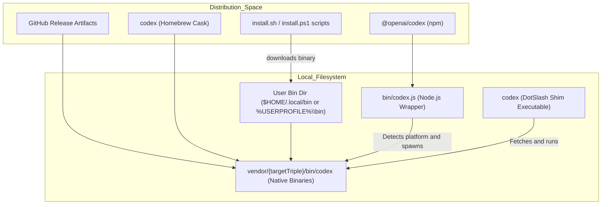
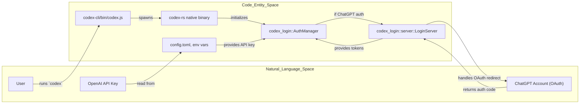

<!-- source: DeepWiki mcp.deepwiki.com · repo openai/codex · page 1.1 Installation and Setup · fetched 2026-10-26 -->

# Installation and Setup

<details>
<summary>Relevant source files</summary>

The following files were used as context for generating this wiki page:

- [.github/actions/linux-code-sign/action.yml](.github/actions/linux-code-sign/action.yml)
- [.github/actions/windows-code-sign/action.yml](.github/actions/windows-code-sign/action.yml)
- [.github/dotslash-config.json](.github/dotslash-config.json)
- [codex-cli/scripts/README.md](codex-cli/scripts/README.md)
- [codex-cli/scripts/build_npm_package.py](codex-cli/scripts/build_npm_package.py)
- [codex-rs/app-server-daemon/Cargo.toml](codex-rs/app-server-daemon/Cargo.toml)
- [codex-rs/app-server-daemon/README.md](codex-rs/app-server-daemon/README.md)
- [codex-rs/app-server-daemon/src/backend/mod.rs](codex-rs/app-server-daemon/src/backend/mod.rs)
- [codex-rs/app-server-daemon/src/backend/pid.rs](codex-rs/app-server-daemon/src/backend/pid.rs)
- [codex-rs/app-server-daemon/src/backend/pid_start.rs](codex-rs/app-server-daemon/src/backend/pid_start.rs)
- [codex-rs/app-server-daemon/src/backend/pid_tests.rs](codex-rs/app-server-daemon/src/backend/pid_tests.rs)
- [codex-rs/app-server-daemon/src/background_command.rs](codex-rs/app-server-daemon/src/background_command.rs)
- [codex-rs/app-server-daemon/src/client.rs](codex-rs/app-server-daemon/src/client.rs)
- [codex-rs/app-server-daemon/src/lib.rs](codex-rs/app-server-daemon/src/lib.rs)
- [codex-rs/app-server-daemon/src/managed_install.rs](codex-rs/app-server-daemon/src/managed_install.rs)
- [codex-rs/app-server-daemon/src/managed_install_path_tests.rs](codex-rs/app-server-daemon/src/managed_install_path_tests.rs)
- [codex-rs/app-server-daemon/src/managed_install_tests.rs](codex-rs/app-server-daemon/src/managed_install_tests.rs)
- [codex-rs/app-server-daemon/src/manual_update.rs](codex-rs/app-server-daemon/src/manual_update.rs)
- [codex-rs/app-server-daemon/src/migration.rs](codex-rs/app-server-daemon/src/migration.rs)
- [codex-rs/app-server-daemon/src/prepare_install.rs](codex-rs/app-server-daemon/src/prepare_install.rs)
- [codex-rs/app-server-daemon/src/prepare_install_tests.rs](codex-rs/app-server-daemon/src/prepare_install_tests.rs)
- [codex-rs/app-server-daemon/src/prepare_install_windows.rs](codex-rs/app-server-daemon/src/prepare_install_windows.rs)
- [codex-rs/app-server-daemon/src/prepare_install_windows_tests.rs](codex-rs/app-server-daemon/src/prepare_install_windows_tests.rs)
- [codex-rs/app-server-daemon/src/release_pruning.rs](codex-rs/app-server-daemon/src/release_pruning.rs)
- [codex-rs/app-server-daemon/src/settings.rs](codex-rs/app-server-daemon/src/settings.rs)
- [codex-rs/app-server-daemon/src/settings_tests.rs](codex-rs/app-server-daemon/src/settings_tests.rs)
- [codex-rs/app-server-daemon/src/update_loop.rs](codex-rs/app-server-daemon/src/update_loop.rs)
- [codex-rs/app-server-daemon/src/update_loop_tests.rs](codex-rs/app-server-daemon/src/update_loop_tests.rs)
- [codex-rs/app-server-transport/src/daemon_shutdown.rs](codex-rs/app-server-transport/src/daemon_shutdown.rs)
- [codex-rs/app-server/tests/suite/v2/otel.rs](codex-rs/app-server/tests/suite/v2/otel.rs)
- [codex-rs/cli/tests/app_server_daemon.rs](codex-rs/cli/tests/app_server_daemon.rs)
- [codex-rs/cli/tests/app_server_daemon_windows.rs](codex-rs/cli/tests/app_server_daemon_windows.rs)
- [codex-rs/cli/tests/daemon_startup.rs](codex-rs/cli/tests/daemon_startup.rs)
- [codex-rs/cli/tests/daemon_telemetry.rs](codex-rs/cli/tests/daemon_telemetry.rs)
- [codex-rs/cli/tests/worktree.rs](codex-rs/cli/tests/worktree.rs)
- [codex-rs/core/tests/suite/cli_stream.rs](codex-rs/core/tests/suite/cli_stream.rs)
- [codex-rs/exec/src/cli.rs](codex-rs/exec/src/cli.rs)
- [codex-rs/exec/src/cli_tests.rs](codex-rs/exec/src/cli_tests.rs)
- [codex-rs/exec/tests/suite/mod.rs](codex-rs/exec/tests/suite/mod.rs)
- [codex-rs/exec/tests/suite/resume.rs](codex-rs/exec/tests/suite/resume.rs)
- [codex-rs/exec/tests/suite/seatbelt.rs](codex-rs/exec/tests/suite/seatbelt.rs)
- [codex-rs/tui/src/cli.rs](codex-rs/tui/src/cli.rs)
- [codex-rs/tui/src/daemon_startup.rs](codex-rs/tui/src/daemon_startup.rs)
- [codex-rs/tui/src/daemon_startup_tests.rs](codex-rs/tui/src/daemon_startup_tests.rs)
- [codex-rs/tui/src/daemon_telemetry.rs](codex-rs/tui/src/daemon_telemetry.rs)
- [codex-rs/tui/src/startup_orchestration.rs](codex-rs/tui/src/startup_orchestration.rs)
- [codex-rs/utils/cli/src/shared_options.rs](codex-rs/utils/cli/src/shared_options.rs)
- [scripts/install/install.ps1](scripts/install/install.ps1)
- [scripts/install/install.sh](scripts/install/install.sh)
- [scripts/install/test_install_sh.py](scripts/install/test_install_sh.py)
- [scripts/stage_npm_packages.py](scripts/stage_npm_packages.py)
- [sdk/typescript/README.md](sdk/typescript/README.md)
- [sdk/typescript/src/codex.ts](sdk/typescript/src/codex.ts)
- [sdk/typescript/src/codexOptions.ts](sdk/typescript/src/codexOptions.ts)
- [sdk/typescript/src/exec.ts](sdk/typescript/src/exec.ts)
- [sdk/typescript/src/index.ts](sdk/typescript/src/index.ts)
- [sdk/typescript/src/thread.ts](sdk/typescript/src/thread.ts)
- [sdk/typescript/src/threadOptions.ts](sdk/typescript/src/threadOptions.ts)
- [sdk/typescript/tests/exec.test.ts](sdk/typescript/tests/exec.test.ts)
- [sdk/typescript/tests/run.test.ts](sdk/typescript/tests/run.test.ts)
- [sdk/typescript/tests/testCodex.ts](sdk/typescript/tests/testCodex.ts)

</details>


This page covers installing Codex CLI, authenticating, and performing initial configuration. Codex is a coding agent from OpenAI that runs locally on your computer [README.md:1](). It is distributed as a native binary through npm, Homebrew, direct download, or shell installation scripts [README.md:14-49]().

## System Requirements

**Supported Platforms:**

| Operating System | Details |
|---|---|
| **macOS** | macOS 12+ (Apple Silicon / arm64 and x86_64) [README.md:57-59](), [docs/install.md:7]() |
| **Linux** | Ubuntu 20.04+ / Debian 10+ (x86_64 and arm64 via MUSL) [README.md:60-62](), [docs/install.md:7]() |
| **Windows** | Windows 11 **via WSL2** (Recommended) [docs/install.md:7]() or Native x86_64/arm64 [README.md:22-26]() |

**Resource Requirements:**

- **RAM:** 4 GB minimum (8 GB recommended) [docs/install.md:9]().

**Development Requirements:**

- **Node.js:** >= 22 (for workspace maintenance) [package.json:35]() or >= 16 (for CLI packaging) [codex-cli/package.json:11]().

- **Rust:** 1.85+ (standard for the `codex-rs` workspace) [AGENTS.md:24]().

- **pnpm:** v10.34.5+ (used for workspace dependency management) [package.json:38](), [pnpm-lock.yaml:21]().

Sources: [README.md:57-62](), [codex-cli/package.json:10-22](), [package.json:34-39](), [docs/install.md:5-10](), [pnpm-lock.yaml:21]()

---

## Installation Methods

### Standalone Install Scripts

The official installation scripts are the primary entry point for users. They default to downloading from `releases.openai.com` and fall back to GitHub Releases if the primary source is unavailable. The install scripts handle platform detection, fallback URLs, timeout settings, and download verification for complete and safe installation of the `codex` binary [scripts/install/install.sh:1-247](), [scripts/install/install.ps1:1-195]().

- **Mac/Linux (Shell):**

  ```shell
  curl -fsSL https://chatgpt.com/codex/install.sh | sh
  ```

  To force downloads from GitHub Releases explicitly, set:

  ```shell
  CODEX_INSTALLER_USE_RELEASES_OPENAI_COM=false curl -fsSL https://chatgpt.com/codex/install.sh | sh
  ```

- **Windows (PowerShell):**

  ```powershell
  powershell -ExecutionPolicy ByPass -c "irm https://chatgpt.com/codex/install.ps1 | iex"
  ```

  To force GitHub Releases explicitly:

  ```powershell
  $env:CODEX_INSTALLER_USE_RELEASES_OPENAI_COM='false'; irm https://chatgpt.com/codex/install.ps1 | iex
  ```

These scripts install Codex binaries into user-writeable directories such as `$HOME/.local/bin` (Unix) or `%USERPROFILE%\bin` (Windows). They also manage version normalization, validation, and fallback handling for download URLs [scripts/install/install.sh:1-247](), [scripts/install/install.ps1:1-195]().

Sources: [scripts/install/install.sh:1-247](), [scripts/install/install.ps1:1-195]()

---

### Package Managers

- **npm**

  The `@openai/codex` npm package acts as a shim wrapping native binaries per platform. The included `bin/codex.js` script dynamically detects the user's OS and CPU architecture at runtime, then spawns the corresponding native binary from `vendor/{targetTriple}/bin/codex` folder, enabling one package to support multiple platforms transparently [scripts/codex_package/cli.py:1-205](), [codex-cli/package.json:1-22]().

  Install with:

  ```shell
  npm install -g @openai/codex
  ```

- **Homebrew**

  For macOS users, install via the cask:

  ```shell
  brew install --cask codex
  ```

  This installs the native executable directly for supported macOS versions [README.md:46-48]().

The package managers ease installation, update management, and platform detection compared to direct downloads.

Sources: [README.md:38-49](), [codex-cli/package.json:1-22](), [scripts/codex_package/cli.py:1-205]()

---

### Direct Binary and DotSlash Distribution

Prebuilt binary archives for various platforms are available on GitHub Releases. For example:

| Target Triple                 | Archive Filename                             |
|------------------------------|---------------------------------------------|
| `aarch64-apple-darwin`        | `codex-package-aarch64-apple-darwin.tar.zst` |
| `x86_64-apple-darwin`         | `codex-package-x86_64-apple-darwin.tar.zst`  |
| `x86_64-unknown-linux-musl`   | `codex-package-x86_64-unknown-linux-musl.tar.zst` |
| `aarch64-unknown-linux-musl`  | `codex-package-aarch64-unknown-linux-musl.tar.zst` |

Users can manually extract these archives and rename the executable `codex` for local use [scripts/codex_package/README.md:1-101](), [README.md:53-65]().

Additionally, the repository offers a **DotSlash** distribution, a minimal portable shim executable named `codex`. This shim automatically fetches and executes the correct native binary on-demand, ensuring consistent CLI usage without full installation overhead. It is useful for cross-platform teams to commit a lightweight executable that manages platform-specific binaries transparently [scripts/codex_package/dotslash.py:1-136](), [docs/install.md:11-14]().

Sources: [scripts/codex_package/README.md:1-101](), [README.md:53-65](), [docs/install.md:11-14](), [.github/dotslash-config.json:1-136]()

---

## Authentication Setup

Codex requires authentication to access AI services. The recommended method is authenticating with your ChatGPT account, providing access under Plus, Pro, Business, Edu, or Enterprise plans using an OAuth flow. Alternatively, users can manually provide an API key via environment variables or config [README.md:68-72]().

### Authentication Modes

| Mode        | User Action/Configuration              | Notes                                                      |
|-------------|--------------------------------------|------------------------------------------------------------|
| **ChatGPT** | Run `codex` and select "Sign in"    | Browser-based OAuth login; uses a local OAuth callback server on localhost:1455. Recommended. |
| **API Key** | Set `CODEX_API_KEY` environment variable or config | Manual provisioning. Requires copying API key into env/config. |

The ChatGPT login flow starts a local HTTP server on port 1455 which listens for OAuth redirect callbacks. It opens the default browser for user authentication, then securely exchanges the authorization code for tokens via PKCE. The flow manages token refresh and stores access tokens securely. The CLI integrates this authentication management during runtime [codex-rs/login/src/server.rs:113-190](), [codex-rs/cli/src/login.rs:140-168]().

Sources: [README.md:68-72](), [codex-rs/login/src/server.rs:113-190](), [codex-rs/cli/src/login.rs:140-168]()

---

### Internal Authentication Components

Authentication implementation primarily resides in the `codex-login` Rust crate, which organizes auth workflow, credential storage, and token lifecycle:

- **`CodexAuth` enum**: Models different authentication forms including API key, ChatGPT OAuth tokens, Bedrock-style credentials, personal tokens, and Agent identities [codex-rs/login/src/auth/manager.rs:75-86]().

- **`AuthManager` struct**: Coordinates login/logout processes, triggers token refresh, and persists credentials securely using pluggable storage backends [codex-rs/login/src/auth/manager.rs:40-70]().

- **Auth Storage Backends**: The `AuthStorageBackend` trait abstracts storage, with concrete implementations supporting local file storage or platform-specific secure stores (e.g., OS keyrings). The crate API `create_auth_storage` facilitates appropriate backend selection [codex-rs/login/src/auth/storage.rs]().

- **OAuth Callback Server (`LoginServer`)**: Runs a local HTTP listener to handle OAuth redirects for PKCE. Interfaces with the CLI binary for interprocess token handoff [codex-rs/login/src/server.rs:113-144]().

Sources: [codex-rs/login/src/auth/manager.rs:1-192](), [codex-rs/login/src/server.rs:113-190](), [codex-rs/login/src/auth/storage.rs]()

---

## Installation and Authentication Data Flow Diagrams

### Installation Distribution and Execution Flow



This diagram maps the user-facing installation methods—standalone install scripts, the npm package, Homebrew cask, direct GitHub releases, and the DotSlash shim—to their final deployment on the user's system filesystem and executable invocation. The `codex.js` Node.js launcher dynamically selects and spawns the platform-appropriate native binary at runtime [scripts/codex_package/cli.py:1-205](), [README.md:14-65](), [codex-cli/bin/codex.js:16-110](), [docs/install.md:11-14]().

Sources: [README.md:14-65](), [codex-cli/bin/codex.js:16-110](), [scripts/codex_package/cli.py:1-205](), [docs/install.md:11-14]()

---

### Authentication Flow and Runtime Initialization



Users launch Codex through the JavaScript wrapper `codex.js`, which spawns the native binary containing the core logic. At runtime, the `AuthManager` component from the `codex_login` crate orchestrates authentication state by integrating OAuth tokens obtained via ChatGPT sign-in or API key authentication configured via environment variables or config files. The `LoginServer` handles the OAuth callback flow. The layered configuration system funnels auth parameters securely into the native binary's runtime session [README.md:68-72](), [codex-cli/bin/codex.js:195-198](), [codex-rs/login/src/lib.rs:1-68](), [codex-rs/login/src/server.rs:113-190]().

Sources: [README.md:68-72](), [codex-cli/bin/codex.js:195-198](), [codex-rs/login/src/lib.rs:1-68](), [codex-rs/login/src/server.rs:113-190]()

---

## Development and Environment Setup

### Development Tools

Codex development uses the Rust workspace alongside Node.js tooling; essential tools include:

- **just**: Task runner for commands like build, test, and lint [`justfile:1-190`]().

- **cargo-nextest**: Parallel test runner to improve Rust test performance.

- **Rust toolchain**: Includes `rustfmt` and `clippy` for code formatting and linting [docs/install.md:25-26]().

### Building from Source

Typical source build steps:

```bash
git clone https://github.com/openai/codex.git
cd codex/codex-rs
cargo build
cargo run --bin codex -- "explain this codebase"
```

### Nix and Devcontainer Profiles

The repository provides [Nix](https://nixos.org) build support through `flake.nix` and `codex-rs/default.nix` defining pinned Rust, Node, and tooling versions. Visual Studio Code devcontainer profiles under `.devcontainer/` include `codex-install` which prepares a fresh environment replicating install conditions for testing install workflows [codex-rs/default.nix:1-55](), [.devcontainer/codex-install/package.json:1-5]().

Sources: [justfile:1-190](), [docs/install.md:17-38](), [codex-rs/default.nix:1-55](), [AGENTS.md:1-67]()

---

# Summary

This document described:

- Codex installation via standalone shell/PowerShell scripts that detect platform and fetch verified binaries.
- Packaging methods through npm with dynamic native binary spawning or Homebrew cask for macOS.
- Manual direct binary downloads from GitHub Releases and the DotSlash shim for portable on-demand execution.
- Authentication workflows including ChatGPT OAuth-based login or manual API key configuration handled by the `codex-login` crate at runtime.
- Development setup with Rust, Node.js, just, cargo-nextest, and reproducible devcontainers.

Two detailed diagrams illustrate the relationships between installation methods and executables on disk, and the authentication flow from user actions through code components at runtime.

---

**Sources:**  
[README.md:1-78](), [codex-cli/package.json:1-22](), [codex-cli/bin/codex.js:16-110](), [docs/install.md:5-38](), [scripts/install/install.sh:1-247](), [scripts/install/install.ps1:1-195](), [scripts/codex_package/cli.py:1-205](), [codex-rs/login/src/auth/manager.rs:1-192](), [codex-rs/login/src/server.rs:113-190](), [codex-rs/cli/src/login.rs:10-180](), [justfile:1-190](), [codex-rs/default.nix:1-55](), [AGENTS.md:1-67]()

---

