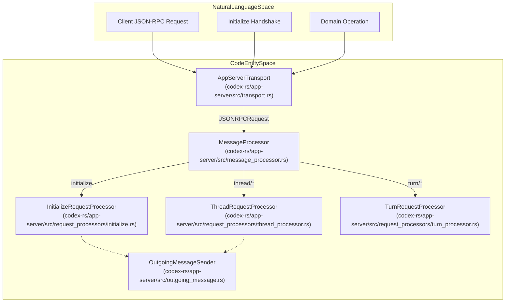
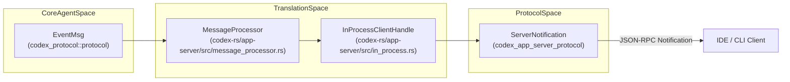
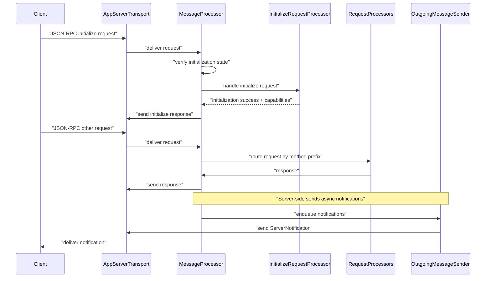
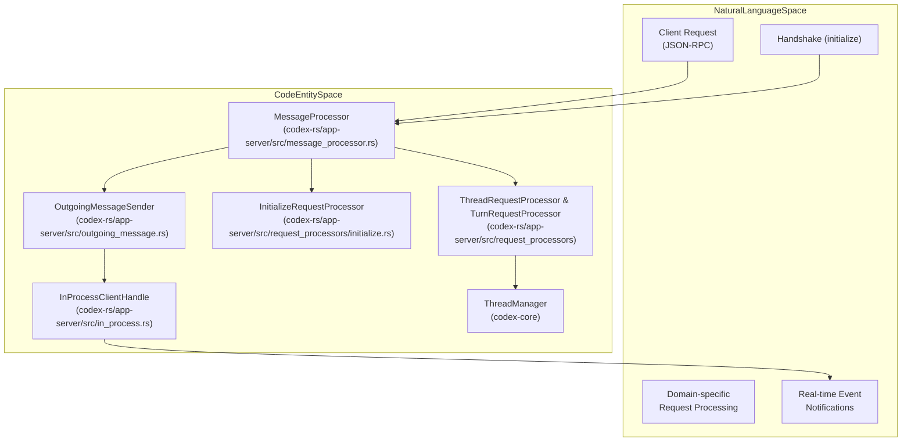

<!-- source: DeepWiki mcp.deepwiki.com · repo openai/codex · extra page CodexMessageProcessor and Request Handling · fetched 2026-10-26 -->

# CodexMessageProcessor and Request Handling

Relevant source files

The following files were used as context for generating this wiki page:

- [codex-rs/analytics/src/client.rs](codex-rs/analytics/src/client.rs)
- [codex-rs/analytics/src/client_tests.rs](codex-rs/analytics/src/client_tests.rs)
- [codex-rs/analytics/src/events.rs](codex-rs/analytics/src/events.rs)
- [codex-rs/analytics/src/facts.rs](codex-rs/analytics/src/facts.rs)
- [codex-rs/analytics/src/lib.rs](codex-rs/analytics/src/lib.rs)
- [codex-rs/analytics/src/reducer.rs](codex-rs/analytics/src/reducer.rs)
- [codex-rs/app-server-client/Cargo.toml](codex-rs/app-server-client/Cargo.toml)
- [codex-rs/app-server-client/src/lib.rs](codex-rs/app-server-client/src/lib.rs)
- [codex-rs/app-server-client/src/remote.rs](codex-rs/app-server-client/src/remote.rs)
- [codex-rs/app-server-protocol/schema/json/ClientRequest.json](codex-rs/app-server-protocol/schema/json/ClientRequest.json)
- [codex-rs/app-server-protocol/schema/json/ServerNotification.json](codex-rs/app-server-protocol/schema/json/ServerNotification.json)
- [codex-rs/app-server-protocol/schema/json/codex_app_server_protocol.schemas.json](codex-rs/app-server-protocol/schema/json/codex_app_server_protocol.schemas.json)
- [codex-rs/app-server-protocol/schema/json/codex_app_server_protocol.v2.schemas.json](codex-rs/app-server-protocol/schema/json/codex_app_server_protocol.v2.schemas.json)
- [codex-rs/app-server-protocol/schema/precomputed/app-server-exports-experimental.json.zst](codex-rs/app-server-protocol/schema/precomputed/app-server-exports-experimental.json.zst)
- [codex-rs/app-server-protocol/schema/precomputed/app-server-exports-stable.json.zst](codex-rs/app-server-protocol/schema/precomputed/app-server-exports-stable.json.zst)
- [codex-rs/app-server-protocol/schema/typescript/ClientRequest.ts](codex-rs/app-server-protocol/schema/typescript/ClientRequest.ts)
- [codex-rs/app-server-protocol/schema/typescript/v2/index.ts](codex-rs/app-server-protocol/schema/typescript/v2/index.ts)
- [codex-rs/app-server-protocol/src/protocol/common.rs](codex-rs/app-server-protocol/src/protocol/common.rs)
- [codex-rs/app-server-protocol/src/protocol/v2/tests.rs](codex-rs/app-server-protocol/src/protocol/v2/tests.rs)
- [codex-rs/app-server-protocol/src/protocol/v2/thread.rs](codex-rs/app-server-protocol/src/protocol/v2/thread.rs)
- [codex-rs/app-server/README.md](codex-rs/app-server/README.md)
- [codex-rs/app-server/src/in_process.rs](codex-rs/app-server/src/in_process.rs)
- [codex-rs/app-server/src/lib.rs](codex-rs/app-server/src/lib.rs)
- [codex-rs/app-server/src/message_processor.rs](codex-rs/app-server/src/message_processor.rs)
- [codex-rs/app-server/src/message_processor_tracing_tests.rs](codex-rs/app-server/src/message_processor_tracing_tests.rs)
- [codex-rs/app-server/src/outgoing_message.rs](codex-rs/app-server/src/outgoing_message.rs)
- [codex-rs/app-server/src/request_processors.rs](codex-rs/app-server/src/request_processors.rs)
- [codex-rs/app-server/src/request_processors/thread_lifecycle.rs](codex-rs/app-server/src/request_processors/thread_lifecycle.rs)
- [codex-rs/app-server/src/request_processors/thread_processor.rs](codex-rs/app-server/src/request_processors/thread_processor.rs)
- [codex-rs/app-server/src/thread_state.rs](codex-rs/app-server/src/thread_state.rs)
- [codex-rs/app-server/tests/suite/v2/analytics.rs](codex-rs/app-server/tests/suite/v2/analytics.rs)
- [codex-rs/app-server/tests/suite/v2/mod.rs](codex-rs/app-server/tests/suite/v2/mod.rs)
- [codex-rs/app-server/tests/suite/v2/thread_fork.rs](codex-rs/app-server/tests/suite/v2/thread_fork.rs)
- [codex-rs/app-server/tests/suite/v2/thread_resume.rs](codex-rs/app-server/tests/suite/v2/thread_resume.rs)
- [codex-rs/app-server/tests/suite/v2/thread_start.rs](codex-rs/app-server/tests/suite/v2/thread_start.rs)
- [codex-rs/app-server/tests/suite/v2/thread_unsubscribe.rs](codex-rs/app-server/tests/suite/v2/thread_unsubscribe.rs)
- [codex-rs/app-server/tests/suite/v2/turn_start.rs](codex-rs/app-server/tests/suite/v2/turn_start.rs)
- [sdk/python/src/openai_codex/generated/v2_all.py](sdk/python/src/openai_codex/generated/v2_all.py)

## Purpose and Scope

This page documents the request handling architecture of the Codex app-server, centered around `MessageProcessor`. It covers the full pipeline from incoming JSON-RPC messages to domain handler invocation, including initialization handshakes, bidirectional communication via `OutgoingMessageSender`, and event translation.

Sources: [codex-rs/app-server/src/message_processor.rs:137-160](), [codex-rs/app-server/src/lib.rs:93-134]()

---

## Request Pipeline and Architecture

The Codex app-server acts as a JSON-RPC server, accepting requests from clients (such as IDEs, CLI tools, or web apps). Incoming requests flow through a multi-layered architecture with clear separation of concerns:

- The **Transport Layer** manages bidirectional communication, supporting multiple protocols including stdio and WebSocket [codex-rs/app-server/src/lib.rs:46-49]().
- The **`MessageProcessor`** is the primary entrypoint per-connection, handling message deserialization, validation, dispatch, and serialization concerns [codex-rs/app-server/src/message_processor.rs:143-160]().
- Requests are routed to **domain-specific Request Processors** specialized by namespace prefixes (`thread/*`, `turn/*`, `config/*`, etc.) to separate concerns such as workspace management, environment controls, and plugin interactions [codex-rs/app-server/src/message_processor.rs:28-52]().

The following diagram illustrates the routing and association of system components to code entities, bridging natural language concepts to concrete code identifiers:

Sources: [codex-rs/app-server/src/message_processor.rs:137-164](), [codex-rs/app-server/src/lib.rs:93-134]()

---

## `MessageProcessor` and Initialization Handshake

The `MessageProcessor` struct is the core per-connection handler responsible for accepting, validating, and delegating JSON-RPC requests. It manages the entire client session lifecycle within the app-server process [codex-rs/app-server/src/message_processor.rs:140-160]().

### Initialization Handshake

Before any other request is processed, the client must send the `initialize` method request. The handshake enforces:

1. **Initial Request Requirement:** Any non-`initialize` request received before successful initialization results in a `"Not initialized"` JSON-RPC error response [codex-rs/app-server/src/message_processor.rs:112-117]().
2. **Capability Negotiation:** The client specifies capabilities (e.g., opting into experimental APIs, notification filtering, extended MCP form elicitation support) in the `InitializeParams` payload [codex-app-server-client/src/remote.rs:94-116](). This information influences runtime behavior such as feature gating and notification management.
3. **Obsolete Field Validation:** The processor explicitly rejects deprecated fields like `permissionProfile` replacing it with the new `permissions` system on thread and turn start requests to avoid client-server incompatibility [codex-rs/app-server/src/message_processor.rs:118-141]().

The state is tracked internally in `MessageProcessor` to gate request handling until the initialization completes.

**Key Initialization Fields and Usage**

| Field | Purpose |
| :--- | :--- |
| `experimental_api` | Opts into experimental API features with explicit gating [codex-app-server-client/src/remote.rs:97-97]() |
| `opt_out_notification_methods` | Allows client to suppress specific server notification categories [codex-app-server-client/src/remote.rs:100-104]() |
| `mcp_server_openai_form_elicitation` | Indicates client support for extended MCP form elicitation [codex-app-server-client/src/remote.rs:105-105]() |

Sources: [codex-rs/app-server/src/message_processor.rs:106-141](), [codex-app-server-client/src/remote.rs:92-115]()

---

## Bidirectional Communication and `OutgoingMessageSender`

The protocol implemented by the Codex app-server supports asynchronous two-way communication. While clients send requests, the server may asynchronously send notifications or elicitations back to clients — for example, prompting for tool approval or requesting user input [codex-rs/app-server/src/lib.rs:174-192]().

### `OutgoingMessageSender`

The `OutgoingMessageSender` is a central hub managing outbound message routing to one or multiple connected clients [codex-rs/app-server/src/message_processor.rs:143-146]().

- It maintains per-connection state such as:
  - Whether the connection is initialized [codex-rs/app-server/src/lib.rs:189-189]()
  - Experimental API enablement flags [codex-rs/app-server/src/lib.rs:190-190]()
  - Set of suppressed notification methods for that connection [codex-rs/app-server/src/lib.rs:191-191]()
- Outgoing messages are dispatched through the transport layer using routing primitives [codex-rs/app-server/src/lib.rs:45-46]().

### Connection Tracking and Lifecycle

Connections are tracked with unique `ConnectionId`s [codex-rs/app-server/src/outgoing_message.rs:22-22](). The server coordinates connection lifecycle events via `OutboundControlEvent::Opened` (registering new connections) and other control events to properly manage routing and shutdown scenarios [codex-rs/app-server/src/lib.rs:183-192]().

Sources: [codex-rs/app-server/src/message_processor.rs:138-158](), [codex-rs/app-server/src/lib.rs:170-192]()

---

## Request Serialization and Scoping

To prevent race conditions or inconsistent state mutations, certain categories of requests require strict serialization:

- The `RequestSerializationQueues` structure handles per-scope queuing keyed by `RequestSerializationQueueKey` [codex-rs/app-server/src/message_processor.rs:54-56]().
- Scope can be global, per-thread, per-process, or other contextual identifiers to ensure correctness for commands that mutate shared resources.

For example, starting multiple requests on the same thread resources will be serialized, while unrelated requests can proceed concurrently. In embedded or in-process scenarios, these semantics are preserved using bounded in-memory queues instead of sockets (`InProcessClientHandle`), allowing local clients to communicate efficiently with the app-server [codex-rs/app-server/src/in_process.rs:1-39]().

Sources: [codex-rs/app-server/src/message_processor.rs:52-56](), [codex-rs/app-server/src/in_process.rs:1-39]()

---

## Event Translation and Handling

Internal events generated by the Codex core agent (`codex-core`) and related subsystems are conveyed to clients as JSON-RPC notifications through the app-server.

### Event Flow Overview

The event flow chain is as follows:

1. **Core Agent Events**: Core generates domain events, e.g., thread status updates, turn completions [codex-thread-store:1-98]().
2. **`MessageProcessor`**: Receives these events and translates them to protocol-compliant `ServerNotification` messages [codex-rs/app-server/src/in_process.rs:71-82]().
3. **`InProcessClientHandle` or Transport Layer**: Enqueue and send these notifications asynchronously to clients [codex-rs/app-server/src/in_process.rs:26-33]().
4. **Client Receives Notifications**: IDE or CLI clients receive and handle these notifications for UI updates or further actions [codex-app-server-client/src/lib.rs:102-107]().

Sources: [codex-rs/app-server/src/in_process.rs:71-82](), [codex-app-server-client/src/lib.rs:97-107]()

---

## Concurrency, Backpressure, and Shutdown

The server employs several mechanisms to ensure robustness under load or slow client conditions:

- **Bounded Queues:** Transport and processing queues have fixed capacity (`CHANNEL_CAPACITY`), preventing unbounded memory growth [codex-rs/app-server/src/in_process.rs:107-110]().
- **Saturation Handling:** When queues fill, new requests can be rejected with a JSON-RPC overloaded error code to signal clients to retry or back off [codex-rs/app-server/src/in_process.rs:28-32]().
- **Graceful Restart:** On server restart, open connections may be disconnected cleanly to ensure fresh startup state [codex-rs/app-server/src/lib.rs:174-192]().
- **Shutdown Timeout:** During graceful shutdown, the server waits up to 30 seconds (`CONNECTION_RPC_DRAIN_TIMEOUT`) for all connections to drain outstanding requests before force termination [codex-rs/app-server/src/message_processor.rs:110-110]().

Sources: [codex-rs/app-server/src/lib.rs:170-192](), [codex-rs/app-server/src/message_processor.rs:110-110](), [codex-rs/app-server/src/in_process.rs:26-33]()

---

## Detailed Data Flow for Request Handling and Initialization

Sources: [codex-rs/app-server/src/message_processor.rs:28-60](), [codex-rs/app-server/src/lib.rs:45-49](), [codex-rs/app-server/src/outgoing_message.rs:22-25]()

---

## Summary Diagram Bridging Natural Language to Code Entities

Sources: [codex-rs/app-server/src/message_processor.rs:137-160](), [codex-rs/app-server/src/outgoing_message.rs:22-25](), [codex-rs/app-server/src/in_process.rs:1-40]()

---

## Sources

- [codex-rs/app-server/src/message_processor.rs:1-160]()
- [codex-rs/app-server/src/lib.rs:45-192]()
- [codex-app-server-client/src/remote.rs:92-116]()
- [codex-rs/app-server/src/in_process.rs:1-110]()
- [codex-rs/app-server/src/outgoing_message.rs:22-25]()

---

