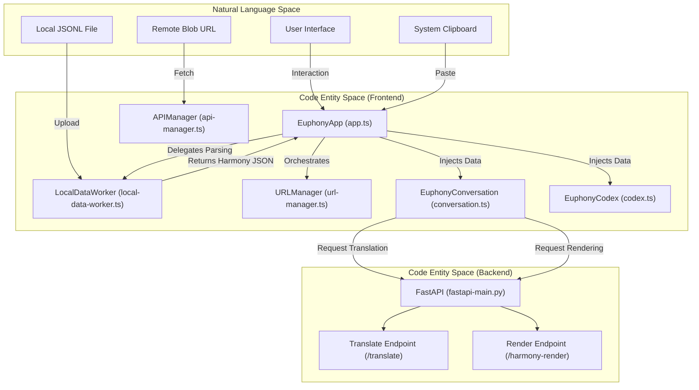
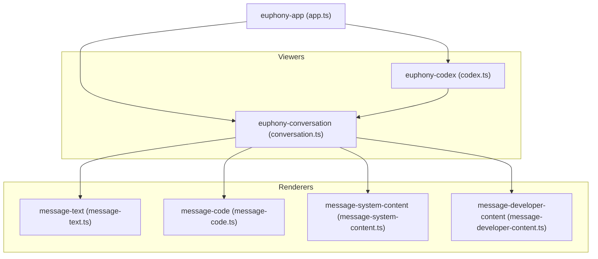

<!-- source: DeepWiki mcp.deepwiki.com · repo openai/euphony · page 2 Architecture · fetched 2026-10-26 -->

# Architecture

Relevant source files

The following files were used as context for generating this wiki page:

- [src/components/app/app.ts](src/components/app/app.ts)
- [src/config/config.ts](src/config/config.ts)
- [src/euphony.ts](src/euphony.ts)

Euphony is built as a modular, web-component-based system designed to visualize complex conversation data (Harmony) and session logs (Codex). The architecture follows a layered approach, separating the UI orchestration, data processing, and optional backend services.

## System Overview

The system is composed of three primary layers:
1.  **The App Shell**: A [LitElement](https://lit.dev) application that manages global state, routing via URL parameters, and high-level data orchestration [src/components/app/app.ts:128-128]().
2.  **The Data Pipeline**: A multi-threaded system using Web Workers to parse large datasets off the main thread, ensuring a responsive UI [src/components/app/app.ts:35-37]().
3.  **The Backend (Optional)**: A FastAPI server that provides advanced features like SSRF-safe data fetching, conversation translation, and server-side rendering (SSR) for Harmony tokens [server/fastapi-main.py:1-25]().

### High-Level Component Relationship

The following diagram illustrates how the core entities interact to transform raw data into a rendered conversation.

**Diagram: Data Flow and Entity Mapping**

**Sources:** [src/components/app/app.ts:128-202](), [src/utils/api-manager.ts:15-20](), [server/fastapi-main.py:1-30]()

---

## Core Layers

### App Shell and Data Pipeline
The `EuphonyApp` class acts as the central controller. It manages the `DataType` (CONVERSATION, CODEX, or JSON) [src/components/app/app.ts:74-78]() and coordinates between the `URLManager` for state persistence and the `LocalDataWorker` for heavy lifting.

*   **URL Management**: Synchronizes the current conversation index and message sub-index with the browser's URL hash and query parameters [src/components/app/app.ts:106-121]().
*   **Worker Orchestration**: Uses `LocalDataWorker` to parse JSONL files in the background to prevent UI jank [src/components/app/app.ts:35-36]().

For details, see [App Shell and Data Pipeline](#2.1).

### FastAPI Backend Server
While Euphony can run in a "Frontend-Only" mode, the FastAPI backend enables features that require server-side logic or bypass CORS restrictions.

*   **Data Proxying**: The `/blob-jsonl/` endpoint allows fetching data from external URLs safely [server/fastapi-main.py:1-25]().
*   **Translation**: Integrates with LLMs to translate conversation messages via the `/translate/` endpoint [server/fastapi-main.py:1-25]().
*   **Harmony Rendering**: Supports server-side tokenization and rendering of specialized Harmony content types [server/fastapi-main.py:1-25]().

For details, see [FastAPI Backend Server](#2.2).

### Library Entry Point and Public API
Euphony is designed to be consumed either as a standalone application or as a library of web components. The `src/euphony.ts` file serves as the main entry point, exporting all necessary components and types [src/euphony.ts:1-14]().

*   **Exports**: Includes viewers like `EuphonyConversation` and `EuphonyCodex`, as well as individual message renderers [src/euphony.ts:2-8]().
*   **Builds**: The library build produces a bundled JavaScript file and TypeScript definitions in the `lib/` directory.

For details, see [Library Entry Point and Public API](#2.3).

---

## Component Architecture

Euphony uses a tree of custom elements. The `EuphonyApp` contains a grid of viewer components, which in turn contain specific message renderers based on the content type.

**Diagram: Component Hierarchy**

**Sources:** [src/euphony.ts:1-8](), [src/components/app/app.ts:55-65]()

**Sources:**
- [src/components/app/app.ts:1-202]()
- [src/euphony.ts:1-14]()
- [src/utils/api-manager.ts:15-20]()
- [src/config/config.ts:1-11]()

---

