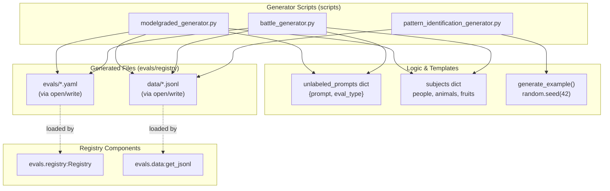
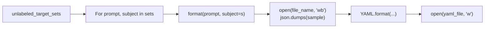

<!-- source: DeepWiki mcp.deepwiki.com · repo openai/evals · page 7.3 Generator Scripts · fetched 2026-10-26 -->

# Generator Scripts

<details>
<summary>Relevant source files</summary>

The following files were used as context for generating this wiki page:

- [evals/cli/oaievalset.py](evals/cli/oaievalset.py)
- [evals/data.py](evals/data.py)
- [evals/data_test.py](evals/data_test.py)
- [evals/record.py](evals/record.py)
- [evals/record_test.py](evals/record_test.py)
- [evals/utils/misc.py](evals/utils/misc.py)
- [mypy.ini](mypy.ini)
- [scripts/battle_generator.py](scripts/battle_generator.py)
- [scripts/modelgraded_generator.py](scripts/modelgraded_generator.py)
- [scripts/pattern_identification_generator.py](scripts/pattern_identification_generator.py)

</details>


This document describes the automated generator scripts that create evaluation configurations and data files at scale. These scripts enable rapid creation of multiple evaluations by programmatically generating JSONL data files and corresponding YAML registry configurations.

For manual data preparation techniques, see [Data Preparation](#7.1). For details on YAML configuration structure, see [Registry Configuration](#7.2). For implementing custom evaluation logic, see [Custom Evaluation Implementation](#6.4).

## Purpose and Scope

The generator scripts in the `scripts/` directory automate the creation of evaluation configurations and data files. Rather than manually writing JSONL samples and YAML configurations for each evaluation variant, these scripts programmatically generate hundreds or thousands of samples from templates, then output both the data files and registry configurations.

The framework provides three main generator patterns:

1.  **Model-Graded Generators** - Create evaluations where an LLM judges outputs.
2.  **Task Generators** - Create synthetic task datasets with programmatic ground truth.
3.  **Battle Generators** - Create comparison evaluations between two model outputs.

## Overview of Generator Architecture

### System to Code Mapping
The following diagram bridges the logical generation process with the specific scripts and registry locations.

Title: Generator Data Flow and Code Entity Mapping

Sources: [scripts/modelgraded_generator.py:6-218](), [scripts/pattern_identification_generator.py:7-70](), [scripts/battle_generator.py:1-75](), [evals/data.py:120-133](), [evals/registry.py:1-20]()

## Common Patterns

### Template Formatting Function

All generator scripts use a common pattern for safe template string substitution with validation:

```python
def format(template: str, **kwargs: str) -> str:
    """Format a template string with kwargs."""
    keys = [k[1] for k in string.Formatter().parse(template) if k[1]]
    assert all(k in kwargs for k in keys), f"Required: {keys}, got: {sorted(kwargs)}"
    cur_keys = {k: kwargs[k] for k in keys}
    return template.format(**cur_keys)
```

This function:
1.  Parses the template to extract placeholder names using `string.Formatter().parse()`.
2.  Validates that all required `kwargs` are provided.
3.  Filters `kwargs` to only those needed by the template.
4.  Safely performs string formatting.

Sources: [scripts/modelgraded_generator.py:9-14](), [scripts/battle_generator.py:13-18]()

### YAML Template Structure

Generators define YAML templates as multi-line strings that follow the registry format. These templates use `{placeholder}` syntax for programmatic substitution.

```python
YAML = """
mg-{prompt_name}-{subject}:
  id: mg-{prompt_name}-{subject}.dev.v0
  metrics: [accuracy]
mg-{prompt_name}-{subject}.dev.v0:
  class: evals.elsuite.modelgraded.classify:ModelBasedClassify
  args:
    samples_jsonl: test_modelgraded/{prompt_name}_{subject}.jsonl
    eval_type: {eval_type}
    modelgraded_spec: {modelgraded_spec}
""".strip()
```

Sources: [scripts/modelgraded_generator.py:18-28](), [scripts/battle_generator.py:21-31]()

## Model-Graded Generator

The `modelgraded_generator.py` script creates evaluations where an LLM evaluates the quality of another model's output on subjective criteria.

### Configuration Structure

**Prompt Definitions:**
`unlabeled_prompts` defines prompts with their evaluation specifications. Each prompt includes a `modelgraded_spec` (referencing a YAML spec), a template `prompt`, and an `eval_type` (e.g., `cot_classify_jp`).

Sources: [scripts/modelgraded_generator.py:31-37]()

**Subject Lists:**
`subjects` defines lists for template substitution. The script removes duplicates using a set comprehension at [scripts/modelgraded_generator.py:175]().

Sources: [scripts/modelgraded_generator.py:40-173]()

**Target Sets:**
`unlabeled_target_sets` specifies which prompt-subject combinations to generate.

Sources: [scripts/modelgraded_generator.py:178-180]()

### Generation Process

Title: Model-Graded Generation Logic

Sources: [scripts/modelgraded_generator.py:188-214]()

### Output Structure

**Generated JSONL:**
Files are written with UTF-8 encoding at [scripts/modelgraded_generator.py:193-197](). Each line contains a sample with an `input` field.

**Generated YAML:**
The output is written to `evals/registry/evals/test-modelgraded-generated.yaml`.

Sources: [scripts/modelgraded_generator.py:211-214]()

## Pattern Identification Generator

The `pattern_identification_generator.py` script creates synthetic task datasets where models must identify patterns from examples.

### Task Structure

The task tests whether a model can identify that outputs depend on whether a target symbol appears in a list.

**Pattern Rule:**
*   If `target_symbol` in `symbol_list` → output "foo"
*   Otherwise → output "bar"

### Generation Components

**Single Example Generation:**
`generate_example()` creates one example using `random.choice` and `random.sample`.

Sources: [scripts/pattern_identification_generator.py:23-28]()

**Exemplar String Generation:**
`generate_exemplars_str()` creates multiple examples as context, prepending the `INSTRUCTION`.

Sources: [scripts/pattern_identification_generator.py:32-38]()

**Full Evaluation Set:**
`generate_eval_examples()` generates 250 test examples by combining exemplars with a final query.

Sources: [scripts/pattern_identification_generator.py:42-51]()

### Output Format

The output is written to `evals/registry/data/pattern_identification/samples.v0.jsonl`. Each line contains a chat-formatted input and an `ideal` answer.

Sources: [scripts/pattern_identification_generator.py:58-69]()

## Battle Generator

The `battle_generator.py` script creates comparison evaluations where two model outputs are compared head-to-head.

### Battle Structure

Battle evaluations generate pairs of inputs where each model/prompt gets a different perspective:
*   Model A sees: `{self: subject1, other: subject2}`
*   Model B sees: `{self: subject2, other: subject1}`

### Configuration

**Prompt Templates:**
`prompts` defines templates with `{self}` and `{other}` placeholders.

Sources: [scripts/battle_generator.py:33-36]()

**Target Combinations:**
`target_sets` specifies which category battles to generate (e.g., `joke-animals-vs-fruits`).

Sources: [scripts/battle_generator.py:44-49]()

### Generation Process

The script performs a nested loop over `subjects[subject1]` and `subjects[subject2]` to generate a Cartesian product of battles.

Sources: [scripts/battle_generator.py:54-61]()

### Output Structure

**Sample Format:**
Each JSONL line contains `input1` and `input2`.

Sources: [scripts/battle_generator.py:55-58]()

**Generated YAML:**
The output is written to `evals/registry/evals/test-modelgraded-battle.yaml`. It uses the `ModelBasedClassify` class with a `battle` modelgraded spec.

Sources: [scripts/battle_generator.py:21-31](), [scripts/battle_generator.py:72-74]()

## Integration with CLI Tools

Generated evaluations are often run in batches using `oaievalset`.

### oaievalset Execution Flow

`oaievalset.py` parses an eval set from the registry and executes the underlying `oaieval` commands for each generated evaluation.

| Function | Role |
| :--- | :--- |
| `run()` | Main entry point for executing an eval set. |
| `Progress.load()` | Loads completed tasks from `/tmp/oaievalset/` to allow resumption. |
| `subprocess.run()` | Executes the `oaieval` command for a specific generated eval. |

Sources: [evals/cli/oaievalset.py:81-131](), [evals/cli/oaievalset.py:22-29]()

### Registry Path Resolution

Generators define paths relative to the registry. The `evals.data` module provides `open_by_file_pattern` which automatically resolves paths relative to `evals/registry/data/` if the file is not found locally.

Sources: [evals/data.py:47-77]()

## Maintenance and Version Control

*   **Fixed Seeds:** `pattern_identification_generator.py` uses `random.seed(42)` to ensure consistent data generation. [scripts/pattern_identification_generator.py:13]()
*   **Auto-generated Headers:** Scripts prepend a comment to YAML files indicating they are generated. [scripts/modelgraded_generator.py:184](), [scripts/battle_generator.py:51]()
*   **Type Safety:** Scripts are checked using `mypy` configurations defined in `mypy.ini`. [mypy.ini:39-41]()

Sources: [scripts/modelgraded_generator.py:184](), [scripts/battle_generator.py:51](), [scripts/pattern_identification_generator.py:13](), [mypy.ini:39-41]()

---

