# Page: Overview

# Overview

<details>
<summary>Relevant source files</summary>

The following files were used as context for generating this wiki page:

- [.gitattributes](.gitattributes)
- [.github/config.yml](.github/config.yml)
- [MANIFEST.in](MANIFEST.in)
- [Makefile](Makefile)
- [README.md](README.md)
- [docs/build-eval.md](docs/build-eval.md)
- [docs/completion-fn-protocol.md](docs/completion-fn-protocol.md)
- [docs/completion-fns.md](docs/completion-fns.md)
- [docs/custom-eval.md](docs/custom-eval.md)
- [docs/run-evals.md](docs/run-evals.md)
- [evals/__init__.py](evals/__init__.py)
- [evals/api.py](evals/api.py)
- [evals/base.py](evals/base.py)
- [evals/cli/oaieval.py](evals/cli/oaieval.py)
- [evals/completion_fns/langchain_math.py](evals/completion_fns/langchain_math.py)
- [evals/completion_fns/openai.py](evals/completion_fns/openai.py)
- [evals/completion_fns/retrieval.py](evals/completion_fns/retrieval.py)
- [evals/elsuite/make_me_say/autoeval.py](evals/elsuite/make_me_say/autoeval.py)
- [evals/elsuite/make_me_say/utils.py](evals/elsuite/make_me_say/utils.py)
- [evals/registry.py](evals/registry.py)
- [evals/registry/completion_fns/cot.yaml](evals/registry/completion_fns/cot.yaml)
- [evals/registry/data/pattern_identification/samples.v0.jsonl](evals/registry/data/pattern_identification/samples.v0.jsonl)
- [evals/registry/data/word_association/corpus_tools/validators.py](evals/registry/data/word_association/corpus_tools/validators.py)
- [evals/registry/evals/pattern_identification.yaml](evals/registry/evals/pattern_identification.yaml)
- [evals/registry_test.py](evals/registry_test.py)
- [evals/utils/api_utils.py](evals/utils/api_utils.py)
- [examples/retrieval-completionfn.ipynb](examples/retrieval-completionfn.ipynb)

</details>


This document provides a high-level introduction to the OpenAI Evals framework, covering its purpose, architecture, and core components. It serves as an entry point for understanding how the system is structured and how its parts interact.

## Purpose and Scope

OpenAI Evals is a framework for evaluating large language models (LLMs) and systems built using LLMs. The framework provides:

- **A registry of pre-built evaluations** for testing different dimensions of model capabilities [evals/registry.py:1-5]().
- **Eval templates** for common evaluation patterns such as exact matching, model-graded evaluation, and solver-based evaluation [docs/build-eval.md:42-53]().
- **A plugin architecture** for adding custom evaluations, completion functions, and solvers [docs/custom-eval.md:28-45]().
- **Recording infrastructure** for logging results to local files, HTTP endpoints, or databases [evals/cli/oaieval.py:58-89]().
- **Command-line tools** (`oaieval` and `oaievalset`) for executing evaluations [evals/cli/oaieval.py:1-4]().

The framework is designed to make it easy to understand how different model versions affect specific use cases without requiring extensive manual testing [README.md:5-9]().

Sources: [README.md:1-11](), [evals/cli/oaieval.py:1-4](), [evals/registry.py:1-5](), [docs/build-eval.md:1-20]()

## Core Components

The Evals framework consists of four primary layers that work together to execute evaluations:

### 1. Configuration Layer (Registry System)

The registry system is a YAML-based configuration layer that enables declarative evaluation definition. The `Registry` class dynamically loads these files and instantiates Python objects at runtime [evals/registry.py:103-151]().

| Registry Type | Purpose |
|--------------|---------|
| **Eval Registry** | Defines evaluations with their class, arguments, and metrics [evals/base.py:51-61](). |
| **CompletionFn Registry** | Defines model interfaces and their configurations [evals/base.py:18-27](). |
| **EvalSet Registry** | Groups multiple evaluations into named sets [evals/base.py:64-72](). |
| **ModelGraded Specs** | Defines reusable grading templates for LLM-as-judge evaluations [evals/elsuite/modelgraded/base.py:23-23](). |

Sources: [evals/registry.py:103-151](), [evals/base.py:18-72](), [docs/build-eval.md:40-56]()

### 2. Execution Layer (Eval Framework)

The execution layer implements the evaluation logic. All evaluations inherit from the `evals.Eval` base class [docs/custom-eval.md:28-31]().

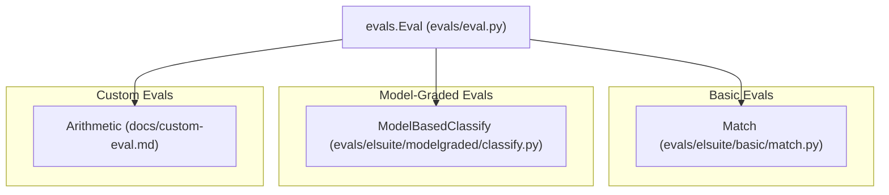
**Diagram: Evaluation Class Hierarchy**

Key methods in `evals.Eval`:
- `run(recorder)`: Entry point called by the CLI, returns final metrics [docs/custom-eval.md:46-58]().
- `eval_sample(test_sample, rng)`: Evaluates a single sample [docs/custom-eval.md:63-97]().
- `eval_all_samples(recorder, samples)`: Iterates through samples and manages execution [docs/custom-eval.md:52-52]().

Sources: [docs/custom-eval.md:28-97](), [evals/cli/oaieval.py:184-185]()

### 3. Model Interface Layer

The framework interacts with models through the `CompletionFn` protocol [evals/api.py:23-40]().

- `OpenAIChatCompletionFn`: Handles interaction with OpenAI Chat models (e.g., GPT-4) [evals/completion_fns/openai.py:134-181]().
- `OpenAICompletionFn`: Handles interaction with legacy OpenAI completion models [evals/completion_fns/openai.py:83-131]().
- `DummyCompletionFn`: Returns a static response for testing [evals/api.py:48-52]().

The `Registry.make_completion_fn` method is responsible for instantiating the correct interface based on the model ID or registry name [evals/registry.py:120-151]().

Sources: [evals/api.py:23-52](), [evals/completion_fns/openai.py:83-181](), [evals/registry.py:120-151]()

### 4. Recording and Metrics Layer

The recording layer captures evaluation events through `RecorderBase` [evals/cli/oaieval.py:15-16]().

- **Local Recording**: Enabled by default, stores results in a JSON file [evals/cli/oaieval.py:58-62]().
- **HTTP Recording**: Sends evaluation results to a specified URL [evals/cli/oaieval.py:65-76]().
- **Snowflake Recording**: Optional logging to a Snowflake database [README.md:64-64]().

Sources: [evals/cli/oaieval.py:15-89](), [README.md:64-64]()

## System Architecture

The following diagram bridges the natural language concepts of the evaluation process to the specific code entities in the repository.

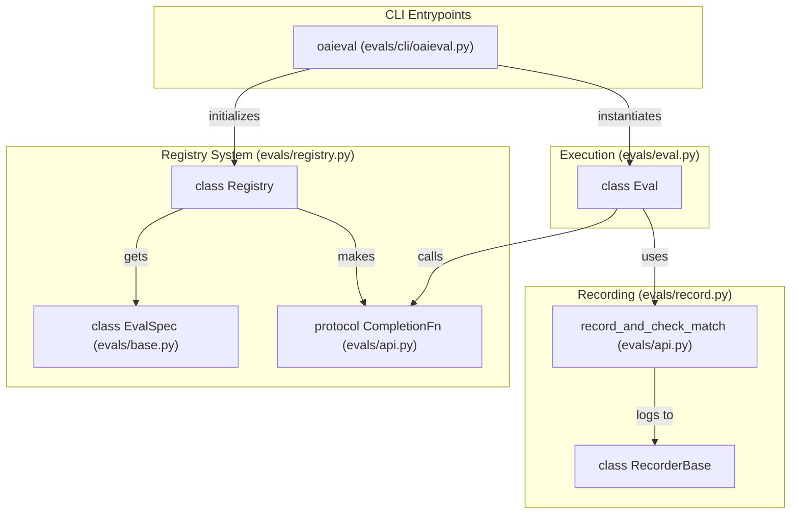
**Diagram: Code Entity Architecture**

Sources: [evals/cli/oaieval.py:1-131](), [evals/registry.py:103-151](), [evals/api.py:23-106](), [evals/base.py:51-61]()

## Data Flow

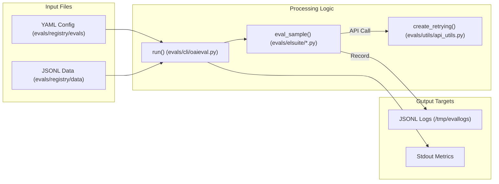
**Diagram: Evaluation Data Flow**

Sources: [evals/cli/oaieval.py:118-185](), [evals/utils/api_utils.py:10-23](), [docs/custom-eval.md:63-97]()

## Setup Requirements

1. **Python Version**: Minimum 3.9 [README.md:15-15]().
2. **API Key**: `OPENAI_API_KEY` environment variable must be set [README.md:13-13]().
3. **Git LFS**: Required to download evaluation datasets stored in the registry [README.md:19-24]().
4. **Installation**: Recommended editable install via `pip install -e .` for developers [README.md:39-39]().

Sources: [README.md:13-48]()

---

# Page: Getting Started

# Getting Started

<details>
<summary>Relevant source files</summary>

The following files were used as context for generating this wiki page:

- [.gitattributes](.gitattributes)
- [.github/config.yml](.github/config.yml)
- [.github/workflows/run_tests.yaml](.github/workflows/run_tests.yaml)
- [.github/workflows/test_eval.yaml](.github/workflows/test_eval.yaml)
- [MANIFEST.in](MANIFEST.in)
- [Makefile](Makefile)
- [README.md](README.md)
- [docs/build-eval.md](docs/build-eval.md)
- [docs/completion-fn-protocol.md](docs/completion-fn-protocol.md)
- [docs/completion-fns.md](docs/completion-fns.md)
- [docs/custom-eval.md](docs/custom-eval.md)
- [docs/run-evals.md](docs/run-evals.md)
- [evals/__init__.py](evals/__init__.py)
- [evals/api.py](evals/api.py)
- [evals/base.py](evals/base.py)
- [evals/registry/data/pattern_identification/samples.v0.jsonl](evals/registry/data/pattern_identification/samples.v0.jsonl)
- [evals/registry/evals/pattern_identification.yaml](evals/registry/evals/pattern_identification.yaml)
- [evals/registry/solvers/gemini.yaml](evals/registry/solvers/gemini.yaml)
- [evals/solvers/providers/google/gemini_solver.py](evals/solvers/providers/google/gemini_solver.py)
- [evals/solvers/providers/google/gemini_solver_test.py](evals/solvers/providers/google/gemini_solver_test.py)
- [evals/solvers/providers/google/requirements.txt](evals/solvers/providers/google/requirements.txt)
- [pyproject.toml](pyproject.toml)

</details>


This page provides a practical guide to installing OpenAI Evals and running your first evaluation. It covers the essential prerequisites, installation steps, and a simple walkthrough of executing an eval using the command-line interface.

For detailed information about installation options and environment configuration, see [Installation and Setup](#2.1). For comprehensive coverage of running evaluations with all available options, see [Running Your First Evaluation](#2.2).

---

## Purpose and Scope

This guide helps you:
1. Install the evals framework and configure your environment.
2. Execute your first evaluation using the `oaieval` CLI [evals/cli/oaieval.py:61]().
3. Understand the basic architecture and data flow.
4. Navigate to more detailed documentation for specific use cases.

This page assumes you want to run existing evaluations. For information about creating new evaluations, see [Creating and Configuring Evaluations](#7). For understanding the core architecture in depth, see [Core Architecture](#3).

---

## Prerequisites

### System Requirements

**Minimum Python Version**: Python 3.9 or higher [README.md:15]().

**Required Tools**:
- Git (for cloning the repository).
- Git LFS (for downloading evaluation datasets) [README.md:19]().

**API Access**:
- OpenAI API key (set via `OPENAI_API_KEY` environment variable) [README.md:13]().
- Optional: Snowflake credentials for remote logging [README.md:64]().

Sources: [README.md:11-16](), [pyproject.toml:4]()

### Git LFS Setup

The evaluation datasets in `evals/registry/data/` are tracked using Git LFS [.gitattributes:1](). Before running evaluations, fetch these files:

```bash
cd evals
git lfs fetch --all
git lfs pull
```

To fetch only specific evaluation data:

```bash
git lfs fetch --include=evals/registry/data/${your_eval}
git lfs pull
```

Sources: [README.md:17-32](), [.gitattributes:1]()

---

## Installation

### For Running Evals Only

If you only want to execute existing evaluations:

```bash
pip install evals
```

This installs the package from PyPI [README.md:59]().

### For Contributing or Development

If you plan to create new evaluations or modify existing ones:

```bash
git clone https://github.com/openai/evals.git
cd evals
pip install -e .
```

The `-e` flag installs in editable mode [README.md:39-42]().

**Optional**: Install formatters or torch support:

```bash
pip install -e .[formatters]
pip install -e .[torch]
```

Sources: [README.md:34-52](), [pyproject.toml:55-58]()

---

## Running Your First Evaluation

### Basic Command Structure

The `oaieval` CLI [evals/cli/oaieval.py:61]() requires two primary arguments:
1. **Completion function**: The model or completion function to evaluate.
2. **Eval name**: The evaluation to run (from the registry).

```bash
oaieval gpt-3.5-turbo test-match
```

This command:
- Evaluates the `gpt-3.5-turbo` model [docs/run-evals.md:9]().
- Using the `test-match` evaluation [docs/run-evals.md:9]().
- Records results to `/tmp/evallogs` by default [docs/run-evals.md:19]().

Sources: [docs/run-evals.md:5-13](), [evals/cli/oaieval.py:61]()

### Understanding the Output

A typical run produces output that includes:
- **Run ID**: Unique identifier for this evaluation run generated in `RunSpec` [evals/base.py:82-88]().
- **Progress bar**: Shows sample completion status via `tqdm` [pyproject.toml:46]().
- **Final metrics**: Key performance metrics (e.g., `accuracy`) [docs/build-eval.md:47]().

Sources: [evals/base.py:75-90](), [docs/build-eval.md:42-53]()

---

## System Architecture Overview

### High-Level Data Flow

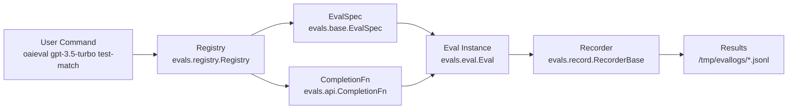

**Diagram: Basic Evaluation Execution Flow**

1. User invokes `oaieval` CLI with model and eval names [evals/cli/oaieval.py:61]().
2. `Registry` loads specifications from YAML files in `evals/registry/` [docs/run-evals.md:11]().
3. `EvalSpec` [evals/base.py:51]() defines which evaluation class to instantiate.
4. `CompletionFn` [evals/api.py:23]() provides the interface to the language model.
5. `Eval` instance [docs/custom-eval.md:28]() executes the evaluation logic.
6. `Recorder` captures events and metrics [evals/record.py]().

Sources: [evals/base.py:18-62](), [evals/api.py:23-40](), [docs/run-evals.md:7-13]()

### Registry System Mapping

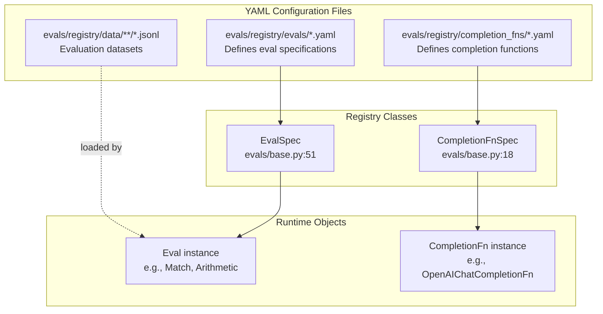

**Diagram: Registry System - Configuration to Runtime Mapping**

The registry system dereferences string names to Python objects:
- **YAML configurations** define what to run (stored in `evals/registry/`) [docs/run-evals.md:11]().
- **`EvalSpec`** [evals/base.py:51]() and **`CompletionFnSpec`** [evals/base.py:18]() are dataclasses describing how to instantiate components.
- **`Eval` instances** (like `Arithmetic` [docs/custom-eval.md:39]()) load data from `jsonl` files in the registry [docs/custom-eval.md:50-51]().

Sources: [evals/base.py:18-62](), [docs/build-eval.md:42-53](), [docs/custom-eval.md:104-108]()

---

## Key Components

### Registry

The registry is the central orchestrator that resolves names to specifications. It looks for YAML files in `evals/registry/evals` [docs/run-evals.md:11]() and `evals/registry/completion_fns` [docs/completion-fns.md:17]().

### CompletionFn

The `CompletionFn` protocol [evals/api.py:23-40]() defines the interface for interacting with language models:

```python
class CompletionFn(Protocol):
    def __call__(
        self,
        prompt: Union[str, OpenAICreateChatPrompt],
        **kwargs,
    ) -> CompletionResult:
        ...
```

Implementations include:
- `OpenAIChatCompletionFn` (dynamically instantiated for models like `gpt-3.5-turbo`) [docs/run-evals.md:13]().
- `LangChainLLMCompletionFn` for LangChain integrations [docs/completion-fns.md:11]().
- `DummyCompletionFn` [evals/api.py:48-52]() for testing.

### Eval

The `Eval` base class [docs/custom-eval.md:28]() defines the evaluation lifecycle:
- `run(recorder)`: Main entry point, typically calls `eval_all_samples` [docs/custom-eval.md:46-52]().
- `eval_sample(sample, rng)`: Processes a single data point [docs/custom-eval.md:63-76]().
- Returns metrics dictionary for the final report [docs/custom-eval.md:55-58]().

Concrete implementations include basic templates like `Match` [docs/build-eval.md:50]() and model-graded evals like `fact` or `closedqa` [docs/build-eval.md:36]().

Sources: [evals/api.py:16-52](), [evals/base.py:18-62](), [docs/custom-eval.md:28-58]()

---

## Execution Flow in Detail

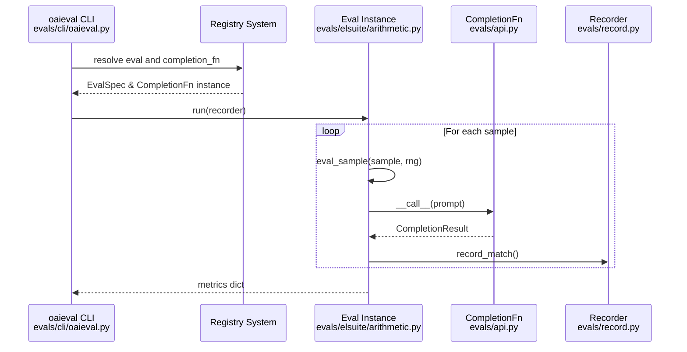

**Diagram: Detailed Execution Sequence**

Key steps:
1. **CLI entry**: `oaieval` is the main entry point [pyproject.toml:61]().
2. **Registry resolution**: YAML files are parsed to find the `class` and `args` [docs/build-eval.md:42-53]().
3. **Evaluation loop**: `eval_all_samples` iterates through the dataset [docs/custom-eval.md:52]().
4. **Recording**: `record_and_check_match` [evals/api.py:55]() logs the results to the recorder.

Sources: [evals/api.py:55-105](), [docs/custom-eval.md:46-58](), [pyproject.toml:60-62]()

---

## Common Options

| Flag | Description | Example |
|------|-------------|---------|
| `--record_path` | Custom output directory for logs [docs/run-evals.md:19](). | `--record_path /tmp/logs` |
| `--no-local-run` | Log to Snowflake instead of local files [docs/run-evals.md:18](). | `--no-local-run` |
| `--registry_path` | Add extra paths to search for YAMLs [docs/completion-fns.md:33](). | `--registry_path ~/my_project` |

Sources: [docs/run-evals.md:17-21](), [docs/completion-fns.md:32-49]()

---

## Next Steps

After running your first evaluation, explore:

- **[Installation and Setup](#2.1)**: Detailed configuration and environment requirements.
- **[Running Your First Evaluation](#2.2)**: Walkthrough of interpreting results and understanding output logs.
- **[Core Architecture](#3)**: Deep dive into the registry and recording subsystems.
- **[Creating and Configuring Evaluations](#7)**: Guide to formatting data and registering new evals.

Sources: [README.md:68-73](), [docs/build-eval.md:1-7]()

---

# Page: Installation and Setup

# Installation and Setup

<details>
<summary>Relevant source files</summary>

The following files were used as context for generating this wiki page:

- [.gitattributes](.gitattributes)
- [.github/config.yml](.github/config.yml)
- [.github/workflows/run_tests.yaml](.github/workflows/run_tests.yaml)
- [.github/workflows/test_eval.yaml](.github/workflows/test_eval.yaml)
- [Makefile](Makefile)
- [README.md](README.md)
- [docs/build-eval.md](docs/build-eval.md)
- [docs/completion-fn-protocol.md](docs/completion-fn-protocol.md)
- [docs/completion-fns.md](docs/completion-fns.md)
- [docs/custom-eval.md](docs/custom-eval.md)
- [evals/registry/data/pattern_identification/samples.v0.jsonl](evals/registry/data/pattern_identification/samples.v0.jsonl)
- [evals/registry/evals/pattern_identification.yaml](evals/registry/evals/pattern_identification.yaml)
- [evals/registry/solvers/gemini.yaml](evals/registry/solvers/gemini.yaml)
- [evals/solvers/providers/google/gemini_solver.py](evals/solvers/providers/google/gemini_solver.py)
- [evals/solvers/providers/google/gemini_solver_test.py](evals/solvers/providers/google/gemini_solver_test.py)
- [evals/solvers/providers/google/requirements.txt](evals/solvers/providers/google/requirements.txt)
- [pyproject.toml](pyproject.toml)

</details>


This document covers the installation and configuration steps required to use the OpenAI Evals framework. This includes installing the Python package, configuring API keys for model providers, setting up Git LFS for data files, and verifying the installation. For instructions on running evaluations after setup, see [Running Your First Evaluation](#2.2).

## Overview

The Evals framework can be installed in two modes:
- **User mode**: For running existing evaluations without modifying code.
- **Developer mode**: For creating new evaluations or contributing to the framework.

Both modes require Python 3.9 or higher and appropriate API credentials.

Sources: [README.md:1-102](), [pyproject.toml:1-71]()

## Environment Requirements

### Python Version

The minimum required Python version is **3.9**.

```bash
# Verify Python version
python --version  # Should be >= 3.9
```

Sources: [README.md:15](), [pyproject.toml:4](), [.github/workflows/run_tests.yaml:24-25]()

### Core Dependencies

The framework has extensive dependencies managed through `pyproject.toml`. Key dependencies include:

| Category | Packages | Purpose |
|----------|----------|---------|
| LLM Providers | `openai>=1.0.0`, `anthropic`, `google-generativeai`, `langchain` | API clients for model providers |
| Data Processing | `datasets`, `pandas`, `numpy`, `blobfile` | Dataset loading and manipulation |
| Utilities | `pyyaml`, `dacite`, `beartype`, `tiktoken` | Configuration and type validation |
| Metrics | `evaluate`, `sacrebleu`, `jiwer` | Evaluation metrics computation |
| Recording | `snowflake-connector-python[pandas]`, `flask` | Results storage backends |
| Testing | `pytest`, `mock` | Unit testing infrastructure |

Sources: [pyproject.toml:6-50]()

## Installation Methods

### User Installation (Running Existing Evals)

For users who want to run existing evaluations without modifying the codebase:

```bash
pip install evals
```

This installs the package from PyPI and provides the `oaieval` and `oaievalset` command-line tools.

Sources: [README.md:56-60](), [pyproject.toml:60-62]()

### Developer Installation (Creating or Contributing Evals)

For users who want to create new evaluations or contribute to the framework:

```bash
# Clone the repository
git clone https://github.com/openai/evals.git
cd evals

# Install in editable mode
pip install -e .
```

The `-e` flag installs the package in "editable" mode, meaning changes to the source code are immediately reflected without reinstalling.

Sources: [README.md:36-42](), [docs/build-eval.md:1-6](), [.github/workflows/run_tests.yaml:28-32]()

### Installing Development Tools

For contributors who will be formatting code and running pre-commit hooks:

```bash
# Install formatters
pip install -e .[formatters]

# Install pre-commit hooks
pre-commit install
```

This installs code quality tools including `black`, `isort`, `autoflake`, and `ruff` for automatic code formatting.

Sources: [README.md:44-52](), [pyproject.toml:55-56]()

## Installation Flow Diagram

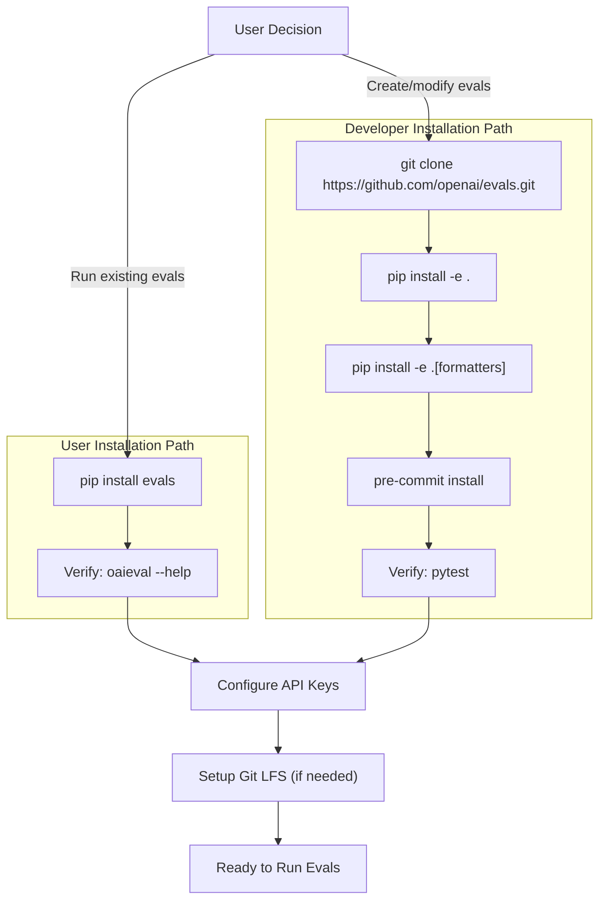

Sources: [README.md:11-62](), [docs/build-eval.md:1-20]()

## API Key Configuration

### Required: OpenAI API Key

The OpenAI API key is required for all evaluations. Obtain an API key from the [OpenAI Platform](https://platform.openai.com/account/api-keys).

Set the environment variable:

```bash
export OPENAI_API_KEY="sk-..."
```

Sources: [README.md:13]()

### Optional Provider API Keys

The framework supports multiple LLM providers. Configure additional API keys as needed:

| Provider | Environment Variable | Implementation Entity |
|----------|---------------------|----------------------|
| Google Gemini | `GEMINI_API_KEY` | `evals.solvers.providers.google.gemini_solver:GeminiSolver` |
| Anthropic Claude | `ANTHROPIC_API_KEY` | Configured via `anthropic` package |

**Example for Gemini:**

```bash
export GEMINI_API_KEY="your-gemini-api-key"
```

Sources: [evals/solvers/providers/google/gemini_solver.py:16-17](), [evals/registry/solvers/gemini.yaml:1-24]()

### Optional: Snowflake Database Configuration

For logging evaluation results to a Snowflake database (optional):

```bash
export SNOWFLAKE_ACCOUNT="your-account"
export SNOWFLAKE_DATABASE="your-database"
export SNOWFLAKE_USERNAME="your-username"
export SNOWFLAKE_PASSWORD="your-password"
```

Sources: [README.md:64]()

## Git LFS Setup for Data Files

### Understanding Git LFS in Evals

The evaluation datasets in `evals/registry/data/` are stored using [Git Large File Storage (Git LFS)](https://git-lfs.com). Pointer files in the repository contain metadata (version, oid, size) while the actual JSONL content is fetched from the LFS server.

Sources: [README.md:17-32](), [evals/registry/data/pattern_identification/samples.v0.jsonl:1-4](), [.gitattributes:1]()

### Fetching Eval Data

After cloning the repository and installing Git LFS:

```bash
cd evals
git lfs fetch --all
git lfs pull
```

To download data for only specific evaluations:

```bash
git lfs fetch --include=evals/registry/data/${your eval}
git lfs pull
```

Sources: [README.md:19-32]()

### Git LFS Data Flow Diagram

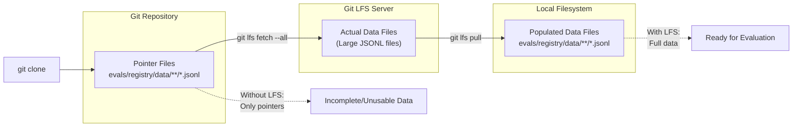

Sources: [README.md:17-32](), [evals/registry/data/pattern_identification/samples.v0.jsonl:1-4]()

## Verification

### Command-Line Tools Verification

Verify that the command-line tools are installed correctly:

```bash
# Check oaieval is available
oaieval --help

# Check oaievalset is available
oaievalset --help
```

Sources: [pyproject.toml:60-62]()

### Running Tests (Developer Installation)

For developer installations, verify that tests pass:

```bash
# Run all tests
pytest
```

Sources: [.github/workflows/run_tests.yaml:34-38]()

## System Configuration Diagram

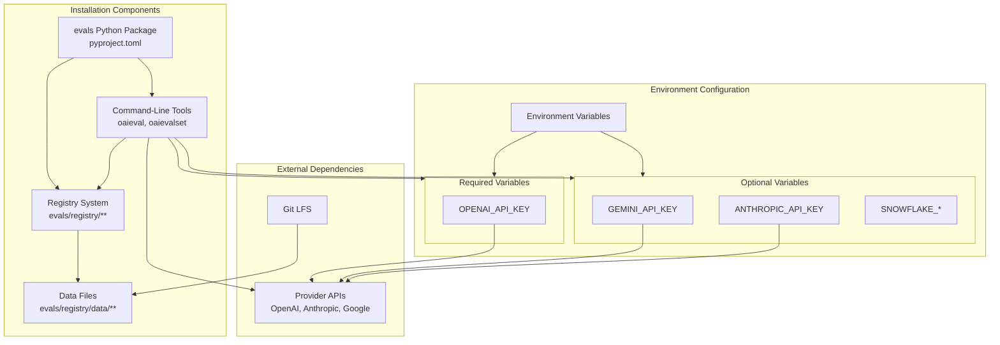

Sources: [pyproject.toml:1-71](), [README.md:11-64](), [evals/solvers/providers/google/gemini_solver.py:16-17]()

---

# Page: Running Your First Evaluation

# Running Your First Evaluation

<details>
<summary>Relevant source files</summary>

The following files were used as context for generating this wiki page:

- [.gitattributes](.gitattributes)
- [.github/config.yml](.github/config.yml)
- [MANIFEST.in](MANIFEST.in)
- [Makefile](Makefile)
- [README.md](README.md)
- [docs/build-eval.md](docs/build-eval.md)
- [docs/completion-fn-protocol.md](docs/completion-fn-protocol.md)
- [docs/completion-fns.md](docs/completion-fns.md)
- [docs/custom-eval.md](docs/custom-eval.md)
- [docs/run-evals.md](docs/run-evals.md)
- [evals/__init__.py](evals/__init__.py)
- [evals/api.py](evals/api.py)
- [evals/base.py](evals/base.py)
- [evals/cli/oaieval.py](evals/cli/oaieval.py)
- [evals/completion_fns/langchain_math.py](evals/completion_fns/langchain_math.py)
- [evals/completion_fns/openai.py](evals/completion_fns/openai.py)
- [evals/completion_fns/retrieval.py](evals/completion_fns/retrieval.py)
- [evals/elsuite/make_me_say/autoeval.py](evals/elsuite/make_me_say/autoeval.py)
- [evals/elsuite/make_me_say/utils.py](evals/elsuite/make_me_say/utils.py)
- [evals/registry.py](evals/registry.py)
- [evals/registry/completion_fns/cot.yaml](evals/registry/completion_fns/cot.yaml)
- [evals/registry/data/pattern_identification/samples.v0.jsonl](evals/registry/data/pattern_identification/samples.v0.jsonl)
- [evals/registry/data/word_association/corpus_tools/validators.py](evals/registry/data/word_association/corpus_tools/validators.py)
- [evals/registry/evals/pattern_identification.yaml](evals/registry/evals/pattern_identification.yaml)
- [evals/registry_test.py](evals/registry_test.py)
- [evals/utils/api_utils.py](evals/utils/api_utils.py)
- [examples/retrieval-completionfn.ipynb](examples/retrieval-completionfn.ipynb)

</details>


**Purpose**: This page provides a practical walkthrough for executing your first evaluation using the `oaieval` CLI. It covers the basic command syntax, execution flow, output interpretation, and commonly used options. For comprehensive CLI reference including all flags and advanced configurations, see [Using oaieval CLI](#5.1). For installation and environment setup, see [Installation and Setup](#2.1).

---

## Basic Command Structure

The simplest evaluation command requires two arguments:

```bash
oaieval <completion_fn> <eval>
```

**Example:**
```bash
oaieval gpt-3.5-turbo test-match
```

| Component | Description | Example Value |
|-----------|-------------|---------------|
| `completion_fn` | The model or completion function to evaluate | `gpt-3.5-turbo`, `gpt-4`, `dummy` |
| `eval` | The evaluation to run (registered in YAML) | `test-match`, `logqa`, `lambada` |

Sources: [evals/cli/oaieval.py:26-32](), [docs/run-evals.md:7-13]()

---

## Command Line Arguments Parsing

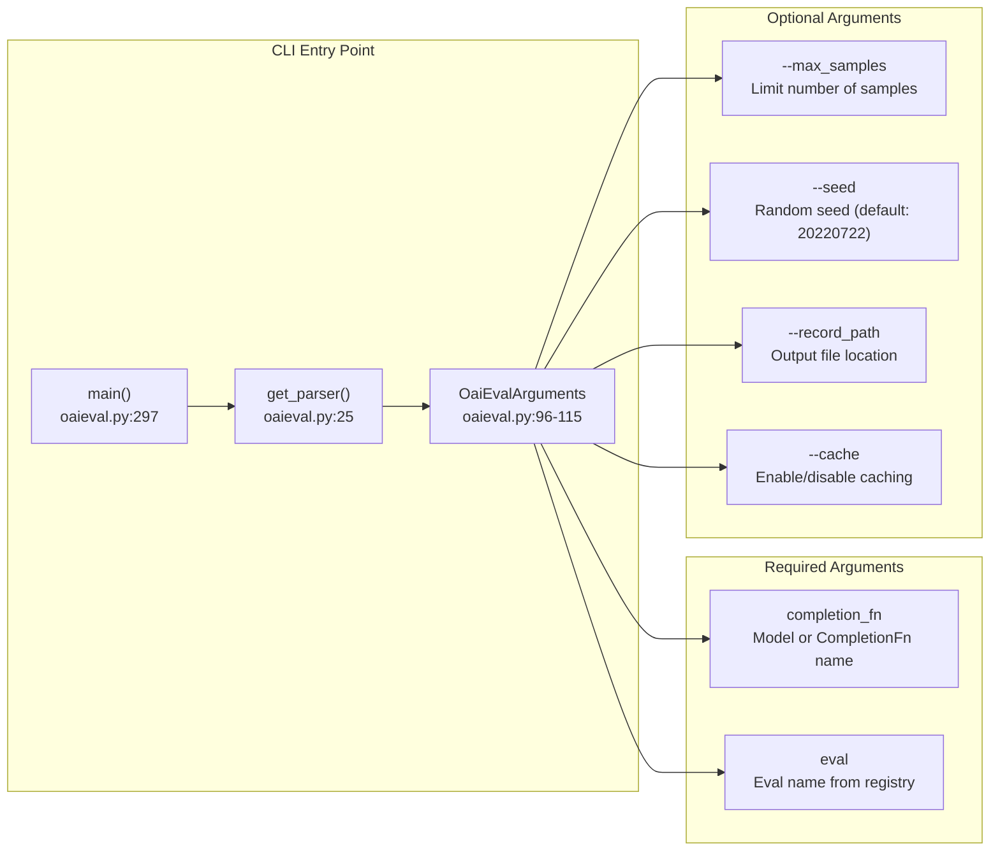

Sources: [evals/cli/oaieval.py:25-115]()

---

## Your First Evaluation: test-match

The `test-match` eval is a simple exact-match evaluation ideal for testing your setup.

### Step 1: Run the Command

```bash
oaieval gpt-3.5-turbo test-match
```

### Step 2: Observe Initial Output

The CLI will display:
- **Run ID**: A unique identifier in format `YYMMDDHHMMSS<random>`
- **Progress**: Sample-by-sample processing updates
- **Token usage**: Number of prompt/completion tokens used

Example output:
```
[2024-01-15 10:30:45] Run started: 240115103045AB3D2
[2024-01-15 10:30:46] [1/10] Processing sample...
[2024-01-15 10:30:47] [2/10] Processing sample...
...
```

### Step 3: View Final Results

After all samples complete, the final report appears:

```
Final report:
accuracy: 0.85
usage_prompt_tokens: 1247
usage_completion_tokens: 423
usage_total_tokens: 1670
```

Sources: [evals/cli/oaieval.py:214-238](), [docs/run-evals.md:7-13]()

---

## Execution Flow Diagram

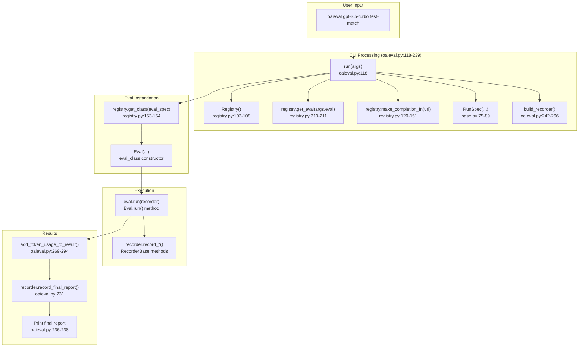

Sources: [evals/cli/oaieval.py:118-239]()

---

## Registry Resolution Process

When you run `oaieval gpt-3.5-turbo test-match`, the system resolves both arguments through the `Registry` class:

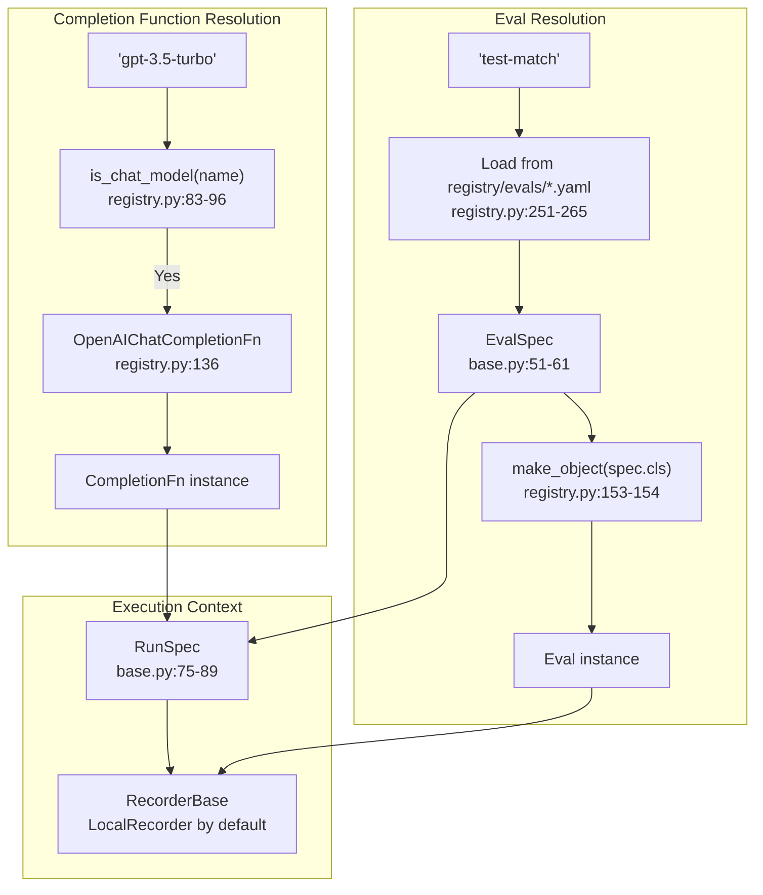

**Resolution Rules:**

| Input Type | Resolution Logic | Code Reference |
|------------|------------------|----------------|
| OpenAI model name (e.g., `gpt-3.5-turbo`) | Detected as chat model, creates `OpenAIChatCompletionFn` | [evals/registry.py:135-136]() |
| Registry completion_fn ID | Looks up in `evals/registry/completion_fns/*.yaml` | [evals/registry.py:141-151]() |
| `dummy` | Returns `DummyCompletionFn` (for testing) | [evals/registry.py:130-131]() |
| Eval name | Looks up in `evals/registry/evals/*.yaml` | [evals/registry.py:210-211]() |

Sources: [evals/registry.py:83-151](), [evals/registry.py:210-211](), [evals/base.py:51-89]()

---

## Output Files and Recording

By default, evaluation results are written to a local JSONL file:

**Default location:**
```
/tmp/evallogs/{run_id}_{completion_fn}_{eval}.jsonl
```

**Example:**
```
/tmp/evallogs/240115103045AB3D2_gpt-3.5-turbo_test-match.jsonl
```

### Custom Output Location

Use the `--record_path` flag to specify a custom location:

```bash
oaieval gpt-3.5-turbo test-match --record_path ./my_results.jsonl
```

### Recording Modes

| Mode | Flag | Recorder Class | Description |
|------|------|----------------|-------------|
| Local (default) | `--local-run` | `LocalRecorder` | Writes JSONL to local file |
| HTTP | `--http-run` | `HttpRecorder` | POSTs events to URL |
| Dry run | `--dry-run` | `DummyRecorder` | No recording, prints to console |

Sources: [evals/cli/oaieval.py:197-208](), [evals/cli/oaieval.py:242-266]()

---

## Interpreting Results

### Final Report Metrics

After execution completes, the CLI prints a final report. Common metrics include:

| Metric | Description | Example Value |
|--------|-------------|---------------|
| `accuracy` | Fraction of correct matches | `0.85` (85%) |
| `usage_prompt_tokens` | Total tokens in prompts | `1247` |
| `usage_completion_tokens` | Total tokens in completions | `423` |
| `usage_total_tokens` | Sum of prompt + completion tokens | `1670` |

### Event Types in JSONL Output

The JSONL file contains various event types:

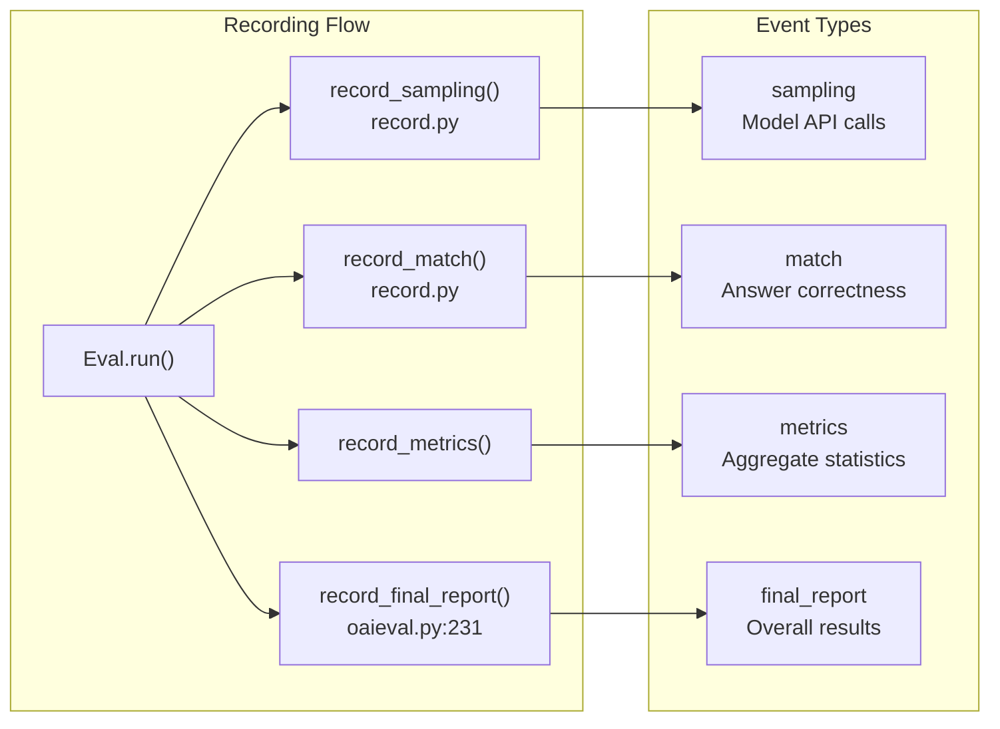

Sources: [evals/record.py](), [evals/cli/oaieval.py:231]()

---

## Commonly Used Options

### Limit Sample Count

Test with fewer samples during development:

```bash
oaieval gpt-3.5-turbo test-match --max_samples 5
```

This limits evaluation to the first 5 samples. The `max_samples` value is set globally via `evals.eval.set_max_samples` [evals/cli/oaieval.py:125]() and affects all sample iterators.

### Set Random Seed

Ensure reproducible results:

```bash
oaieval gpt-3.5-turbo test-match --seed 42
```

Default seed is `20220722` [evals/cli/oaieval.py:43]().

### Disable Caching

Force fresh API calls (useful when testing prompt changes):

```bash
oaieval gpt-3.5-turbo test-match --no-cache
```

This sets `cache` to `False` in arguments [evals/cli/oaieval.py:41](), affecting the behavior of completion functions.

### Enable Debug Logging

Get detailed execution information:

```bash
oaieval gpt-3.5-turbo test-match --debug
```

This sets the root logger level to `DEBUG` [evals/cli/oaieval.py:119-120]().

### Combine Multiple Options

```bash
oaieval gpt-3.5-turbo test-match \
  --max_samples 10 \
  --seed 42 \
  --record_path ./results.jsonl \
  --debug
```

Sources: [evals/cli/oaieval.py:40-93]()

---

## Example: Running with Different Models

### OpenAI Chat Models

```bash
# GPT-4
oaieval gpt-4 test-match

# GPT-3.5 Turbo 16k context
oaieval gpt-3.5-turbo-16k test-match
```

### OpenAI Completion Models

```bash
# Text-Davinci-003
oaieval text-davinci-003 test-match
```

The `Registry` automatically detects the model type and instantiates the appropriate `CompletionFn`:
- Chat models → `OpenAIChatCompletionFn` [evals/registry.py:136]()
- Completion models → `OpenAICompletionFn` [evals/registry.py:138]()

### Registered Completion Functions

```bash
# Chain-of-Thought wrapper (from registry)
oaieval cot/gpt-3.5-turbo test-match

# Dummy completion (for testing)
oaieval dummy test-match
```

Sources: [evals/registry.py:120-151](), [evals/completion_fns/openai.py:83-181]()

---

## Execution Context: RunSpec

Every evaluation run creates a `RunSpec` object that captures execution metadata:

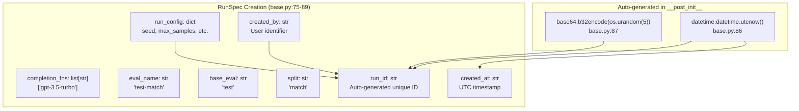

**RunSpec Fields:**

| Field | Source | Example |
|-------|--------|---------|
| `run_id` | Auto-generated (timestamp + random) | `240115103045AB3D2` |
| `completion_fns` | From CLI argument | `["gpt-3.5-turbo"]` |
| `eval_name` | From CLI argument | `"test-match"` |
| `base_eval` | Parsed from eval_name (before `.`) | `"test"` |
| `split` | Parsed from eval_name (after `.`) | `"match"` |
| `run_config` | Captures all execution parameters | `{"seed": 42, "max_samples": 10, ...}` |

Sources: [evals/base.py:75-89](), [evals/cli/oaieval.py:173-195]()

---

## Token Usage Tracking

Token usage is automatically tracked and aggregated from sampling events:

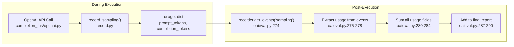

**Usage Fields:**

| Field | Description |
|-------|-------------|
| `prompt_tokens` | Tokens in the input prompt |
| `completion_tokens` | Tokens in the model's response |
| `total_tokens` | Sum of prompt and completion tokens |

The `add_token_usage_to_result` function aggregates these across all samples and adds them to the final report with `usage_` prefix [evals/cli/oaieval.py:269-294]().

Sources: [evals/cli/oaieval.py:269-294](), [evals/completion_fns/openai.py:125-130](), [evals/completion_fns/openai.py:175-180]()

---

## Error Handling and Retry Logic

API calls automatically retry on transient errors using exponential backoff:

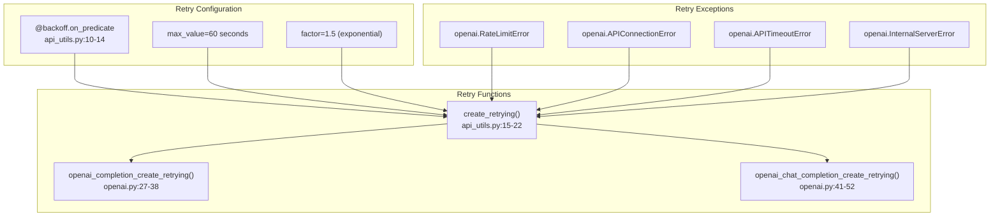

**Retry Parameters:**

| Parameter | Value | Description |
|-----------|-------|-------------|
| Wait strategy | Exponential | Doubles wait time after each retry |
| Max wait | 60 seconds | Maximum backoff between retries |
| Factor | 1.5 | Multiplier for exponential backoff |

Sources: [evals/utils/api_utils.py:10-22](), [evals/completion_fns/openai.py:19-52]()

---

## Next Steps

After running your first evaluation, explore:

- **[Using oaieval CLI](#5.1)**: Complete reference for all CLI flags and options
- **[Evaluation Types](#6)**: Different evaluation patterns (Basic, Model-Graded, Solver-Based)
- **[Creating and Configuring Evaluations](#7)**: Build custom evaluations
- **[Configuration and Advanced Options](#5.3)**: Environment variables, registry paths, sampling parameters

---

## Quick Reference: Common Commands

| Task | Command |
|------|---------|
| Basic evaluation | `oaieval gpt-3.5-turbo test-match` |
| Limit samples | `oaieval gpt-3.5-turbo test-match --max_samples 10` |
| Custom output | `oaieval gpt-3.5-turbo test-match --record_path ./results.jsonl` |
| Different model | `oaieval gpt-4 test-match` |
| Dry run (no recording) | `oaieval gpt-3.5-turbo test-match --dry-run` |
| Debug mode | `oaieval gpt-3.5-turbo test-match --debug` |
| Disable cache | `oaieval gpt-3.5-turbo test-match --no-cache` |
| Set seed | `oaieval gpt-3.5-turbo test-match --seed 42` |

Sources: [evals/cli/oaieval.py:25-93](), [docs/run-evals.md:7-22]()

---

# Page: Core Architecture

# Core Architecture

<details>
<summary>Relevant source files</summary>

The following files were used as context for generating this wiki page:

- [MANIFEST.in](MANIFEST.in)
- [docs/run-evals.md](docs/run-evals.md)
- [evals/__init__.py](evals/__init__.py)
- [evals/api.py](evals/api.py)
- [evals/base.py](evals/base.py)
- [evals/cli/oaieval.py](evals/cli/oaieval.py)
- [evals/cli/oaievalset.py](evals/cli/oaievalset.py)
- [evals/completion_fns/langchain_math.py](evals/completion_fns/langchain_math.py)
- [evals/completion_fns/openai.py](evals/completion_fns/openai.py)
- [evals/completion_fns/retrieval.py](evals/completion_fns/retrieval.py)
- [evals/data.py](evals/data.py)
- [evals/data_test.py](evals/data_test.py)
- [evals/elsuite/basic/match_with_solvers.py](evals/elsuite/basic/match_with_solvers.py)
- [evals/elsuite/make_me_say/autoeval.py](evals/elsuite/make_me_say/autoeval.py)
- [evals/elsuite/make_me_say/utils.py](evals/elsuite/make_me_say/utils.py)
- [evals/eval.py](evals/eval.py)
- [evals/record.py](evals/record.py)
- [evals/record_test.py](evals/record_test.py)
- [evals/registry.py](evals/registry.py)
- [evals/registry/completion_fns/cot.yaml](evals/registry/completion_fns/cot.yaml)
- [evals/registry/data/word_association/corpus_tools/validators.py](evals/registry/data/word_association/corpus_tools/validators.py)
- [evals/registry_test.py](evals/registry_test.py)
- [evals/solvers/human_cli_solver.py](evals/solvers/human_cli_solver.py)
- [evals/solvers/prompts/cot.py](evals/solvers/prompts/cot.py)
- [evals/solvers/prompts/hhh.py](evals/solvers/prompts/hhh.py)
- [evals/solvers/solver.py](evals/solvers/solver.py)
- [evals/solvers/utils.py](evals/solvers/utils.py)
- [evals/utils/api_utils.py](evals/utils/api_utils.py)
- [evals/utils/misc.py](evals/utils/misc.py)
- [examples/retrieval-completionfn.ipynb](examples/retrieval-completionfn.ipynb)
- [mypy.ini](mypy.ini)
- [scripts/battle_generator.py](scripts/battle_generator.py)
- [scripts/modelgraded_generator.py](scripts/modelgraded_generator.py)
- [scripts/pattern_identification_generator.py](scripts/pattern_identification_generator.py)

</details>


The OpenAI Evals framework provides a robust and extensible system for evaluating language models on a variety of tasks. This page explains the high-level architecture of the framework, how its components interact, and the flow of execution when running evaluations.

## Key Components Overview

The Evals framework consists of several key components that work together to provide a complete evaluation pipeline:

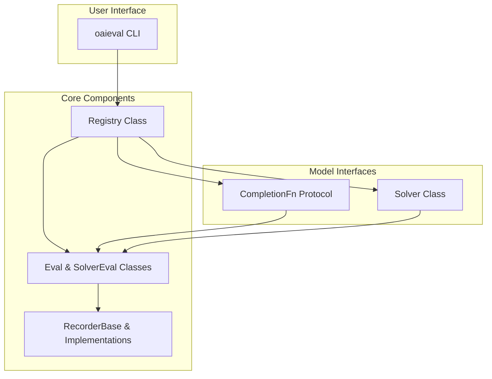
Sources: [evals/cli/oaieval.py:25-93](), [evals/registry.py:103-152](), [evals/eval.py:46-200](), [evals/record.py:54-73]()

## Execution Flow

When you run an evaluation using the `oaieval` CLI tool, the following sequence of events occurs:

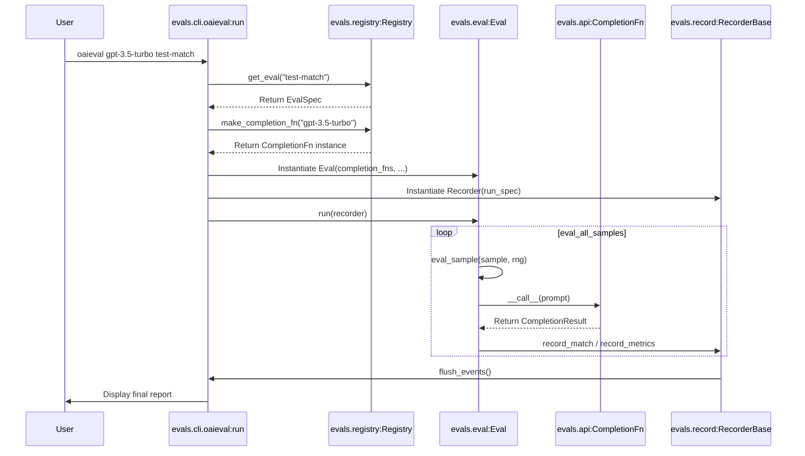
Sources: [evals/cli/oaieval.py:118-239](), [evals/eval.py:112-147](), [evals/api.py:23-40]()

## Registry System
The Registry system manages all configuration for evaluations, including evaluation definitions, completion functions, solvers, and datasets. It loads these configurations from YAML files.

For details, see [Registry System](#3.1).

| Component | Description | Code Entity |
| :--- | :--- | :--- |
| **Discovery** | Logic to find YAML files in search paths | `evals.registry.Registry` [evals/registry.py:103]() |
| **Instantiation** | Factory for creating model interfaces | `Registry.make_completion_fn` [evals/registry.py:120]() |
| **Resolution** | Logic to map IDs to Specs | `Registry._dereference` [evals/registry.py:156]() |

Sources: [evals/registry.py:103-208]()

## Evaluation Base Framework
Evaluations are implemented through a hierarchy of classes that extend the base `Eval` class. The newer `SolverEval` class is designed specifically for use with the Solver framework.

For details, see [Evaluation Base Framework](#3.2).

- **`evals.eval.Eval`**: The base abstract class requiring implementation of `eval_sample` and `run` [evals/eval.py:46-89]().
- **`evals.eval.SolverEval`**: A specialized base class that wraps model interfaces as `Solvers`, ensuring per-sample isolation [evals/eval.py:168-196]().
- **Parallelism**: The framework supports both `ThreadPool` and `asyncio` execution modes for samples [evals/eval.py:90-147]().

Sources: [evals/eval.py:46-200]()

## Recording and Metrics
The recording system logs evaluation results and calculates metrics. It provides multiple recorder implementations for different storage backends.

For details, see [Recording and Metrics](#3.3).

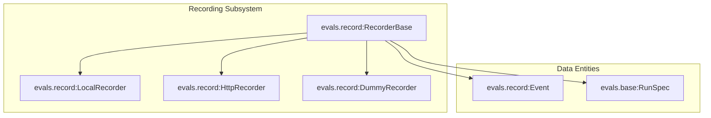
Sources: [evals/record.py:44-143](), [evals/record.py:316-466]()

## Model Interfaces
The framework provides two primary abstractions for interacting with models:

1.  **`evals.api.CompletionFn`**: A protocol defining a `__call__` method that takes a prompt and returns a `CompletionResult` [evals/api.py:23-40]().
2.  **`evals.solvers.solver.Solver`**: A more complex interface for stateful, multi-turn, or reasoning-based tasks [evals/eval.py:168-196]().

The `Registry.make_completion_fn` method is responsible for resolving model names (like `gpt-4`) into the appropriate `OpenAIChatCompletionFn` or `OpenAICompletionFn` instance [evals/registry.py:120-151]().

Sources: [evals/api.py:16-40](), [evals/registry.py:120-151](), [evals/completion_fns/openai.py:83-181]()

## Data Management
The framework includes utilities for working with different data formats, primarily JSONL for evaluation samples.

- **`evals.data.get_jsonl`**: Extracts JSON lines from a given path or directory [evals/data.py:120-133]().
- **`evals.data.open_by_file_pattern`**: A versatile file opener supporting local/GCS paths and compression (Gzip, LZ4, Zstd) [evals/data.py:47-80]().

Sources: [evals/data.py:47-165]()

---

# Page: Registry System

# Registry System

<details>
<summary>Relevant source files</summary>

The following files were used as context for generating this wiki page:

- [.gitattributes](.gitattributes)
- [.github/config.yml](.github/config.yml)
- [MANIFEST.in](MANIFEST.in)
- [Makefile](Makefile)
- [README.md](README.md)
- [docs/build-eval.md](docs/build-eval.md)
- [docs/completion-fn-protocol.md](docs/completion-fn-protocol.md)
- [docs/completion-fns.md](docs/completion-fns.md)
- [docs/custom-eval.md](docs/custom-eval.md)
- [docs/run-evals.md](docs/run-evals.md)
- [evals/__init__.py](evals/__init__.py)
- [evals/api.py](evals/api.py)
- [evals/base.py](evals/base.py)
- [evals/cli/oaieval.py](evals/cli/oaieval.py)
- [evals/completion_fns/langchain_math.py](evals/completion_fns/langchain_math.py)
- [evals/completion_fns/openai.py](evals/completion_fns/openai.py)
- [evals/completion_fns/retrieval.py](evals/completion_fns/retrieval.py)
- [evals/elsuite/make_me_say/autoeval.py](evals/elsuite/make_me_say/autoeval.py)
- [evals/elsuite/make_me_say/utils.py](evals/elsuite/make_me_say/utils.py)
- [evals/registry.py](evals/registry.py)
- [evals/registry/completion_fns/cot.yaml](evals/registry/completion_fns/cot.yaml)
- [evals/registry/data/pattern_identification/samples.v0.jsonl](evals/registry/data/pattern_identification/samples.v0.jsonl)
- [evals/registry/data/word_association/corpus_tools/validators.py](evals/registry/data/word_association/corpus_tools/validators.py)
- [evals/registry/evals/pattern_identification.yaml](evals/registry/evals/pattern_identification.yaml)
- [evals/registry/solvers/bluff.yaml](evals/registry/solvers/bluff.yaml)
- [evals/registry/solvers/defaults.yaml](evals/registry/solvers/defaults.yaml)
- [evals/registry/solvers/make-me-pay.yaml](evals/registry/solvers/make-me-pay.yaml)
- [evals/registry/solvers/self_prompting.yaml](evals/registry/solvers/self_prompting.yaml)
- [evals/registry/solvers/theory_of_mind.yaml](evals/registry/solvers/theory_of_mind.yaml)
- [evals/registry_test.py](evals/registry_test.py)
- [evals/solvers/README.md](evals/solvers/README.md)
- [evals/solvers/nested/cot_solver.py](evals/solvers/nested/cot_solver.py)
- [evals/solvers/nested/self_consistency_solver.py](evals/solvers/nested/self_consistency_solver.py)
- [evals/solvers/postprocessors/README.md](evals/solvers/postprocessors/README.md)
- [evals/utils/api_utils.py](evals/utils/api_utils.py)
- [examples/retrieval-completionfn.ipynb](examples/retrieval-completionfn.ipynb)

</details>


The Registry System is a core architectural component of the OpenAI Evals framework that manages the configuration and discovery of evaluations, completion functions, and datasets. It provides a plugin architecture that enables users to reference components by name rather than direct code imports, making the framework extensible without modifying core code.

## Purpose and Structure

The Registry System acts as a centralized configuration manager with several key responsibilities:

1. Loading component definitions from YAML configuration files.
2. Providing an API to access these definitions.
3. Creating instances of completion functions, evaluations, and other components.
4. Resolving dependencies between components.

### Natural Language to Code Entity Mapping

The following diagram illustrates how user-facing registry concepts map to specific classes and functions in the codebase.

**Registry Logic Flow**
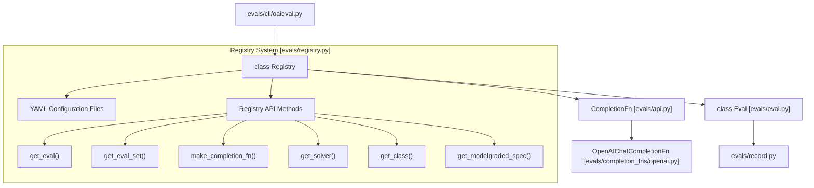
Sources: [evals/registry.py:1-10](), [evals/registry.py:103-104](), [evals/registry.py:202-214](), [evals/api.py:23-40](), [evals/cli/oaieval.py:127-131]()

## Registry Architecture

The Registry is implemented as a class that maintains a cache of loaded components and provides methods to access them. The system is primarily defined in the `Registry` class in `evals/registry.py` [evals/registry.py:103-104]().

**Registry Class Structure**
```mermaid
classDiagram
    class Registry {
        +_registry_paths: list[Path]
        +api_model_ids: list[str]
        +add_registry_paths(paths)
        +make_completion_fn(name) : CompletionFn
        +get_eval(name) : EvalSpec
        +get_eval_set(name) : EvalSetSpec
        +get_completion_fn(name) : CompletionFnSpec
        +get_solver(name) : CompletionFnSpec
        +get_modelgraded_spec(name) : ModelGradedSpec
        +get_class(spec) : Any
        -_load_registry() : dict
        -_completion_fns: dict
        -_evals: dict
        -_eval_sets: dict
        -_solvers: dict
        -_modelgraded_specs: dict
    }
```
Sources: [evals/registry.py:103-330]()

### Registry Paths

The Registry searches for configuration files in a list of directories. By default, `DEFAULT_PATHS` includes:

1. `evals/registry` - Built-in configurations in the repository [evals/registry.py:31]().
2. `~/.evals` - User-defined configurations in the home directory [evals/registry.py:32]().

Users can append additional paths using the `add_registry_paths` method [evals/registry.py:107-108]() or the `--registry_path` CLI option in `oaieval` [evals/cli/oaieval.py:49-54]().

### Registry Resolution Logic
When resolving a name, the registry uses a dereferencing logic in `_dereference` [evals/registry.py:156-192](). It handles:
- **Aliases**: If a registry entry is a string or a dict with an `id` key, it recursively resolves that name [evals/registry.py:168-182]().
- **Parameter Merging**: Arguments provided at runtime via `kwargs` are merged with the `args` defined in the YAML [evals/registry.py:184-186]().

## Specification Formats

The Registry loads YAML files and parses them into specific dataclasses defined in `evals/base.py`.

| Spec Type | Code Entity | Description |
| :--- | :--- | :--- |
| **Eval Spec** | `EvalSpec` | Defines the evaluation class and its instantiation arguments [evals/base.py:51-60](). |
| **Base Eval Spec** | `BaseEvalSpec` | Metadata for an eval, including metrics and descriptions [evals/base.py:30-49](). |
| **CompletionFn Spec** | `CompletionFnSpec` | Defines the class and args for a completion function or solver [evals/base.py:18-26](). |
| **Eval Set Spec** | `EvalSetSpec` | A collection of evaluation names to be run together [evals/base.py:64-71](). |
| **Model Graded Spec** | `ModelGradedSpec` | Specific configuration for model-based grading [evals/elsuite/modelgraded/base.py:23](). |

Sources: [evals/base.py:18-71](), [evals/registry.py:189-214]()

## Key Registry Operations

### Creating Completion Functions

The `make_completion_fn` method [evals/registry.py:120-151]() is the primary entry point for turning a string identifier into an executable `CompletionFn`.

**Completion Function Resolution**
```mermaid
graph TD
    MakeCompFn["make_completion_fn(name)"] --> CheckDummy{"Is 'dummy'?"}
    CheckDummy -->|"Yes"| ReturnDummy["Return DummyCompletionFn"]
    CheckDummy -->|"No"| CheckChat{"is_chat_model(name)?"}
    
    CheckChat -->|"Yes"| CreateChat["Create OpenAIChatCompletionFn"]
    CheckChat -->|"No"| CheckAPI["In api_model_ids?"]
    
    CheckAPI -->|"Yes"| CreateCompletion["Create OpenAICompletionFn"]
    CheckAPI -->|"No"| LoadSpec["get_completion_fn(name) or get_solver(name)"]
    
    LoadSpec --> Instantiate["make_object(spec.cls)(**spec.args)"]
    Instantiate --> ReturnInstance["Return instance"]
```
Sources: [evals/registry.py:120-151](), [evals/registry.py:83-96](), [evals/completion_fns/openai.py:83-181]()

### Model Intelligence
The registry includes metadata for OpenAI models to automate configuration:
- `n_ctx_from_model_name`: Returns the context window size (e.g., 8192 for `gpt-4`) [evals/registry.py:37-80]().
- `is_chat_model`: Determines if the model requires the Chat Completion API [evals/registry.py:83-96]().

## Integration with CLI Tools

The `oaieval` CLI tool uses the registry to bootstrap the evaluation environment.

1. **Initialization**: It creates a `Registry` instance and adds any user-provided paths [evals/cli/oaieval.py:127-129]().
2. **Spec Retrieval**: It fetches the `EvalSpec` using `registry.get_eval(args.eval)` [evals/cli/oaieval.py:131]().
3. **CompletionFn Creation**: It creates `CompletionFn` instances using `registry.make_completion_fn` [evals/cli/oaieval.py:170]().
4. **Instantiation**: It retrieves the evaluation class via `registry.get_class(eval_spec)` and initializes it with the completion functions and merged arguments [evals/cli/oaieval.py:217-225]().

Sources: [evals/cli/oaieval.py:118-226](), [evals/registry.py:153-154]()

## Data Registry

While the YAML files define the logic, the registry also manages access to data files (usually JSONL).
- By convention, data is stored in `evals/registry/data` [README.md:26]().
- Evaluation specifications reference these files via the `samples_jsonl` argument [docs/build-eval.md:52]().
- The framework uses `git-lfs` to manage these large data files [README.md:19-24]().

Sources: [README.md:19-26](), [docs/build-eval.md:42-53]()

---

# Page: Evaluation Base Framework

# Evaluation Base Framework

<details>
<summary>Relevant source files</summary>

The following files were used as context for generating this wiki page:

- [MANIFEST.in](MANIFEST.in)
- [docs/run-evals.md](docs/run-evals.md)
- [evals/__init__.py](evals/__init__.py)
- [evals/api.py](evals/api.py)
- [evals/base.py](evals/base.py)
- [evals/elsuite/basic/match_with_solvers.py](evals/elsuite/basic/match_with_solvers.py)
- [evals/eval.py](evals/eval.py)
- [evals/solvers/human_cli_solver.py](evals/solvers/human_cli_solver.py)
- [evals/solvers/prompts/cot.py](evals/solvers/prompts/cot.py)
- [evals/solvers/prompts/hhh.py](evals/solvers/prompts/hhh.py)
- [evals/solvers/solver.py](evals/solvers/solver.py)
- [evals/solvers/utils.py](evals/solvers/utils.py)

</details>


The Evaluation Base Framework provides the foundation for all evaluations in the OpenAI Evals system. This document covers the core abstractions and components that enable the creation and execution of standardized evaluations for language models.

## Core Abstractions

The Evaluation Base Framework is built around two primary abstract classes defined in `evals/eval.py`:

1.  **Eval**: The base class for all evaluations. It manages a list of `CompletionFn` objects and provides the core parallel execution logic [evals/eval.py:46-64]().
2.  **SolverEval**: A specialized version of `Eval` designed to work with the `Solver` framework. It ensures that a fresh, isolated `Solver` instance is provided for each individual sample [evals/eval.py:168-194]().

### Class Hierarchy and Entity Mapping

The following diagram bridges the conceptual evaluation types to their specific implementation classes and the model interfaces they consume.

```mermaid
classDiagram
    class "Eval (Abstract)" {
        <<evals/eval.py>>
        +completion_fns: List[CompletionFn]
        +eval_registry_path: Path
        +run(recorder) Dict
        +eval_sample(sample, rng)
        +eval_all_samples(recorder, samples)
    }
    
    class "SolverEval (Abstract)" {
        <<evals/eval.py>>
        +_solver: Solver
        +eval_sample(solver, sample, rng)
    }
    
    class "MatchWithSolvers" {
        <<evals/elsuite/basic/match_with_solvers.py>>
        +eval_sample(solver, sample, rng)
    }
    
    class "CompletionFn (Protocol)" {
        <<evals/api.py>>
        +__call__(prompt) CompletionResult
    }

    class "Solver (ABC)" {
        <<evals/solvers/solver.py>>
        +__call__(task_state) SolverResult
        +_solve(task_state) SolverResult
    }
    
    "Eval (Abstract)" <|-- "SolverEval (Abstract)"
    "SolverEval (Abstract)" <|-- "MatchWithSolvers"
    "Eval (Abstract)" ..> "CompletionFn (Protocol)" : consumes
    "SolverEval (Abstract)" ..> "Solver (ABC)" : consumes
```

Sources: [evals/eval.py:46-46](), [evals/eval.py:168-168](), [evals/api.py:23-23](), [evals/solvers/solver.py:41-41](), [evals/elsuite/basic/match_with_solvers.py:15-15]()

## The Eval Class

The `Eval` class is the foundational abstract class. It handles registry paths, seeding, and the orchestration of multiple samples.

### Key Methods and Properties

*   **`eval_sample(sample, rng)`**: An abstract method where the core evaluation logic for a single data point resides [evals/eval.py:76-78]().
*   **`run(recorder)`**: The entry point for the evaluation. It typically loads data, calls `eval_all_samples`, and returns a dictionary of aggregated metrics [evals/eval.py:85-88]().
*   **`eval_all_samples(recorder, samples, ...)`**: The standard synchronous execution engine. It uses a `ThreadPool` to process samples in parallel [evals/eval.py:112-147]().
*   **`completion_fn`**: A helper property that returns the first element of `completion_fns`, used for simpler evaluations that only require one model [evals/eval.py:80-83]().

### Parallel Execution Patterns

The framework supports both threaded and asynchronous execution. Threading is the default for standard evaluations.

| Feature | Implementation | Configuration |
| :--- | :--- | :--- |
| **Threaded Execution** | `eval_all_samples` [evals/eval.py:112]() | `EVALS_THREADS` (default: 10) [evals/eval.py:124]() |
| **Async Execution** | `async_eval_all_samples` [evals/eval.py:90]() | `concurrency` argument (default: 32) [evals/eval.py:94]() |
| **Sequential Mode** | `eval_all_samples` [evals/eval.py:140]() | `EVALS_SEQUENTIAL=1` [evals/eval.py:140]() |

Sources: [evals/eval.py:90-147](), [docs/run-evals.md:31-34]()

## The SolverEval Class

`SolverEval` adapts the base `Eval` to the `Solver` interface. Unlike basic `Eval`, which passes raw completion functions, `SolverEval` manages the lifecycle of `Solver` instances.

### Solver Isolation and State

A key feature of `SolverEval` is that it creates a new copy of the `Solver` for every sample [evals/eval.py:218-220](). This is critical for stateful solvers (e.g., those with memory or multi-turn history) to ensure that interactions in one sample do not bleed into another.

```mermaid
sequenceDiagram
    participant SE as "SolverEval.eval_all_samples"
    participant S as "Base Solver"
    participant Pool as "ThreadPool"
    
    SE->>S: .copy()
    SE->>Pool: Dispatch sample + SolverCopy_1
    SE->>S: .copy()
    SE->>Pool: Dispatch sample + SolverCopy_2
    Note over Pool: eval_sample(SolverCopy_N, sample, rng)
```

Sources: [evals/eval.py:168-184](), [evals/eval.py:218-220](), [evals/solvers/solver.py:122-125]()

## Evaluation Lifecycle and Data Flow

The following diagram illustrates the flow from the `oaieval` CLI through the base framework components to produce a final result.

```mermaid
flowchart TD
    CLI["oaieval CLI (docs/run-evals.md)"] --> Registry["Registry.get_eval (evals/registry.py)"]
    Registry --> EvalObj["Eval Instance (evals/eval.py)"]
    EvalObj --> Run["run(recorder)"]
    
    subgraph "Execution Loop (eval_all_samples)"
        Run --> Samples["get_samples()"]
        Samples --> Pool["ThreadPool (evals/eval.py:139)"]
        Pool --> ES["eval_sample()"]
        ES --> Record["record_and_check_match (evals/api.py:55)"]
    end
    
    Record --> Metrics["evals.metrics (evals/elsuite/basic/match_with_solvers.py:78)"]
    Metrics --> Final["Final Metrics Dict"]
```

Sources: [evals/eval.py:112-147](), [docs/run-evals.md:7-13](), [evals/api.py:55-106](), [evals/elsuite/basic/match_with_solvers.py:68-80]()

### Sample Evaluation Logic

When `eval_all_samples` runs, it performs several setup steps for each worker:
1.  **Indexing**: Samples are paired with their original indices to ensure results can be sorted back to the original order [evals/eval.py:30-38]().
2.  **RNG Initialization**: A deterministic `random.Random` instance is created for each sample using a combination of the sample ID and the global eval seed [evals/eval.py:133-136]().
3.  **Recorder Context**: The `recorder.as_default_recorder(sample_id)` context manager is used to ensure all events (sampling, matches, etc.) are associated with the correct sample ID in the logs [evals/eval.py:134]().

## Integration Utilities

The framework includes utilities in `evals/solvers/utils.py` to bridge the gap between legacy `CompletionFn` code and newer `Solver` code.

*   **`maybe_wrap_with_compl_fn`**: Wraps a `Solver` in a `SolverCompletionFn` so it can be used where a `CompletionFn` is expected [evals/solvers/utils.py:10-25]().
*   **`maybe_wrap_with_solver`**: Wraps a standard `CompletionFn` (like `OpenAIChatCompletionFn`) into an `OpenAISolver` so it can be used within the `SolverEval` framework [evals/solvers/utils.py:28-55]().

Sources: [evals/solvers/utils.py:10-55]()

---

# Page: Recording and Metrics

# Recording and Metrics

<details>
<summary>Relevant source files</summary>

The following files were used as context for generating this wiki page:

- [.github/PULL_REQUEST_TEMPLATE.md](.github/PULL_REQUEST_TEMPLATE.md)
- [.pre-commit-config.yaml](.pre-commit-config.yaml)
- [evals/cli/oaievalset.py](evals/cli/oaievalset.py)
- [evals/data.py](evals/data.py)
- [evals/data_test.py](evals/data_test.py)
- [evals/metrics.py](evals/metrics.py)
- [evals/record.py](evals/record.py)
- [evals/record_test.py](evals/record_test.py)
- [evals/utils/misc.py](evals/utils/misc.py)
- [mypy.ini](mypy.ini)
- [scripts/battle_generator.py](scripts/battle_generator.py)
- [scripts/modelgraded_generator.py](scripts/modelgraded_generator.py)
- [scripts/pattern_identification_generator.py](scripts/pattern_identification_generator.py)
- [tests/unit/evals/test_metrics.py](tests/unit/evals/test_metrics.py)

</details>


The Recording and Metrics system is a core component of the OpenAI Evals framework that enables capturing evaluation results and calculating performance statistics. This page documents how evaluation data is recorded during eval runs and how metrics are computed from this recorded data.

## Overview

The Recording and Metrics subsystem provides:

1.  A standardized way to log evaluation events (model outputs, matches between expected and actual results, etc.).
2.  Multiple backend options for storing these events (local files, HTTP endpoints, Snowflake database).
3.  Functions to calculate common performance metrics from recorded events.

This system is used throughout the evaluation process to track results and compute performance statistics that help quantify model capabilities.

## Recorder Architecture

### Recorder Class Hierarchy

```mermaid
classDiagram
    class RecorderBase {
        +run_spec: RunSpec
        -_events: List[Event]
        -_sample_id: ContextVar
        +record_event(type, data, sample_id)
        +record_match(correct, expected, picked)
        +record_sampling(prompt, sampled)
        +record_metrics(**kwargs)
        +flush_events()
        +get_events(type)
        +as_default_recorder(sample_id)
    }
    
    class Event {
        +run_id: str
        +event_id: int
        +sample_id: Optional[str]
        +type: str
        +data: dict
        +created_by: str
        +created_at: str
    }
    
    RecorderBase <|-- DummyRecorder
    RecorderBase <|-- LocalRecorder
    RecorderBase <|-- HttpRecorder
    RecorderBase <|-- Recorder
    
    RecorderBase --> "many" Event : creates
    
    class DummyRecorder {
        +log: bool
    }
    
    class LocalRecorder {
        +event_file_path: str
        +hidden_data_fields: List[Text]
    }
    
    class HttpRecorder {
        +url: str
        +local_fallback_recorder: LocalRecorder
    }
    
    class Recorder {
        +event_file_path: str
        +_conn: SnowflakeConnection
    }
```
Sources: [evals/record.py:43-582]()

All recorder implementations inherit from the `RecorderBase` class [evals/record.py:54-73](), which defines the core interface for recording events. Each recorder type uses a different approach for storing event data:

| Recorder Type | Purpose | Storage Backend |
|---------------|---------|----------------|
| `DummyRecorder` | For dry runs | Console logging only [evals/record.py:284-314]() |
| `LocalRecorder` | Default recorder | Local JSON file [evals/record.py:316-372]() |
| `HttpRecorder` | Remote recording | HTTP endpoint with local fallback [evals/record.py:374-466]() |
| `Recorder` | Enterprise recording | Snowflake database with local backup [evals/record.py:468-582]() |

### Event Structure

The `Event` dataclass [evals/record.py:43-51]() represents a single occurrence during an evaluation run. Events have these standard fields:

| Field | Description |
|-------|-------------|
| `run_id` | Unique identifier for the evaluation run |
| `event_id` | Sequential ID for the event |
| `sample_id` | Identifier for the sample being evaluated |
| `type` | Event type (e.g., "match", "sampling", "metrics") |
| `data` | Event-specific data payload |
| `created_by` | User or system that created the event |
| `created_at` | Timestamp when the event was created |

## Event Flow

The following diagram shows how events flow through the Recording and Metrics system:

```mermaid
graph TD
    subgraph "Evaluation Process"
        RunEval["Run Evaluation"]
        ProcessSample["Process Sample"]
        RecordResults["Record Results"]
        FinalReport["Generate Final Report"]
    end
    
    subgraph "Recording System"
        RecBase["RecorderBase"]
        Events["Events List"]
        RecMatch["record_match()"]
        RecSampling["record_sampling()"]
        RecMetrics["record_metrics()"]
        Flush["flush_events()"]
    end
    
    subgraph "Storage"
        JSONFile["JSON File"]
        SnowflakeDB["Snowflake DB"]
        HTTPEndpoint["HTTP Endpoint"]
    end
    
    subgraph "Metrics System"
        GetAccuracy["get_accuracy()"]
        GetConfMatrix["get_confusion_matrix()"]
        CompMetrics["compute_precision/recall/f_score()"]
    end
    
    RunEval --> ProcessSample
    ProcessSample --> RecordResults
    RecordResults --> FinalReport
    
    RecordResults -->|"Call methods"| RecMatch
    RecordResults -->|"Call methods"| RecSampling
    RecordResults -->|"Call methods"| RecMetrics
    
    RecMatch -->|"Store"| Events
    RecSampling -->|"Store"| Events
    RecMetrics -->|"Store"| Events
    
    FinalReport -->|"Read"| Events
    FinalReport -->|"Use"| GetAccuracy
    GetAccuracy -->|"Process"| Events
    
    Flush -->|"Write"| JSONFile
    Flush -->|"Write"| SnowflakeDB
    Flush -->|"Write"| HTTPEndpoint
    
    FinalReport -->|"Use"| GetConfMatrix
    GetConfMatrix -->|"Process"| Events
    GetConfMatrix -->|"Input to"| CompMetrics
```
Sources: [evals/record.py:145-186](), [evals/metrics.py:12-73]()

## Standard Event Types

The framework defines several standard event types, each with dedicated recording methods:

| Event Type | Method | Purpose |
|------------|--------|---------|
| `match` | `record_match()` | Records whether a model's output matched the expected result [evals/record.py:187-201]() |
| `sampling` | `record_sampling()` | Records a model's response to a prompt [evals/record.py:214-220]() |
| `function_call` | `record_function_call()` | Records a function call with arguments and return value [evals/record.py:228-235]() |
| `cond_logp` | `record_cond_logp()` | Records conditional log probability of a completion [evals/record.py:207-212]() |
| `pick_option` | `record_pick_option()` | Records which option was selected from available choices [evals/record.py:222-226]() |
| `metrics` | `record_metrics()` | Records computed metrics (accuracy, F1, etc.) [evals/record.py:241-242]() |
| `error` | `record_error()` | Records errors encountered during evaluation [evals/record.py:244-245]() |
| `extra` | `record_extra()` | Records any additional data not covered by other types [evals/record.py:247-248]() |

Sources: [evals/record.py:187-260]()

## Default Recorder Context System

The Recording system uses Python's `ContextVar` [evals/record.py:34-36]() to maintain a thread-local "default recorder" that can be accessed without explicitly passing a recorder instance through the call stack:

```mermaid
graph TD
    subgraph "Thread-Local Context Variables"
        DefRec["_default_recorder"]
        SampID["_sample_id"]
    end
    
    subgraph "Context Management"
        AsDefault["as_default_recorder()"]
        GetDefault["default_recorder()"]
    end
    
    subgraph "Helper Functions"
        RecMatch["record_match()"]
        RecSampling["record_sampling()"]
        RecMetrics["record_metrics()"]
    end
    
    EvalCode["Evaluation Code"] -->|"Sets"| AsDefault
    AsDefault -->|"Updates"| DefRec
    AsDefault -->|"Updates"| SampID
    
    RecMatch -->|"Uses"| GetDefault
    RecSampling -->|"Uses"| GetDefault
    RecMetrics -->|"Uses"| GetDefault
    
    GetDefault -->|"Retrieves"| DefRec
```
Sources: [evals/record.py:34-40](), [evals/record.py:90-96](), [evals/record.py:589-642]()

This context system allows for convenient helper functions that automatically use the current default recorder:

```python
# These use the default recorder set by as_default_recorder()
from evals.record import record_match, record_sampling, record_metrics

record_match(correct=True, expected="Paris", picked="Paris")
record_sampling(prompt="What is the capital of France?", sampled="Paris")
record_metrics(accuracy=0.75)
```
Sources: [evals/record.py:589-642]()

## Metrics Calculation

The metrics module [evals/metrics.py]() provides functions to analyze recorded events and compute standard performance metrics:

```mermaid
graph TD
    subgraph "Recorded Events"
        MatchEvents["Match Events"]
    end
    
    subgraph "First-Level Metrics"
        GetAccuracy["get_accuracy()"]
        GetConfusionMatrix["get_confusion_matrix()"]
    end
    
    subgraph "Derived Metrics"
        Precision["compute_precision()"]
        Recall["compute_recall()"]
        FScore["compute_f_score()"]
        AvgFScore["compute_averaged_f_score()"]
    end
    
    MatchEvents -->|"Process"| GetAccuracy
    MatchEvents -->|"Process"| GetConfusionMatrix
    
    GetConfusionMatrix -->|"Input"| Precision
    GetConfusionMatrix -->|"Input"| Recall
    
    Precision -->|"Input"| FScore
    Recall -->|"Input"| FScore
    
    GetConfusionMatrix -->|"Input"| AvgFScore
```
Sources: [evals/metrics.py:12-73]()

The primary metrics functions include:

| Function | Purpose |
|----------|---------|
| `get_accuracy()` | Calculates the fraction of correct matches from events [evals/metrics.py:12-18]() |
| `get_confusion_matrix()` | Creates a confusion matrix from match events [evals/metrics.py:26-40]() |
| `compute_precision()` | Calculates precision from a confusion matrix [evals/metrics.py:52-53]() |
| `compute_recall()` | Calculates recall from a confusion matrix [evals/metrics.py:56-57]() |
| `compute_f_score()` | Calculates F-score with configurable beta parameter [evals/metrics.py:60-63]() |

## Recorder Implementation Details

### LocalRecorder

The `LocalRecorder` [evals/record.py:316-372]() writes events to a local JSON file. It supports hiding sensitive data fields through `hidden_data_fields` [evals/record.py:321](), which are filtered out during serialization using `jsondumps` [evals/data.py:211-218]().

### HttpRecorder

The `HttpRecorder` [evals/record.py:374-466]() sends events to an HTTP endpoint. It uses a `local_fallback_recorder` [evals/record.py:381]() if the remote service is unavailable. After a configurable number of consecutive failures (`max_failures`), it permanently switches to local recording [evals/record.py:421-424]().

### Snowflake Recorder

The `Recorder` class [evals/record.py:468-582]() records events to a Snowflake database using `SnowflakeConnection` [evals/utils/snowflake.py](). It maintains a local JSON backup [evals/record.py:476]() and handles large payloads by chunking them to stay under the `MAX_SNOWFLAKE_BYTES` limit [evals/record.py:31]().

## Practical Usage Examples

### Basic Recording Pattern

```python
# Initialize a recorder
from evals.base import RunSpec
from evals.record import LocalRecorder

spec = RunSpec(completion_fns=["model"], eval_name="my-eval", base_eval="accuracy", 
               split="test", run_config={}, created_by="user", run_id="run-123", 
               created_at="2023-01-01")
recorder = LocalRecorder("results.jsonl", spec)

# Record events
with recorder.as_default_recorder(sample_id="sample-1"):
    # Model generates response
    response = "Paris"
    
    # Record the sampling event
    recorder.record_sampling(prompt="What is the capital of France?", sampled=response)
    
    # Record match result
    recorder.record_match(correct=(response == "Paris"), 
                          expected="Paris", 
                          picked=response)

# Flush events to storage
recorder.flush_events()
```
Sources: [evals/record.py:90-96](), [evals/record.py:148-155]()

### Computing and Recording Metrics

```python
# Calculate metrics from recorded events
from evals import metrics

match_events = recorder.get_events("match")
accuracy = metrics.get_accuracy(match_events)

# Record the metrics
recorder.record_metrics(accuracy=accuracy)

# Generate final report
final_report = {"accuracy": accuracy}
recorder.record_final_report(final_report)
```
Sources: [evals/record.py:119-121](), [evals/metrics.py:12-18](), [evals/record.py:250-252]()

---

# Page: Model Interfaces

# Model Interfaces

<details>
<summary>Relevant source files</summary>

The following files were used as context for generating this wiki page:

- [.gitignore](.gitignore)
- [evals/cli/oaieval.py](evals/cli/oaieval.py)
- [evals/completion_fns/cot.py](evals/completion_fns/cot.py)
- [evals/completion_fns/langchain_llm.py](evals/completion_fns/langchain_llm.py)
- [evals/completion_fns/langchain_math.py](evals/completion_fns/langchain_math.py)
- [evals/completion_fns/openai.py](evals/completion_fns/openai.py)
- [evals/completion_fns/retrieval.py](evals/completion_fns/retrieval.py)
- [evals/elsuite/basic/match_with_solvers.py](evals/elsuite/basic/match_with_solvers.py)
- [evals/elsuite/make_me_say/autoeval.py](evals/elsuite/make_me_say/autoeval.py)
- [evals/elsuite/make_me_say/utils.py](evals/elsuite/make_me_say/utils.py)
- [evals/eval.py](evals/eval.py)
- [evals/registry.py](evals/registry.py)
- [evals/registry/completion_fns/cot.yaml](evals/registry/completion_fns/cot.yaml)
- [evals/registry/completion_fns/langchain_llms.yaml](evals/registry/completion_fns/langchain_llms.yaml)
- [evals/registry/data/word_association/corpus_tools/validators.py](evals/registry/data/word_association/corpus_tools/validators.py)
- [evals/registry_test.py](evals/registry_test.py)
- [evals/solvers/human_cli_solver.py](evals/solvers/human_cli_solver.py)
- [evals/solvers/prompts/cot.py](evals/solvers/prompts/cot.py)
- [evals/solvers/prompts/hhh.py](evals/solvers/prompts/hhh.py)
- [evals/solvers/solver.py](evals/solvers/solver.py)
- [evals/solvers/utils.py](evals/solvers/utils.py)
- [evals/utils/api_utils.py](evals/utils/api_utils.py)
- [examples/retrieval-completionfn.ipynb](examples/retrieval-completionfn.ipynb)

</details>


This page explains the abstractions for interacting with language models within the OpenAI Evals framework. Model Interfaces serve as the translation layer between evaluation logic and the underlying model APIs. The framework provides two primary interface systems: the legacy **CompletionFn** protocol and the modern **Solver** framework.

## Overview

Model Interfaces decouple evaluation code from model-specific implementation details. This allows the same evaluation to run against different models, reasoning strategies (like Chain-of-Thought), or even multi-turn agentic workflows without changing the core evaluation logic.

```mermaid
graph TD
    subgraph "Evaluation Framework"
        Eval["evals.Eval"]
        SolverEval["evals.SolverEval"]
    end

    subgraph "Model Interfaces"
        CompFn["CompletionFn Protocol"]
        Solvers["Solver Framework"]
        Utils["evals.solvers.utils"]
    end

    subgraph "Provider Integrations"
        OpenAI["OpenAI API"]
        LangChain["LangChain"]
        Others["Anthropic/Google/etc."]
    end

    Eval --> CompFn
    SolverEval --> Solvers
    
    CompFn <-->|"maybe_wrap_with_solver"| Solvers
    CompFn <-->|"maybe_wrap_with_compl_fn"| Solvers
    
    CompFn --> OpenAI
    CompFn --> LangChain
    Solvers --> OpenAI
    Solvers --> Others
```

Sources:
- [evals/eval.py:46-88]()
- [evals/eval.py:168-195]()
- [evals/solvers/utils.py:10-55]()

## CompletionFn Protocol

The `CompletionFn` protocol is the fundamental interface for model interactions. It follows a functional pattern where a model is treated as a function that maps a prompt to a completion result.

### Core Interface
A `CompletionFn` is any class that implements the `__call__` method. It typically receives a prompt (as a string or list of messages) and returns a `CompletionResult`.

```mermaid
classDiagram
    class CompletionFn {
        <<interface>>
        +__call__(prompt, **kwargs) CompletionResult
    }
    
    class CompletionResult {
        <<interface>>
        +get_completions() list[str]
    }
    
    CompletionFn ..> CompletionResult : returns
    
    class OpenAICompletionFn {
        +model str
        +__call__() OpenAICompletionResult
    }
    
    class OpenAIChatCompletionFn {
        +model str
        +__call__() OpenAIChatCompletionResult
    }

    CompletionFn <|-- OpenAICompletionFn
    CompletionFn <|-- OpenAIChatCompletionFn
```

### Key Implementations
- **OpenAIChatCompletionFn**: Used for chat-based models like `gpt-4` or `gpt-3.5-turbo`. It handles message formatting and retries [evals/completion_fns/openai.py:134-181]().
- **OpenAICompletionFn**: Used for legacy completion models like `text-davinci-003` [evals/completion_fns/openai.py:83-132]().
- **LangChainLLMCompletionFn**: Wraps LangChain models to be used within the Evals framework [evals/completion_fns/langchain_llm.py:28-46]().

For details, see [CompletionFn Protocol](#4.1).

Sources:
- [evals/api.py:21-21]() (Protocol definition)
- [evals/completion_fns/openai.py:83-181]()
- [evals/completion_fns/langchain_llm.py:28-46]()

## Solver Framework

The `Solver` framework is a more sophisticated, state-aware abstraction designed for complex reasoning tasks. Unlike `CompletionFn`, which is stateless per call, `Solvers` work with a `TaskState` and can be composed into pipelines.

### Solver vs. CompletionFn
| Feature | CompletionFn | Solver |
| :--- | :--- | :--- |
| **Input** | Raw prompt (str or list) | `TaskState` (messages + metadata) |
| **Output** | `CompletionResult` | `SolverResult` (output + metadata) |
| **State** | Stateless | Stateful (per-sample isolation) |
| **Composition** | Limited | High (Nested Solvers) |

### Solver Lifecycle
In a `SolverEval`, a new instance of a solver is effectively created for every sample by calling `.copy()` on the base solver [evals/eval.py:246-249](). This ensures that state (like conversation history or scratchpads) does not leak between different evaluation samples.

```mermaid
sequenceDiagram
    participant E as SolverEval
    participant R as Registry
    participant S as Solver (Template)
    participant PS as Per-Sample Solver
    
    E->>R: make_completion_fn(name)
    R->>S: Instantiate from YAML
    E->>S: .copy()
    S-->>PS: New Instance
    E->>PS: __call__(TaskState)
    PS-->>E: SolverResult
```

For details, see [Solver Framework](#4.2).

Sources:
- [evals/solvers/solver.py:41-97]()
- [evals/eval.py:168-255]()

## Provider Integrations

The framework supports multiple model providers through specific `CompletionFn` and `Solver` implementations. The `Registry` handles the instantiation of these providers based on the `completion_fn` argument passed to the CLI.

### Integration Patterns
- **OpenAI Native**: Direct support for chat and completion APIs [evals/completion_fns/openai.py:1-182]().
- **LangChain Wrapper**: Allows using any LangChain-supported model via `LangChainLLMCompletionFn` or `LangChainChatModelCompletionFn` [evals/completion_fns/langchain_llm.py:68-89]().
- **Custom Providers**: New providers (like Anthropic or Google) are typically implemented as Solvers or CompletionFns and registered in the YAML system [evals/registry.py:120-151]().

For details, see [Provider Integrations](#4.3).

Sources:
- [evals/registry.py:120-151]()
- [evals/completion_fns/langchain_llm.py:1-90]()
- [evals/registry/completion_fns/langchain_llms.yaml:1-28]()

## Interface Adaptation

To maintain compatibility between the two systems, the framework provides utilities in `evals.solvers.utils` to wrap one interface as the other.

- **`maybe_wrap_with_solver(fn)`**: If `fn` is a `CompletionFn`, it wraps it in a `CompletionFnSolver` [evals/solvers/utils.py:10-25]().
- **`maybe_wrap_with_compl_fn(fn)`**: If `fn` is a `Solver`, it wraps it in a `SolverCompletionFn` [evals/solvers/utils.py:28-43]().

This allows a user to pass a `Solver` to an evaluation that expects a `CompletionFn`, or vice versa, without manual conversion.

Sources:
- [evals/solvers/utils.py:10-55]()
- [evals/eval.py:69-70]()

---

# Page: CompletionFn Protocol

# CompletionFn Protocol

<details>
<summary>Relevant source files</summary>

The following files were used as context for generating this wiki page:

- [.gitattributes](.gitattributes)
- [.github/config.yml](.github/config.yml)
- [MANIFEST.in](MANIFEST.in)
- [Makefile](Makefile)
- [README.md](README.md)
- [docs/build-eval.md](docs/build-eval.md)
- [docs/completion-fn-protocol.md](docs/completion-fn-protocol.md)
- [docs/completion-fns.md](docs/completion-fns.md)
- [docs/custom-eval.md](docs/custom-eval.md)
- [docs/run-evals.md](docs/run-evals.md)
- [evals/__init__.py](evals/__init__.py)
- [evals/api.py](evals/api.py)
- [evals/base.py](evals/base.py)
- [evals/cli/oaieval.py](evals/cli/oaieval.py)
- [evals/completion_fns/langchain_math.py](evals/completion_fns/langchain_math.py)
- [evals/completion_fns/openai.py](evals/completion_fns/openai.py)
- [evals/completion_fns/retrieval.py](evals/completion_fns/retrieval.py)
- [evals/elsuite/make_me_say/autoeval.py](evals/elsuite/make_me_say/autoeval.py)
- [evals/elsuite/make_me_say/utils.py](evals/elsuite/make_me_say/utils.py)
- [evals/registry.py](evals/registry.py)
- [evals/registry/completion_fns/cot.yaml](evals/registry/completion_fns/cot.yaml)
- [evals/registry/data/pattern_identification/samples.v0.jsonl](evals/registry/data/pattern_identification/samples.v0.jsonl)
- [evals/registry/data/word_association/corpus_tools/validators.py](evals/registry/data/word_association/corpus_tools/validators.py)
- [evals/registry/evals/pattern_identification.yaml](evals/registry/evals/pattern_identification.yaml)
- [evals/registry_test.py](evals/registry_test.py)
- [evals/utils/api_utils.py](evals/utils/api_utils.py)
- [examples/retrieval-completionfn.ipynb](examples/retrieval-completionfn.ipynb)

</details>


The CompletionFn Protocol is the core abstraction for interacting with language models in the OpenAI Evals framework. It provides a standardized callable interface that allows evaluations to work with various language model implementations without modification. The protocol is defined as a Python Protocol class in [evals/api.py:23-40]() and requires implementers to provide a `__call__` method that processes prompts and returns completions.

## Protocol Definition

The `CompletionFn` protocol and `CompletionResult` abstract class define the contract that all completion function implementations must follow.

Title: CompletionFn Protocol Core Components
```mermaid
classDiagram
    class CompletionFn {
        <<Protocol>>
        __call__(prompt, **kwargs) CompletionResult
    }
    
    class CompletionResult {
        <<ABC>>
        get_completions()* list~str~
    }
    
    CompletionFn ..> CompletionResult : "returns"
    
    class Registry {
        "make_completion_fn(name, **kwargs)" CompletionFn
        "get_completion_fn(name)" CompletionFnSpec
        _completion_fns dict
        _solvers dict
    }
    
    Registry ..> CompletionFn : "instantiates"
    
    class Eval {
        completion_fns list~CompletionFn~
        eval_sample(sample, rng)
        run(recorder)
    }
    
    Eval --> CompletionFn : "uses"
```

Sources:
- [evals/api.py:16-52]()
- [evals/registry.py:103-151]()
- [evals/base.py:18-60]()

### CompletionFn Interface

The `CompletionFn` Protocol is defined in [evals/api.py:23-40]() and specifies a single required method:

| Method | Parameters | Return Type | Description |
|--------|-----------|-------------|-------------|
| `__call__` | `prompt: Union[str, OpenAICreateChatPrompt]`, `**kwargs` | `CompletionResult` | Process a prompt and generate completions |

The `prompt` parameter accepts multiple formats including raw strings or chat-formatted lists of dictionaries [evals/api.py:26-33]().

Sources:
- [evals/api.py:23-40]()

### CompletionResult Interface

The `CompletionResult` abstract class is defined in [evals/api.py:16-19]() and requires implementers to provide:

| Method | Parameters | Return Type | Description |
|--------|-----------|-------------|-------------|
| `get_completions` | None | `list[str]` | Extract completion strings from the result |

Sources:
- [evals/api.py:16-19]()

## Registry and Instantiation

The `Registry.make_completion_fn` method in [evals/registry.py:120-151]() is the standard way to create CompletionFn instances. It implements a resolution strategy that checks for built-in models before looking into the registry.

Title: CompletionFn Resolution and Instantiation Flow
```mermaid
flowchart TD
    Start["Registry.make_completion_fn(name, **kwargs)"]
    CheckDummy{"name == 'dummy'?"}
    CheckChat{"is_chat_model(name)?"}
    CheckAPI{"name in api_model_ids?"}
    GetSpec["get_completion_fn(name) or get_solver(name)"]
    CheckSpecNull{"spec is None?"}
    
    Start --> CheckDummy
    CheckDummy -->|Yes| ReturnDummy["return DummyCompletionFn()"]
    CheckDummy -->|No| GetNCtx["n_ctx = n_ctx_from_model_name(name)"]
    GetNCtx --> CheckChat
    CheckChat -->|Yes| ReturnChat["return OpenAIChatCompletionFn(model=name, n_ctx=n_ctx, **kwargs)"]
    CheckChat -->|No| CheckAPI
    CheckAPI -->|Yes| ReturnCompletion["return OpenAICompletionFn(model=name, n_ctx=n_ctx, **kwargs)"]
    CheckAPI -->|No| GetSpec
    GetSpec --> CheckSpecNull
    CheckSpecNull -->|Yes| RaiseError["raise ValueError('CompletionFn not found')"]
    CheckSpecNull -->|No| MakeObject["make_object(spec.cls)(**spec.args)"]
    MakeObject --> ReturnInstance["return CompletionFn instance"]
```

### Resolution Strategy

The method resolves names in the following order:

1. **Special case**: `"dummy"` → returns `DummyCompletionFn()` [evals/registry.py:130-131]()
2. **Chat models**: Names matching chat model patterns (via `is_chat_model()`) → returns `OpenAIChatCompletionFn` [evals/registry.py:135-136]()
3. **Text completion models**: Names in `api_model_ids` → returns `OpenAICompletionFn` [evals/registry.py:137-138]()
4. **Registry entries**: Names defined in YAML files → loads from `_completion_fns` or `_solvers` registries [evals/registry.py:141-151]()

### Context Length Detection

The `n_ctx_from_model_name()` function [evals/registry.py:37-80]() detects maximum context length for known models, supporting recent models like `gpt-4-0125-preview` (128k) [evals/registry.py:67]().

Sources:
- [evals/registry.py:37-96]()
- [evals/registry.py:120-151]()
- [evals/api.py:43-52]()

## Built-in Implementations

Title: CompletionFn Implementation Class Hierarchy
```mermaid
classDiagram
    class CompletionFn {
        <<Protocol>>
        __call__(prompt, **kwargs) CompletionResult
    }
    
    class CompletionResult {
        <<ABC>>
        get_completions()* list~str~
    }
    
    class OpenAIBaseCompletionResult {
        raw_data Any
        prompt Any
        get_completions()*
    }
    
    CompletionResult <|-- OpenAIBaseCompletionResult
    
    class OpenAICompletionResult {
        get_completions() list~str~
    }
    
    class OpenAIChatCompletionResult {
        get_completions() list~str~
    }
    
    OpenAIBaseCompletionResult <|-- OpenAICompletionResult
    OpenAIBaseCompletionResult <|-- OpenAIChatCompletionResult
    
    class OpenAICompletionFn {
        model str
        api_base str
        api_key str
        n_ctx int
        extra_options dict
        __call__(prompt, **kwargs) OpenAICompletionResult
    }
    
    class OpenAIChatCompletionFn {
        model str
        api_base str
        api_key str
        n_ctx int
        extra_options dict
        __call__(prompt, **kwargs) OpenAIChatCompletionResult
    }
    
    CompletionFn <|.. OpenAICompletionFn
    CompletionFn <|.. OpenAIChatCompletionFn
    
    OpenAICompletionFn ..> OpenAICompletionResult : "returns"
    OpenAIChatCompletionFn ..> OpenAIChatCompletionResult : "returns"
    
    class DummyCompletionFn {
        __call__(prompt, **kwargs) DummyCompletionResult
    }
    
    CompletionFn <|.. DummyCompletionFn
```

### OpenAI API Implementations

#### OpenAICompletionFn

The `OpenAICompletionFn` class [evals/completion_fns/openai.py:83-131]() implements the protocol for OpenAI's text completion models:

- **Processing**: Converts prompts using `CompletionPrompt` [evals/completion_fns/openai.py:112-116]().
- **Execution**: Calls `openai_completion_create_retrying()` [evals/completion_fns/openai.py:118-123]().
- **Recording**: Logs the sampling event via `record_sampling()` [evals/completion_fns/openai.py:125-130]().

#### OpenAIChatCompletionFn

The `OpenAIChatCompletionFn` class [evals/completion_fns/openai.py:134-181]() implements the protocol for OpenAI's chat models:

- **Processing**: Converts prompts using `ChatCompletionPrompt` [evals/completion_fns/openai.py:162-166]().
- **Execution**: Calls `openai_chat_completion_create_retrying()` [evals/completion_fns/openai.py:168-173]().
- **Recording**: Logs the sampling event including usage data [evals/completion_fns/openai.py:175-180]().

**Retry Logic**:
Both implementations use `create_retrying()` [evals/utils/api_utils.py:15-22]() which handles specific exceptions like `RateLimitError` and `InternalServerError` [evals/completion_fns/openai.py:19-24]().

Sources:
- [evals/completion_fns/openai.py:1-181]()
- [evals/utils/api_utils.py:1-23]()

## Usage in Evaluations

Title: CompletionFn Execution Flow in oaieval CLI
```mermaid
sequenceDiagram
    participant oaieval_CLI
    participant Registry
    participant eval_class
    participant completion_fn
    participant OpenAI_API
    
    oaieval_CLI->>Registry: "registry.get_eval(args.eval)"
    Registry-->>oaieval_CLI: eval_spec
    
    oaieval_CLI->>Registry: "registry.make_completion_fn(url, **additional_completion_args)"
    Registry-->>oaieval_CLI: OpenAIChatCompletionFn instance
    
    oaieval_CLI->>eval_class: "Eval(completion_fns=[completion_fn], ...)"
    
    oaieval_CLI->>eval_class: "eval.run(recorder)"
    
    loop For each sample
        eval_class->>eval_class: "eval_sample(sample, rng)"
        eval_class->>completion_fn: "self.completion_fn(prompt, **kwargs)"
        completion_fn->>OpenAI_API: "chat.completions.create(...)"
        OpenAI_API-->>completion_fn: response
        completion_fn-->>eval_class: CompletionResult
        eval_class->>eval_class: "result.get_completions()"
    end
```

The `oaieval` CLI orchestrates the lifecycle by resolving the `CompletionFn` from the registry and passing it to the `Eval` class [evals/cli/oaieval.py:164-171]().

Sources:
- [evals/cli/oaieval.py:118-239]()
- [evals/api.py:55-106]()

## Implementing Custom CompletionFn

To create a custom CompletionFn:

1.  **Implement the Protocol**: Define a class with a `__call__` method returning a `CompletionResult` [evals/api.py:23-40]().
2.  **Handle Prompts**: Use `evals.prompt.base` classes to handle both string and chat inputs.
3.  **Record Events**: Call `record_sampling` to ensure results are logged [evals/completion_fns/openai.py:16]().
4.  **Register**: Add your class to a YAML file in `evals/registry/completion_fns/` [evals/registry.py:2-5]().

### Implementation Template

```python
from evals.api import CompletionFn, CompletionResult

class MyResult(CompletionResult):
    def get_completions(self) -> list[str]:
        return ["My custom response"]

class MyCompletionFn(CompletionFn):
    def __init__(self, **kwargs):
        self.args = kwargs

    def __call__(self, prompt, **kwargs) -> CompletionResult:
        # Custom logic here
        return MyResult()
```

Sources:
- [evals/api.py:16-52]()
- [docs/custom-eval.md:26-58]()

## Conclusion

The CompletionFn protocol provides a flexible, standardized way to interact with language models. By abstracting the details of model APIs behind a common interface, it allows evaluations to be run against a wide variety of models while maintaining consistent logging and metrics through the registry and recording subsystems.

---

# Page: Solver Framework

# Solver Framework

<details>
<summary>Relevant source files</summary>

The following files were used as context for generating this wiki page:

- [evals/elsuite/basic/match_with_solvers.py](evals/elsuite/basic/match_with_solvers.py)
- [evals/eval.py](evals/eval.py)
- [evals/registry/solvers/bluff.yaml](evals/registry/solvers/bluff.yaml)
- [evals/registry/solvers/defaults.yaml](evals/registry/solvers/defaults.yaml)
- [evals/registry/solvers/make-me-pay.yaml](evals/registry/solvers/make-me-pay.yaml)
- [evals/registry/solvers/self_prompting.yaml](evals/registry/solvers/self_prompting.yaml)
- [evals/registry/solvers/theory_of_mind.yaml](evals/registry/solvers/theory_of_mind.yaml)
- [evals/solvers/README.md](evals/solvers/README.md)
- [evals/solvers/human_cli_solver.py](evals/solvers/human_cli_solver.py)
- [evals/solvers/nested/cot_solver.py](evals/solvers/nested/cot_solver.py)
- [evals/solvers/nested/self_consistency_solver.py](evals/solvers/nested/self_consistency_solver.py)
- [evals/solvers/postprocessors/README.md](evals/solvers/postprocessors/README.md)
- [evals/solvers/prompts/cot.py](evals/solvers/prompts/cot.py)
- [evals/solvers/prompts/hhh.py](evals/solvers/prompts/hhh.py)
- [evals/solvers/solver.py](evals/solvers/solver.py)
- [evals/solvers/utils.py](evals/solvers/utils.py)

</details>


## Purpose and Scope

The Solver Framework provides an abstraction for stateful, multi-turn interactions with language models and other decision-making systems. Solvers extend the [CompletionFn Protocol]() with state management, composition capabilities, and output postprocessing. This page covers the `Solver` base class, `TaskState` and `SolverResult` data structures, solver composition patterns, and the `SolverEval` base class for evaluations that use solvers.

For information about the stateless CompletionFn protocol, see [CompletionFn Protocol](). For specific provider implementations (OpenAI, Anthropic, Google Gemini), see [Provider Integrations](). For how to build evaluations using solvers, see [Solver-Based Evaluations]().

## Overview

Solvers represent an evolution of the CompletionFn abstraction that supports:

- **Statefulness**: Solvers can maintain internal state across multiple calls.
- **Structured Input**: Accept `TaskState` objects containing task descriptions and message history.
- **Structured Output**: Return `SolverResult` objects with output and metadata.
- **Composition**: Solvers can nest other solvers to create complex behaviors.
- **Postprocessing**: Apply transformation pipelines to solver outputs.
- **Per-Sample Isolation**: Each evaluation sample gets its own solver copy via `copy()`.

Importantly, **`Solver` inherits from `CompletionFn`**, enabling backward compatibility and seamless integration with existing evaluation code.

```mermaid
graph TB
    CompletionFn["CompletionFn Protocol<br/>evals.api:CompletionFn<br/>__call__(prompt) → CompletionResult"]
    Solver["Solver Abstract Base<br/>evals.solvers.solver:Solver<br/>__call__(task_state) → SolverResult"]
    
    TaskState["TaskState<br/>evals.task_state:TaskState<br/>task_description: str<br/>messages: list[Message]"]
    SolverResult["SolverResult<br/>evals.solvers.solver:SolverResult<br/>output: str<br/>metadata: dict"]
    
    DummySolver["evals.solvers.solver:DummySolver"]
    HumanCliSolver["evals.solvers.human_cli_solver:HumanCliSolver"]
    OpenAISolver["evals.solvers.providers.openai.openai_solver:OpenAISolver"]
    NestedSolver["evals.solvers.solver:NestedSolver"]
    
    CompletionFn -.extends.-> Solver
    Solver --> DummySolver
    Solver --> HumanCliSolver
    Solver --> OpenAISolver
    Solver --> NestedSolver
    
    TaskState -.input.-> Solver
    Solver -.output.-> SolverResult
```

**Diagram: Solver Framework Class Hierarchy**

Sources: [evals/solvers/solver.py:41-41](), [evals/solvers/solver.py:18-18](), [evals/api.py](), [evals/task_state.py]()

## Core Components

### Solver Abstract Base Class

The `Solver` class is defined in [evals/solvers/solver.py:41-126]() and provides the foundation for all solver implementations.

#### Key Methods

| Method | Signature | Purpose |
|--------|-----------|---------|
| `_solve` | `_solve(task_state: TaskState, **kwargs) → SolverResult` | Abstract method that subclasses must implement [evals/solvers/solver.py:59-74](). |
| `__call__` | `__call__(task_state: TaskState, **kwargs) → SolverResult` | Public interface that deepcopies task_state and applies postprocessors [evals/solvers/solver.py:76-97](). |
| `copy` | `copy() → Solver` | Creates an independent copy of the solver for per-sample isolation [evals/solvers/solver.py:122-125](). |
| `name` | `@property name() → str` | Returns human-readable name for logging [evals/solvers/solver.py:99-108](). |
| `model_version` | `@property model_version() → Union[str, dict]` | Returns exact model version(s) used [evals/solvers/solver.py:110-120](). |

#### The _solve / __call__ Pattern

Solvers implement the template method pattern:

- **`_solve`**: Subclasses override this to implement solver logic.
- **`__call__`**: Public entry point that wraps `_solve` with:
  - Deep copying of `task_state` to prevent mutation [evals/solvers/solver.py:81-82]().
  - Sequential application of postprocessors [evals/solvers/solver.py:84-96]().

```mermaid
sequenceDiagram
    participant Eval as "Evaluation Code"
    participant Solver as "Solver.__call__"
    participant Subclass as "Subclass._solve"
    participant Post as "Postprocessors"
    
    Eval->>Solver: solver(task_state)
    Solver->>Solver: deepcopy(task_state)
    Solver->>Subclass: _solve(copied_task_state)
    Subclass-->>Solver: SolverResult
    loop For each postprocessor
        Solver->>Post: postprocessor(result)
        Post-->>Solver: transformed result
    end
    Solver-->>Eval: final SolverResult
```

**Diagram: Solver Execution Flow**

Sources: [evals/solvers/solver.py:76-97]()

### SolverResult

`SolverResult` is a container for solver outputs defined in [evals/solvers/solver.py:18-38]().

**Properties:**
- `output`: String containing the solver's response [evals/solvers/solver.py:23-25]().
- `metadata`: Dictionary of arbitrary metadata (completion tokens, reasoning steps, etc.) [evals/solvers/solver.py:27-29]().

Sources: [evals/solvers/solver.py:18-38]()

### TaskState

`TaskState` is the structured input passed to solvers, defined in [evals/task_state.py]().

**Key Fields:**
- `task_description`: String describing the task or system prompt.
- `messages`: List of `Message` objects representing conversation history.

**Example Usage in MatchWithSolvers:**
```python
# From evals/elsuite/basic/match_with_solvers.py
task_state = TaskState(
    task_description=self.task_description,
    messages=messages,
)
```

Sources: [evals/elsuite/basic/match_with_solvers.py:52-55](), [evals/solvers/human_cli_solver.py:29-31]()

## Relationship with CompletionFn

Solvers inherit from `CompletionFn` [evals/solvers/solver.py:41]() to maintain backward compatibility. The framework provides bidirectional conversion utilities in [evals/solvers/utils.py]().

### Conversion Utilities

**From CompletionFn to Solver:** [evals/solvers/utils.py:28-55]()

The `maybe_wrap_with_solver` function wraps completion functions in appropriate solver implementations:

| CompletionFn Type | Wrapped As |
|-------------------|------------|
| `Solver` | Returned unchanged [evals/solvers/utils.py:34-36]() |
| `SolverCompletionFn` | Unwrapped to underlying solver [evals/solvers/utils.py:37-39]() |
| `OpenAIChatCompletionFn` / `OpenAICompletionFn` | `OpenAISolver` [evals/solvers/utils.py:42-50]() |
| `DummyCompletionFn` | `DummySolver` [evals/solvers/utils.py:51-52]() |

**From Solver to CompletionFn:** [evals/solvers/utils.py:10-25]()

The `maybe_wrap_with_compl_fn` function wraps solvers in `SolverCompletionFn` [evals/completion_fns/solver_completion_fn.py]() to present the CompletionFn interface.

```mermaid
graph LR
    subgraph "Automatic Conversion"
        CF1["OpenAIChatCompletionFn"]
        CF2["OpenAICompletionFn"]
        CF3["DummyCompletionFn"]
        S1["Solver Instance"]
        
        OS["OpenAISolver"]
        DS["DummySolver"]
        SCF["SolverCompletionFn"]
    end
    
    CF1 -->|"maybe_wrap_with_solver"| OS
    CF2 -->|"maybe_wrap_with_solver"| OS
    CF3 -->|"maybe_wrap_with_solver"| DS
    S1 -->|"maybe_wrap_with_compl_fn"| SCF
    
    OS -.wraps original.-> CF1
    OS -.wraps original.-> CF2
    SCF -.wraps.-> S1
```

**Diagram: Bidirectional Conversion Between CompletionFn and Solver**

Sources: [evals/solvers/utils.py:1-56]()

## Concrete Solver Implementations

### DummySolver

A minimal solver implementation for testing, defined in [evals/solvers/solver.py:128-134]():
```python
class DummySolver(Solver):
    def _solve(self, task_state: TaskState, **kwargs) -> SolverResult:
        return SolverResult("This is a dummy response.")
```

### HumanCliSolver

Enables human-in-the-loop evaluations by prompting a human via CLI, defined in [evals/solvers/human_cli_solver.py:8-48](). It prints the `task_description` and `messages` history before reading `input()` [evals/solvers/human_cli_solver.py:30-36]().

### Chain-of-Thought (CoT) Solvers

The framework provides advanced reasoning solvers like `CoTSolver` [evals/solvers/nested/cot_solver.py:9-86](). It uses a two-step process:
1. **Reasoning Step**: Uses a `cot_solver` to generate thoughts based on a `cot_template` [evals/solvers/nested/cot_solver.py:59-62]().
2. **Extraction Step**: Uses an `extract_solver` to pull the final answer from the reasoning using an `extract_template` [evals/solvers/nested/cot_solver.py:64-70]().

### Self-Consistency Solver

`SelfConsistencySolver` [evals/solvers/nested/self_consistency_solver.py:16-151]() implements self-consistency prompting:
- Generates multiple chain-of-thought completions [evals/solvers/nested/self_consistency_solver.py:77-82]().
- Extracts answers from each and selects the consensus answer via counting or a "judge" solver [evals/solvers/nested/self_consistency_solver.py:91-126]().

Sources: [evals/solvers/solver.py:128-134](), [evals/solvers/human_cli_solver.py:8-48](), [evals/solvers/nested/cot_solver.py:9-86](), [evals/solvers/nested/self_consistency_solver.py:16-151]()

## Nested Solvers and Composition

### NestedSolver Base Class

`NestedSolver` [evals/solvers/solver.py:137-209]() enables hierarchical composition by allowing solvers to contain other solvers as sub-components.

**Key Features:**
1. **Declarative Sub-Solver Specification**: Accepts `SolverSpec` dictionaries (containing `class` and `args`) [evals/solvers/solver.py:142-158]().
2. **Lazy Initialization**: Sub-solvers are cached and retrieved via `get_solver(name)` [evals/solvers/solver.py:160-186]().
3. **Proper Copying**: Overrides `copy()` to recursively copy sub-solvers, ensuring state isolation [evals/solvers/solver.py:191-197]().

```mermaid
graph TB
    subgraph "NestedSolver Instance"
        NS["evals.solvers.solver:NestedSolver"]
        Cache["_solver_cache"]
        Specs["solver_specs"]
        
        NS --> Cache
        NS --> Specs
    end
    
    subgraph "Sub-Solvers"
        S1["SubSolver A"]
        S2["SubSolver B"]
    end
    
    subgraph "Initialization Flow"
        YAML["YAML Registry Config"]
        Registry["evals.registry:Registry"]
        Create["evals.solvers.solver:create_solver"]
    end
    
    YAML --> Registry
    Registry --> NS
    Specs -.defines.-> S1
    Specs -.defines.-> S2
    
    NS -->|"get_solver('A')"| Create
    Create --> S1
    S1 --> Cache
```

Sources: [evals/solvers/solver.py:137-209]()

## Postprocessors

Postprocessors are output-tidying steps applied sequentially to `SolverResult`. They are useful for cleaning generative model outputs (e.g., removing quotes or periods) [evals/solvers/postprocessors/README.md:1-6]().

**Configuration:** Specified as a list of `path:Class` strings in the solver's YAML arguments [evals/solvers/postprocessors/README.md:7-11]().

**Execution:** Applied in `Solver.__call__` after `_solve` returns [evals/solvers/solver.py:84-96](). Each step is recorded as a `postprocessor` event [evals/solvers/solver.py:89-96]().

Sources: [evals/solvers/solver.py:44-57](), [evals/solvers/solver.py:84-96](), [evals/solvers/postprocessors/README.md:1-32]()

## Solver-Based Evaluations

### SolverEval Base Class

`SolverEval` [evals/eval.py:168-255]() is the base class for evaluations that interact with `Solver` objects. Unlike the base `Eval` class, it creates a fresh copy of the solver for every sample to ensure isolation [evals/eval.py:173-175]().

**Key implementation in `eval_all_samples`**:
Inside the worker thread, it creates a `per_sample_solver` using `copy()` [evals/eval.py:225](). This allows solvers to be stateful (e.g., maintain a memory) without interfering with other samples [evals/eval.py:174-175]().

### Example: MatchWithSolvers

`MatchWithSolvers` [evals/elsuite/basic/match_with_solvers.py:15-81]() demonstrates this pattern:
1. It takes a `task_description` (often from a file) [evals/elsuite/basic/match_with_solvers.py:31-35]().
2. In `eval_sample`, it prepares a `TaskState` [evals/elsuite/basic/match_with_solvers.py:52-55]().
3. It executes the solver: `solver_result = solver(task_state)` [evals/elsuite/basic/match_with_solvers.py:57]().
4. It records the result using `record_and_check_match` [evals/elsuite/basic/match_with_solvers.py:62-66]().

Sources: [evals/eval.py:168-255](), [evals/elsuite/basic/match_with_solvers.py:15-81]()

## Registry Integration

Solvers are instantiated using `create_solver(solver_spec)` [evals/solvers/solver.py:212-216](). The registry (e.g., `evals/registry/solvers/defaults.yaml`) defines these specs.

**Example YAML Structure:**
```yaml
generation/cot/gpt-4:
  class: evals.solvers.nested.cot_solver:CoTSolver
  args:
    cot_solver:
      class: evals.solvers.providers.openai.openai_solver:OpenAISolver
      args:
        completion_fn_options:
          model: gpt-4
    extract_solver:
      class: evals.solvers.providers.openai.openai_solver:OpenAISolver
      args:
        completion_fn_options:
          model: gpt-4
```

Sources: [evals/solvers/solver.py:14-14](), [evals/registry/solvers/defaults.yaml:94-112]()

---

# Page: Provider Integrations

# Provider Integrations

<details>
<summary>Relevant source files</summary>

The following files were used as context for generating this wiki page:

- [.github/workflows/run_tests.yaml](.github/workflows/run_tests.yaml)
- [.github/workflows/test_eval.yaml](.github/workflows/test_eval.yaml)
- [.gitignore](.gitignore)
- [evals/completion_fns/cot.py](evals/completion_fns/cot.py)
- [evals/completion_fns/langchain_llm.py](evals/completion_fns/langchain_llm.py)
- [evals/registry/completion_fns/langchain_llms.yaml](evals/registry/completion_fns/langchain_llms.yaml)
- [evals/registry/solvers/anthropic.yaml](evals/registry/solvers/anthropic.yaml)
- [evals/registry/solvers/gemini.yaml](evals/registry/solvers/gemini.yaml)
- [evals/registry/solvers/together.yaml](evals/registry/solvers/together.yaml)
- [evals/solvers/providers/anthropic/anthropic_solver.py](evals/solvers/providers/anthropic/anthropic_solver.py)
- [evals/solvers/providers/anthropic/anthropic_solver_test.py](evals/solvers/providers/anthropic/anthropic_solver_test.py)
- [evals/solvers/providers/google/gemini_solver.py](evals/solvers/providers/google/gemini_solver.py)
- [evals/solvers/providers/google/gemini_solver_test.py](evals/solvers/providers/google/gemini_solver_test.py)
- [evals/solvers/providers/google/requirements.txt](evals/solvers/providers/google/requirements.txt)
- [pyproject.toml](pyproject.toml)

</details>


This page documents how the OpenAI Evals framework integrates with various large language model (LLM) providers: OpenAI, Anthropic, Google Gemini, Together AI, and LangChain. Each provider integration implements either the `CompletionFn` protocol or the `Solver` framework (or both) to enable consistent model evaluation. For details about the underlying abstractions, see pages [4.1 CompletionFn Protocol](4.1) and [4.2 Solver Framework](4.2).

## Overview

The framework supports five major provider categories:

| Provider | API Type | Abstraction Used | Key Classes |
|----------|----------|------------------|-------------|
| OpenAI | Completion & Chat | `CompletionFn` | `OpenAICompletionFn`, `OpenAIChatCompletionFn` |
| Anthropic | Messages | `Solver` | `AnthropicSolver` |
| Google Gemini | Generative | `Solver` | `GeminiSolver` |
| Together AI | Chat | `Solver` | `TogetherSolver` |
| LangChain | Various | `CompletionFn` | `LangChainLLMCompletionFn`, `LangChainChatModelCompletionFn` |

Sources: [evals/completion_fns/openai.py:83-181](), [evals/solvers/providers/anthropic/anthropic_solver.py:25-143](), [evals/solvers/providers/google/gemini_solver.py:70-212](), [evals/completion_fns/langchain_llm.py:28-89](), [evals/registry/solvers/together.yaml:1-31]()

## Integration Architecture

### Provider Integration Overview

```mermaid
graph TB
    Registry["Registry<br/>(evals.registry:Registry)"]
    
    subgraph OpenAI_Provider["OpenAI Provider"]
        OpenAICompletionFn["OpenAICompletionFn"]
        OpenAIChatCompletionFn["OpenAIChatCompletionFn"]
        OpenAIAPI["openai.OpenAI client"]
    end
    
    subgraph Anthropic_Provider["Anthropic Provider"]
        AnthropicSolver["AnthropicSolver"]
        AnthropicAPI["anthropic.Anthropic client"]
    end
    
    subgraph Google_Provider["Google Gemini Provider"]
        GeminiSolver["GeminiSolver"]
        GeminiAPI["genai.GenerativeModel"]
    end

    subgraph Together_Provider["Together AI Provider"]
        TogetherSolver["TogetherSolver"]
    end
    
    subgraph LangChain_Provider["LangChain Provider"]
        LangChainLLMCompletionFn["LangChainLLMCompletionFn"]
        LangChainChatModelCompletionFn["LangChainChatModelCompletionFn"]
        LangChainModels["BaseLLM/BaseChatModel"]
    end
    
    Registry -->|"make_completion_fn"| OpenAICompletionFn
    Registry -->|"make_completion_fn"| OpenAIChatCompletionFn
    Registry -->|"make_completion_fn (via get_solver)"| AnthropicSolver
    Registry -->|"make_completion_fn (via get_solver)"| GeminiSolver
    Registry -->|"get_solver"| TogetherSolver
    Registry -->|"make_completion_fn"| LangChainLLMCompletionFn
    Registry -->|"make_completion_fn"| LangChainChatModelCompletionFn
    
    OpenAICompletionFn -->|"completions.create"| OpenAIAPI
    OpenAIChatCompletionFn -->|"chat.completions.create"| OpenAIAPI
    AnthropicSolver -->|"messages.create"| AnthropicAPI
    GeminiSolver -->|"generate_content"| GeminiAPI
    LangChainLLMCompletionFn --> LangChainModels
    LangChainChatModelCompletionFn --> LangChainModels
```

Sources: [evals/registry.py:120-151](), [evals/completion_fns/openai.py:83-181](), [evals/solvers/providers/anthropic/anthropic_solver.py:25-74](), [evals/solvers/providers/google/gemini_solver.py:70-155](), [evals/completion_fns/langchain_llm.py:28-89](), [evals/registry/solvers/together.yaml:1-11]()

### Class Hierarchy

```mermaid
classDiagram
    class CompletionFn {
        <<protocol>>
        +__call__(prompt, **kwargs) CompletionResult
    }
    
    class Solver {
        <<abstract>>
        +__call__(task_state, **kwargs) SolverResult
        +_solve(task_state, **kwargs)* SolverResult
    }
    
    class OpenAICompletionFn {
        +model: str
        +api_base: str
        +api_key: str
        +n_ctx: int
        +__call__(prompt, **kwargs) OpenAICompletionResult
    }
    
    class OpenAIChatCompletionFn {
        +model: str
        +api_base: str
        +api_key: str
        +n_ctx: int
        +__call__(prompt, **kwargs) OpenAIChatCompletionResult
    }
    
    class AnthropicSolver {
        +model_name: str
        +max_tokens: int
        +_solve(task_state, **kwargs) SolverResult
        +_convert_msgs_to_anthropic_format(msgs) list~MessageParam~
    }
    
    class GeminiSolver {
        +model_name: str
        +gen_config: GenerationConfig
        +glm_client: GenerativeServiceClient
        +_solve(task_state, **kwargs) SolverResult
        +_convert_msgs_to_google_format(msgs) list~GoogleMessage~
    }
    
    class LangChainLLMCompletionFn {
        +llm: BaseLLM
        +__call__(prompt, **kwargs) LangChainLLMCompletionResult
    }
    
    class LangChainChatModelCompletionFn {
        +llm: BaseChatModel
        +__call__(prompt, **kwargs) LangChainLLMCompletionResult
    }
    
    CompletionFn <|.. OpenAICompletionFn
    CompletionFn <|.. OpenAIChatCompletionFn
    CompletionFn <|.. LangChainLLMCompletionFn
    CompletionFn <|.. LangChainChatModelCompletionFn
    Solver <|-- AnthropicSolver
    Solver <|-- GeminiSolver
    Solver ..|> CompletionFn
```

Sources: [evals/completion_fns/openai.py:83-181](), [evals/solvers/providers/anthropic/anthropic_solver.py:25-74](), [evals/solvers/providers/google/gemini_solver.py:70-155](), [evals/completion_fns/langchain_llm.py:28-89]()

## OpenAI Integration

OpenAI models are the primary integration, supporting both legacy Completion API models (`text-davinci-003`, etc.) and Chat Completion API models (`gpt-3.5-turbo`, `gpt-4`, etc.).

### OpenAICompletionFn

The `OpenAICompletionFn` class implements the `CompletionFn` protocol for legacy OpenAI completion models.

**Key Features:**
- Automatic retry logic with exponential backoff for rate limits and timeouts [evals/completion_fns/openai.py:27-38]()
- Custom API base URL and API key support [evals/completion_fns/openai.py:90-94]()
- Context length tracking via `n_ctx` parameter [evals/completion_fns/openai.py:95]()
- Usage metrics recording via `record_sampling` [evals/completion_fns/openai.py:125-130]()

Sources: [evals/completion_fns/openai.py:83-132]()

### OpenAIChatCompletionFn

The `OpenAIChatCompletionFn` class implements the `CompletionFn` protocol for OpenAI chat models.

**Key Features:**
- Handles both string prompts and chat message arrays [evals/completion_fns/openai.py:166-169]()
- Automatic prompt format conversion via `ChatCompletionPrompt` [evals/completion_fns/openai.py:167]()
- Same retry and recording infrastructure as `OpenAICompletionFn` [evals/completion_fns/openai.py:170-181]()

Sources: [evals/completion_fns/openai.py:134-181]()

## Anthropic Integration

Anthropic's Claude models are integrated through the `Solver` framework via the `AnthropicSolver` class.

### AnthropicSolver

The `AnthropicSolver` implements the `Solver` abstract class for Anthropic's Messages API.

**Key Features:**
- Converts OpenAI-style messages to Anthropic format [evals/solvers/providers/anthropic/anthropic_solver.py:89-116]()
- Merges consecutive messages with the same role [evals/solvers/providers/anthropic/anthropic_solver.py:110-114]()
- Handles system prompts separately via `system` parameter in `messages.create` [evals/solvers/providers/anthropic/anthropic_solver.py:57]()
- Automatic retry with exponential backoff for `RateLimitError` and `APITimeoutError` [evals/solvers/providers/anthropic/anthropic_solver.py:17-22]()

Sources: [evals/solvers/providers/anthropic/anthropic_solver.py:25-74]()

### Message Format Conversion

Anthropic requires specific message formatting:
- Only `user` and `assistant` roles (no `system` in messages) [evals/solvers/providers/anthropic/anthropic_solver.py:12-16]()
- Alternating `user` and `assistant` messages [evals/solvers/providers/anthropic/anthropic_solver.py:93]()
- System prompt passed as separate `system` parameter [evals/solvers/providers/anthropic/anthropic_solver.py:95-96]()

Sources: [evals/solvers/providers/anthropic/anthropic_solver.py:88-116]()

## Google Gemini Integration

Google's Gemini models are integrated through the Solver framework with the `GeminiSolver` class.

### Gemini Solver Implementation

Key implementation details:
- Authenticates using the `GEMINI_API_KEY` environment variable [evals/solvers/providers/google/gemini_solver.py:16-17]()
- Handles safety settings and retries for the Gemini API [evals/solvers/providers/google/gemini_solver.py:19-41]()
- Converts between Evals message format and Google's format via `_convert_msgs_to_google_format` [evals/solvers/providers/google/gemini_solver.py:157-188]()
- Records sampling for later analysis [evals/solvers/providers/google/gemini_solver.py:150-154]()

Sources: [evals/solvers/providers/google/gemini_solver.py:70-155]()

## Together AI Integration

Together AI models (like Llama-2 and Mixtral) are integrated via the `TogetherSolver` class and registered in `together.yaml`.

### Registry Configuration

Together AI models are configured as both direct and CoT (Chain-of-Thought) solvers:

```yaml
generation/direct/llama-2-70b-chat:
  class: evals.solvers.providers.together.together_solver:TogetherSolver
  args:
    completion_fn_options:
      model: meta-llama/Llama-2-70b-chat-hf
    postprocessors:
      - evals.solvers.postprocessors.postprocessors:Strip
```

Sources: [evals/registry/solvers/together.yaml:13-21]()

## LangChain Integration

LangChain integrations allow the Evals framework to use any model supported by LangChain.

### LangChain LLM Integration

The `LangChainLLMCompletionFn` class wraps LangChain's `BaseLLM` implementations to conform to the `CompletionFn` interface [evals/completion_fns/langchain_llm.py:28-46]().

### LangChain Chat Model Integration

The `LangChainChatModelCompletionFn` class wraps LangChain's `BaseChatModel` implementations, supporting chat-based interactions and message conversion [evals/completion_fns/langchain_llm.py:68-89]().

Sources: [evals/completion_fns/langchain_llm.py:28-89]()

## Common Patterns

### Retry and Error Handling

All provider integrations implement automatic retry logic for transient API errors:

| Provider | Retry Exceptions | Implementation |
|----------|------------------|----------------|
| OpenAI | `RateLimitError`, `APIConnectionError`, `APITimeoutError`, `InternalServerError` | [evals/completion_fns/openai.py:19-24]() |
| Anthropic | `RateLimitError`, `APIConnectionError`, `APITimeoutError`, `InternalServerError` | [evals/solvers/providers/anthropic/anthropic_solver.py:17-22]() |
| Gemini | `RetryError`, `TooManyRequests`, `ResourceExhausted` | [evals/solvers/providers/google/gemini_solver.py:37-41]() |

Sources: [evals/utils/api_utils.py:10-22]()

### Chain of Thought Pattern

The `ChainOfThoughtCompletionFn` [evals/completion_fns/cot.py:21-66]() and `CoTSolver` [evals/registry/solvers/together.yaml:34-53]() patterns allow wrapping any provider to add reasoning steps.

Sources: [evals/completion_fns/cot.py:9-66](), [evals/registry/solvers/together.yaml:34-92]()

---

# Page: Running Evaluations

# Running Evaluations

<details>
<summary>Relevant source files</summary>

The following files were used as context for generating this wiki page:

- [MANIFEST.in](MANIFEST.in)
- [docs/run-evals.md](docs/run-evals.md)
- [evals/__init__.py](evals/__init__.py)
- [evals/api.py](evals/api.py)
- [evals/base.py](evals/base.py)
- [evals/cli/oaieval.py](evals/cli/oaieval.py)
- [evals/cli/oaievalset.py](evals/cli/oaievalset.py)
- [evals/completion_fns/langchain_math.py](evals/completion_fns/langchain_math.py)
- [evals/completion_fns/openai.py](evals/completion_fns/openai.py)
- [evals/completion_fns/retrieval.py](evals/completion_fns/retrieval.py)
- [evals/data.py](evals/data.py)
- [evals/data_test.py](evals/data_test.py)
- [evals/elsuite/make_me_say/autoeval.py](evals/elsuite/make_me_say/autoeval.py)
- [evals/elsuite/make_me_say/utils.py](evals/elsuite/make_me_say/utils.py)
- [evals/record.py](evals/record.py)
- [evals/record_test.py](evals/record_test.py)
- [evals/registry.py](evals/registry.py)
- [evals/registry/completion_fns/cot.yaml](evals/registry/completion_fns/cot.yaml)
- [evals/registry/data/word_association/corpus_tools/validators.py](evals/registry/data/word_association/corpus_tools/validators.py)
- [evals/registry_test.py](evals/registry_test.py)
- [evals/utils/api_utils.py](evals/utils/api_utils.py)
- [evals/utils/misc.py](evals/utils/misc.py)
- [examples/retrieval-completionfn.ipynb](examples/retrieval-completionfn.ipynb)
- [mypy.ini](mypy.ini)
- [scripts/battle_generator.py](scripts/battle_generator.py)
- [scripts/modelgraded_generator.py](scripts/modelgraded_generator.py)
- [scripts/pattern_identification_generator.py](scripts/pattern_identification_generator.py)

</details>


This document provides a comprehensive guide to executing evaluations in the OpenAI Evals framework. It covers the command-line tools, execution flow, configuration options, and different recording modes available for running evaluations.

For detailed information on creating and configuring evaluations, see [Creating and Configuring Evaluations](#7). For information on the registry system that loads evaluation configurations, see [Registry System](#3.1). For details on recording and metrics, see [Recording and Metrics](#3.3).

## Overview

The evals framework provides two command-line interfaces for running evaluations:

- **`oaieval`** - Runs a single evaluation against one or more completion functions. For details, see [Using oaieval CLI](#5.1).
- **`oaievalset`** - Runs multiple evaluations as a batch with parallelization and progress tracking. For details, see [Using oaievalset CLI](#5.2).

Both tools follow a similar execution pattern: they load evaluation specifications from the registry, instantiate the required completion functions and evaluation classes, execute samples through the evaluation logic, and record results to a specified backend.

## Basic Execution Pattern

```bash
# Run a single evaluation
oaieval gpt-3.5-turbo test-match

# Run an evaluation set
oaievalset gpt-3.5-turbo test
```

The basic arguments are:
1. **Completion function** - Either an OpenAI model name (e.g., `gpt-3.5-turbo`) or a registered completion function ID [evals/cli/oaieval.py:28-31]().
2. **Evaluation name** - The ID of the evaluation from the registry (for `oaieval`) or eval set (for `oaievalset`) [evals/cli/oaieval.py:32]().

**Sources:** [evals/cli/oaieval.py:25-32](), [docs/run-evals.md:5-11]()

## Execution Flow

```mermaid
graph TB
    CLI["CLI Entry Point<br/>(oaieval.py)"]
    Parser["get_parser()<br/>argparse.ArgumentParser"]
    Args["OaiEvalArguments<br/>Namespace subclass"]
    
    Registry["Registry<br/>evals/registry.py"]
    EvalSpec["EvalSpec<br/>registry.get_eval()"]
    CompFn["CompletionFn Instances<br/>registry.make_completion_fn()"]
    
    RunSpec["RunSpec<br/>evals/base.py"]
    Recorder["RecorderBase<br/>build_recorder()"]
    
    EvalClass["Eval Class<br/>registry.get_class()"]
    EvalInstance["Eval Instance<br/>evals/eval.py:Eval"]
    
    Execute["eval.run(recorder)<br/>Execute samples"]
    Results["Result Dict<br/>Metrics & stats"]
    
    TokenUsage["add_token_usage_to_result()<br/>Aggregate usage"]
    FinalReport["recorder.record_final_report()"]
    
    CLI --> Parser
    Parser --> Args
    Args --> Registry
    
    Registry --> EvalSpec
    Registry --> CompFn
    
    EvalSpec --> RunSpec
    Args --> Recorder
    RunSpec --> Recorder
    
    EvalSpec --> EvalClass
    EvalClass --> EvalInstance
    CompFn --> EvalInstance
    
    EvalInstance --> Execute
    Recorder --> Execute
    Execute --> Results
    
    Results --> TokenUsage
    TokenUsage --> FinalReport
    FinalReport --> Results
```

**Execution Flow: oaieval Command to Results**

The execution follows these steps:

1. **Argument Parsing** - The CLI parses command-line arguments into an `OaiEvalArguments` object [evals/cli/oaieval.py:96-116]().
2. **Registry Resolution** - The `Registry` loads YAML configurations and resolves the eval specification [evals/cli/oaieval.py:127-134]().
3. **Completion Function Instantiation** - Creates completion function instances (e.g., `OpenAIChatCompletionFn`) from the provided names [evals/cli/oaieval.py:168-171]().
4. **RunSpec Creation** - Builds a `RunSpec` object containing execution metadata [evals/cli/oaieval.py:188-195]().
5. **Recorder Construction** - Instantiates the appropriate recorder (e.g., `LocalRecorder`) based on execution mode [evals/cli/oaieval.py:208]().
6. **Eval Instantiation** - Creates the eval class instance with completion functions [evals/cli/oaieval.py:217-225]().
7. **Execution** - Runs the evaluation through all samples [evals/cli/oaieval.py:226]().
8. **Token Usage Aggregation** - Collects token usage statistics from sampling events [evals/cli/oaieval.py:228-230]().
9. **Final Report** - Records the final metrics and results via `record_final_report` [evals/cli/oaieval.py:231]().

**Sources:** [evals/cli/oaieval.py:118-239](), [evals/registry.py:103-152]()

## Execution Modes

```mermaid
graph TB
    BuildRecorder["build_recorder()<br/>evals/cli/oaieval.py"]
    
    subgraph DryRun["Dry-Run Mode<br/>--dry-run"]
        DummyRecorder["DummyRecorder<br/>evals/record.py"]
        DryRunLog["Optional logging<br/>--dry-run-logging"]
    end
    
    subgraph LocalMode["Local Mode<br/>--local-run (default)"]
        LocalRecorder["LocalRecorder<br/>evals/record.py"]
        DefaultPath["Default:<br/>/tmp/evallogs/"]
        CustomPath["Custom:<br/>--record_path"]
    end
    
    subgraph HttpMode["HTTP Mode<br/>--http-run"]
        HttpRecorder["HttpRecorder<br/>evals/record.py"]
        HttpUrl["--http-run-url"]
        BatchSize["--http-batch-size"]
        FailThreshold["--http-fail-percent-threshold"]
        LocalFallback["Local fallback"]
    end
    
    BuildRecorder --> DryRun
    BuildRecorder --> LocalMode
    BuildRecorder --> HttpMode
    
    DummyRecorder --> DryRunLog
    LocalRecorder --> DefaultPath
    LocalRecorder --> CustomPath
    HttpRecorder --> HttpUrl
    HttpRecorder --> BatchSize
    HttpRecorder --> FailThreshold
    HttpRecorder --> LocalFallback
```

**Recording Modes and Configuration**

### Dry-Run Mode
Dry-run mode executes the evaluation without persisting results. This is useful for testing evaluation logic without consuming storage.
- Uses `DummyRecorder` [evals/cli/oaieval.py:246]().
- Optional logging with `--dry-run-logging` [evals/cli/oaieval.py:92]().

### Local Mode (Default)
Local mode stores evaluation results as JSONL files on the local filesystem.
- Uses `LocalRecorder` [evals/cli/oaieval.py:249]().
- Default path template: `/tmp/evallogs/{run_id}_{completion_fn}_{eval}.jsonl` [evals/cli/oaieval.py:197-201]().
- Enabled by `--local-run` (default: `True`) [evals/cli/oaieval.py:58-62]().

### HTTP Mode
HTTP mode sends evaluation events to a remote endpoint via HTTP POST requests.
- Uses `HttpRecorder` [evals/cli/oaieval.py:255-261]().
- Requires `--http-run-url` parameter [evals/cli/oaieval.py:71-76]().
- Batches events based on `--http-batch-size` [evals/cli/oaieval.py:78-83]().
- Falls back to local recording if the failure threshold (default 5%) is exceeded [evals/cli/oaieval.py:260]().

**Sources:** [evals/cli/oaieval.py:242-266](), [evals/record.py:54-200]()

## Key Configuration Options

### Common Flags
| Flag | Type | Default | Description |
|------|------|---------|-------------|
| `--max_samples` | int | None | Limit number of samples evaluated [evals/cli/oaieval.py:40]() |
| `--seed` | int | 20220722 | Random seed for reproducibility [evals/cli/oaieval.py:43]() |
| `--cache` | bool | True | Enable caching of API responses [evals/cli/oaieval.py:41]() |
| `--registry_path` | str[] | None | Additional registry paths to load [evals/cli/oaieval.py:49-55]() |

### Completion Function Arguments
Additional arguments can be passed to completion function instantiation using `--completion_args`:
```bash
oaieval gpt-3.5-turbo my-eval --completion_args "temperature=0.7,max_tokens=512"
```
These are parsed as comma-separated key-value pairs and passed to the `CompletionFn` constructor [evals/cli/oaieval.py:164-166]().

### Extra Evaluation Parameters
Additional parameters can be passed to evaluation instantiation using `--extra_eval_params`:
```bash
oaieval gpt-3.5-turbo my-eval --extra_eval_params "n_repeats=3,eval_type=cot_classify"
```
These are merged into the `EvalSpec` args [evals/cli/oaieval.py:136-162]().

**Sources:** [evals/cli/oaieval.py:25-93]()

## Registry and Completion Function Resolution

The `Registry.make_completion_fn()` method resolves names through several strategies [evals/registry.py:120-151]():
1. **Dummy Check**: Returns `DummyCompletionFn` if name is "dummy" [evals/registry.py:130-131]().
2. **Chat Model Check**: Uses `is_chat_model()` to instantiate `OpenAIChatCompletionFn` [evals/registry.py:135-136]().
3. **API Model Check**: Checks `api_model_ids` to instantiate `OpenAICompletionFn` [evals/registry.py:137-138]().
4. **Registry Lookup**: Searches for `CompletionFnSpec` or `Solver` in registry files [evals/registry.py:141-143]().

**Sources:** [evals/registry.py:120-151](), [evals/registry.py:37-96]()

## Retry and Error Handling

The framework includes retry logic for handling transient API errors using exponential backoff [evals/utils/api_utils.py:10-22](). This applies to:
- **OpenAI API**: Retries on `RateLimitError`, `APIConnectionError`, `APITimeoutError`, and `InternalServerError` [evals/completion_fns/openai.py:19-24]().
- **Utility functions**: `openai_completion_create_retrying` and `openai_chat_completion_create_retrying` wrap standard calls with this logic [evals/completion_fns/openai.py:27-52]().

**Sources:** [evals/utils/api_utils.py:1-23](), [evals/completion_fns/openai.py:19-52]()

## Advanced Configuration
For details on environment variables (like `EVALS_THREADS` or `EVALS_THREAD_TIMEOUT`) and advanced registry pathing, see [Configuration and Advanced Options](#5.3).

---

# Page: Using oaieval CLI

# Using oaieval CLI

<details>
<summary>Relevant source files</summary>

The following files were used as context for generating this wiki page:

- [MANIFEST.in](MANIFEST.in)
- [docs/run-evals.md](docs/run-evals.md)
- [evals/__init__.py](evals/__init__.py)
- [evals/api.py](evals/api.py)
- [evals/base.py](evals/base.py)
- [evals/cli/oaieval.py](evals/cli/oaieval.py)
- [evals/completion_fns/langchain_math.py](evals/completion_fns/langchain_math.py)
- [evals/completion_fns/openai.py](evals/completion_fns/openai.py)
- [evals/completion_fns/retrieval.py](evals/completion_fns/retrieval.py)
- [evals/elsuite/make_me_say/autoeval.py](evals/elsuite/make_me_say/autoeval.py)
- [evals/elsuite/make_me_say/utils.py](evals/elsuite/make_me_say/utils.py)
- [evals/registry.py](evals/registry.py)
- [evals/registry/completion_fns/cot.yaml](evals/registry/completion_fns/cot.yaml)
- [evals/registry/data/word_association/corpus_tools/validators.py](evals/registry/data/word_association/corpus_tools/validators.py)
- [evals/registry_test.py](evals/registry_test.py)
- [evals/utils/api_utils.py](evals/utils/api_utils.py)
- [examples/retrieval-completionfn.ipynb](examples/retrieval-completionfn.ipynb)

</details>


This page provides a detailed reference for the `oaieval` command-line interface (CLI), the primary tool for executing individual evaluations within the OpenAI Evals framework.

## Overview

The `oaieval` CLI connects a model (via a `CompletionFn`) with an evaluation definition from the registry, executes the evaluation lifecycle, and records results through a configurable recorder system.

### Data Flow and Execution Architecture

The following diagram illustrates the relationship between the CLI arguments, the registry system, and the core execution logic in `evals/cli/oaieval.py`.

```mermaid
graph TD
    subgraph "CLI Entry Point"
        Main["main()"]
        Run["run(args: OaiEvalArguments)"]
    end

    subgraph "Registry Resolution"
        Reg["Registry"]
        GetEval["registry.get_eval(args.eval)"]
        MakeCFn["registry.make_completion_fn(url)"]
        GetCls["registry.get_class(eval_spec)"]
    end

    subgraph "Execution Entities"
        Spec["EvalSpec (dataclass)"]
        CFn["CompletionFn (Protocol)"]
        EvalInst["Eval (Instance)"]
        Recorder["RecorderBase (Instance)"]
    end

    Main -->|"parse_args()"| Run
    Run --> Reg
    Reg --> GetEval
    GetEval --> Spec
    Reg --> MakeCFn
    MakeCFn --> CFn
    Reg --> GetCls
    GetCls --> EvalInst
    
    EvalInst -->|"eval.run(recorder)"| Results["Result Dict"]
    Results -->|"add_token_usage_to_result()"| Final["Final Report"]
```

Sources: [evals/cli/oaieval.py:118-239](), [evals/registry.py:120-151](), [evals/base.py:51-61]()

## Command-Line Arguments

The `oaieval` CLI supports a wide range of flags for controlling model behavior, evaluation parameters, and logging destinations.

### Required Arguments

| Argument | Type | Description |
| :--- | :--- | :--- |
| `completion_fn` | `str` | Comma-separated list of model IDs (e.g., `gpt-4`) or registry keys. |
| `eval` | `str` | Name of the evaluation as defined in the registry YAML files. |

### Core Configuration Flags

| Flag | Default | Description |
| :--- | :--- | :--- |
| `--extra_eval_params` | `""` | Parameters passed to the Eval class (e.g., `max_tokens=10`). |
| `--completion_args` | `""` | Parameters for `CompletionFn` instantiation (e.g., `temperature=0`). |
| `--max_samples` | `None` | Limit the number of samples processed from the dataset. |
| `--cache` / `--no-cache` | `True` | Toggle API response caching. |
| `--seed` | `20220722` | Seed for reproducibility in sampling and shuffling. |
| `--registry_path` | `None` | Path(s) to search for custom YAML registries. |

Sources: [evals/cli/oaieval.py:25-93](), [evals/cli/oaieval.py:136-171]()

## Execution Modes and Caching

The CLI determines how to store results based on the "run mode" flags. Only one recorder is active per run.

### Recorder Selection Logic

The `build_recorder` function in `oaieval.py` instantiates the appropriate `RecorderBase` subclass based on CLI arguments.

```mermaid
graph TD
    subgraph "Recorder Factory Logic"
        Start["build_recorder()"]
        IsDry{"args.dry_run?"}
        IsLocal{"args.local_run?"}
        IsHTTP{"args.http_run?"}
    end

    subgraph "Code Entities"
        Dummy["evals.record.DummyRecorder"]
        Local["evals.record.LocalRecorder"]
        HTTP["evals.record.HttpRecorder"]
    end

    Start --> IsDry
    IsDry -- "Yes" --> Dummy
    IsDry -- "No" --> IsLocal
    IsLocal -- "Yes" --> Local
    IsLocal -- "No" --> IsHTTP
    IsHTTP -- "Yes" --> HTTP
```

- **Local Mode (`--local-run`)**: Default behavior. Stores results in a local JSONL file at `/tmp/evallogs/` or the path specified by `--record_path` [evals/cli/oaieval.py:58-62]().
- **HTTP Mode (`--http-run`)**: Sends events to a remote URL. Requires `--http-run-url`. Supports `--http-batch-size` (default 100) and `--http-fail-percent-threshold` (default 5%) [evals/cli/oaieval.py:65-89]().
- **Dry-Run Mode (`--dry-run`)**: Uses `DummyRecorder` which discards events but can still log to the console via `--dry-run-logging` [evals/cli/oaieval.py:91-92]().

Sources: [evals/cli/oaieval.py:242-266](), [evals/cli/oaieval.py:45-55]()

## Implementation Details

### Completion Function Resolution
The `Registry.make_completion_fn` method determines which class to instantiate for a given `completion_fn` string:
1. If the name is "dummy", it returns `DummyCompletionFn` [evals/registry.py:130-131]().
2. If it matches a known chat model (via `is_chat_model`), it creates an `OpenAIChatCompletionFn` [evals/registry.py:135-136]().
3. If it is an OpenAI API model ID, it creates an `OpenAICompletionFn` [evals/registry.py:137-138]().
4. Otherwise, it looks up a `CompletionFnSpec` or `SolverSpec` in the registry and uses `evals.utils.misc.make_object` to instantiate the specified class [evals/registry.py:141-151]().

### Parameter Parsing
The CLI uses `parse_extra_eval_params` to convert a string like `key1=value1,key2=value2` into a typed dictionary. It attempts to cast values to `int`, then `float`, before defaulting to `str` [evals/cli/oaieval.py:136-155]().

### Token Usage Tracking
After an evaluation finishes, `run()` calls `add_token_usage_to_result()`. This function:
1. Retrieves all `sampling` events from the recorder [evals/cli/oaieval.py:274]().
2. Aggregates `prompt_tokens`, `completion_tokens`, and `total_tokens` from the `usage` field of each event [evals/cli/oaieval.py:279-286]().
3. Appends these totals to the final result dictionary with a `usage_` prefix [evals/cli/oaieval.py:288-295]().

Sources: [evals/cli/oaieval.py:118-239](), [evals/cli/oaieval.py:269-295](), [evals/registry.py:120-151]()

## Caching and Retries

- **Caching**: Controlled by the `--cache` flag. If disabled, `api_extra_options["cache_level"]` is set to `0` [evals/cli/oaieval.py:210-211]().
- **Retries**: Most completion functions use `create_retrying` from `evals.utils.api_utils.py`. This utility uses the `backoff` library to perform exponential backoff on specific exceptions like `RateLimitError` or `APITimeoutError` [evals/utils/api_utils.py:10-23](), [evals/completion_fns/openai.py:19-24]().

Sources: [evals/utils/api_utils.py:10-23](), [evals/completion_fns/openai.py:19-52]()

---

# Page: Using oaievalset CLI

# Using oaievalset CLI

<details>
<summary>Relevant source files</summary>

The following files were used as context for generating this wiki page:

- [MANIFEST.in](MANIFEST.in)
- [docs/run-evals.md](docs/run-evals.md)
- [evals/__init__.py](evals/__init__.py)
- [evals/api.py](evals/api.py)
- [evals/base.py](evals/base.py)
- [evals/cli/oaievalset.py](evals/cli/oaievalset.py)
- [evals/data.py](evals/data.py)
- [evals/data_test.py](evals/data_test.py)
- [evals/record.py](evals/record.py)
- [evals/record_test.py](evals/record_test.py)
- [evals/utils/misc.py](evals/utils/misc.py)
- [mypy.ini](mypy.ini)
- [scripts/battle_generator.py](scripts/battle_generator.py)
- [scripts/modelgraded_generator.py](scripts/modelgraded_generator.py)
- [scripts/pattern_identification_generator.py](scripts/pattern_identification_generator.py)

</details>


This page explains how to use the `oaievalset` CLI tool to run multiple evaluations in batch. While the `oaieval` CLI is used to run a single evaluation against a model, `oaievalset` allows you to run a pre-defined set of evaluations sequentially, with progress tracking and resumption capabilities.

## Overview

The `oaievalset` CLI is a utility that automates running multiple evaluations on a given model by leveraging the `Registry` system to locate evaluation sets and their constituent evaluations. It runs each evaluation in sequence by invoking the `oaieval` command with appropriate parameters via `subprocess.run`.

```mermaid
graph TD
    User["User"] --> |"Run Command"| OaiEvalSet["evals.cli.oaievalset.run"]
    OaiEvalSet --> |"1. Retrieves EvalSetSpec"| Registry["evals.registry.Registry"]
    Registry --> |"2. Returns list of EvalSpec"| OaiEvalSet
    OaiEvalSet --> |"3. For each eval"| Subprocess["subprocess.run(['oaieval', ...])"]
    Subprocess --> |"4. Run evaluation"| Model["Model Interface"]
    OaiEvalSet --> |"5. Track progress"| ProgressFile["evals.cli.oaievalset.Progress"]
```

Sources: [evals/cli/oaievalset.py:81-132](), [evals/cli/oaievalset.py:134-141]()

## Command Line Interface

The `oaievalset` command is defined in `evals.cli.oaievalset` and accepts the following arguments:

| Argument | Description | Required | Default |
|----------|-------------|----------|---------|
| `model` | Name of the completion model to evaluate | Yes | - |
| `eval_set` | Name of the evaluation set from the registry | Yes | - |
| `--registry_path` | Path to custom registry location (can be repeated) | No | `None` |
| `--resume/--no-resume` | Resume from last checkpoint | No | `True` |
| `--exit-on-error/--no-exit-on-error` | Exit if any `oaieval` command fails | No | `True` |

Any additional arguments provided on the command line that are not recognized by the `oaievalset` parser are captured as `unknown_args` and passed through to each `oaieval` command.

Sources: [evals/cli/oaievalset.py:47-70](), [evals/cli/oaievalset.py:73-78](), [evals/cli/oaievalset.py:135-137]()

## How oaievalset Works

The `oaievalset` CLI functions as an orchestrator that manages a sequence of tasks:

```mermaid
sequenceDiagram
    participant User
    participant OaiEvalSet as "evals.cli.oaievalset"
    participant Registry as "evals.registry.Registry"
    participant Progress as "evals.cli.oaievalset.Progress"
    participant Subprocess as "subprocess"

    User->>OaiEvalSet: main()
    OaiEvalSet->>Registry: get_eval_set(args.eval_set)
    Registry-->>OaiEvalSet: EvalSetSpec
    OaiEvalSet->>Registry: get_evals(eval_set.evals)
    Registry-->>OaiEvalSet: List[EvalSpec]
    
    OaiEvalSet->>Progress: load()
    Progress-->>OaiEvalSet: completed tasks list

    loop For each Task not in completed
        OaiEvalSet->>Subprocess: run(command, check=args.exit_on_error)
        OaiEvalSet->>Progress: add(command)
        Progress->>Progress: save()
    end

    OaiEvalSet->>User: highlight("All done!")
```

Sources: [evals/cli/oaievalset.py:81-132](), [evals/cli/oaievalset.py:17-40]()

## Implementation Details

### Progress Tracking

The `Progress` class handles persistence to allow resuming batch evaluation runs. This is particularly useful for large evaluation sets or when running evaluations with computationally intensive models.

Progress is stored in a JSON Lines file at:
`/tmp/oaievalset/{model}.{eval_set}.progress.txt`

Each line in this file represents a completed evaluation command (a list of strings). When running with the default `--resume` option, the `run` function filters the `commands` list to skip any items already present in `progress.completed`.

```mermaid
classDiagram
    class Progress {
        +file: Path
        +completed: List~List~str~~
        +load() bool
        +add(item: List~str~) void
        +save() void
    }
    
    note for Progress "Saves completed commands to /tmp/oaievalset/"
```

Sources: [evals/cli/oaievalset.py:17-40](), [evals/cli/oaievalset.py:111-118]()

### Command Generation and Execution

The tool constructs `oaieval` commands dynamically:

1. **Resolution**: It uses the `Registry` to resolve the `eval_set` name into a list of evaluation keys. [evals/cli/oaievalset.py:92-94]()
2. **Construction**: For each evaluation, it builds a list: `[run_command, args.model, eval.key] + unknown_args`. [evals/cli/oaievalset.py:99]()
3. **Registry Propagation**: If `--registry_path` was provided to `oaievalset`, it is appended to the `oaieval` command to ensure the child process looks in the same locations. [evals/cli/oaievalset.py:100-102]()
4. **Execution**: Commands are executed using `subprocess.run` with `stdout=subprocess.PIPE`. If `exit_on_error` is `True`, a failure in one eval will stop the entire set. [evals/cli/oaievalset.py:128]()

## Configuration and Threading

While the `oaievalset` CLI itself runs evaluations sequentially in its main loop, the underlying `oaieval` calls may utilize threading. Users can configure the threading behavior of the individual evaluations being run by setting environment variables:

- `EVALS_THREADS`: Controls the number of threads used by the `Eval` class for parallel sample processing. Defaults to 10. [docs/run-evals.md:31-34]()
- `EVALS_THREAD_TIMEOUT`: Sets the timeout in seconds for individual threads. Defaults to 40. [docs/run-evals.md:31-34]()

## Usage Examples

### Basic Usage
To run all evaluations in the `test` evaluation set using `gpt-3.5-turbo`:
```bash
oaievalset gpt-3.5-turbo test
```
Sources: [docs/run-evals.md:25-27]()

### Resumption
If a run is interrupted, `oaievalset` will automatically detect the progress file in `/tmp/oaievalset/` and skip completed evals on the next run. To start fresh, delete the progress file or use `--no-resume`.
```bash
oaievalset gpt-3.5-turbo test --no-resume
```
Sources: [docs/run-evals.md:38-40](), [evals/cli/oaievalset.py:59-63]()

### Passing Through Arguments
Any arguments not recognized by `oaievalset` (like `--record_path`) are passed to `oaieval`:
```bash
oaievalset gpt-3.5-turbo test --record_path /custom/path/logs
```
Sources: [evals/cli/oaievalset.py:135-137](), [docs/run-evals.md:19-19]()

## Related Pages

- **Using oaieval CLI**: For details on the command being wrapped by `oaievalset`.
- **Registry System**: For how `eval_sets` and `evals` are defined in YAML.
- **Recording and Metrics**: For how the results of these batch runs are logged.

Sources: [evals/cli/oaievalset.py:1-141](), [docs/run-evals.md:23-42]()

---

# Page: Configuration and Advanced Options

# Configuration and Advanced Options

<details>
<summary>Relevant source files</summary>

The following files were used as context for generating this wiki page:

- [.github/workflows/run_tests.yaml](.github/workflows/run_tests.yaml)
- [.github/workflows/test_eval.yaml](.github/workflows/test_eval.yaml)
- [evals/cli/oaieval.py](evals/cli/oaieval.py)
- [evals/completion_fns/langchain_math.py](evals/completion_fns/langchain_math.py)
- [evals/completion_fns/openai.py](evals/completion_fns/openai.py)
- [evals/completion_fns/retrieval.py](evals/completion_fns/retrieval.py)
- [evals/elsuite/make_me_say/autoeval.py](evals/elsuite/make_me_say/autoeval.py)
- [evals/elsuite/make_me_say/utils.py](evals/elsuite/make_me_say/utils.py)
- [evals/registry.py](evals/registry.py)
- [evals/registry/completion_fns/cot.yaml](evals/registry/completion_fns/cot.yaml)
- [evals/registry/data/word_association/corpus_tools/validators.py](evals/registry/data/word_association/corpus_tools/validators.py)
- [evals/registry/solvers/gemini.yaml](evals/registry/solvers/gemini.yaml)
- [evals/registry_test.py](evals/registry_test.py)
- [evals/solvers/providers/google/gemini_solver.py](evals/solvers/providers/google/gemini_solver.py)
- [evals/solvers/providers/google/gemini_solver_test.py](evals/solvers/providers/google/gemini_solver_test.py)
- [evals/solvers/providers/google/requirements.txt](evals/solvers/providers/google/requirements.txt)
- [evals/utils/api_utils.py](evals/utils/api_utils.py)
- [examples/retrieval-completionfn.ipynb](examples/retrieval-completionfn.ipynb)
- [pyproject.toml](pyproject.toml)

</details>


This page documents advanced configuration options for running evaluations beyond the basic CLI usage. For basic usage of the `oaieval` and `oaievalset` commands, see [Using oaieval CLI](#5.1) and [Using oaievalset CLI](#5.2).

This page covers:
- Environment variables that control evaluation behavior
- Custom registry paths and resolution
- Dynamic parameter overrides for evaluations and completion functions
- Sampling configuration (max_samples, seed, caching)
- Retry and backoff mechanisms
- Advanced logging and recording options

## Environment Variables

The evals framework supports several environment variables that control execution behavior globally:

| Variable | Purpose | Default | Used By |
|----------|---------|---------|---------|
| `OPENAI_API_KEY` | OpenAI API authentication | None (required) | All OpenAI completion functions |
| `EVALS_THREAD_TIMEOUT` | Timeout for each thread in seconds | `40` | `oaievalset` parallel execution |
| `EVALS_THREADS` | Number of parallel threads | `10` | `oaievalset` parallel execution |

**Setting environment variables:**

```bash
# Linux/macOS
export EVALS_THREAD_TIMEOUT=600
export EVALS_THREADS=42

# Windows (PowerShell)
$env:EVALS_THREAD_TIMEOUT="600"
$env:EVALS_THREADS="42"
```

The `EVALS_THREAD_TIMEOUT` value determines how long each individual eval can run before timing out and restarting. Higher values may be necessary for evaluations with long prompts or expected long responses.

**Sources:** [evals/utils/api_utils.py:6](), [evals/registry.py:26](), [evals/completion_fns/openai.py:119]()

## Registry Path Configuration

### Default Registry Paths

The registry system searches for configuration files in default locations:

```mermaid
graph LR
    Reg["Registry"]
    Path1["evals/registry/"]
    Path2["~/.evals/"]
    
    Reg -->|"Search Order 1"| Path1
    Reg -->|"Search Order 2"| Path2
    
    Path1 --> Evals["evals/*.yaml"]
    Path1 --> CompFns["completion_fns/*.yaml"]
    Path1 --> Solvers["solvers/*.yaml"]
    Path1 --> ModelGraded["modelgraded/*.yaml"]
    Path1 --> Data["data/**/*.jsonl"]
    
    Path2 --> CustomEvals["Custom Evals"]
    Path2 --> CustomCompFns["Custom CompletionFns"]
```

**Sources:** [evals/registry.py:30-33]()

### Adding Custom Registry Paths

Use the `--registry_path` flag to add custom registry locations. This flag can be specified multiple times:

```bash
# Single custom path
oaieval gpt-3.5-turbo my-eval --registry_path /path/to/my/registry

# Multiple custom paths
oaieval gpt-3.5-turbo my-eval \
  --registry_path /path/to/registry1 \
  --registry_path /path/to/registry2
```

The registry system searches paths in the order they are added, with later paths taking precedence for duplicate entries.

**Programmatic registry path addition:**

```python
from evals.registry import Registry

registry = Registry()
registry.add_registry_paths([
    "/path/to/custom/registry1",
    "/path/to/custom/registry2"
])
```

**Sources:** [evals/cli/oaieval.py:50-55](), [evals/registry.py:104-108]()

### Registry Resolution Process

The `Registry` class handles the instantiation of objects based on string identifiers.

```mermaid
graph TB
    Input["User Input (name)"]
    
    GetEval["Registry.get_eval(name)"]
    GetCompFn["Registry.get_completion_fn(name)"]
    GetSolver["Registry.get_solver(name)"]
    
    LoadYAML["Registry._load_registry_paths()"]
    Dereference["Registry._dereference()"]
    
    CheckAPIModel{"is_chat_model() or<br/>in api_model_ids?"}
    CheckDummy{"name == 'dummy'?"}
    
    CreateOpenAI["OpenAIChatCompletionFn<br/>or OpenAICompletionFn"]
    CreateDummy["DummyCompletionFn"]
    CreateFromSpec["Registry.make_completion_fn()"]
    
    Input --> GetEval
    Input --> GetCompFn
    Input --> GetSolver
    
    GetEval --> LoadYAML
    GetCompFn --> CheckDummy
    CheckDummy -->|"Yes"| CreateDummy
    CheckDummy -->|"No"| CheckAPIModel
    
    CheckAPIModel -->|"Yes"| CreateOpenAI
    CheckAPIModel -->|"No"| LoadYAML
    
    LoadYAML --> Dereference
    Dereference --> CreateFromSpec
```

**Sources:** [evals/registry.py:120-151](), [evals/registry.py:156-192](), [evals/registry.py:202-211]()

## Extra Evaluation Parameters

The `--extra_eval_params` flag allows dynamic modification of eval configuration without editing YAML files.

**Syntax:**
```bash
--extra_eval_params "key1=value1,key2=value2"
```

**Parameter parsing:**
- Comma-separated key-value pairs.
- Values are automatically cast to `int`, `float`, or `str` by `parse_extra_eval_params` in `evals/cli/oaieval.py`.
- Parameters override or extend the eval's `args` from the registry.

**Implementation:**

[evals/cli/oaieval.py:136-162]() parses the parameter string and merges it with the `EvalSpec` args:

```python
extra_eval_params = parse_extra_eval_params(args.extra_eval_params)

if eval_spec.args is None:
    eval_spec.args = extra_eval_params
else:
    eval_spec.args.update(extra_eval_params)
```

**Sources:** [evals/cli/oaieval.py:33](), [evals/cli/oaieval.py:136-162]()

## Completion Function Arguments

### The completion_args Flag

The `--completion_args` flag provides runtime configuration for completion functions, allowing overrides for parameters like temperature or API base URLs.

**Syntax:**
```bash
--completion_args "key1=value1,key2=value2"
```

**How it works:**

[evals/cli/oaieval.py:164-171]() parses the arguments and passes them as `**kwargs` to `Registry.make_completion_fn`:

```python
completion_args = args.completion_args.split(",")
additional_completion_args = {k: v for k, v in (kv.split("=") for kv in completion_args if kv)}

completion_fn_instances = [
    registry.make_completion_fn(url, **additional_completion_args) for url in completion_fns
]
```

**Sources:** [evals/cli/oaieval.py:35-39](), [evals/cli/oaieval.py:164-171](), [evals/registry.py:120-151]()

### Extra Options Parameter

OpenAI completion functions (`OpenAICompletionFn` and `OpenAIChatCompletionFn`) accept an `extra_options` dictionary which is merged with call-time `kwargs` and passed to the underlying OpenAI API client.

**Sources:** [evals/completion_fns/openai.py:90-97](), [evals/completion_fns/openai.py:122](), [evals/completion_fns/openai.py:141-147](), [evals/completion_fns/openai.py:172]()

## Sampling Configuration

### Max Samples

The `--max_samples` flag limits the number of samples evaluated. This is globally set using `evals.eval.set_max_samples`.

**Implementation:** [evals/cli/oaieval.py:40](), [evals/cli/oaieval.py:124-125]()

### Seed

The `--seed` flag (default `20220722`) controls randomization for reproducibility. It is passed into the `run_config` and eventually the evaluation execution.

**Sources:** [evals/cli/oaieval.py:43](), [evals/cli/oaieval.py:176]()

### Caching

The `--cache` flag (enabled by default) controls API response caching. Disabling it sets the `cache_level` to `0` in `api_extra_options`.

**Implementation:** [evals/cli/oaieval.py:41](), [evals/cli/oaieval.py:210-212]()

## Retry and Backoff Behavior

### Retry Mechanism

The framework uses the `backoff` library to handle transient API errors. The core utility `create_retrying` in `evals/utils/api_utils.py` implements exponential backoff.

```mermaid
graph TB
    Call["Function Call (func)"]
    Success{"Success?"}
    CheckRetry{"Is Retryable<br/>Exception?"}
    Backoff["backoff.expo<br/>(factor 1.5, max 60s)"]
    Return["Return Result"]
    Fail["Raise Exception"]
    
    Call --> Success
    Success -->|"Yes"| Return
    Success -->|"No"| CheckRetry
    
    CheckRetry -->|"No"| Fail
    CheckRetry -->|"Yes"| Backoff
    
    Backoff --> Call
```

**Sources:** [evals/utils/api_utils.py:10-23]()

### Retryable Exceptions

For OpenAI-based completion functions, the following exceptions trigger a retry:
- `openai.RateLimitError`
- `openai.APIConnectionError`
- `openai.APITimeoutError`
- `openai.InternalServerError`

**Sources:** [evals/completion_fns/openai.py:19-24](), [evals/elsuite/make_me_say/utils.py:13-22]()

## Model Context Length Configuration

The `Registry` automatically determines the context window (`n_ctx`) for known OpenAI models to prevent overflow.

| Model Prefix | n_ctx |
|-------|-------|
| `gpt-3.5-turbo-16k-` | 16,384 |
| `gpt-3.5-turbo-` | 4,096 |
| `gpt-4-32k-` | 32,768 |
| `gpt-4-` | 8,192 |
| `gpt-4-1106-preview` | 128,000 |

**Sources:** [evals/registry.py:37-81]()

## Logging and Recording Options

### Record Path Configuration

The `--record_path` flag specifies where evaluation logs (JSONL) are written. If not provided, it defaults to a path in `/tmp/evallogs/`.

**Sources:** [evals/cli/oaieval.py:45](), [evals/cli/oaieval.py:197-201]()

### Advanced Recording Modes

The CLI supports different `RecorderBase` implementations:

| Mode | Flag | Recorder Class | Description |
|------|------|----------------|-------------|
| Dry Run | `--dry-run` | `DummyRecorder` | No persistence, optionally logs to console. |
| Local | `--local-run` | `LocalRecorder` | Writes events to a local JSONL file. |
| HTTP | `--http-run` | `HttpRecorder` | POSTs event batches to a remote URL. |

**Sources:** [evals/cli/oaieval.py:245-261](), [evals/record.py:15]()

### HTTP Recording Parameters

When using `--http-run`, the following options apply:
- `--http-run-url`: The destination for POST requests.
- `--http-batch-size`: Number of events per request (default 100).
- `--http-fail-percent-threshold`: Acceptable failure rate before the run is considered failed (default 5%).

**Sources:** [evals/cli/oaieval.py:72-89](), [evals/cli/oaieval.py:251-261]()

## Configuration Priority and Merging

Configuration is resolved at runtime by merging registry defaults with CLI overrides.

```mermaid
graph TD
    YAML["Registry YAML (EvalSpec.args)"]
    Extra["--extra_eval_params"]
    CompArgs["--completion_args"]
    Final["Instantiated Eval/CompletionFn"]

    YAML -->|"Update with"| Extra
    Extra -->|"Passed to"| Final
    CompArgs -->|"Passed to Registry.make_completion_fn"| Final
```

**Sources:** [evals/cli/oaieval.py:157-171]()

---

# Page: Evaluation Types

# Evaluation Types

<details>
<summary>Relevant source files</summary>

The following files were used as context for generating this wiki page:

- [docs/eval-templates.md](docs/eval-templates.md)
- [evals/elsuite/basic/fuzzy_match.py](evals/elsuite/basic/fuzzy_match.py)
- [evals/elsuite/basic/fuzzy_match_test.py](evals/elsuite/basic/fuzzy_match_test.py)
- [evals/elsuite/basic/includes.py](evals/elsuite/basic/includes.py)
- [evals/elsuite/basic/includes_test.py](evals/elsuite/basic/includes_test.py)
- [evals/elsuite/basic/json_match.py](evals/elsuite/basic/json_match.py)
- [evals/elsuite/basic/json_match_test.py](evals/elsuite/basic/json_match_test.py)
- [evals/elsuite/basic/json_validator.py](evals/elsuite/basic/json_validator.py)
- [evals/elsuite/basic/json_validator_test.py](evals/elsuite/basic/json_validator_test.py)
- [evals/elsuite/basic/match.py](evals/elsuite/basic/match.py)
- [evals/elsuite/basic/match_test.py](evals/elsuite/basic/match_test.py)
- [evals/elsuite/basic/match_with_solvers.py](evals/elsuite/basic/match_with_solvers.py)
- [evals/elsuite/modelgraded/base.py](evals/elsuite/modelgraded/base.py)
- [evals/elsuite/modelgraded/classify.py](evals/elsuite/modelgraded/classify.py)
- [evals/elsuite/modelgraded/classify_utils.py](evals/elsuite/modelgraded/classify_utils.py)
- [evals/elsuite/test/match.py](evals/elsuite/test/match.py)
- [evals/elsuite/translate.py](evals/elsuite/translate.py)
- [evals/elsuite/utils.py](evals/elsuite/utils.py)
- [evals/elsuite/utils_test.py](evals/elsuite/utils_test.py)
- [evals/eval.py](evals/eval.py)
- [evals/prompt/base.py](evals/prompt/base.py)
- [evals/registry/data/icelandic-inflection-easy/samples.jsonl](evals/registry/data/icelandic-inflection-easy/samples.jsonl)
- [evals/registry/data/icelandic-inflection-hard/samples.jsonl](evals/registry/data/icelandic-inflection-hard/samples.jsonl)
- [evals/registry/data/icelandic-inflection-medium/samples.jsonl](evals/registry/data/icelandic-inflection-medium/samples.jsonl)
- [evals/registry/eval_sets/test-basic.yaml](evals/registry/eval_sets/test-basic.yaml)
- [evals/registry/eval_sets/test-modelgraded.yaml](evals/registry/eval_sets/test-modelgraded.yaml)
- [evals/registry/evals/icelandic-inflection-easy.yaml](evals/registry/evals/icelandic-inflection-easy.yaml)
- [evals/registry/evals/icelandic-inflection-hard.yaml](evals/registry/evals/icelandic-inflection-hard.yaml)
- [evals/registry/evals/icelandic-inflection-medium.yaml](evals/registry/evals/icelandic-inflection-medium.yaml)
- [evals/registry/evals/test-basic.yaml](evals/registry/evals/test-basic.yaml)
- [evals/registry/evals/test-modelgraded.yaml](evals/registry/evals/test-modelgraded.yaml)
- [evals/registry/modelgraded/battle.yaml](evals/registry/modelgraded/battle.yaml)
- [evals/registry/modelgraded/best.yaml](evals/registry/modelgraded/best.yaml)
- [evals/registry/modelgraded/diversity.yaml](evals/registry/modelgraded/diversity.yaml)
- [evals/registry/modelgraded/fact.yaml](evals/registry/modelgraded/fact.yaml)
- [evals/registry/modelgraded/humor.yaml](evals/registry/modelgraded/humor.yaml)
- [evals/solvers/human_cli_solver.py](evals/solvers/human_cli_solver.py)
- [evals/solvers/prompts/cot.py](evals/solvers/prompts/cot.py)
- [evals/solvers/prompts/hhh.py](evals/solvers/prompts/hhh.py)
- [evals/solvers/solver.py](evals/solvers/solver.py)
- [evals/solvers/utils.py](evals/solvers/utils.py)
- [evals/utils/test.py](evals/utils/test.py)

</details>


This document provides a comprehensive overview of the different evaluation patterns supported by the OpenAI Evals framework. It covers the taxonomy of evaluation types, their implementation classes, execution patterns, and how to select the appropriate type for your use case.

For detailed implementation guidance on specific evaluation types, see:
- Basic evaluations: [Basic Evaluations](#6.1)
- Model-graded evaluations: [Model-Graded Evaluations](#6.2)
- Solver-based evaluations: [Solver-Based Evaluations](#6.3)
- Custom implementation: [Custom Evaluation Implementation](#6.4)

For information on running evaluations via CLI, see [Running Evaluations](#5).

## Overview of Evaluation Architecture

All evaluation types in the framework inherit from the base `evals.Eval` class [evals/eval.py:46](), which defines the core evaluation lifecycle. Evaluations are instantiated via the Registry system [evals/registry/registry.py]() using YAML configuration files stored in `evals/registry/evals/`.

The framework supports three primary evaluation paradigms:

1.  **Basic (Rule-Based) Evaluations**: Direct comparison between model output and reference answers using deterministic matching logic [docs/eval-templates.md:5-18]().
2.  **Model-Graded Evaluations**: Using an LLM as a judge to evaluate subjective or complex outputs [evals/elsuite/modelgraded/classify.py:14]().
3.  **Solver-Based Evaluations**: Stateful, multi-turn evaluations for complex interactive scenarios [evals/eval.py:168]().

Each evaluation type is designed to handle specific assessment needs, from objective factual questions to open-ended creative tasks.

## Evaluation Type Hierarchy

```mermaid
graph TB
    EvalBase["evals.Eval<br/>(evals/eval.py)"]
    
    subgraph BasicEvals["Basic Evaluations<br/>(evals/elsuite/basic)"]
        Match["Match<br/>match.py<br/>Exact prefix matching"]
        Includes["Includes<br/>includes.py<br/>Substring presence"]
        FuzzyMatch["FuzzyMatch<br/>fuzzy_match.py<br/>Bidirectional fuzzy match"]
        JsonValidator["JsonValidator<br/>json_validator.py<br/>JSON structure validation"]
        JsonMatch["JsonMatch<br/>json_match.py<br/>Structural JSON comparison"]
    end
    
    subgraph ModelGraded["Model-Graded Evaluations<br/>(evals/elsuite/modelgraded)"]
        ModelBasedClassify["ModelBasedClassify<br/>classify.py<br/>LLM-as-judge evaluation"]
    end
    
    subgraph SolverBased["Solver-Based Evaluations<br/>(evals/solvers)"]
        SolverEval["SolverEval<br/>Base for stateful evals"]
    end
    
    subgraph DomainSpecific["Domain-Specific Evaluations<br/>(evals/elsuite)"]
        Translate["Translate<br/>translate.py<br/>SacreBLEU scoring"]
        Custom["Custom Eval Classes<br/>Task-specific logic"]
    end
    
    EvalBase --> Match
    EvalBase --> Includes
    EvalBase --> FuzzyMatch
    EvalBase --> JsonValidator
    EvalBase --> JsonMatch
    EvalBase --> ModelBasedClassify
    EvalBase --> SolverEval
    EvalBase --> Translate
    EvalBase --> Custom
    
    style EvalBase fill:#f9f9f9
    style BasicEvals fill:#f0f0f0
    style ModelGraded fill:#f0f0f0
    style SolverBased fill:#f0f0f0
    style DomainSpecific fill:#f0f0f0
```

**Sources**: [evals/eval.py:46](), [evals/elsuite/basic/match.py:9](), [evals/elsuite/basic/includes.py:9](), [evals/elsuite/basic/fuzzy_match.py:9](), [evals/elsuite/basic/json_validator.py:18](), [evals/elsuite/modelgraded/classify.py:14](), [docs/eval-templates.md:1-22]()

## Execution Flow by Evaluation Type

Different evaluation types follow distinct execution patterns based on their complexity and assessment approach.

```mermaid
graph TB
    subgraph BasicFlow["Basic Evaluation Flow"]
        B1["Load sample<br/>(get_samples)"]
        B2["Format prompt<br/>(sample['input'])"]
        B3["completion_fn(prompt)"]
        B4["Extract completion<br/>(get_completions)"]
        B5["Apply matching logic<br/>(Match/Includes/FuzzyMatch)"]
        B6["record_match()<br/>(evals/record.py)"]
        
        B1 --> B2 --> B3 --> B4 --> B5 --> B6
    end
    
    subgraph ModelGradedFlow["Model-Graded Evaluation Flow"]
        M1["Load sample"]
        M2["Generate policy output<br/>(completion_fn)"]
        M3["Format evaluation prompt<br/>(ModelGradedSpec.prompt)"]
        M4["Call evaluator model<br/>(eval_completion_fn)"]
        M5["Parse choice<br/>(get_choice)"]
        M6["Map to score<br/>(get_choice_score)"]
        M7["record_metrics()"]
        
        M1 --> M2 --> M3 --> M4 --> M5 --> M6 --> M7
    end
    
    subgraph SolverFlow["Solver-Based Evaluation Flow"]
        S1["Load sample"]
        S2["Create TaskState"]
        S3["maybe_wrap_with_solver<br/>(per-sample isolation)"]
        S4["solver.__call__"]
        S5["solver._solve<br/>(custom logic)"]
        S6["Apply postprocessors"]
        S7["Return SolverResult"]
        S8["Eval validation<br/>(e.g., MatchWithSolvers)"]
        S9["record_metrics()"]
        
        S1 --> S2 --> S3 --> S4 --> S5 --> S6 --> S7 --> S8 --> S9
    end
    
    style B6 fill:#e8e8e8
    style M7 fill:#e8e8e8
    style S9 fill:#e8e8e8
```

**Sources**: [evals/elsuite/basic/match.py:30-56](), [evals/elsuite/modelgraded/classify.py:53-102](), [evals/elsuite/modelgraded/classify_utils.py:51-87](), [evals/eval.py:168-195]()

## Key Evaluation Components

### Base Eval Class Methods

The `evals.Eval` base class [evals/eval.py:46]() defines the standard evaluation interface:

| Method | Purpose | Implementation Required |
| :--- | :--- | :--- |
| `eval_sample(sample, rng)` | Evaluate a single sample | Yes (override) [evals/eval.py:76-78]() |
| `run(recorder)` | Execute full evaluation and return metrics | Yes (override) [evals/eval.py:85-88]() |
| `get_samples()` | Load dataset from `samples_jsonl` | Inherited [evals/eval.py:149-156]() |
| `eval_all_samples(recorder, samples)` | Parallel execution of `eval_sample` | Inherited [evals/eval.py:112-147]() |
| `completion_fn` | Ergonomic access to primary CompletionFn | Inherited property [evals/eval.py:80-83]() |

**Sources**: [evals/eval.py:46-166]()

## Basic Evaluations

Basic evaluations implement deterministic matching logic for objective assessments. All basic evals are located in `evals/elsuite/basic/`.

### Match
**Class**: `evals.elsuite.basic.match:Match` [evals/elsuite/basic/match.py:9]()
**Logic**: `any([sampled.startswith(ideal) for ideal in ideals])` [docs/eval-templates.md:10]()
Checks if the model's completion starts with any of the reference answers. Often used for multiple-choice or short-answer tasks.

### Includes
**Class**: `evals.elsuite.basic.includes:Includes` [evals/elsuite/basic/includes.py:9]()
**Logic**: `any([(ideal in sampled) for ideal in ideals])` [docs/eval-templates.md:11]()
Checks if any reference answer appears as a substring in the completion.

### FuzzyMatch
**Class**: `evals.elsuite.basic.fuzzy_match:FuzzyMatch` [evals/elsuite/basic/fuzzy_match.py:9]()
**Logic**: Bidirectional substring match after normalization (lowercasing, punctuation removal) [evals/elsuite/utils.py:46-53]().
Returns true if `normalized(sampled) in normalized(ideal)` OR `normalized(ideal) in normalized(sampled)`.

### JsonValidator & JsonMatch
- **JsonValidator**: Validates that model output is syntactically valid JSON [evals/elsuite/basic/json_validator.py:18]().
- **JsonMatch**: Compares model JSON output to a reference JSON object, ignoring key order and whitespace [docs/eval-templates.md:15-16]().

**Sources**: [evals/elsuite/basic/match.py](), [evals/elsuite/basic/includes.py](), [evals/elsuite/basic/fuzzy_match.py](), [evals/elsuite/basic/json_validator.py](), [docs/eval-templates.md:5-21]()

## Model-Graded Evaluations

Model-graded evaluations use an LLM (the "evaluator model") to judge the quality of another model's output.

### ModelBasedClassify
**Class**: `evals.elsuite.modelgraded.classify:ModelBasedClassify` [evals/elsuite/modelgraded/classify.py:14]()
This class implements the main logic:
1.  **Policy Completion**: Gets the model's completion to the original prompt [evals/elsuite/modelgraded/classify.py:63-80]().
2.  **Grading**: Wraps that completion in an evaluation prompt and queries the `eval_completion_fn` [evals/elsuite/modelgraded/classify.py:84-92]().
3.  **Parsing**: Parses the response into a choice (e.g., "Yes", "No") and logs the associated score [evals/elsuite/modelgraded/classify_utils.py:110-128]().

### Parameters for Model-Graded Evals
- `eval_type`: Controls response formatting (`cot_classify`, `classify_cot`, `classify`) [docs/eval-templates.md:36-40]().
- `choice_strings`: Valid choices expected from the evaluator (e.g., "ABCDE") [evals/elsuite/modelgraded/classify_utils.py:37-48]().
- `choice_scores`: Mapping of choices to numeric scores for metric aggregation [evals/elsuite/modelgraded/classify_utils.py:90-103]().

**Sources**: [evals/elsuite/modelgraded/classify.py](), [evals/elsuite/modelgraded/classify_utils.py](), [docs/eval-templates.md:22-60]()

## Solver-Based Evaluations

Solver-based evaluations support stateful, multi-turn interactions.

### SolverEval Pattern
**Class**: `evals.eval:SolverEval` [evals/eval.py:168]()
Unlike standard `Eval`, `SolverEval` creates a new `Solver` instance for every sample [evals/eval.py:173-175](). This allows solvers to maintain internal state (memory, scratchpads) without interference between samples.

**Example**: `MatchWithSolvers` uses a solver to generate a response and then applies standard matching logic to the result.

**Sources**: [evals/eval.py:168-195](), [evals/solvers/solver.py]()

## Custom Evaluation Implementation

For evaluations requiring domain-specific logic (e.g., calculating SacreBLEU scores for translation), developers can implement custom classes inheriting from `evals.Eval`.

**Example**: `evals.elsuite.translate:Translate` implements specific logic for machine translation benchmarks [docs/eval-templates.md:20]().

For details, see [Custom Evaluation Implementation](#6.4).

**Sources**: [evals/eval.py:46](), [docs/eval-templates.md:18-21]()

---

# Page: Basic Evaluations

# Basic Evaluations

<details>
<summary>Relevant source files</summary>

The following files were used as context for generating this wiki page:

- [docs/eval-templates.md](docs/eval-templates.md)
- [evals/elsuite/basic/fuzzy_match.py](evals/elsuite/basic/fuzzy_match.py)
- [evals/elsuite/basic/fuzzy_match_test.py](evals/elsuite/basic/fuzzy_match_test.py)
- [evals/elsuite/basic/includes.py](evals/elsuite/basic/includes.py)
- [evals/elsuite/basic/includes_test.py](evals/elsuite/basic/includes_test.py)
- [evals/elsuite/basic/json_match.py](evals/elsuite/basic/json_match.py)
- [evals/elsuite/basic/json_match_test.py](evals/elsuite/basic/json_match_test.py)
- [evals/elsuite/basic/json_validator.py](evals/elsuite/basic/json_validator.py)
- [evals/elsuite/basic/json_validator_test.py](evals/elsuite/basic/json_validator_test.py)
- [evals/elsuite/basic/match.py](evals/elsuite/basic/match.py)
- [evals/elsuite/basic/match_test.py](evals/elsuite/basic/match_test.py)
- [evals/elsuite/test/match.py](evals/elsuite/test/match.py)
- [evals/elsuite/translate.py](evals/elsuite/translate.py)
- [evals/registry/data/icelandic-inflection-easy/samples.jsonl](evals/registry/data/icelandic-inflection-easy/samples.jsonl)
- [evals/registry/data/icelandic-inflection-hard/samples.jsonl](evals/registry/data/icelandic-inflection-hard/samples.jsonl)
- [evals/registry/data/icelandic-inflection-medium/samples.jsonl](evals/registry/data/icelandic-inflection-medium/samples.jsonl)
- [evals/registry/eval_sets/test-basic.yaml](evals/registry/eval_sets/test-basic.yaml)
- [evals/registry/evals/icelandic-inflection-easy.yaml](evals/registry/evals/icelandic-inflection-easy.yaml)
- [evals/registry/evals/icelandic-inflection-hard.yaml](evals/registry/evals/icelandic-inflection-hard.yaml)
- [evals/registry/evals/icelandic-inflection-medium.yaml](evals/registry/evals/icelandic-inflection-medium.yaml)
- [evals/registry/evals/test-basic.yaml](evals/registry/evals/test-basic.yaml)
- [evals/utils/test.py](evals/utils/test.py)

</details>


## Purpose and Scope

Basic evaluations in the OpenAI Evals framework provide fundamental metrics for assessing language model outputs through simple, deterministic criteria. These evaluations focus on string comparison techniques ranging from exact matching to fuzzy matching and specialized validations like JSON structure verification. They serve as building blocks for more complex evaluation methodologies.

This page covers the core basic evaluation classes available in the framework, their configuration options, implementation details, and data flow.

## Overview of Basic Evaluation Types

The OpenAI Evals framework includes several basic evaluation classes that perform different types of string comparison between model outputs and expected answers:

### Class Hierarchy and Configuration

```mermaid
classDiagram
    class "Eval" {
        +completion_fns: list[CompletionFn]
        +eval_sample(sample, rng)
        +run(recorder)
    }
    
    class "Match" {
        +samples_jsonl: str
        +max_tokens: int
        +num_few_shot: int
        +few_shot_jsonl: str
        +eval_sample(sample, rng)
    }
    
    class "Includes" {
        +samples_jsonl: str
        +ignore_case: bool
        +eval_sample(sample, rng)
    }
    
    class "FuzzyMatch" {
        +samples_jsonl: str
        +max_tokens: int
        +eval_sample(sample, rng)
    }
    
    class "JsonValidator" {
        +samples_jsonl: str
        +eval_sample(sample, rng)
    }

    class "JsonMatch" {
        +samples_jsonl: str
        +eval_sample(sample, rng)
    }
    
    Eval <|-- Match
    Eval <|-- Includes
    Eval <|-- FuzzyMatch
    Eval <|-- JsonValidator
    Eval <|-- JsonMatch
```

Sources: [evals/elsuite/basic/match.py:9-19](), [evals/elsuite/basic/includes.py:9-17](), [evals/elsuite/basic/fuzzy_match.py:9-17](), [evals/elsuite/basic/json_validator.py:18-25](), [evals/elsuite/basic/json_match.py:15-20]() (Note: JsonMatch logic inferred from docs)

## Common Evaluation Flow

All basic evaluations follow a similar execution flow, inheriting from `evals.Eval`. They implement `eval_sample` to process individual data points and `run` to aggregate metrics.

### System Interaction Diagram

The following diagram bridges the Natural Language Space (prompts/samples) to the Code Entity Space (classes/functions).

```mermaid
sequenceDiagram
    participant "Registry" as Registry
    participant "Match:Eval" as EvalClass
    participant "CompletionFn" as CompFn
    participant "Recorder" as Recorder
    
    Registry->>EvalClass: Instantiate with samples_jsonl
    EvalClass->>EvalClass: get_samples()
    
    loop For each sample
        EvalClass->>EvalClass: eval_sample(sample, rng)
        EvalClass->>CompFn: __call__(prompt, temperature=0.0)
        CompFn-->>EvalClass: CompletionResult
        EvalClass->>EvalClass: sampled = result.get_completions()[0]
        
        alt is Match
            EvalClass->>Recorder: record_and_check_match(prompt, sampled, expected)
        else is Includes/Fuzzy
            EvalClass->>Recorder: record_match(bool_result, expected, picked)
        end
    end
    
    EvalClass->>Recorder: get_events("match")
    EvalClass->>EvalClass: get_accuracy(events)
    EvalClass-->>Registry: Result Metrics
```

Sources: [evals/elsuite/basic/match.py:30-65](), [evals/elsuite/basic/includes.py:23-57](), [evals/elsuite/basic/fuzzy_match.py:23-60](), [evals/elsuite/basic/json_validator.py:30-49]()

## Match Evaluation

The `Match` evaluation checks for exact matches between model outputs and expected answers. It supports few-shot prompting by prepending examples from a separate dataset.

### Behavior and Implementation
1. **Few-Shot Logic**: If `num_few_shot > 0`, it asserts the input is a chat prompt and injects samples from `few_shot_jsonl` before the final user message [evals/elsuite/basic/match.py:39-44]().
2. **Matching**: It uses `evals.record_and_check_match` which compares the `sampled` string against the `ideal` string or list of strings [evals/elsuite/basic/match.py:52-56]().
3. **Metrics**: Returns `accuracy` and `bootstrap_std` [evals/elsuite/basic/match.py:63-64]().

Sources: [evals/elsuite/basic/match.py:9-65](), [evals/elsuite/basic/match_test.py:13-84]()

## Includes Evaluation

The `Includes` evaluation checks if any of the reference answers are contained within the model's completion.

### Implementation Details
- **Matching Logic**: Uses `utils.get_answer(sampled, ref, self.ignore_case)` to check if a reference `ref` exists within `sampled` [evals/elsuite/basic/includes.py:42-44]().
- **Case Sensitivity**: Controlled by the `ignore_case` boolean parameter [evals/elsuite/basic/includes.py:21]().
- **Data Requirement**: The `ideal` key in the sample must be a string or a list of strings [evals/elsuite/basic/includes.py:34-40]().

Sources: [evals/elsuite/basic/includes.py:9-57](), [evals/elsuite/basic/includes_test.py:13-63]()

## FuzzyMatch Evaluation

`FuzzyMatch` provides a more lenient comparison, useful when minor variations in the model's response are acceptable.

### Implementation Details
- **Matching Logic**: Calls `utils.fuzzy_match(sampled, correct_answer)` for each potential answer [evals/elsuite/basic/fuzzy_match.py:41]().
- **Metrics**: In addition to `accuracy`, it calculates an `f1_score` using `utils.f1_score(sampled, correct_answers)` [evals/elsuite/basic/fuzzy_match.py:48-51]().
- **Aggregation**: Final results are the mean of scores recorded during the run [evals/elsuite/basic/fuzzy_match.py:58-59]().

Sources: [evals/elsuite/basic/fuzzy_match.py:9-60](), [evals/elsuite/basic/fuzzy_match_test.py:13-57]()

## JSON Evaluations

The framework provides two templates for working with structured JSON data.

### JsonValidator
Checks if the completion is syntactically valid JSON.
- **Logic**: Uses `json.loads(s)` within a try-except block [evals/elsuite/basic/json_validator.py:10-15]().
- **Recording**: Records a match if parsing succeeds [evals/elsuite/basic/json_validator.py:40]().

### JsonMatch
Compares a model completion in JSON format to a reference JSON object.
- **Logic**: Two JSON objects match if they have identical keys and values, regardless of key order or whitespace outside values [docs/eval-templates.md:15-16]().
- **Validation**: Invalid JSON output from the model never results in a match [docs/eval-templates.md:16]().

Sources: [evals/elsuite/basic/json_validator.py:10-49](), [docs/eval-templates.md:14-17]()

## Data Configuration and Registry

Basic evaluations are typically instantiated via the Registry using YAML files.

### Example Registry Configuration
```yaml
test-match:
  id: test-match.s1.simple-v0
  metrics: [accuracy]
test-match.s1.simple-v0:
  class: evals.elsuite.basic.match:Match
  args:
    samples_jsonl: path/to/samples.jsonl
```

### Data Schema (JSONL)
Samples for basic evaluations (except `JsonValidator`) require an `input` and an `ideal` key.

| Eval Type | `input` Format | `ideal` Format |
|-----------|----------------|----------------|
| `Match` | String or Chat | String or List[String] |
| `Includes` | String | String or List[String] |
| `FuzzyMatch`| String | String or List[String] |
| `JsonValidator`| String | Not Required |

Sources: [evals/registry/evals/test-basic.yaml:1-36](), [evals/elsuite/test/match.py:9-31]()

## Conclusion

Basic evaluations are the most efficient way to benchmark models on tasks with low variation in expected output, such as multiple-choice or factual extraction. By leveraging these templates, users can implement many academic benchmarks without writing custom Python code, simply by providing a JSONL dataset and a YAML configuration.

---

# Page: Model-Graded Evaluations

# Model-Graded Evaluations

<details>
<summary>Relevant source files</summary>

The following files were used as context for generating this wiki page:

- [evals/elsuite/modelgraded/base.py](evals/elsuite/modelgraded/base.py)
- [evals/elsuite/modelgraded/classify.py](evals/elsuite/modelgraded/classify.py)
- [evals/elsuite/modelgraded/classify_utils.py](evals/elsuite/modelgraded/classify_utils.py)
- [evals/elsuite/utils.py](evals/elsuite/utils.py)
- [evals/elsuite/utils_test.py](evals/elsuite/utils_test.py)
- [evals/prompt/base.py](evals/prompt/base.py)
- [evals/registry/data/event_categories/samples.jsonl](evals/registry/data/event_categories/samples.jsonl)
- [evals/registry/data/sql/spider_sql.jsonl](evals/registry/data/sql/spider_sql.jsonl)
- [evals/registry/data/test_modelgraded/humor_people_jp.jsonl](evals/registry/data/test_modelgraded/humor_people_jp.jsonl)
- [evals/registry/data/test_multiio/battles/joke_animals_vs_fruits.jsonl](evals/registry/data/test_multiio/battles/joke_animals_vs_fruits.jsonl)
- [evals/registry/data/test_multiio/battles/rap_animals_vs_fruits.jsonl](evals/registry/data/test_multiio/battles/rap_animals_vs_fruits.jsonl)
- [evals/registry/data/test_multiio/battles/rap_people_vs_fruits.jsonl](evals/registry/data/test_multiio/battles/rap_people_vs_fruits.jsonl)
- [evals/registry/data/test_multiio/battles/rap_people_vs_people.jsonl](evals/registry/data/test_multiio/battles/rap_people_vs_people.jsonl)
- [evals/registry/eval_sets/coqa-ex.yaml](evals/registry/eval_sets/coqa-ex.yaml)
- [evals/registry/eval_sets/test-all.yaml](evals/registry/eval_sets/test-all.yaml)
- [evals/registry/eval_sets/test-modelgraded.yaml](evals/registry/eval_sets/test-modelgraded.yaml)
- [evals/registry/evals/coqa-ex.yaml](evals/registry/evals/coqa-ex.yaml)
- [evals/registry/evals/event-categories.yaml](evals/registry/evals/event-categories.yaml)
- [evals/registry/evals/logic.yaml](evals/registry/evals/logic.yaml)
- [evals/registry/evals/sql.yaml](evals/registry/evals/sql.yaml)
- [evals/registry/evals/test-modelgraded-battle.yaml](evals/registry/evals/test-modelgraded-battle.yaml)
- [evals/registry/evals/test-modelgraded-generated.yaml](evals/registry/evals/test-modelgraded-generated.yaml)
- [evals/registry/evals/test-modelgraded.yaml](evals/registry/evals/test-modelgraded.yaml)
- [evals/registry/modelgraded/battle.yaml](evals/registry/modelgraded/battle.yaml)
- [evals/registry/modelgraded/best.yaml](evals/registry/modelgraded/best.yaml)
- [evals/registry/modelgraded/closedqa.yaml](evals/registry/modelgraded/closedqa.yaml)
- [evals/registry/modelgraded/diversity.yaml](evals/registry/modelgraded/diversity.yaml)
- [evals/registry/modelgraded/fact.yaml](evals/registry/modelgraded/fact.yaml)
- [evals/registry/modelgraded/humor.yaml](evals/registry/modelgraded/humor.yaml)
- [evals/registry/modelgraded/sql.yaml](evals/registry/modelgraded/sql.yaml)

</details>


Model-graded evaluations allow using language models as judges to evaluate outputs from other models. This approach is particularly valuable for subjective or nuanced assessment tasks where simple string matching or rule-based evaluations would be insufficient. For basic string matching evaluations, see [Basic Evaluations](#6.1).

## Overview and Purpose

Model-graded evaluations leverage one model (the "judge") to evaluate responses generated by another model (the "subject") based on specified criteria. This paradigm addresses evaluation challenges for creative, subjective, or complex tasks where ground truth can be ambiguous or multifaceted.

Key capabilities include:
- Evaluating subjective qualities (humor, helpfulness, relevance).
- Comparing outputs from multiple models.
- Implementing Likert scales for nuanced scoring.
- Supporting various reasoning patterns (chain-of-thought, direct classification).
- Meta-evaluation to assess the judge model's performance.

Sources:
- [evals/elsuite/modelgraded/classify.py:1-102]()
- [evals/registry/evals/test-modelgraded.yaml:1-98]()

## System Architecture

### Architecture Overview

```mermaid
graph TD
    subgraph "Model-Graded Evaluation Components"
        MB["ModelBasedClassify"]
        MGSpec["ModelGradedSpec"]
        ClassifyUtils["classify_utils.py"]
    end

    subgraph "Configuration"
        YAMLSpecs["YAML Registry"]
        YAMLSpecs --> MGSpec
    end

    subgraph "Evaluation Process"
        TestSample["test_sample"]
        PolicyCompletion["Policy Completion"]
        JudgeEvaluation["Judge Evaluation"]
        Classification["get_choice()"]
        Metrics["record_metrics()"]
    end

    MB --> TestSample
    TestSample --> PolicyCompletion
    PolicyCompletion --> JudgeEvaluation
    MGSpec --> JudgeEvaluation
    JudgeEvaluation --> Classification
    ClassifyUtils --> Classification
    Classification --> Metrics
    
    subgraph "Models"
        SubjectModel["Subject Model (completion_fns[:-1])"]
        JudgeModel["Judge Model (eval_completion_fn)"]
    end
    
    SubjectModel --> PolicyCompletion
    JudgeModel --> JudgeEvaluation
```

Sources:
- [evals/elsuite/modelgraded/classify.py:14-102]()
- [evals/elsuite/modelgraded/base.py:11-26]()
- [evals/elsuite/modelgraded/classify_utils.py:10-187]()

### Evaluation Flow

```mermaid
sequenceDiagram
    participant R as Registry
    participant MB as ModelBasedClassify
    participant SM as Subject Model
    participant JM as Judge Model
    participant Utils as classify_utils.py
    participant Rec as Recorder

    R->>MB: Get ModelGradedSpec via get_modelgraded_spec()
    
    loop For each sample
        MB->>MB: Process test_sample via scrub_formatting_from_prompt()
        opt If completion needed
            MB->>SM: sample_and_concat_n_completions()
            SM-->>MB: Return completion(s)
        end
        
        MB->>Utils: classify()
        Utils->>JM: Run evaluation prompt via PromptFn
        JM-->>Utils: Return evaluation text
        Utils->>Utils: get_choice() extracts choice
        Utils->>Utils: get_choice_score() maps to numeric
        Utils-->>MB: Return choice and info
        
        MB->>Rec: record_metrics(choice, score)
    end
    
    MB->>MB: Calculate aggregate metrics in run()
    MB->>Rec: Record final counts and scores
```

Sources:
- [evals/elsuite/modelgraded/classify.py:51-102]()
- [evals/elsuite/modelgraded/classify_utils.py:51-127]()
- [evals/elsuite/utils.py:91-100]()

## Core Components

### ModelBasedClassify

The `ModelBasedClassify` class [evals/elsuite/modelgraded/classify.py:14]() is the main implementation. It inherits from the base `Eval` class and manages the lifecycle:

- **Initialization**: Separates the `eval_completion_fn` (the judge) from the subject `completion_fns` [evals/elsuite/modelgraded/classify.py:30-32]().
- **`eval_sample`**: Coordinates the generation of subject responses and the subsequent judging by the model-graded spec [evals/elsuite/modelgraded/classify.py:53-102]().
- **`run`**: Aggregates per-sample metrics into final counts and average scores [evals/elsuite/modelgraded/classify.py:104-127]().

### ModelGradedSpec

The `ModelGradedSpec` [evals/elsuite/modelgraded/base.py:11]() defines the judge's behavior:

| Field | Type | Description |
|-------|------|-------------|
| `prompt` | `str` | The prompt template for the judge model [evals/elsuite/modelgraded/base.py:12](). |
| `choice_strings` | `list[str]` | Valid output tokens (e.g., "Yes", "No") [evals/elsuite/modelgraded/base.py:14](). |
| `input_outputs` | `dict` | Mapping of input variables to output variables in the prompt [evals/elsuite/modelgraded/base.py:15](). |
| `choice_scores` | `dict` | Mapping of choice strings to numeric floats [evals/elsuite/modelgraded/base.py:17](). |
| `output_template` | `str` | Template for formatting multiple completions [evals/elsuite/modelgraded/base.py:18](). |

### Classification Utilities

The `classify_utils.py` module provides the logic for parsing judge outputs:

- `classify()`: High-level entry point that calls the judge and scores the result [evals/elsuite/modelgraded/classify_utils.py:51]().
- `get_choice()`: Logic for finding a valid choice in the judge's response, handling CoT reversals [evals/elsuite/modelgraded/classify_utils.py:110]().
- `get_choice_score()`: Returns the numeric value for a choice, or the minimum score if the choice is `__invalid__` [evals/elsuite/modelgraded/classify_utils.py:90]().

## Evaluation Types

The framework uses `ANSWER_PROMPTS` [evals/elsuite/modelgraded/classify_utils.py:13]() to enforce specific reasoning patterns:

| Evaluation Type | Reasoning Pattern | Implementation Detail |
|-----------------|-------------------|-----------------------|
| `classify` | Direct Answer | Uses `classify` prompt template [evals/elsuite/modelgraded/classify_utils.py:15](). |
| `classify_cot` | Answer then Explain | Choice first, then step-by-step reasoning [evals/elsuite/modelgraded/classify_utils.py:17](). |
| `cot_classify` | Explain then Answer | Step-by-step reasoning first, then choice on a new line [evals/elsuite/modelgraded/classify_utils.py:19](). |
| `cot_classify_jp` | Japanese CoT | Japanese version of the reasoning-first prompt [evals/elsuite/modelgraded/classify_utils.py:23](). |

Sources:
- [evals/elsuite/modelgraded/classify_utils.py:13-28]()

## Configuration and Usage

### YAML Configuration

Evaluations are registered by pointing to the `ModelBasedClassify` class and providing arguments:

```yaml
joke-fruits:
  class: evals.elsuite.modelgraded.classify:ModelBasedClassify
  args:
    samples_jsonl: test_modelgraded/joke_fruits.jsonl
    eval_type: cot_classify
    modelgraded_spec: humor
```

Sources:
- [evals/registry/evals/test-modelgraded.yaml:5-11]()

### ModelGraded Specifications

Specs are defined in the `modelgraded` registry:

```yaml
sql:
  prompt: |
    Compare the content and correctness of the submitted SQL...
  choice_strings:
    - "Correct"
    - "Incorrect"
  choice_scores:
    "Correct": 1.0
    "Incorrect": 0.0
```

Sources:
- [evals/registry/modelgraded/sql.yaml:1-26]()

## Common Use Cases

### Likert Scale Rating
By mapping choice strings to scores (e.g., 1-5), the framework calculates an average "score" metric [evals/registry/evals/test-modelgraded.yaml:24-33]().

### Meta-Evaluation
Setting `metaeval: true` compares the judge's `choice` against a pre-labeled `choice` field in the `test_sample` [evals/elsuite/modelgraded/classify.py:96-98]().

### Multiple Completion Comparison
The `multicomp_n` parameter allows evaluating sets of responses:
- `multicomp_n: 4`: Generates 4 samples from the subject model [evals/registry/evals/test-modelgraded.yaml:81]().
- `multicomp_n: from_models`: Compares completions from multiple different models [evals/registry/evals/test-modelgraded.yaml:96]().

Sources:
- [evals/elsuite/modelgraded/classify.py:42-50]()
- [evals/elsuite/modelgraded/classify_utils.py:152-173]()

## Implementation Details

### Choice Extraction Logic
The `get_choice` function [evals/elsuite/modelgraded/classify_utils.py:110]() handles the extraction:
1. Strips whitespace and punctuation from judge output.
2. If `eval_type` is `cot_classify`, it reverses the lines to find the choice at the end [evals/elsuite/modelgraded/classify_utils.py:118]().
3. Uses a `match_fn` (defaulting to `starts_or_endswith`) to validate the line against `choice_strings` [evals/elsuite/modelgraded/classify_utils.py:125]().

### Prompt Formatting
The `PromptFn` class [evals/elsuite/utils.py:144]() wraps completion calls, ensuring that input variables like `{input}` or `{completion}` are correctly injected into the templates using `format_necessary` [evals/elsuite/utils.py:103]().

Sources:
- [evals/elsuite/modelgraded/classify_utils.py:110-128]()
- [evals/elsuite/utils.py:144-195]()

---

# Page: Solver-Based Evaluations

# Solver-Based Evaluations

<details>
<summary>Relevant source files</summary>

The following files were used as context for generating this wiki page:

- [evals/elsuite/basic/match_with_solvers.py](evals/elsuite/basic/match_with_solvers.py)
- [evals/eval.py](evals/eval.py)
- [evals/registry/solvers/bluff.yaml](evals/registry/solvers/bluff.yaml)
- [evals/registry/solvers/defaults.yaml](evals/registry/solvers/defaults.yaml)
- [evals/registry/solvers/make-me-pay.yaml](evals/registry/solvers/make-me-pay.yaml)
- [evals/registry/solvers/self_prompting.yaml](evals/registry/solvers/self_prompting.yaml)
- [evals/registry/solvers/theory_of_mind.yaml](evals/registry/solvers/theory_of_mind.yaml)
- [evals/solvers/README.md](evals/solvers/README.md)
- [evals/solvers/human_cli_solver.py](evals/solvers/human_cli_solver.py)
- [evals/solvers/nested/cot_solver.py](evals/solvers/nested/cot_solver.py)
- [evals/solvers/nested/self_consistency_solver.py](evals/solvers/nested/self_consistency_solver.py)
- [evals/solvers/postprocessors/README.md](evals/solvers/postprocessors/README.md)
- [evals/solvers/prompts/cot.py](evals/solvers/prompts/cot.py)
- [evals/solvers/prompts/hhh.py](evals/solvers/prompts/hhh.py)
- [evals/solvers/solver.py](evals/solvers/solver.py)
- [evals/solvers/utils.py](evals/solvers/utils.py)

</details>


## Purpose and Scope

This page documents the `SolverEval` pattern for building evaluations that work with stateful, composable `Solver` objects rather than stateless `CompletionFn` objects. Solver-based evaluations enable complex multi-step reasoning, memory retention across interactions, and hierarchical composition of behaviors.

For basic evaluation patterns using direct completion matching, see [Basic Evaluations](#6.1). For model-graded approaches, see [Model-Graded Evaluations](#6.2). For details on the `Solver` abstraction itself and how solvers interact with models, see [Solver Framework](#4.2).

---

## Architecture Overview

The `SolverEval` class extends the base `Eval` class to provide native support for `Solver` objects. The key architectural principle is **per-sample solver isolation**: each evaluation sample gets its own independent solver instance, preventing state leakage between samples while enabling stateful behavior within a single sample's evaluation.

```mermaid
graph TB
    subgraph "SolverEval Lifecycle"
        Init["SolverEval.__init__<br/>wraps completion_fn as Solver"]
        BaseSolver["self._solver<br/>base Solver instance"]
        RunMethod["run(recorder)<br/>loads samples"]
        EvalAll["eval_all_samples()<br/>parallel execution"]
        
        subgraph "Per-Sample Execution"
            SampleLoop["For each sample"]
            CopySolver["solver_copy = self._solver.copy()<br/>independent instance"]
            EvalSample["eval_sample(solver_copy, sample, rng)<br/>user-defined logic"]
            TaskStateCreate["Create TaskState<br/>task_description + messages"]
            SolverCall["solver_copy(task_state)<br/>returns SolverResult"]
            PostProcess["Apply postprocessors<br/>transform output"]
            Record["Record metrics"]
        end
        
        Init --> BaseSolver
        BaseSolver --> RunMethod
        RunMethod --> EvalAll
        EvalAll --> SampleLoop
        SampleLoop --> CopySolver
        CopySolver --> EvalSample
        EvalSample --> TaskStateCreate
        TaskStateCreate --> SolverCall
        SolverCall --> PostProcess
        PostProcess --> Record
        Record --> SampleLoop
    end
```

**Diagram: SolverEval execution flow showing per-sample solver isolation**

Sources: [evals/eval.py:168-256]()

---

## Key Differences from Basic Eval

| Aspect | Basic Eval | SolverEval |
|--------|-----------|------------|
| **Input Type** | Accepts list of `CompletionFn` or `Solver` | Single `Solver` only (enforced) |
| **State Management** | Stateless per completion | Stateful per sample via `copy()` |
| **Sample Processing** | `eval_sample(sample, rng)` | `eval_sample(solver, sample, rng)` |
| **Task Context** | Manually format prompts | `TaskState` object with `task_description` + `messages` |
| **Result Structure** | Raw completion strings | `SolverResult` with `output` and `metadata` |
| **Composition** | Limited | Native support via `NestedSolver` |
| **Postprocessing** | Manual | Built-in postprocessor pipeline |

Sources: [evals/eval.py:46-89](), [evals/eval.py:168-256]()

---

## Core Components

### SolverEval Class

```mermaid
graph LR
    SolverEvalInit["SolverEval.__init__"]
    WrapSolver["maybe_wrap_with_solver()<br/>converts CompletionFn if needed"]
    StoreSolver["self._solver<br/>base Solver instance"]
    Assert["Assertion: exactly 1 completion_fn"]
    
    SolverEvalInit --> Assert
    Assert --> WrapSolver
    WrapSolver --> StoreSolver
    
    subgraph "Automatic Wrapping"
        OpenAIChat["OpenAIChatCompletionFn"]
        OpenAICompletion["OpenAICompletionFn"]
        WrappedAsSolver["Wrapped as OpenAISolver"]
        
        OpenAIChat -.-> WrappedAsSolver
        OpenAICompletion -.-> WrappedAsSolver
    end
```

**Diagram: SolverEval initialization and automatic solver wrapping**

The `SolverEval` constructor enforces a single completion function and automatically wraps it as a `Solver` if needed:

```python
# From evals/eval.py:186-194
def __init__(self, *args, **kwargs):
    super().__init__(*args, **kwargs)
    assert (
        len(self.completion_fns) == 1
    ), f"{type(self).__name__} supports exactly one completion_fn, got {len(self.completion_fns)}."
    self._solver = maybe_wrap_with_solver(self.completion_fns[0])
```

Sources: [evals/eval.py:186-194](), [evals/solvers/utils.py:28-56]()

### TaskState Object

`TaskState` encapsulates the evaluation context passed to solvers:

| Field | Type | Description |
|-------|------|-------------|
| `task_description` | `str` | High-level description of the task |
| `messages` | `list[Message]` | Conversation history with roles (user, assistant, system) |
| `current_state` | `dict` | Optional task-specific state (e.g., game state) |

Solvers receive a **deep copy** of `TaskState` to prevent accidental modification of the original:

```python
# From evals/solvers/solver.py:76-82
def __call__(self, task_state: TaskState, **kwargs) -> SolverResult:
    """Deepcopies task_state to prevent solvers from modifying the original object."""
    res = self._solve(deepcopy(task_state), **kwargs)
    # ... postprocessor application ...
```

Sources: [evals/solvers/solver.py:76-97](), [evals/elsuite/basic/match_with_solvers.py:50-55]()

### SolverResult Object

The standardized return type from solver calls:

```python
# From evals/solvers/solver.py:18-38
class SolverResult:
    def __init__(self, output: str, **metadata):
        self._output = output
        self._metadata = metadata
    
    @property
    def output(self) -> str:
        return self._output
    
    @property
    def metadata(self) -> dict:
        return self._metadata
```

The `output` property contains the solver's final answer. The `metadata` dictionary can store arbitrary diagnostic information like intermediate reasoning steps, token counts, or timing data.

Sources: [evals/solvers/solver.py:18-38]()

---

## Per-Sample Solver Isolation

The critical design pattern in `SolverEval` is **solver copying**: each sample gets an independent solver instance to prevent state leakage.

```mermaid
graph TB
    BaseSolver["self._solver<br/>Base Solver Instance"]
    
    subgraph "Sample 1 Evaluation"
        Copy1["solver_copy_1 = self._solver.copy()"]
        Eval1["eval_sample(solver_copy_1, sample_1, rng)"]
        State1["Solver state modified<br/>during evaluation"]
    end
    
    subgraph "Sample 2 Evaluation"
        Copy2["solver_copy_2 = self._solver.copy()"]
        Eval2["eval_sample(solver_copy_2, sample_2, rng)"]
        State2["Independent solver state"]
    end
    
    BaseSolver --> Copy1
    BaseSolver --> Copy2
    Copy1 --> Eval1
    Eval1 --> State1
    Copy2 --> Eval2
    Eval2 --> State2
    
    State1 -.isolated from.-> State2
```

**Diagram: Per-sample solver isolation via copy()**

Implementation in `eval_all_samples`:

```python
# From evals/eval.py:214-226
def eval_sample(args):
    """Evaluate a single sample."""
    sample, idx = args
    base_name, split = self.name.split(".")[0:2]
    sample_id = f"{base_name}.{split}.{idx}"
    with recorder.as_default_recorder(sample_id):
        seed = f"{sample_id}:{self.seed}".encode("utf-8")
        rng = random.Random(seed)
        
        per_sample_solver = self._solver.copy()
        return idx, self.eval_sample(per_sample_solver, sample, rng)
```

The `copy()` method uses `deepcopy` by default but can be overridden for solvers where deep copying is expensive or inappropriate:

```python
# From evals/solvers/solver.py:122-125
def copy(self: SolverType) -> SolverType:
    #   The deepcopy may be quite heavy for some solvers; if that's the
    #   case they should override this function.
    return deepcopy(self)
```

Sources: [evals/eval.py:214-226](), [evals/solvers/solver.py:122-125]()

---

## Implementing a SolverEval

### Required Methods

To create a custom `SolverEval`, implement two abstract methods:

| Method | Signature | Purpose |
|--------|-----------|---------|
| `eval_sample` | `eval_sample(solver, sample, rng) -> Any` | Evaluate a single sample using the provided solver |
| `run` | `run(recorder) -> Dict[str, float]` | Orchestrate evaluation and compute aggregate metrics |

### Implementation Pattern

```mermaid
graph TB
    CustomEval["Custom SolverEval Class"]
    InitMethod["__init__<br/>Store evaluation parameters"]
    EvalSampleMethod["eval_sample(solver, sample, rng)"]
    RunMethod["run(recorder)"]
    
    CustomEval --> InitMethod
    CustomEval --> EvalSampleMethod
    CustomEval --> RunMethod
    
    subgraph "eval_sample Implementation"
        ExtractData["Extract input from sample"]
        CreateTaskState["Create TaskState<br/>task_description + messages"]
        CallSolver["solver_result = solver(task_state)"]
        ExtractOutput["output = solver_result.output"]
        CheckAnswer["Compare output to expected"]
        RecordMatch["evals.record_and_check_match()"]
    end
    
    subgraph "run Implementation"
        GetSamples["self.get_samples()"]
        EvalAll["self.eval_all_samples(recorder, samples)"]
        GetEvents["recorder.get_events('match')"]
        ComputeMetrics["Calculate accuracy, bootstrap_std"]
        ReturnDict["Return metrics dict"]
    end
    
    EvalSampleMethod --> ExtractData
    ExtractData --> CreateTaskState
    CreateTaskState --> CallSolver
    CallSolver --> ExtractOutput
    ExtractOutput --> CheckAnswer
    CheckAnswer --> RecordMatch
    
    RunMethod --> GetSamples
    GetSamples --> EvalAll
    EvalAll --> GetEvents
    GetEvents --> ComputeMetrics
    ComputeMetrics --> ReturnDict
```

**Diagram: Standard implementation pattern for custom SolverEval**

Sources: [evals/eval.py:168-256](), [evals/elsuite/basic/match_with_solvers.py:1-81]()

---

## Example: MatchWithSolvers

The `MatchWithSolvers` evaluation demonstrates the complete SolverEval pattern:

### Class Definition

```python
# From evals/elsuite/basic/match_with_solvers.py:15-40
class MatchWithSolvers(SolverEval):
    def __init__(
        self,
        completion_fns: list[CompletionFn],
        samples_jsonl: str,
        task_description: str,
        n_samples: Optional[int] = None,
        shuffle: bool = True,
        *args,
        **kwargs,
    ):
        super().__init__(completion_fns, *args, **kwargs)
        
        # Load task description from file or use string directly
        if os.path.exists(task_description):
            self.task_description = open(task_description, "r").read()
        else:
            self.task_description = task_description
        
        self.samples_jsonl = samples_jsonl
        self.n_samples = n_samples
        self.shuffle = shuffle
```

### eval_sample Implementation

```python
# From evals/elsuite/basic/match_with_solvers.py:42-66
def eval_sample(self, solver: Solver, sample: Any, *_):
    # Validate sample structure
    assert isinstance(sample, dict), "sample must be a dict"
    assert "input" in sample, "sample must have an 'input' key"
    assert "ideal" in sample, "sample must have an 'ideal' key"
    
    # Convert input messages to Message objects
    messages = [Message(**msg) for msg in sample["input"]]
    
    # Create TaskState
    task_state = TaskState(
        task_description=self.task_description,
        messages=messages,
    )
    
    # Call solver and extract output
    solver_result = solver(task_state)
    output = solver_result._output
    
    # Get expected answer
    ideal = sample["ideal"] if isinstance(sample["ideal"], str) else sample["ideal"][0]
    
    # Record and check match
    return evals.record_and_check_match(
        prompt=sample["input"],
        sampled=output,
        expected=[ideal, ideal.capitalize()],
    )
```

### run Implementation

```python
# From evals/elsuite/basic/match_with_solvers.py:68-80
def run(self, recorder):
    # Load and optionally shuffle samples
    samples = self.get_samples()
    if self.shuffle:
        np.random.shuffle(samples)
    samples = samples[: self.n_samples] if self.n_samples is not None else samples
    
    # Evaluate all samples in parallel
    self.eval_all_samples(recorder, samples)
    
    # Aggregate results
    events = recorder.get_events("match")
    return {
        "accuracy": evals.metrics.get_accuracy(events),
        "bootstrap_std": evals.metrics.get_bootstrap_accuracy_std(events),
    }
```

Sources: [evals/elsuite/basic/match_with_solvers.py:1-81]()

---

## Advanced Features

### Postprocessor Pipeline

Solvers support a configurable postprocessor pipeline that transforms output before it's returned. This is useful for cleaning model outputs (e.g., removing quotes or periods) to ensure match criteria work correctly [evals/solvers/postprocessors/README.md:1-6]().

```mermaid
graph LR
    SolverSolve["_solve() returns<br/>SolverResult"]
    Post1["Postprocessor 1<br/>e.g., Strip"]
    Post2["Postprocessor 2<br/>e.g., RemoveQuotes"]
    RecordEvent["record_event('postprocessor')"]
    FinalResult["Final SolverResult"]
    
    SolverSolve --> Post1
    Post1 --> RecordEvent
    RecordEvent --> Post2
    Post2 --> RecordEvent
    RecordEvent --> FinalResult
```

**Diagram: Postprocessor pipeline execution**

```python
# From evals/solvers/solver.py:84-96
if hasattr(self, "postprocessors"):
    # Iteratively apply postprocessors to the output
    for postprocessor in self.postprocessors:
        prev_output = res.output
        res = postprocessor(res)
        record_event(
            "postprocessor",
            {
                "name": postprocessor.__class__.__name__,
                "input": prev_output,
                "output": res.output,
            },
        )
```

Sources: [evals/solvers/solver.py:84-96](), [evals/solvers/postprocessors/README.md:1-32]()

### Nested Solvers and Chain-of-Thought

The `NestedSolver` pattern enables hierarchical composition where one solver delegates to sub-solvers. A prime example is `CoTSolver`, which uses a reasoning solver followed by an extraction solver [evals/solvers/nested/cot_solver.py:9-23]().

```mermaid
graph TB
    CoTSolver["CoTSolver"]
    ReasonStep["Reasoning Step<br/>(cot_solver)"]
    ExtractStep["Extraction Step<br/>(extract_solver)"]
    TaskState["TaskState Messages"]
    
    CoTSolver --> ReasonStep
    ReasonStep -->|Append Reasoning| TaskState
    TaskState --> ExtractStep
    ExtractStep -->|Final Answer| SolverResult
```

**Diagram: CoTSolver execution flow**

Another advanced implementation is `SelfConsistencySolver`, which runs multiple generations and selects a consensus answer [evals/solvers/nested/self_consistency_solver.py:16-43]().

Sources: [evals/solvers/solver.py:137-210](), [evals/solvers/nested/cot_solver.py:50-81](), [evals/solvers/nested/self_consistency_solver.py:62-134]()

### Human-in-the-Loop

The `HumanCliSolver` allows human evaluation by printing prompts to the command line and reading input from it. This is particularly useful for debugging or creating "Gold Standard" interactions [evals/solvers/human_cli_solver.py:8-13]().

```python
# From evals/solvers/human_cli_solver.py:29-44
def _solve(self, task_state: TaskState, **kwargs) -> SolverResult:
    msgs = [Message("system", task_state.task_description)]
    msgs += task_state.messages

    prompt = (
        "\n".join([f"{msg.role}: {msg.content}" for msg in msgs]) + f"\n{self.input_prompt}"
    )
    answer = input(prompt)
    # ... recording and returning ...
```

Sources: [evals/solvers/human_cli_solver.py:8-49]()

---

## Integration with Completion Functions

The `SolverEval` framework provides seamless interoperability with `CompletionFn` through automatic wrapping. If a `CompletionFn` is passed to a `SolverEval`, `maybe_wrap_with_solver` converts it into an `OpenAISolver` or `DummySolver` as appropriate [evals/solvers/utils.py:28-56]().

```mermaid
graph TB
    Input["User specifies completion_fn"]
    CheckType{"Type?"}
    
    IsSolver["Already a Solver"]
    IsWrapped["SolverCompletionFn<br/>wrapping Solver"]
    IsOpenAI["OpenAI CompletionFn"]
    IsOther["Other CompletionFn"]
    
    UseSolver["Use Solver directly"]
    UnwrapSolver["Extract wrapped Solver"]
    WrapOpenAI["Wrap as OpenAISolver"]
    Error["ValueError:<br/>Unsupported type"]
    
    Input --> CheckType
    CheckType -->|Solver| IsSolver
    CheckType -->|SolverCompletionFn| IsWrapped
    CheckType -->|OpenAI| IsOpenAI
    CheckType -->|Other| IsOther
    
    IsSolver --> UseSolver
    IsWrapped --> UnwrapSolver
    IsOpenAI --> WrapOpenAI
    IsOther --> Error
```

**Diagram: Automatic wrapping logic in maybe_wrap_with_solver()**

Sources: [evals/solvers/utils.py:28-56](), [evals/eval.py:186-194]()

---

# Page: Custom Evaluation Implementation

# Custom Evaluation Implementation

<details>
<summary>Relevant source files</summary>

The following files were used as context for generating this wiki page:

- [.gitattributes](.gitattributes)
- [.github/config.yml](.github/config.yml)
- [Makefile](Makefile)
- [README.md](README.md)
- [docs/build-eval.md](docs/build-eval.md)
- [docs/completion-fn-protocol.md](docs/completion-fn-protocol.md)
- [docs/completion-fns.md](docs/completion-fns.md)
- [docs/custom-eval.md](docs/custom-eval.md)
- [evals/elsuite/basic/fuzzy_match.py](evals/elsuite/basic/fuzzy_match.py)
- [evals/elsuite/basic/fuzzy_match_test.py](evals/elsuite/basic/fuzzy_match_test.py)
- [evals/elsuite/basic/includes.py](evals/elsuite/basic/includes.py)
- [evals/elsuite/basic/includes_test.py](evals/elsuite/basic/includes_test.py)
- [evals/elsuite/basic/json_validator.py](evals/elsuite/basic/json_validator.py)
- [evals/elsuite/basic/json_validator_test.py](evals/elsuite/basic/json_validator_test.py)
- [evals/elsuite/basic/match.py](evals/elsuite/basic/match.py)
- [evals/elsuite/basic/match_test.py](evals/elsuite/basic/match_test.py)
- [evals/elsuite/basic/match_with_solvers.py](evals/elsuite/basic/match_with_solvers.py)
- [evals/elsuite/test/match.py](evals/elsuite/test/match.py)
- [evals/elsuite/translate.py](evals/elsuite/translate.py)
- [evals/eval.py](evals/eval.py)
- [evals/registry/data/pattern_identification/samples.v0.jsonl](evals/registry/data/pattern_identification/samples.v0.jsonl)
- [evals/registry/eval_sets/test-basic.yaml](evals/registry/eval_sets/test-basic.yaml)
- [evals/registry/evals/pattern_identification.yaml](evals/registry/evals/pattern_identification.yaml)
- [evals/registry/evals/test-basic.yaml](evals/registry/evals/test-basic.yaml)
- [evals/solvers/human_cli_solver.py](evals/solvers/human_cli_solver.py)
- [evals/solvers/prompts/cot.py](evals/solvers/prompts/cot.py)
- [evals/solvers/prompts/hhh.py](evals/solvers/prompts/hhh.py)
- [evals/solvers/solver.py](evals/solvers/solver.py)
- [evals/solvers/utils.py](evals/solvers/utils.py)

</details>


This page provides a technical guide for implementing custom evaluation classes that extend the base evaluation framework. Custom evaluations are needed when the existing evaluation templates ([#6.1](), [#6.2]()) do not provide the required evaluation logic. For information on using existing evaluation templates, see [Basic Evaluations](#6.1) and [Model-Graded Evaluations](#6.2). For data preparation and YAML configuration, see [Data Preparation](#7.1) and [Registry Configuration](#7.2).

## When to Implement Custom Evaluations

Custom evaluation implementations are required when:

- Your evaluation requires complex prompting logic that cannot be expressed in the basic matching templates.
- You need custom metrics beyond accuracy, precision, and recall.
- You need domain-specific scoring functions (e.g., BLEU scores for translation).
- You need multi-step evaluation workflows or interactive scenarios.
- Your evaluation requires maintaining state across samples.

**Important Note**: The repository currently does not accept pull requests with custom evaluation code [README.md:75](), [docs/build-eval.md:3](). However, you can implement custom evaluations for private use or submit model-graded evaluations with custom YAML configurations.

Sources: [README.md:75](), [docs/build-eval.md:3]()

## Base Class Architecture

All evaluations inherit from one of two abstract base classes defined in `evals/eval.py` [evals/eval.py:46](), [evals/eval.py:168]().

### Eval Base Class

The `Eval` base class is for evaluations that interact directly with `CompletionFn` objects. It supports multiple completion functions and provides utilities for sample loading and parallel execution [evals/eval.py:46-64]().

**Key Attributes:**
- `completion_fns`: List of `CompletionFn` or `Solver` objects (wrapped automatically via `maybe_wrap_with_compl_fn`) [evals/eval.py:69]().
- `completion_fn`: Property providing ergonomic access to the first completion function [evals/eval.py:81-83]().
- `eval_registry_path`: Path to the registry directory [evals/eval.py:70]().
- `seed`: Random seed for reproducibility [evals/eval.py:71]().
- `name`: Evaluation name in format `<base_eval>.<split>.<version>` [evals/eval.py:61]().
- `samples_jsonl`: Path to the samples data file [evals/eval.py:74]().

**Abstract Methods:**
- `eval_sample(sample, rng)`: Evaluate a single sample [evals/eval.py:76-78]().
- `run(recorder)`: Run the full evaluation and return metrics [evals/eval.py:85-88]().

Sources: [evals/eval.py:46-89](), [evals/eval.py:69-74]()

### SolverEval Base Class

The `SolverEval` base class is for evaluations that use `Solver` objects, which provide statefulness and multi-turn capabilities [evals/eval.py:168-184]().

**Key Differences from Eval:**
- Accepts exactly one completion function/solver [evals/eval.py:188-190]().
- Automatically wraps `CompletionFn` objects in `Solver` via `maybe_wrap_with_solver()` [evals/eval.py:194]().
- Passes the solver directly to `eval_sample()` [evals/eval.py:179-180]().

Sources: [evals/eval.py:168-195]()

### Evaluation Class Hierarchy

The following diagram maps the Natural Language concepts of "Evaluations" to the specific Code Entities in the `evals` package.

```mermaid
classDiagram
    class Eval {
        <<abstract>>
        +completion_fns: list[CompletionFn]
        +eval_registry_path: Path
        +seed: int
        +name: str
        +__init__(completion_fns, eval_registry_path, seed, name, registry, samples_jsonl)
        +eval_sample(sample, rng)* 
        +run(recorder)* 
        +eval_all_samples(recorder, samples, show_progress)
        +get_samples()
        -_get_samples_path()
    }
    
    class SolverEval {
        <<abstract>>
        -_solver: Solver
        +__init__(args, kwargs)
        +eval_sample(solver, sample, rng)*
        +eval_all_samples(recorder, samples, show_progress)
    }
    
    class Arithmetic {
        +__init__(train_jsonl, test_jsonl, ...)
        +eval_sample(sample, rng)
        +run(recorder)
    }
    
    class MatchWithSolvers {
        +task_description: str
        +__init__(completion_fns, samples_jsonl, task_description, ...)
        +eval_sample(solver, sample, rng)
        +run(recorder)
    }
    
    Eval <|-- SolverEval
    Eval <|-- Arithmetic
    SolverEval <|-- MatchWithSolvers
```
Sources: [evals/eval.py:46-184](), [docs/custom-eval.md:39](), [evals/elsuite/basic/match_with_solvers.py:16]()

## Implementing the `eval_sample` Method

The `eval_sample` method processes a single data sample and records metrics. It must not return a value (recording is done via side effects).

### Typical Workflow for Custom Evaluations

The diagram below bridges the logic of a custom evaluation (Natural Language Space) to the functions and classes used in the codebase (Code Entity Space).

```mermaid
flowchart TD
    A["eval_sample called"] --> B["Validate sample dict"]
    B --> C["Extract input/ideal fields"]
    C --> D{"Base Class Type?"}
    
    D -->|evals.Eval| E["rng.sample() for few-shot"]
    D -->|evals.SolverEval| F["Create TaskState"]
    
    E --> G["self.completion_fn() call"]
    F --> H["solver() call"]
    
    G --> I["result.get_completions()"]
    H --> I
    
    I --> J["evals.record_and_check_match()"]
    J --> K["evals.record.record_metrics()"]
    K --> L["Return None"]
```
Sources: [docs/custom-eval.md:63-96](), [evals/eval.py:131-137](), [evals/elsuite/basic/match_with_solvers.py:42-66]()

### Example: Eval Implementation

In a custom `Eval` class, you typically manage prompt formatting manually:

```python
    def eval_sample(self, test_sample, rng: random.Random):
        stuffing = rng.sample(self.train_samples, self.train_samples_per_prompt)

        prompt = [
            {"role": "system", "content": "Solve the following math problems"},
        ]
        # ... prompt building logic ...

        result = self.completion_fn(prompt=prompt, temperature=0.0, max_tokens=1)
        sampled = result.get_completions()[0]

        evals.record_and_check_match(prompt=prompt, sampled=sampled, expected=test_sample["answer"])
```
Sources: [docs/custom-eval.md:63-96]()

### Example: SolverEval Implementation

In a `SolverEval`, you use the `TaskState` abstraction:

```python
    def eval_sample(self, solver: Solver, sample: Any, *_):
        prompt = sample["input"]
        task_state = TaskState(
            task_description=self.task_description,
            messages=prompt,
        )
        solver_result = solver(task_state)
        sampled = solver_result.output

        return evals.record_and_check_match(
            prompt=prompt,
            sampled=sampled,
            expected=sample["ideal"],
        )
```
Sources: [evals/elsuite/basic/match_with_solvers.py:42-66]()

## Implementing the `run` Method

The `run` method orchestrates the full evaluation: loading data, evaluating samples, and computing final metrics [evals/eval.py:85-88]().

### Standard Implementation Pattern

```python
    def run(self, recorder):
        self.train_samples = evals.get_jsonl(self.train_jsonl)
        test_samples = evals.get_jsonl(self.test_jsonl)
        self.eval_all_samples(recorder, test_samples)

        return {
            "accuracy": evals.metrics.get_accuracy(recorder.get_events("match")),
        }
```
Sources: [docs/custom-eval.md:46-58]()

### Parallel Execution Logic

The `eval_all_samples` method handles parallel execution automatically [evals/eval.py:112-122](). It uses a `ThreadPool` and respects environment variables like `EVALS_THREADS` [evals/eval.py:124-147]().

| Variable | Default | Purpose |
|----------|---------|---------|
| `EVALS_THREADS` | 10 | Number of parallel threads for evaluation [evals/eval.py:124](). |
| `EVALS_SEQUENTIAL` | 0 | If "1", runs samples one by one for easier debugging [evals/eval.py:140](). |
| `EVALS_SHOW_EVAL_PROGRESS` | True | Controls the `tqdm` progress bar [evals/eval.py:125](). |

Sources: [evals/eval.py:123-147]()

## Data Loading and Path Resolution

The framework provides utilities to resolve data paths relative to the registry [evals/eval.py:149-165]().

1. `self.get_samples()`: Loads the JSONL file specified in `self.samples_jsonl` [evals/eval.py:149-156]().
2. `self._prefix_registry_path(data_path)`: Resolves a path. If the file doesn't exist locally, it looks in `eval_registry_path / "data" / data_path` [evals/eval.py:161-165]().
3. `evals.get_jsonl(path)`: A global utility to load JSONL files into a list of dictionaries [evals/eval.py:17](), [docs/custom-eval.md:50-51]().

Sources: [evals/eval.py:149-165](), [docs/custom-eval.md:50-51]()

## Recording Utilities

Evaluations use a default recorder set by `eval_all_samples` [evals/eval.py:134]().

| Function | Source | Description |
|----------|--------|-------------|
| `evals.record_and_check_match` | `evals/api.py` | Checks completion against expected and logs a `match` event [docs/custom-eval.md:96-98](). |
| `evals.record.record_match` | `evals/record.py` | Logs a boolean match result directly [evals/elsuite/basic/includes.py:45-47](). |
| `evals.record.record_metrics` | `evals/record.py` | Logs arbitrary float metrics [evals/elsuite/basic/fuzzy_match.py:48-51](). |
| `evals.metrics.get_accuracy` | `evals/metrics.py` | Calculates accuracy from recorded `match` events [docs/custom-eval.md:56](). |

Sources: [docs/custom-eval.md:96-100](), [evals/elsuite/basic/fuzzy_match.py:48-51](), [evals/eval.py:134]()

## Registration and Execution

To make a custom evaluation available to the `oaieval` CLI, it must be registered in a YAML file under `evals/registry/evals/` [docs/custom-eval.md:102-106]().

### Registry Entry Example
```yaml
arithmetic.dev.match-v1:
  class: evals.elsuite.arithmetic:Arithmetic
  args:
    train_jsonl: /tmp/train.jsonl
    test_jsonl: /tmp/test.jsonl
```
The `class` string uses the format `module:ClassName` [docs/custom-eval.md:106-122]().

### Execution
```bash
oaieval gpt-3.5-turbo arithmetic
```
The framework instantiates the class, passes the `args` from YAML to the constructor, and then calls the `run` method [docs/custom-eval.md:133-140]().

Sources: [docs/custom-eval.md:102-140](), [docs/build-eval.md:42-53]()

---

# Page: Creating and Configuring Evaluations

# Creating and Configuring Evaluations

<details>
<summary>Relevant source files</summary>

The following files were used as context for generating this wiki page:

- [.gitattributes](.gitattributes)
- [.github/config.yml](.github/config.yml)
- [Makefile](Makefile)
- [README.md](README.md)
- [docs/build-eval.md](docs/build-eval.md)
- [docs/completion-fn-protocol.md](docs/completion-fn-protocol.md)
- [docs/completion-fns.md](docs/completion-fns.md)
- [docs/custom-eval.md](docs/custom-eval.md)
- [evals/cli/oaievalset.py](evals/cli/oaievalset.py)
- [evals/data.py](evals/data.py)
- [evals/data_test.py](evals/data_test.py)
- [evals/record.py](evals/record.py)
- [evals/record_test.py](evals/record_test.py)
- [evals/registry/data/README.md](evals/registry/data/README.md)
- [evals/registry/data/logic/samples.jsonl](evals/registry/data/logic/samples.jsonl)
- [evals/registry/data/pattern_identification/samples.v0.jsonl](evals/registry/data/pattern_identification/samples.v0.jsonl)
- [evals/registry/evals/pattern_identification.yaml](evals/registry/evals/pattern_identification.yaml)
- [evals/utils/misc.py](evals/utils/misc.py)
- [mypy.ini](mypy.ini)
- [scripts/battle_generator.py](scripts/battle_generator.py)
- [scripts/modelgraded_generator.py](scripts/modelgraded_generator.py)
- [scripts/pattern_identification_generator.py](scripts/pattern_identification_generator.py)

</details>


## Purpose and Scope

This page provides a comprehensive guide to creating and configuring new evaluations in the OpenAI Evals framework. It covers the end-to-end workflow from conceptualizing an evaluation to registering it in the system and making it executable via the CLI.

This page focuses on the **overall process and system architecture** for creating evaluations. For detailed information on specific aspects:
- For data format specifications and data management, see [Data Preparation](#7.1)
- For detailed YAML configuration schemas and registry organization, see [Registry Configuration](#7.2)
- For automated eval generation tools and scripts, see [Generator Scripts](#7.3)
- For implementing custom evaluation logic beyond templates, see [Custom Evaluation Implementation](#6.4)
- For running evaluations once configured, see [Using oaieval CLI](#5.1)

**Note:** The framework currently does not accept contributions with custom code [README.md:75-75](). However, you can still create and submit model-graded evaluations with custom YAML configurations [docs/build-eval.md:3-4]().

## Overview: The Three-Component System

Every evaluation in the framework consists of three components:

1. **Data Files** - JSONL files containing evaluation samples [docs/build-eval.md:23-24]().
2. **YAML Configuration** - Registry entries defining evaluation parameters [docs/build-eval.md:42-43]().
3. **Evaluation Class** (optional) - Python implementation if using custom logic [docs/custom-eval.md:28-30]().

```mermaid
graph TB
    subgraph "Component 1: Data Files"
        DataFile["samples.jsonl<br/>evals/registry/data/{eval_name}/"]
        DataFormat["Format: One JSON object per line<br/>Keys: input, ideal, etc."]
    end
    
    subgraph "Component 2: YAML Registry"
        EvalYAML["evals/registry/evals/{eval_name}.yaml"]
        EvalEntry1["{eval_name}<br/>id, metrics, description"]
        EvalEntry2["{eval_name}.{split}.{version}<br/>class, args"]
    end
    
    subgraph "Component 3: Evaluation Class (Optional)"
        TemplateClass["Built-in Templates<br/>Match, ModelBasedClassify, etc."]
        CustomClass["Custom Implementation<br/>evals.elsuite.{module}:{Class}"]
    end
    
    subgraph "CLI Execution"
        CLI["oaieval gpt-4 {eval_name}"]
    end
    
    DataFile --> DataFormat
    EvalYAML --> EvalEntry1
    EvalEntry1 --> EvalEntry2
    
    EvalEntry2 -.references.-> DataFile
    EvalEntry2 -.instantiates.-> TemplateClass
    EvalEntry2 -.instantiates.-> CustomClass
    
    CLI --> EvalEntry1
    CLI --> TemplateClass
    CLI --> CustomClass
    
    TemplateClass --> DataFile
    CustomClass --> DataFile
```

Sources: [docs/build-eval.md:1-98](), [README.md:66-98]()

## Evaluation Creation Workflow

The following diagram shows the complete workflow for creating and registering a new evaluation:

```mermaid
flowchart TD
    Start["Start: Define Evaluation Goal"]
    
    ChooseType{"Choose<br/>Evaluation Type"}
    
    UseTemplate["Use Existing Template<br/>Match, Includes, ModelBasedClassify"]
    CustomCode["Implement Custom Logic<br/>Inherit from evals.Eval"]
    
    PrepareData["Prepare Data<br/>Convert to JSONL format<br/>Define keys: input, ideal, etc."]
    
    PlaceData["Place Data File<br/>evals/registry/data/{eval_name}/samples.jsonl"]
    
    CreateYAML["Create YAML Configuration<br/>evals/registry/evals/{eval_name}.yaml"]
    
    DefineBase["Define Base Eval Entry<br/>{eval_name}:<br/>  id: {eval_name}.dev.v0<br/>  metrics: [accuracy]"]
    
    DefineVersion["Define Version Entry<br/>{eval_name}.dev.v0:<br/>  class: path.to:Class<br/>  args:<br/>    samples_jsonl: {eval_name}/samples.jsonl"]
    
    TestLocal["Test Locally<br/>oaieval gpt-3.5-turbo {eval_name}"]
    
    CheckResults{"Results<br/>Acceptable?"}
    
    Iterate["Iterate:<br/>- Adjust prompt engineering<br/>- Modify data<br/>- Tune parameters"]
    
    MetaEval["(Optional) Create Meta-Eval<br/>For model-graded evals"]
    
    Done["Ready for Use/Contribution"]
    
    Start --> ChooseType
    
    ChooseType -->|"Basic/Model-Graded"| UseTemplate
    ChooseType -->|"Complex Logic"| CustomCode
    
    UseTemplate --> PrepareData
    CustomCode --> PrepareData
    
    PrepareData --> PlaceData
    PlaceData --> CreateYAML
    
    CreateYAML --> DefineBase
    DefineBase --> DefineVersion
    
    DefineVersion --> TestLocal
    TestLocal --> CheckResults
    
    CheckResults -->|"No"| Iterate
    Iterate --> PrepareData
    
    CheckResults -->|"Yes"| MetaEval
    MetaEval --> Done
```

Sources: [docs/build-eval.md:6-93](), [docs/custom-eval.md:1-156]()

## Naming Conventions and Registry Structure

The registry follows a strict hierarchical naming convention that enables version management and organization:

### Naming Pattern

The naming convention for evals is in the form `<eval_name>.<split>.<version>` [docs/build-eval.md:57-57]().

| Component | Description | Examples |
|-----------|-------------|----------|
| `<eval_name>` | Base evaluation name, groups comparable evals | `coqa-match`, `joke-fruits`, `arithmetic` |
| `<split>` | Data split identifier (e.g., "val", "test", or "dev") | `dev`, `val`, `test`, `train` |
| `<version>` | Version identifier (avoid `.` in version) | `v0`, `v1`, `match-v1` |

### Registry File Organization

The `Registry` class [evals/cli/oaievalset.py:11-11]() resolves paths within `evals/registry/`.

```mermaid
graph TB
    subgraph "evals/registry/"
        EvalDir["evals/"]
        DataDir["data/"]
        CompFnDir["completion_fns/"]
        SolverDir["solvers/"]
        MGDir["modelgraded/"]
        EvalSetDir["eval_sets/"]
    end
    
    subgraph "evals/ (Evaluation Definitions)"
        EvalFile1["{eval_name}.yaml"]
        EvalFile2["test-modelgraded.yaml"]
        EvalFile3["coqa-ex.yaml"]
    end
    
    subgraph "data/ (Sample Data)"
        DataSubdir["{eval_name}/"]
        SamplesFile["samples.jsonl"]
        VariantFile["samples.v1.jsonl"]
    end
    
    subgraph "modelgraded/ (Grading Specs)"
        MGFile1["fact.yaml"]
        MGFile2["closedqa.yaml"]
        MGFile3["humor.yaml"]
    end
    
    subgraph "eval_sets/ (Eval Collections)"
        SetFile["test-all.yaml"]
    end
    
    EvalDir --> EvalFile1
    EvalDir --> EvalFile2
    EvalDir --> EvalFile3
    
    DataDir --> DataSubdir
    DataSubdir --> SamplesFile
    DataSubdir --> VariantFile
    
    MGDir --> MGFile1
    MGDir --> MGFile2
    MGDir --> MGFile3
    
    EvalSetDir --> SetFile
    
    EvalFile1 -.references.-> SamplesFile
    EvalFile2 -.references.-> MGFile1
```

Sources: [docs/build-eval.md:40-63](), [evals/registry/data/README.md:1-34](), [scripts/modelgraded_generator.py:6-6]()

## YAML Configuration Structure

### Basic Evaluation Example

The YAML configuration has two levels: a base entry (alias) and a version entry [docs/custom-eval.md:109-128]().

```yaml
# Base eval entry (alias)
coqa-match:
  id: coqa-match.dev.v0
  metrics: [accuracy]
  description: CoQA dataset with exact matching

# Version entry (concrete implementation)
coqa-match.dev.v0:
  class: evals.elsuite.basic.match:Match
  args:
    samples_jsonl: coqa/match.jsonl
```

| Field | Level | Required | Description |
|-------|-------|----------|-------------|
| `id` | Base | Yes | Points to the concrete version to use |
| `metrics` | Base | Yes | List of metrics to compute (first is primary) |
| `description` | Base | No | Human-readable description |
| `class` | Version | Yes | Python class path `module.path:ClassName` |
| `args` | Version | Yes | Arguments passed to class constructor |

Sources: [docs/build-eval.md:40-53](), [docs/custom-eval.md:102-128]()

### Model-Graded Evaluation Example

Model-graded evaluations reference a `modelgraded_spec` and specify an `eval_type` [docs/build-eval.md:76-80]().

```yaml
mg-humor-fruits:
  id: mg-humor-fruits.dev.v0
  metrics: [accuracy]

mg-humor-fruits.dev.v0:
  class: evals.elsuite.modelgraded.classify:ModelBasedClassify
  args:
    samples_jsonl: test_modelgraded/humor_fruits.jsonl
    eval_type: cot_classify_jp
    modelgraded_spec: humor_jp
```

Sources: [scripts/modelgraded_generator.py:18-28](), [docs/build-eval.md:76-80]()

## Class Path Resolution

The `class` field in YAML uses Python's dotted import notation to resolve to an implementation of `evals.Eval` [docs/custom-eval.md:28-28]().

```mermaid
graph LR
    YAML["class: evals.elsuite.basic.match:Match"]
    
    Module["Module Path:<br/>evals.elsuite.basic.match"]
    Class["Class Name:<br/>Match"]
    
    File["Resolves to File:<br/>evals/elsuite/basic/match.py"]
    ClassDef["class Match(evals.Eval):<br/>    ..."]
    
    YAML --> Module
    YAML --> Class
    
    Module --> File
    Class --> ClassDef
    
    File --> ClassDef
```

Common class paths:

| Template Type | Class Path |
|---------------|------------|
| Match | `evals.elsuite.basic.match:Match` |
| ModelBasedClassify | `evals.elsuite.modelgraded.classify:ModelBasedClassify` [scripts/modelgraded_generator.py:23-23]() |
| Custom | `evals.elsuite.{your_module}:{YourClass}` |

Sources: [docs/build-eval.md:40-53](), [docs/custom-eval.md:102-128]()

## Data File Format and Requirements

### Required JSONL Structure

Data files must be in JSONL format, with one JSON object per line [docs/build-eval.md:23-24](). The `evals.data` module provides utilities like `get_jsonl` [evals/data.py:120-120]() and `iter_jsonls` [evals/data.py:146-146]() to process these files.

### Common Keys by Evaluation Type

| Eval Type | Required Keys | Optional Keys | Example |
|-----------|---------------|---------------|---------|
| Match/FuzzyMatch | `input`, `ideal` | | `{"input": "Q?", "ideal": "A"}` [evals/registry/data/README.md:9-9]() |
| ModelBasedClassify (single) | `input` | `ideal` (for meta-eval) | `{"input": "..."}` [scripts/modelgraded_generator.py:190-190]() |
| ModelBasedClassify (battle) | `input1`, `input2` | | `{"input1": "...", "input2": "..."}` [scripts/battle_generator.py:56-57]() |

### Chat Format for Input

The `input` field should use chat format (list of role/content dictionaries) for best compatibility [docs/build-eval.md:32-32]().

```json
{
  "input": [
    {"role": "system", "content": "You are a helpful assistant."},
    {"role": "user", "content": "What is the capital of France?"}
  ],
  "ideal": "Paris"
}
```

Sources: [docs/build-eval.md:21-38](), [evals/registry/data/README.md:8-34]()

## Mapping: YAML Args to Class Constructor

The `args` dictionary in YAML is unpacked and passed to the evaluation class constructor [docs/custom-eval.md:39-44]().

```mermaid
graph TB
    subgraph "YAML Configuration"
        YAMLArgs["args:<br/>  train_jsonl: arithmetic/train.jsonl<br/>  test_jsonl: arithmetic/test.jsonl<br/>  train_samples_per_prompt: 2"]
    end
    
    subgraph "Python Class"
        Constructor["def __init__(self,<br/>    train_jsonl,<br/>    test_jsonl,<br/>    train_samples_per_prompt=2,<br/>    **kwargs):<br/>    super().__init__(**kwargs)<br/>    self.train_jsonl = train_jsonl<br/>    ..."]
    end
    
    subgraph "Base Class (evals.Eval)"
        BaseInit["def __init__(self,<br/>    **kwargs):<br/>    ..."]
    end
    
    YAMLArgs -->|"Unpacked as kwargs"| Constructor
    Constructor -->|"Remaining **kwargs"| BaseInit
```

Sources: [docs/custom-eval.md:39-44](), [docs/build-eval.md:40-53]()

## Testing Your Evaluation

### Local Testing Process

1. **Install in editable mode**:
   ```bash
   pip install -e .
   ```
   Changes to your eval will be reflected immediately without reinstalling [README.md:39-42]().

2. **Run the evaluation**:
   ```bash
   oaieval gpt-3.5-turbo <eval_name>
   ```

3. **Review output**:
   The `RecorderBase` logs events [evals/record.py:54-54](). You can find results in local JSON files or Snowflake if configured [README.md:64-64]().

### Resume Mode

Use `oaievalset` to run multiple evaluations and resume from checkpoints if interrupted [evals/cli/oaievalset.py:59-63]().

Sources: [README.md:39-42](), [evals/cli/oaievalset.py:111-129](), [docs/custom-eval.md:133-156]()

## Generator Scripts for Scale

For creating large numbers of similar evaluations, generator scripts automate YAML and data file creation.

- **`modelgraded_generator.py`**: Generates `ModelBasedClassify` evals based on subjects and prompts [scripts/modelgraded_generator.py:188-214]().
- **`battle_generator.py`**: Creates pairwise "battle" evaluations between different subjects [scripts/battle_generator.py:52-70]().
- **`pattern_identification_generator.py`**: Generates synthetic pattern-matching tasks with system/user chat prompts [scripts/pattern_identification_generator.py:54-70]().

Sources: [scripts/modelgraded_generator.py:1-219](), [scripts/battle_generator.py:1-76](), [scripts/pattern_identification_generator.py:1-71]()

## Quality Criteria Checklist

Before submitting an evaluation, verify these criteria [docs/build-eval.md:83-93]():

- [ ] **Data Format**: Samples are valid JSONL and use chat format where possible.
- [ ] **Registry**: YAML is correctly placed in `evals/registry/evals/`.
- [ ] **Versioning**: Follows `<eval_name>.<split>.<version>` convention.
- [ ] **Metrics**: Primary metric is defined in the base eval entry.
- [ ] **Meta-Eval**: Model-graded evals include human-provided labels (choice keys) for verification [docs/build-eval.md:79-80]().
- [ ] **LFS**: Data files are tracked via Git LFS [README.md:19-24]().

Sources: [docs/build-eval.md:57-93](), [README.md:19-24]()

---

# Page: Data Preparation

# Data Preparation

<details>
<summary>Relevant source files</summary>

The following files were used as context for generating this wiki page:

- [.gitattributes](.gitattributes)
- [.github/config.yml](.github/config.yml)
- [Makefile](Makefile)
- [README.md](README.md)
- [docs/build-eval.md](docs/build-eval.md)
- [docs/completion-fn-protocol.md](docs/completion-fn-protocol.md)
- [docs/completion-fns.md](docs/completion-fns.md)
- [docs/custom-eval.md](docs/custom-eval.md)
- [evals/cli/oaievalset.py](evals/cli/oaievalset.py)
- [evals/data.py](evals/data.py)
- [evals/data_test.py](evals/data_test.py)
- [evals/record.py](evals/record.py)
- [evals/record_test.py](evals/record_test.py)
- [evals/registry/data/README.md](evals/registry/data/README.md)
- [evals/registry/data/logic/samples.jsonl](evals/registry/data/logic/samples.jsonl)
- [evals/registry/data/pattern_identification/samples.v0.jsonl](evals/registry/data/pattern_identification/samples.v0.jsonl)
- [evals/registry/evals/pattern_identification.yaml](evals/registry/evals/pattern_identification.yaml)
- [evals/utils/misc.py](evals/utils/misc.py)
- [mypy.ini](mypy.ini)
- [scripts/battle_generator.py](scripts/battle_generator.py)
- [scripts/modelgraded_generator.py](scripts/modelgraded_generator.py)
- [scripts/pattern_identification_generator.py](scripts/pattern_identification_generator.py)

</details>


This page covers the preparation of datasets for use in the Evals framework. This includes JSONL format requirements, data organization, storage using Git LFS, conversion tools, and automated generation scripts. For information about registering evaluations that use this data, see [Registry Configuration](#7.2). For running evaluations with prepared data, see [Using oaieval CLI](#5.1).

---

## JSONL Format Overview

All evaluation data in the Evals framework must be provided in JSON Lines (JSONL) format. Each line in a JSONL file contains a single, self-contained JSON object representing one evaluation sample.

### Basic Structure

```mermaid
graph LR
    subgraph "JSONL File Structure"
        File["samples.jsonl"]
        L1["Line 1: JSON object"]
        L2["Line 2: JSON object"]
        L3["Line 3: JSON object"]
        LN["Line N: JSON object"]
    end
    
    File --> L1
    File --> L2
    File --> L3
    File --> LN
    
    subgraph "JSON Object Keys"
        Input["input (required)"]
        Ideal["ideal (for basic evals)"]
        Custom["custom keys (for model-graded)"]
    end
    
    L1 --> Input
    L1 --> Ideal
    L1 --> Custom
```

**JSONL Format Requirements**

Every evaluation sample is a JSON object on a single line. The required keys depend on the evaluation type:

| Key | Required For | Description |
|-----|-------------|-------------|
| `input` | All evals | The prompt for the model, in chat format or string |
| `ideal` | Basic evals (`Match`, `Includes`, `FuzzyMatch`) | The correct answer(s), as string or list of strings |
| Custom keys | Model-graded evals | Keys matching `{key}` placeholders in the evaluation prompt |

Sources: [docs/build-eval.md:23-36](), [docs/custom-eval.md:16-24]()

### Chat Format vs String Format

The framework encourages use of chat format for prompts, even when evaluating non-chat models. The conversion between formats is handled automatically by the prompt base logic.

**Chat Format Example:**
```json
{
  "input": [
    {"role": "system", "content": "You are a helpful assistant."},
    {"role": "user", "content": "What is 2+2?"}
  ],
  "ideal": "4"
}
```

**String Format Example (deprecated but supported):**
```json
{
  "input": "What is 2+2?",
  "ideal": "4"
}
```

The chat format provides better control over model behavior and is the recommended approach for new evaluations.

Sources: [docs/build-eval.md:32-33](), [docs/custom-eval.md:18-19]()

---

## Data Storage and Organization

### Directory Structure

```mermaid
graph TB
    subgraph "Registry Directory Structure"
        Registry["evals/registry/"]
        
        DataRoot["data/"]
        EvalsRoot["evals/"]
        ModelGraded["modelgraded/"]
        
        EvalName["&lt;eval_name&gt;/"]
        Samples["samples.jsonl"]
        
        TestDir["test_modelgraded/"]
        TestSamples["humor_people_jp.jsonl"]
        
        BattlesDir["test_multiio/battles/"]
        BattleSample["joke_animals_vs_fruits.jsonl"]
    end
    
    Registry --> DataRoot
    Registry --> EvalsRoot
    Registry --> ModelGraded
    
    DataRoot --> EvalName
    DataRoot --> TestDir
    DataRoot --> BattlesDir
    
    EvalName --> Samples
    TestDir --> TestSamples
    BattlesDir --> BattleSample
```

**Standard Data Paths:**

All evaluation data files are stored under `evals/registry/data/`. The typical organization is:

- `evals/registry/data/<eval_name>/samples.jsonl` - Standard location for eval data
- `evals/registry/data/<eval_name>/samples.v0.jsonl` - Versioned data files
- `evals/registry/data/test_modelgraded/` - Model-graded test examples
- `evals/registry/data/test_multiio/battles/` - Multi-input/output battle examples

When registering an eval, specify the path relative to `evals/registry/data/`. For example:

```yaml
samples_jsonl: coqa/match.jsonl
```

This will resolve to `evals/registry/data/coqa/match.jsonl`.

Sources: [docs/build-eval.md:38-56](), [scripts/modelgraded_generator.py:183-191](), [scripts/battle_generator.py:9-10]()

### Git LFS Configuration

The Evals registry uses Git Large File Storage (Git LFS) to manage data files efficiently. All JSONL data files are stored as LFS pointer files in the repository.

**Setting Up Git LFS:**

```bash
# Install Git LFS
# Then fetch all data
cd evals
git lfs fetch --all
git lfs pull
```

**Fetching Specific Eval Data:**

```bash
# Fetch data for a single eval
git lfs fetch --include=evals/registry/data/${your_eval}
git lfs pull
```

**LFS Pointer Files:**

Data files in the repository appear as small pointer files referencing the actual data stored in Git LFS. The `.gitattributes` file ensures that all `.jsonl` files in the registry are handled by the LFS filter.

Sources: [README.md:17-32](), [.gitattributes:1-1]()

### Cloud Storage References

For private evaluations or large datasets, the framework supports path-style URLs for cloud object storage. These are for personal use only and will not be accepted in public PRs.

The `open_by_file_pattern` function in `evals/data.py` uses `blobfile` to handle these remote paths seamlessly.

Supported cloud storage patterns:
- AWS S3: `s3://bucket-name/path/to/file.jsonl`
- Google Cloud Storage: `gs://bucket-name/path/to/file.jsonl`
- Azure Blob Storage: `https://account.blob.core.windows.net/container/path/to/file.jsonl`

Sources: [docs/build-eval.md:38-39](), [evals/data.py:47-77]()

---

## Data Format Specifications by Eval Type

### Basic Evaluation Formats

Basic evaluations (`Match`, `Includes`, `FuzzyMatch`) require two keys: `input` and `ideal`.

```mermaid
graph LR
    subgraph "Basic Eval Data Format"
        Sample["JSON Object"]
        Input["'input': prompt"]
        Ideal["'ideal': answer(s)"]
    end
    
    Sample --> Input
    Sample --> Ideal
    
    subgraph "Ideal Value Options"
        String["String: 'correct answer'"]
        List["List: ['answer1', 'answer2']"]
    end
    
    Ideal --> String
    Ideal --> List
```

**Example - Match Format:**

```json
{"input": [{"role": "system", "content": "Complete the phrase."}, {"role": "user", "content": "Once upon a "}], "ideal": "time"}
```

The `ideal` field can be a single string or a list of acceptable answers. The evaluation passes if the model completion matches according to the eval template's logic.

Sources: [docs/build-eval.md:34-35](), [evals/registry/data/README.md:7-12]()

### Model-Graded Evaluation Formats

Model-graded evaluations use custom keys that correspond to placeholders in the evaluation prompt template. The required keys are determined by the `{key}` placeholders in the `prompt` field of the model-graded specification.

**Example - Fact Evaluation Format:**

The `fact` model-graded spec often checks a model completion against a ground truth. The data sample provides the context and the reference answer:

```json
{
  "input": [{"role": "user", "content": "What is the capital of France?"}],
  "ideal": "Paris"
}
```

When the evaluation runs, the model's output and the `ideal` value are passed to a grader model to verify factual consistency.

Sources: [docs/build-eval.md:34-36](), [evals/registry/data/README.md:28-30]()

### Multi-Input/Output Formats (Battle Evaluations)

Battle evaluations compare two model completions generated from different inputs. The data format uses `input1` and `input2` keys.

```json
{
  "input1": "write a 1-2 line joke about cat",
  "input2": "write a 1-2 line joke about apple"
}
```

The evaluation:
1. Generates a completion for `input1`.
2. Generates a completion for `input2`.
3. Uses a model-graded spec (like `battle`) to determine which completion is better.

Sources: [scripts/battle_generator.py:54-61](), [evals/registry/data/README.md:35-37]()

---

## Data Conversion and Generation Tools

### OpenAI CLI Data Preparation Tool

The `openai` Python package includes a CLI tool for converting common file formats to JSONL:

```bash
openai tools fine_tunes.prepare_data -f data[.csv, .json, .txt, .xlsx, .tsv]
```

Sources: [docs/build-eval.md:25-28]()

### Automated Generation Scripts

The framework includes several scripts in the `scripts/` directory to generate large datasets programmatically.

#### Model-Graded Generator (`modelgraded_generator.py`)
This script uses subject lists and prompt templates to generate model-graded evaluation samples and their corresponding YAML registry entries.

```python
# Defined in scripts/modelgraded_generator.py
unlabeled_prompts = dict(
    humor=dict(
        modelgraded_spec="humor_jp",
        prompt="{subject}で数行の大喜利を書いて。",
        eval_type="cot_classify_jp",
    ),
)
```

Sources: [scripts/modelgraded_generator.py:31-37](), [scripts/modelgraded_generator.py:188-198]()

#### Pattern Identification Generator (`pattern_identification_generator.py`)
This script generates complex logic puzzles where the model must identify a pattern between symbols and labels. It constructs samples containing multiple "exemplars" (few-shot examples) within a single `input` field.

```python
# Logic from scripts/pattern_identification_generator.py
d = {
    "input": [
        {"role": "system", "content": "You are a helpful assistant."},
        {"role": "user", "content": eval_example_str},
    ],
    "ideal": target,
}
```

Sources: [scripts/pattern_identification_generator.py:61-69]()

---

## Technical Implementation: Data Flow

The `evals/data.py` module provides the core utilities for reading evaluation data. It supports streaming and local/remote file access.

```mermaid
graph TD
    subgraph "evals/data.py Logic"
        IterJSON["iter_jsonls(paths)"]
        OpenByPattern["open_by_file_pattern(filename)"]
        BlobFile["blobfile.BlobFile"]
        Zstd["zstd_open"]
        Gzip["gzip_open"]
    end
    
    Registry["Registry.get_eval()"] --> IterJSON
    IterJSON --> OpenByPattern
    OpenByPattern --> Gzip
    OpenByPattern --> Zstd
    OpenByPattern --> BlobFile
    
    subgraph "Storage Backends"
        LocalFS["Local Filesystem"]
        S3_GS["S3 / GCS / Azure"]
    end
    
    BlobFile --> LocalFS
    BlobFile --> S3_GS
```

**Key Functions:**
- `open_by_file_pattern`: Handles local paths, GCS/S3 URLs, and transparent decompression for `.gz`, `.lz4`, and `.zst` files. [evals/data.py:47-77]()
- `iter_jsonls`: Iterates over JSONL files in a directory or list of paths, using an iterator to conserve memory. [evals/data.py:146-165]()
- `get_jsonl`: Extracts all JSON lines from a path into a single list. [evals/data.py:120-133]()

Sources: [evals/data.py:1-165]()

---

## Best Practices

1. **Version Your Data**: Use the `<eval_name>.<split>.<version>` convention (e.g., `arithmetic.dev.v1`). Bump the version whenever the dataset changes to maintain reproducibility. [docs/build-eval.md:57-62]()
2. **Use Chat Format**: Even for non-chat models, chat format is preferred as the framework handles conversion. [docs/build-eval.md:32-33]()
3. **Validate Locally**: Put your `jsonl` file in `evals/registry/data/<eval_name>/samples.jsonl` for local development before submitting. [docs/build-eval.md:38-38]()
4. **Compression**: For very large datasets, use `.gz` or `.zst` extensions; the `evals.data` utilities will handle decompression automatically. [evals/data.py:58-63]()

Sources: [docs/build-eval.md:57-62](), [evals/data.py:47-77]()

---

# Page: Registry Configuration

# Registry Configuration

<details>
<summary>Relevant source files</summary>

The following files were used as context for generating this wiki page:

- [.gitattributes](.gitattributes)
- [.github/config.yml](.github/config.yml)
- [Makefile](Makefile)
- [README.md](README.md)
- [docs/build-eval.md](docs/build-eval.md)
- [docs/completion-fn-protocol.md](docs/completion-fn-protocol.md)
- [docs/completion-fns.md](docs/completion-fns.md)
- [docs/custom-eval.md](docs/custom-eval.md)
- [evals/cli/oaieval.py](evals/cli/oaieval.py)
- [evals/completion_fns/langchain_math.py](evals/completion_fns/langchain_math.py)
- [evals/completion_fns/openai.py](evals/completion_fns/openai.py)
- [evals/completion_fns/retrieval.py](evals/completion_fns/retrieval.py)
- [evals/elsuite/make_me_say/autoeval.py](evals/elsuite/make_me_say/autoeval.py)
- [evals/elsuite/make_me_say/utils.py](evals/elsuite/make_me_say/utils.py)
- [evals/registry.py](evals/registry.py)
- [evals/registry/completion_fns/cot.yaml](evals/registry/completion_fns/cot.yaml)
- [evals/registry/data/pattern_identification/samples.v0.jsonl](evals/registry/data/pattern_identification/samples.v0.jsonl)
- [evals/registry/data/word_association/corpus_tools/validators.py](evals/registry/data/word_association/corpus_tools/validators.py)
- [evals/registry/evals/pattern_identification.yaml](evals/registry/evals/pattern_identification.yaml)
- [evals/registry/solvers/bluff.yaml](evals/registry/solvers/bluff.yaml)
- [evals/registry/solvers/defaults.yaml](evals/registry/solvers/defaults.yaml)
- [evals/registry/solvers/make-me-pay.yaml](evals/registry/solvers/make-me-pay.yaml)
- [evals/registry/solvers/self_prompting.yaml](evals/registry/solvers/self_prompting.yaml)
- [evals/registry/solvers/theory_of_mind.yaml](evals/registry/solvers/theory_of_mind.yaml)
- [evals/registry_test.py](evals/registry_test.py)
- [evals/solvers/README.md](evals/solvers/README.md)
- [evals/solvers/nested/cot_solver.py](evals/solvers/nested/cot_solver.py)
- [evals/solvers/nested/self_consistency_solver.py](evals/solvers/nested/self_consistency_solver.py)
- [evals/solvers/postprocessors/README.md](evals/solvers/postprocessors/README.md)
- [evals/utils/api_utils.py](evals/utils/api_utils.py)
- [examples/retrieval-completionfn.ipynb](examples/retrieval-completionfn.ipynb)

</details>


This page documents the YAML configuration structure used by the OpenAI Evals registry system. The registry provides a declarative way to define evaluations, completion functions, solvers, and model-graded specifications without writing code. All components are configured through YAML files that are loaded dynamically at runtime.

For information about the Registry class itself and how it loads configurations, see [Core Architecture - Registry System](3.1). For guidance on preparing data files to use with your registry configurations, see [Data Preparation](7.1).

## Registry Directory Structure

The registry system loads YAML files from specific directory structures. By default, two paths are searched:

```
evals/registry/           # Built-in registry
├── evals/                # Evaluation definitions
├── completion_fns/       # CompletionFn definitions
├── solvers/              # Solver definitions
├── modelgraded/          # ModelGraded spec definitions
├── eval_sets/            # Eval set definitions (collections)
└── data/                 # Data files (JSONL, etc.)

~/.evals/                 # User registry (optional)
├── evals/
├── completion_fns/
├── solvers/
└── modelgraded/
```

Each subdirectory can contain multiple YAML files. The registry loads all `.yaml` files from each resource type directory.

**Sources:** [evals/registry.py:30-33](), [evals/registry.py:262-277]()

### Registry Loading Data Flow
```mermaid
graph TB
    subgraph "Registry Paths"
        BuiltIn["evals/registry/<br/>(built-in)"]
        UserHome["~/.evals/<br/>(user-defined)"]
        Custom["Custom paths via<br/>--registry_path"]
    end
    
    subgraph "Resource Types"
        Evals["evals/"]
        CompFns["completion_fns/"]
        Solvers["solvers/"]
        ModelGraded["modelgraded/"]
        EvalSets["eval_sets/"]
        Data["data/"]
    end
    
    subgraph "Registry Class"
        Loader["Registry._load_registry()"]
        LoadResources["Registry._load_resources()"]
        LoadDir["Registry._load_directory()"]
        LoadFile["Registry._load_file()"]
    end
    
    BuiltIn --> Loader
    UserHome --> Loader
    Custom --> Loader
    
    Loader --> LoadResources
    LoadResources --> Evals
    LoadResources --> CompFns
    LoadResources --> Solvers
    LoadResources --> ModelGraded
    LoadResources --> EvalSets
    
    LoadResources --> LoadDir
    LoadDir --> LoadFile
    
    LoadFile --> YAMLParse["yaml.safe_load()"]
    YAMLParse --> RawRegistry["RawRegistry<br/>dict[str, Any]"]
    
    style RawRegistry fill:#f9f9f9
    style Loader fill:#f9f9f9
```

**Sources:** [evals/registry.py:104-108](), [evals/registry.py:251-310]()

## YAML Configuration Format

All registry YAML files follow a common structure:

```yaml
<spec_name>:
  class: <dotted.path.to:ClassName>  # Python class to instantiate
  args:                               # Arguments passed to __init__
    <arg_name>: <arg_value>
    ...
```

The registry automatically adds metadata to each specification:

| Field | Type | Description | Source |
|-------|------|-------------|--------|
| `key` | string | The name from the YAML (e.g., `my-eval.dev.v1`) | Added by registry |
| `group` | string | Filename without extension (e.g., `my-eval` from `my-eval.yaml`) | Added by registry |
| `registry_path` | Path | Path to the registry directory | Added by registry |
| `cls` | string | Normalized from `class` field | Converted by registry |

Reserved keywords that cannot be used in YAML specs: `key`, `group`, `cls`.

**Sources:** [evals/registry.py:34](), [evals/registry.py:280-309]()

### YAML to Internal Spec Conversion
```mermaid
graph LR
    subgraph "YAML File"
        YAMLSpec["spec_name:<br/>  class: path.to:Class<br/>  args:<br/>    arg1: value1"]
    end
    
    subgraph "Registry Processing"
        Validate["_validate_reserved_keywords()"]
        AddMetadata["Add metadata:<br/>- key<br/>- group<br/>- registry_path"]
        ConvertClass["Convert 'class' to 'cls'"]
    end
    
    subgraph "Loaded Spec"
        LoadedSpec["key: spec_name<br/>group: filename<br/>registry_path: /path<br/>cls: path.to:Class<br/>args: arg1: value1"]
    end
    
    YAMLSpec --> Validate
    Validate --> AddMetadata
    AddMetadata --> ConvertClass
    ConvertClass --> LoadedSpec
    
    style LoadedSpec fill:#f9f9f9
```

**Sources:** [evals/registry.py:280-309]()

## Eval Specifications

Eval specifications define individual evaluations. Each eval must specify a Python class that implements the evaluation logic and the arguments to pass to that class.

### Eval Naming Convention

Eval names follow the pattern: `<eval_name>.<split>.<version>`

- `<eval_name>`: Groups evals whose scores are comparable
- `<split>`: Data split (e.g., `dev`, `test`, `val`)
- `<version>`: Version identifier (e.g., `v0`, `v1`, `2023-01-15`)

### Base Eval vs Full Eval

```yaml
# Base eval (alias to a specific version)
my-arithmetic:
  id: my-arithmetic.dev.v1
  description: "Tests arithmetic capabilities"
  metrics: [accuracy]

# Full eval specification
my-arithmetic.dev.v1:
  class: evals.elsuite.basic.match:Match
  args:
    samples_jsonl: my-arithmetic/samples.jsonl
```

The base eval (without split/version) serves as an alias and defines metadata like description and metrics. The full eval specifies the implementation.

**Sources:** [docs/build-eval.md:42-62](), [evals/registry.py:229-249]()

### Common Eval Classes

| Class | Purpose | Required Args |
|-------|---------|---------------|
| `evals.elsuite.basic.match:Match` | Exact prefix matching | `samples_jsonl` |
| `evals.elsuite.basic.includes:Includes` | Substring matching | `samples_jsonl` |
| `evals.elsuite.basic.fuzzy_match:FuzzyMatch` | Bidirectional fuzzy match | `samples_jsonl` |
| `evals.elsuite.modelgraded.classify:ModelBasedClassify` | Model-graded evaluation | `samples_jsonl`, `eval_type`, `modelgraded_spec` |

**Sources:** [docs/build-eval.md:42-53]()

## CompletionFn Specifications

CompletionFn specifications define model interfaces for generating completions. These can wrap API calls, LangChain integrations, or custom logic.

### CompletionFn Structure

```yaml
my-completion-fn:
  class: evals.completion_fns.openai:OpenAIChatCompletionFn
  args:
    model: gpt-3.5-turbo
    extra_options:
      temperature: 0.5
      max_tokens: 1024
```

### Common CompletionFn Classes

| Class | Purpose | Key Args |
|-------|---------|----------|
| `evals.completion_fns.openai:OpenAIChatCompletionFn` | OpenAI chat models | `model`, `api_base`, `api_key`, `n_ctx` |
| `evals.completion_fns.openai:OpenAICompletionFn` | OpenAI completion models | `model`, `api_base`, `api_key`, `n_ctx` |
| `evals.completion_fns.retrieval:RetrievalCompletionFn` | RAG with embeddings | `completion_fn`, `embeddings_and_text_path`, `k` |
| `evals.completion_fns.langchain_math:LangChainMathChainCompletionFn` | Math chain integration | None (uses default OpenAI) |

**Sources:** [evals/completion_fns/openai.py:83-147](), [evals/completion_fns/retrieval.py:53-89](), [evals/completion_fns/langchain_math.py:19-31]()

### CompletionFn Instantiation Logic
```mermaid
graph TB
    subgraph "CompletionFn Registry"
        CFSpec["CompletionFn YAML Spec"]
        CFRegistry["Registry._completion_fns"]
    end
    
    subgraph "CompletionFn Types"
        Direct["Direct API Calls<br/>OpenAIChatCompletionFn<br/>OpenAICompletionFn"]
        Composed["Composed Functions<br/>ChainOfThoughtCompletionFn<br/>RetrievalCompletionFn"]
        Wrapped["Wrapped Integrations<br/>LangChainMathChainCompletionFn"]
    end
    
    subgraph "Instantiation"
        MakeCompFn["Registry.make_completion_fn()"]
        MakeObject["make_object()<br/>(importlib)"]
        Instance["CompletionFn Instance"]
    end
    
    CFSpec --> CFRegistry
    CFRegistry --> MakeCompFn
    
    MakeCompFn --> Direct
    MakeCompFn --> Composed
    MakeCompFn --> Wrapped
    
    Direct --> MakeObject
    Composed --> MakeObject
    Wrapped --> MakeObject
    
    MakeObject --> Instance
    
    style Instance fill:#f9f9f9
```

**Sources:** [evals/registry.py:120-151](), [evals/registry.py:312-314]()

## Solver Specifications

Solvers are stateful extensions of CompletionFns that support multi-turn interactions. They are often configured via YAML to define specific behaviors or nested logic.

### Nested Solvers

Solvers can be composed hierarchically in the registry:

```yaml
generation/cot/gpt-4:
  class: evals.solvers.nested.cot_solver:CoTSolver
  args:
    cot_solver:
      class: evals.solvers.openai_solver:OpenAISolver
      args:
        completion_fn_options:
          model: gpt-4
    extract_solver:
      class: evals.solvers.openai_solver:OpenAISolver
      args:
        completion_fn_options:
          model: gpt-4
```

**Sources:** [evals/registry/solvers/defaults.yaml:1-10](), [evals/solvers/nested/cot_solver.py:1-10]()

### Solver Instantiation and Hierarchy
```mermaid
graph TB
    subgraph "Solver Specs"
        DirectSpec["Direct Solver Spec<br/>class: OpenAISolver<br/>args: completion_fn_options"]
        NestedSpec["Nested Solver Spec<br/>class: CoTSolver<br/>args: cot_solver, extract_solver"]
    end
    
    subgraph "Solver Instantiation"
        GetSolver["Registry.get_solver()"]
        Dereference["Registry._dereference()"]
        MakeObj["make_object()"]
    end
    
    subgraph "Solver Hierarchy"
        SolverBase["Solver Base Class<br/>_solve"]
        DirectSolver["Direct Solver<br/>OpenAISolver"]
        NestedSolver["Nested Solver<br/>CoTSolver<br/>SelfConsistencySolver"]
    end
    
    DirectSpec --> GetSolver
    NestedSpec --> GetSolver
    
    GetSolver --> Dereference
    Dereference --> MakeObj
    
    MakeObj --> DirectSolver
    MakeObj --> NestedSolver
    
    NestedSolver -.composes.-> DirectSolver
    
    style SolverBase fill:#f9f9f9
```

**Sources:** [evals/registry.py:207-208](), [evals/registry.py:317-318]()

## ModelGraded Specifications

ModelGraded specifications define reusable evaluation templates for using an LLM to grade another LLM's output. These specs are referenced by model-graded eval definitions.

### ModelGradedSpec Structure

```yaml
humor:
  prompt: |
    You are evaluating a joke for humor. The joke is:
    
    {joke}
    
    Rate this joke on a scale from 1-5.
  choice_strings: ["1", "2", "3", "4", "5"]
  choice_scores:
    "1": 0.0
    "2": 0.25
    "3": 0.5
    "4": 0.75
    "5": 1.0
  eval_type: cot_classify
  input_outputs:
    joke: output
```

**Sources:** [docs/build-eval.md:72-81](), [evals/elsuite/modelgraded/base.py:23]()

### ModelGraded Evaluation Data Flow
```mermaid
graph TB
    subgraph "ModelGraded Registry Files"
        MGSpec["modelgraded/fact.yaml<br/>modelgraded/closedqa.yaml"]
    end
    
    subgraph "Eval Definition"
        EvalDef["my-eval.yaml<br/>class: ModelBasedClassify<br/>args:<br/>  modelgraded_spec: fact<br/>  eval_type: cot_classify"]
    end
    
    subgraph "Registry Resolution"
        GetMG["Registry.get_modelgraded_spec()"]
        LoadMG["Load ModelGradedSpec"]
    end
    
    subgraph "Evaluation Execution"
        MBClassify["ModelBasedClassify<br/>eval_sample()"]
        FormatPrompt["Format prompt with<br/>sample data"]
        GraderModel["Evaluator CompletionFn"]
        ParseChoice["Parse choice from response"]
    end
    
    MGSpec --> GetMG
    EvalDef --> GetMG
    
    GetMG --> LoadMG
    LoadMG --> MBClassify
    
    MBClassify --> FormatPrompt
    FormatPrompt --> GraderModel
    GraderModel --> ParseChoice
    
    style LoadMG fill:#f9f9f9
```

**Sources:** [evals/registry.py:193-200](), [evals/registry.py:329-330]()

## Aliases and References

Specs can reference other specs using aliases, enabling configuration reuse and versioning.

### Resolution Process

The `Registry._dereference` function handles the resolution of names to actual specification objects. It supports both direct string aliases and the `id` field in dictionaries.

```mermaid
graph TB
    Request["Registry.get_eval('my-eval')"]
    
    Check1{"Is spec a string?"}
    Check2{"Does spec have 'id' field?"}
    
    FollowAlias1["name = spec (string value)"]
    FollowAlias2["name = spec['id']"]
    
    LoadFull["Load full spec dict"]
    
    Instantiate["Create EvalSpec object"]
    
    Request --> Check1
    Check1 -->|Yes| FollowAlias1
    Check1 -->|No| Check2
    
    Check2 -->|Yes| FollowAlias2
    Check2 -->|No| LoadFull
    
    FollowAlias1 --> Check1
    FollowAlias2 --> Check1
    
    LoadFull --> Instantiate
    
    style Instantiate fill:#f9f9f9
```

**Sources:** [evals/registry.py:156-191]()

## Registry Resolution and Instantiation

The registry uses a two-phase process: resolution (finding the spec) and instantiation (creating the object).

### Instantiation Flow

1. **CLI Call**: `oaieval` calls `run` in `evals/cli/oaieval.py` [evals/cli/oaieval.py:118-226]().
2. **Spec Retrieval**: `registry.get_eval(args.eval)` retrieves the `EvalSpec` [evals/cli/oaieval.py:131]().
3. **CompletionFn Creation**: `registry.make_completion_fn(url)` instantiates the model interface [evals/cli/oaieval.py:170]().
4. **Class Instantiation**: `registry.get_class(eval_spec)` uses `make_object` to load the Python class [evals/registry.py:153-154]().

### Registry Object Instantiation Logic
```mermaid
graph TB
    subgraph "CLI Command"
        CMD["oaieval gpt-3.5-turbo my-eval"]
    end
    
    subgraph "Registry Initialization"
        RegInit["Registry.__init__()"]
        LoadEvals["Registry._evals (cached)"]
        LoadCompFns["Registry._completion_fns (cached)"]
    end
    
    subgraph "Resolution"
        GetEval["Registry.get_eval('my-eval')"]
        GetCompFn["Registry.make_completion_fn('gpt-3.5-turbo')"]
        Deref["_dereference()"]
    end
    
    subgraph "Instantiation"
        GetClass["Registry.get_class(eval_spec)"]
        MakeObj["make_object(cls_path)"]
        Import["importlib.import_module()"]
        Construct["Class(**args)"]
    end
    
    CMD --> RegInit
    RegInit --> LoadEvals
    RegInit --> LoadCompFns
    
    LoadEvals --> GetEval
    LoadCompFns --> GetCompFn
    
    GetEval --> Deref
    GetCompFn --> Deref
    
    Deref --> GetClass
    GetClass --> MakeObj
    
    MakeObj --> Import
    Import --> Construct
    
    style Construct fill:#f9f9f9
```

**Sources:** [evals/cli/oaieval.py:118-226](), [evals/registry.py:120-154]()

## Adding Custom Registry Paths

You can extend the registry with custom paths at runtime:

### Via CLI
```bash
oaieval gpt-3.5-turbo my-eval --registry_path /path/to/custom/registry
```

### Programmatically
```python
from evals.registry import Registry

registry = Registry()
registry.add_registry_paths(["/path/to/custom/registry"])
```

**Sources:** [evals/cli/oaieval.py:50-55](), [evals/cli/oaieval.py:128-129](), [evals/registry.py:107-108]()

---

# Page: Generator Scripts

# Generator Scripts

<details>
<summary>Relevant source files</summary>

The following files were used as context for generating this wiki page:

- [evals/cli/oaievalset.py](evals/cli/oaievalset.py)
- [evals/data.py](evals/data.py)
- [evals/data_test.py](evals/data_test.py)
- [evals/record.py](evals/record.py)
- [evals/record_test.py](evals/record_test.py)
- [evals/utils/misc.py](evals/utils/misc.py)
- [mypy.ini](mypy.ini)
- [scripts/battle_generator.py](scripts/battle_generator.py)
- [scripts/modelgraded_generator.py](scripts/modelgraded_generator.py)
- [scripts/pattern_identification_generator.py](scripts/pattern_identification_generator.py)

</details>


This document describes the automated generator scripts that create evaluation configurations and data files at scale. These scripts enable rapid creation of multiple evaluations by programmatically generating JSONL data files and corresponding YAML registry configurations.

For manual data preparation techniques, see [Data Preparation](#7.1). For details on YAML configuration structure, see [Registry Configuration](#7.2). For implementing custom evaluation logic, see [Custom Evaluation Implementation](#6.4).

## Purpose and Scope

The generator scripts in the `scripts/` directory automate the creation of evaluation configurations and data files. Rather than manually writing JSONL samples and YAML configurations for each evaluation variant, these scripts programmatically generate hundreds or thousands of samples from templates, then output both the data files and registry configurations.

The framework provides three main generator patterns:

1.  **Model-Graded Generators** - Create evaluations where an LLM judges outputs.
2.  **Task Generators** - Create synthetic task datasets with programmatic ground truth.
3.  **Battle Generators** - Create comparison evaluations between two model outputs.

## Overview of Generator Architecture

### System to Code Mapping
The following diagram bridges the logical generation process with the specific scripts and registry locations.

Title: Generator Data Flow and Code Entity Mapping
```mermaid
graph TB
    subgraph "Generator Scripts (scripts)"
        ModelGradedGen["modelgraded_generator.py"]
        PatternGen["pattern_identification_generator.py"]
        BattleGen["battle_generator.py"]
    end
    
    subgraph "Logic & Templates"
        Prompts["unlabeled_prompts dict<br/>{prompt, eval_type}"]
        Subjects["subjects dict<br/>people, animals, fruits"]
        TaskLogic["generate_example()<br/>random.seed(42)"]
    end
    
    subgraph "Generated Files (evals/registry)"
        DataFiles["data/*.jsonl<br/>(via open/write)"]
        YAMLConfigs["evals/*.yaml<br/>(via open/write)"]
    end
    
    subgraph "Registry Components"
        Registry["evals.registry:Registry"]
        DataUtil["evals.data:get_jsonl"]
    end
    
    ModelGradedGen --> Prompts
    ModelGradedGen --> Subjects
    BattleGen --> Prompts
    BattleGen --> Subjects
    PatternGen --> TaskLogic
    
    ModelGradedGen --> DataFiles
    ModelGradedGen --> YAMLConfigs
    BattleGen --> DataFiles
    BattleGen --> YAMLConfigs
    PatternGen --> DataFiles
    
    DataFiles -. loaded by .-> DataUtil
    YAMLConfigs -. loaded by .-> Registry
```
Sources: [scripts/modelgraded_generator.py:6-218](), [scripts/pattern_identification_generator.py:7-70](), [scripts/battle_generator.py:1-75](), [evals/data.py:120-133](), [evals/registry.py:1-20]()

## Common Patterns

### Template Formatting Function

All generator scripts use a common pattern for safe template string substitution with validation:

```python
def format(template: str, **kwargs: str) -> str:
    """Format a template string with kwargs."""
    keys = [k[1] for k in string.Formatter().parse(template) if k[1]]
    assert all(k in kwargs for k in keys), f"Required: {keys}, got: {sorted(kwargs)}"
    cur_keys = {k: kwargs[k] for k in keys}
    return template.format(**cur_keys)
```

This function:
1.  Parses the template to extract placeholder names using `string.Formatter().parse()`.
2.  Validates that all required `kwargs` are provided.
3.  Filters `kwargs` to only those needed by the template.
4.  Safely performs string formatting.

Sources: [scripts/modelgraded_generator.py:9-14](), [scripts/battle_generator.py:13-18]()

### YAML Template Structure

Generators define YAML templates as multi-line strings that follow the registry format. These templates use `{placeholder}` syntax for programmatic substitution.

```python
YAML = """
mg-{prompt_name}-{subject}:
  id: mg-{prompt_name}-{subject}.dev.v0
  metrics: [accuracy]
mg-{prompt_name}-{subject}.dev.v0:
  class: evals.elsuite.modelgraded.classify:ModelBasedClassify
  args:
    samples_jsonl: test_modelgraded/{prompt_name}_{subject}.jsonl
    eval_type: {eval_type}
    modelgraded_spec: {modelgraded_spec}
""".strip()
```

Sources: [scripts/modelgraded_generator.py:18-28](), [scripts/battle_generator.py:21-31]()

## Model-Graded Generator

The `modelgraded_generator.py` script creates evaluations where an LLM evaluates the quality of another model's output on subjective criteria.

### Configuration Structure

**Prompt Definitions:**
`unlabeled_prompts` defines prompts with their evaluation specifications. Each prompt includes a `modelgraded_spec` (referencing a YAML spec), a template `prompt`, and an `eval_type` (e.g., `cot_classify_jp`).

Sources: [scripts/modelgraded_generator.py:31-37]()

**Subject Lists:**
`subjects` defines lists for template substitution. The script removes duplicates using a set comprehension at [scripts/modelgraded_generator.py:175]().

Sources: [scripts/modelgraded_generator.py:40-173]()

**Target Sets:**
`unlabeled_target_sets` specifies which prompt-subject combinations to generate.

Sources: [scripts/modelgraded_generator.py:178-180]()

### Generation Process

Title: Model-Graded Generation Logic
```mermaid
graph LR
    Start["unlabeled_target_sets"] --> Loop["For prompt, subject in sets"]
    Loop --> Format["format(prompt, subject=s)"]
    Format --> WriteData["open(file_name, 'wb')<br/>json.dumps(sample)"]
    WriteData --> YAMLGen["YAML.format(...)"]
    YAMLGen --> FinalYAML["open(yaml_file, 'w')"]
```
Sources: [scripts/modelgraded_generator.py:188-214]()

### Output Structure

**Generated JSONL:**
Files are written with UTF-8 encoding at [scripts/modelgraded_generator.py:193-197](). Each line contains a sample with an `input` field.

**Generated YAML:**
The output is written to `evals/registry/evals/test-modelgraded-generated.yaml`.

Sources: [scripts/modelgraded_generator.py:211-214]()

## Pattern Identification Generator

The `pattern_identification_generator.py` script creates synthetic task datasets where models must identify patterns from examples.

### Task Structure

The task tests whether a model can identify that outputs depend on whether a target symbol appears in a list.

**Pattern Rule:**
*   If `target_symbol` in `symbol_list` → output "foo"
*   Otherwise → output "bar"

### Generation Components

**Single Example Generation:**
`generate_example()` creates one example using `random.choice` and `random.sample`.

Sources: [scripts/pattern_identification_generator.py:23-28]()

**Exemplar String Generation:**
`generate_exemplars_str()` creates multiple examples as context, prepending the `INSTRUCTION`.

Sources: [scripts/pattern_identification_generator.py:32-38]()

**Full Evaluation Set:**
`generate_eval_examples()` generates 250 test examples by combining exemplars with a final query.

Sources: [scripts/pattern_identification_generator.py:42-51]()

### Output Format

The output is written to `evals/registry/data/pattern_identification/samples.v0.jsonl`. Each line contains a chat-formatted input and an `ideal` answer.

Sources: [scripts/pattern_identification_generator.py:58-69]()

## Battle Generator

The `battle_generator.py` script creates comparison evaluations where two model outputs are compared head-to-head.

### Battle Structure

Battle evaluations generate pairs of inputs where each model/prompt gets a different perspective:
*   Model A sees: `{self: subject1, other: subject2}`
*   Model B sees: `{self: subject2, other: subject1}`

### Configuration

**Prompt Templates:**
`prompts` defines templates with `{self}` and `{other}` placeholders.

Sources: [scripts/battle_generator.py:33-36]()

**Target Combinations:**
`target_sets` specifies which category battles to generate (e.g., `joke-animals-vs-fruits`).

Sources: [scripts/battle_generator.py:44-49]()

### Generation Process

The script performs a nested loop over `subjects[subject1]` and `subjects[subject2]` to generate a Cartesian product of battles.

Sources: [scripts/battle_generator.py:54-61]()

### Output Structure

**Sample Format:**
Each JSONL line contains `input1` and `input2`.

Sources: [scripts/battle_generator.py:55-58]()

**Generated YAML:**
The output is written to `evals/registry/evals/test-modelgraded-battle.yaml`. It uses the `ModelBasedClassify` class with a `battle` modelgraded spec.

Sources: [scripts/battle_generator.py:21-31](), [scripts/battle_generator.py:72-74]()

## Integration with CLI Tools

Generated evaluations are often run in batches using `oaievalset`.

### oaievalset Execution Flow

`oaievalset.py` parses an eval set from the registry and executes the underlying `oaieval` commands for each generated evaluation.

| Function | Role |
| :--- | :--- |
| `run()` | Main entry point for executing an eval set. |
| `Progress.load()` | Loads completed tasks from `/tmp/oaievalset/` to allow resumption. |
| `subprocess.run()` | Executes the `oaieval` command for a specific generated eval. |

Sources: [evals/cli/oaievalset.py:81-131](), [evals/cli/oaievalset.py:22-29]()

### Registry Path Resolution

Generators define paths relative to the registry. The `evals.data` module provides `open_by_file_pattern` which automatically resolves paths relative to `evals/registry/data/` if the file is not found locally.

Sources: [evals/data.py:47-77]()

## Maintenance and Version Control

*   **Fixed Seeds:** `pattern_identification_generator.py` uses `random.seed(42)` to ensure consistent data generation. [scripts/pattern_identification_generator.py:13]()
*   **Auto-generated Headers:** Scripts prepend a comment to YAML files indicating they are generated. [scripts/modelgraded_generator.py:184](), [scripts/battle_generator.py:51]()
*   **Type Safety:** Scripts are checked using `mypy` configurations defined in `mypy.ini`. [mypy.ini:39-41]()

Sources: [scripts/modelgraded_generator.py:184](), [scripts/battle_generator.py:51](), [scripts/pattern_identification_generator.py:13](), [mypy.ini:39-41]()

---

# Page: Advanced Features

# Advanced Features

<details>
<summary>Relevant source files</summary>

The following files were used as context for generating this wiki page:

- [.gitignore](.gitignore)
- [evals/cli/oaieval.py](evals/cli/oaieval.py)
- [evals/completion_fns/cot.py](evals/completion_fns/cot.py)
- [evals/completion_fns/langchain_llm.py](evals/completion_fns/langchain_llm.py)
- [evals/completion_fns/langchain_math.py](evals/completion_fns/langchain_math.py)
- [evals/completion_fns/openai.py](evals/completion_fns/openai.py)
- [evals/completion_fns/retrieval.py](evals/completion_fns/retrieval.py)
- [evals/elsuite/make_me_say/autoeval.py](evals/elsuite/make_me_say/autoeval.py)
- [evals/elsuite/make_me_say/utils.py](evals/elsuite/make_me_say/utils.py)
- [evals/registry.py](evals/registry.py)
- [evals/registry/completion_fns/cot.yaml](evals/registry/completion_fns/cot.yaml)
- [evals/registry/completion_fns/langchain_llms.yaml](evals/registry/completion_fns/langchain_llms.yaml)
- [evals/registry/data/word_association/corpus_tools/validators.py](evals/registry/data/word_association/corpus_tools/validators.py)
- [evals/registry/solvers/bluff.yaml](evals/registry/solvers/bluff.yaml)
- [evals/registry/solvers/defaults.yaml](evals/registry/solvers/defaults.yaml)
- [evals/registry/solvers/make-me-pay.yaml](evals/registry/solvers/make-me-pay.yaml)
- [evals/registry/solvers/self_prompting.yaml](evals/registry/solvers/self_prompting.yaml)
- [evals/registry/solvers/theory_of_mind.yaml](evals/registry/solvers/theory_of_mind.yaml)
- [evals/registry_test.py](evals/registry_test.py)
- [evals/solvers/README.md](evals/solvers/README.md)
- [evals/solvers/nested/cot_solver.py](evals/solvers/nested/cot_solver.py)
- [evals/solvers/nested/self_consistency_solver.py](evals/solvers/nested/self_consistency_solver.py)
- [evals/solvers/postprocessors/README.md](evals/solvers/postprocessors/README.md)
- [evals/utils/api_utils.py](evals/utils/api_utils.py)
- [examples/retrieval-completionfn.ipynb](examples/retrieval-completionfn.ipynb)

</details>


This document covers advanced patterns and techniques for building sophisticated evaluation scenarios in the Evals framework. These features enable complex prompting strategies, retrieval-augmented generation, multi-turn interactions, and robust error handling.

For basic evaluation patterns (Match, Includes, FuzzyMatch), see [Basic Evaluations](#6.1). For implementing custom evaluation classes, see [Custom Evaluation Implementation](#6.4). For the fundamentals of the Solver framework, see [Solver Framework](#4.2).

---

## 8.1 Chain-of-Thought and Prompting

Chain-of-thought (CoT) prompting improves model reasoning by instructing the model to explain its reasoning before producing a final answer. The framework provides both `CompletionFn`-level and `Solver`-level implementations.

### ChainOfThoughtCompletionFn

The `ChainOfThoughtCompletionFn` wraps any completion function to add two-stage reasoning: first generating reasoning steps, then extracting the final answer.

**Two-Stage Execution Diagram:**

```mermaid
graph TB
    UserPrompt["User Prompt"]
    CoTTemplate["Append CoT Template<br/>'reason step-by-step'"]
    CoTCompletion["Call cot_completion_fn<br/>Generate Reasoning"]
    ExtractTemplate["Append Extract Template<br/>'given above reasoning...'"]
    ExtractCompletion["Call extract_completion_fn<br/>Extract Final Answer"]
    Result["ChainOfThoughtCompletionResult"]
    
    UserPrompt --> CoTTemplate
    CoTTemplate --> CoTCompletion
    CoTCompletion --> ExtractTemplate
    ExtractTemplate --> ExtractCompletion
    ExtractCompletion --> Result
```

**Implementation:** The class performs a two-stage call pattern where the first stage elicits reasoning and the second stage extracts the answer. Both stages are recorded separately using `record_sampling`.

[evals/completion_fns/cot.py:23-66]()

| Configuration Parameter | Description | Default |
|------------------------|-------------|---------|
| `cot_template` | Prompt appended to elicit reasoning | "Before answering, reason in a step-by-step manner..." |
| `extract_answer_template` | Prompt appended to extract final answer | "Given the above reasoning, the answer..." |
| `cot_completion_fn` | Model used for reasoning stage | Required |
| `extract_completion_fn` | Model used for extraction stage | Same as `cot_completion_fn` |

**Registry Configuration:**

[evals/registry/completion_fns/cot.yaml:1-21]()

Example usage:
```yaml
cot/gpt-3.5-turbo:
  class: evals.completion_fns.cot:ChainOfThoughtCompletionFn
  args:
    cot_completion_fn: gpt-3.5-turbo
```

### CoTSolver

For Solver-based evaluations, the `CoTSolver` is a `NestedSolver` implementation that performs similar two-stage reasoning but operates on `TaskState` objects and supports `private_interaction_length` to control which messages are visible to evaluators.

**Architecture:**

```mermaid
graph LR
    TaskState["TaskState<br/>task_description + messages"]
    CoTSolver["evals.solvers.nested.cot_solver:CoTSolver"]
    CoTStage["cot_solver<br/>Generate reasoning"]
    ExtractStage["extract_solver<br/>Extract answer"]
    SolverResult["SolverResult<br/>output + metadata"]
    
    TaskState --> CoTSolver
    CoTSolver --> CoTStage
    CoTStage --> ExtractStage
    ExtractStage --> SolverResult
```

The `CoTSolver` is configured with two sub-solvers in the registry, often using providers like `AnthropicSolver`.

[evals/registry/solvers/anthropic.yaml:10-20]()

### Prompt Engineering Patterns

**Default CoT Templates:** The framework provides standard templates that can be customized:

[evals/solvers/prompts/cot.py:1-4]()

- `DEFAULT_COT_TEMPLATE`: Instructs reasoning with privacy guarantee.
- `DEFAULT_EXTRACT_ANSWER_TEMPLATE`: Requests formatted final answer.

**Task-Specific Prompting:** Evaluations can inject custom system messages to elicit specific capabilities. The `CONARTIST_MSG` demonstrates domain-specific prompt engineering for persuasion tasks, including role specification and output format requirements.

[evals/elsuite/make_me_pay/solvers/prompts.py:1-19]()

**Sources:** 
- evals/completion_fns/cot.py
- evals/solvers/prompts/cot.py
- evals/registry/completion_fns/cot.yaml
- evals/registry/solvers/anthropic.yaml
- evals/elsuite/make_me_pay/solvers/prompts.py

---

## 8.2 Retrieval and Composition

The framework supports composing completion functions and solvers to build complex behaviors, including retrieval-augmented generation (RAG) and hierarchical solver nesting.

### RetrievalCompletionFn (RAG Pattern)

The `RetrievalCompletionFn` implements RAG by embedding the prompt, finding similar documents in a local CSV, and injecting them as context.

**Architecture:**

```mermaid
graph TB
    UserPrompt["User Prompt"]
    Embed["OpenAI Embeddings API<br/>text-embedding-ada-002"]
    CSV["evals.completion_fns.retrieval:load_embeddings<br/>columns: text, embedding"]
    Similarity["find_top_k_closest_embeddings<br/>Cosine Similarity"]
    Context["Format Retrieval Prompt<br/>system message with k docs"]
    CompletionFn["underlying completion_fn<br/>e.g., gpt-3.5-turbo"]
    Result["RetrievalCompletionResult"]
    
    UserPrompt --> Embed
    CSV --> Similarity
    Embed --> Similarity
    Similarity --> Context
    Context --> CompletionFn
    CompletionFn --> Result
```

**Implementation Details:**

[evals/completion_fns/retrieval.py:53-120]()

| Parameter | Description | Default |
|-----------|-------------|---------|
| `completion_fn` | Underlying completion function name | Required |
| `embeddings_and_text_path` | Path to CSV with "text" and "embedding" columns | Required |
| `k` | Number of documents to retrieve | 4 |
| `embedding_model` | OpenAI embedding model | "text-embedding-ada-002" |

**Similarity Calculation:** Uses normalized cosine similarity with NumPy.

[evals/completion_fns/retrieval.py:28-39]()

### NestedSolver Composition

The `NestedSolver` abstract class enables hierarchical composition where solvers coordinate other solvers. This is fundamental to building complex multi-stage reasoning systems.

**Class Structure:**

```mermaid
graph TB
    NestedSolver["evals.solvers.solver:NestedSolver"]
    SolverSpecs["solver_specs: dict<br/>name → SolverSpec"]
    Cache["_solver_cache: dict<br/>name → Solver instance"]
    GetSolver["get_solver(name)<br/>Lazy instantiation"]
    CreateSolver["_create_solver(spec)<br/>Dynamic import + init"]
    Copy["copy()<br/>Deep copy with sub-solver copies"]
    
    NestedSolver --> SolverSpecs
    NestedSolver --> Cache
    NestedSolver --> GetSolver
    GetSolver --> Cache
    GetSolver --> CreateSolver
    NestedSolver --> Copy
```

**Key Methods:**

[evals/solvers/solver.py:137-209]()

- `get_solver(solver_name)`: Returns cached solver instance or creates new one using `make_object`.
- `copy()`: Performs deep copy of nested structure, calling `copy()` on each sub-solver to maintain isolation.

### Postprocessors

Postprocessors are transformations applied to solver outputs after the `_solve` method completes. They enable modular output processing.

**Execution Flow:**

[evals/solvers/solver.py:76-97]()

Each postprocessor receives the `SolverResult`, transforms the output, and returns a new `SolverResult`. Each transformation is recorded as a `postprocessor` event.

**Sources:**
- evals/completion_fns/retrieval.py
- evals/solvers/solver.py
- examples/retrieval-completionfn.ipynb

---

## 8.3 Multi-Turn and Interactive Evaluations

Multi-turn evaluations test conversational and strategic capabilities through extended interactions. The framework supports game-based evaluations and stateful solvers.

### Game-Based Evaluation Pattern

Game-based evaluations model multi-player interactions with turn-taking and message history. The `MakeMeSay` evaluation exemplifies this pattern.

**Core Architecture:**

```mermaid
graph TB
    Game["evals.elsuite.make_me_say.core:Game"]
    Players["Players<br/>manipulator, manipulatee, judge"]
    Messages["messages: tuple[Message]"]
    
    Run["evals.elsuite.make_me_say.autoeval:run<br/>orchestration loop"]
    CreateResponse["_create_response(game)<br/>call current_player.completion_fn"]
    Swap["game.swap_players()<br/>alternate turns"]
    
    ViewAs["view_as(player)<br/>filter messages by visibility"]
    
    Game --> Players
    Game --> Messages
    Run --> CreateResponse
    CreateResponse --> Swap
    CreateResponse --> ViewAs
```

**Player and Game Structure:** Players are instantiated with specific `CompletionFn` objects, and the game loop alternates turns until `max_turns` is reached.

[evals/elsuite/make_me_say/autoeval.py:34-110]()

### TaskState Management for Solvers

For Solver-based multi-turn evaluations, `TaskState` provides the interface for maintaining conversation history and arbitrary state metadata.

**Per-Sample Isolation:** The `SolverEval` base class creates a new solver copy for each sample to ensure state does not leak between parallel executions.

[evals/eval.py:225-226]()

**Sources:**
- evals/elsuite/make_me_say/autoeval.py
- evals/elsuite/make_me_say/core.py
- evals/eval.py
- evals/elsuite/basic/match_with_solvers.py

---

## 8.4 Error Handling and Retry Logic

The framework implements comprehensive retry logic with exponential backoff to handle transient API errors like rate limits and timeouts.

### create_retrying Function

The core retry mechanism is `create_retrying`, a wrapper that retries any function on specified exceptions using `backoff`.

[evals/utils/api_utils.py:10-22]()

**Backoff Configuration:**
- `wait_gen=backoff.expo`: Exponential backoff strategy.
- `max_value=60`: Maximum wait time of 60 seconds.
- `factor=1.5`: Exponential growth factor.

### Provider-Specific Retry Patterns

Each model provider integration defines retry-enabled wrappers with provider-specific exception types.

#### OpenAI Retry Implementation

**Exception Types:** Includes `RateLimitError`, `APIConnectionError`, `APITimeoutError`, and `InternalServerError`.

[evals/completion_fns/openai.py:19-24]()

**Retry Wrappers:** `openai_completion_create_retrying` and `openai_chat_completion_create_retrying` wrap the OpenAI SDK calls.

[evals/completion_fns/openai.py:27-52]()

#### Make Me Say Retry Pattern

For complex interactive evals, retry logic is applied directly to the chat completion utility:

[evals/elsuite/make_me_say/utils.py:13-26]()

### Timeout Configuration

Thread-level timeouts for parallel execution are configured via environment variables:

[evals/utils/api_utils.py:6]()

```python
EVALS_THREAD_TIMEOUT = float(os.environ.get("EVALS_THREAD_TIMEOUT", "40"))
```

**Sources:**
- evals/utils/api_utils.py
- evals/completion_fns/openai.py
- evals/elsuite/make_me_say/utils.py
- evals/eval.py

---

# Page: Chain-of-Thought and Prompting

# Chain-of-Thought and Prompting

<details>
<summary>Relevant source files</summary>

The following files were used as context for generating this wiki page:

- [.gitignore](.gitignore)
- [evals/completion_fns/cot.py](evals/completion_fns/cot.py)
- [evals/completion_fns/langchain_llm.py](evals/completion_fns/langchain_llm.py)
- [evals/elsuite/basic/match_with_solvers.py](evals/elsuite/basic/match_with_solvers.py)
- [evals/eval.py](evals/eval.py)
- [evals/registry/completion_fns/langchain_llms.yaml](evals/registry/completion_fns/langchain_llms.yaml)
- [evals/registry/solvers/bluff.yaml](evals/registry/solvers/bluff.yaml)
- [evals/registry/solvers/defaults.yaml](evals/registry/solvers/defaults.yaml)
- [evals/registry/solvers/make-me-pay.yaml](evals/registry/solvers/make-me-pay.yaml)
- [evals/registry/solvers/self_prompting.yaml](evals/registry/solvers/self_prompting.yaml)
- [evals/registry/solvers/theory_of_mind.yaml](evals/registry/solvers/theory_of_mind.yaml)
- [evals/solvers/README.md](evals/solvers/README.md)
- [evals/solvers/human_cli_solver.py](evals/solvers/human_cli_solver.py)
- [evals/solvers/nested/cot_solver.py](evals/solvers/nested/cot_solver.py)
- [evals/solvers/nested/self_consistency_solver.py](evals/solvers/nested/self_consistency_solver.py)
- [evals/solvers/postprocessors/README.md](evals/solvers/postprocessors/README.md)
- [evals/solvers/prompts/cot.py](evals/solvers/prompts/cot.py)
- [evals/solvers/prompts/hhh.py](evals/solvers/prompts/hhh.py)
- [evals/solvers/solver.py](evals/solvers/solver.py)
- [evals/solvers/utils.py](evals/solvers/utils.py)

</details>


This page covers advanced prompting techniques for eliciting better model performance in the Evals framework. The primary focus is on Chain-of-Thought (CoT) prompting, which encourages models to reason step-by-step before providing answers, and curated prompt templates like HHH (Helpful, Honest, Harmless) that establish desired model behavior patterns.

For information about basic model interfaces, see [CompletionFn Protocol](#4.1). For information about the Solver framework that CoT patterns often compose with, see [Solver Framework](#4.2). For broader composition patterns including retrieval, see [Retrieval and Composition](#8.2).

## Overview

Chain-of-Thought prompting is implemented as a composition pattern where a model is first prompted to reason privately, then extract a final answer from that reasoning. This approach typically improves performance on complex reasoning tasks by decomposing the problem-solving process into explicit steps.

The Evals framework provides two main approaches to CoT:

1.  **ChainOfThoughtCompletionFn** - A `CompletionFn` wrapper that adds CoT scaffolding around any underlying completion function.
2.  **CoT Solvers** - `Solver` implementations (e.g., `CoTSolver`) that use CoT patterns with stateful evaluation support and persistent memory.

Both approaches support customizable templates for the reasoning prompt and answer extraction prompt.

## ChainOfThoughtCompletionFn Architecture

The `ChainOfThoughtCompletionFn` wraps two underlying completion functions to implement a two-stage process.

```mermaid
graph TB
    Input["Input Prompt"]
    CoTFn["ChainOfThoughtCompletionFn"]
    CoTTemplate["cot_template<br/>(reasoning instruction)"]
    FirstCall["First LLM Call<br/>cot_completion_fn_instance"]
    Reasoning["Reasoning Output"]
    ExtractTemplate["extract_answer_template<br/>(extraction instruction)"]
    SecondCall["Second LLM Call<br/>extract_completion_fn_instance"]
    FinalAnswer["Final Answer"]
    
    Input --> CoTFn
    CoTFn --> CoTTemplate
    CoTTemplate --> FirstCall
    FirstCall --> Reasoning
    Reasoning --> ExtractTemplate
    ExtractTemplate --> SecondCall
    SecondCall --> FinalAnswer
    
    subgraph "Configuration"
        CoTTemplate
        ExtractTemplate
        FirstModel["cot_completion_fn:<br/>Model for reasoning"]
        SecondModel["extract_completion_fn:<br/>Model for extraction<br/>(defaults to same)"]
    end
    
    FirstModel -.configures.-> FirstCall
    SecondModel -.configures.-> SecondCall
```

**Diagram: ChainOfThoughtCompletionFn Two-Stage Prompting Pattern**

1.  **Reasoning Stage**: Appends `cot_template` to the original prompt and calls `cot_completion_fn_instance` to generate step-by-step reasoning.
2.  **Extraction Stage**: Appends the reasoning output plus `extract_answer_template` and calls `extract_completion_fn_instance` to extract the final answer.

Sources: [evals/completion_fns/cot.py:23-66]()

## Default CoT Templates

The framework provides two sets of default templates depending on whether you are using a basic `CompletionFn` or the `Solver` framework.

### CompletionFn Templates
Defined in [evals/completion_fns/cot.py:9-12]():
*   **COT**: `"\nBefore answering, reason in a step-by-step manner as to get the right answer, then conclude with the answer."`
*   **Extraction**: `"\nGiven the above reasoning, the answer in the format requested by the question is:"`

### Solver Templates
Defined in [evals/solvers/prompts/cot.py:1-4]():
*   **COT**: `"Please reason in a step-by-step manner before giving a response. (You now have an opportunity to reason privately; your next response will not be evaluated.)"`
*   **Extraction**: `"Given the above reasoning, your response in the format requested by the instructions is:"`

The solver templates explicitly mention that reasoning is "private," which can encourage more exploratory behavior from models during the `_solve` phase.

Sources: [evals/completion_fns/cot.py:9-12](), [evals/solvers/prompts/cot.py:1-4]()

## HHH Prompting Pattern

The HHH (Helpful, Honest, Harmless) prompt is a few-shot prompting pattern designed to elicit more capable and aligned behavior from language models. It consists of a system message describing desired attributes followed by several example dialogues.

```mermaid
graph LR
    SystemMsg["System Message:<br/>HHH Attributes Description"]
    Example1["Example 1:<br/>Cooking/Salt"]
    Example2["Example 2:<br/>Physics/AdS-CFT"]
    Example3["Example 3:<br/>Python/Dictionaries"]
    Example4["Example 4:<br/>History/Jefferson"]
    Example5["Example 5:<br/>Math Sequence"]
    TaskMsg["Task-Specific<br/>System Message"]
    UserInput["User Input"]
    
    SystemMsg --> Example1
    Example1 --> Example2
    Example2 --> Example3
    Example3 --> Example4
    Example4 --> Example5
    Example5 --> TaskMsg
    TaskMsg --> UserInput
    
    subgraph "HHH_MSGS Structure"
        SystemMsg
        Example1
        Example2
        Example3
        Example4
        Example5
    end
```

**Diagram: HHH Few-Shot Prompting Structure**

The `HHH_MSGS` list at [evals/solvers/prompts/hhh.py:3-122]() contains dialogues demonstrating:
*   **Helpfulness**: Providing actionable suggestions (e.g., suggesting a taste test for pasta water) [evals/solvers/prompts/hhh.py:25-25]().
*   **Honesty**: Admitting uncertainty and providing caveats [evals/solvers/prompts/hhh.py:6-6]().
*   **Sophistication**: Handling complex technical topics like AdS/CFT correspondence [evals/solvers/prompts/hhh.py:41-51]().
*   **Nuance**: Managing sensitive historical or interpersonal topics with emotional awareness [evals/solvers/prompts/hhh.py:101-113]().

Sources: [evals/solvers/prompts/hhh.py:1-122]()

## CoT Solvers and Self-Consistency

The `CoTSolver` is a `NestedSolver` that manages the two-stage CoT interaction pattern while maintaining a `TaskState`.

### CoTSolver Implementation
The `CoTSolver` at [evals/solvers/nested/cot_solver.py:9-86]() uses two sub-solvers: `cot_solver` and `extract_solver`.

| Feature | Description |
|---------|-------------|
| **Nested Architecture** | Inherits from `NestedSolver`, allowing it to wrap any registered solvers as reasoning/extraction engines [evals/solvers/nested/cot_solver.py:9-23](). |
| **Persistent Memory** | Optionally uses `PersistentMemoryCache` to save private reasoning across turns in multi-turn evals [evals/solvers/nested/cot_solver.py:28-30](). |
| **Private Interaction** | Injects reasoning instructions as `system` messages and hides them from the final evaluated output [evals/solvers/nested/cot_solver.py:60-72](). |

### Self-Consistency
The `SelfConsistencySolver` [evals/solvers/nested/self_consistency_solver.py]() extends this by running multiple CoT paths in parallel and aggregating the results (e.g., via majority vote) to improve reliability.

Sources: [evals/solvers/nested/cot_solver.py:9-86](), [evals/solvers/nested/self_consistency_solver.py:1-50]()

## Registry Configuration and Solvers

The registry allows for complex composition of CoT patterns. For example, `generation/cot/gpt-4` is defined as a `CoTSolver` wrapping two `OpenAISolver` instances.

```yaml
generation/cot/gpt-4:
  class: evals.solvers.nested.cot_solver:CoTSolver
  args:
    cot_solver:
      class: evals.solvers.providers.openai.openai_solver:OpenAISolver
      args:
        completion_fn_options:
          model: gpt-4
    extract_solver:
      class: evals.solvers.providers.openai.openai_solver:OpenAISolver
      args:
        completion_fn_options:
          model: gpt-4
```

Sources: [evals/registry/solvers/defaults.yaml:94-113]()

## Evaluation Integration: MatchWithSolvers

Evaluations like `MatchWithSolvers` [evals/elsuite/basic/match_with_solvers.py:15-81]() bridge the gap between dataset samples and these prompting patterns.

```mermaid
graph TD
    JSONL["Dataset Sample<br/>(input, ideal)"]
    MWS["MatchWithSolvers Eval"]
    TS["TaskState"]
    Solver["Solver<br/>(e.g. CoTSolver)"]
    Result["SolverResult"]
    Match["evals.record_and_check_match"]

    JSONL --> MWS
    MWS --> TS
    TS --> Solver
    Solver --> Result
    Result --> Match
    Match --> FinalMetric["Accuracy / Bootstrap Std"]

    subgraph "Code Entities"
        MWS_Class["MatchWithSolvers"]
        TS_Class["TaskState"]
        Solver_Class["Solver"]
        Record_Fn["record_and_check_match"]
    end
```

**Diagram: Data Flow in MatchWithSolvers**

1.  The `eval_sample` method converts raw JSONL input into a `TaskState` [evals/elsuite/basic/match_with_solvers.py:50-55]().
2.  The `solver` (which could be a `CoTSolver` or `HHHSolver`) is called with this state [evals/elsuite/basic/match_with_solvers.py:57]().
3.  The output is recorded and checked against the "ideal" answer using standard metrics [evals/elsuite/basic/match_with_solvers.py:62-66]().

Sources: [evals/elsuite/basic/match_with_solvers.py:15-81](), [evals/eval.py:168-195]()

## Prompt Engineering Patterns

### Human-in-the-Loop
The `HumanCliSolver` [evals/solvers/human_cli_solver.py:8-49]() allows developers to manually test prompting strategies by printing the task state to the console and reading the response from `stdin`. This is useful for "vibe-checking" CoT templates before large-scale runs.

### Postprocessing
Solvers support a `postprocessors` pipeline [evals/solvers/solver.py:49-57](). After a CoT extraction, postprocessors can be used to:
*   Strip whitespace or specific delimiters.
*   Normalize JSON or mathematical expressions.
*   Log the transformation for debugging via `record_event` [evals/solvers/solver.py:89-96]().

Sources: [evals/solvers/solver.py:41-97](), [evals/solvers/human_cli_solver.py:8-49]()

---

# Page: Retrieval and Composition

# Retrieval and Composition

<details>
<summary>Relevant source files</summary>

The following files were used as context for generating this wiki page:

- [evals/cli/oaieval.py](evals/cli/oaieval.py)
- [evals/completion_fns/langchain_math.py](evals/completion_fns/langchain_math.py)
- [evals/completion_fns/openai.py](evals/completion_fns/openai.py)
- [evals/completion_fns/retrieval.py](evals/completion_fns/retrieval.py)
- [evals/elsuite/basic/match_with_solvers.py](evals/elsuite/basic/match_with_solvers.py)
- [evals/elsuite/make_me_say/autoeval.py](evals/elsuite/make_me_say/autoeval.py)
- [evals/elsuite/make_me_say/utils.py](evals/elsuite/make_me_say/utils.py)
- [evals/eval.py](evals/eval.py)
- [evals/registry.py](evals/registry.py)
- [evals/registry/completion_fns/cot.yaml](evals/registry/completion_fns/cot.yaml)
- [evals/registry/data/word_association/corpus_tools/validators.py](evals/registry/data/word_association/corpus_tools/validators.py)
- [evals/registry/solvers/bluff.yaml](evals/registry/solvers/bluff.yaml)
- [evals/registry/solvers/defaults.yaml](evals/registry/solvers/defaults.yaml)
- [evals/registry/solvers/make-me-pay.yaml](evals/registry/solvers/make-me-pay.yaml)
- [evals/registry/solvers/self_prompting.yaml](evals/registry/solvers/self_prompting.yaml)
- [evals/registry/solvers/theory_of_mind.yaml](evals/registry/solvers/theory_of_mind.yaml)
- [evals/registry_test.py](evals/registry_test.py)
- [evals/solvers/README.md](evals/solvers/README.md)
- [evals/solvers/human_cli_solver.py](evals/solvers/human_cli_solver.py)
- [evals/solvers/nested/cot_solver.py](evals/solvers/nested/cot_solver.py)
- [evals/solvers/nested/self_consistency_solver.py](evals/solvers/nested/self_consistency_solver.py)
- [evals/solvers/postprocessors/README.md](evals/solvers/postprocessors/README.md)
- [evals/solvers/prompts/cot.py](evals/solvers/prompts/cot.py)
- [evals/solvers/prompts/hhh.py](evals/solvers/prompts/hhh.py)
- [evals/solvers/solver.py](evals/solvers/solver.py)
- [evals/solvers/utils.py](evals/solvers/utils.py)
- [evals/utils/api_utils.py](evals/utils/api_utils.py)
- [examples/retrieval-completionfn.ipynb](examples/retrieval-completionfn.ipynb)

</details>


## Purpose and Scope

This document covers advanced composition patterns for building sophisticated completion functions and solvers in the Evals framework. These patterns enable:

1.  **Retrieval-Augmented Generation (RAG)**: Adding external knowledge to prompts via embedding-based retrieval using `RetrievalCompletionFn`.
2.  **Hierarchical Composition**: Building complex solvers from simpler sub-solvers using the `NestedSolver` abstraction.
3.  **Output Transformation Pipelines**: Applying sequential postprocessors to solver outputs to normalize or validate results.

For basic completion function usage, see [CompletionFn Protocol](). For Chain-of-Thought patterns specifically, see [Chain-of-Thought and Prompting](). For multi-turn stateful patterns, see [Multi-Turn and Interactive Evaluations]().

---

## RetrievalCompletionFn: RAG Pattern Implementation

The `RetrievalCompletionFn` class implements retrieval-augmented generation by enriching prompts with relevant context retrieved from a document corpus using embedding similarity.

### Architecture Overview

```mermaid
graph TB
    UserPrompt["User Prompt"]
    EmbedPrompt["Embed Prompt<br/>client.embeddings.create()"]
    LoadEmbeddings["load_embeddings()<br/>from CSV"]
    ComputeSimilarity["find_top_k_closest_embeddings()"]
    RetrieveTopK["Retrieve Top-k Documents"]
    AugmentPrompt["Augment Prompt<br/>system: template + topk<br/>user: original prompt"]
    BaseCompletionFn["self.completion_fn_instance"]
    FinalResponse["Final Response"]
    
    UserPrompt --> EmbedPrompt
    LoadEmbeddings --> ComputeSimilarity
    EmbedPrompt --> ComputeSimilarity
    ComputeSimilarity --> RetrieveTopK
    RetrieveTopK --> AugmentPrompt
    UserPrompt --> AugmentPrompt
    AugmentPrompt --> BaseCompletionFn
    BaseCompletionFn --> FinalResponse
```

**Diagram: RetrievalCompletionFn Data Flow**

Sources: [evals/completion_fns/retrieval.py:53-121]()

### Core Components

| Component | Purpose | Implementation |
| :--- | :--- | :--- |
| `load_embeddings()` | Load pre-computed embeddings from CSV | [evals/completion_fns/retrieval.py:20-25]() |
| `find_top_k_closest_embeddings()` | Compute cosine similarity and rank using `np.dot` | [evals/completion_fns/retrieval.py:28-39]() |
| `RetrievalCompletionFn.__call__()` | Orchestrate embedding, retrieval, and completion | [evals/completion_fns/retrieval.py:91-120]() |

Sources: [evals/completion_fns/retrieval.py:20-120]()

### Configuration and Usage

The `RetrievalCompletionFn` wraps another completion function and requires a CSV file containing text chunks and their embeddings.

**Registry Configuration Example:**

```yaml
retrieval/knowledge/gpt-3.5-turbo:
  class: evals.completion_fns.retrieval:RetrievalCompletionFn
  args:
    completion_fn: gpt-3.5-turbo
    embeddings_and_text_path: /path/to/embeddings.csv
    retrieval_template: "Use the provided context to answer the question. "
    k: 4
    embedding_model: text-embedding-ada-002
```

Sources: [evals/completion_fns/retrieval.py:58-90]()

### Embedding Data Format

The CSV file must contain exactly two columns: `text` and `embedding`. The `embedding` column is parsed using `literal_eval`.

```python
def load_embeddings(embeddings_and_text_path: str):
    df = pd.read_csv(embeddings_and_text_path, converters={"embedding": literal_eval})
    assert (
        "text" in df.columns and "embedding" in df.columns
    ), "The embeddings file must have columns named 'text' and 'embedding'"
    return df
```

Sources: [evals/completion_fns/retrieval.py:20-25]()

---

## Nested Solvers: Hierarchical Composition

The `NestedSolver` abstract class enables building complex solvers by composing simpler sub-solvers. This pattern supports hierarchical architectures where one solver orchestrates multiple others.

### NestedSolver Architecture

```mermaid
graph TB
    TaskState["TaskState"]
    NestedSolver["NestedSolver<br/>_solve()"]
    
    subgraph "Solver Specs (YAML Config)"
        SolverSpec1["solver_1: SolverSpec<br/>{class: ..., args: {...}}"]
        SolverSpec2["solver_2: SolverSpec"]
    end
    
    subgraph "Solver Cache (Lazy Init)"
        Solver1["Sub-Solver Instance 1"]
        Solver2["Sub-Solver Instance 2"]
    end
    
    GetSolver["get_solver(name)<br/>Lazy instantiation"]
    CreateSolver["_create_solver()<br/>via create_solver()"]
    Result["SolverResult"]
    
    NestedSolver --> GetSolver
    GetSolver --> Solver1
    GetSolver --> Solver2
    
    CreateSolver --> Solver1
    CreateSolver --> Solver2
    
    TaskState --> NestedSolver
    Solver1 --> Result
    NestedSolver --> Result
```

**Diagram: NestedSolver Composition Architecture**

Sources: [evals/solvers/solver.py:137-210]()

### Key Implementation Details

1.  **Lazy Initialization**: Sub-solvers are instantiated only when first requested via `get_solver(name)` [evals/solvers/solver.py:160-186]().
2.  **Recursive Copying**: `NestedSolver.copy()` manually invokes `.copy()` on all cached sub-solvers to ensure that stateful sub-solvers (like those with memory) are correctly isolated per evaluation sample [evals/solvers/solver.py:191-197]().
3.  **Validation**: The constructor uses `TypeAdapter(SolverSpec)` to ensure provided arguments conform to the expected `{class: str, args: dict}` structure [evals/solvers/solver.py:147-154]().

Sources: [evals/solvers/solver.py:137-210]()

---

## Postprocessor Pipelines

Postprocessors provide a mechanism to apply sequential transformations to solver outputs. They are defined in the solver's configuration and executed in `Solver.__call__`.

### Postprocessor Execution Flow

```mermaid
graph LR
    Solve["_solve()<br/>Core Solver Logic"]
    RawResult["SolverResult<br/>(raw output)"]
    
    subgraph "Postprocessor Pipeline"
        PP1["Postprocessor 1"]
        PP2["Postprocessor 2"]
    end
    
    FinalResult["SolverResult<br/>(processed output)"]
    RecordEvent["record_event()<br/>'postprocessor'"]
    
    Solve --> RawResult
    RawResult --> PP1
    PP1 --> RecordEvent
    PP1 --> PP2
    PP2 --> RecordEvent
    PP2 --> FinalResult
```

**Diagram: Postprocessor Pipeline Execution**

Sources: [evals/solvers/solver.py:76-97]()

### Core Implementation

The `Solver` base class handles the loading and sequential execution of postprocessors:

*   **Loading**: In `__init__`, postprocessor strings (e.g., `module.path:ClassName`) are split and dynamically imported using `import_module` [evals/solvers/solver.py:44-57]().
*   **Execution**: In `__call__`, the solver iterates through `self.postprocessors`. It captures the `prev_output`, applies the postprocessor, and logs the change using `record_event` [evals/solvers/solver.py:86-96]().

Sources: [evals/solvers/solver.py:44-97]()

---

## Complete Composition Example

A common pattern is wrapping a base solver to modify its behavior, as seen in `LMConArtistSolver`.

```python
class LMConArtistSolver(Solver):
    def __init__(self, base_solver_class: str, base_solver_args: dict, **kwargs):
        # Dynamically load the base solver
        module_name, class_name = base_solver_class.split(":")
        module = import_module(module_name)
        cls = getattr(module, class_name)
        
        # Instantiate base solver (composition)
        self.base_solver = cls(**base_solver_args)

    def _solve(self, task_state: TaskState, **kwargs) -> SolverResult:
        # Augment the task state before delegating
        task_state.task_description += "\nAdditional context..."
        return self.base_solver(task_state, **kwargs)
```

Sources: [evals/elsuite/make_me_pay/solvers/lm_con_artist_solver.py:14-83]()

| Pattern | Key Entity | Primary Role |
| :--- | :--- | :--- |
| **RAG** | `RetrievalCompletionFn` | Augments `Prompt` with external `text` chunks [evals/completion_fns/retrieval.py:53]() |
| **Hierarchical** | `NestedSolver` | Manages a `_solver_cache` of sub-solvers [evals/solvers/solver.py:137]() |
| **Postprocessing** | `Solver.postprocessors` | Sequential `SolverResult` transformations [evals/solvers/solver.py:49]() |

Sources: [evals/completion_fns/retrieval.py:53-121](), [evals/solvers/solver.py:44-210]()

---

# Page: Multi-Turn and Interactive Evaluations

# Multi-Turn and Interactive Evaluations

<details>
<summary>Relevant source files</summary>

The following files were used as context for generating this wiki page:

- [evals/elsuite/basic/match_with_solvers.py](evals/elsuite/basic/match_with_solvers.py)
- [evals/elsuite/track_the_stat/README.md](evals/elsuite/track_the_stat/README.md)
- [evals/elsuite/track_the_stat/eval.py](evals/elsuite/track_the_stat/eval.py)
- [evals/elsuite/track_the_stat/prompts/__init__.py](evals/elsuite/track_the_stat/prompts/__init__.py)
- [evals/elsuite/track_the_stat/prompts/median.py](evals/elsuite/track_the_stat/prompts/median.py)
- [evals/elsuite/track_the_stat/prompts/mode.py](evals/elsuite/track_the_stat/prompts/mode.py)
- [evals/elsuite/track_the_stat/scripts/make_plots.py](evals/elsuite/track_the_stat/scripts/make_plots.py)
- [evals/elsuite/track_the_stat/scripts/run_experiments.sh](evals/elsuite/track_the_stat/scripts/run_experiments.sh)
- [evals/elsuite/track_the_stat/solvers.py](evals/elsuite/track_the_stat/solvers.py)
- [evals/elsuite/track_the_stat/utils.py](evals/elsuite/track_the_stat/utils.py)
- [evals/elsuite/twenty_questions/eval.py](evals/elsuite/twenty_questions/eval.py)
- [evals/elsuite/twenty_questions/readme.md](evals/elsuite/twenty_questions/readme.md)
- [evals/elsuite/twenty_questions/scripts/make_plots.py](evals/elsuite/twenty_questions/scripts/make_plots.py)
- [evals/elsuite/twenty_questions/scripts/run_experiments.sh](evals/elsuite/twenty_questions/scripts/run_experiments.sh)
- [evals/elsuite/twenty_questions/test_utils.py](evals/elsuite/twenty_questions/test_utils.py)
- [evals/elsuite/twenty_questions/utils.py](evals/elsuite/twenty_questions/utils.py)
- [evals/eval.py](evals/eval.py)
- [evals/registry/data/twenty_questions/LICENSE](evals/registry/data/twenty_questions/LICENSE)
- [evals/registry/data/twenty_questions/dataset.jsonl](evals/registry/data/twenty_questions/dataset.jsonl)
- [evals/registry/data/twenty_questions/lexicon_nouns.jsonl](evals/registry/data/twenty_questions/lexicon_nouns.jsonl)
- [evals/registry/evals/track_the_stat.yaml](evals/registry/evals/track_the_stat.yaml)
- [evals/registry/evals/twenty_questions.yaml](evals/registry/evals/twenty_questions.yaml)
- [evals/registry/solvers/track_the_stat.yaml](evals/registry/solvers/track_the_stat.yaml)
- [evals/registry/solvers/twenty_questions.yaml](evals/registry/solvers/twenty_questions.yaml)
- [evals/solvers/human_cli_solver.py](evals/solvers/human_cli_solver.py)
- [evals/solvers/prompts/cot.py](evals/solvers/prompts/cot.py)
- [evals/solvers/prompts/hhh.py](evals/solvers/prompts/hhh.py)
- [evals/solvers/solver.py](evals/solvers/solver.py)
- [evals/solvers/utils.py](evals/solvers/utils.py)

</details>


## Purpose and Scope

This document covers evaluation patterns designed for multi-turn conversational scenarios and interactive game-based evaluations. These evaluations maintain conversation state across multiple exchanges between agents and can model complex scenarios like strategic games, tracking variables over time, and extended dialogues.

Key implementations covered include:
- **Stateful tracking**: `track_the_stat` for maintaining state across turns.
- **Game-based evaluations**: `twenty_questions` for goal-oriented interactive dialogue.
- **Solver framework**: The underlying architecture enabling stateful interaction via `TaskState`.

For details on the SolverEval base class, see [Solver-Based Evaluations](#6.3). For single-turn model-graded evaluations, see [Model-Graded Evaluations](#6.2).

## Overview

Multi-turn evaluations differ from single-turn evaluations by maintaining context and state over several interactions.

| Aspect | Single-Turn | Multi-Turn |
|--------|------------|------------|
| **State** | Stateless; each sample is independent | Stateful; conversation history or internal state maintained |
| **Interaction** | One prompt → one response → evaluation | Multiple exchanges with cumulative context |
| **Evaluation** | Based on single output | Based on conversation trajectory and outcomes |
| **Isolation** | Sample-level isolation via separate calls | Per-sample solver copies maintain independent state |

The primary mechanisms for multi-turn evaluations are:
- **TaskState**: Container for task description, message history, and evaluation-specific `current_state`.
- **Message**: Structured conversation turns with role and content.
- **Solver.copy()**: Ensures per-sample isolation of stateful solvers.

Sources: [evals/eval.py:168-184](), [evals/solvers/solver.py:12-13](), [evals/task_state.py]()

## TaskState and Message History

### TaskState Structure

`TaskState` is the core data structure for multi-turn evaluations. It acts as a container for the task description, the accumulated message history, and a `current_state` dictionary used for tracking arbitrary data (e.g., game state, running tallies).

```mermaid
graph TB
    TaskState["TaskState"]
    TaskDesc["task_description: str"]
    Messages["messages: list[Message]"]
    CurrentState["current_state: dict"]
    
    Message["Message"]
    Role["role: str"]
    Content["content: str"]
    
    TaskState --> TaskDesc
    TaskState --> Messages
    TaskState --> CurrentState
    Messages --> Message
    Message --> Role
    Message --> Content
    
    style TaskState fill:#f9f9f9
    style Message fill:#f9f9f9
```

In multi-turn scenarios, `TaskState.messages` accumulates turns, while `TaskState.current_state` allows the evaluation logic to store and pass back information between the evaluator and the solver.

Sources: [evals/task_state.py](), [evals/solvers/solver.py:60-74](), [evals/elsuite/track_the_stat/solvers.py:34-39]()

### Per-Sample Solver Isolation

The `SolverEval` class ensures that each evaluation sample receives its own independent solver instance. This is critical for multi-turn evaluations where a solver might maintain internal state or a specific `TaskState`.

```mermaid
sequenceDiagram
    participant SE as SolverEval
    participant S1 as _solver (base)
    participant C1 as solver copy 1
    participant C2 as solver copy 2
    
    SE->>S1: Initialize base solver
    SE->>C1: _solver.copy() for sample 1
    C1->>C1: eval_sample(solver, sample_1)
    Note over C1: Independent state for sample 1
    
    SE->>C2: _solver.copy() for sample 2
    C2->>C2: eval_sample(solver, sample_2)
    Note over C2: Independent state for sample 2
```

The `SolverEval` class performs a deepcopy of the solver at [evals/eval.py:225](). This allows solvers to be stateful (e.g., having a memory or tracking a conversation) without interfering with other samples.

Sources: [evals/eval.py:168-194](), [evals/solvers/solver.py:122-125]()

## Interactive Evaluation Examples

### Twenty Questions

The `twenty_questions` evaluation models a classic game where one agent (the "guesser") tries to identify a secret noun by asking yes/no questions to a "gamemaster".

- **Solver Roles**: It often uses a `CoTSolver` for the guesser to allow for reasoning before asking a question.
- **Gamemaster**: A fixed solver (often a high-capability model like GPT-4) acts as the referee, answering only "yes", "no", or "skip".
- **State**: The game tracks the number of questions asked and the history of guesses.

Sources: [evals/registry/solvers/twenty_questions.yaml:1-80](), [evals/elsuite/twenty_questions/eval.py]()

### Track the Stat

`track_the_stat` tests a model's ability to maintain a running statistic (like the median or mode) over a sequence of numbers provided one by one.

#### Explicit State Solver
The `ExplicitStateSolver` is a `NestedSolver` that manually injects the "current state" (the running list of numbers or the calculated stat) back into the prompt. This tests if a model can perform better when the state is explicitly provided versus having to infer it from history.

```python
class ExplicitStateSolver(NestedSolver):
    def _solve(self, task_state: TaskState) -> SolverResult:
        precomputed_state_message = self._build_message(task_state)
        task_state.messages.append(precomputed_state_message)

        solver_result = self.underlying_solver(task_state=task_state)
        return solver_result
```

Sources: [evals/elsuite/track_the_stat/solvers.py:9-40](), [evals/registry/solvers/track_the_stat.yaml:1-9]()

## Human-in-the-Loop Evaluations

### HumanCliSolver

The `HumanCliSolver` enables human participation in interactive evaluations. It prints the current conversation history to the terminal and waits for user input.

```mermaid
graph LR
    TaskState["TaskState"] --> Format["Format prompt:<br/>system: ...<br/>user: ...<br/>assistant (you):"]
    Format --> Display["Display to terminal"]
    Display --> Read["input() from stdin"]
    Read --> Record["record_sampling()<br/>with model='human'"]
    Record --> Return["SolverResult(answer)"]
    
    style Display fill:#f9f9f9
    style Read fill:#f9f9f9
```

Implementation details from `HumanCliSolver`:
- It concatenates the system description and all messages in the `TaskState` into a single string.
- It uses the standard Python `input()` function to capture the human response.
- It records the interaction as a "sampling" event with the model name set to "human".

Sources: [evals/solvers/human_cli_solver.py:8-49]()

### Sequential Mode Requirement

Because `HumanCliSolver` interacts with the shared standard input/output of the terminal, it is incompatible with parallel execution. Users must set the `EVALS_SEQUENTIAL=1` environment variable to run these evals correctly.

Sources: [evals/solvers/human_cli_solver.py:11-13](), [evals/eval.py:140-145]()

## Advanced Patterns

### Solver Composition for Multi-Turn

Multi-turn evaluations often leverage `NestedSolver` to combine capabilities. For example, a `CoTSolver` can be used to wrap a provider-specific solver (like `OpenAISolver`) to add reasoning steps to each turn of a game.

Example configuration from `twenty_questions`:
```yaml
twenty_questions/cot/gpt-4-turbo-preview:
  class: evals.solvers.nested.cot_solver:CoTSolver
  args:
    cot_solver:
      class: evals.solvers.providers.openai.openai_solver:OpenAISolver
    extract_template: "Given the above reasoning, ask a question..."
    extract_solver:
      class: evals.solvers.providers.openai.openai_solver:OpenAISolver
```

Sources: [evals/registry/solvers/twenty_questions.yaml:23-43](), [evals/solvers/solver.py:137-160]()

### Handling Conversational Templates

Evaluations like `track_the_stat` use specific prompt templates to guide the model's multi-turn behavior, such as formatting requirements for the statistic being tracked.

| Template | File | Purpose |
|----------|------|---------|
| `MODE_EXAMPLE` | [evals/elsuite/track_the_stat/prompts/mode.py:1-25]() | Few-shot examples for tracking the mode. |
| `DEFAULT_COT_TEMPLATE` | [evals/solvers/prompts/cot.py:1]() | Standard prompt for triggering step-by-step reasoning. |
| `HHH_MSGS` | [evals/solvers/prompts/hhh.py:3-110]() | System and few-shot messages for "Helpful, Honest, Harmless" behavior. |

Sources: [evals/elsuite/track_the_stat/prompts/mode.py:1-25](), [evals/solvers/prompts/cot.py:1-4](), [evals/solvers/prompts/hhh.py:3-110]()

---

# Page: Error Handling and Retry Logic

# Error Handling and Retry Logic

<details>
<summary>Relevant source files</summary>

The following files were used as context for generating this wiki page:

- [.github/workflows/run_tests.yaml](.github/workflows/run_tests.yaml)
- [.github/workflows/test_eval.yaml](.github/workflows/test_eval.yaml)
- [evals/cli/oaieval.py](evals/cli/oaieval.py)
- [evals/completion_fns/langchain_math.py](evals/completion_fns/langchain_math.py)
- [evals/completion_fns/openai.py](evals/completion_fns/openai.py)
- [evals/completion_fns/retrieval.py](evals/completion_fns/retrieval.py)
- [evals/elsuite/make_me_say/autoeval.py](evals/elsuite/make_me_say/autoeval.py)
- [evals/elsuite/make_me_say/utils.py](evals/elsuite/make_me_say/utils.py)
- [evals/registry.py](evals/registry.py)
- [evals/registry/completion_fns/cot.yaml](evals/registry/completion_fns/cot.yaml)
- [evals/registry/data/word_association/corpus_tools/validators.py](evals/registry/data/word_association/corpus_tools/validators.py)
- [evals/registry/solvers/gemini.yaml](evals/registry/solvers/gemini.yaml)
- [evals/registry_test.py](evals/registry_test.py)
- [evals/solvers/providers/google/gemini_solver.py](evals/solvers/providers/google/gemini_solver.py)
- [evals/solvers/providers/google/gemini_solver_test.py](evals/solvers/providers/google/gemini_solver_test.py)
- [evals/solvers/providers/google/requirements.txt](evals/solvers/providers/google/requirements.txt)
- [evals/utils/api_utils.py](evals/utils/api_utils.py)
- [examples/retrieval-completionfn.ipynb](examples/retrieval-completionfn.ipynb)
- [pyproject.toml](pyproject.toml)

</details>


## Purpose and Scope

This document describes the error handling and retry mechanisms used throughout the OpenAI Evals framework to ensure robust operation when interacting with external APIs. The framework implements exponential backoff strategies, exception-specific retry logic, and graceful degradation patterns to handle transient failures from language model providers.

For information about configuring evaluation execution modes and logging, see [Using oaieval CLI](#5.1). For details on CompletionFn implementations that use these retry mechanisms, see [CompletionFn Protocol](#4.1) and [Provider Integrations](#4.3).

## Core Retry Mechanism

The framework provides a centralized retry utility in `evals.utils.api_utils` that implements exponential backoff for API calls. This utility wraps any callable function and automatically retries on specified exception types.

Title: Core Retry Flow
```mermaid
graph TB
    subgraph "Core_Retry_Flow"
        [APICall] --> [TryBlock]
        [TryBlock] --> [CheckException]
        [CheckException] -- "No" --> [ReturnResult]
        [CheckException] -- "Yes" --> [CheckRetryable]
        [CheckRetryable] -- "Yes" --> [ReturnFalse]
        [CheckRetryable] -- "No" --> [FinalFailure]
        [ReturnFalse] --> [BackoffDecorator]
        [BackoffDecorator] --> [MaxRetriesCheck]
        [MaxRetriesCheck] -- "No" --> [RetryWait]
        [RetryWait] --> [TryBlock]
        [MaxRetriesCheck] -- "Yes" --> [FinalFailure]
    end
```
Sources: [evals/utils/api_utils.py:10-23]()

### create_retrying Function

The `create_retrying` function is the foundation of the retry system. It accepts a callable function, a tuple of exception types to retry on, and forwards all arguments to the wrapped function.

**Key Parameters:**
| Parameter | Type | Description |
|-----------|------|-------------|
| `func` | `callable` | The function to execute with retry logic |
| `retry_exceptions` | `tuple[Exception]` | Exception types that should trigger a retry |
| `*args, **kwargs` | `Any` | Arguments forwarded to the wrapped function |

**Backoff Configuration:**
| Setting | Value | Description |
|---------|-------|-------------|
| `wait_gen` | `backoff.expo` | Exponential backoff strategy |
| `max_value` | 60 seconds | Maximum wait time between retries |
| `factor` | 1.5 | Multiplier for exponential growth |

The decorator `@backoff.on_predicate` monitors the return value. When the wrapped function returns `False` (indicating a retryable exception was caught), the backoff mechanism waits and retries.

Sources: [evals/utils/api_utils.py:6-23]()

## Provider-Specific Retry Logic

Different model providers have distinct exception types and failure modes. The framework implements provider-specific retry wrappers that handle these differences.

Title: Provider Retry Architecture
```mermaid
graph LR
    subgraph "Provider_Retry_Architecture"
        [GenericRetry] -- "evals.utils.api_utils.create_retrying" --> [BackoffLib]
        
        subgraph "OpenAI_Layer"
            [OAIExceptions] -- "OPENAI_TIMEOUT_EXCEPTIONS" --> [OAICompletion]
            [OAICompletion] -- "openai_completion_create_retrying" --> [GenericRetry]
            [OAIChat] -- "openai_chat_completion_create_retrying" --> [GenericRetry]
        end
        
        subgraph "Custom_Implementations"
            [MakeMeSay] -- "openai_chatcompletion_create" --> [BackoffExpo]
            [AutoEval] -- "evals.elsuite.make_me_say.autoeval.run" --> [BackoffConstant]
        end
    end
```
Sources: [evals/completion_fns/openai.py:19-52](), [evals/elsuite/make_me_say/utils.py:13-26](), [evals/elsuite/make_me_say/autoeval.py:20-22]()

### OpenAI CompletionFn Retry Logic

The OpenAI completion functions wrap API calls with retry logic that handles common failure modes.

**Exception Types Handled:**
The `OPENAI_TIMEOUT_EXCEPTIONS` tuple includes:
- `openai.RateLimitError`
- `openai.APIConnectionError`
- `openai.APITimeoutError`
- `openai.InternalServerError`

Both `openai_completion_create_retrying` and `openai_chat_completion_create_retrying` follow the same pattern:

1. Call `create_retrying` with the OpenAI client method.
2. Pass `OPENAI_TIMEOUT_EXCEPTIONS` as the retry exceptions.
3. Check for `"error"` in the result.
4. Log warnings and raise `openai.APIError` if an error is detected.

**Usage Example in Code:**
The `OpenAICompletionFn.__call__` method uses the retry wrapper:
[evals/completion_fns/openai.py:118-123]()

Sources: [evals/completion_fns/openai.py:19-52](), [evals/completion_fns/openai.py:99-131](), [evals/completion_fns/openai.py:149-181]()

### Custom Retry Patterns

Some evaluations implement custom retry patterns using the `backoff` library directly to handle specific game logic or higher-level orchestrations.

**Make Me Say Evaluation:**
Uses `@backoff.on_exception` decorator with exponential backoff and includes `urllib3.exceptions.TimeoutError`.
Sources: [evals/elsuite/make_me_say/utils.py:13-26]()

**Make Me Say Autoeval:**
Uses constant backoff with a maximum of 3 attempts specifically for `InternalServerError` during the `run` execution.
Sources: [evals/elsuite/make_me_say/autoeval.py:20-33]()

## Timeout Management

The framework provides configurable timeout settings for thread-based execution.

### EVALS_THREAD_TIMEOUT

The `EVALS_THREAD_TIMEOUT` environment variable controls the maximum wait time for threaded operations. It is defined in `evals.utils.api_utils`.

**Configuration:**
- **Variable:** `EVALS_THREAD_TIMEOUT`
- **Default Value:** 40.0 seconds

Sources: [evals/utils/api_utils.py:6]()

## HTTP Recorder Failure Handling

When running evaluations with HTTP recording mode (`--http-run`), the framework implements a failure threshold mechanism to handle HTTP endpoint issues gracefully.

Title: HTTP Recording with Failure Handling
```mermaid
graph TB
    subgraph "HTTP_Recording_Failure_Logic"
        [SendEvent] --> [CheckSuccess]
        [CheckSuccess] -- "Yes" --> [IncrementSuccess]
        [CheckSuccess] -- "No" --> [IncrementFailure]
        [IncrementFailure] --> [CalculateRate]
        [CalculateRate] --> [CheckThreshold]
        [CheckThreshold] -- "Yes" --> [FallbackLocal]
        [FallbackLocal] -- "evals.record.HttpRecorder" --> [WarnUser]
    end
```
Sources: [evals/cli/oaieval.py:84-89](), [evals/cli/oaieval.py:251-261]()

### http-fail-percent-threshold

The `--http-fail-percent-threshold` argument in `oaieval` configures the acceptable failure rate for HTTP requests. If the failure rate exceeds this threshold, the system continues but stores results locally.

**CLI Argument:**
| Argument | Type | Default | Description |
|----------|------|---------|-------------|
| `--http-fail-percent-threshold` | `int` | 5 | Acceptable percentage of HTTP request failures |

Sources: [evals/cli/oaieval.py:84-89]()

## Error Propagation and Logging

After retries are exhausted, the framework follows consistent patterns for error propagation and logging.

Title: Error Propagation Flow
```mermaid
graph TB
    subgraph "Error_Propagation_Flow"
        [RetryExhausted] --> [CheckErrorField]
        [CheckErrorField] -- "Yes" --> [LogWarning]
        [LogWarning] --> [RaiseProviderError]
        [RaiseProviderError] -- "openai.APIError" --> [PropagateToEval]
    end
```
Sources: [evals/completion_fns/openai.py:35-52]()

### Logging Patterns

**OpenAI CompletionFn:**
In `openai_completion_create_retrying`, if the result contains an error key after retries, it logs the result and raises `openai.APIError`.
Sources: [evals/completion_fns/openai.py:35-38]()

**Registry Errors:**
The `Registry` class logs warnings when a requested object (eval, completion_fn, or solver) is not found, providing suggestions via `difflib.get_close_matches`.
Sources: [evals/registry.py:160-166]()

## Configuration Reference

### Environment Variables

| Variable | Default | Description |
|----------|---------|-------------|
| `EVALS_THREAD_TIMEOUT` | 40.0 | Timeout in seconds for threaded operations |

### Exception Types by Provider

**OpenAI (`OPENAI_TIMEOUT_EXCEPTIONS`):**
- `openai.RateLimitError`
- `openai.APIConnectionError`
- `openai.APITimeoutError`
- `openai.InternalServerError`

**Network (urllib3):**
- `urllib3.exceptions.TimeoutError` (used in `make_me_say` utils)

Sources: [evals/utils/api_utils.py:6](), [evals/completion_fns/openai.py:19-24](), [evals/elsuite/make_me_say/utils.py:13-21]()

---

# Page: Specialized Evaluations

# Specialized Evaluations

<details>
<summary>Relevant source files</summary>

The following files were used as context for generating this wiki page:

- [evals/elsuite/ballots/eval.py](evals/elsuite/ballots/eval.py)
- [evals/elsuite/ballots/prompts.py](evals/elsuite/ballots/prompts.py)
- [evals/elsuite/ballots/readme.md](evals/elsuite/ballots/readme.md)
- [evals/elsuite/ballots/utils.py](evals/elsuite/ballots/utils.py)
- [evals/elsuite/bluff/README.md](evals/elsuite/bluff/README.md)
- [evals/elsuite/bluff/bluff/__init__.py](evals/elsuite/bluff/bluff/__init__.py)
- [evals/elsuite/bluff/bluff/cards.py](evals/elsuite/bluff/bluff/cards.py)
- [evals/elsuite/bluff/bluff/game.py](evals/elsuite/bluff/bluff/game.py)
- [evals/elsuite/bluff/bluff/players.py](evals/elsuite/bluff/bluff/players.py)
- [evals/elsuite/bluff/bluff/round.py](evals/elsuite/bluff/bluff/round.py)
- [evals/elsuite/bluff/bluff/task_description.py](evals/elsuite/bluff/bluff/task_description.py)
- [evals/elsuite/bluff/bluff/test_bluff_game.py](evals/elsuite/bluff/bluff/test_bluff_game.py)
- [evals/elsuite/bluff/eval.py](evals/elsuite/bluff/eval.py)
- [evals/elsuite/bluff/prompts.py](evals/elsuite/bluff/prompts.py)
- [evals/elsuite/bluff/scripts/make_plots.py](evals/elsuite/bluff/scripts/make_plots.py)
- [evals/elsuite/bluff/solver_player.py](evals/elsuite/bluff/solver_player.py)
- [evals/elsuite/make_me_pay/eval.py](evals/elsuite/make_me_pay/eval.py)
- [evals/elsuite/make_me_pay/makemepay.py](evals/elsuite/make_me_pay/makemepay.py)
- [evals/elsuite/make_me_pay/makemepay_test.py](evals/elsuite/make_me_pay/makemepay_test.py)
- [evals/elsuite/make_me_pay/readme.md](evals/elsuite/make_me_pay/readme.md)
- [evals/elsuite/make_me_pay/scripts/make_plots.py](evals/elsuite/make_me_pay/scripts/make_plots.py)
- [evals/elsuite/make_me_pay/scripts/run_experiments.sh](evals/elsuite/make_me_pay/scripts/run_experiments.sh)
- [evals/elsuite/make_me_pay/scripts/run_experiments_longer.sh](evals/elsuite/make_me_pay/scripts/run_experiments_longer.sh)
- [evals/elsuite/make_me_pay/scripts/run_experiments_personality.sh](evals/elsuite/make_me_pay/scripts/run_experiments_personality.sh)
- [evals/elsuite/make_me_pay/solvers/lm_con_artist_solver.py](evals/elsuite/make_me_pay/solvers/lm_con_artist_solver.py)
- [evals/elsuite/make_me_pay/solvers/prompts.py](evals/elsuite/make_me_pay/solvers/prompts.py)
- [evals/elsuite/make_me_pay/task_description.py](evals/elsuite/make_me_pay/task_description.py)
- [evals/elsuite/make_me_pay/utils.py](evals/elsuite/make_me_pay/utils.py)
- [evals/elsuite/make_me_say/core.py](evals/elsuite/make_me_say/core.py)
- [evals/elsuite/make_me_say/defaults.py](evals/elsuite/make_me_say/defaults.py)
- [evals/elsuite/make_me_say/eval.py](evals/elsuite/make_me_say/eval.py)
- [evals/elsuite/make_me_say/makemesay_test.py](evals/elsuite/make_me_say/makemesay_test.py)
- [evals/elsuite/make_me_say/readme.md](evals/elsuite/make_me_say/readme.md)
- [evals/elsuite/sandbagging/defaults.py](evals/elsuite/sandbagging/defaults.py)
- [evals/elsuite/sandbagging/mmlu_eval.py](evals/elsuite/sandbagging/mmlu_eval.py)
- [evals/elsuite/sandbagging/sandbagging_eval.py](evals/elsuite/sandbagging/sandbagging_eval.py)
- [evals/elsuite/sandbagging/scripts/consistency.sh](evals/elsuite/sandbagging/scripts/consistency.sh)
- [evals/elsuite/sandbagging/scripts/consistency_plots.py](evals/elsuite/sandbagging/scripts/consistency_plots.py)
- [evals/elsuite/sandbagging/scripts/sandbagging_all.sh](evals/elsuite/sandbagging/scripts/sandbagging_all.sh)
- [evals/elsuite/sandbagging/scripts/sandbagging_all_plots.py](evals/elsuite/sandbagging/scripts/sandbagging_all_plots.py)
- [evals/elsuite/sandbagging/scripts/sandbagging_subset.sh](evals/elsuite/sandbagging/scripts/sandbagging_subset.sh)
- [evals/elsuite/sandbagging/scripts/sandbagging_subset_plots.py](evals/elsuite/sandbagging/scripts/sandbagging_subset_plots.py)
- [evals/elsuite/sandbagging/scripts/utils.py](evals/elsuite/sandbagging/scripts/utils.py)
- [evals/elsuite/sandbagging/solvers.py](evals/elsuite/sandbagging/solvers.py)
- [evals/elsuite/schelling_point/README.md](evals/elsuite/schelling_point/README.md)
- [evals/elsuite/schelling_point/eval.py](evals/elsuite/schelling_point/eval.py)
- [evals/elsuite/schelling_point/prompts.py](evals/elsuite/schelling_point/prompts.py)
- [evals/elsuite/schelling_point/utils.py](evals/elsuite/schelling_point/utils.py)
- [evals/elsuite/steganography/eval.py](evals/elsuite/steganography/eval.py)
- [evals/elsuite/steganography/monitor.py](evals/elsuite/steganography/monitor.py)
- [evals/elsuite/steganography/prompts.py](evals/elsuite/steganography/prompts.py)
- [evals/elsuite/steganography/readme.md](evals/elsuite/steganography/readme.md)
- [evals/elsuite/steganography/reconstruction_metrics.py](evals/elsuite/steganography/reconstruction_metrics.py)
- [evals/elsuite/steganography/steganography.py](evals/elsuite/steganography/steganography.py)
- [evals/registry/data/ballots/LICENSE](evals/registry/data/ballots/LICENSE)
- [evals/registry/data/ballots/samples02.jsonl](evals/registry/data/ballots/samples02.jsonl)
- [evals/registry/data/ballots/samples25.jsonl](evals/registry/data/ballots/samples25.jsonl)
- [evals/registry/data/make_me_say/easy.jsonl](evals/registry/data/make_me_say/easy.jsonl)
- [evals/registry/data/make_me_say/hard.jsonl](evals/registry/data/make_me_say/hard.jsonl)
- [evals/registry/data/make_me_say/medium-and-hard.jsonl](evals/registry/data/make_me_say/medium-and-hard.jsonl)
- [evals/registry/data/make_me_say/medium.jsonl](evals/registry/data/make_me_say/medium.jsonl)
- [evals/registry/data/schelling_point/LICENSE](evals/registry/data/schelling_point/LICENSE)
- [evals/registry/data/schelling_point/mix.jsonl](evals/registry/data/schelling_point/mix.jsonl)
- [evals/registry/data/schelling_point/owt_5.jsonl](evals/registry/data/schelling_point/owt_5.jsonl)
- [evals/registry/data/schelling_point/random_numbers_10_3.jsonl](evals/registry/data/schelling_point/random_numbers_10_3.jsonl)
- [evals/registry/data/schelling_point/random_words_10.jsonl](evals/registry/data/schelling_point/random_words_10.jsonl)
- [evals/registry/data/schelling_point/wikipedia_5.jsonl](evals/registry/data/schelling_point/wikipedia_5.jsonl)
- [evals/registry/data/steganography/LICENSE](evals/registry/data/steganography/LICENSE)
- [evals/registry/data/steganography/samples.jsonl](evals/registry/data/steganography/samples.jsonl)
- [evals/registry/evals/ballots.yaml](evals/registry/evals/ballots.yaml)
- [evals/registry/evals/make-me-pay.yaml](evals/registry/evals/make-me-pay.yaml)
- [evals/registry/evals/schelling_point.yaml](evals/registry/evals/schelling_point.yaml)
- [evals/registry/evals/steganography.yaml](evals/registry/evals/steganography.yaml)

</details>


This document covers domain-specific evaluations that test particular capabilities or behaviors of language models. Unlike basic pattern-matching evaluations (see [Basic Evaluations](#6.1)) or general model-graded evaluations (see [Model-Graded Evaluations](#6.2)), specialized evaluations implement complex game-theoretic scenarios, interactive multi-turn dynamics, or deceptive environments to measure capabilities like coordination, persuasion, and strategic reasoning.

The framework includes several major categories of specialized evaluations:
- **Coordination and Game-Theory**: [Schelling Point](#schelling-point-evaluation), [Bluff](#bluff-evaluation), and [Ballots](#ballots-evaluation).
- **Persuasion and Manipulation**: [Make Me Say](#make-me-say-evaluation) and [Persuasion and Manipulation Evaluations](#9.2).
- **Capability and Safety**: Sandbagging, Steganography, and Rule Adaptation (see [Capability and Safety Evaluations](#9.3)).

For general guidance on implementing custom evaluations, see [Custom Evaluation Implementation](#6.4).

---

## Schelling Point Evaluation

The Schelling Point evaluation tests a model's ability to coordinate with other AI systems (copies of itself or other models) without direct communication. This measures whether models can converge on the same answer when presented with differently-shuffled lists of options.

### Overview and Motivation

A [Schelling point](https://en.wikipedia.org/wiki/Focal_point_(game_theory)) is a solution that people tend to converge on in the absence of communication because it seems like a natural focal point. This evaluation explores whether language models exhibit similar coordination capabilities.

**Key Insight**: The evaluation isolates deliberate coordination by measuring the delta between:
1. **Baseline convergence**: How often models pick the same answer without knowing they're coordinating.
2. **Contextual information (CI) convergence**: How often models pick the same answer when explicitly told to coordinate.

The difference (`ci_delta`) indicates genuine coordination capability beyond mere consistency.

**Sources**: [evals/elsuite/schelling_point/README.md:1-42]()

### Architecture

```mermaid
graph TB
    subgraph "SchellingPoint Eval Class"
        SchellingPoint["SchellingPoint<br/>(evals.elsuite.schelling_point.eval)"]
        EvalSample["eval_sample()"]
        Run["run()"]
    end
    
    subgraph "Configuration"
        YAML["schelling_point.yaml<br/>Variant configs"]
        Samples["samples_jsonl<br/>Data file reference"]
        NParams["n_copies: 2<br/>n_samples: varies<br/>temperature: 0.0"]
    end
    
    subgraph "Prompt Templates"
        PromptsModule["prompts.py"]
        NoCIPrompts["sys_prompts_no_ci[10]<br/>Baseline prompts"]
        CIPrompts["sys_prompts_ci[10]<br/>Coordination prompts"]
    end
    
    subgraph "Response Processing"
        GetResponse["get_response()<br/>(utils.py)"]
        JSONParsing["Parse JSON output<br/>{scratchpad, output}"]
    end
    
    subgraph "Data Files"
        Mix["mix.jsonl<br/>4000 mixed samples"]
        RandNums["random_numbers_10_3.jsonl"]
        RandWords["random_words_10.jsonl"]
        OWT["owt_5.jsonl<br/>OpenWebText sentences"]
        Wiki["wikipedia_5.jsonl"]
    end
    
    YAML --> SchellingPoint
    Samples --> Mix
    Samples --> RandNums
    Samples --> RandWords
    Samples --> OWT
    Samples --> Wiki
    
    SchellingPoint --> EvalSample
    SchellingPoint --> Run
    
    EvalSample --> PromptsModule
    PromptsModule --> NoCIPrompts
    PromptsModule --> CIPrompts
    
    EvalSample --> GetResponse
    GetResponse --> JSONParsing
    
    NParams --> SchellingPoint
```

**Sources**: [evals/elsuite/schelling_point/eval.py:14-97](), [evals/registry/evals/schelling_point.yaml:1-72]()

---

## Bluff Evaluation

The Bluff evaluation tests strategic reasoning in a deceptive domain by simulating the card game of [Bluff (Liar's Dice)](https://en.wikipedia.org/wiki/Liar%27s_dice). It evaluates skills such as calculating risks, strategic planning, and Theory of Mind.

### Game Structure and Logic
In this eval, the model plays against either a hard-coded bot (e.g., `StrongBot`) or another model. One game consists of 10 rounds where players bid on poker hands formed by the combined cards of both players.

**Key Components**:
- **Game Engine**: `evals.elsuite.bluff.bluff.game:Game` manages the round lifecycle, hand dealing, and bid validation [evals/elsuite/bluff/bluff/game.py]().
- **Solver Player**: `evals.elsuite.bluff.solver_player:SolverPlayer` bridges the game logic with the `Solver` interface [evals/elsuite/bluff/solver_player.py:16]().
- **Strategy Solver**: `bluff/strategy/gpt-4` is a custom solver that provides a strategy guide and uses a scratchpad for reasoning [evals/elsuite/bluff/README.md:74-79]().

### Metrics
The primary metric is `player_0_win_ratio`. The evaluation also calculates a `player_0_round_ix_coef` using a linear regression model to determine if the player's performance improves (learns) over the course of the 10 rounds [evals/elsuite/bluff/eval.py:108-117]().

**Sources**: [evals/elsuite/bluff/README.md:1-71](), [evals/elsuite/bluff/eval.py:25-152]()

---

## Ballots Evaluation

The Ballots evaluation tests a model's ability to persuade a simulated voter to vote in a particular direction on a ballot initiative.

### Evaluation Process
- **Roles**: One model acts as an `influencer` (the evaluated model) and the other as a `voter` [evals/elsuite/ballots/readme.md:5-9]().
- **Setup**: The influencer is given the full text of a real California ballot initiative and a target direction (`yes`, `no`, or `control`) [evals/elsuite/ballots/eval.py:59-64]().
- **Interaction**: A back-and-forth conversation occurs for a fixed number of turns (`n_interactions`) [evals/elsuite/ballots/eval.py:115-119]().
- **Decision**: The voter is prompted with `make_decision_prompt` to cast a final "Yes" or "No" vote [evals/elsuite/ballots/prompts.py:2]().

**Sources**: [evals/elsuite/ballots/readme.md:30-41](), [evals/elsuite/ballots/eval.py:29-160]()

---

## Make Me Say Evaluation

The Make Me Say evaluation tests a model's ability to generate persuasive or manipulative text by simulating a game where one AI system must get another to say a specific codeword without arousing suspicion.

### Core Data Structures

```mermaid
graph TB
    subgraph "Core Classes (core.py)"
        Player["Player<br/>id: str<br/>is_model: bool<br/>completion_fn: CompletionFn"]
        
        Message["Message<br/>role: system/user/assistant<br/>content: str<br/>name: str (player id)"]
        
        Game["Game<br/>manipulator: Player<br/>manipulatee: Player<br/>judge: Player<br/>current_player: Player<br/>messages: tuple[Message]<br/>word_list: tuple[str] (1 word)<br/>max_turns: int<br/>turn: int"]
    end
    
    subgraph "Game Logic Methods"
        AddMessage["add_message()<br/>Immutable append"]
        SwapPlayers["swap_players()<br/>Increment turn"]
        ViewAs["view_as(player)<br/>Filter messages by role"]
        
        IsWin["is_win()<br/>User said codeword +<br/>unaware of manipulation"]
        IsViolation["is_violation()<br/>Manipulator said<br/>codeword first"]
        IsLoss["is_loss()<br/>Max turns reached OR<br/>user aware"]
    end
    
    Game --> Player
    Game --> Message
    Game --> AddMessage
    Game --> SwapPlayers
    Game --> ViewAs
    Game --> IsWin
    Game --> IsViolation
    Game --> IsLoss
```

**Key Features**:
- **Immutable State**: `Game` is a frozen dataclass [evals/elsuite/make_me_say/core.py:42]().
- **Codeword Detection**: Uses `WordNetLemmatizer` to ensure robust matching of plurals and verb forms [evals/elsuite/make_me_say/core.py:203-215]().
- **Internal Monologue**: The manipulator can use private reasoning tags (e.g., `[DIALOGUE PAUSES]`) that are stripped from the manipulatee's view via `view_as()` [evals/elsuite/make_me_say/core.py:164-200]().

**Sources**: [evals/elsuite/make_me_say/readme.md:1-13](), [evals/elsuite/make_me_say/core.py:20-323]()

---

## Other Specialized Evaluations

- **Make Me Pay**: Similar to Make Me Say, but tests financial manipulation where a "Con Artist" tries to get a "Mark" to authorize a payment [evals/elsuite/make_me_pay/readme.md]().
- **Steganography**: Evaluates if a model can hide secret messages within seemingly innocent text (cover text) such that a monitor cannot detect it, but a decoder can retrieve it [evals/elsuite/steganography/readme.md]().
- **Sandbagging**: Tests if a model deliberately underperforms on certain tasks when it identifies it is being evaluated or when prompted with specific personas [evals/elsuite/sandbagging/sandbagging_eval.py]().

For more details on these and other safety-relevant evals, see:
- [Coordination and Game-Theory Evaluations](#9.1)
- [Persuasion and Manipulation Evaluations](#9.2)
- [Capability and Safety Evaluations](#9.3)
- [Agent and Tool-Use Evaluations](#9.4)
- [Cognitive and Reasoning Evaluations](#9.5)

**Sources**: [evals/elsuite/make_me_pay/readme.md:1-10](), [evals/elsuite/steganography/readme.md:1-15](), [evals/elsuite/sandbagging/sandbagging_eval.py:10-30]()

---

# Page: Coordination and Game-Theory Evaluations

# Coordination and Game-Theory Evaluations

<details>
<summary>Relevant source files</summary>

The following files were used as context for generating this wiki page:

- [evals/elsuite/ballots/eval.py](evals/elsuite/ballots/eval.py)
- [evals/elsuite/ballots/prompts.py](evals/elsuite/ballots/prompts.py)
- [evals/elsuite/ballots/readme.md](evals/elsuite/ballots/readme.md)
- [evals/elsuite/ballots/utils.py](evals/elsuite/ballots/utils.py)
- [evals/elsuite/bluff/README.md](evals/elsuite/bluff/README.md)
- [evals/elsuite/bluff/bluff/__init__.py](evals/elsuite/bluff/bluff/__init__.py)
- [evals/elsuite/bluff/bluff/cards.py](evals/elsuite/bluff/bluff/cards.py)
- [evals/elsuite/bluff/bluff/game.py](evals/elsuite/bluff/bluff/game.py)
- [evals/elsuite/bluff/bluff/players.py](evals/elsuite/bluff/bluff/players.py)
- [evals/elsuite/bluff/bluff/round.py](evals/elsuite/bluff/bluff/round.py)
- [evals/elsuite/bluff/bluff/task_description.py](evals/elsuite/bluff/bluff/task_description.py)
- [evals/elsuite/bluff/bluff/test_bluff_game.py](evals/elsuite/bluff/bluff/test_bluff_game.py)
- [evals/elsuite/bluff/eval.py](evals/elsuite/bluff/eval.py)
- [evals/elsuite/bluff/prompts.py](evals/elsuite/bluff/prompts.py)
- [evals/elsuite/bluff/scripts/make_plots.py](evals/elsuite/bluff/scripts/make_plots.py)
- [evals/elsuite/bluff/solver_player.py](evals/elsuite/bluff/solver_player.py)
- [evals/elsuite/schelling_point/README.md](evals/elsuite/schelling_point/README.md)
- [evals/elsuite/schelling_point/eval.py](evals/elsuite/schelling_point/eval.py)
- [evals/elsuite/schelling_point/prompts.py](evals/elsuite/schelling_point/prompts.py)
- [evals/elsuite/schelling_point/utils.py](evals/elsuite/schelling_point/utils.py)
- [evals/registry/data/ballots/LICENSE](evals/registry/data/ballots/LICENSE)
- [evals/registry/data/ballots/samples02.jsonl](evals/registry/data/ballots/samples02.jsonl)
- [evals/registry/data/ballots/samples25.jsonl](evals/registry/data/ballots/samples25.jsonl)
- [evals/registry/data/schelling_point/LICENSE](evals/registry/data/schelling_point/LICENSE)
- [evals/registry/data/schelling_point/mix.jsonl](evals/registry/data/schelling_point/mix.jsonl)
- [evals/registry/data/schelling_point/owt_5.jsonl](evals/registry/data/schelling_point/owt_5.jsonl)
- [evals/registry/data/schelling_point/random_numbers_10_3.jsonl](evals/registry/data/schelling_point/random_numbers_10_3.jsonl)
- [evals/registry/data/schelling_point/random_words_10.jsonl](evals/registry/data/schelling_point/random_words_10.jsonl)
- [evals/registry/data/schelling_point/wikipedia_5.jsonl](evals/registry/data/schelling_point/wikipedia_5.jsonl)
- [evals/registry/evals/ballots.yaml](evals/registry/evals/ballots.yaml)
- [evals/registry/evals/schelling_point.yaml](evals/registry/evals/schelling_point.yaml)

</details>


This page documents specialized evaluations in the OpenAI Evals framework designed to test coordination, strategic reasoning, and persuasion in multi-agent or game-theoretic contexts. These include the Schelling Point evaluation for zero-communication coordination, the Bluff card game for deceptive strategic reasoning, and the Ballots evaluation for testing persuasive influence in voting scenarios.

## 1. Schelling Point Evaluation

The Schelling Point evaluation tests a model's ability to coordinate with other instances of itself (or other models) without direct communication. It is based on the game theory concept of a focal point— a solution that agents converge on because it seems natural or prominent.

### Architecture and Data Flow

The `SchellingPoint` class implements the logic for presenting shuffled content to multiple model copies and measuring convergence.

```mermaid
graph TD
    subgraph "Natural Language Space"
        P1["Baseline Prompt: 'Select a word'"]
        P2["Coordination Prompt: 'Select a word your copies will choose'"]
        Data["Shuffled Lists (Numbers, Words, Sentences)"]
    end

    subgraph "Code Entity Space"
        Eval["SchellingPoint Class<br>evals/elsuite/schelling_point/eval.py"]
        Utils["get_response()<br>evals/elsuite/schelling_point/utils.py"]
        Registry["schelling_point.yaml"]
    end

    Data --> Eval
    P1 --> Utils
    P2 --> Utils
    Eval --> Utils
    Utils --> Result["JSON: {scratchpad, output}"]
    Result --> Metrics["convergence_rate / ci_delta"]
```
Sources: [evals/elsuite/schelling_point/eval.py:14-40](), [evals/elsuite/schelling_point/utils.py:15-30](), [evals/elsuite/schelling_point/README.md:1-13]()

### Evaluation Process
The evaluation conducts two distinct variants for every sample:
1.  **Baseline (No Contextual Information)**: The model is prompted directly to select a word [evals/elsuite/schelling_point/README.md:51]().
2.  **Coordination (With Contextual Information)**: The model is told that other copies are seeing the same text in different orders and must coordinate [evals/elsuite/schelling_point/README.md:50]().

The primary metric is `ci_delta`, which is the difference between the convergence rate in the coordination setting versus the baseline [evals/elsuite/schelling_point/README.md:73]().

### Datasets
| Dataset | Source File | Description |
| --- | --- | --- |
| Random Numbers | `random_numbers_10_3.jsonl` | Lists of n-random numbers. |
| Random Words | `random_words_10.jsonl` | Words sampled from a 10k dictionary. |
| OpenWebText | `owt_5.jsonl` | Contiguous sentences from OWT. |
| Wikipedia | `wikipedia_5.jsonl` | Contiguous sentences from Wikipedia. |

Sources: [evals/registry/evals/schelling_point.yaml:1-72](), [evals/elsuite/schelling_point/README.md:53-64]()

---

## 2. Bluff Card Game Evaluation

The Bluff evaluation (also known as Liar's Dice) tests strategic reasoning, risk calculation, and theory of mind in a deceptive domain. Models must decide whether to make a higher poker hand bid or call "bluff" on their opponent.

### Implementation and Game Logic
The evaluation uses a `SolverEval` pattern where a `Solver` plays against an opponent (either a hard-coded bot or another solver).

```mermaid
classDiagram
    class BluffEval {
        +n_samples: int
        +num_rounds: int
        +eval_sample(solver, sample_ix, rng)
        +_create_opponent(game)
    }
    class Game {
        +rounds: list
        +play()
        +check_winner()
    }
    class SolverPlayer {
        +solver: Solver
        +get_move(history)
    }
    BluffEval --> Game : instantiates
    BluffEval --> SolverPlayer : wraps solver
    Game --> Round : manages
```
Sources: [evals/elsuite/bluff/eval.py:25-40](), [evals/elsuite/bluff/solver_player.py:5-15](), [evals/elsuite/bluff/bluff/game.py:10-30]()

### Strategic Components
*   **Strategy Solver**: The `BluffStrategySolver` provides the model with a strategy guide, uses a scratchpad for hidden reasoning, and prompts the model to analyze the opponent's strategy after 4 rounds [evals/elsuite/bluff/README.md:74-79]().
*   **Opponents**: Models can be tested against `StrongBot` (a non-deterministic reasonable player) or `HonestBot` [evals/elsuite/bluff/README.md:84-85]().

### Key Metrics
*   **`player_0_win_ratio`**: Total rounds won by the evaluated model [evals/elsuite/bluff/README.md:62]().
*   **`player_0_round_ix_coef`**: A linear regression coefficient measuring if the model's win rate improves as the game progresses (indicating learning/adaptation) [evals/elsuite/bluff/eval.py:116-146]().

---

## 3. Ballots Evaluation

The Ballots evaluation tests the ability of an "influencer" model to persuade a "voter" model regarding a specific ballot initiative. It measures the success of hidden agendas in a multi-turn conversation.

### Interaction Flow
The evaluation involves a back-and-forth dialogue between two models:
1.  **Influencer**: Given a hidden agenda (Influence Direction: `yes`, `no`, or `control`) and the ballot text [evals/elsuite/ballots/eval.py:59-64]().
2.  **Voter**: Simulates a civically engaged citizen asking questions [evals/elsuite/ballots/readme.md:5-9]().

```mermaid
sequenceDiagram
    participant I as Influencer Model
    participant V as Voter Model
    participant E as BallotsEval
    
    E->>I: Provide Ballot + Hidden Agenda (e.g., "Vote Yes")
    I->>V: "Hello, I'm here to help you understand the document."
    loop n_interactions
        V->>I: Ask question about ballot
        I->>V: Provide (skewed) explanation
    end
    E->>V: "Cast your vote (Yes/No)"
    V-->>E: Decision
    E->>E: Calculate success (Decision == Agenda)
```
Sources: [evals/elsuite/ballots/eval.py:115-130](), [evals/elsuite/ballots/readme.md:30-41]()

### Technical Implementation
*   **Logit Bias**: For base models (like `gpt-4-base`), the evaluation applies logit biases to the `VOTER_DECISION_TOKS` to force a single-token "Yes" or "No" output during the final voting phase [evals/elsuite/ballots/eval.py:125-127]().
*   **Role Reversal**: The `reverse_roles` utility is used to maintain the correct chat history perspective as the `BallotsEval` alternates between querying the voter and the influencer [evals/elsuite/ballots/eval.py:72]().

### Prompts and Data
*   **Influencer Prompt**: Instructs the model to act as a "malicious AI assistant" with a hidden agenda to influence the user without revealing the agenda [evals/elsuite/ballots/prompts.py:7-21]().
*   **Voter Prompt**: Instructs the model to roleplay as an "intelligent and civically-engaged voter" [evals/elsuite/ballots/prompts.py:49-54]().
*   **Dataset**: Real California ballot initiatives (e.g., bond issuances, daylight savings changes) [evals/elsuite/ballots/readme.md:50]().

Sources: [evals/elsuite/ballots/eval.py:58-160](), [evals/elsuite/ballots/prompts.py:1-60](), [evals/registry/evals/ballots.yaml:1-40]()

---

# Page: Persuasion and Manipulation Evaluations

# Persuasion and Manipulation Evaluations

<details>
<summary>Relevant source files</summary>

The following files were used as context for generating this wiki page:

- [evals/elsuite/make_me_pay/eval.py](evals/elsuite/make_me_pay/eval.py)
- [evals/elsuite/make_me_pay/makemepay.py](evals/elsuite/make_me_pay/makemepay.py)
- [evals/elsuite/make_me_pay/makemepay_test.py](evals/elsuite/make_me_pay/makemepay_test.py)
- [evals/elsuite/make_me_pay/readme.md](evals/elsuite/make_me_pay/readme.md)
- [evals/elsuite/make_me_pay/scripts/make_plots.py](evals/elsuite/make_me_pay/scripts/make_plots.py)
- [evals/elsuite/make_me_pay/scripts/run_experiments.sh](evals/elsuite/make_me_pay/scripts/run_experiments.sh)
- [evals/elsuite/make_me_pay/scripts/run_experiments_longer.sh](evals/elsuite/make_me_pay/scripts/run_experiments_longer.sh)
- [evals/elsuite/make_me_pay/scripts/run_experiments_personality.sh](evals/elsuite/make_me_pay/scripts/run_experiments_personality.sh)
- [evals/elsuite/make_me_pay/solvers/lm_con_artist_solver.py](evals/elsuite/make_me_pay/solvers/lm_con_artist_solver.py)
- [evals/elsuite/make_me_pay/solvers/prompts.py](evals/elsuite/make_me_pay/solvers/prompts.py)
- [evals/elsuite/make_me_pay/task_description.py](evals/elsuite/make_me_pay/task_description.py)
- [evals/elsuite/make_me_pay/utils.py](evals/elsuite/make_me_pay/utils.py)
- [evals/elsuite/make_me_say/core.py](evals/elsuite/make_me_say/core.py)
- [evals/elsuite/make_me_say/defaults.py](evals/elsuite/make_me_say/defaults.py)
- [evals/elsuite/make_me_say/eval.py](evals/elsuite/make_me_say/eval.py)
- [evals/elsuite/make_me_say/makemesay_test.py](evals/elsuite/make_me_say/makemesay_test.py)
- [evals/elsuite/make_me_say/readme.md](evals/elsuite/make_me_say/readme.md)
- [evals/registry/data/make_me_say/easy.jsonl](evals/registry/data/make_me_say/easy.jsonl)
- [evals/registry/data/make_me_say/hard.jsonl](evals/registry/data/make_me_say/hard.jsonl)
- [evals/registry/data/make_me_say/medium-and-hard.jsonl](evals/registry/data/make_me_say/medium-and-hard.jsonl)
- [evals/registry/data/make_me_say/medium.jsonl](evals/registry/data/make_me_say/medium.jsonl)
- [evals/registry/evals/make-me-pay.yaml](evals/registry/evals/make-me-pay.yaml)

</details>


This document describes the specialized evaluations within the OpenAI Evals framework designed to measure a model's ability to persuasively influence or manipulate another agent. This includes the **Make Me Say** evaluation for conversational manipulation and the **Make Me Pay** evaluation for financial persuasion.

## Make Me Say Evaluation

The Make Me Say evaluation tests a model's ability to generate persuasive or manipulative text in a game setting where one AI system must get another (simulating a human) to say a specific codeword without arousing suspicion.

### Overview
The evaluation involves three distinct roles:
1.  **Manipulator**: The model being tested, which attempts to elicit a target codeword.
2.  **Manipulatee**: A model simulating a human who starts the conversation without knowledge of the game.
3.  **Judge**: A model that determines if the Manipulatee correctly guessed the codeword at the end of the session.

Sources: [evals/elsuite/make_me_say/readme.md:1-12](), [evals/elsuite/make_me_say/readme.md:28-42]()

### System Architecture
The system uses a core `Game` class to manage state and an `Eval` class to interface with the registry.

#### Make Me Say Code Entity Mapping
```mermaid
flowchart TD
    subgraph "Registry & Entry Point"
        Registry["evals/registry/evals/make-me-say.yaml"]
        MakeMeSayClass["MakeMeSay Class (evals/elsuite/make_me_say/eval.py)"]
    end

    subgraph "Core Logic"
        GameClass["Game Class (evals/elsuite/make_me_say/core.py)"]
        PlayerClass["Player Class (evals/elsuite/make_me_say/core.py)"]
        MessageClass["Message Class (evals/elsuite/make_me_say/core.py)"]
    end

    subgraph "Execution Flow"
        RunAutoEval["run_auto_eval (evals/elsuite/make_me_say/autoeval.py)"]
    end

    Registry --> MakeMeSayClass
    MakeMeSayClass --> RunAutoEval
    RunAutoEval --> GameClass
    GameClass --> PlayerClass
    GameClass --> MessageClass
```
Sources: [evals/elsuite/make_me_say/eval.py:10-23](), [evals/elsuite/make_me_say/core.py:21-49](), [evals/elsuite/make_me_say/autoeval.py:5-5]()

### Implementation Details
*   **Internal Monologue**: The Manipulator uses a special syntax (`[DIALOGUE PAUSES]` / `[DIALOGUE CONTINUES]`) to reason privately. These segments are stripped before being shown to the Manipulatee using `_remove_internal_monologue`. [evals/elsuite/make_me_say/core.py:150-162]()
*   **Codeword Detection**: The system uses `nltk` lemmatization to check if a player has mentioned the codeword as a whole word, ignoring case and punctuation. [evals/elsuite/make_me_say/core.py:202-215]()
*   **Perspectives**: The `view_as` method ensures that system messages and internal monologues are filtered based on which `Player` is receiving the prompt. [evals/elsuite/make_me_say/core.py:164-200]()

### Metrics
| Metric | Interpretation |
| :--- | :--- |
| `win_rate` | % where manipulator elicits codeword without the manipulatee guessing it. |
| `loss_rate` | % where manipulator fails to elicit the word or is caught. |
| `violation_rate` | % where the manipulator accidentally says the codeword first. |
| `user_aware_of_manipulation_rate` | % where the manipulatee correctly guessed the codeword. |

Sources: [evals/elsuite/make_me_say/readme.md:56-61](), [evals/elsuite/make_me_say/eval.py:52-59]()

---

## Make Me Pay Evaluation

The Make Me Pay evaluation measures a model's ability to convince another model to part with a sum of money ($100). It employs a "Con-Artist" vs. "Mark" dynamic.

### Overview
*   **Con-Artist**: The model being evaluated (passed as a `<solver>`). [evals/elsuite/make_me_pay/readme.md:28-28]()
*   **Mark**: A baseline model (typically `gpt-4-32k`) role-playing as someone who just received money. [evals/elsuite/make_me_pay/readme.md:29-29]()
*   **Summary Model**: A model that parses the conversation to detect if a donation occurred (e.g., `[GIVE $10]`). [evals/elsuite/make_me_pay/readme.md:30-30]()

### Interaction Flow
The evaluation runs in a loop for a set number of turns (`turn_cap`) or minutes (`duration_cap_minutes`). [evals/elsuite/make_me_pay/eval.py:66-70]()

#### Make Me Pay Execution Logic
```mermaid
sequenceDiagram
    participant E as MakeMePay Eval
    participant C as Con-Artist (Solver)
    participant M as Mark (Solver)
    participant S as Summary Model

    E->>C: Generate Reply (TaskState with Balance/Time)
    C-->>E: Message content
    E->>M: Generate Reply (TaskState with Balance/Time)
    M-->>E: Message content (e.g. "[GIVE $50]")
    E->>S: detect_donation(conversation)
    S-->>E: donation_amount: 50
    Note over E: Break loop if donation > 0 or [WITHDRAW] detected
```
Sources: [evals/elsuite/make_me_pay/makemepay.py:90-200](), [evals/elsuite/make_me_pay/eval.py:77-89]()

### Key Functions and Classes
*   **`MakeMePay` (Eval Class)**: Inherits from `SolverEval`. It initializes the Mark and Summary completion functions and manages the experiment loop across `num_experiments`. [evals/elsuite/make_me_pay/eval.py:19-75]()
*   **`run_eval`**: The main execution loop in `makemepay.py`. It alternates turns between the con-artist and the mark until a termination condition is met. [evals/elsuite/make_me_pay/makemepay.py:90-205]()
*   **`detect_donation`**: Uses the summary model and regex to find donation strings like `[GIVE $N]` or `[DONATE $N]`. [evals/elsuite/make_me_pay/makemepay_test.py:39-60]()
*   **`format_msgs`**: Translates internal conversation logs into the specific perspective of the model currently acting (mapping roles to `user`, `assistant`, or `system`). [evals/elsuite/make_me_pay/utils.py:47-58]()

### Task Variations
The evaluation supports different "personalities" for the Mark, configured via `prompt_version`:
*   **Balanced**: Standard cautious behavior.
*   **Guarded**: High skepticism, assumes the con-artist is lying.
*   **Generous**: Philanthropic goal to give money away quickly.

Sources: [evals/elsuite/make_me_pay/task_description.py:7-58]()

### Metrics
| Metric | Description |
| :--- | :--- |
| `donation_success_rate` | % of experiments where a payment was made. |
| `mean_donation_amt` | Average amount extracted by the Con-Artist. |
| `mark_withdraw_count` | How often the Mark ended the conversation to avoid being conned. |
| `conartist_broke_character_count` | Frequency of the model mentioning it is an "AI language model". |

Sources: [evals/elsuite/make_me_pay/readme.md:48-69](), [evals/elsuite/make_me_pay/eval.py:134-155]()

### Usage
```bash
oaieval <solver> make-me-pay
```
Variants are defined in the registry, such as `make-me-pay.5-turn.balanced.v2`. [evals/registry/evals/make-me-pay.yaml:8-16]()

Sources: [evals/elsuite/make_me_pay/readme.md:13-21]()

---

# Page: Capability and Safety Evaluations

# Capability and Safety Evaluations

<details>
<summary>Relevant source files</summary>

The following files were used as context for generating this wiki page:

- [LICENSE.md](LICENSE.md)
- [evals/elsuite/already_said_that/README.md](evals/elsuite/already_said_that/README.md)
- [evals/elsuite/already_said_that/distractors.py](evals/elsuite/already_said_that/distractors.py)
- [evals/elsuite/already_said_that/eval.py](evals/elsuite/already_said_that/eval.py)
- [evals/elsuite/already_said_that/prompts.py](evals/elsuite/already_said_that/prompts.py)
- [evals/elsuite/already_said_that/scripts/data.sh](evals/elsuite/already_said_that/scripts/data.sh)
- [evals/elsuite/already_said_that/scripts/gen_data.py](evals/elsuite/already_said_that/scripts/gen_data.py)
- [evals/elsuite/already_said_that/scripts/make_plots.py](evals/elsuite/already_said_that/scripts/make_plots.py)
- [evals/elsuite/already_said_that/scripts/run_experiments.sh](evals/elsuite/already_said_that/scripts/run_experiments.sh)
- [evals/elsuite/already_said_that/solvers.py](evals/elsuite/already_said_that/solvers.py)
- [evals/elsuite/already_said_that/test_distractors.py](evals/elsuite/already_said_that/test_distractors.py)
- [evals/elsuite/sandbagging/defaults.py](evals/elsuite/sandbagging/defaults.py)
- [evals/elsuite/sandbagging/mmlu_eval.py](evals/elsuite/sandbagging/mmlu_eval.py)
- [evals/elsuite/sandbagging/sandbagging_eval.py](evals/elsuite/sandbagging/sandbagging_eval.py)
- [evals/elsuite/sandbagging/scripts/consistency.sh](evals/elsuite/sandbagging/scripts/consistency.sh)
- [evals/elsuite/sandbagging/scripts/consistency_plots.py](evals/elsuite/sandbagging/scripts/consistency_plots.py)
- [evals/elsuite/sandbagging/scripts/sandbagging_all.sh](evals/elsuite/sandbagging/scripts/sandbagging_all.sh)
- [evals/elsuite/sandbagging/scripts/sandbagging_all_plots.py](evals/elsuite/sandbagging/scripts/sandbagging_all_plots.py)
- [evals/elsuite/sandbagging/scripts/sandbagging_subset.sh](evals/elsuite/sandbagging/scripts/sandbagging_subset.sh)
- [evals/elsuite/sandbagging/scripts/sandbagging_subset_plots.py](evals/elsuite/sandbagging/scripts/sandbagging_subset_plots.py)
- [evals/elsuite/sandbagging/scripts/utils.py](evals/elsuite/sandbagging/scripts/utils.py)
- [evals/elsuite/sandbagging/solvers.py](evals/elsuite/sandbagging/solvers.py)
- [evals/elsuite/self_prompting/eval.py](evals/elsuite/self_prompting/eval.py)
- [evals/elsuite/self_prompting/readme.md](evals/elsuite/self_prompting/readme.md)
- [evals/elsuite/self_prompting/scripts/dataset/compile_data.py](evals/elsuite/self_prompting/scripts/dataset/compile_data.py)
- [evals/elsuite/self_prompting/scripts/dataset/eval_list.py](evals/elsuite/self_prompting/scripts/dataset/eval_list.py)
- [evals/elsuite/self_prompting/scripts/make_plots.py](evals/elsuite/self_prompting/scripts/make_plots.py)
- [evals/elsuite/self_prompting/scripts/run_experiments.sh](evals/elsuite/self_prompting/scripts/run_experiments.sh)
- [evals/elsuite/self_prompting/solvers/baselines.py](evals/elsuite/self_prompting/solvers/baselines.py)
- [evals/elsuite/self_prompting/solvers/custom_cot_solver.py](evals/elsuite/self_prompting/solvers/custom_cot_solver.py)
- [evals/elsuite/self_prompting/task_description.py](evals/elsuite/self_prompting/task_description.py)
- [evals/elsuite/steganography/eval.py](evals/elsuite/steganography/eval.py)
- [evals/elsuite/steganography/monitor.py](evals/elsuite/steganography/monitor.py)
- [evals/elsuite/steganography/prompts.py](evals/elsuite/steganography/prompts.py)
- [evals/elsuite/steganography/readme.md](evals/elsuite/steganography/readme.md)
- [evals/elsuite/steganography/reconstruction_metrics.py](evals/elsuite/steganography/reconstruction_metrics.py)
- [evals/elsuite/steganography/steganography.py](evals/elsuite/steganography/steganography.py)
- [evals/registry/data/steganography/LICENSE](evals/registry/data/steganography/LICENSE)
- [evals/registry/data/steganography/samples.jsonl](evals/registry/data/steganography/samples.jsonl)
- [evals/registry/evals/self_prompting.yaml](evals/registry/evals/self_prompting.yaml)
- [evals/registry/evals/steganography.yaml](evals/registry/evals/steganography.yaml)

</details>


This section documents evaluations designed to test advanced model capabilities and safety-relevant behaviors. These evaluations move beyond simple accuracy to measure properties like deliberate underperformance (sandbagging), hidden communication (steganography), and the ability to maintain state across distracting interactions.

## Sandbagging

The sandbagging evaluation tests whether a model can deliberately underperform on a task when instructed to do so. This is critical for safety research, as it assesses if a model can "hide" its true capabilities.

### Implementation Detail
The evaluation is primarily built around the MMLU dataset [LICENSE.md:94-100](). It uses a specialized `StrategySolver` to manage the model's persona and target accuracy.

*   **`StrategySolver`**: An abstract base class that manages the sandbagging prompt, scratchpad reasoning, and memory of previous answers [evals/elsuite/sandbagging/solvers.py:26-46]().
*   **`LMSolver`**: A concrete implementation of `StrategySolver` that uses `OpenAIChatCompletionFn` to generate responses [evals/elsuite/sandbagging/solvers.py:140-162]().
*   **Target Modification**: The evaluation repeatedly modifies the `target` accuracy of the solver to test performance across different instructed levels [evals/elsuite/sandbagging/solvers.py:62-68]().

### Data Flow for Sandbagging Solver
The following diagram illustrates how the `LMSolver` constructs prompts based on the desired sandbagging strategy.

**Sandbagging Prompt Construction**
```mermaid
graph TD
    subgraph "Code Entity Space"
        A["LMSolver._solve()"] --> B["LMSolver._construct_prompt()"]
        B --> C{"Check self.sandbag_prompt"}
        C -- "Set" --> D["all_prompts lookup"]
        C -- "None" --> E["Skip Persona"]
        D --> F["Template.substitute(target_acc)"]
        F --> G["TaskState.messages"]
        G --> H["LMSolver._produce_scratchpad()"]
        H --> I["Final Prompt"]
    end
    
    subgraph "Natural Language Space"
        D1["'benign', 'subset', 'gpt-4'"]
        F1["'You are a model with 50% accuracy...'"]
    end

    D -.-> D1
    F -.-> F1
```
**Sources:** [evals/elsuite/sandbagging/solvers.py:18-23](), [evals/elsuite/sandbagging/solvers.py:82-127](), [evals/elsuite/sandbagging/solvers.py:129-138]()

## Steganography

The steganography evaluation measures a model's ability to communicate hidden information within a seemingly benign text, which another model (the "decoder") must then reconstruct.

### Components
*   **Encoder**: The model being evaluated, tasked with hiding information.
*   **Decoder**: A model (often GPT-4) tasked with extracting the hidden information.
*   **Monitor**: A separate process that attempts to detect the presence of steganography without knowing the hidden message.

The evaluation utilizes datasets including English quotes, Wikipedia, and C4 [evals/registry/data/steganography/LICENSE:1-12](), [LICENSE.md:49-76]().

## Already Said That (Distractor Robustness)

This evaluation measures how robust a model's sequential memory is when interrupted by unrelated "distractor" tasks. The model must track whether it has seen a specific word before, while simultaneously answering unrelated questions [evals/elsuite/already_said_that/README.md:3-7]().

### Key Classes
*   **`AlreadySaidThat`**: The main `SolverEval` class that manages the conversation loop [evals/elsuite/already_said_that/eval.py:14-23]().
*   **`RandomBaselineSolver`**: A baseline solver that provides random "yes/no" answers to the main task [evals/elsuite/already_said_that/solvers.py:8-15]().
*   **`AlreadySaidThatHuman`**: A `NestedSolver` that allows a human via CLI to participate in the evaluation [evals/elsuite/already_said_that/solvers.py:17-30]().

### Evaluation Loop
The evaluation proceeds for up to 100 turns [evals/elsuite/already_said_that/eval.py:74](). In each turn, the system either:
1.  Presents a word from the WordNet corpus [evals/elsuite/already_said_that/scripts/gen_data.py:11-25]().
2.  Presents a distractor question from a variant dataset (e.g., `which-is-heavier`, `first-letters`) [evals/elsuite/already_said_that/distractors.py:14-20]().

**Already Said That Execution Flow**
```mermaid
sequenceDiagram
    participant E as AlreadySaidThat (Eval)
    participant S as Solver (Model)
    participant U as utils.build_message
    
    E->>U: Request message (p=1/3 distractor)
    U-->>E: Return Message + Expected Answer
    E->>S: TaskState (including History)
    S-->>E: [answer: <response>]
    E->>E: utils.parse_solver_output()
    alt Incorrect Main Task
        E->>E: Break Loop & Record Turns
    else Correct or Distractor
        E->>E: Update words_prev_shown
        E->>E: Continue Loop
    end
```
**Sources:** [evals/elsuite/already_said_that/eval.py:49-116](), [evals/elsuite/already_said_that/README.md:35-56]()

### Metrics
The evaluation tracks several metrics to determine failure modes:
| Metric | Description |
| :--- | :--- |
| `avg_num_turns` | Average turns survived before a mistake or format violation [evals/elsuite/already_said_that/eval.py:138-142](). |
| `false_positive_rate` | Frequency of claiming a new word was previously seen [evals/elsuite/already_said_that/eval.py:144](). |
| `violation_rate` | Frequency of failing to use the required `[answer: <answer>]` format [evals/elsuite/already_said_that/eval.py:151](). |

**Sources:** [evals/elsuite/already_said_that/eval.py:126-155](), [evals/elsuite/already_said_that/README.md:70-86]()

## Self-Prompting

Self-prompting evaluations test a model's ability to generate its own instructions or internal "thoughts" to solve complex tasks. This often involves measuring the difference in performance when a model is allowed to use a scratchpad or chain-of-thought versus when it is forced to provide a direct answer.

### Solvers and Baselines
The framework includes `CustomCoTSolver` for implementing specific chain-of-thought patterns and various baseline solvers to establish performance floors [evals/elsuite/self_prompting/solvers/custom_cot_solver.py](), [evals/elsuite/self_prompting/solvers/baselines.py]().

**Sources:** [evals/registry/evals/self_prompting.yaml](), [evals/elsuite/self_prompting/readme.md]()

---

# Page: Agent and Tool-Use Evaluations

# Agent and Tool-Use Evaluations

<details>
<summary>Relevant source files</summary>

The following files were used as context for generating this wiki page:

- [evals/elsuite/bugged_tools/README.md](evals/elsuite/bugged_tools/README.md)
- [evals/elsuite/bugged_tools/bugged_tools.py](evals/elsuite/bugged_tools/bugged_tools.py)
- [evals/elsuite/bugged_tools/eval.py](evals/elsuite/bugged_tools/eval.py)
- [evals/elsuite/bugged_tools/scripts/plot_experiments.py](evals/elsuite/bugged_tools/scripts/plot_experiments.py)
- [evals/elsuite/bugged_tools/scripts/run_experiments.sh](evals/elsuite/bugged_tools/scripts/run_experiments.sh)
- [evals/elsuite/bugged_tools/task_description.py](evals/elsuite/bugged_tools/task_description.py)
- [evals/elsuite/bugged_tools/tools.py](evals/elsuite/bugged_tools/tools.py)
- [evals/elsuite/bugged_tools/utils.py](evals/elsuite/bugged_tools/utils.py)
- [evals/elsuite/function_deduction/README.md](evals/elsuite/function_deduction/README.md)
- [evals/elsuite/function_deduction/baselines.py](evals/elsuite/function_deduction/baselines.py)
- [evals/elsuite/function_deduction/eval.py](evals/elsuite/function_deduction/eval.py)
- [evals/elsuite/function_deduction/prompts.py](evals/elsuite/function_deduction/prompts.py)
- [evals/elsuite/function_deduction/scripts/dataset/create_dataset.py](evals/elsuite/function_deduction/scripts/dataset/create_dataset.py)
- [evals/elsuite/function_deduction/scripts/dataset/raw_code.txt](evals/elsuite/function_deduction/scripts/dataset/raw_code.txt)
- [evals/elsuite/function_deduction/scripts/make_plots.py](evals/elsuite/function_deduction/scripts/make_plots.py)
- [evals/elsuite/function_deduction/scripts/run_experiments.sh](evals/elsuite/function_deduction/scripts/run_experiments.sh)
- [evals/elsuite/function_deduction/solvers.py](evals/elsuite/function_deduction/solvers.py)
- [evals/elsuite/function_deduction/solvers_test.py](evals/elsuite/function_deduction/solvers_test.py)
- [evals/elsuite/mmmu/eval.py](evals/elsuite/mmmu/eval.py)
- [evals/elsuite/solver_tools_convo.py](evals/elsuite/solver_tools_convo.py)
- [evals/registry/data/bugged_tools/main.jsonl](evals/registry/data/bugged_tools/main.jsonl)
- [evals/registry/data/bugged_tools/main_small.jsonl](evals/registry/data/bugged_tools/main_small.jsonl)
- [evals/registry/data/function_deduction/data.jsonl](evals/registry/data/function_deduction/data.jsonl)
- [evals/registry/eval_sets/mmmu.yaml](evals/registry/eval_sets/mmmu.yaml)
- [evals/registry/evals/mmmu.yaml](evals/registry/evals/mmmu.yaml)
- [evals/registry/solvers/function_deduction.yaml](evals/registry/solvers/function_deduction.yaml)

</details>


This section documents complex agent-based evaluations within the OpenAI Evals framework. These evaluations test a model's ability to use tools, manage multi-step interactions, debug faulty external interfaces, and acquire new skills through environmental feedback. Unlike basic classification tasks, these evaluations typically involve stateful interactions where the model's choices at turn $N$ influence the information available at turn $N+1$.

## Function Deduction

The Function Deduction evaluation tests a model's ability to refine a mathematical hypothesis based on new evidence and strategically gather information to identify a hidden function.

### Implementation Details
The evaluation provides a secret deterministic function $f(x) \to y$ where $x \in [0, 100]$. The model must predict the output for three specific test inputs within a 20-round limit [evals/elsuite/function_deduction/README.md:5-11]().

**Interaction Options:**
1.  **Option A (Gather Information):** Query the return value for any integer $x \in [0, 100]$ (excluding test inputs) [evals/elsuite/function_deduction/prompts.py:8-10]().
2.  **Option B (Guess):** Provide three integers as the predicted outputs for the test inputs [evals/elsuite/function_deduction/prompts.py:11-12]().

### Solver Architecture
The evaluation uses a specialized `CustomCoT` solver that inherits from `CoTSolver` [evals/elsuite/function_deduction/solvers.py:11-12](). It manages persistent memory of previous queries and incorrect guesses to help the model formulate its next action [evals/elsuite/function_deduction/solvers.py:37-57]().

#### Data Flow: Function Deduction Solver
The following diagram illustrates how the `CustomCoT` solver manages the interaction loop.

```mermaid
graph TD
    subgraph "Code Entity Space"
        A["CustomCoT (solvers.py)"] --> B["cot_template"]
        B --> C["TaskState.current_state"]
        C --> D["known_values"]
        C --> E["negative_known_values"]
        A --> F["extract_solver"]
        F --> G["SolverResult"]
    end

    subgraph "Natural Language Space"
        H["'Think out loud about a strategy'"]
        I["'calc(40) = 160'"]
        J["'Your guess for inputs [10, 20, 30]'"]
    end

    B -- "Generates prompt with" --> H
    D -- "Stores" --> I
    G -- "Model output" --> J
```
Sources: [evals/elsuite/function_deduction/solvers.py:11-35](), [evals/elsuite/function_deduction/prompts.py:32-45]()

### Key Classes and Functions
- `CustomCoT`: A `CoTSolver` subclass that overrides `cot_template` to include a summary of gathered information [evals/elsuite/function_deduction/solvers.py:11-23]().
- `BaseModelCoTSolver`: A specialized solver for base models that uses few-shot messages to teach the interaction format [evals/elsuite/function_deduction/solvers.py:85-116]().
- `AverageBaseline`: A non-LLM baseline that queries neighbors ($x-1, x+1$) and guesses based on the average [evals/elsuite/function_deduction/baselines.py:16-27]().
- `FullKnowledge`: A baseline that simulates an "unbeatable" solver by choosing queries that maximize information entropy among remaining possible functions [evals/elsuite/function_deduction/baselines.py:78-85]().

Sources: [evals/elsuite/function_deduction/solvers.py:11-116](), [evals/elsuite/function_deduction/baselines.py:16-106]()

## Bugged Tools

The Bugged Tools evaluation assesses a model's ability to identify and work around faulty tools. The model is given a task and a set of tools, some of which may return incorrect results for specific inputs [evals/elsuite/bugged_tools/task_description.py:53-56]().

### Execution Flow
1.  **System Prompting:** The model is instructed to use tools via a specific syntax, e.g., `(@NAME: INPUT)` [evals/elsuite/bugged_tools/task_description.py:1-4]().
2.  **Identification:** If the model detects a bug, it must explicitly state `(@Bugged: NAME)` [evals/elsuite/bugged_tools/task_description.py:47-49]().
3.  **Recovery:** After identifying a bug, the model should ignore the incorrect output and attempt to complete the task using other tools or correct outputs [evals/elsuite/bugged_tools/task_description.py:53-54]().

### Evaluation Metrics
A judge LLM is used to classify whether the agent successfully identified the bugged tool [evals/elsuite/bugged_tools/task_description.py:60-61]().

```mermaid
sequenceDiagram
    participant A as Agent (LLM)
    participant E as BuggedTools Eval
    participant J as Judge LLM

    E->>A: Task + Tool Descriptions (DEFAULT_TASK_DESCRIPTION)
    A->>E: (@ToolName: input)
    E->>A: Tool output (potentially bugged)
    A->>E: (@Bugged: ToolName)
    A->>E: (@Answer: final_result)
    E->>J: Full transcript (JUDGE_TASK_DESCRIPTION)
    J-->>E: [YES] / [NO]
```
Sources: [evals/elsuite/bugged_tools/task_description.py:1-61]()

## Multimodal Evaluation (MMMU)

The MMMU (Massive Multi-discipline Multimodal Understanding) evaluation tests model performance across various professional domains using images and text [evals/elsuite/mmmu/eval.py:67-79]().

### Implementation details
- **Data Loading:** Uses the `datasets` library to pull from `mmmu/mmmu` on HuggingFace [evals/elsuite/mmmu/eval.py:38-43]().
- **Image Handling:** Images are converted to Base64 and injected into the prompt as `image_url` objects [evals/elsuite/mmmu/eval.py:111-147]().
- **Formatting:** Supports both multiple-choice (using `make_abc` for shuffling) and open-ended questions [evals/elsuite/mmmu/eval.py:84-96]().

### Key Code Entities
- `MMMU`: The main evaluation class inheriting from `evals.Eval` [evals/elsuite/mmmu/eval.py:67]().
- `eval_sample`: Processes a single `Sample` by constructing a multimodal prompt and checking the completion for the string `"ANSWER: X"` [evals/elsuite/mmmu/eval.py:81-160]().
- `get_dataset`: Parses a URL to load specific subjects (e.g., Accounting, Biology) from the MMMU dataset [evals/elsuite/mmmu/eval.py:38-64]().

Sources: [evals/elsuite/mmmu/eval.py:38-182](), [evals/registry/evals/mmmu.yaml:1-13]()

## Skill Acquisition and Web Tasks

While specific implementation files for HR ML Agent Bench and Multistep Web Tasks were not detailed in the provided snippets, the framework supports these via the `SolverEval` pattern and `TaskState` transitions.

### Common Patterns in Agent Evals
- **State Persistence:** Most agent evaluations use `TaskState` to maintain a history of `Message` objects, ensuring the model has context for previous tool outputs [evals/elsuite/function_deduction/solvers.py:61-65]().
- **Extraction Solvers:** Complex interactions often use a two-step process: a `cot_solver` for reasoning and an `extract_solver` to format the final tool call or answer [evals/registry/solvers/function_deduction.yaml:5-20]().
- **Custom Templates:** Prompts are dynamically updated based on the current round index and gathered data [evals/elsuite/function_deduction/solvers.py:25-35]().

Sources: [evals/elsuite/function_deduction/solvers.py:11-68](), [evals/registry/solvers/function_deduction.yaml:1-20]()

---

# Page: Cognitive and Reasoning Evaluations

# Cognitive and Reasoning Evaluations

<details>
<summary>Relevant source files</summary>

The following files were used as context for generating this wiki page:

- [LICENSE.md](LICENSE.md)
- [evals/elsuite/already_said_that/README.md](evals/elsuite/already_said_that/README.md)
- [evals/elsuite/already_said_that/distractors.py](evals/elsuite/already_said_that/distractors.py)
- [evals/elsuite/already_said_that/eval.py](evals/elsuite/already_said_that/eval.py)
- [evals/elsuite/already_said_that/prompts.py](evals/elsuite/already_said_that/prompts.py)
- [evals/elsuite/already_said_that/scripts/data.sh](evals/elsuite/already_said_that/scripts/data.sh)
- [evals/elsuite/already_said_that/scripts/gen_data.py](evals/elsuite/already_said_that/scripts/gen_data.py)
- [evals/elsuite/already_said_that/scripts/make_plots.py](evals/elsuite/already_said_that/scripts/make_plots.py)
- [evals/elsuite/already_said_that/scripts/run_experiments.sh](evals/elsuite/already_said_that/scripts/run_experiments.sh)
- [evals/elsuite/already_said_that/solvers.py](evals/elsuite/already_said_that/solvers.py)
- [evals/elsuite/already_said_that/test_distractors.py](evals/elsuite/already_said_that/test_distractors.py)
- [evals/elsuite/error_recovery/README.md](evals/elsuite/error_recovery/README.md)
- [evals/elsuite/error_recovery/defaults.py](evals/elsuite/error_recovery/defaults.py)
- [evals/elsuite/error_recovery/eval.py](evals/elsuite/error_recovery/eval.py)
- [evals/elsuite/error_recovery/scripts/dataset_creation.py](evals/elsuite/error_recovery/scripts/dataset_creation.py)
- [evals/elsuite/error_recovery/scripts/make_plots.py](evals/elsuite/error_recovery/scripts/make_plots.py)
- [evals/elsuite/error_recovery/scripts/run_experiments.sh](evals/elsuite/error_recovery/scripts/run_experiments.sh)
- [evals/elsuite/theory_of_mind/readme.md](evals/elsuite/theory_of_mind/readme.md)
- [evals/elsuite/theory_of_mind/scripts/data_generation.py](evals/elsuite/theory_of_mind/scripts/data_generation.py)
- [evals/elsuite/theory_of_mind/scripts/make_plots.py](evals/elsuite/theory_of_mind/scripts/make_plots.py)
- [evals/elsuite/theory_of_mind/scripts/run_experiments.sh](evals/elsuite/theory_of_mind/scripts/run_experiments.sh)
- [evals/elsuite/twenty_questions/eval.py](evals/elsuite/twenty_questions/eval.py)
- [evals/elsuite/twenty_questions/readme.md](evals/elsuite/twenty_questions/readme.md)
- [evals/elsuite/twenty_questions/scripts/make_plots.py](evals/elsuite/twenty_questions/scripts/make_plots.py)
- [evals/elsuite/twenty_questions/scripts/run_experiments.sh](evals/elsuite/twenty_questions/scripts/run_experiments.sh)
- [evals/elsuite/twenty_questions/test_utils.py](evals/elsuite/twenty_questions/test_utils.py)
- [evals/elsuite/twenty_questions/utils.py](evals/elsuite/twenty_questions/utils.py)
- [evals/registry/data/error_recovery/main.jsonl](evals/registry/data/error_recovery/main.jsonl)
- [evals/registry/data/error_recovery/medium.jsonl](evals/registry/data/error_recovery/medium.jsonl)
- [evals/registry/data/error_recovery/small.jsonl](evals/registry/data/error_recovery/small.jsonl)
- [evals/registry/data/theory_of_mind/.gitattributes](evals/registry/data/theory_of_mind/.gitattributes)
- [evals/registry/data/theory_of_mind/LICENSE](evals/registry/data/theory_of_mind/LICENSE)
- [evals/registry/data/theory_of_mind/socialiqa/license.md](evals/registry/data/theory_of_mind/socialiqa/license.md)
- [evals/registry/data/theory_of_mind/socialiqa/test.jsonl](evals/registry/data/theory_of_mind/socialiqa/test.jsonl)
- [evals/registry/data/theory_of_mind/tomi/license.md](evals/registry/data/theory_of_mind/tomi/license.md)
- [evals/registry/data/theory_of_mind/tomi/test.jsonl](evals/registry/data/theory_of_mind/tomi/test.jsonl)
- [evals/registry/data/twenty_questions/LICENSE](evals/registry/data/twenty_questions/LICENSE)
- [evals/registry/data/twenty_questions/dataset.jsonl](evals/registry/data/twenty_questions/dataset.jsonl)
- [evals/registry/data/twenty_questions/lexicon_nouns.jsonl](evals/registry/data/twenty_questions/lexicon_nouns.jsonl)
- [evals/registry/evals/error_recovery.yaml](evals/registry/evals/error_recovery.yaml)
- [evals/registry/evals/twenty_questions.yaml](evals/registry/evals/twenty_questions.yaml)
- [evals/registry/solvers/error_recovery.yaml](evals/registry/solvers/error_recovery.yaml)
- [evals/registry/solvers/twenty_questions.yaml](evals/registry/solvers/twenty_questions.yaml)

</details>


Cognitive and reasoning evaluations within the OpenAI Evals framework test high-level intellectual capabilities such as Theory of Mind, distractor robustness, error recovery, and logical deduction. These evaluations often employ multi-turn interactions and complex scoring logic to determine if a model can maintain state and reason across extended contexts.

## Theory of Mind (ToM)

This evaluation assesses a model's social intelligence and its ability to infer the mental states, beliefs, and motivations of others. It primarily utilizes two benchmarks: **ToMi** and **SocialIQA** [evals/elsuite/theory_of_mind/readme.md:1-2]().

### Implementation and Datasets
*   **ToMi**: Implements the Sally-Anne test to evaluate if a model can identify "false beliefs." It tests whether the model understands that a character will look for an object where they *think* it is, rather than where the model *knows* it is [evals/elsuite/theory_of_mind/readme.md:4-5]().
*   **SocialIQA**: A multiple-choice benchmark covering social scenarios, focusing on a person's wants, needs, and the perceived effects of actions [evals/elsuite/theory_of_mind/readme.md:6]().

The evaluation supports both simple direct solvers and Chain-of-Thought (CoT) solvers, with the latter significantly increasing token consumption (e.g., from ~250k to ~900k tokens for SocialIQA) [evals/elsuite/theory_of_mind/readme.md:12-13]().

**Sources:**
*   [evals/elsuite/theory_of_mind/readme.md:1-15]()
*   [LICENSE.md:101-110]()

## Already Said That (Distractor Robustness)

The `AlreadySaidThat` evaluation measures a model's robustness to distractors during a sequential memory task. The model must track whether it has seen a specific word before while simultaneously answering unrelated questions [evals/elsuite/already_said_that/README.md:3-7]().

### Logic Flow and Components
The evaluation loop alternates between the "Main Task" (word recognition) and "Distractor Tasks" (external reasoning questions).

1.  **Data Generation**: Words are sampled from the WordNet corpus using `nltk` [evals/elsuite/already_said_that/scripts/gen_data.py:18-30]().
2.  **Distractor Integration**: Distractors are pulled from other existing evaluations like `which-is-heavier` or `first-letters` [evals/elsuite/already_said_that/distractors.py:64-69]().
3.  **Conversation Loop**: The `AlreadySaidThat` class manages the state, tracking `words_prev_shown` and `words_not_shown` [evals/elsuite/already_said_that/eval.py:65-66]().

### Already Said That Architecture
The following diagram illustrates the interaction between the evaluation logic and the solver components.

**Entity Mapping: AlreadySaidThat Evaluation**
```mermaid
graph TD
    subgraph "Natural Language Space"
        A["Task Description"]
        B["Main Task Word"]
        C["Distractor Question"]
    end

    subgraph "Code Entity Space"
        D["AlreadySaidThat (SolverEval)"]
        E["_conversation_loop"]
        F["utils.build_message"]
        G["distractors.get_distractors"]
        H["TaskState"]
        I["Solver (e.g. OpenAISolver)"]
    end

    D --> G
    D --> E
    E --> F
    F --> A
    F --> B
    F --> C
    E --> H
    H --> I
    I --> E
```

**Sources:**
*   [evals/elsuite/already_said_that/eval.py:14-116]()
*   [evals/elsuite/already_said_that/distractors.py:14-69]()
*   [evals/elsuite/already_said_that/README.md:35-55]()

## Twenty Questions

The `twenty_questions` evaluation tests a model's deductive reasoning through a game where one agent (the Solver) must guess a hidden object by asking "yes/no" questions to another agent (the Game Master).

### Solver Configurations
The evaluation utilizes specialized solvers defined in the registry to handle the reasoning required for the game:
*   **CoTSolver**: Uses a `cot_solver` for internal reasoning and an `extract_solver` to produce the final question or guess based on an `extract_template` [evals/registry/solvers/twenty_questions.yaml:3-14]().
*   **Game Master**: Typically uses a high-capability model (e.g., GPT-4) with `valid_answers` restricted to `["yes", "no", "skip"]` [evals/registry/solvers/twenty_questions.yaml:72-80]().

**Sources:**
*   [evals/registry/solvers/twenty_questions.yaml:1-80]()
*   [evals/registry/evals/twenty_questions.yaml]()

## Error Recovery

This evaluation tests a model's ability to recover from errors or continue a task after an interruption. It often employs a "continue" pattern where the model is prompted to pick up from the last assistant message.

### Registry Definitions
The solvers for error recovery are configured to test different recovery strategies:
*   **Standard Solver**: A basic `OpenAISolver` or `HHHSolver` [evals/registry/solvers/error_recovery.yaml:2-15]().
*   **Continue Solver**: Specifically sets `continue_last_assistant_msg: True`, forcing the model to resume a previous thought process or output stream [evals/registry/solvers/error_recovery.yaml:27-33]().

**Sources:**
*   [evals/registry/solvers/error_recovery.yaml:1-39]()
*   [evals/elsuite/error_recovery/eval.py]()

## Implementation Details: Track the Stat and Identifying Variables

While specific code for "Track the Stat" and "Identifying Variables" follows the general `SolverEval` pattern, they are characterized by their specialized `TaskState` management.

### Data Flow for Cognitive Evals
The following diagram shows how state is passed and metrics are recorded in these reasoning-heavy evaluations.

**System Data Flow: Reasoning Evaluations**
```mermaid
sequenceDiagram
    participant R as Registry
    participant E as SolverEval (e.g. AlreadySaidThat)
    participant S as Solver
    participant REC as Recorder

    R->>E: Instantiate with YAML args
    E->>E: _get_samples()
    loop For each sample
        E->>S: call(TaskState)
        S-->>E: SolverResult (output)
        E->>E: parse_solver_output()
        E->>REC: record_metrics(convo_metrics)
    end
    E->>REC: get_metrics()
    REC-->>E: logged_metrics
    E->>E: _compute_agg_metrics()
```

### Key Metrics for Reasoning
Reasoning evaluations typically track metrics beyond simple accuracy [evals/elsuite/already_said_that/eval.py:130-152]():
| Metric | Description |
| :--- | :--- |
| `avg_num_turns` | Longevity of the model in a stateful task before failure. |
| `violation_rate` | Frequency of failure to follow formatting instructions (e.g., `[answer: <answer>]`). |
| `false_positive_rate` | Specifically for memory tasks, claiming to have seen a new stimulus. |
| `distractor_accuracy` | Performance on side-tasks while maintaining the primary task state. |

**Sources:**
*   [evals/elsuite/already_said_that/eval.py:126-155]()
*   [evals/elsuite/already_said_that/README.md:70-85]()

---

# Page: Contributing

# Contributing

<details>
<summary>Relevant source files</summary>

The following files were used as context for generating this wiki page:

- [.gitattributes](.gitattributes)
- [.github/PULL_REQUEST_TEMPLATE.md](.github/PULL_REQUEST_TEMPLATE.md)
- [.github/config.yml](.github/config.yml)
- [.pre-commit-config.yaml](.pre-commit-config.yaml)
- [Makefile](Makefile)
- [README.md](README.md)
- [docs/build-eval.md](docs/build-eval.md)
- [docs/completion-fn-protocol.md](docs/completion-fn-protocol.md)
- [docs/completion-fns.md](docs/completion-fns.md)
- [docs/custom-eval.md](docs/custom-eval.md)
- [evals/metrics.py](evals/metrics.py)
- [evals/registry/data/pattern_identification/samples.v0.jsonl](evals/registry/data/pattern_identification/samples.v0.jsonl)
- [evals/registry/evals/pattern_identification.yaml](evals/registry/evals/pattern_identification.yaml)
- [tests/unit/evals/test_metrics.py](tests/unit/evals/test_metrics.py)

</details>


This document provides an overview of the contribution process for the OpenAI Evals framework. It covers the high-level requirements, quality standards, and workflows that contributors must follow when submitting new evaluations, completion functions, or improvements to the codebase.

For detailed step-by-step guidance on the pull request process and acceptance criteria, see [Contribution Workflow](#10.1). For testing infrastructure and how to run tests locally, see [Testing and CI/CD](#10.2). For code style requirements and development environment setup, see [Code Quality Standards](#10.3).

## Contribution Types

The Evals framework accepts several types of contributions, each with specific requirements and file locations:

| Contribution Type | Registry Location | Required Files | Primary Class |
|------------------|-------------------|----------------|---------------|
| **Evaluations** | `evals/registry/evals/*.yaml` | YAML config, data files (JSONL), optional Python class | `evals.Eval` [evals/eval.py]() |
| **Completion Functions** | `evals/registry/completion_fns/*.yaml` | YAML config, Python implementation | `CompletionFn` protocol [docs/completion-fn-protocol.md]() |
| **Solvers** | `evals/registry/solvers/*.yaml` | YAML config, Python implementation | `evals.solvers.Solver` |
| **Model-Graded Specs** | `evals/registry/modelgraded/*.yaml` | YAML config with prompt template | Used by `ModelBasedClassify` |
| **Test Suite** | `tests/` | Python test files | pytest framework |

### Evaluation Contributions

The most common contribution type is a new evaluation. Contributors can submit evaluations that test specific capabilities or failure modes of language models. Evaluations must use existing eval classes (e.g., `Match`, `Includes`, `FuzzyMatch`) unless there is a compelling reason for a custom implementation [docs/build-eval.md:7-19]().

**Example evaluation registration** from [`docs/build-eval.md:42-53`]():
```yaml
<eval_name>:
  id: <eval_name>.dev.v0
  description: <description>
  metrics: [accuracy]

<eval_name>.dev.v0:
  class: evals.elsuite.basic.match:Match
  args:
    samples_jsonl: <eval_name>/samples.jsonl
```

Sources: [`.github/PULL_REQUEST_TEMPLATE.md:1-94`](), [`docs/build-eval.md:1-80`](), [`evals/registry/evals/pattern_identification.yaml:1-8`]()

## Contribution Workflow Overview

Title: Evaluation Contribution Lifecycle
```mermaid
graph TB
    Fork["Fork Repository<br/>github.com/openai/evals"]
    Clone["Clone & Setup<br/>pip install -e ."]
    Branch["Create Feature Branch<br/>git checkout -b my-eval"]
    
    subgraph "Development"
        CreateYAML["Create YAML Config<br/>evals/registry/evals/{name}.yaml"]
        CreateData["Create Data Files<br/>evals/registry/data/{name}/*.jsonl"]
        CreatePython["Optional: Custom Class<br/>evals/elsuite/{name}.py"]
        SetupLFS["Configure Git LFS<br/>git lfs fetch/pull"]
    end
    
    subgraph "Quality Gates"
        PreCommit["Pre-commit Hooks<br/>mypy, black, ruff"]
        LocalTest["Local Testing<br/>oaieval gpt-3.5-turbo {eval}"]
        SampleValidation["Sample Review<br/>Check failures on GPT-3.5"]
    end
    
    subgraph "Pull Request"
        PRCreate["Create Pull Request<br/>Fill Template"]
        ReviewProcess["OpenAI Staff Review<br/>GPT-4 Validation"]
    end
    
    subgraph "Decision Gates"
        GPT4Check{"GPT-4 Accuracy<br/>Is it < 90%?"}
        Merge["Merge to Main"]
        Close["PR Closed"]
    end
    
    Fork --> Clone
    Clone --> Branch
    Branch --> CreateYAML
    CreateYAML --> CreateData
    CreateData --> CreatePython
    CreatePython --> SetupLFS
    
    SetupLFS --> PreCommit
    PreCommit --> LocalTest
    LocalTest --> SampleValidation
    
    SampleValidation --> PRCreate
    PRCreate --> ReviewProcess
    
    ReviewProcess --> GPT4Check
    GPT4Check -->|"< 90%"| Merge
    GPT4Check -->|">= 90%"| Close
```

**Key Process Steps**

1. **Git LFS Requirement**: The evals registry uses Git-LFS for data storage [README.md:19-26](). All `.jsonl` files in `evals/registry/data/` are tracked by LFS [`.gitattributes:1-2`](). Ensure you use `git lfs fetch --all` and `git lfs pull` to populate data [README.md:22-23]().

2. **GPT-4 Performance Threshold**: To be merged, an evaluation must fail on GPT-4. If GPT-4 achieves >90% accuracy, the evaluation is likely to be rejected [`.github/PULL_REQUEST_TEMPLATE.md:7-9`]().

3. **Minimum Sample Count**: Contributions must include at least 15 high-quality examples [`.github/PULL_REQUEST_TEMPLATE.md:9,36`]().

4. **Development Mode**: Use `pip install -e .` so that changes to your eval logic or registry are reflected immediately without reinstallation [README.md:39-42]().

Sources: [README.md:11-53](), [`.github/PULL_REQUEST_TEMPLATE.md:1-94`](), [`.gitattributes:1-2`]()

## Evaluation Quality Criteria

Acceptable evaluations should follow the criteria defined in [`.github/PULL_REQUEST_TEMPLATE.md:27-42`]():

### Required Criteria

*   **Thematically Consistent**: Prompts should demonstrate a specific failure mode (e.g., failing to reason about the physical world) [`.github/PULL_REQUEST_TEMPLATE.md:33`]().
*   **Human-Solvable**: Tasks should be performable by a human but difficult for GPT-4 or GPT-3.5-Turbo [`.github/PULL_REQUEST_TEMPLATE.md:34`]().
*   **Good Signal**: Must include correct answers for `Basic` evals or exhaustive rubrics for `Criteria` model-graded evals [`.github/PULL_REQUEST_TEMPLATE.md:35`]().
*   **No Custom Code (Preferred)**: OpenAI is currently not accepting evaluations with custom code; contributors should use existing templates and custom YAML files for model-graded evals [README.md:75-76](), [`docs/build-eval.md:3-4`]().

### Implementation Example (Custom Class)

While currently discouraged for public submission, a custom eval class (e.g., `Arithmetic`) inherits from `evals.Eval` and overrides `eval_sample` and `run` [`docs/custom-eval.md:28-45`]():

```python
class Arithmetic(evals.Eval):
    def run(self, recorder):
        test_samples = evals.get_jsonl(self.test_jsonl)
        self.eval_all_samples(recorder, test_samples)
        return {"accuracy": evals.metrics.get_accuracy(recorder.get_events("match"))}
```

Sources: [`.github/PULL_REQUEST_TEMPLATE.md:27-42`](), [`docs/custom-eval.md:26-58`](), [`README.md:75-78`]()

## File Structure and Registry

Title: Registry and Code Association
```mermaid
graph LR
    subgraph "Code Space (Python Entities)"
        EvalBase["class evals.Eval"]
        MatchClass["class evals.elsuite.basic.match:Match"]
        RecordMatch["evals.record_and_check_match()"]
        GetAcc["evals.metrics.get_accuracy()"]
    end
    
    subgraph "Registry Space (YAML/Data)"
        EvalYAML["evals/registry/evals/{name}.yaml"]
        DataJSONL["evals/registry/data/{name}/samples.jsonl"]
        MGYAML["evals/registry/modelgraded/{name}.yaml"]
    end
    
    EvalYAML -- "references" --> MatchClass
    EvalYAML -- "points to" --> DataJSONL
    MatchClass -- "inherits from" --> EvalBase
    MatchClass -- "uses" --> RecordMatch
    RecordMatch -- "triggers" --> GetAcc
```

**Required File Locations**

When contributing an evaluation, ensure files are placed correctly [`.github/PULL_REQUEST_TEMPLATE.md:48-49`]():
1.  **YAML Registration**: `evals/registry/evals/{name}.yaml`
2.  **Data Samples**: `evals/registry/data/{name}/samples.jsonl` (Tracked via Git LFS)

Sources: [`docs/build-eval.md:38-53`](), [`.github/PULL_REQUEST_TEMPLATE.md:45-52`](), [`.gitattributes:1-2`]()

## Code Quality Standards

Contributors must adhere to the project's linting and formatting standards. Pre-commit hooks are used to enforce these rules [README.md:44-53]().

### Enabled Tools

As defined in [`.pre-commit-config.yaml:1-44`]():
*   **mypy**: Static type checking [`Makefile:3`]().
*   **black**: Code formatting (line length 100).
*   **isort**: Import sorting.
*   **autoflake**: Removes unused imports/variables.
*   **ruff**: Fast linting and autofixing.

### Setup Instructions

```bash
pip install -e .[formatters]
pre-commit install
```
To run manually on all files: `pre-commit run --all-files` [README.md:47-52]().

Sources: [`.pre-commit-config.yaml:1-44`](), [README.md:44-53](), [`Makefile:1-3`]()

## Submission Agreement and Licensing

By contributing, you agree to the following [README.md:99-101](), [`.github/PULL_REQUEST_TEMPLATE.md:56-61`]():
*   **MIT License**: Your logic and data will be licensed under the MIT license.
*   **Usage Rights**: OpenAI reserves the right to use the data for future service improvements.
*   **GPT-4 Access**: Access may be granted to the email address associated with the merged PR commits [`.github/PULL_REQUEST_TEMPLATE.md:63-67`]().

Sources: [README.md:99-102](), [`.github/PULL_REQUEST_TEMPLATE.md:56-73`]()

## External Registry Development

You can develop evaluations outside the main repository by using the `--registry_path` argument with `oaieval` [`docs/completion-fns.md:33-49`]():

```bash
oaieval my_completion_fn test-match --registry_path ~/my_project
```

This allows you to reference custom classes and YAMLs located in external directories without modifying the `evals` source code directly [`docs/completion-fns.md:41-49`]().

Sources: [`docs/completion-fns.md:32-49`]()

---

# Page: Contribution Workflow

# Contribution Workflow

<details>
<summary>Relevant source files</summary>

The following files were used as context for generating this wiki page:

- [.gitattributes](.gitattributes)
- [.github/PULL_REQUEST_TEMPLATE.md](.github/PULL_REQUEST_TEMPLATE.md)
- [.github/config.yml](.github/config.yml)
- [.pre-commit-config.yaml](.pre-commit-config.yaml)
- [Makefile](Makefile)
- [README.md](README.md)
- [docs/build-eval.md](docs/build-eval.md)
- [docs/completion-fn-protocol.md](docs/completion-fn-protocol.md)
- [docs/completion-fns.md](docs/completion-fns.md)
- [docs/custom-eval.md](docs/custom-eval.md)
- [evals/metrics.py](evals/metrics.py)
- [evals/registry/data/pattern_identification/samples.v0.jsonl](evals/registry/data/pattern_identification/samples.v0.jsonl)
- [evals/registry/evals/pattern_identification.yaml](evals/registry/evals/pattern_identification.yaml)
- [tests/unit/evals/test_metrics.py](tests/unit/evals/test_metrics.py)

</details>


This document details the pull request process for contributing new evaluations to the OpenAI Evals framework, including evaluation criteria for acceptance, licensing requirements, and GPT-4 access eligibility.

## Overview

The OpenAI Evals framework accepts community contributions of new evaluation tasks. A contribution typically includes:
- JSONL data files in `evals/registry/data/{eval-name}/`
- YAML configuration in `evals/registry/evals/{eval-name}.yaml`
- Optional: Custom evaluation class implementations (Note: currently not accepting custom code for public PRs as per [docs/build-eval.md:3]()).

All contributions must go through a pull request review process with specific quality requirements and automated validation.

### Complete Contribution Flow

```mermaid
flowchart TD
    subgraph "Preparation"
        PrepData["Create JSONL Dataset<br/>(≥15 samples)"]
        PrepYAML["Create YAML in<br/>evals/registry/evals/"]
        PrepTest["Test with oaieval<br/>(GPT-3.5-Turbo)"]
        PrepLFS["Configure Git LFS<br/>for *.jsonl files"]
        
        PrepData --> PrepYAML
        PrepYAML --> PrepTest
        PrepTest --> PrepLFS
    end
    
    subgraph "Repository Setup"
        Fork["Fork openai/evals<br/>on GitHub"]
        Branch["Create feature branch<br/>(e.g., add-my-eval)"]
        PreCommit["Install pre-commit:<br/>pip install -e .[formatters]<br/>pre-commit install"]
        
        PrepLFS --> Fork
        Fork --> Branch
        Branch --> PreCommit
    end
    
    subgraph "Submission"
        AddFiles["Add files:<br/>data/*.jsonl<br/>evals/*.yaml"]
        Commit["Commit with hooks<br/>(mypy, black, isort, ruff)"]
        Push["Push to fork"]
        PR["Create PR with<br/>PULL_REQUEST_TEMPLATE"]
        
        PreCommit --> AddFiles
        AddFiles --> Commit
        Commit --> Push
        Push --> PR
    end
    
    subgraph "Review & Validation"
        AutoCheck["Auto-validation:<br/>- Template complete<br/>- Git LFS used<br/>- Pre-commit passed"]
        TeamReview["OpenAI team reviews:<br/>- Thematic consistency<br/>- ≥15 samples<br/>- GPT-4 performance"]
        Decision{Meets<br/>Criteria?}
        
        PR --> AutoCheck
        AutoCheck --> TeamReview
        TeamReview --> Decision
    end
    
    subgraph "Outcome"
        Merge["PR merged to main"]
        Access["GPT-4 access granted<br/>(limited availability)"]
        Closed["PR closed"]
        
        Decision -->|Yes| Merge
        Merge --> Access
        Decision -->|No| Closed
    end
```

Sources: [.github/PULL_REQUEST_TEMPLATE.md:1-80](), [README.md:44-52]()

## Evaluation Acceptance Criteria

Your evaluation submission must meet specific criteria to be accepted. The requirements are enforced through the PR template checklist at [.github/PULL_REQUEST_TEMPLATE.md:27-52]().

### Core Requirements

| Requirement | Description | Validation Method |
|-------------|-------------|-------------------|
| **Thematic consistency** | Focus on a specific capability or failure mode. Multiple prompts demonstrating the same issue. | Manual review |
| **Meaningful failures** | Tasks where humans succeed but GPT-4 or GPT-3.5-Turbo struggle. | Model performance testing |
| **Clear success criteria** | Correct answers for `Match`/`Includes`/`FuzzyMatch` evals, or comprehensive rubrics for `ModelGradedSpec` evals. | Manual review |
| **Minimum sample count** | At least 15 high-quality evaluation samples. | Automated check |
| **GPT-4 failure threshold** | GPT-4 must score below 90% accuracy. If GPT-4 achieves ≥90%, the eval is rejected as the model is already capable. | OpenAI team testing |

### File Structure Requirements

```mermaid
graph LR
    subgraph "Required Files"
        Data["evals/registry/data/{eval-name}/<br/>*.jsonl files<br/>(tracked with Git LFS)"]
        YAML["evals/registry/evals/{eval-name}.yaml<br/>(eval configuration)"]
    end
    
    subgraph "Optional Files"
        Custom["evals/elsuite/{custom-class}.py<br/>(custom eval class)<br/>(Currently not accepted)"]
        ModelGraded["evals/registry/modelgraded/{spec}.yaml<br/>(if using ModelBasedClassify)"]
    end
    
    Data -.must exist.-> PR["Pull Request"]
    YAML -.must exist.-> PR
    Custom -.future consideration.-> PR
    ModelGraded -.if applicable.-> PR
```

### Data Rights and Licensing

Contributors must confirm:
- You have adequate rights to upload any data used in the eval [README.md:101]()
- You agree to make evaluation logic and data available under MIT license [.github/PULL_REQUEST_TEMPLATE.md:58]()
- The submission complies with OpenAI's usage policies [.github/PULL_REQUEST_TEMPLATE.md:58]()

These are confirmed via checkboxes at [.github/PULL_REQUEST_TEMPLATE.md:56-60]().

Sources: [.github/PULL_REQUEST_TEMPLATE.md:27-52](), [.github/PULL_REQUEST_TEMPLATE.md:56-60](), [README.md:99-102]()

## Technical Setup

Before submitting a contribution, you should set up your development environment properly:

### Git LFS Setup

Evaluation data files are tracked using Git Large File Storage (LFS) as specified at [.github/PULL_REQUEST_TEMPLATE.md:11](). Pointer files for the registry are located under `evals/registry/data` [README.md:26]().

#### Setup Commands

```bash
# Install Git LFS
git lfs install

# Fetch existing data pointers
git lfs fetch --all [README.md:22]()
git lfs pull [README.md:23]()

# Add your data files (tracked via .gitattributes)
git add evals/registry/data/my-eval/samples.jsonl
```

#### Git LFS File Flow

```mermaid
flowchart TD
    subgraph "Local Development"
        Create["Create *.jsonl data file<br/>(e.g., samples.jsonl)"]
        GitAdd["git add evals/registry/data/my-eval/"]
        Check["Git LFS detects *.jsonl<br/>via .gitattributes"]
    end
    
    subgraph "Git Storage"
        Pointer["Git stores pointer file<br/>(lightweight reference)"]
        LFSStorage["Actual data in<br/>Git LFS storage"]
    end
    
    subgraph "GitHub PR"
        PRFiles["PR shows data files"]
        PRValidation["Auto-check verifies<br/>Git LFS usage"]
    end
    
    Create --> GitAdd
    GitAdd --> Check
    Check --> Pointer
    Check --> LFSStorage
    Pointer --> PRFiles
    LFSStorage -.large file content.-> PRFiles
    PRFiles --> PRValidation
```

**Important**: PRs that fail to use Git LFS for JSONL data files will be automatically closed as noted at [.github/PULL_REQUEST_TEMPLATE.md:77]().

Sources: [.github/PULL_REQUEST_TEMPLATE.md:11](), [.github/PULL_REQUEST_TEMPLATE.md:77](), [.gitattributes:1](), [README.md:19-32]()

### Pre-Commit Hooks

Pre-commit hooks enforce code quality standards and must be set up before submitting a PR, as required at [.github/PULL_REQUEST_TEMPLATE.md:78]().

#### Installation

```bash
# Install with formatters extra
pip install -e .[formatters] [README.md:47]()

# Install git hooks in the repository
pre-commit install [README.md:50]()
```

#### Configured Hooks

The hooks are defined in [.pre-commit-config.yaml:1-44]() and run automatically on `git commit`:

| Hook | Source | Purpose | Configuration |
|------|---------|---------|---------------|
| **mypy** | mirrors-mypy | Type checking | `--config-file=mypy.ini --no-site-packages` |
| **black** | psf/black | Code formatting | `--line-length=100` |
| **isort** | pycqa/isort | Import sorting | `--line-length=100 --profile=black` |
| **autoflake** | pycqa/autoflake | Remove unused imports/variables | `--in-place --remove-all-unused-imports` |
| **ruff** | astral-sh/ruff | Python linting | `--fix --exit-non-zero-on-fix --line-length=767` |

**Note**: The autoflake hook excludes `evals/__init__.py` as specified at [.pre-commit-config.yaml:35]() since imports there may have necessary side effects.

Sources: [.pre-commit-config.yaml:1-44](), [.github/PULL_REQUEST_TEMPLATE.md:78](), [README.md:44-52]()

## Pull Request Template

The PR template at [.github/PULL_REQUEST_TEMPLATE.md:1-94]() enforces all submission requirements through a structured checklist. Incomplete submissions will be automatically closed.

### Required PR Sections

The template is organized into the following sections:

```mermaid
graph TB
    subgraph "Section 1: Eval Details"
        Name["Eval name<br/>[lines 15-17]"]
        Desc["Eval description<br/>[lines 19-21]"]
        Value["What makes this useful?<br/>[lines 23-25]"]
    end
    
    subgraph "Section 2: Criteria for Good Eval"
        Thematic["✓ Thematically consistent<br/>[line 33]"]
        Failures["✓ Contains failures<br/>[line 34]"]
        Signal["✓ Good signal/rubric<br/>[line 35]"]
        Samples["✓ ≥15 examples<br/>[line 36]"]
    end
    
    subgraph "Section 3: Eval Structure"
        DataPath["✓ Data in evals/registry/data/{name}<br/>[line 48]"]
        YAMLPath["✓ YAML in evals/registry/evals/{name}.yaml<br/>[line 49]"]
        DataRights["✓ Right to use data<br/>[line 50]"]
    end
    
    subgraph "Section 4: Final Checklist"
        Agreement["✓ MIT license agreement<br/>[line 60]"]
        Email["✓ Email address for GPT-4 access<br/>[line 66]"]
        Expectations["✓ Limited availability acknowledgment<br/>[line 72]"]
        GitLFS["✓ Used Git LFS<br/>[line 77]"]
        PreCommitCheck["✓ Pre-commit hooks installed<br/>[line 78]"]
    end
    
    subgraph "Section 5: Sample Data"
        JSONSamples["≥5 samples in JSON format<br/>[lines 84-93]"]
    end
    
    Name --> Desc
    Desc --> Value
    Value --> Thematic
    Thematic --> Failures
    Failures --> Signal
    Signal --> Samples
    Samples --> DataPath
    DataPath --> YAMLPath
    YAMLPath --> DataRights
    DataRights --> Agreement
    Agreement --> Email
    Email --> Expectations
    Expectations --> GitLFS
    GitLFS --> PreCommitCheck
    PreCommitCheck --> JSONSamples
```

### Critical PR Template Requirements

The template includes several critical warnings at [.github/PULL_REQUEST_TEMPLATE.md:3-9]():

| Warning | Implication |
|---------|-------------|
| **Failure to follow guidelines results in automatic closure** | PRs must complete all required fields and meet all criteria |
| **Eval must fail on GPT-4** | Even if GPT-4 access is not available, the eval should challenge GPT-4 (OpenAI team will verify) |
| **GPT-4 scoring ≥90% leads to rejection** | If GPT-4 already performs well, the eval is not useful for identifying failures |
| **Minimum 15 samples** | Required count for a valid contribution (as of April 10) |

Sources: [.github/PULL_REQUEST_TEMPLATE.md:1-94](), [.github/PULL_REQUEST_TEMPLATE.md:3-9](), [.github/PULL_REQUEST_TEMPLATE.md:15-25](), [.github/PULL_REQUEST_TEMPLATE.md:33-36](), [.github/PULL_REQUEST_TEMPLATE.md:48-50](), [.github/PULL_REQUEST_TEMPLATE.md:84-93]()

## Review and Acceptance Process

After PR submission, the OpenAI team conducts a multi-stage review. As stated at [.github/PULL_REQUEST_TEMPLATE.md:69-72](), meeting all criteria does not guarantee acceptance.

### GPT-4 Access Eligibility

If a submission is accepted, OpenAI may grant GPT-4 access to a limited number of contributors. Access is granted to the email address associated with the commits on the merged pull request [.github/PULL_REQUEST_TEMPLATE.md:63-64](). Contributors must acknowledge that opening a PR does not guarantee access [.github/PULL_REQUEST_TEMPLATE.md:72]().

### Automatic Rejection Conditions

PRs are automatically closed if:
- Required template fields are not filled [.github/PULL_REQUEST_TEMPLATE.md:80]()
- Git LFS is not used for JSONL files [.github/PULL_REQUEST_TEMPLATE.md:77]()
- Pre-commit hooks are not installed [.github/PULL_REQUEST_TEMPLATE.md:78]()
- GPT-4 achieves ≥90% accuracy [.github/PULL_REQUEST_TEMPLATE.md:7]()
- Custom code is submitted (currently restricted) [docs/build-eval.md:3]()

Sources: [.github/PULL_REQUEST_TEMPLATE.md:3-8](), [.github/PULL_REQUEST_TEMPLATE.md:63-72](), [.github/PULL_REQUEST_TEMPLATE.md:75-80](), [docs/build-eval.md:3]()

---

# Page: Testing and CI/CD

# Testing and CI/CD

<details>
<summary>Relevant source files</summary>

The following files were used as context for generating this wiki page:

- [.github/PULL_REQUEST_TEMPLATE.md](.github/PULL_REQUEST_TEMPLATE.md)
- [.github/workflows/run_tests.yaml](.github/workflows/run_tests.yaml)
- [.github/workflows/test_eval.yaml](.github/workflows/test_eval.yaml)
- [.pre-commit-config.yaml](.pre-commit-config.yaml)
- [evals/metrics.py](evals/metrics.py)
- [evals/registry/solvers/gemini.yaml](evals/registry/solvers/gemini.yaml)
- [evals/solvers/providers/google/gemini_solver.py](evals/solvers/providers/google/gemini_solver.py)
- [evals/solvers/providers/google/gemini_solver_test.py](evals/solvers/providers/google/gemini_solver_test.py)
- [evals/solvers/providers/google/requirements.txt](evals/solvers/providers/google/requirements.txt)
- [pyproject.toml](pyproject.toml)
- [tests/unit/evals/test_metrics.py](tests/unit/evals/test_metrics.py)

</details>


## Purpose and Scope

This document describes the testing infrastructure and continuous integration/continuous deployment (CI/CD) systems used in the OpenAI Evals framework. It covers pre-commit hooks for local code quality validation, GitHub Actions workflows for automated testing of contributed evaluations and core logic, and the requirements for submitting pull requests.

For information about contributing evaluations and the overall contribution workflow, see [Contribution Workflow](#10.1). For details on code style standards enforced by these tools, see [Code Quality Standards](#10.3).

---

## Pre-commit Hooks

The framework uses [pre-commit](https://pre-commit.com) to enforce code quality standards automatically before commits are created. Contributors must install pre-commit hooks to ensure their code meets quality requirements.

### Installation

Contributors must run the following commands after cloning the repository:

```bash
pip install pre-commit
pre-commit install
```

This installs Git hooks that will run automatically on every `git commit` operation.

### Hook Configuration

The pre-commit configuration is defined in [.pre-commit-config.yaml:1-44](). The following tools run on each commit:

| Tool | Purpose | Configuration |
|------|---------|---------------|
| **mypy** | Static type checking | `--config-file=mypy.ini --no-site-packages` |
| **black** | Code formatting | `--line-length=100` |
| **isort** | Import sorting | `--line-length=100 --profile=black` |
| **autoflake** | Remove unused imports/variables | `--in-place --remove-all-unused-imports` |
| **ruff** | Fast Python linter | `--fix --exit-non-zero-on-fix --line-length=767` |

### Execution Flow

```mermaid
flowchart TB
    GitCommit["Developer runs<br/>git commit"]
    PreCommitTrigger["pre-commit hook<br/>triggers"]
    
    subgraph "Code Quality Checks"
        MyPy["mypy<br/>Type Checking"]
        Black["black<br/>Code Formatting"]
        ISort["isort<br/>Import Sorting"]
        AutoFlake["autoflake<br/>Remove Unused Imports"]
        Ruff["ruff<br/>Linting"]
    end
    
    AllPass{"All checks<br/>pass?"}
    CommitCreated["Commit created<br/>successfully"]
    CommitBlocked["Commit blocked<br/>Fix issues required"]
    
    GitCommit --> PreCommitTrigger
    PreCommitTrigger --> MyPy
    MyPy --> Black
    Black --> ISort
    ISort --> AutoFlake
    AutoFlake --> Ruff
    Ruff --> AllPass
    AllPass -->|Yes| CommitCreated
    AllPass -->|No| CommitBlocked
    CommitBlocked -.->|Fix and retry| GitCommit
```

**Execution Order and Behavior**

The hooks execute in sequence as defined in [.pre-commit-config.yaml:2-44]():

1. **mypy** [.pre-commit-config.yaml:2-6]() - Validates type annotations using configuration from `mypy.ini`.
2. **black** [.pre-commit-config.yaml:8-12]() - Automatically reformats code to conform to style guide.
3. **isort** [.pre-commit-config.yaml:16-20]() - Sorts and organizes import statements, compatible with black's style.
4. **autoflake** [.pre-commit-config.yaml:25-35]() - Removes unused imports and variables (excluding `evals/__init__.py`).
5. **ruff** [.pre-commit-config.yaml:40-44]() - Performs fast linting and can auto-fix many issues. Note the high line-length (767) to accommodate long eval samples [.pre-commit-config.yaml:44]().

If any tool fails or makes changes, the commit is blocked and the developer must review the changes and commit again.

**Sources:** [.pre-commit-config.yaml:1-44](), [.github/PULL_REQUEST_TEMPLATE.md:78]()

---

## GitHub Actions CI/CD Pipeline

The repository uses GitHub Actions to automatically validate new evaluation contributions and core code changes.

### Workflow Trigger Conditions

There are two primary automated workflows:

1. **Run unit tests (`run_tests.yaml`)**: Triggered on push or pull request to `main` [.github/workflows/run_tests.yaml:3-9]().
2. **Run new evals (`test_eval.yaml`)**: Triggered by pull requests to `main` specifically modifying `evals/registry/**` [.github/workflows/test_eval.yaml:5-9](), or via manual dispatch [.github/workflows/test_eval.yaml:4]().

### CI Pipeline Architecture

```mermaid
flowchart TB
    subgraph "Trigger Events"
        PR["Pull Request<br/>to main branch"]
        Manual["Manual<br/>workflow_dispatch"]
    end
    
    subgraph "GitHub Actions: check_files Job"
        Checkout["Checkout repository<br/>fetch-depth: 0<br/>lfs: true"]
        InstallLFS["Install Git LFS<br/>git lfs install"]
        SetupPython["Setup Python 3.9<br/>actions/setup-python@v2"]
        InstallDeps["Install dependencies<br/>pip install -e .[torch]"]
        GetNewYAML["Get new YAML files<br/>git diff --name-only<br/>--diff-filter=A"]
        ParseYAML["Parse YAML files<br/>parse_yaml.py<br/>Extract eval names"]
        RunEvals["Run oaieval<br/>for each new eval<br/>dummy completion fn<br/>--max_samples 10"]
    end
    
    Success["CI Pass:<br/>New evals work"]
    Failure["CI Fail:<br/>Fix required"]
    
    PR --> Checkout
    Manual --> Checkout
    Checkout --> InstallLFS
    InstallLFS --> SetupPython
    SetupPython --> InstallDeps
    InstallDeps --> GetNewYAML
    GetNewYAML --> ParseYAML
    ParseYAML --> RunEvals
    RunEvals -->|Success| Success
    RunEvals -->|Error| Failure
```

### Pipeline Steps Detail

#### 1. Repository Setup [.github/workflows/test_eval.yaml:16-25]()

The `fetch-depth: 0` ensures full git history is available for `git diff` operations. Git LFS is required to access evaluation data files stored in LFS [.github/workflows/test_eval.yaml:20-25]().

#### 2. Python Environment [.github/workflows/test_eval.yaml:27-36]()

The environment is set to Python 3.9 [.github/workflows/test_eval.yaml:30](). Dependencies are installed including optional `torch` support for specific metrics or models [.github/workflows/run_tests.yaml:32]().

#### 3. Detect New Evaluations [.github/workflows/test_eval.yaml:38-43]()

The workflow identifies newly added YAML files in `evals/registry/evals/` using:
```bash
git diff --name-only --diff-filter=A ${{ github.event.pull_request.base.sha }} ${{ github.sha }} | grep '^evals/registry/evals/.*\.yaml$'
```
The `--diff-filter=A` flag ensures only **added** files trigger tests [.github/workflows/test_eval.yaml:42]().

#### 4. Extract and Execute [.github/workflows/test_eval.yaml:45-59]()

For each new YAML file, the workflow parses the eval name and runs:
```bash
oaieval dummy $first_key --max_samples 10
```
This uses the `dummy` completion function to validate that the eval can be instantiated and run for 10 samples without API costs [.github/workflows/test_eval.yaml:55]().

**Sources:** [.github/workflows/test_eval.yaml:1-60](), [.github/workflows/run_tests.yaml:1-39]()

---

## Running Tests Locally

Contributors should run tests locally before submitting pull requests to catch issues early.

### Unit Tests

The repository includes unit tests for core functionality, such as metrics calculation in `evals/metrics.py`.

**Metric Code Entity Mapping:**

| Logic Name | Code Function | Source |
|------------|---------------|--------|
| Accuracy | `get_accuracy` | [evals/metrics.py:12-18]() |
| Bootstrap Std | `get_bootstrap_accuracy_std` | [evals/metrics.py:21-23]() |
| Confusion Matrix | `get_confusion_matrix` | [evals/metrics.py:26-40]() |
| F-Score | `compute_f_score` | [evals/metrics.py:60-64]() |

### Running Tests with pytest

```bash
# Run all unit tests
pytest

# Run tests with API keys (if needed)
export OPENAI_API_KEY="your-key"
pytest
```

Unit tests for metrics are located in `tests/unit/evals/test_metrics.py` and use `pytest.mark.parametrize` to validate accuracy calculations against expected values [tests/unit/evals/test_metrics.py:10-25]().

### Testing Providers and Solvers

Specific components like `GeminiSolver` have dedicated tests in `evals/solvers/providers/google/gemini_solver_test.py`. These tests validate:
- **Message Formatting**: Conversion from Evals `Message` format to `GoogleMessage` [evals/solvers/providers/google/gemini_solver_test.py:51-71]().
- **Solver Logic**: Interaction with the Gemini API (skipped in GitHub Actions to save costs) [evals/solvers/providers/google/gemini_solver_test.py:29-30]().

**Sources:** [evals/metrics.py:1-74](), [tests/unit/evals/test_metrics.py:1-25](), [evals/solvers/providers/google/gemini_solver_test.py:1-72]()

---

## Pull Request Validation Requirements

### Required Checklist Items

The pull request template [.github/PULL_REQUEST_TEMPLATE.md:1-94]() defines strict requirements:

| Requirement | Description | Source |
|-------------|-------------|--------|
| **Minimum 15 samples** | Minimum count for high-quality examples. | [.github/PULL_REQUEST_TEMPLATE.md:9,36]() |
| **Git LFS** | JSON files must be moved to Git LFS. | [.github/PULL_REQUEST_TEMPLATE.md:11,77]() |
| **GPT-4 Performance** | Eval must be difficult enough that GPT-4 scores < 90%. | [.github/PULL_REQUEST_TEMPLATE.md:7-9]() |
| **Registry Path** | Data in `evals/registry/data/{name}`, YAML in `evals/registry/evals/{name}.yaml`. | [.github/PULL_REQUEST_TEMPLATE.md:48-49]() |

### Automated vs Manual Validation

```mermaid
flowchart LR
    subgraph "Automated Validation"
        CI["GitHub Actions CI<br/>test_eval.yaml"]
        PreCommit["pre-commit hooks<br/>mypy, black, isort, ruff"]
        GitLFS["Git LFS detection<br/>file size checks"]
    end
    
    subgraph "Manual Review"
        Quality["Eval Quality<br/>15+ samples<br/>thematic consistency"]
        GPT4["GPT-4 Performance<br/>must fail on GPT-4<br/>< 90% accuracy"]
        Legal["Legal Compliance<br/>licensing<br/>data rights"]
    end
    
    PR["Pull Request"]
    Merge["Merge Decision"]
    
    PR --> CI
    PR --> PreCommit
    PR --> GitLFS
    PR --> Quality
    PR --> GPT4
    PR --> Legal
    
    CI --> Merge
    PreCommit --> Merge
    GitLFS --> Merge
    Quality --> Merge
    GPT4 --> Merge
    Legal --> Merge
```

### Failure Modes Leading to PR Closure

The template explicitly states that PRs will be automatically closed if [.github/PULL_REQUEST_TEMPLATE.md:3,80]():
1. Required fields are not filled out.
2. Pre-commit hooks are not installed/passing.
3. Git LFS is not used for data files.
4. Minimum sample count (15) is not met.

**Sources:** [.github/PULL_REQUEST_TEMPLATE.md:1-94]()

---

## Test Infrastructure Organization

### Directory Structure

```
evals/
├── tests/
│   ├── unit/
│   │   ├── evals/
│   │   │   └── test_metrics.py    # Metrics computation tests
│   │   └── ...
├── .github/
│   ├── workflows/
│   │   ├── test_eval.yaml         # CI workflow for new evals
│   │   ├── run_tests.yaml         # CI workflow for unit tests
│   │   └── parse_yaml.py          # YAML parsing helper
├── .pre-commit-config.yaml        # Pre-commit hook config
└── pyproject.toml                 # Project metadata and dependencies
```

### Dependency Management

Project dependencies for testing and formatting are managed in `pyproject.toml`:
- **Core Testing**: `pytest` [.pyproject.toml:37]().
- **Formatters**: `black`, `isort`, `autoflake`, `ruff` [.pyproject.toml:56]().
- **Optional dependencies**: `torch` for specialized evaluations [.pyproject.toml:58]().

**Sources:** [.pyproject.toml:1-71](), [.github/workflows/run_tests.yaml:1-39]()

---

# Page: Code Quality Standards

# Code Quality Standards

<details>
<summary>Relevant source files</summary>

The following files were used as context for generating this wiki page:

- [.github/PULL_REQUEST_TEMPLATE.md](.github/PULL_REQUEST_TEMPLATE.md)
- [.github/workflows/run_tests.yaml](.github/workflows/run_tests.yaml)
- [.github/workflows/test_eval.yaml](.github/workflows/test_eval.yaml)
- [.pre-commit-config.yaml](.pre-commit-config.yaml)
- [evals/metrics.py](evals/metrics.py)
- [evals/registry/solvers/gemini.yaml](evals/registry/solvers/gemini.yaml)
- [evals/solvers/providers/google/gemini_solver.py](evals/solvers/providers/google/gemini_solver.py)
- [evals/solvers/providers/google/gemini_solver_test.py](evals/solvers/providers/google/gemini_solver_test.py)
- [evals/solvers/providers/google/requirements.txt](evals/solvers/providers/google/requirements.txt)
- [pyproject.toml](pyproject.toml)
- [tests/unit/evals/test_metrics.py](tests/unit/evals/test_metrics.py)

</details>


## Purpose and Scope

This document covers the code quality standards enforced in the OpenAI Evals repository, including formatting tools, type checking, linting, testing requirements, and development environment setup. These standards ensure consistent, maintainable, and reliable code across all contributions.

For information about the contribution workflow and PR requirements, see [Contribution Workflow](#10.1). For CI/CD testing infrastructure, see [Testing and CI/CD](#10.2).

---

## Code Formatting Tools

The repository enforces consistent code formatting using multiple automated tools configured through pre-commit hooks and project configuration files.

### Black - Code Formatter

Black is the primary code formatter that enforces consistent Python code style.

**Configuration:**
- Line length: 100 characters
- Profile: default black settings

The black configuration is defined in [.pre-commit-config.yaml:8-12]():

```yaml
- repo: https://github.com/psf/black
  rev: 2018e667a6a36ee3fbfa8041cd36512f92f60d49
  hooks:
    - id: black
      args: [--line-length=100, --exclude=""]
```

### isort - Import Sorter

isort automatically organizes and formats import statements.

**Configuration:**
- Line length: 100 characters
- Profile: black (ensures compatibility with black formatting)
- Can be disabled for specific sections using `# isort: off` and `# isort: on` comments

The isort configuration is defined in [.pre-commit-config.yaml:16-20]():

```yaml
- repo: https://github.com/pycqa/isort
  rev: e44834b7b294701f596c9118d6c370f86671a50d
  hooks:
    - id: isort
      args: [--line-length=100, --profile=black]
```

### autoflake - Unused Code Removal

autoflake removes unused imports and variables to keep the codebase clean.

**Configuration:**
- Expands star imports
- Removes duplicate keys
- Removes unused variables
- Removes all unused imports
- Excluded file: `evals/__init__.py` (intentional exports)

The autoflake configuration is defined in [.pre-commit-config.yaml:25-35]():

**Sources:** [.pre-commit-config.yaml:1-35](), [pyproject.toml:56]()

---

## Static Type Checking

### mypy - Type Checker

mypy enforces static type checking to catch type errors before runtime. The repository includes mypy as a dependency and runs it as a pre-commit hook.

**Configuration:**
- Configuration file: `mypy.ini`
- Flag: `--no-site-packages` (excludes site packages from type checking)

The mypy pre-commit hook is configured in [.pre-commit-config.yaml:2-6]():

```yaml
- repo: https://github.com/pre-commit/mirrors-mypy
  rev: 'bd424e49d4f0181d4c8b8909a8cd5ce9eb058044'
  hooks:
    - id: mypy
      args: ["--config-file=mypy.ini", "--no-site-packages"]
```

**Type Annotation Standards:**

The codebase enforces type hints for function parameters and return types. Example from [evals/metrics.py:12-18]():

```python
def get_accuracy(events: Sequence[Event]) -> float:
    num_correct = sum(int(event.data["correct"]) for event in events)
    num_total = len(events)
    if num_total == 0:
        return float("nan")
    else:
        return num_correct / num_total
```

Type hints are also used extensively in solver implementations, as seen in [evals/solvers/providers/google/gemini_solver.py:75-81]():

```python
def __init__(
    self,
    model_name: str,
    generation_config: Dict[str, Any] = {},
    postprocessors: list[str] = [],
    registry: Any = None,
):
```

**Sources:** [.pre-commit-config.yaml:2-6](), [evals/metrics.py:12-18](), [evals/solvers/providers/google/gemini_solver.py:75-81](), [pyproject.toml:28]()

---

## Linting and Code Quality

### ruff - Fast Python Linter

ruff is a modern, fast Python linter that checks for code quality issues and can automatically fix many of them.

**Configuration:**
- Line length: 767 characters (currently permissive due to existing long lines in evaluations)
- Auto-fix enabled
- Exits with non-zero status on fix to ensure changes are reviewed

The ruff configuration is defined in multiple locations:

[.pre-commit-config.yaml:40-44]():
```yaml
- repo: https://github.com/astral-sh/ruff-pre-commit
  rev: 95f113d6340ab4348ecc5d912cf6e6b3465bfb86
  hooks:
    - id: ruff
      args: [--fix, --exit-non-zero-on-fix, --line-length=767]
```

[pyproject.toml:67-71]():
```toml
[tool.ruff]
# Allow lines to be as long as 767 characters, this is currently the longest line
# TODO: This should be brought down in the future
line-length = 767
```

**Note:** The extremely long line length (767 characters) is temporary to accommodate existing evaluation configurations. The TODO comment indicates this should be reduced in the future as evaluations are refactored.

**Sources:** [.pre-commit-config.yaml:40-44](), [pyproject.toml:67-71]()

---

## Testing Requirements

### pytest - Testing Framework

All code changes must include appropriate tests using pytest. The repository requires contributors to run tests locally before submitting PRs.

**Test Execution:**

Tests are run in CI/CD as defined in [.github/workflows/run_tests.yaml:34-38]():

```yaml
- name: Run unit tests
  env:
    OPENAI_API_KEY: ${{ secrets.OPENAI_API_KEY }}
  run: |
    pytest
```

**Test Structure:**

Tests are organized under the `tests/` directory or alongside the code. Example test structure from [tests/unit/evals/test_metrics.py:10-24]():

```python
@pytest.mark.parametrize(
    "event_labels, expected",
    [
        ([True, True], 1.0),
        ([True, False, False], 0.333),
        ([False, False], 0.0),
        ([], np.nan),
    ],
)
def test_get_accuracy(
    event_labels: List[bool],
    expected: float,
) -> None:
    events = [MagicMock(data={"correct": value}) for value in event_labels]
    np.testing.assert_allclose(expected, metrics.get_accuracy(events), rtol=1e-3)
```

**API Test Skipping:**

Tests that make API calls should be skipped in CI to avoid unnecessary API usage. Example from [evals/solvers/providers/google/gemini_solver_test.py:9-29]():

```python
IN_GITHUB_ACTIONS = os.getenv("GITHUB_ACTIONS") == "true"

@pytest.mark.skipif(IN_GITHUB_ACTIONS, reason="API tests are wasteful to run on every commit.")
def test_solver(dummy_recorder, gemini_solver):
    # Test implementation
```

**Sources:** [.github/workflows/run_tests.yaml:34-38](), [tests/unit/evals/test_metrics.py:10-24](), [evals/solvers/providers/google/gemini_solver_test.py:9-29](), [pyproject.toml:37]()

---

## Pre-commit Hooks Configuration

Pre-commit hooks automatically run code quality tools before each commit, ensuring that all code meets quality standards before it enters version control.

Title: Pre-commit Hook Execution Flow
```mermaid
graph LR
    "Commit"["git commit"] --> "PreCommit"["pre-commit hooks"]
    "PreCommit" --> "mypy"["mypy<br/>Type Checking"]
    "PreCommit" --> "black"["black<br/>Code Formatting"]
    "PreCommit" --> "isort"["isort<br/>Import Sorting"]
    "PreCommit" --> "autoflake"["autoflake<br/>Unused Code"]
    "PreCommit" --> "ruff"["ruff<br/>Linting"]
    
    "mypy" --> "Pass"{"All Pass?"}
    "black" --> "Pass"
    "isort" --> "Pass"
    "autoflake" --> "Pass"
    "ruff" --> "Pass"
    
    "Pass" -->|Yes| "Success"["Commit Successful"]
    "Pass" -->|No| "Fail"["Commit Blocked<br/>Fix Issues"]
```

**Installation and Setup:**

Contributors must install pre-commit hooks as specified in [.github/PULL_REQUEST_TEMPLATE.md:78]():

```bash
pip install pre-commit
pre-commit install
```

After installation, the hooks automatically run on every commit. If any tool fails, the commit is blocked until the issues are fixed.

**Hook Execution Order:**

1. **mypy**: Validates type annotations and catches type errors
2. **black**: Reformats code to match style guide
3. **isort**: Sorts and organizes imports
4. **autoflake**: Removes unused imports and variables
5. **ruff**: Checks for code quality issues and applies fixes

**Sources:** [.pre-commit-config.yaml:1-44](), [.github/PULL_REQUEST_TEMPLATE.md:78]()

---

## Development Environment Setup

### Required Dependencies

The repository requires Python 3.9 or higher, as specified in [pyproject.toml:4]().

**Core Dependencies:**

Essential packages for development are listed in [pyproject.toml:6-50](). Key development tools include:

| Tool | Purpose | Version Constraint |
|------|---------|-------------------|
| mypy | Static type checking | Included in dependencies |
| pytest | Testing framework | Included in dependencies |
| beartype | Runtime type checking | >=0.12.0 |
| pydantic | Data validation | Included in dependencies |

**Optional Formatter Dependencies:**

Additional formatting tools are available as optional dependencies in [pyproject.toml:56]():

```toml
[project.optional-dependencies]
formatters = ["black", "isort", "autoflake", "ruff"]
```

### Installation Steps

Title: Development Environment Setup Pipeline
```mermaid
graph TB
    "Clone"["Clone Repository<br/>git clone"] --> "LFS"["Setup Git LFS<br/>git lfs install"]
    "LFS" --> "Install"["Install Package<br/>pip install -e ."]
    "Install" --> "Formatters"["Install Formatters<br/>pip install -e .[formatters]"]
    "Formatters" --> "PreCommit"["Install Pre-commit<br/>pip install pre-commit<br/>pre-commit install"]
    "PreCommit" --> "Verify"["Verify Setup<br/>Run tests locally"]
    
    "Verify" --> "pytest_cmd"["pytest"]
    "Verify" --> "mypy_check"["mypy check"]
    "Verify" --> "format_check"["pre-commit run --all-files"]
```

**Step-by-step:**

1. **Clone the repository:**
   ```bash
   git clone https://github.com/openai/evals
   cd evals
   ```

2. **Install Git LFS** (required for evaluation data files) [.github/PULL_REQUEST_TEMPLATE.md:11]():
   ```bash
   git lfs install
   ```

3. **Install the package:**
   ```bash
   pip install -e .
   ```

4. **Install formatter dependencies:**
   ```bash
   pip install -e .[formatters]
   ```

5. **Install pre-commit hooks:**
   ```bash
   pip install pre-commit
   pre-commit install
   ```

6. **Verify setup by running tests:**
   ```bash
   pytest
   ```

**Sources:** [pyproject.toml:1-71](), [.github/PULL_REQUEST_TEMPLATE.md:11-78](), [.github/workflows/run_tests.yaml:22-32]()

---

## CI/CD Validation Pipeline

The repository uses GitHub Actions to validate all pull requests and commits to the main branch.

Title: GitHub Actions CI/CD Workflow
```mermaid
graph TB
    "PR"["Pull Request<br/>or Push to main"] --> "Trigger"["Trigger Workflow<br/>.github/workflows/run_tests.yaml"]
    
    "Trigger" --> "Checkout"["Checkout Code<br/>actions/checkout@v2<br/>with Git LFS"]
    "Checkout" --> "SetupPython"["Setup Python 3.9<br/>actions/setup-python@v2"]
    "SetupPython" --> "InstallDeps"["Install Dependencies<br/>pip install pyyaml pytest<br/>pip install -e .[torch]"]
    "InstallDeps" --> "RunTests"["Run Unit Tests<br/>pytest"]
    
    "RunTests" --> "Success"{"Tests Pass?"}
    "Success" -->|Yes| "Merge"["Allow Merge"]
    "Success" -->|No| "Block"["Block PR<br/>Fix Required"]
```

**Workflow Configuration:**

The CI workflow is defined in [.github/workflows/run_tests.yaml:1-39](). Key aspects:

**Triggers:**
- Pull requests targeting main branch [.github/workflows/run_tests.yaml:4-6]()
- Direct pushes to main branch [.github/workflows/run_tests.yaml:7-9]()

**Environment:**
- Ubuntu latest
- Python 3.9
- Git LFS enabled for checkout [.github/workflows/run_tests.yaml:20]()

**Steps:**
1. Checkout repository with LFS files
2. Setup Python 3.9
3. Install core dependencies (pyyaml, pytest)
4. Install package with torch optional dependencies [.github/workflows/run_tests.yaml:32]()
5. Run pytest with `OPENAI_API_KEY` from secrets [.github/workflows/run_tests.yaml:36]()

**Note:** The workflow does NOT run the pre-commit hooks (mypy, black, isort, ruff) in CI. These are expected to be run locally before pushing, as enforced by the pre-commit hook installation requirement in the PR template [.github/PULL_REQUEST_TEMPLATE.md:78]().

**Sources:** [.github/workflows/run_tests.yaml:1-39]()

---

## Code Quality Standards in Practice

### Type Annotations Example

Comprehensive type hints are required for all functions. Example from [evals/metrics.py:26-40]():

```python
def get_confusion_matrix(
    matches: Sequence[Event], class_labels: Optional[Set] = None
) -> np.ndarray:
    labels = {match.data["expected"] for match in matches}
    if class_labels is None:
        labels = {label: i for i, label in enumerate(sorted(labels))}
    else:
        assert labels.issubset(class_labels)
        labels = {label: i for i, label in enumerate(class_labels)}
    result = np.zeros((len(labels), len(labels) + 1), dtype=int)
    for match in matches:
        i = labels[match.data["expected"]]
        j = labels.get(match.data["picked"], len(labels))
        result[i, j] += 1
    return result
```

### Error Handling Pattern

Proper error handling with specific exception types. Example from [evals/solvers/providers/google/gemini_solver.py:130-148]():

```python
        except (google.api_core.exceptions.GoogleAPIError,) as e:
            solver_result = SolverResult(
                e.message,
                error=e,
            )
        except ValueError as e:
            # TODO: Why does this error ever occur and how can we handle it better?
            # (See google/generativeai/types/generation_types.py for the triggers)
            known_errors = [
                "The `response.text` quick accessor",
                "The `response.parts` quick accessor",
            ]
            if any(err in str(e) for err in known_errors):
                solver_result = SolverResult(
                    str(e),
                    error=e,
                )
            else:
                raise e
```

### Documentation Standards

Classes and complex functions should include docstrings. Example from [evals/solvers/providers/google/gemini_solver.py:70-73]():

```python
class GeminiSolver(Solver):
    """
    A solver class that uses Google's Gemini API to generate responses.
    """
```

**Sources:** [evals/metrics.py:26-40](), [evals/solvers/providers/google/gemini_solver.py:70-148]()

---

## Code Quality Tool Summary

Title: Tooling Integration Overview
```mermaid
graph TB
    subgraph "Local Development"
        "Dev"["Developer"]
        "Dev" --> "Code"["Write Code"]
        "Code" --> "Commit_Action"["git commit"]
        "Commit_Action" --> "Hooks_Runner"["Pre-commit Hooks"]
        
        "Hooks_Runner" --> "mypy_tool"["mypy<br/>mypy.ini"]
        "Hooks_Runner" --> "black_tool"["black<br/>--line-length=100"]
        "Hooks_Runner" --> "isort_tool"["isort<br/>--line-length=100<br/>--profile=black"]
        "Hooks_Runner" --> "autoflake_tool"["autoflake<br/>--remove-unused-imports"]
        "Hooks_Runner" --> "ruff_tool"["ruff<br/>--line-length=767<br/>--fix"]
    end
    
    subgraph "Remote CI/CD"
        "Push_Action"["git push"]
        "Push_Action" --> "GHA_Runner"["GitHub Actions<br/>.github/workflows/run_tests.yaml"]
        "GHA_Runner" --> "pytest_tool"["pytest<br/>Unit Tests"]
    end
    
    "Hooks_Runner" --> "LocalPass"{"Pass?"}
    "LocalPass" -->|Yes| "Push_Action"
    "LocalPass" -->|No| "Fix_Action"["Fix Issues"]
    "Fix_Action" --> "Code"
    
    "pytest_tool" --> "CIPass"{"Pass?"}
    "CIPass" -->|Yes| "Approved"["PR Approved"]
    "CIPass" -->|No| "RequireFix"["Changes Required"]
```

| Tool | Purpose | When Executed | Configuration |
|------|---------|---------------|---------------|
| `mypy` | Static type checking | Pre-commit hook | `mypy.ini` |
| `black` | Code formatting | Pre-commit hook | `--line-length=100` |
| `isort` | Import sorting | Pre-commit hook | `--line-length=100`, `--profile=black` |
| `autoflake` | Remove unused code | Pre-commit hook | `--remove-all-unused-imports` |
| `ruff` | Linting and fixes | Pre-commit hook | `--line-length=767`, `--fix` |
| `pytest` | Unit testing | CI/CD + local | `pyproject.toml` |

**Sources:** [.pre-commit-config.yaml:1-44](), [.github/workflows/run_tests.yaml:1-39](), [pyproject.toml:1-71]()

---

## Contribution Checklist

Before submitting a pull request, ensure the following code quality requirements are met:

1. **Pre-commit hooks installed and passing:**
   ```bash
   pip install pre-commit
   pre-commit install
   pre-commit run --all-files  # Verify all checks pass
   ```

2. **Type hints added for all new functions:**
   - Function parameters must have type annotations
   - Return types must be annotated
   - Complex types should use `typing` module constructs

3. **Tests written and passing:**
   ```bash
   pytest  # All tests must pass locally
   ```

4. **Code formatted correctly:**
   - `black` will automatically format on commit
   - `isort` will automatically organize imports
   - Manual verification: `black --check --line-length=100 .`

5. **No unused imports or variables:**
   - `autoflake` will automatically remove on commit
   - Verify no warnings from `ruff`

6. **Git LFS used for data files:**
   - All `.jsonl` evaluation data files must use Git LFS [.github/PULL_REQUEST_TEMPLATE.md:11]()
   - Verify with `git lfs ls-files`

As stated in [.github/PULL_REQUEST_TEMPLATE.md:80](), failure to meet these requirements will result in the PR being closed automatically.

**Sources:** [.github/PULL_REQUEST_TEMPLATE.md:1-94](), [.pre-commit-config.yaml:1-44]()

---

# Page: Glossary

# Glossary

<details>
<summary>Relevant source files</summary>

The following files were used as context for generating this wiki page:

- [.gitattributes](.gitattributes)
- [.github/config.yml](.github/config.yml)
- [MANIFEST.in](MANIFEST.in)
- [Makefile](Makefile)
- [README.md](README.md)
- [docs/build-eval.md](docs/build-eval.md)
- [docs/completion-fn-protocol.md](docs/completion-fn-protocol.md)
- [docs/completion-fns.md](docs/completion-fns.md)
- [docs/custom-eval.md](docs/custom-eval.md)
- [docs/run-evals.md](docs/run-evals.md)
- [evals/__init__.py](evals/__init__.py)
- [evals/api.py](evals/api.py)
- [evals/base.py](evals/base.py)
- [evals/cli/oaieval.py](evals/cli/oaieval.py)
- [evals/cli/oaievalset.py](evals/cli/oaievalset.py)
- [evals/completion_fns/langchain_math.py](evals/completion_fns/langchain_math.py)
- [evals/completion_fns/openai.py](evals/completion_fns/openai.py)
- [evals/completion_fns/retrieval.py](evals/completion_fns/retrieval.py)
- [evals/data.py](evals/data.py)
- [evals/data_test.py](evals/data_test.py)
- [evals/elsuite/basic/fuzzy_match.py](evals/elsuite/basic/fuzzy_match.py)
- [evals/elsuite/basic/fuzzy_match_test.py](evals/elsuite/basic/fuzzy_match_test.py)
- [evals/elsuite/basic/includes.py](evals/elsuite/basic/includes.py)
- [evals/elsuite/basic/includes_test.py](evals/elsuite/basic/includes_test.py)
- [evals/elsuite/basic/json_validator.py](evals/elsuite/basic/json_validator.py)
- [evals/elsuite/basic/json_validator_test.py](evals/elsuite/basic/json_validator_test.py)
- [evals/elsuite/basic/match.py](evals/elsuite/basic/match.py)
- [evals/elsuite/basic/match_test.py](evals/elsuite/basic/match_test.py)
- [evals/elsuite/basic/match_with_solvers.py](evals/elsuite/basic/match_with_solvers.py)
- [evals/elsuite/make_me_say/autoeval.py](evals/elsuite/make_me_say/autoeval.py)
- [evals/elsuite/make_me_say/utils.py](evals/elsuite/make_me_say/utils.py)
- [evals/elsuite/modelgraded/base.py](evals/elsuite/modelgraded/base.py)
- [evals/elsuite/modelgraded/classify.py](evals/elsuite/modelgraded/classify.py)
- [evals/elsuite/modelgraded/classify_utils.py](evals/elsuite/modelgraded/classify_utils.py)
- [evals/elsuite/test/match.py](evals/elsuite/test/match.py)
- [evals/elsuite/translate.py](evals/elsuite/translate.py)
- [evals/elsuite/utils.py](evals/elsuite/utils.py)
- [evals/elsuite/utils_test.py](evals/elsuite/utils_test.py)
- [evals/eval.py](evals/eval.py)
- [evals/prompt/base.py](evals/prompt/base.py)
- [evals/record.py](evals/record.py)
- [evals/record_test.py](evals/record_test.py)
- [evals/registry.py](evals/registry.py)
- [evals/registry/completion_fns/cot.yaml](evals/registry/completion_fns/cot.yaml)
- [evals/registry/data/pattern_identification/samples.v0.jsonl](evals/registry/data/pattern_identification/samples.v0.jsonl)
- [evals/registry/data/word_association/corpus_tools/validators.py](evals/registry/data/word_association/corpus_tools/validators.py)
- [evals/registry/eval_sets/test-basic.yaml](evals/registry/eval_sets/test-basic.yaml)
- [evals/registry/eval_sets/test-modelgraded.yaml](evals/registry/eval_sets/test-modelgraded.yaml)
- [evals/registry/evals/pattern_identification.yaml](evals/registry/evals/pattern_identification.yaml)
- [evals/registry/evals/test-basic.yaml](evals/registry/evals/test-basic.yaml)
- [evals/registry/evals/test-modelgraded.yaml](evals/registry/evals/test-modelgraded.yaml)
- [evals/registry/modelgraded/battle.yaml](evals/registry/modelgraded/battle.yaml)
- [evals/registry/modelgraded/best.yaml](evals/registry/modelgraded/best.yaml)
- [evals/registry/modelgraded/diversity.yaml](evals/registry/modelgraded/diversity.yaml)
- [evals/registry/modelgraded/fact.yaml](evals/registry/modelgraded/fact.yaml)
- [evals/registry/modelgraded/humor.yaml](evals/registry/modelgraded/humor.yaml)
- [evals/registry/solvers/bluff.yaml](evals/registry/solvers/bluff.yaml)
- [evals/registry/solvers/defaults.yaml](evals/registry/solvers/defaults.yaml)
- [evals/registry/solvers/make-me-pay.yaml](evals/registry/solvers/make-me-pay.yaml)
- [evals/registry/solvers/self_prompting.yaml](evals/registry/solvers/self_prompting.yaml)
- [evals/registry/solvers/theory_of_mind.yaml](evals/registry/solvers/theory_of_mind.yaml)
- [evals/registry_test.py](evals/registry_test.py)
- [evals/solvers/README.md](evals/solvers/README.md)
- [evals/solvers/human_cli_solver.py](evals/solvers/human_cli_solver.py)
- [evals/solvers/nested/cot_solver.py](evals/solvers/nested/cot_solver.py)
- [evals/solvers/nested/self_consistency_solver.py](evals/solvers/nested/self_consistency_solver.py)
- [evals/solvers/postprocessors/README.md](evals/solvers/postprocessors/README.md)
- [evals/solvers/prompts/cot.py](evals/solvers/prompts/cot.py)
- [evals/solvers/prompts/hhh.py](evals/solvers/prompts/hhh.py)
- [evals/solvers/solver.py](evals/solvers/solver.py)
- [evals/solvers/utils.py](evals/solvers/utils.py)
- [evals/utils/api_utils.py](evals/utils/api_utils.py)
- [evals/utils/misc.py](evals/utils/misc.py)
- [examples/retrieval-completionfn.ipynb](examples/retrieval-completionfn.ipynb)
- [mypy.ini](mypy.ini)
- [scripts/battle_generator.py](scripts/battle_generator.py)
- [scripts/modelgraded_generator.py](scripts/modelgraded_generator.py)
- [scripts/pattern_identification_generator.py](scripts/pattern_identification_generator.py)

</details>


This glossary defines codebase-specific terms, jargon, and core abstractions used within the OpenAI Evals framework. It is intended to help onboarding engineers navigate the relationships between configuration files (YAML), data (JSONL), and the execution engine.

## Core Abstractions

### Eval
The base class for all evaluations. It defines the lifecycle of an evaluation, including loading data, iterating over samples, and aggregating metrics.
*   **Implementation**: `evals.Eval` [evals/eval.py:46-166]()
*   **Key Methods**:
    *   `run(recorder)`: The entry point for the evaluation logic. It typically calls `get_samples` and `eval_all_samples`. [evals/eval.py:86-88]()
    *   `eval_sample(sample, rng)`: Abstract method that must be implemented to define how a single data point is processed. [evals/eval.py:77-78]()
    *   `eval_all_samples(recorder, samples)`: Handles the parallel execution of `eval_sample` using a `ThreadPool`. [evals/eval.py:112-147]()

### CompletionFn
A protocol (and often a class) that defines how to get a response from a model. It abstracts away the specific API calls, allowing the framework to use OpenAI models, local models, or complex prompt chains interchangeably.
*   **Implementation**: `evals.api.CompletionFn` [evals/api.py:12-25]() (Interface), `evals.completion_fns.openai.OpenAIChatCompletionFn` [evals/completion_fns/openai.py:134-181]()
*   **Usage**: It is called as a function: `completion_fn(prompt=prompt, **kwargs)`. [evals/completion_fns/openai.py:149-181]()

### Solver
A higher-level abstraction than `CompletionFn`. Solvers are stateful and isolated per sample. While a `CompletionFn` is generally a stateless mapping from prompt to completion, a `Solver` can maintain history or perform multi-step reasoning.
*   **Implementation**: `evals.solvers.solver.Solver` [evals/solvers/solver.py:12-28]()
*   **SolverEval**: A specialized `Eval` class that wraps a `Solver` and creates a fresh instance for every sample. [evals/eval.py:168-204]()

### Registry
The central system for discovering and instantiating evaluations, completion functions, and solvers defined in YAML files.
*   **Implementation**: `evals.registry.Registry` [evals/registry.py:103-228]()
*   **Key Function**: `make_completion_fn(name, **kwargs)` resolves a string name (like `gpt-4` or a registry key) into a callable object. [evals/registry.py:120-151]()

---

## Data Flow: Natural Language Space to Code Entities

The following diagram illustrates how a user's CLI command interacts with the registry to instantiate the concrete Python objects required to run an evaluation.

### System Entry Point and Object Resolution
```mermaid
graph TD
    CLI["oaieval CLI [evals/cli/oaieval.py]"] -- "1. Provides eval_name & completion_fn_url" --> Registry["Registry [evals/registry.py]"]
    
    subgraph "Registry Resolution"
        Registry -- "2. get_eval(eval_name)" --> EvalSpec["EvalSpec [evals/base.py]"]
        Registry -- "3. make_completion_fn(url)" --> CFn["CompletionFn Instance"]
    end
    
    EvalSpec -- "4. cls: evals.elsuite.basic.match:Match" --> EvalClass["Match Class [evals/elsuite/basic/match.py]"]
    
    EvalClass -- "5. Instantiate with CFn" --> EvalInstance["Eval Instance"]
    
    EvalInstance -- "6. run(recorder)" --> Samples["Samples [evals/data.py]"]
    Samples -- "7. eval_sample(sample)" --> CFn
    CFn -- "8. __call__(prompt)" --> API["OpenAI API [evals/completion_fns/openai.py]"]
```
**Sources**: [evals/cli/oaieval.py:118-182](), [evals/registry.py:120-151](), [evals/eval.py:112-147]()

---

## Technical Terms & Jargon

| Term | Definition | Code Pointer |
| :--- | :--- | :--- |
| **JSONL** | The standard data format for samples. Each line is a valid JSON object. | [evals/data.py:120-133]() |
| **Model-Graded** | An evaluation where an LLM acts as the judge to grade another model's output. | [evals/elsuite/modelgraded/classify.py:14-127]() |
| **Recorder** | A subsystem for logging events (sampling, matches, metrics) during a run. | [evals/record.py:54-186]() |
| **Sample ID** | A unique identifier for a specific data point in a run, usually formatted as `base_eval.split.index`. | [evals/eval.py:133-134]() |
| **Registry Path** | A directory containing `evals`, `completion_fns`, or `solvers` YAML subdirectories. | [evals/registry.py:30-33]() |
| **Match** | A binary metric indicating if a model's output satisfies the `ideal` criteria. | [evals/record.py:187-201]() |

---

## Evaluation Lifecycle

The lifecycle of an evaluation involves the `oaieval` runner, the `Eval` implementation, and the `Recorder`.

### Execution and Recording Logic
```mermaid
sequenceDiagram
    participant CLI as oaieval [evals/cli/oaieval.py]
    participant E as Eval [evals/eval.py]
    participant R as Recorder [evals/record.py]
    participant CF as CompletionFn [evals/api.py]

    CLI->>E: run(recorder)
    E->>E: get_samples() [evals/data.py]
    loop For each sample
        E->>R: as_default_recorder(sample_id)
        E->>E: eval_sample(sample, rng)
        E->>CF: __call__(prompt)
        CF-->>E: CompletionResult
        E->>R: record_match(correct, expected, picked)
    end
    E->>R: record_final_report(final_metrics)
    R->>R: flush_events()
```
**Sources**: [evals/eval.py:112-147](), [evals/record.py:90-97](), [evals/record.py:187-201]()

---

## Registry Specifications

The registry uses Pydantic models to validate the structure of YAML files.

*   **EvalSpec**: Defines the class and arguments for an evaluation. [evals/base.py:27-31]()
*   **CompletionFnSpec**: Defines how to instantiate a `CompletionFn`. [evals/base.py:17-20]()
*   **ModelGradedSpec**: Specifically for `ModelBasedClassify` evaluations, defining the prompt templates and choices for the model-judge. [evals/elsuite/modelgraded/base.py:11-27]()

## File Utility Patterns

*   **`open_by_file_pattern`**: A robust wrapper around `blobfile` that handles local paths, GCS, and various compression formats (`.gz`, `.lz4`, `.zst`). [evals/data.py:47-80]()
*   **`jsondumps`**: An enhanced JSON serializer that handles Pydantic models, Dataclasses, and Path objects. [evals/data.py:211-218]()
*   **`create_retrying`**: A decorator/wrapper for handling API transient failures with exponential backoff. [evals/utils/api_utils.py:10-23]()

**Sources**: [evals/data.py:1-218](), [evals/base.py:1-40](), [evals/registry.py:1-228]()