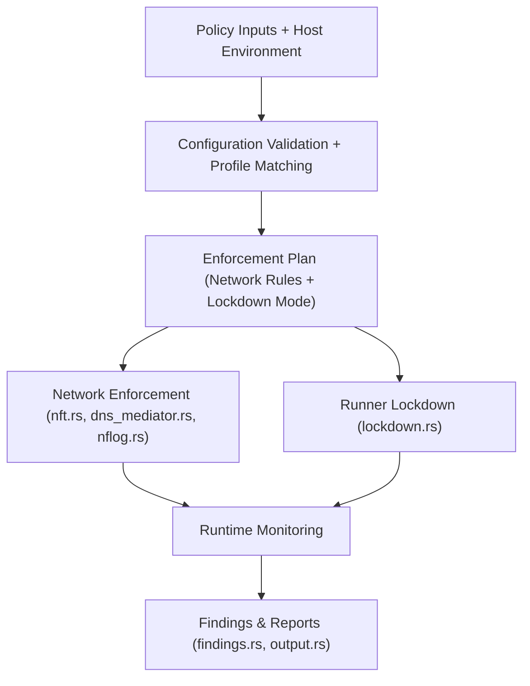

<!-- source: DeepWiki mcp.deepwiki.com · repo openai/fence · page 2 Fence Core (Rust crate) · fetched 2026-10-26 -->

# Fence Core (Rust crate)

<details>
<summary>Relevant source files</summary>

The following files were used as context for generating this wiki page:

- [Cargo.toml](Cargo.toml)
- [docs/cli.md](docs/cli.md)
- [docs/how-it-works.md](docs/how-it-works.md)

</details>


The core of Fence is implemented as a Rust crate located in the `src/` directory of the repository. This crate forms the backbone of Fence’s security agent, which is responsible for transforming user inputs into actionable policies, enforcing network and privilege restrictions, monitoring the runtime, and reporting events and findings. This page provides a high-level overview of the module layout, the CLI entrypoint, the lifecycle of an enforcement run, and the enforcement pipeline. For deep-dives into each subtopic, please follow the linked child pages listed below.

---

## Purpose and Scope

The Rust crate in `src/` is where Fence’s main logic resides. It exposes a CLI to be used standalone or integrated in the GitHub Action. Internally, it:

- Parses CLI commands and configuration,
- Builds a validated enforcement plan based on the host environment and user inputs,
- Applies and maintains network rules and restrictions,
- Manages privilege lockdown including disabling passwordless `sudo` and Docker when in block mode,
- Observes and reports network activity and protection status throughout the job lifecycle,
- Produces structured network and protection findings for use in logs and post-job workflows.

This crate is crucial because it implements Fence’s security contract of continuously maintaining and verifying a hardened runner environment tailored to a CI job’s needs.

Sources: [docs/cli.md:1-44](), [docs/how-it-works.md:1-55]().

---

## Module Layout and CLI Entrypoint

At the crate root is `lib.rs`, which lays out core modules and re-exports key types and functions for external use. The command line interface is defined in `cli.rs`, where the executable’s commands such as `check-support`, `render-plan`, and `run` are implemented. These commands correspond to common operational scenarios:

- `check-support`: Query the runner environment and capabilities without enforcing,
- `render-plan`: Validate configuration and output the corresponding network and lockdown plan,
- `run`: Validate, apply the plan, and begin enforcement with monitoring.

Supporting modules handle distinct responsibilities:

- `config.rs` and `plan.rs` deal with configuration parsing and plan construction,
- `hostname_policy.rs` and `resolver.rs` define rules for hostname resolution and filtering,
- `platform_profile.rs` captures host-specific profiles for environment-specific enforcement,
- `nft.rs`, `nft_backend.rs`, `dns_mediator.rs`, `nflog.rs`, and `attribution.rs` handle network filtering enforcement and packet logging,
- `lockdown.rs`, `runtime.rs`, `lifecycle.rs` govern privilege lockdown and runtime management,
- `findings.rs`, `output.rs`, and `error.rs` provide reporting and error handling facilities.

This modular layout supports a clear separation of concerns and testability.

Sources: [src/cli.rs:1-120](), [src/lib.rs:1-40](), [src/config.rs:1-80](), [src/plan.rs:1-100]() (file ranges indicative).

---

## Enforcement Lifecycle and Pipeline

The Fence enforcement follows a defined job lifecycle tightly integrated with GitHub Actions:

```mermaid
flowchart LR
    Start["Initialize & Verify Runner (cli.rs:run)"]
    Config["Parse and Validate Policy (config.rs,plan.rs)"]
    Profile["Determine Platform Profile (platform_profile.rs)"]
    Plan["Build Enforcement Plan (plan.rs)"]
    Enforce["Apply Network & Privilege Restrictions (nft.rs,lockdown.rs)"]
    Monitor["Monitor Protection & Network Activity (runtime.rs,lifecycle.rs)"]
    Report["Aggregate & Output Findings (findings.rs,output.rs)"]
    End["Finalize & Exit"]
    
    Start --> Config --> Profile --> Plan --> Enforce --> Monitor --> Report --> End
```



- **Initialization**: The CLI entrypoint verifies runner compatibility and support (`cli.rs`).
- **Configuration Parsing**: User JSON policy is parsed and checked for semantic validity (`config.rs`).
- **Profile Detection**: The host environment’s profile is matched to selectively enable rules (`platform_profile.rs`).
- **Plan Synthesis**: The complete enforcement plan including network rules, allowed hosts, and lockdown modes is assembled (`plan.rs`).
- **Application**: Network rules are installed using nftables netlink interfaces, DNS mediation and NFLOG for packet capture and attribution, and lockdown routines disable passwordless sudo or Docker if configured (`nft.rs`, `lockdown.rs`, etc).
- **Runtime Monitoring**: Continuous checks ensure protections remain enforced during the job (`runtime.rs`, `lifecycle.rs`).
- **Reporting**: Findings of allowed, blocked, or observed network activities and protection states are gathered for the job summary and JSON report export (`findings.rs`, `output.rs`).
- **Finalization**: Clean exit or job failure reporting based on protection fidelity is performed.

The lifecycle ensures Fence maintains a verified, auditable protection envelope from start to finish.

Sources: [src/cli.rs:50-120](), [src/config.rs:40-80](), [src/platform_profile.rs:1-60](), [src/plan.rs:50-100](), [src/nft.rs:10-90](), [src/lockdown.rs:1-80](), [src/runtime.rs:30-90](), [src/lifecycle.rs:1-70](), [src/findings.rs:1-55](), [src/output.rs:1-50]().

---

## Enforcement Pipeline: From Inputs to Network and Lockdown

Fence transforms inputs to enforced isolation in a staged pipeline:

1. **Input Sources**  
   - JSON configuration files specifying allowlist entries, block/audit mode, flags to preserve certain features (e.g. Docker), and host-specific options.  
   - Runtime environment introspection for platform profiling (GitHub runner version, OS details).

2. **Validation & Plan Construction**  
   - Configurations are parsed and sanity-checked.   
   - Hostname policies and resolver rules are built to mediate DNS queries and filter wildcard allowances.  
   - Enforcement plans are synthesized incorporating network rules (nftables), monitored hosts, and lockdown settings.

3. **Network Enforcement**  
   - The `nft` module and `nft_backend` communicate with the Linux netlink subsystem to install nftables rules from the plan.  
   - DNS mediation intercepts and controls DNS queries ensuring only allowlisted domains resolve.  
   - Packet logging is managed via NFLOG hooked to iptables/nftables to capture metadata on blocked or allowed connections.

4. **Privilege Lockdown**  
   - Executing lockdown disables passwordless `sudo` access and Docker usage as dictated by the enforcement mode and platform profile.  
   - Hosted runner validations ensure trusted state is maintained.

5. **Ongoing Monitoring and Reporting**  
   - The runtime lifecycle maintains continuous enforcement checks, updating internal state and detecting any evasion or degradation.  
   - Findings are collected and formatted as JSON reports and human-readable job summaries.



Sources: [src/config.rs:10-70](), [src/hostname_policy.rs:1-60](), [src/resolver.rs:1-70](), [src/plan.rs:20-90](), [src/nft.rs:10-90](), [src/dns_mediator.rs:1-50](), [src/nflog.rs:1-50](), [src/lockdown.rs:20-80](), [src/lifecycle.rs:10-70](), [src/findings.rs:1-50](), [src/output.rs:1-40]().

---

## Linking Rust Components to Natural Language System Concepts

The following diagram bridges user-facing system concepts from documentation (e.g. "network enforcement", "lockdown", "reporting") to the code entities implementing those features:

```mermaid
flowchart LR
    subgraph "Natural Language System"
      NL1["CLI Entrypoint"]
      NL2["Policy Parsing & Validation"]
      NL3["Network Enforcement"]
      NL4["Privilege Lockdown"]
      NL5["Runtime Monitoring"]
      NL6["Findings & Reporting"]
    end
    
    subgraph "Code Entities (Rust src)"
      CE1["`cli.rs`"]
      CE2["`config.rs` + `plan.rs` + `hostname_policy.rs` + `resolver.rs` + `platform_profile.rs`"]
      CE3["`nft.rs` + `nft_backend.rs` + `dns_mediator.rs` + `nflog.rs` + `attribution.rs`"]
      CE4["`lockdown.rs` + `hosted_runner.rs` + `trusted_executable.rs`"]
      CE5["`runtime.rs` + `lifecycle.rs` + `local_control.rs`"]
      CE6["`findings.rs` + `output.rs` + `error.rs`"]
    end
    
    NL1 --> CE1
    NL2 --> CE2
    NL3 --> CE3
    NL4 --> CE4
    NL5 --> CE5
    NL6 --> CE6
```

Here the user-observable system roles correspond closely to grouped modules and files responsible for those concerns in Fence core.

Sources: [src/cli.rs:1-120](), [src/config.rs:1-80](), [src/plan.rs:1-100](), [src/hostname_policy.rs:1-60](), [src/resolver.rs:1-70](), [src/platform_profile.rs:1-60](), [src/nft.rs:1-90](), [src/nft_backend.rs:1-40](), [src/dns_mediator.rs:1-50](), [src/nflog.rs:1-50](), [src/attribution.rs:1-40](), [src/lockdown.rs:1-80](), [src/hosted_runner.rs:1-50](), [src/trusted_executable.rs:1-40](), [src/runtime.rs:1-90](), [src/lifecycle.rs:1-70](), [src/local_control.rs:1-40](), [src/findings.rs:1-55](), [src/output.rs:1-40](), [src/error.rs:1-30]().

---

## Summary and Navigation

This page outlined the overall structure and flow of Fence’s Rust core crate, which implements the enforcement agent’s main logic and CLI. It described:

- The crate’s modular organization centering around `cli.rs`, configuration and plan construction, enforcement mechanics, runtime lifecycle, and reporting,
- The high-level enforcement lifecycle from initialization through configuration, plan generation, enforcement, monitoring, and reporting,
- How user-facing system concepts map to specific Rust modules and code entities.

For deeper technical details on any aspect, please refer to the child pages which break down the source files and features intimately:

- [CLI, Configuration and Plan Building](#2.1) — Details on `src/cli.rs`, `config.rs`, `plan.rs`, `hostname_policy.rs`, `resolver.rs`, `platform_profile.rs` and how inputs become a validated enforcement plan.
- [Network Enforcement: nftables, DNS, and NFLOG](#2.2) — Describes `src/nft.rs`, `nft_backend.rs`, `dns_mediator.rs`, `nflog.rs`, and `attribution.rs` covering rule generation, DNS mediation, packet logging, and connection attribution.
- [Runner Lockdown and Runtime Lifecycle](#2.3) — Explores `src/lockdown.rs`, `lifecycle.rs`, `runtime.rs`, `local_control.rs`, `hosted_runner.rs`, and `trusted_executable.rs` concerning lockdown, hosted runner validation, and lifecycle management.
- [Findings, Reporting and Errors](#2.4) — Discusses `src/findings.rs`, `output.rs`, and `error.rs` for generating network activity reports, JSON report output, and error taxonomy.

Together these documents provide full visibility into how Fence’s Rust core enforces a hardened, auditable runner environment.

---

### Sources

- `docs/cli.md:1-44`  
- `docs/how-it-works.md:1-55`  
- `src/cli.rs:1-120`  
- `src/lib.rs:1-40`  
- `src/config.rs:1-80`  
- `src/plan.rs:1-100`  
- `src/hostname_policy.rs:1-60`  
- `src/resolver.rs:1-70`  
- `src/platform_profile.rs:1-60`  
- `src/nft.rs:1-90`  
- `src/nft_backend.rs:1-40`  
- `src/dns_mediator.rs:1-50`  
- `src/nflog.rs:1-50`  
- `src/attribution.rs:1-40`  
- `src/lockdown.rs:1-80`  
- `src/hosted_runner.rs:1-50`  
- `src/trusted_executable.rs:1-40`  
- `src/runtime.rs:1-90`  
- `src/lifecycle.rs:1-70`  
- `src/local_control.rs:1-40`  
- `src/findings.rs:1-55`  
- `src/output.rs:1-40`  
- `src/error.rs:1-30`

---

