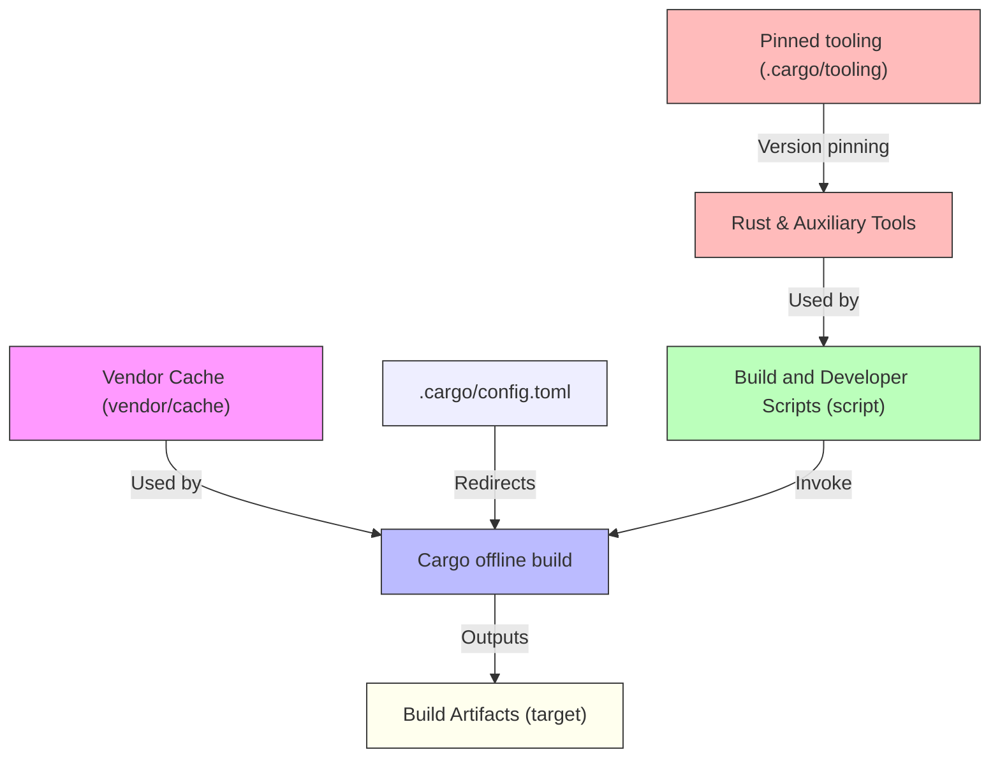

<!-- source: DeepWiki mcp.deepwiki.com · repo openai/fence · page 4 Build, Tooling and Vendoring · fetched 2026-10-26 -->

# Build, Tooling and Vendoring

<details>
<summary>Relevant source files</summary>

The following files were used as context for generating this wiki page:

- [.cargo/config.toml](.cargo/config.toml)
- [Cargo.lock](Cargo.lock)
- [script/bootstrap](script/bootstrap)
- [script/build](script/build)

</details>


This section provides a high-level overview of the build, tooling, and vendoring infrastructure used in the Fence project to enable hermetic, reproducible, and offline-capable builds. It summarizes the core concepts including vendored crates, pinned toolchains, and automation scripts that orchestrate the build process. For detailed technical specifics, related lockfiles, vendoring mechanics, and script usage are covered in dedicated child pages linked below.

---

## Overview

Fence employs a hermetic offline build approach to ensure reproducible builds without external network dependencies. Key aspects supporting this approach include:

- **Vendored Dependencies:** All Rust crates and other tool sources are vendored within the repository under `vendor/` directories to allow building without network access.
- **Pinned Toolchains:** Rust toolchain versions and auxiliary tools such as Zig, cargo extensions (`cargo-zigbuild`, `cargo-llvm-cov`, `cargo-audit`, `cargo-deny`) are pinned by version using lockfiles and version files in `.cargo/tooling/`.
- **Build and Developer Automation:** A collection of shell scripts under `script/` automate tasks such as bootstrapping the environment, preparing toolchains, building, testing, linting, and other repetitive tasks to streamline development and CI.

Together, these elements support secure, offline, and reproducible builds critical for supply chain hardening and consistent developer experience.

---

## Vendored Crates and Offline Build Enforcement

The project relies on the Rust [vendoring feature](https://doc.rust-lang.org/cargo/commands/cargo-vendor.html) to store all crate sources locally within the repository at `vendor/cache`. This effectively locks dependencies to specific versions recorded in `Cargo.lock` and shields the build from network failures and supply chain risks by replacing the default crates.io source with the vendored one through `.cargo/config.toml` configuration:

```toml
[source.crates-io]
replace-with = "vendored-sources"

[source.vendored-sources]
directory = "vendor/cache"

[net]
offline = true
```

This config enforces offline mode (`net.offline = true`) so that Cargo refuses to access the network, using only vendored sources. Additional vendor directories such as `vendor/release-tools` and `vendor/test-tools` contain binaries and tool sources used during release and testing stages.

---

## Pinned Toolchains and Lockfiles

Fence manages pinned versions of Rust and supporting tools by storing version information and lockfiles centrally under `.cargo/tooling/`. This includes:

- Rust toolchains via `rust-toolchain.toml` and `.rust-version` files specifying Rust versions.
- Zig compiler version pin to support cross-compilation and building with `cargo-zigbuild`.
- Cargo extensions pinned with lockfiles to establish consistent tooling behavior.
- Auxiliary tools such as `cargo-llvm-cov`, `cargo-audit`, and `cargo-deny` pinned to specific versions.

The pinning ensures the build environment is deterministic and reproducible across developers and CI infrastructure.

---

## Build and Developer Automation Scripts

A suite of shell scripts located in the `script/` directory codify common build, tooling, and environment tasks with unified error handling and environment setup.

Key scripts include:

- `script/bootstrap`: Validates Rust toolchain presence, ensures vendor cache is populated, and verifies the environment is ready for an offline build.
- `script/build`: Performs building of the project with optional release mode, cross-compilation targeting, and universal macOS builds. It handles toolchain environment preparation and binary output management.
- `script/prepare-rust`: Facilitates Rust toolchain installation and target addition.
- `script/install-zig` and `script/install-test-tools`: Manage auxiliary tool installation for cross-compilation and testing.
- Various linting, testing, server, and update scripts streamline validation and development workflows.

These scripts collaborate to deliver a reliable development environment while abstracting away platform-specific complexities.

---

## Integration of Vendoring, Tooling, and Build

Below is a schematic overview illustrating how vendoring, pinned toolchains, and build scripts interoperate:



This diagram associates the natural language concepts like "Vendor Cache" and "Pinned Tooling" with precise code artifacts and files: vendored source directories, `.cargo/config.toml`, `.cargo/tooling/` version files, plus the build scripts invoking Rust and auxiliary tooling and controlling the build lifecycle.

---

## Further Reading and Detailed Documentation

This page is a parent overview of Fence's build and tooling approach. For comprehensive details on each aspect, please refer to the following child pages:

- **[Pinned Toolchains and Lockfiles](#4.1)** — Describes version pin files and lockfiles stored under `.cargo/tooling` for Rust toolchain, Zig, and cargo extensions. Includes configuration files like `rust-toolchain.toml` and `.rust-version`.

- **[Vendor Directory and Offline Builds](#4.2)** — Explains vendored crate storage in `vendor/cache`, other vendor resources, Cargo's source replacement strategy, and offline enforcement through `.cargo/config.toml`. Covers validation scripts that confirm lockfile integrity.

- **[Developer Scripts](#4.3)** — Documents in detail the scripts under `script/` directory including `bootstrap`, `build`, `env`, `lint`, `test`, `server`, and others with examples of their usage and how they delegate to toolchain installations and vendored sources.

---

# Summary Table

| Aspect               | Location                           | Purpose                             |
|----------------------|----------------------------------|-----------------------------------|
| Vendored Crates      | `vendor/cache`                   | Offline crate sources for builds   |
| Cargo Config         | `.cargo/config.toml`             | Redirect crates.io source to vendored and enforce offline |
| Toolchain Pinning    | `.cargo/tooling/`                | Store pins for Rust, Zig, and cargo tooling versions |
| Build Scripts        | `script/`                       | Automation for build, test, lint, and environment bootstrap |
| Lockfiles            | `Cargo.lock`, tooling lockfiles  | Ensure dependency versions remain fixed |

---

By combining vendoring, pinned toolchains, and scripted automation, Fence achieves a robust and repeatable build ecosystem fostering secure and consistent development and deployment.

---

### Sources

- `.cargo/config.toml:1-9`  
- `Cargo.lock:1-244`  
- `script/bootstrap:1-18`  
- `script/build:1-252`

---

