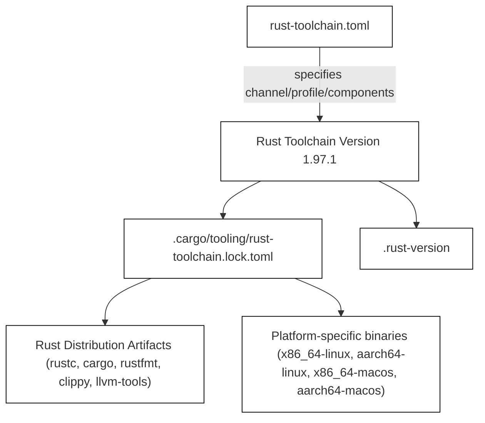
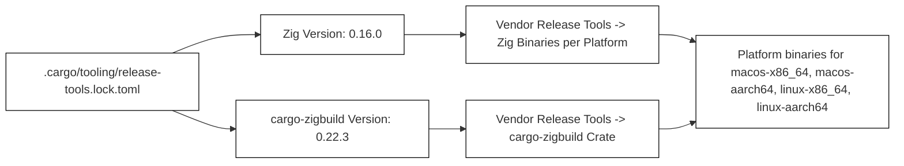
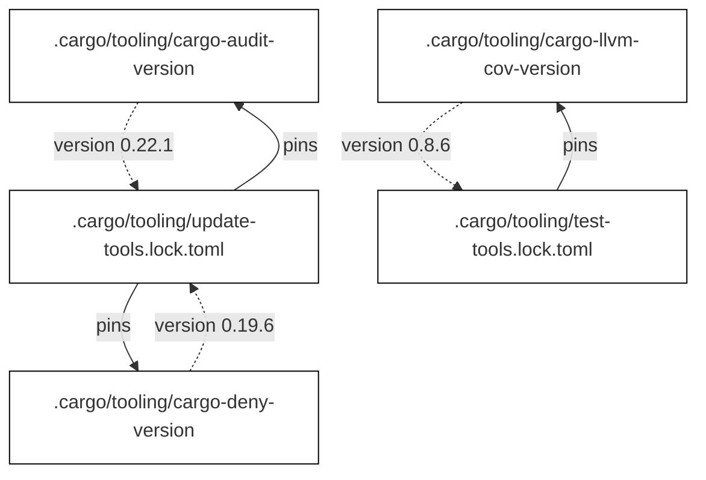
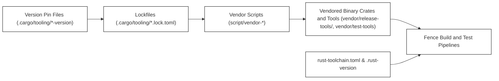

<!-- source: DeepWiki mcp.deepwiki.com · repo openai/fence · page 4.1 Pinned Toolchains and Lockfiles · fetched 2026-10-26 -->

# Pinned Toolchains and Lockfiles

Relevant source files

The following files were used as context for generating this wiki page:

- [.cargo/tooling/cargo-audit-version](.cargo/tooling/cargo-audit-version)
- [.cargo/tooling/cargo-deny-version](.cargo/tooling/cargo-deny-version)
- [.cargo/tooling/cargo-llvm-cov-version](.cargo/tooling/cargo-llvm-cov-version)
- [.cargo/tooling/cargo-zigbuild-version](.cargo/tooling/cargo-zigbuild-version)
- [.cargo/tooling/release-tools.lock.toml](.cargo/tooling/release-tools.lock.toml)
- [.cargo/tooling/rust-toolchain.lock.toml](.cargo/tooling/rust-toolchain.lock.toml)
- [.cargo/tooling/test-tools.lock.toml](.cargo/tooling/test-tools.lock.toml)
- [.cargo/tooling/update-tools.lock.toml](.cargo/tooling/update-tools.lock.toml)
- [.cargo/tooling/zig-version](.cargo/tooling/zig-version)
- [.rust-version](.rust-version)
- [rust-toolchain.toml](rust-toolchain.toml)

This section details the version pinning and lockfile management of critical build and tooling dependencies in the Fence codebase. Specifically, it describes how Fence manages pinned versions and lockfiles under the `.cargo/tooling` directory to ensure reproducible builds and consistent development environments. This includes pinned Rust toolchains, Zig, and various Cargo tools used for building, testing, and auditing such as `cargo-zigbuild`, `cargo-llvm-cov`, `cargo-audit`, and `cargo-deny`. Also covered are the root-level Rust toolchain configuration files `rust-toolchain.toml` and `.rust-version`.

---

## 1. Overview of Version Pinning in Fence Tooling

Fence maintains strong control over its development and build dependencies by pinning exact versions of all critical toolchain components involved in its Rust and build tooling toolchain.

- The `.cargo/tooling` directory contains lockfiles that pin:
  - The Rust distribution (compiler, cargo, clippy, rustfmt, LLVM tools)
  - The Zig compiler and build tool version
  - Cargo extensions for Zig-based builds (`cargo-zigbuild`)
  - Code coverage tooling (`cargo-llvm-cov`)
  - Security audit tools (`cargo-audit`, `cargo-deny`)

- Root level defines clearer toolchain configurations for Rust with:
  - `rust-toolchain.toml`: defines Rust channel, profile, and components for the toolchain.
  - `.rust-version`: simple file with the Rust version string to assist legacy tooling or editors.

This approach enables deterministic builds with offline support and prevents build divergence or accidental upgrades during development or CI.

---

## 2. Rust Toolchain Pinning and Lockfile (`.cargo/tooling/rust-toolchain.lock.toml`, `rust-toolchain.toml`, `.rust-version`)

Fence pins the Rust toolchain version and distribution by maintaining a detailed lockfile `.cargo/tooling/rust-toolchain.lock.toml` that specifies the exact Rust version, channels, platforms, and component distributions.

Key implementation details:

- The lockfile lists the Rust version (`1.97.1`), manifest URL, SHA256 checksum for integrity verification, and supported host and target platforms including Linux and macOS (both x86_64 and aarch64).
- Each component (rustc, cargo, rustfmt, clippy, llvm-tools-preview) is listed with precise artifact URLs and checksums.
- This lockfile acts as a human-reviewed source of truth for the Rust distribution Fence commits and uses, generated by the `script/vendor-rust` script.
- The top-level `rust-toolchain.toml` references this pinned version with:
  - `channel = "1.97.1"`
  - `profile = "minimal"` to include minimal components
  - `components` array specifying tools for format, lint, and LLVM support (`rustfmt`, `clippy`, `llvm-tools-preview`).

- The `.rust-version` file contains only the version string `1.97.1` for compatibility or quick version lookups.

This layered structuring enables Fence to control Rust toolchain versions robustly while supporting minimal CLI toolchain load and editor integrations.

#### Rust Toolchain Pinning Diagram

Sources: `.cargo/tooling/rust-toolchain.lock.toml:1-177`, `rust-toolchain.toml:1-5`, `.rust-version:1-2`

---

## 3. Zig Build Tool and Cargo-Zigbuild Versioning (`.cargo/tooling/release-tools.lock.toml`, `.cargo/tooling/zig-version`, `.cargo/tooling/cargo-zigbuild-version`)

Fence uses Zig as part of its build process, especially for some release tooling and compilation steps. The precise Zig version is pinned via:

- `.cargo/tooling/zig-version`: contains the Zig compiler version string `0.16.0`.

The Cargo extension `cargo-zigbuild` (for integrating Rust cross-compile builds with Zig) is also pinned:

- `.cargo/tooling/cargo-zigbuild-version`: specifies the version `0.22.3`.

The lockfile `.cargo/tooling/release-tools.lock.toml` is the central authoritative lockfile for release build tooling versions including Zig and cargo-zigbuild. Details include:

- `zig_version` and `cargo_zigbuild_version` fields.
- Downstream URLs and SHA256 checksums to verify black-box binaries before inclusion in the vendored tools directory.
- List of platform-specific Zig binaries with their paths inside the `vendor/release-tools/zig/` directory.
- Crate package details for cargo-zigbuild with download URL and checksums.

The lockfile is generated and used by the `script/vendor-release-tools` helper script, which downloads, verifies, and populates the vendored release tool artifacts.

#### Zig and Cargo-Zigbuild Tooling Version Diagram

Sources: `.cargo/tooling/release-tools.lock.toml:1-53`, `.cargo/tooling/zig-version:1-2`, `.cargo/tooling/cargo-zigbuild-version:1-2`

---

## 4. Cargo Tools Lockfile Versions (`cargo-audit`, `cargo-deny`, `cargo-llvm-cov`)

Several Cargo subcommands and audit/testing tools are specifically pinned with minimal version files under `.cargo/tooling` and via lockfiles:

- `.cargo/tooling/cargo-audit-version`: contains pinned version `0.22.1`.
- `.cargo/tooling/cargo-deny-version`: contains pinned version `0.19.6`.
- `.cargo/tooling/cargo-llvm-cov-version`: contains pinned version `0.8.6`.

Additionally, two lockfiles cover the offline vendor details with full download URL and checksum verification:

- `.cargo/tooling/update-tools.lock.toml`:
  - Locks online update paths for Cargo tools such as `cargo-audit` and `cargo-deny`.
  - Specifies tool name, binary, version, crate URL, and SHA256 checksums for crate and lockfile.
- `.cargo/tooling/test-tools.lock.toml`:
  - Covers testing tools like `cargo-llvm-cov`.
  - Specifies version, platform binaries, target triples, URLs, and SHA256 checksums.
  - Also includes license files with checksum verification.

These lockfiles are generated by scripts (`script/vendor-update-tools` and `script/vendor-test-tools` respectively) to ensure the exact audit and testing toolchain versions are known and immutable.

#### Audit and Test Tool Version Pinning Diagram

Sources: `.cargo/tooling/cargo-audit-version:1-2`, `.cargo/tooling/cargo-deny-version:1-2`, `.cargo/tooling/cargo-llvm-cov-version:1-2`, `.cargo/tooling/update-tools.lock.toml:1-22`, `.cargo/tooling/test-tools.lock.toml:1-61`

---

## 5. Summary of Files and Their Roles

| File Path                             | Purpose                                                            |
|-------------------------------------|--------------------------------------------------------------------|
| `.cargo/tooling/rust-toolchain.lock.toml` | Locks Rust compiler and toolchain artifacts with download URLs, SHA256 checksums, and platform targets. Source of truth for Rust distribution pinning. |
| `rust-toolchain.toml`                | Config file specifying the Rust toolchain channel, minimal profile, and components (rustfmt, clippy, llvm-tools-preview). |
| `.rust-version`                     | Plain string file specifying Rust version `1.97.1` for backward compatibility. |
| `.cargo/tooling/release-tools.lock.toml` | Pins versions and download verification for Zig compiler and `cargo-zigbuild` tool, including platform-specific binaries. |
| `.cargo/tooling/zig-version`         | Contains the Zig compiler version `0.16.0`.                        |
| `.cargo/tooling/cargo-zigbuild-version` | Contains the version string `0.22.3` for cargo-zigbuild.           |
| `.cargo/tooling/cargo-audit-version` | Contains Cargo Audit version `0.22.1`.                             |
| `.cargo/tooling/cargo-deny-version`  | Contains Cargo Deny version `0.19.6`.                              |
| `.cargo/tooling/cargo-llvm-cov-version` | Contains Cargo LLVM Coverage version `0.8.6`.                    |
| `.cargo/tooling/update-tools.lock.toml` | Locks Cargo audit and deny tool crates with URLs and checksums for offline builds. |
| `.cargo/tooling/test-tools.lock.toml`   | Locks Cargo coverage tool with platform binaries, licenses, URLs, and checksums. |

---

## 6. Dataflow and Tooling Usage in the Build Process

- Tooling version files (`*-version`) provide simple, programmatically readable version pins for scripting or runtime checks.
- Lockfiles (`*.lock.toml`) act as authoritative sources for exact artifact versions along with URLs and SHA256 checksums for security and reproducibility.
- Scripts such as `script/vendor-rust`, `script/vendor-release-tools`, `script/vendor-update-tools`, and `script/vendor-test-tools` ingest these lockfiles, download the necessary binaries or crates, verify integrity, and place them into the vendored directories (`vendor/release-tools`, `vendor/test-tools`).
- The pinned Rust toolchain files ensure that developer and CI environments use consistent compiler and tool versions, enforced by `rustup` or CI tooling invoking `rustup` with `rust-toolchain.toml`.
- The pinned Cargo tools and binary dependencies allow Fence to build and audit with known-safe versions, supporting offline or hermetic build regimes.
- `rust-toolchain.toml` defines the minimal Rust components installed, reducing bloat and ensuring needed tool availability (`rustfmt`, `clippy`, `llvm-tools-preview`).

#### High-level Dataflow from Version Pin Files to Tooling Usage

Sources: All cited files above

---

# Conclusion

Fence employs a comprehensive and layered version pinning and lockfile system for all critical tools used in its build and audit pipelines. This includes explicit locking of Rust and Zig compiler versions as well as Cargo tools for building, testing, and auditing. The use of human-reviewed lockfiles with SHA256 verification, combined with minimal toolchain profile configuration, enables a hermetic build environment consistent across development machines and CI infrastructure. The tooling version files enable simple scripting checks, while detailed lockfiles serve as authoritative manifests for vendoring and offline builds.

This results in strong reproducibility and supply chain integrity for the Fence project as part of its build, vendoring, and release engineering practices.

---

# References

- `.cargo/tooling/rust-toolchain.lock.toml:1-177`
- `rust-toolchain.toml:1-5`
- `.rust-version:1-2`
- `.cargo/tooling/release-tools.lock.toml:1-53`
- `.cargo/tooling/zig-version:1-2`
- `.cargo/tooling/cargo-zigbuild-version:1-2`
- `.cargo/tooling/cargo-audit-version:1-2`
- `.cargo/tooling/cargo-deny-version:1-2`
- `.cargo/tooling/cargo-llvm-cov-version:1-2`
- `.cargo/tooling/update-tools.lock.toml:1-22`
- `.cargo/tooling/test-tools.lock.toml:1-61`

---

