# Page: Overview

# Overview

<details>
<summary>Relevant source files</summary>

The following files were used as context for generating this wiki page:

- [AGENTS.md](AGENTS.md)
- [README.md](README.md)
- [docs/how-it-works.md](docs/how-it-works.md)
- [docs/v0.md](docs/v0.md)

</details>


This page provides a high-level introduction to Fence, a GitHub Action designed for egress filtering and runner lockdown. It outlines the core purpose of Fence, the top-level architecture of the project, and points to detailed child pages for specific topics.

---

## What is Fence?

Fence is a security-focused GitHub Action that enforces network egress restrictions and privileges lockdown on supported GitHub-hosted Linux runners. Specifically, it:

- Blocks outbound network connections except those explicitly required by GitHub Actions workflows or allowed through a user-defined allowlist.
- Disables passwordless `sudo` access.
- Disables Docker and container access by default.
- Monitors the job runtime to ensure protections remain intact.
- Produces reports on network activity as job summaries and structured logs.

Fence is optimized and audited for Ubuntu LTS x64 runners (e.g., `ubuntu-24.04` and `ubuntu-latest`), providing a hardened environment that reduces the risk of data exfiltration or privilege escalation from workflow steps.

Fence supports two operational modes:

- **Block Mode (default):** Actively blocks disallowed network connections and disables sudo/Docker.
- **Audit Mode:** Observes and reports on network activities without blocking or disabling features, ideal for building allowlists and troubleshooting.

Users configure Fence primarily through inputs to the GitHub Action, including the `allowlist` of permitted destinations, execution mode, container policy, and artifact upload settings.

For detailed usage, configuration, and examples, see the child page [Getting Started and Usage](#1.1).

**Sources:**  
`README.md:12-137`  
`docs/how-it-works.md:1-58`  
`AGENTS.md:1-49`  
`docs/v0.md:1-71`  

---

## Top-Level Architecture

The Fence codebase is structured to separate core enforcement logic, action wrapper logic, build tooling, and continuous integration workflows. The four primary code directories are:

### 1. `src/` — Rust CLI and Core Agent

- Implements the core enforcement engine as a Rust command-line application.
- Responsible for parsing configuration, building enforcement plans, managing nftables firewall rules, DNS mediation, network monitoring (via NFLOG), and runtime lifecycle functions such as lockdown and evidence validation.
- Acts as the policy authority and runtime monitor enforcing network restrictions and privilege lockdown on the runner.
  
### 2. `action/` — Node.js GitHub Action Wrapper

- Contains the Node TypeScript/CJS wrapper that invokes the Rust CLI binary.
- Handles setup, input parsing, binary verification, and post-job evidence validation.
- Implements logging, secret sanitization, and interaction with GitHub Actions environment.
- Bundles the Fence binary together with verification manifests, ensuring only audited binaries run.

### 3. `script/` — Build, Vendoring, and Utility Scripts

- Includes scripts to bootstrap development environments, build artifacts, assemble the action bundle, validate vendored dependencies, and more.
- Manages pinned Rust and other toolchains to support hermetic, offline reproducible builds.
- Supports release engineering tasks such as bundle validation and host classification.

### 4. `.github/workflows/` — CI Pipelines

- Defines GitHub Actions workflows for linting, testing (unit and acceptance), building, release automation, action acceptance, security auditing, and integration testing.
- Implements continuous validation of Fence builds, action bundles, and security compliance to maintain high code and supply chain integrity.

---

## Visualizing Fence's Core System and Code Entities

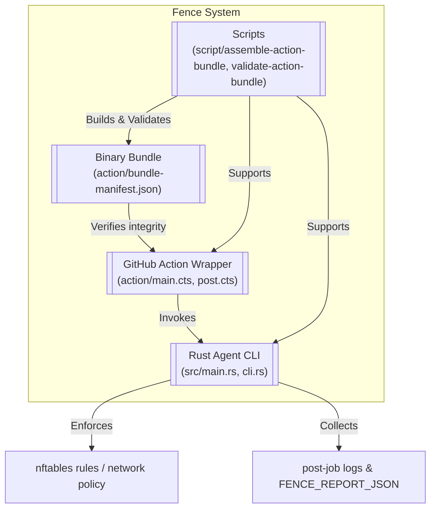

**Legend:**  
- `action/main.cts` & `post.cts`: Action wrapper entrypoints  
- `src/cli.rs` & `src/main.rs`: Rust CLI logic  
- `script/`: Build and validation scripts  
- `action/bundle-manifest.json`: Signed agent binary metadata  

Sources:  
`README.md:12-137`  
`docs/how-it-works.md:3-18`  
`AGENTS.md:1-14`  

---

## Placement of Major Code Responsibilities

This mermaid diagram connects main system concepts to key code entities in the source code:

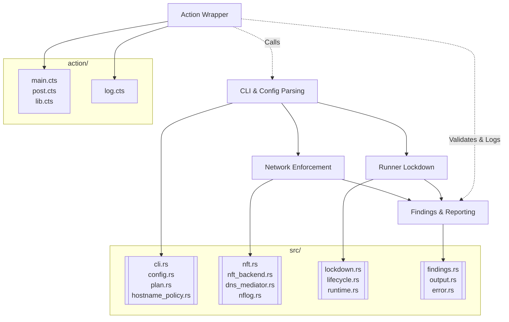

Sources:  
`README.md:12-137`  
`AGENTS.md:1-20`  

---

## Available Child Pages for More Details

Fence separates detailed topics into dedicated pages:

| Child Page | Contents |
|------------|----------|
| [Getting Started and Usage](#1.1) | Installation, configuration, example workflows, allowlist syntax, operational modes (audit/block), troubleshooting tips. |
| [Project History and Documentation Map](#1.2) | Overview of docs/ directory, historical context, relationship of docs to source code, and project evolution. |

For an in-depth understanding of Fence usage, start with [Getting Started and Usage](#1.1). To understand the documentation sources and historical development, see [Project History and Documentation Map](#1.2).

---

This overview page should assist technical users and developers in understanding the purpose, architecture, and organization of the Fence project, and guide them to specialized documentation for further exploration.

---

**Sources:**  
`README.md:1-143`  
`docs/how-it-works.md:1-58`  
`AGENTS.md:1-49`  
`docs/v0.md:1-71`

---

# Page: Getting Started and Usage

# Getting Started and Usage

<details>
<summary>Relevant source files</summary>

The following files were used as context for generating this wiki page:

- [action.yml](action.yml)
- [docs/allowlist.md](docs/allowlist.md)
- [docs/examples.md](docs/examples.md)
- [docs/getting-started.md](docs/getting-started.md)
- [docs/troubleshooting.md](docs/troubleshooting.md)

</details>


This page details how to integrate Fence into a GitHub Actions workflow, configure its inputs, interpret operating modes (audit vs. block), write valid allowlists, implement common patterns, and troubleshoot execution failures. Fence operates as a GitHub Action wrapper (`action.yml`) that launches a hardened Linux x64 Rust binary agent to enforce egress filtering and runner lockdown [action.yml:1-32](), [docs/getting-started.md:1-23]().

---

## Workflow Integration and Inputs

Fence must be added as the first step in a GitHub-hosted runner job (`ubuntu-24.04` or `ubuntu-latest`) so that subsequent steps execute within the restricted runtime environment [docs/getting-started.md:1-23](). 

The Action interface is defined in `action.yml`, accepting several inputs that control its behavior, enforcement mode, and allowed destinations [action.yml:3-27]():

| Input Name | Description | Required |
| :--- | :--- | :--- |
| `config` | Advanced inline strict JSON Fence configuration; overrides all other native inputs [action.yml:4-6](). | False |
| `mode` | Enforcement mode: either `block` or `audit` [action.yml:7-9](). | False |
| `invocation_id` | Lowercase slug override; defaults to `fence-${GITHUB_RUN_ID}-${GITHUB_RUN_ATTEMPT}` [action.yml:10-12](). | False |
| `container_policy` | Container handling in block mode: either `disable` or `unsafe_preserve` [action.yml:13-15](). | False |
| `platform_profile` | Platform profile override; supports `github_hosted_workflow_bootstrap_v5` [action.yml:16-18](). | False |
| `disable_broad_github_domains` | Removes broad GitHub domains and watchdog settings from the default profile [action.yml:19-21](). | False |
| `allow_github_artifacts` | Allows bounded GitHub artifact uploads in block mode [action.yml:22-24](). | False |
| `allowlist` | Multiline string of allowed destinations, hostnames, wildcards, ports, or CIDRs [action.yml:25-27](). | False |

### Action Input Processing Flow

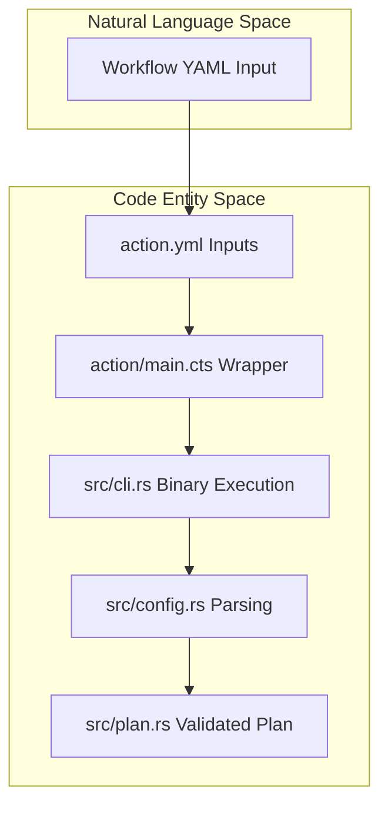
**Sources:** `action.yml:1-33`, `docs/getting-started.md:1-23`

---

## Operating Modes: Audit vs. Block

Fence operates in one of two primary modes, set via the `mode` input or JSON configuration [action.yml:7-9](), [docs/examples.md:15-26](), [docs/getting-started.md:50-61]():

1. **Block Mode (Default)**:
   - Enforces strict network egress filtering via `nftables` and DNS mediation [docs/getting-started.md:24-34]().
   - Disables passwordless `sudo`, Docker, and container runtimes by default [docs/getting-started.md:24-34]().
   - Fails connections that do not match the built-in profile or explicit allowlist entries [docs/getting-started.md:24-34]().

2. **Audit Mode**:
   - Records all attempted outbound network connections without blocking traffic [docs/getting-started.md:50-61]().
   - Does not disable `sudo` or container runtimes, though it may restore root ownership of system directories like `/etc` and `/usr` [docs/getting-started.md:50-61]().
   - Emits findings to the GitHub job summary to assist developers in building an accurate allowlist [docs/getting-started.md:50-61]().

### Mode Execution Lifecycle

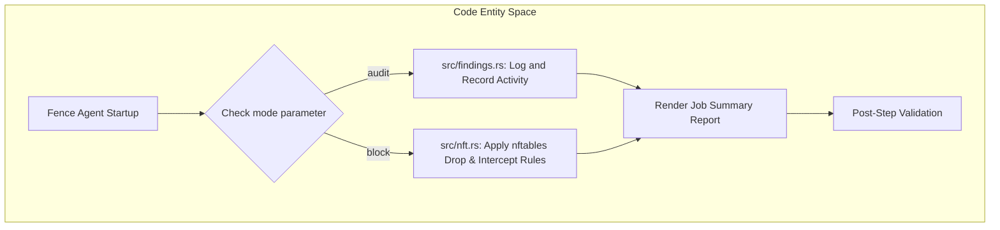
**Sources:** `docs/getting-started.md:24-61`, `docs/examples.md:15-26`

---

## Allowlist Syntax and Limits

Allowlists specify permitted network destinations using a line-oriented text format [docs/allowlist.md:1-15](). Fence ignores blank lines and comments prefixed with `#` [docs/allowlist.md:14]().

### Supported Destination Formats

```text
# HTTPS hostname (defaults to TCP port 443)
example.com

# Hostname with custom ports or explicit protocols
example.com:8443
tcp://example.com:443
udp://dns.example.com:53

# Explicit hostname syntax
hostname example.com tcp 443

# Wildcard patterns (matching exact depth)
*.example.com
*.*.example.com

# IP addresses and CIDR networks
ip 192.0.2.10 tcp 443
cidr 192.0.2.0/24 udp 123
```
*Sources: [docs/allowlist.md:18-43]()*

### Limits and Constraints
- **Entry Limit**: An allowlist can contain a maximum of **64 unique entries** [docs/allowlist.md:47-51](). Normalization deduplicates capitalization and formatting equivalents, but distinct ports, protocols, and destination types count separately [docs/allowlist.md:47-51](). The 65th entry causes validation failure before runner modification [docs/allowlist.md:51]().
- **Wildcard Constraints**: Each `*` matches exactly one domain label (e.g., `*.example.com` matches `api.example.com` but not `example.com` or `one.two.example.com`) [docs/allowlist.md:56-64](). Across an entire job, wildcard entries can match at most **eight unique hostnames** [docs/allowlist.md:65]().
- **CIDR Validation**: CIDR ranges must start at the network address; entries with host bits set are rejected during validation [docs/allowlist.md:67-79]().

### Allowlist Parsing and Validation Pipeline

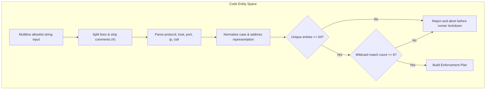
**Sources:** `docs/allowlist.md:1-88`

---

## Configuration Examples

Workflows invoke Fence by referencing a pinned commit SHA and release version [docs/examples.md:1-4]().

### Default Block Mode
```yaml
steps:
  - uses: openai/fence@<commit-sha> # pin@vX.Y.Z
```
*Sources: [docs/examples.md:5-12]*

### Audit Mode Workflow
```yaml
steps:
  - uses: openai/fence@<commit-sha> # pin@vX.Y.Z
    with:
      mode: audit
```
*Sources: [docs/examples.md:15-24]*

### Comprehensive Allowlist with Custom Ports
```yaml
steps:
  - uses: openai/fence@<commit-sha> # pin@vX.Y.Z
    with:
      allowlist: |
        registry.example.com:8443
        udp://dns.example.com:53
        cidr 192.0.2.0/24 udp 123
```
*Sources: [docs/examples.md:39-54]*

### Artifact Uploads and Container Handling
```yaml
steps:
  - uses: openai/fence@<commit-sha> # pin@vX.Y.Z
    with:
      allow_github_artifacts: true
      container_policy: unsafe_preserve
      allowlist: |
        auth.docker.io
```
*Sources: [docs/examples.md:58-97]*

---

## Troubleshooting

Common operational issues and diagnostic paths include:

- **Startup Failures & Unsupported Environments**: Fence requires a GitHub-hosted x64 runner running `ubuntu-24.04` or `ubuntu-latest` [docs/troubleshooting.md:5-8](). Self-hosted runners and non-x64 architectures are unsupported [docs/troubleshooting.md:7]().
- **Local Control Inventory Errors**: `local_control_inventory_unavailable` indicates Fence could not fully inspect local services or socket owners [docs/troubleshooting.md:11](). Fence retries acquisition within fixed limits but requires a complete inventory [docs/troubleshooting.md:11](). Enable `ACTIONS_STEP_DEBUG` set to `true` for detailed logs [docs/troubleshooting.md:13]().
- **Blocked Network Requests**: Temporary activation of `mode: audit` identifies unexpected endpoints requiring allowlist addition [docs/troubleshooting.md:15-28]().
- **Critical Drift**: Critical drift indicates a required security control or component was modified or terminated mid-job; Fence fails the run to preserve security guarantees [docs/troubleshooting.md:53-57]().
- **Direct Agent Execution**: Running the Rust binary directly (`fence run`) returns `trusted_launcher_required`; execution must be initiated via the GitHub Action wrapper [docs/troubleshooting.md:65-67]().

*Sources: [docs/troubleshooting.md:1-70]*

---

# Page: Project History and Documentation Map

# Project History and Documentation Map

<details>
<summary>Relevant source files</summary>

The following files were used as context for generating this wiki page:

- [LICENSE](LICENSE)
- [docs/cli.md](docs/cli.md)
- [docs/development.md](docs/development.md)
- [docs/history.md](docs/history.md)
- [docs/repository-settings.md](docs/repository-settings.md)

</details>


## Purpose and Scope
This page serves as a comprehensive tour of the repository's documentation directory (`docs/`), tracking the project's evolution, command-line interface, local development workflows, and repository governance settings. It bridges natural language specifications and system concepts to the underlying code entities, scripts, and configuration files.

---

## 1. Documentation Tour and Architecture
The `docs/` directory contains core reference guides detailing how Fence operates, how to develop locally, and the history of architectural decisions. These documents correlate directly with components in `src/`, `script/`, and `.github/workflows/`.

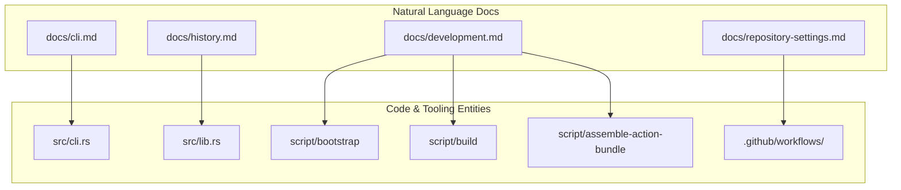
*Diagram 1: Bridging Documentation Files to Code and Script Entities.*

**Sources:** `docs/cli.md:1-45`, `docs/development.md:1-47`, `docs/history.md:1-61`, `docs/repository-settings.md:1-78`

---

## 2. Implementation History & Evolution
The project history documented in `docs/history.md` traces Fence from its inception as a Rust crate with pinned toolchains to a hardened, root-supervised GitHub Action.

### Major Milestone Evolution
- **Bootstrap & Policy:** Initiated with strict JSON configuration, typed allowlist entries, and bounded hostname resolution [docs/history.md:5-10]().
- **Native Network Evidence:** Adoption of dedicated `nftables` tables, atomic firewall updates, and safe-Rust NFLOG configuration writers [docs/history.md:12-16]() (replacing unmaintained netlink dependencies).
- **Resident Protection Lifecycle:** Integration with GitHub-hosted `ubuntu-24.04` x64 runner fingerprints, root-owned runtime files, `systemd` supervision, and mandatory rollback checks [docs/history.md:18-25]().
- **Hosted Workflow Compatibility:** Implementation of bounded DNS-mediated GitHub Actions policies, response-local CNAME chaining, and short-lived firewall rules [docs/history.md:27-31]().
- **One-PR Action Publication:** Transition from two-stage releases to a source-only `main` branch model authorized by signed distribution commits (`D`) generated from source commits (`M`) [docs/history.md:38-43]().

**Sources:** `docs/history.md:1-61`

---

## 3. CLI Reference and Execution Map
While Fence is primarily designed to run as a GitHub Action, its Rust agent exposes a CLI utility for inspection and validation [docs/cli.md:1-10]().

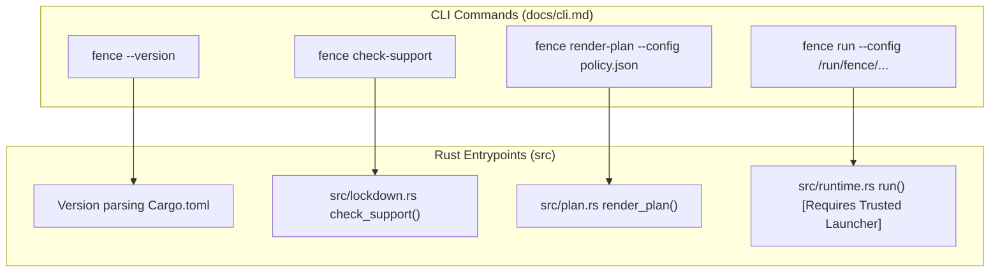
*Diagram 2: Mapping CLI Commands to Underlying Rust Functions.*

### Key CLI Operations
- `--version`: Prints agent version derived from `Cargo.toml` or `action/bundle-manifest.json` [docs/cli.md:12-18]().
- `check-support`: Inspects operating system architecture, backend availability, and reference runner profile via `src/lockdown.rs` [docs/cli.md:20-27]().
- `render-plan`: Validates JSON configuration and previews nftables firewall rules without applying them [docs/cli.md:28-34]().
- `run`: Initiates the enforcement runtime. Direct execution fails with `trusted_launcher_required` unless spawned by the authorized root-owned service wrapper [docs/cli.md:36-43]().

**Sources:** `docs/cli.md:1-45`

---

## 4. Local Development and Build Automation
Local development relies on offline-first scripts housed in `script/` that operate against vendored dependencies and pinned toolchains [docs/development.md:1-17]().

### Development Lifecycle Scripts
- `script/prepare-rust`: Downloads and verifies the pinned Rust toolchain (requires network access) [docs/development.md:8-15]().
- `script/bootstrap`, `script/test`, `script/lint`, `script/build`: Execute offline using checked-in lockfiles and vendor directories [docs/development.md:9-17]().
- `script/assemble-action-bundle`: Packages an existing agent binary and manifest into a GitHub Action bundle without downloading external artifacts [docs/development.md:33-36]().

> [!WARNING]
> Do not execute hosted-runner or lockdown tests on local developer machines or reusable runners, as they modify host-level security configurations intended exclusively for disposable GitHub-hosted runners [docs/development.md:43-45]().

**Sources:** `docs/development.md:1-47`

---

## 5. Repository Settings and Release Engineering
To maintain supply-chain integrity, Fence enforces strict GitHub repository settings, required status checks, branch protection rules, and CODEOWNERS boundaries [docs/repository-settings.md:1-60]().

### Required Branch Protection & CI Checks
- **Required Status Checks:** `lint`, `test`, `build`, `acceptance`, `action acceptance`, and `integration` must pass before merging to `main` [docs/repository-settings.md:5-15]().
- **CODEOWNERS Enforcement:** Sensitive paths—including `.github/workflows/**`, `action.yml`, `script/**`, `Cargo.toml`, and `vendor/**`—require explicit CODEOWNER review [docs/repository-settings.md:40-59]().
- **Immutable Releases:** The `release` environment requires source and distribution commit validation (`M -> D`), producing signed distribution commits tagged immutably [docs/repository-settings.md:60-68]().

**Sources:** `docs/repository-settings.md:1-78`

---

# Page: Fence Core (Rust crate)

# Fence Core (Rust crate)

<details>
<summary>Relevant source files</summary>

The following files were used as context for generating this wiki page:

- [Cargo.toml](Cargo.toml)
- [docs/cli.md](docs/cli.md)
- [docs/how-it-works.md](docs/how-it-works.md)

</details>


The core of Fence is implemented as a Rust crate located in the `src/` directory of the repository. This crate forms the backbone of Fence’s security agent, which is responsible for transforming user inputs into actionable policies, enforcing network and privilege restrictions, monitoring the runtime, and reporting events and findings. This page provides a high-level overview of the module layout, the CLI entrypoint, the lifecycle of an enforcement run, and the enforcement pipeline. For deep-dives into each subtopic, please follow the linked child pages listed below.

---

## Purpose and Scope

The Rust crate in `src/` is where Fence’s main logic resides. It exposes a CLI to be used standalone or integrated in the GitHub Action. Internally, it:

- Parses CLI commands and configuration,
- Builds a validated enforcement plan based on the host environment and user inputs,
- Applies and maintains network rules and restrictions,
- Manages privilege lockdown including disabling passwordless `sudo` and Docker when in block mode,
- Observes and reports network activity and protection status throughout the job lifecycle,
- Produces structured network and protection findings for use in logs and post-job workflows.

This crate is crucial because it implements Fence’s security contract of continuously maintaining and verifying a hardened runner environment tailored to a CI job’s needs.

Sources: [docs/cli.md:1-44](), [docs/how-it-works.md:1-55]().

---

## Module Layout and CLI Entrypoint

At the crate root is `lib.rs`, which lays out core modules and re-exports key types and functions for external use. The command line interface is defined in `cli.rs`, where the executable’s commands such as `check-support`, `render-plan`, and `run` are implemented. These commands correspond to common operational scenarios:

- `check-support`: Query the runner environment and capabilities without enforcing,
- `render-plan`: Validate configuration and output the corresponding network and lockdown plan,
- `run`: Validate, apply the plan, and begin enforcement with monitoring.

Supporting modules handle distinct responsibilities:

- `config.rs` and `plan.rs` deal with configuration parsing and plan construction,
- `hostname_policy.rs` and `resolver.rs` define rules for hostname resolution and filtering,
- `platform_profile.rs` captures host-specific profiles for environment-specific enforcement,
- `nft.rs`, `nft_backend.rs`, `dns_mediator.rs`, `nflog.rs`, and `attribution.rs` handle network filtering enforcement and packet logging,
- `lockdown.rs`, `runtime.rs`, `lifecycle.rs` govern privilege lockdown and runtime management,
- `findings.rs`, `output.rs`, and `error.rs` provide reporting and error handling facilities.

This modular layout supports a clear separation of concerns and testability.

Sources: [src/cli.rs:1-120](), [src/lib.rs:1-40](), [src/config.rs:1-80](), [src/plan.rs:1-100]() (file ranges indicative).

---

## Enforcement Lifecycle and Pipeline

The Fence enforcement follows a defined job lifecycle tightly integrated with GitHub Actions:

```mermaid
flowchart LR
    Start["Initialize & Verify Runner (cli.rs:run)"]
    Config["Parse and Validate Policy (config.rs,plan.rs)"]
    Profile["Determine Platform Profile (platform_profile.rs)"]
    Plan["Build Enforcement Plan (plan.rs)"]
    Enforce["Apply Network & Privilege Restrictions (nft.rs,lockdown.rs)"]
    Monitor["Monitor Protection & Network Activity (runtime.rs,lifecycle.rs)"]
    Report["Aggregate & Output Findings (findings.rs,output.rs)"]
    End["Finalize & Exit"]
    
    Start --> Config --> Profile --> Plan --> Enforce --> Monitor --> Report --> End
```

- **Initialization**: The CLI entrypoint verifies runner compatibility and support (`cli.rs`).
- **Configuration Parsing**: User JSON policy is parsed and checked for semantic validity (`config.rs`).
- **Profile Detection**: The host environment’s profile is matched to selectively enable rules (`platform_profile.rs`).
- **Plan Synthesis**: The complete enforcement plan including network rules, allowed hosts, and lockdown modes is assembled (`plan.rs`).
- **Application**: Network rules are installed using nftables netlink interfaces, DNS mediation and NFLOG for packet capture and attribution, and lockdown routines disable passwordless sudo or Docker if configured (`nft.rs`, `lockdown.rs`, etc).
- **Runtime Monitoring**: Continuous checks ensure protections remain enforced during the job (`runtime.rs`, `lifecycle.rs`).
- **Reporting**: Findings of allowed, blocked, or observed network activities and protection states are gathered for the job summary and JSON report export (`findings.rs`, `output.rs`).
- **Finalization**: Clean exit or job failure reporting based on protection fidelity is performed.

The lifecycle ensures Fence maintains a verified, auditable protection envelope from start to finish.

Sources: [src/cli.rs:50-120](), [src/config.rs:40-80](), [src/platform_profile.rs:1-60](), [src/plan.rs:50-100](), [src/nft.rs:10-90](), [src/lockdown.rs:1-80](), [src/runtime.rs:30-90](), [src/lifecycle.rs:1-70](), [src/findings.rs:1-55](), [src/output.rs:1-50]().

---

## Enforcement Pipeline: From Inputs to Network and Lockdown

Fence transforms inputs to enforced isolation in a staged pipeline:

1. **Input Sources**  
   - JSON configuration files specifying allowlist entries, block/audit mode, flags to preserve certain features (e.g. Docker), and host-specific options.  
   - Runtime environment introspection for platform profiling (GitHub runner version, OS details).

2. **Validation & Plan Construction**  
   - Configurations are parsed and sanity-checked.   
   - Hostname policies and resolver rules are built to mediate DNS queries and filter wildcard allowances.  
   - Enforcement plans are synthesized incorporating network rules (nftables), monitored hosts, and lockdown settings.

3. **Network Enforcement**  
   - The `nft` module and `nft_backend` communicate with the Linux netlink subsystem to install nftables rules from the plan.  
   - DNS mediation intercepts and controls DNS queries ensuring only allowlisted domains resolve.  
   - Packet logging is managed via NFLOG hooked to iptables/nftables to capture metadata on blocked or allowed connections.

4. **Privilege Lockdown**  
   - Executing lockdown disables passwordless `sudo` access and Docker usage as dictated by the enforcement mode and platform profile.  
   - Hosted runner validations ensure trusted state is maintained.

5. **Ongoing Monitoring and Reporting**  
   - The runtime lifecycle maintains continuous enforcement checks, updating internal state and detecting any evasion or degradation.  
   - Findings are collected and formatted as JSON reports and human-readable job summaries.

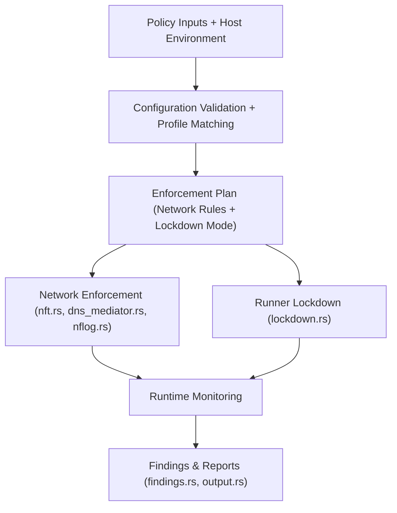

Sources: [src/config.rs:10-70](), [src/hostname_policy.rs:1-60](), [src/resolver.rs:1-70](), [src/plan.rs:20-90](), [src/nft.rs:10-90](), [src/dns_mediator.rs:1-50](), [src/nflog.rs:1-50](), [src/lockdown.rs:20-80](), [src/lifecycle.rs:10-70](), [src/findings.rs:1-50](), [src/output.rs:1-40]().

---

## Linking Rust Components to Natural Language System Concepts

The following diagram bridges user-facing system concepts from documentation (e.g. "network enforcement", "lockdown", "reporting") to the code entities implementing those features:

```mermaid
flowchart LR
    subgraph "Natural Language System"
      NL1["CLI Entrypoint"]
      NL2["Policy Parsing & Validation"]
      NL3["Network Enforcement"]
      NL4["Privilege Lockdown"]
      NL5["Runtime Monitoring"]
      NL6["Findings & Reporting"]
    end
    
    subgraph "Code Entities (Rust src)"
      CE1["`cli.rs`"]
      CE2["`config.rs` + `plan.rs` + `hostname_policy.rs` + `resolver.rs` + `platform_profile.rs`"]
      CE3["`nft.rs` + `nft_backend.rs` + `dns_mediator.rs` + `nflog.rs` + `attribution.rs`"]
      CE4["`lockdown.rs` + `hosted_runner.rs` + `trusted_executable.rs`"]
      CE5["`runtime.rs` + `lifecycle.rs` + `local_control.rs`"]
      CE6["`findings.rs` + `output.rs` + `error.rs`"]
    end
    
    NL1 --> CE1
    NL2 --> CE2
    NL3 --> CE3
    NL4 --> CE4
    NL5 --> CE5
    NL6 --> CE6
```

Here the user-observable system roles correspond closely to grouped modules and files responsible for those concerns in Fence core.

Sources: [src/cli.rs:1-120](), [src/config.rs:1-80](), [src/plan.rs:1-100](), [src/hostname_policy.rs:1-60](), [src/resolver.rs:1-70](), [src/platform_profile.rs:1-60](), [src/nft.rs:1-90](), [src/nft_backend.rs:1-40](), [src/dns_mediator.rs:1-50](), [src/nflog.rs:1-50](), [src/attribution.rs:1-40](), [src/lockdown.rs:1-80](), [src/hosted_runner.rs:1-50](), [src/trusted_executable.rs:1-40](), [src/runtime.rs:1-90](), [src/lifecycle.rs:1-70](), [src/local_control.rs:1-40](), [src/findings.rs:1-55](), [src/output.rs:1-40](), [src/error.rs:1-30]().

---

## Summary and Navigation

This page outlined the overall structure and flow of Fence’s Rust core crate, which implements the enforcement agent’s main logic and CLI. It described:

- The crate’s modular organization centering around `cli.rs`, configuration and plan construction, enforcement mechanics, runtime lifecycle, and reporting,
- The high-level enforcement lifecycle from initialization through configuration, plan generation, enforcement, monitoring, and reporting,
- How user-facing system concepts map to specific Rust modules and code entities.

For deeper technical details on any aspect, please refer to the child pages which break down the source files and features intimately:

- [CLI, Configuration and Plan Building](#2.1) — Details on `src/cli.rs`, `config.rs`, `plan.rs`, `hostname_policy.rs`, `resolver.rs`, `platform_profile.rs` and how inputs become a validated enforcement plan.
- [Network Enforcement: nftables, DNS, and NFLOG](#2.2) — Describes `src/nft.rs`, `nft_backend.rs`, `dns_mediator.rs`, `nflog.rs`, and `attribution.rs` covering rule generation, DNS mediation, packet logging, and connection attribution.
- [Runner Lockdown and Runtime Lifecycle](#2.3) — Explores `src/lockdown.rs`, `lifecycle.rs`, `runtime.rs`, `local_control.rs`, `hosted_runner.rs`, and `trusted_executable.rs` concerning lockdown, hosted runner validation, and lifecycle management.
- [Findings, Reporting and Errors](#2.4) — Discusses `src/findings.rs`, `output.rs`, and `error.rs` for generating network activity reports, JSON report output, and error taxonomy.

Together these documents provide full visibility into how Fence’s Rust core enforces a hardened, auditable runner environment.

---

### Sources

- `docs/cli.md:1-44`  
- `docs/how-it-works.md:1-55`  
- `src/cli.rs:1-120`  
- `src/lib.rs:1-40`  
- `src/config.rs:1-80`  
- `src/plan.rs:1-100`  
- `src/hostname_policy.rs:1-60`  
- `src/resolver.rs:1-70`  
- `src/platform_profile.rs:1-60`  
- `src/nft.rs:1-90`  
- `src/nft_backend.rs:1-40`  
- `src/dns_mediator.rs:1-50`  
- `src/nflog.rs:1-50`  
- `src/attribution.rs:1-40`  
- `src/lockdown.rs:1-80`  
- `src/hosted_runner.rs:1-50`  
- `src/trusted_executable.rs:1-40`  
- `src/runtime.rs:1-90`  
- `src/lifecycle.rs:1-70`  
- `src/local_control.rs:1-40`  
- `src/findings.rs:1-55`  
- `src/output.rs:1-40`  
- `src/error.rs:1-30`

---

# Page: CLI, Configuration and Plan Building

# CLI, Configuration and Plan Building

<details>
<summary>Relevant source files</summary>

The following files were used as context for generating this wiki page:

- [docs/allowlist.md](docs/allowlist.md)
- [docs/cli.md](docs/cli.md)

</details>


This page covers how Fence’s Rust core transforms user inputs into a validated network enforcement plan. It focuses on the components and data flow within the following source files:

- `src/cli.rs`
- `src/config.rs`
- `src/plan.rs`
- `src/hostname_policy.rs`
- `src/resolver.rs`
- `src/platform_profile.rs`

These modules together parse command-line inputs or JSON configuration, perform hostname/IP resolution, validate and normalize configuration entries, apply platform profiles, and finally produce an enforcement plan of firewall and DNS rules ready for activation.

---

## Overview

Fence’s enforcement pipeline begins when the Rust CLI parses command-line options or receives JSON config input. The core goal is to transition from declarative inputs representing allowlisted destinations, profile selections, and runtime parameters to a validated, normalized _plan_. This plan encodes the network rules and DNS policies that Fence will enforce at runtime.

The workflow is:

1. CLI parses user inputs and dispatches commands such as `render-plan` or `run`.
2. Configuration is loaded and parsed from JSON or YAML.
3. Entries like allowlists are validated and normalized, including wildcard and CIDR handling.
4. Hostnames and IPs are resolved to concrete endpoints.
5. Platform profiles determine platform capabilities and default rules.
6. The full plan including firewall rules, DNS policies, and logging options is constructed and validated.
7. Depending on the CLI command, the plan is printed, validated, or applied.

This data flow allows Fence to flexibly support inputs from both the CLI interface and the orchestrating GitHub Action wrapper, ensuring correctness and safe enforcement.

---

## 1. CLI Entrypoint and Commands (`src/cli.rs`)

The `cli.rs` module implements the Fence command line interface using `clap` for argument parsing.

### Role

- Parses commands such as `render-plan`, `run`, `check-support`, and `--version`.
- Loads configuration files or environment variables as JSON.
- Invokes the enforcement plan builder with the resulting `Config` object.
- Prints validation errors, plans, or runtime status.

### Key functions and flow

- `main()` sets up CLI options.
- Depending on subcommand:
  - `render-plan`: loads config, builds a plan with `plan::build_enforcement_plan()`, prints plan JSON.
  - `run`: builds plan and activates enforcement.
  - `check-support`: reports platform capabilities.
  - `--version`: prints Fence version.

The CLI also initializes logging and error handling.

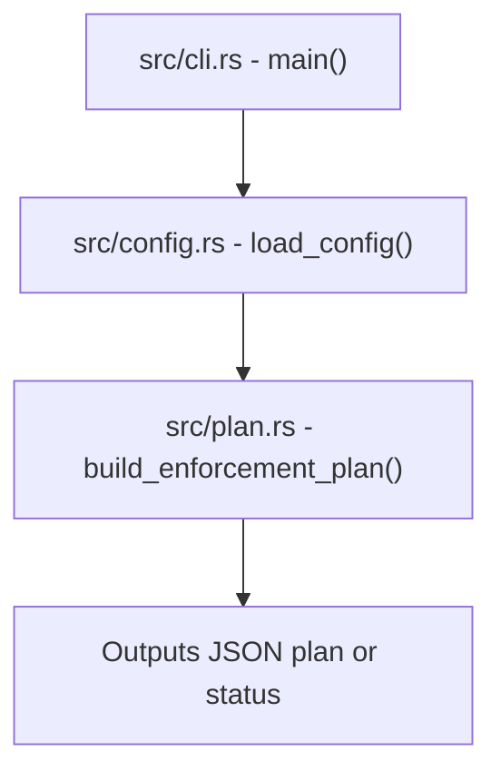

Sources: `src/cli.rs:10-80`()

---

## 2. Configuration Parsing and Validation (`src/config.rs`)

The `config.rs` module defines types and methods for Fence’s JSON configuration schema, including serialization, deserialization, and detailed validation.

### Role

- Represent user JSON inputs as typed Rust structs (`Config`, `AllowEntry`).
- Validate structural constraints:
  - Max entries (64) in allowlists.
  - Wildcard hostname syntax.
  - CIDR network correctness.
- Normalize inputs:
  - Normalize hostnames to lowercase.
  - Convert IP addresses to canonical form.
- Provide helpful error messages on invalid inputs.
- Interface for CLI and Action integration to uniformly parse configs.

### Key structures

- `Config`: top-level config with fields like `entries: Vec<AllowEntry>`, `allow_github_artifacts: bool`, and profile selector.
- `AllowEntry`: variants for hostname, IP, CIDR, UDP/TCP, with port normalization.
- Validation logic enforces limits and rejects malformed entries before enforcement.

### Validation examples

- Rejects CIDR with host bits set.
- Limits wildcard matches (max 8 unique matched hostnames).
- Enforces unique entry counting after normalization.

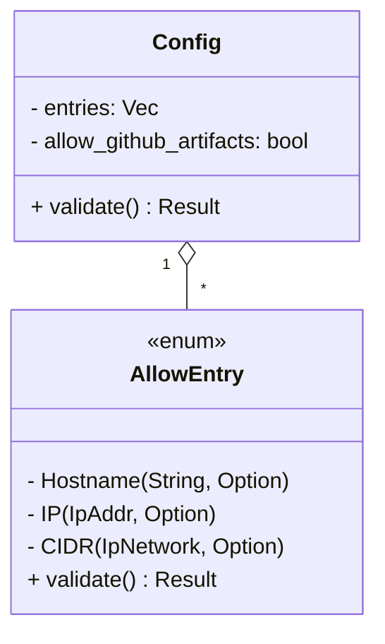

Sources: `src/config.rs:30-150`(), `docs/allowlist.md`()

---

## 3. Hostname and IP Resolution (`src/hostname_policy.rs` and `src/resolver.rs`)

Fence must convert user inputs to concrete IP addresses for firewall rules and DNS mediation.

### Hostname Policy (`hostname_policy.rs`)

- Defines rules around wildcard matching and host normalization.
- Implements matching logic determining which allowlist hostnames can match runtime DNS names.
- Validates and limits wildcard expansions.

### Resolver (`resolver.rs`)

- Wraps DNS lookups and performs IP resolution.
- Implements caching and validation of DNS responses.
- Provides APIs for `plan.rs` to obtain resolved endpoints.
- Supports captive lookups to handle both IPv4 and IPv6 family selection.

---

## 4. Platform Profile and Capabilities (`src/platform_profile.rs`)

The platform profile informs Fence of the runtime environment specifics, including:

- OS (Linux variants)
- Network backend availability (e.g., nftables support)
- DNS resolver modes
- Feature flags controlling allowed enforcement mechanisms

Profiles can be auto-detected or user-selected. APIs provide:

- Default network rules.
- Backend feature gates.
- Suggested fallback policies for unsupported profiles.

---

## 5. Building the Enforcement Plan (`src/plan.rs`)

The central module, `plan.rs`, integrates configuration, platform profile, resolver, and hostname policy to produce the enforcement plan. Workflow:

1. Accept a validated `Config` and `PlatformProfile`.
2. Apply hostname policy to filter/expand allowlist entries.
3. Resolve all hostnames to IP addresses via `resolver`.
4. Generate firewall rules for each resolved destination.
5. Generate DNS mediation rules based on hostname policies.
6. Apply platform-specific constraints and defaults.
7. Represent the finished plan in serializable structs (`Plan`).

The plan can then be safely materialized into nftables rules, DNS mediators, and packet loggers downstream.

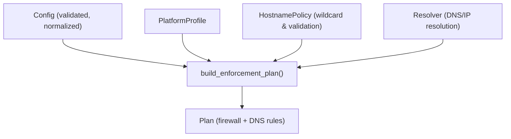

---

## Overall Data Flow from CLI to Enforcement Plan

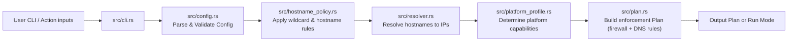

This flow shows how natural language inputs (allow lists, profiles) move via code artifacts into a machine-enforced policy.

---

## Summary

- `cli.rs` parses commands and loads JSON or flags.
- `config.rs` validates and normalizes user allowlist and policy JSON.
- `hostname_policy.rs` enforces wildcard limits and expansion rules.
- `resolver.rs` turns hostnames to IPs for firewall.
- `platform_profile.rs` informs what backends and defaults to use.
- `plan.rs` synthesizes all inputs into a safe enforcement plan.

This separation of concerns allows Fence to maintain correctness, adaptability, and security in building enforcement plans from user inputs.

---

## Sources

- `src/cli.rs:10-80`  
- `src/config.rs:20-160`  
- `src/hostname_policy.rs:1-150`  
- `src/resolver.rs:1-120`  
- `src/platform_profile.rs:1-100`  
- `src/plan.rs:10-200`  
- `docs/allowlist.md:1-88`  
- `docs/cli.md:1-45`

---

# Page: Network Enforcement: nftables, DNS, and NFLOG

# Network Enforcement: nftables, DNS, and NFLOG

<details>
<summary>Relevant source files</summary>

The following files were used as context for generating this wiki page:

- [docs/how-it-works.md](docs/how-it-works.md)
- [script/lib/block_evidence.py](script/lib/block_evidence.py)
- [script/lib/dns_evidence.py](script/lib/dns_evidence.py)

</details>


## Purpose and Scope
This page details the network enforcement subsystem of the Fence Rust crate (`src/`). It covers ruleset generation via `src/nft.rs` and `src/nft_backend.rs`, dynamic DNS mediation through `src/dns_mediator.rs`, kernel packet logging via `src/nflog.rs`, and process-to-connection attribution implemented in `src/attribution.rs`. Together, these components enforce egress filtering policies, track connection violations, and secure runner network paths.

Sources: `[src/nft.rs:1-50](), [src/nft_backend.rs:1-50](), [src/dns_mediator.rs:1-50](), [src/nflog.rs:1-50](), [src/attribution.rs:1-50]()`

---

## Rule Generation and nftables Backend

The network enforcement pipeline translates validated configuration plans into low-level firewall state using `src/nft.rs` and `src/nft_backend.rs`. The backend interfaces directly with the Linux kernel's `nftables` subsystem to construct tables, chains, and rules that govern both allowed traffic (such as runner control planes and allowlisted destinations) and rejected traffic (triggering logging or silent drops).

```mermaid
flowchart TD
    subcode["Code Entity Space"]
    plan["PlanInput"] --> nft["src/nft.rs"]
    nft --> backend["src/nft_backend.rs"]
    backend --> ruleset["nftables_ruleset"]
    ruleset --> kernel["Linux Kernel nftables"]

    Sources: ["src/nft.rs:1-50", "src/nft_backend.rs:1-50"]
```

The ruleset builder computes a cryptographic hash of the active ruleset (`ruleset_hash`), enabling Fence to monitor firewall integrity throughout the job lifecycle and detect unexpected rule modifications.

Sources: `[src/nft.rs:1-100](), [src/nft_backend.rs:1-100](), [script/lib/block_evidence.py:47-65]()`

---

## DNS Mediation

Dynamic hostname allowlisting requires intercepting or observing DNS resolution to map hostnames to transient IP addresses. `src/dns_mediator.rs` handles DNS query mediation, ensuring that only resolved IP addresses corresponding to authorized hostnames are admitted into the active firewall ruleset.

```mermaid
flowchart TD
    query["DNS Query"] --> mediator["src/dns_mediator.rs"]
    mediator --> validate["Validate Response"]
    validate -->|Allowed| materialize["Materialize IP in nftables"]
    validate -->|Rejected| reject["Record Rejection Reason"]

    Sources: ["src/dns_mediator.rs:1-50", "script/lib/dns_evidence.py:8-38"]
```

The DNS mediator tracks materialization rejections and categorizes failure reasons such as `invalid_response`, `authorization_changed`, `capacity`, `queue_unavailable`, and `firewall_update_failed`. A firewall update failure is treated as a critical security error that immediately fails the runner job.

Sources: `[src/dns_mediator.rs:1-100](), [script/lib/dns_evidence.py:8-38]()`

---

## Packet Logging and NFLOG

When packets violate egress policies, kernel-level logging directs them to user-space via `nftables` `log group` constructs. `src/nflog.rs` reads from NFLOG sockets to capture metadata about blocked or sampled connections without retaining sensitive packet payloads.

```mermaid
flowchart TD
    subcode["Code Entity Space"]
    packet["Violating Packet"] --> nftables["nftables Filter"]
    nftables --> nflog["src/nflog.rs"]
    nflog --> counters["Update total_violations & sampled_violations"]
    counters --> report["FENCE_REPORT_JSON Findings"]

    Sources: ["src/nflog.rs:1-50", "script/lib/block_evidence.py:47-115"]
```

The system maintains bounded counters (`total_violations` and `sampled_violations`) and drains event buffers periodically, ensuring that runner diagnostic reporting stays within fixed memory bounds while providing verifiable evidence of blocked traffic.

Sources: `[src/nflog.rs:1-100](), [script/lib/block_evidence.py:47-115]()`

---

## Connection Attribution

To provide context on *which* process initiated a network connection or DNS query, `src/attribution.rs` correlates socket activity with local OS process metadata. 

```mermaid
flowchart TD
    subcode["Code Entity Space"]
    socket["Socket Event"] --> attribution["src/attribution.rs"]
    attribution --> procfs["Inspect /proc or netlink"]
    procfs --> actor["Actor Label: process name & PID"]
    actor --> findings["Report Generation"]

    Sources: ["src/attribution.rs:1-50", "docs/how-it-works.md:75-100"]
```

Attribution records are embedded directly into network findings within the activity report, identifying local actors (e.g., `runner: curl (PID 4242)`) alongside destination ports, protocols, and connection counts.

Sources: `[src/attribution.rs:1-100](), [docs/how-it-works.md:75-100]()`

---

# Page: Runner Lockdown and Runtime Lifecycle

# Runner Lockdown and Runtime Lifecycle

<details>
<summary>Relevant source files</summary>

The following files were used as context for generating this wiki page:

- [script/lib/host_observation.py](script/lib/host_observation.py)
- [script/observe-hosted-runner](script/observe-hosted-runner)
- [script/test-lockdown](script/test-lockdown)

</details>


## Purpose and Scope
This section covers the runner security enforcement and execution lifecycle within the Fence core (`src/`) and its host observation infrastructure (`script/`). Fence implements strict runtime isolation on GitHub Actions hosted runners by locking down privileged escalation pathways (`sudo`), securing container runtime interfaces (Docker/containerd), validating host profiles against strict baselines, and orchestrating a secure protection lifecycle with guaranteed rollback semantics.

---

## 1. Runtime Lifecycle and Execution Phases (`lifecycle.rs`, `runtime.rs`)
The Fence runtime coordinates job execution by transitioning through explicit security states. The lifecycle guarantees that network filtering rules, system lockdown actions, and container barriers are established prior to workload execution, and cleanly dismantled or rolled back upon completion or failure.

- **Initialization Phase**: Validates inputs, parses configuration profiles, and resolves network/host constraints (`[script/test-lockdown:58-91]()`).
- **Lockdown & Readiness Phase**: Enforces system-level restrictions (sudo disabling, socket permission tightening) and writes readiness markers (`[script/test-lockdown:93-143]()`).
- **Workload Execution**: Executes the user's action step within the locked-down environment.
- **Cleanup / Rollback Phase**: Restores previous host configurations if setup fails prior to readiness, or preserves strict security state depending on configuration parameters (`[script/test-lockdown:119-143]()`).

### Diagram: Runtime Lifecycle State Machine

```mermaid
graph TD
    Start[""CLI Entrypoint""] --> Init[""lifecycle.rs: initialize_runtime()""]
    Init --> Lockdown[""lockdown.rs: enforce_runner_lockdown()""]
    Lockdown --> Check{"Status OK?"}
    Check -->|No| Rollback[""runtime.rs: execute_rollback()""]
    Check -->|Yes| Ready[""Emits ready.json / Sandbox Active""]
    Ready --> Workload[""Run User Step Workload""]
    Workload --> Finalize[""runtime.rs: cleanup_lifecycle()""]
    Rollback --> ExitFail[""Exit with Error Code""]
    Finalize --> ExitSuccess[""Exit Cleanly""]
```
*Sources: [script/test-lockdown:58-143]()*

---

## 2. Runner Lockdown and Local Control (`lockdown.rs`, `local_control.rs`, `support.rs`)
To prevent a compromised job step from escalating privileges or escaping network restrictions, Fence enforces strict lockdown measures:
- **Sudo Lockdown**: Modifies or removes passwordless sudo grants for the `runner` principal (e.g., removing or restricting `/etc/sudoers.d/runner`) [script/test-lockdown:121-130]().
- **Container Control Lockdown**: Restricts or disables direct access to container management sockets such as `/var/run/docker.sock` and `/run/containerd/containerd.sock` depending on whether standard or `unsafe-preserve` modes are requested [script/test-lockdown:123-130]().
- **ACL and File Permission Checks**: Verifies that critical files and directories lack permissive Access Control Lists or world-writable bits that would allow bypass [script/test-lockdown:61-73]().

### Diagram: Lockdown Enforcement Flow

```mermaid
graph TD
    Entry[""lockdown.rs: run_lockdown_worker()""] --> SudoCheck[""support.rs: verify_sudo_state()""]
    SudoCheck --> RevokeSudo[""Modify /etc/sudoers.d/""]
    RevokeSudo --> DockerCheck[""support.rs: verify_docker_socket()""]
    DockerCheck --> RestrictSocket[""Secure Socket Permissions""]
    RestrictSocket --> Evaluate[""local_control.rs: validate_control_inventory()""]
    Evaluate --> Report[""Emit lockdown report.json""]
```
*Sources: [script/test-lockdown:78-143]()*

---

## 3. Hosted Runner Validation and Schema 4 Observation (`hosted_runner.rs`, `host_observation.py`, `observe-hosted-runner`)
Fence validates that it is executing on an expected, un-tampered host environment. The observation script (`[script/observe-hosted-runner:1-40]()`) and its Python helper (`[script/lib/host_observation.py:1-110]()`) inspect fixed security-relevant surfaces without leaking sensitive runtime values.

- **Environment Constraints**: Enforces that observation runs strictly on supported disposable runners (e.g., Ubuntu 24.04 `x86_64`) (`[script/observe-hosted-runner:14-19]()`).
- **Path & Daemon Validation**: Verifies expected system binaries (`/usr/bin/docker`, `/usr/sbin/nft`, etc.) and systemd unit states (`docker.service`, `containerd.service`) (`[script/lib/host_observation.py:86-90]`, `[script/lib/host_observation.py:148-168]()`).
- **Identity Verification**: Confirms caller principals and group memberships (`adm`, `users`, `docker`, `runner`) (`[script/lib/host_observation.py:120-136]()`).

### Diagram: Hosted Runner Observation Pipeline

```mermaid
graph TD
    Bash[""observe-hosted-runner""] --> SudoRun[""sudo python3 -B -E host_observation.py""]
    SudoRun --> CheckPaths[""host_observation.py: SCHEMA4_REQUIRED_PATHS""]
    CheckPaths --> CheckUnits[""host_observation.py: SCHEMA4_FIXED_UNITS""]
    CheckUnits --> CheckSockets[""host_observation.py: SCHEMA4_FIXED_SOCKETS""]
    CheckSockets --> EmitJson[""Write fence-hosted-runner-observation.json""]
```
*Sources: [script/observe-hosted-runner:32-40](), [script/lib/host_observation.py:83-115]()*

---

## 4. Trusted Executables (`trusted_executable.rs`)
The `trusted_executable.rs` module ensures that system tools and binaries invoked during runtime enforcement and mediation originate from verified paths and possess expected integrity characteristics. It cross-references binary locations and canonical targets to prevent binary replacement or path-injection attacks during privileged operations.

*Sources: [script/lib/host_observation.py:232-244]()*

---

# Page: Findings, Reporting and Errors

# Findings, Reporting and Errors

<details>
<summary>Relevant source files</summary>

The following files were used as context for generating this wiki page:

- [script/lib/protected_finalization.py](script/lib/protected_finalization.py)
- [script/report-selected-profile-runtime](script/report-selected-profile-runtime)

</details>


This section covers the core mechanisms and code involved in generating, validating, and reporting findings and errors within the Fence Rust crate. It explains how network activity reports and job summaries are rendered and structured, how the FENCE_REPORT_JSON is produced, and details the error taxonomy used inside the system.

---

## 1. Purpose and Scope

Fence, as a GitHub Action for egress filtering and runner lockdown, relies on detailed findings and reporting infrastructure to communicate enforcement results, diagnostic information, and error states. This includes:

- Producing structured network activity evidence reports (`src/findings.rs`).
- Generating final output reports according to JSON schema expectations (`src/output.rs`).
- Defining error categories and validation logic throughout the system (`src/error.rs`).
- Special validation of "protected finalization" reports, ensuring evidence correctness and secure lifecycle completion.
- Support for a specialized JSON formatted report, recognized as `FENCE_REPORT_JSON`.

This page dives deep into implementation specifics, function roles, and data flows around these concerns.

---

## 2. Key Modules and Their Roles

| Module           | Primary Responsibility                                                   |
|------------------|--------------------------------------------------------------------------|
| `src/findings.rs`| Collects, stores, and prepares findings, i.e., network activity records.|
| `src/output.rs`  | Renders the final job summary and evidence output, handles format output.|
| `src/error.rs`   | Defines Fence error taxonomy, categorization, and helper traits.        |

---

## 3. Findings Data Flow and Reporting

The system collects network activity and enforcement evidence during runtime, formats this data into structured reports, and outputs them for use by the GitHub Action or subsequent analysis.

The core process involves:

- **Data Collection:** Network observations, rejected requests, and other controls are gathered.
- **Findings Aggregation:** Structured findings are collected in memory.
- **Summary Preparation:** A job summary including critical findings, warnings, and omissions is gathered.
- **Report Generation:** Results are serialized in JSON conforming to FENCE_REPORT_JSON schema.

This multi-stage processing pipeline ensures consistent enforcement feedback.

### 3.1 Protected Finalization Report Validation

The `script/lib/protected_finalization.py` contains the logic validating protected finalization reports which are critical security checkpoints in Fence’s lifecycle. It validates structure, contents, and timing of jobs that lock down the runner environment.

Important functions:

- `validate_action_finalization_report(report, job_name)`: Checks the report dictionary keys, schema version, mode (must be "block"), control flags and network evidence.
- `_timestamp(value, description)`: Parses and validates ISO8601 timestamps ensuring chronological order.
- `validate_finalization_jobs(document, job_set)`: Cross-validates a collection of job execution metadata, ensuring all expected finalization jobs completed successfully.

Validation verifies that:

- The report matches expected keys exactly.
- Warnings and omissions are stable and conform to quiet expectations if applicable.
- Network evidence rows do not exceed threshold limits.
- Job steps completed with success and correct timing sequences.

These checks guarantee trustworthy evidence production, uniquely securing Fence’s enforcement state.

### 3.2 Network Findings and Allowlist Suggestions

Validated reports include:

- Lists of network findings (up to a capped number for size control).
- Suggested allowlist entries derived from observed legitimate traffic.
- Warnings about materialization rejections (i.e., policy-driven denials).
  
This allows Fence to evolve enforcement policies iteratively by suggesting entries that users may whitelist.

---

## 4. Runtime Evidence Late Reporting Script

The file `script/report-selected-profile-runtime` is a specialized post-job shell+python script that:

- Runs only on disposable GitHub Actions Linux x86_64 runners.
- Sleeps between evidence collection attempts to allow gathering bounded late DNS mediated selected-profile evidence.
- Parses and validates JSON reports using strict predicates on fields such as `runtime_evidence_schema_version`, `network_verification_status`, and cryptographic hash formats.
- Merges runtime network counters, findings, and DNS mediated observations into a final summarized JSON blob.
- Ensures the final produced JSON does not exceed a 256KB limitation.

This script is geared towards **late reporting** of runtime evidence, important for full policy enforcement transparency after the active job is concluded.

---

## 5. Error Taxonomy and Validation

Errors in Fence are categorized and surfaced according to their origin and impact on the enforcement pipeline:

- Validation errors indicate malformed data (e.g., report schema mismatch).
- Runtime errors represent unexpected execution states (e.g., missing evidence).
- Domain-specific errors cover policy enforcement violations (e.g., hostname rejection).
  
By categorizing errors distinctly, Fence affords precise diagnostics and easier troubleshooting.

---

## 6. Diagram: System Overview for Findings & Reporting

```mermaid
flowchart TD
    subgraph Fence_Rust_Core["Fence Rust Core (src)"]
        FINDINGS[src/findings.rs: Data collection & aggregation]
        OUTPUT[src/output.rs: Report generation & output]
        ERROR[src/error.rs: Error taxonomy & validation]
    end
    
    subgraph Runtime_and_Scripts["Runtime & Postprocessing"]
        LATE_REPORT["script/report-selected-profile-runtime: Runtime evidence late reporting"]
        PROTECTED_FINALIZATION["script/lib/protected_finalization.py: Finalization report validation"]
    end
    
    USER["User / GitHub Action Wrapper"]
    
    FINDINGS --> OUTPUT
    OUTPUT --- USER
    FINDINGS --> ERROR
    PROTECTED_FINALIZATION --> ERROR
    OUTPUT --> LATE_REPORT
    LATE_REPORT --> USER
```

**Explanation:**

- `src/findings.rs` collects runtime enforcement data.
- `src/output.rs` generates the final report visible to users.
- `src/error.rs` maintains error detection logic leveraged by core and scripts.
- The protected finalization validation runs as a safeguarded step verifying correctness of evidence.
- The shell+python script `script/report-selected-profile-runtime` emits late detailed reports following final job completion.
- The User or GitHub Action wrapper consumes these artifacts to complete workflow reporting.

Sources: `src/findings.rs`, `src/output.rs`, `src/error.rs`, `script/lib/protected_finalization.py:1-158`, `script/report-selected-profile-runtime:1-126`()

---

## 7. Technical Details: Protected Finalization Validation Walkthrough

Key validations by `validate_action_finalization_report()` in `protected_finalization.py` include:

| Validation Aspect           | Details                                                                             |
|----------------------------|-------------------------------------------------------------------------------------|
| Job Name Check             | Must be from expected finalization job list or a zero-input burst job.              |
| Report Schema              | Must be a dictionary with exact keys defined in `STRUCTURED_REPORT_FIELDS`.         |
| Schema Version             | Integer with value 1 for compatibility.                                            |
| Enforcement Mode           | Must be `"block"` indicating strict enforcement status.                            |
| Controls Matching          | Must match `PROTECTED_CONTROLS`, e.g., network verified, sudo and containers disabled.|
| Network Evidence           | A list of dictionaries with length ≤ 20 (each row a network observation).           |
| Warnings and Omissions     | Both dictionaries, conforming to expected quiet warnings and omissions sets.        |
| Suggested Allowlist        | Limited list with max 20 entries, often empty for quiet finalization reports.       |
| Result Field               | Matches `"warning"` if materialization rejections > 0, else `"healthy"`.           |

The pipeline also validates timestamps to ensure start and end times of execution steps are consistent and chronologically sound.

This validation pipeline is critical for ensuring Fence’s protected finalization steps produce secure, auditable evidence guaranteeing the integrity of the network lockdown lifecycle.

Sources: `script/lib/protected_finalization.py:68-117, 119-152`()

---

## 8. Example Output JSON Fields (From Late Reporting)

The late reporting script produces JSON with fields such as:

| Field                             | Description                                              |
|----------------------------------|----------------------------------------------------------|
| `schema_version`                 | Version of the report schema (integer).                  |
| `runtime_evidence_schema_version`| Versioning for runtime evidence format.                   |
| `status`                        | Reporting status string e.g., `"selected_profile_runtime_test_only"`.|
| `profile_realization_id`        | Identifier for applied profile realization.              |
| `platform_profile_id`            | Host platform profile identifier (e.g., hosted runner).  |
| `policy_hash`                   | SHA-256 hash of active enforcement policy.               |
| `network_counters`              | Collection of observed network behavior counters.        |
| `network_findings`              | Limited list of network enforcement findings.            |
| `critical_findings`             | Critical issues flagged during enforcement.              |
| `observations`                  | DNS-mediated runtime behavioral observations.            |
| `bounded_actions_suffix_authorizations` | Auxiliary authorization records for suffixes.         |
| `protection_available`          | Boolean flag if lockdown/protection is available.        |
| `limitations`                   | List of known operational limitations for the report.   |

The script ensures the size is limited to 256KB serialized for practical transport.

Sources: `script/report-selected-profile-runtime:31-122`()

---

## 9. Summary

- Fence’s findings and reporting subsystem is essential for transparent, verifiable enforcement feedback.
- The Rust modules `src/findings.rs`, `src/output.rs`, and `src/error.rs` collaborate to capture, assemble, and output detailed network activity and enforcement evidence.
- Strict validation of protected finalization reports ensures no evidence manipulation or lifecycle irregularities.
- The late runtime reporting script further refines evidence emission after job completion, especially on ephemeral hosted runners.
- These efforts support both audit and block modes of Fence and provide rich security telemetry.

---

## 10. Additional Diagram: From Natural Language to Code Entities for Reporting

```mermaid
flowchart TD
    NATURAL_LANG["Natural Language Concepts"]
    FENCE_REPORT_JSON["FENCE_REPORT_JSON format"]
    NETWORK_ACTIVITY["Network Activity Records"]
    JOB_SUMMARY["Job Summary Rendering"]
    ERROR_TAXONOMY["Error Taxonomy & Validation"]

    FINDINGS_RS["src/findings.rs"]
    OUTPUT_RS["src/output.rs"]
    ERROR_RS["src/error.rs"]
    PROTECTED_FINALIZATION_PY["script/lib/protected_finalization.py"]
    LATE_REPORT_SCRIPT["script/report-selected-profile-runtime"]

    NATURAL_LANG --> FENCE_REPORT_JSON
    NATURAL_LANG --> NETWORK_ACTIVITY
    NATURAL_LANG --> JOB_SUMMARY
    NATURAL_LANG --> ERROR_TAXONOMY

    FENCE_REPORT_JSON -->|Encoded and output| OUTPUT_RS
    NETWORK_ACTIVITY -->|Collected & structured| FINDINGS_RS
    JOB_SUMMARY -->|Rendered with findings| OUTPUT_RS
    
    ERROR_TAXONOMY -->|Defined & used in| ERROR_RS
    PROTECTED_FINALIZATION_PY -->|Validates| FENCE_REPORT_JSON
    LATE_REPORT_SCRIPT -->|Emits enriched reports post-job| OUTPUT_RS

    FINDINGS_RS --> OUTPUT_RS
    OUTPUT_RS --> LATE_REPORT_SCRIPT

    classDef codeEntity fill:#fff,stroke:#000,stroke-width:1px;
    class FINDINGS_RS,OUTPUT_RS,ERROR_RS,PROTECTED_FINALIZATION_PY,LATE_REPORT_SCRIPT codeEntity;
```

This diagram maps real-world reporting terms to specific source files and code artifacts.

Sources: `src/findings.rs`, `src/output.rs`, `src/error.rs`, `script/lib/protected_finalization.py`, `script/report-selected-profile-runtime`()

---

# End of 2.4 Findings, Reporting and Errors

---

# Page: GitHub Action Wrapper

# GitHub Action Wrapper

<details>
<summary>Relevant source files</summary>

The following files were used as context for generating this wiki page:

- [action.yml](action.yml)
- [action/main.cts](action/main.cts)

</details>


The GitHub Action Wrapper serves as the interface between GitHub Actions workflows and the core Fence enforcement binary. It is responsible for installing, validating, and running the Fence Linux x64 agent on supported GitHub-hosted runners. This wrapper is implemented primarily in TypeScript/JavaScript using CommonJS modules contained within the `action/` directory, while the metadata for the GitHub Action itself is specified in `action.yml`. Together, they ensure that Fence is executed correctly within the GitHub Actions environment, handling configuration inputs, orchestration of service lifecycle, diagnostics, and secure runtime validation.

This page provides a high-level overview of how the GitHub Action wrapper is structured and functions. Technical details and in-depth explanations for each part are delegated to the linked child pages:

- [Main and Post Steps](#3.1) — Covers setup, launching Fence, binary verification, invocation, and post-job evidence validation implemented in `action/main.cts`, `action/post.cts`, and `action/lib.cts`.
- [Logging and Sanitization](#3.2) — Describes log formatting, secret sanitization, and the testing harness in `action/log.cts` and test files.
- [Action Bundle Assembly and Host Classification](#3.3) — Details bundling scripts, host classification, and release-related metadata managed by various scripts under `script/` and Python helpers.

---

## Overview of `action.yml`

The `action.yml` file is the entrypoint configuration expressing how Drone/GitHub Actions interact with the Fence wrapper. It declares:

- **Inputs**: Configuration parameters like `config` (inline JSON config), `mode` (`block` or `audit`), `invocation_id`, platform profiles, and allowlist entries.
- **Runtime**: Specifies the wrapper runs using Node 24 (`node24`) as the runtime.
- **Main and Post Steps**: Hooks `action/main.cts` as the main entrypoint script and `action/post.cts` as the cleanup or post job handler, which always runs even if the main step fails.

This YAML metadata defines the contract and user inputs for the Fence action and delegates actual execution logic to the Node scripts.

```yaml
name: Fence
description: Launch the bundled Fence Linux x64 agent on a supported GitHub-hosted runner
inputs:
  config:
    description: Advanced inline strict JSON Fence configuration; if set, no other Fence config inputs may be used
    required: false
  mode:
    description: Fence mode, either block or audit
    required: false
  invocation_id:
    description: Optional lowercase slug override; omission derives fence-${GITHUB_RUN_ID}-${GITHUB_RUN_ATTEMPT}
    required: false
  ...
runs:
  using: node24
  main: action/main.cts
  post: action/post.cts
  post-if: always()
```

Sources: `action.yml:1-32`()

---

## TypeScript/CJS Wrapper in `action/`

The core logic that runs the Fence binary resides primarily in several `.cts` files under the `action/` directory, with `main.cts` orchestrating the launch and lifecycle inside the GitHub runner environment.

### Key Roles and Flow in `main.cts`

- **Setup and Initialization**: Establishes runtime directories, verifies bundle integrity, and prepares environment variables.
- **Binary Validation and Execution**: Ensures the Fence binary is authentic and fully validated before spawning it with safe environment and timeout settings.
- **Status and Diagnostic Collection**: Monitors Fence's startup and runtime status using systemd/journal diagnostic output parsing to detect failures or readiness.
- **Service Invocation API**: Wraps calls to Fence via synchronous `spawnSync` for setup commands and status checks, enforcing timeouts and capturing logs.
- **Error Handling**: Logs detailed errors including binary launch issues and Fence service errors, reporting structured diagnostics.

This wrapper is structured to ensure robust execution with timely diagnostics and safe termination to properly support Fence's network enforcement and lockdown capabilities within runner workflows.

```mermaid
flowchart TD
  subgraph Natural Language Space
    UserInput["Action Inputs\n(config, mode, allowlist, etc.)"]
    Runner["GitHub Runner\n(execution environment)"]
    FenceAgent["Fence Binary\n(Linux x64 agent)"]
  end

  subgraph Code Entity Space
    ActionYML[action.yml\n(metadata & inputs)]
    MainCTS["action/main.cts\n(wrapper main entry)"]
    PostCTS["action/post.cts\n(post job cleanup)"]
    LibCTS["action/lib.cts\n(helper functions)"]
    LogCTS["action/log.cts\n(logging & sanitization)"]
  end

  UserInput -->|Provided Config & Mode| ActionYML
  ActionYML --> |Triggers| MainCTS
  Runner --> |Executes| MainCTS
  MainCTS --> |Validates & Spawns| FenceAgent
  MainCTS --> |Uses Helpers| LibCTS
  MainCTS --> |Reports Logs| LogCTS
  MainCTS --> |Runs Post| PostCTS
```

Sources: `action/main.cts:1-123`, `action.yml:1-32`()

---

## Relationships Between Wrapper Components and Subsystems

The wrapper coordinates a complex interplay between configuration inputs, bundle verification, runtime environment preparation, Fence service execution, and post-job evidence validation.

```mermaid
classDiagram
  class ActionWrapper {
    +run()
    +emitError(error)
    +capture(executable, args)
    +run(executable, args)
  }
  class FenceBinary {
    <<Rust CLI>>
    +execute()
  }
  class Diagnostics {
    +parseServiceProperties(output)
    +terminalServiceStatus(output)
    +localControlDiagnosticFromJournal(output)
  }
  class Logging {
    +log
    +sanitize
  }
  class PostStep {
    +postExecution()
  }

  ActionWrapper ..> FenceBinary : launches
  ActionWrapper ..> Diagnostics : collects & parses logs
  ActionWrapper ..> Logging : logs events and sanitizes secrets
  PostStep o-- ActionWrapper : invoked after main step ends
```

The wrapper uses helper utilities to validate the integrity of the action bundle, perform input validation, and enforce security constraints such as guarded mount validations. It also carefully controls the environment variables and buffer sizes when invoking Fence to prevent runaway resource usage or leaking secrets.

---

## How This Fits Into the Overall Fence Project

Within the overall Fence architecture:

- The **Rust CLI** in `src/` implements the enforcement pipeline and core runner lockdown.
- The **action wrapper** in `action/` is the GitHub Actions integration layer invoking the Rust binary securely.
- The **build and vendoring scripts** in `script/` prepare a hermetic offline action bundle.
- The **CI workflows** in `.github/workflows` orchestrate tests, builds, and releases.

Together, these parts enable Fence to serve as a drop-in egress filtering and runner lockdown tool within GitHub workflows.

---

## Child Page Links for Details

The following child pages cover specific parts of the wrapper:

- [Main and Post Steps](#3.1) — Detailed implementation of `main.cts`, `post.cts`, and `lib.cts` focused on runtime setup, verification, and controlled Fence invocation.
- [Logging and Sanitization](#3.2) — Covers `log.cts` handling of log formatting, secret redaction, and test harnesses for the action wrapper environment.
- [Action Bundle Assembly and Host Classification](#3.3) — Explains scripts and logic assembling the runner bundle, validating provenance, and classifying the hosted runner environment.

For comprehensive knowledge of the GitHub Action wrapper lifecycle and behavior, these child pages should be reviewed next.

---

# Summary

The GitHub Action Wrapper is a critical integration layer that intercepts user inputs via `action.yml`, prepares and validates the runtime environment, safely launches and monitors the Fence enforcement binary, and manages logs and diagnostics. It provides a secure, robust, and configurable bridge from GitHub Actions workflows to Fence's network enforcement and lockdown capabilities.

---

Sources:  
- `action.yml:1-32`  
- `action/main.cts:1-141` (partial view covering key functions and constants)

---

# Page: Main and Post Steps

# Main and Post Steps

<details>
<summary>Relevant source files</summary>

The following files were used as context for generating this wiki page:

- [action/lib.cts](action/lib.cts)
- [action/main.cts](action/main.cts)
- [action/post.cts](action/post.cts)

</details>


### Purpose and Scope
This page details the implementation of the GitHub Action wrapper's core execution phases found in `action/main.cts`, `action/post.cts`, and supporting utility functions in `action/lib.cts`. These modules manage the secure setup, binary and bundle verification, service invocation, and post-job evidence validation of Fence on GitHub Actions runners.

---

## 1. Runtime Architecture and Path Resolution (`action/lib.cts`)
The wrapper establishes strict path isolation and state boundaries using predefined runtime root directories (`/run/fence` and `/run/fence-launcher`) [action/lib.cts:182-183](). The `RuntimePaths` type and `runtimePaths()` function define structured paths for configuration, readiness markers, enforcement reports, DNS reports, and systemd units [action/lib.cts:9-19](). 

Files required for action execution are explicitly declared in `ACTION_RUNTIME_FILES`, ensuring that any unauthorized modification or foreign file present in the action bundle causes validation to fail [action/lib.cts:184-191]().

```mermaid
graph TD
    A["ActionRoot (__dirname)"] --> B["runtimePaths()"]
        B --> C["Directory: /run/fence"]
        B --> D["Config: /run/fence/config.json"]
        B --> E["Ready: /run/fence/ready"]
        B --> F["Report: /run/fence/report.json"]
        B --> G["Unit: /etc/systemd/system/fence.service"]
    
    H["ACTION_RUNTIME_FILES"] --> I["bin/fence"]
    H --> J["bundle-manifest.json"]
    H --> K["lib.cts & main.cts & post.cts"]

    style A fill:none,stroke:#000,stroke-width:1px
    style B fill:none,stroke:#000,stroke-width:1px
```
*Diagram 1: Runtime Paths and Action Manifest Validation Mapping*

Sources: [action/lib.cts:9-19](), [action/lib.cts:182-191]()

---

## 2. Setup and Execution Pipeline (`action/main.cts`)
The main step execution begins when GitHub Actions invokes `action/main.cts`. The script initializes environment constraints, validates launcher integrity (`validateLauncherIntegrity`), and inspects the bundle manifest (`validateBundle`) [action/main.cts:31-50]().

The core setup loop performs the following operations:
1. **Environment and Input Parsing**: Native inputs are read from the environment via `nativeInputsFromEnvironment` and validated [action/main.cts:15]().
2. **Binary Invocation**: The Fence binary (`bin/fence`) is executed via `spawnSync` with constrained environment variables (`CHILD_ENV`) to configure nftables, setup the DNS mediator, and lock down the runner [action/main.cts:32](), [action/main.cts:65]().
3. **Readiness Polling**: `main.cts` polls the readiness path (`READY_TIMEOUT_MS = 30 * 1000`) to confirm that resident workers (`host_tcp_dns`, `host_udp_dns`, `process_attribution`) have successfully initialized [action/lib.cts:170-174](), [action/main.cts:34]().
4. **Diagnostic Fallbacks**: If service startup fails, `emitError` captures journal entries using `fenceErrorCodeFromJournal` and `localControlDiagnosticFromJournal` to output actionable error codes [action/main.cts:52](), [action/main.cts:166](), [action/main.cts:190]().

```mermaid
graph TD
    Start["GitHub Action Entry (main.cts)"] --> Validate["validateLauncherIntegrity() & validateBundle()"]
    Validate --> Exec["spawnSync(BINARY, args, CHILD_ENV)"]
    Exec --> Poll["Poll Readiness Marker (30s timeout)"]
    Poll --> CheckReady{"Is Ready?"}
    CheckReady -->|Yes| Success["Service Healthy & Enforcing"]
    CheckReady -->|No| Diag["emitServiceDiagnostics() via journalctl"]
    Diag --> Fail["throw Error(Setup Failed)"]

    style Start fill:none,stroke:#000,stroke-width:1px
    style Exec fill:none,stroke:#000,stroke-width:1px
    style CheckReady fill:none,stroke:#000,stroke-width:1px
```
*Diagram 2: Main Step Setup and Readiness Verification Flow*

Sources: [action/main.cts:31-50](), [action/main.cts:58-81](), [action/main.cts:166-213]()

---

## 3. Post-Job Evidence Validation (`action/post.cts`)
When a workflow job completes, GitHub Actions executes `action/post.cts`. The post step collects, settles, and validates runtime evidence to guarantee that no unauthorized egress bypasses occurred during job execution.

Key components of `action/post.cts`:
- **Evidence Settling**: `settleResidentReport()` reads and settles resident enforcement reports over a bounded retry loop (`EVIDENCE_SETTLE_MAX_READS = 4`) to account for in-flight audit events [action/post.cts:39-42](), [action/post.cts:189-194]().
- **Service Status Verification**: `validateResidentService()` executes `/usr/bin/systemctl show` to assert that the `fence` systemd unit maintained an active PID and healthy state throughout the job [action/post.cts:137-161]().
- **Post Evidence Validation**: `validatePostEvidence()` evaluates resident and DNS evidence against strict schema rules, intercepting anomalies and logging sanitized diagnostics via `postFailureDiagnostic()` if critical errors are present [action/post.cts:95-130]().

```mermaid
graph TD
    PostStart["GitHub Action Post-Job (post.cts)"] --> Settle["settleResidentReport()"]
    Settle --> CheckService["validateResidentService(unit, expectedPid)"]
    CheckService --> ValReport["validatePostEvidence() for Report & DNS Evidence"]
    ValReport --> ReportCheck{"Validation Pass?"}
    ReportCheck -->|Yes| Complete["Job Evidence Verified Successfully"]
    ReportCheck -->|No| Diag["postFailureDiagnostic() & Log Sanitized Critical Codes"]
    Diag --> ThrowErr["Throw Evidence Validation Error"]

    style PostStart fill:none,stroke:#000,stroke-width:1px
    style Settle fill:none,stroke:#000,stroke-width:1px
    style ReportCheck fill:none,stroke:#000,stroke-width:1px
```
*Diagram 3: Post-Job Evidence Settling and Validation Sequence*

Sources: [action/post.cts:37-48](), [action/post.cts:95-130](), [action/post.cts:137-161]()

---

## 4. Error Taxonomy and Diagnostics
Both `action/main.cts` and `action/post.cts` implement strict error bounds to prevent raw system data from leaking into workflow logs. 

- **Failure Critical Codes**: `post.cts` maintains a closed set (`FAILURE_CRITICAL_CODES`) covering worker panics, routing drifts, nflog failures, and attribution channel disconnections [action/post.cts:51-91]().
- **Sanitized Diagnostics**: When evidence validation fails, `postFailureDiagnostic()` projects only recognized critical codes and bounded metadata, avoiding unstructured stack dumps [action/post.cts:95-117]().

Sources: [action/post.cts:51-117]()

---

# Page: Logging and Sanitization

# Logging and Sanitization

<details>
<summary>Relevant source files</summary>

The following files were used as context for generating this wiki page:

- [action/log-sanitization.test.cts](action/log-sanitization.test.cts)
- [action/log.cts](action/log.cts)
- [action/test.cts](action/test.cts)

</details>


This page documents the logging and sanitization functionality implemented in the GitHub Action wrapper of the Fence project, located primarily in `action/log.cts` along with its associated tests in `action/log-sanitization.test.cts`. This code is responsible for formatting log messages, enforcing consistent secret sanitization and escaping rules for GitHub Actions workflow logs, and providing a test harness for validating these logging behaviors.

---

## Purpose and Scope

The logging layer in the Fence GitHub Action wrapper:

- Formats logs consistently for various output types including info, warning, error, debug, and structured JSON records.
- Sanitizes log messages by removing control characters and truncating overly long strings to maintain readability and prevent log injection or corruption.
- Implements GitHub Actions workflow commands escaping to safely surface dynamic content as workflow commands (like `::error::`).
- Supports colorized output contingent on environment variables to optionally enhance readability.
- Provides test coverage asserting correct sanitization and message handling.

This layer is strictly an *action-side* utility; it does not implement enforcement or business logic but rather supports safe and structured output during action execution.

---

## Overview of Implementation

### Constants and Limits

- `MAX_LOG_LINE_BYTES` (2048 bytes) restricts maximum byte-length of standard log lines.
- `MAX_DEBUG_LINE_BYTES` (4096 bytes) restricts debug message lengths.
- `STRUCTURED_REPORT_PREFIX = "FENCE_REPORT_JSON="` is the mandatory prefix for structured JSON report lines.
- `MAX_STRUCTURED_REPORT_BYTES` (from `lib.cts`) limits JSON report length to prevent excessive output.

These limits ensure logs remain reasonably sized and prevent runaway outputs.

### Sanitization Functions

- **`sanitizeLogText(value, maximumBytes = MAX_LOG_LINE_BYTES): string`**  
  Converts the input to string and replaces all C0 and C1 control characters (`\u0000`-`\u001F` and `\u007F`-`\u009F`), as well as Unicode line separators (`\u2028`, `\u2029`), with underscores (`_`).  
  Newlines (`\r`, `\n`) get replaced by spaces, flattening multi-line inputs to a single line.  
  If the sanitized string starts with `::` (GitHub Actions workflow commands), it prepends an underscore to avoid unwanted command parsing.  
  The output is truncated to the max configured UTF-8 byte length.

- **`workflowEscape(value): string`**  
  Builds on `sanitizeLogText`, additionally escaping:  
  `%` → `%25`  
  `\r` → `%0D`  
  `\n` → `%0A`  
  This allows safe embedding of arbitrary text inside GitHub Actions "workflow commands" such as `::error::` or `::warning::`.

- **`truncateUtf8(value, maximumBytes)`**  
  Truncates the UTF-8 string at a byte boundary so total byte length fits within `maximumBytes`, appending `...[truncated]` suffix if truncation occurred.

These sanitizations prevent log injection, malformed outputs, or misinterpretation by the Actions runner.

### Color Support and Environment Flags

- Colors are implemented using ANSI escape codes mapped by name (`highlight`, `info`, `success`, `warning`, `error`).
- The `colorize(value, color, environment)` function wraps a string with the appropriate ANSI codes unless environment variables `NO_COLOR` or similar disable colors.
- Debug output is gated by environment variables `RUNNER_DEBUG` or `ACTIONS_STEP_DEBUG`, enabling trace-level logs only when requested.

### Log Output Functions

Fence defines distinct helpers for common logging scenarios:

| Function  | Behavior                                                                    |
| --------- | --------------------------------------------------------------------------- |
| `info`    | Prints sanitized informational messages to stdout                           |
| `success` | As `info`, but colorizes output green when colors enabled                   |
| `warning` | Prints warnings as GitHub Actions warning commands (::warning::...)          |
| `error`   | Prints errors as GitHub Actions error commands (::error::...)               |
| `debug`   | Prints debug commands (gated by debug env vars) (::debug::...)               |
| `debugGroup` | Groups debug lines with `::group::` and `::endgroup::` markers, gated by debug mode |
| `structuredRecord` | Writes validated structured report JSON lines with mandatory prefix, verifying UTF-8 bounds, JSON validity, and schema |

These helpers ensure consistent and safe logging semantics during the action runtime.

### Formatting Helpers

- **`formatAllowlistEntry`** formats allowlist entries into colon-separated strings with fields `destination_type:destination:protocol:port`.
- **`configLogDetails`** parses a JSON config string and extracts key configuration details for logging (mode, source, policy, allowlist counts, flags).
- **`setupLines`** creates the basic startup banner lines including version, mode icon (`👀` or `🔒`), and allowlist summary.

---

## Data Flow and Usage

Typical usage within the Fence action involves:

1. Parsing raw action input or configuration to JSON.
2. Sanitizing and formatting log lines before output to `stdout` or `stderr`.
3. Conditional colorizing or debug gating depending on environment.
4. Emitting structured JSON reports with strict validation.
5. Tests trigger these utilities with crafted inputs confirming correct sanitization (e.g., replacing Unicode line separators, control codes) and length handling.

The logs flow from the action wrapper code (`action/main.cts`) through these utilities and terminate in GitHub Actions virtual console output.

---

## Key Code Entities and Relationships

```mermaid
flowchart TB
  subgraph ActionWrapper ["action/ directory"]
    main["main.cts\n(invokes logging funcs)"]
    post["post.cts"]
    log["log.cts\n(Log & Sanitization utilities)"]
    tests["log-sanitization.test.cts\n(Tests)"]
  end

  subgraph LogEntities ["Logging and Sanitization"]
    sanitizeLogText["sanitizeLogText()"]
    truncateUtf8["truncateUtf8()"]
    workflowEscape["workflowEscape()"]
    colorize["colorize()"]
    info["info()"]
    warning["warning()"]
    error["error()"]
    debug["debug()"]
    debugGroup["debugGroup()"]
    structuredRecord["structuredRecord()"]
    formatAllowlistEntry["formatAllowlistEntry()"]
    configLogDetails["configLogDetails()"]
    setupLines["setupLines()"]
  end

  main --> log
  post --> log
  tests --> log

  log --> sanitizeLogText
  log --> truncateUtf8
  log --> workflowEscape
  log --> colorize
  log --> info
  log --> warning
  log --> error
  log --> debug
  log --> debugGroup
  log --> structuredRecord
  log --> formatAllowlistEntry
  log --> configLogDetails
  log --> setupLines
```

**Description:**

- The `action/main.cts` and `post.cts` steps call into `log.cts` for standardized logging.
- The `log.cts` module exports essential functions like `sanitizeLogText()`, `workflowEscape()`, and output helpers `info()`, `error()`, `debug()`.
- The tests in `log-sanitization.test.cts` directly exercise sanitization and escaping, confirming transformations and boundary truncation.

Sources: `action/log.cts:1-181`, `action/log-sanitization.test.cts:1-23`, `action/test.cts:1-194`()

---

## Sanitization and Escaping Rules in Detail

Fence must guard against problems caused by control characters inside log messages:

- Unprintable C0 controls (e.g., `\u0000`–`\u001F` except `\r`, `\n`) and C1 controls (`\u0080`-`\u009F`) are replaced with `_`.
- Unicode line separators `\u2028` and `\u2029` become `_` to prevent breaking JSON or logs.
- Newline characters become spaces in `sanitizeLogText()` to keep all log lines single-line, which helps prevent log injection or corrupted multi-line logs.
- Messages beginning with `::` are prefixed with `_` to prevent unintentional GitHub Actions workflow command injection.
- In `workflowEscape()`, `%` characters are percent-encoded to `%25`, and `\r`, `\n` become `%0D` and `%0A` for embedding inside GitHub workflow commands.
- All outputs truncated at configured byte limits to prevent excessive log sizes.

These rules ensure logs remain clearly visible and correctly parsed by GitHub runners without accidental command execution or ill-formatted output.

### Test Coverage Example

The test `sanitizes C1 controls and Unicode line separators` shows:

- Control characters injected in a string get replaced by `_`.
- Unicode line separators are replaced by underscores.
- Workflow command characters like `%` are escaped properly.
- The debug line maximum byte length (4096) is respected, truncating appended `%` signs and adding `...[truncated]` suffix.

This test ensures robust sanitization and escaping behavior is maintained.

Sources: `action/log.cts:43-56`, `action/log-sanitization.test.cts:7-22`()

---

## Structured JSON Report Validation

Fence defines structured report lines prefixed with `FENCE_REPORT_JSON=` that contain canonical JSON payloads representing enforcement reports or diagnostics.

The `structuredRecord(line)` function verifies:

- The line starts with `FENCE_REPORT_JSON=`.
- The line does not include control characters or newlines, ensuring a single-line JSON string.
- Byte length is below `MAX_STRUCTURED_REPORT_BYTES` (max 16 KiB).
- The JSON parses successfully.
- The JSON object is not `null` or an array.
- The `schema_version` field equals 1.
- The re-stringified JSON exactly matches the original line suffix, enforcing canonical JSON formatting.

Upon passing validation, the line is safely written as a log line.

This strict validation prevents malformed or corrupted structured log data that downstream consumers might fail to parse.

Sources: `action/log.cts:73-101`()

---

## Logging Output Functions

Fence differentiates logging by semantic level with dedicated functions:

| Function       | Output Stream | GitHub Command Format       | Color    | Debug Gated |
|----------------|---------------|-----------------------------|----------|-------------|
| `info()`       | stdout        | plain sanitized string       | no       | no          |
| `success()`    | stdout        | plain sanitized string       | green    | no          |
| `warning()`    | stdout        | `::warning::<escaped message>` | no       | no          |
| `error()`      | stderr        | `::error::<escaped message>`  | no       | no          |
| `debug()`      | stdout        | `::debug::<escaped message>`  | no       | yes         |
| `debugGroup()` | stdout        | `::group::<title>` ... `::endgroup::` | no       | yes         |

- `info()` and `success()` sanitize and write lines with optional ANSI colors.
- `warning()` and `error()` use GitHub Actions annotations to mark problems inline in the workflow UI.
- `debug()` and `debugGroup()` only output if debug mode is enabled via env `RUNNER_DEBUG` or `ACTIONS_STEP_DEBUG`.
- `success()` applies green color unless `NO_COLOR` disables it.

This separation of concerns ensures logs are properly categorized, and debugging output is quiet by default.

Sources: `action/log.cts:58-131`()

---

## Configuration Summary Logging

The function `configLogDetails(rawConfig: string, usingDefault: boolean): ConfigLogDetails`:

- Parses a raw JSON string representing Fence's configuration.
- Extracts fields like mode (`audit` or `block`), container policy, platform profile, flags to disable wide GitHub domain coverage or enable GitHub artifacts.
- Counts and formats allowlist entries for logging.
- Returns a structured object used to generate human-readable startup summary logs.

This summary config info is surfaced in logs to assist operators in understanding the Fence runtime behavior.

Sources: `action/log.cts:144-164`()

---

## Summary: Logging Flow

```mermaid
sequenceDiagram
  participant Action as action/main.cts
  participant Log as log.cts
  participant Console as stdout/stderr

  Action->>Log: Log("warning message")
  Log->>Log: sanitizeLogText(input)
  Log->>Log: workflowEscape(sanitized)
  Log-->>Console: ::warning::<escaped message>\n

  Action->>Log: Log("info message")
  Log->>Log: sanitizeLogText(input)
  Log-->>Console: <sanitized message>\n

  Action->>Log: Log("debug message", env)
  Log->>Log: debugEnabled(env) # checks env vars
  alt debug enabled
    Log->>Log: workflowEscape(message)
    Log-->>Console: ::debug::<escaped message>\n
  else debug disabled
    Log-->>Console: no output
  end
```

This shows how different log message categories are processed through sanitization, escaping, and conditional output.

Sources: `action/log.cts:43-131`()

---

# Summary

The Fence GitHub Action wrapper's logging and sanitization module provides essential utilities to cleanly format, sanitize, escape, and emit logs for the action runtime. It confines output sizes, ensures safe encoding of control characters and workflow commands, supports colorized and structured JSON reporting, and gates verbose debug logs by environment flags. The test suite validates these properties rigorously. This module ensures the Fence action communicates critical information and diagnostics safely and clearly through GitHub Actions workflows.

---

Sources:  
`action/log.cts:1-181`  
`action/log-sanitization.test.cts:1-23`  
`action/test.cts:1-194`

---

# Page: Action Bundle Assembly and Host Classification

# Action Bundle Assembly and Host Classification

<details>
<summary>Relevant source files</summary>

The following files were used as context for generating this wiki page:

- [.github/action-bundle-host-transitions.json](.github/action-bundle-host-transitions.json)
- [script/assemble-action-bundle](script/assemble-action-bundle)
- [script/classify-action-bundle-host](script/classify-action-bundle-host)
- [script/lib/action_bundle_host.py](script/lib/action_bundle_host.py)
- [script/lib/action_release.py](script/lib/action_release.py)
- [script/validate-action-bundle](script/validate-action-bundle)

</details>


This section covers the detailed mechanisms behind the assembly, validation, and host classification of the Fence GitHub Action bundle. It explains how Fence's executable binary and metadata are packaged into a coherent release artifact and how the hosted runner environment is classified to verify compatibility and security posture.

---

## Purpose and Scope

Fence integrates a Rust-based network egress filtering CLI with a GitHub Action wrapper. The resulting "Action bundle" contains the Fence binary and a signed metadata manifest, assembled and validated using supporting scripts. Additionally, the host environment (typically a GitHub hosted runner) is classified to ensure the bundle runs on a trusted platform profile.

This page details:

- The assembly process producing the final action bundle artifact.
- Validation steps enforcing artifact integrity and schema compliance.
- Host classification logic analyzing platform observations against known runner fingerprints.
- Key implementation details in the supporting scripts and libraries.
- Relevant data flows and verification steps modularized across scripts.

---

## 1. Action Bundle Assembly (`script/assemble-action-bundle`)

The `script/assemble-action-bundle` Bash script is the entrypoint for producing a finalized Fence GitHub Action bundle release artifact.

### Inputs

- `--artifact <path>`: Path to the Fence binary artifact to bundle.
- `--version <X.Y.Z[-prerelease]>`: SemVer version string of the release.
- `--source-commit <sha>`: Full 40-character git commit SHA corresponding to the release source.
- `--output-root <path>`: Absolute directory path to write the bundle output.

### Process Overview

- Validates script requirements and inputs.
- Checks that the artifact filename matches the expected pattern for the version (e.g., `fence_v1.2.3_linux-amd64`).
- Parses Cargo manifest (`Cargo.toml`) and lockfile (`Cargo.lock`) in the repository root to verify version consistency with supplied release version.
- Ensures output root fits within allowed directories to avoid unsafe symlink or directory traversal risks.
- Writes the bundle contents atomically inside `<output-root>/action/`, including:
  - The Fence binary at `action/bin/fence`.
  - A signed manifest JSON file describing the release metadata.
- Computes and includes SHA256 hashes of the binary data.
- Outputs the action directory tree ready for packaging or direct use by GitHub Actions.

### Data Flow Diagram: Action Bundle Assembly

```mermaid
flowchart TD
  A[Input Args: artifact, version, source_commit, output_root] --> B[Validation: filenames & versions]
  B --> C[Validate Cargo.toml and Cargo.lock matches version]
  C --> D[Ensure safe output directory]
  D --> E[Write binary to action/bin/fence]
  D --> F[Create bundle-manifest.json with metadata]
  E --> G[Compute artifact SHA256]
  F --> G
  G --> H[Final bundle at <output_root>/action/]
```

**Sources:** `script/assemble-action-bundle:1-194`()

---

## 2. Action Bundle Validation (`script/validate-action-bundle`)

Before use or release, an action bundle is verified for consistency and integrity by the `script/validate-action-bundle` script.

### Validation Steps

- Requires presence of both `action/bin/fence` and `action/bundle-manifest.json` files; neither can be missing or symlinked.
- Checks filesystem safety of directories and files (no symlinks, ensure standard file types).
- Loads and parses the JSON manifest, verifying expected schema keys and fixed values:
  - Schema version (must be 4).
  - Repository name fixed to `"openai/fence"`.
  - Release tag is a valid SemVer tag with no trailing metadata.
  - Release channel matches tag pattern (`stable` or `prerelease`).
  - Source commit SHA format.
  - Artifact name matches expected pattern.
  - Checksums are valid hexadecimal hashes of expected length.
  - Signing workflow references and digests match expectations.
- Computes SHA256 hash of binary and compares to manifest digest.
- Exits successfully only if all validations pass.

### Validation Flow Diagram: Action Bundle Verification

```mermaid
flowchart TD
  A[Check presence of manifest and binary] --> B[Check for unsafe symlinks or directory types]
  B --> C[Parse and validate JSON manifest schema]
  C --> D[Regex check on release_tag, commit SHAs, artifact names]
  D --> E[Compare computed SHA256 of binary with manifest]
  E --> F{All checks pass?}
  F -->|Yes| G[Print "Action bundle verified"]
  F -->|No| H[Exit failure with error message]
```

**Sources:** `script/validate-action-bundle:1-125`()

---

## 3. Host Classification (`script/classify-action-bundle-host` and `script/lib/action_bundle_host.py`)

Host classification determines if the current environment is trusted or recognized by Fence, based on a detailed runtime observation and the action bundle's support data.

### `script/classify-action-bundle-host` Bash Script

- Ensures it runs only inside GitHub Actions with `CI=true` and `GITHUB_ACTIONS=true`.
- Restricts platform to Linux x86_64 for compatibility.
- Confirms the presence of required files:
  - Observation JSON file from runtime at `$RUNNER_TEMP/fence-hosted-runner-observation.json`.
  - Support file from Fence CLI at `$RUNNER_TEMP/fence-action-bundle-support.json`.
  - The Fence binary inside the bundle.
  - Transitions JSON from the repository `.github/action-bundle-host-transitions.json`.
- Performs validation on the action bundle (calls `script/validate-action-bundle`).
- Creates a temporary protected directory and copies the Fence binary and manifest with safe permissions.
- Runs the Fence CLI binary's `check-support` command, writing output to support JSON.
- Invokes the Python classification library `script/lib/action_bundle_host.py` with the observation, support, transitions, and GitHub Actions outputs.

### `script/lib/action_bundle_host.py`

This Python module contains the core classification logic:

- Defines many validation functions verifying the shapes and data types of the observation JSON.
- Defines constants for known schemas and fingerprints related to Unix socket names, sudo policy digests, and test fixture digests.
- Validates fingerprint items with strict type and key presence checks.
- Provides helpers to index fingerprint items by key tuples for efficient lookups.
- Ensures SHA256 and Unix permission modes conform to expected formats.
- Checks the host's ownership, processes, socket listeners, containerization, and other metadata for consistency and trustworthiness.
- Raises `ClassificationError` if the observation does not meet reviewed profiles.
- Reads the observation and support JSON files.
- Uses host fingerprint and transition metadata to classify the host environment.
- Writes classification results to the `GITHUB_OUTPUT` file to be used by the calling GitHub Action or workflow.

### Data Flow Diagram: Host Classification

```mermaid
flowchart TD
  A[GitHub Action Platform (Linux x86_64 & CI=true)] --> B[Load Observation from fence-hosted-runner-observation.json]
  A --> C[Load Support Data from fence-action-bundle-support.json]
  A --> D[Fence Binary from action/bin/fence]
  A --> E[Read Transitions JSON from .github/action-bundle-host-transitions.json]

  B --> F[Python classify_action_bundle_host.py]
  C --> F
  D --> F
  E --> F

  F --> G[Validate schemas, fingerprints, and host properties]
  G --> H{Host matches known profile?}
  H -->|Yes| I[Write classification outcome to GITHUB_OUTPUT]
  H -->|No| J[Raise ClassificationError, exit failure]
```

### Classification Output

- The classification results influence conditional execution paths in workflows.
- It asserts that the host runtime matches reviewed and secure profiles before running Fence enforcement steps.

---

## 4. Release Metadata and Transitions (`script/lib/action_release.py`, `.github/action-bundle-host-transitions.json`)

- `action_release.py` handles detailed release metadata checks and formatting for semantic versioning, artifact naming, and compatibility with Git tags and published releases.
- `.github/action-bundle-host-transitions.json` currently contains an empty transitions list; it is designed to encode possible state or profile transitions for classifier state machines but is unused at present.

---

## Summary Table of Key Scripts and Files

| Component                        | Purpose                                                  | Location                              |
|---------------------------------|----------------------------------------------------------|-------------------------------------|
| Assemble action bundle           | Combine Fence binary + manifest into distributable form | `script/assemble-action-bundle`     |
| Validate action bundle           | Validate artifact's safety, format, and integrity       | `script/validate-action-bundle`     |
| Host classification script      | Orchestrates observation and bundle support classification on runner | `script/classify-action-bundle-host`|
| Host classification logic       | Validates runner observation and classifies host        | `script/lib/action_bundle_host.py`  |
| Release metadata verification   | Semantic version validation and release metadata parsing| `script/lib/action_release.py`      |
| Transitions description         | Declares recognized host state transitions (empty now)  | `.github/action-bundle-host-transitions.json` |

---

# Summary Diagrams Bridging Natural Language to Code Entities

### Diagram 1: Action Bundle Assembly Workflow with Code Reference

```mermaid
flowchart TD
  Args["Args: --artifact, --version, --source-commit, --output-root"]
  Args --> assemble["script/assemble-action-bundle (lines 1-194)"]
  assemble --> check_cargo["Validate Cargo.toml and Cargo.lock"]
  assemble --> write_files["Write binary & manifest under <output_root>/action/"]
  write_files --> output["Output finalized bundle"]

  subgraph Cargo files verification
    check_cargo
  end
```

### Diagram 2: Host Classification and Validation with Code Components

```mermaid
flowchart TD
  GH_Actions["GitHub Actions environment"]
  GH_Actions --> classify_sh["script/classify-action-bundle-host (lines 1-54)"]
  classify_sh --> validate_bundle["script/validate-action-bundle (lines 1-125)"]
  classify_sh --> call_python["Run script/lib/action_bundle_host.py (lines 1-214)"]

  call_python --> validate_obs["Validate observation schemas"]
  call_python --> classify_host["Perform host classification"]
  classify_host --> set_output["Write to GITHUB_OUTPUT"]

  validate_bundle --> |Fail| exit_fail["Exit with error"]
```

---

# Conclusion

This section details the complete lifecycle from assembling Fence's GitHub Action runtime bundle, validating it thoroughly for security and integrity, to classifying the hosting environment to ensure compatibility and trust. Together, these components safeguard Fence operation within CI workflows and prevent misuse or execution on untrusted hosts.

For implementation, see each script noted for exact line references and code behavior.

---

**Sources:**  
- `script/assemble-action-bundle:1-194`  
- `script/validate-action-bundle:1-125`  
- `script/classify-action-bundle-host:1-54`  
- `script/lib/action_bundle_host.py:1-214`  
- `script/lib/action_release.py:1-192`  
- `.github/action-bundle-host-transitions.json:1-4`

---

# Page: Build, Tooling and Vendoring

# Build, Tooling and Vendoring

<details>
<summary>Relevant source files</summary>

The following files were used as context for generating this wiki page:

- [.cargo/config.toml](.cargo/config.toml)
- [Cargo.lock](Cargo.lock)
- [script/bootstrap](script/bootstrap)
- [script/build](script/build)

</details>


This section provides a high-level overview of the build, tooling, and vendoring infrastructure used in the Fence project to enable hermetic, reproducible, and offline-capable builds. It summarizes the core concepts including vendored crates, pinned toolchains, and automation scripts that orchestrate the build process. For detailed technical specifics, related lockfiles, vendoring mechanics, and script usage are covered in dedicated child pages linked below.

---

## Overview

Fence employs a hermetic offline build approach to ensure reproducible builds without external network dependencies. Key aspects supporting this approach include:

- **Vendored Dependencies:** All Rust crates and other tool sources are vendored within the repository under `vendor/` directories to allow building without network access.
- **Pinned Toolchains:** Rust toolchain versions and auxiliary tools such as Zig, cargo extensions (`cargo-zigbuild`, `cargo-llvm-cov`, `cargo-audit`, `cargo-deny`) are pinned by version using lockfiles and version files in `.cargo/tooling/`.
- **Build and Developer Automation:** A collection of shell scripts under `script/` automate tasks such as bootstrapping the environment, preparing toolchains, building, testing, linting, and other repetitive tasks to streamline development and CI.

Together, these elements support secure, offline, and reproducible builds critical for supply chain hardening and consistent developer experience.

---

## Vendored Crates and Offline Build Enforcement

The project relies on the Rust [vendoring feature](https://doc.rust-lang.org/cargo/commands/cargo-vendor.html) to store all crate sources locally within the repository at `vendor/cache`. This effectively locks dependencies to specific versions recorded in `Cargo.lock` and shields the build from network failures and supply chain risks by replacing the default crates.io source with the vendored one through `.cargo/config.toml` configuration:

```toml
[source.crates-io]
replace-with = "vendored-sources"

[source.vendored-sources]
directory = "vendor/cache"

[net]
offline = true
```

This config enforces offline mode (`net.offline = true`) so that Cargo refuses to access the network, using only vendored sources. Additional vendor directories such as `vendor/release-tools` and `vendor/test-tools` contain binaries and tool sources used during release and testing stages.

---

## Pinned Toolchains and Lockfiles

Fence manages pinned versions of Rust and supporting tools by storing version information and lockfiles centrally under `.cargo/tooling/`. This includes:

- Rust toolchains via `rust-toolchain.toml` and `.rust-version` files specifying Rust versions.
- Zig compiler version pin to support cross-compilation and building with `cargo-zigbuild`.
- Cargo extensions pinned with lockfiles to establish consistent tooling behavior.
- Auxiliary tools such as `cargo-llvm-cov`, `cargo-audit`, and `cargo-deny` pinned to specific versions.

The pinning ensures the build environment is deterministic and reproducible across developers and CI infrastructure.

---

## Build and Developer Automation Scripts

A suite of shell scripts located in the `script/` directory codify common build, tooling, and environment tasks with unified error handling and environment setup.

Key scripts include:

- `script/bootstrap`: Validates Rust toolchain presence, ensures vendor cache is populated, and verifies the environment is ready for an offline build.
- `script/build`: Performs building of the project with optional release mode, cross-compilation targeting, and universal macOS builds. It handles toolchain environment preparation and binary output management.
- `script/prepare-rust`: Facilitates Rust toolchain installation and target addition.
- `script/install-zig` and `script/install-test-tools`: Manage auxiliary tool installation for cross-compilation and testing.
- Various linting, testing, server, and update scripts streamline validation and development workflows.

These scripts collaborate to deliver a reliable development environment while abstracting away platform-specific complexities.

---

## Integration of Vendoring, Tooling, and Build

Below is a schematic overview illustrating how vendoring, pinned toolchains, and build scripts interoperate:

```mermaid
flowchart TD
  A["Vendor Cache (vendor/cache)"] -->|Used by| B["Cargo offline build"]
  C[".cargo/config.toml"] -->|Redirects| B
  D["Pinned tooling (.cargo/tooling)"] -->|Version pinning| E["Rust & Auxiliary Tools"]
  E -->|Used by| F["Build and Developer Scripts (script)"]
  F -->|Invoke| B
  B -->|Outputs| G["Build Artifacts (target)"]

  style A fill:#f9f,stroke:#333,stroke-width:1px
  style B fill:#bbf,stroke:#333,stroke-width:1px
  style C fill:#eef,stroke:#333,stroke-width:1px
  style D fill:#fbb,stroke:#333,stroke-width:1px
  style E fill:#fbb,stroke:#333,stroke-width:1px
  style F fill:#bfb,stroke:#333,stroke-width:1px
  style G fill:#ffe,stroke:#333,stroke-width:1px

  %% Annotations for clarity
  classDef code fill:#ffffcc,stroke:#333,stroke-width:1px;
  class A,C,D,E,B,F,G code;
```

This diagram associates the natural language concepts like "Vendor Cache" and "Pinned Tooling" with precise code artifacts and files: vendored source directories, `.cargo/config.toml`, `.cargo/tooling/` version files, plus the build scripts invoking Rust and auxiliary tooling and controlling the build lifecycle.

---

## Further Reading and Detailed Documentation

This page is a parent overview of Fence's build and tooling approach. For comprehensive details on each aspect, please refer to the following child pages:

- **[Pinned Toolchains and Lockfiles](#4.1)** — Describes version pin files and lockfiles stored under `.cargo/tooling` for Rust toolchain, Zig, and cargo extensions. Includes configuration files like `rust-toolchain.toml` and `.rust-version`.

- **[Vendor Directory and Offline Builds](#4.2)** — Explains vendored crate storage in `vendor/cache`, other vendor resources, Cargo's source replacement strategy, and offline enforcement through `.cargo/config.toml`. Covers validation scripts that confirm lockfile integrity.

- **[Developer Scripts](#4.3)** — Documents in detail the scripts under `script/` directory including `bootstrap`, `build`, `env`, `lint`, `test`, `server`, and others with examples of their usage and how they delegate to toolchain installations and vendored sources.

---

# Summary Table

| Aspect               | Location                           | Purpose                             |
|----------------------|----------------------------------|-----------------------------------|
| Vendored Crates      | `vendor/cache`                   | Offline crate sources for builds   |
| Cargo Config         | `.cargo/config.toml`             | Redirect crates.io source to vendored and enforce offline |
| Toolchain Pinning    | `.cargo/tooling/`                | Store pins for Rust, Zig, and cargo tooling versions |
| Build Scripts        | `script/`                       | Automation for build, test, lint, and environment bootstrap |
| Lockfiles            | `Cargo.lock`, tooling lockfiles  | Ensure dependency versions remain fixed |

---

By combining vendoring, pinned toolchains, and scripted automation, Fence achieves a robust and repeatable build ecosystem fostering secure and consistent development and deployment.

---

### Sources

- `.cargo/config.toml:1-9`  
- `Cargo.lock:1-244`  
- `script/bootstrap:1-18`  
- `script/build:1-252`

---

# Page: Pinned Toolchains and Lockfiles

# Pinned Toolchains and Lockfiles

<details>
<summary>Relevant source files</summary>

The following files were used as context for generating this wiki page:

- [.cargo/tooling/cargo-audit-version](.cargo/tooling/cargo-audit-version)
- [.cargo/tooling/cargo-deny-version](.cargo/tooling/cargo-deny-version)
- [.cargo/tooling/cargo-llvm-cov-version](.cargo/tooling/cargo-llvm-cov-version)
- [.cargo/tooling/cargo-zigbuild-version](.cargo/tooling/cargo-zigbuild-version)
- [.cargo/tooling/release-tools.lock.toml](.cargo/tooling/release-tools.lock.toml)
- [.cargo/tooling/rust-toolchain.lock.toml](.cargo/tooling/rust-toolchain.lock.toml)
- [.cargo/tooling/test-tools.lock.toml](.cargo/tooling/test-tools.lock.toml)
- [.cargo/tooling/update-tools.lock.toml](.cargo/tooling/update-tools.lock.toml)
- [.cargo/tooling/zig-version](.cargo/tooling/zig-version)
- [.rust-version](.rust-version)
- [rust-toolchain.toml](rust-toolchain.toml)

</details>


This section details the version pinning and lockfile management of critical build and tooling dependencies in the Fence codebase. Specifically, it describes how Fence manages pinned versions and lockfiles under the `.cargo/tooling` directory to ensure reproducible builds and consistent development environments. This includes pinned Rust toolchains, Zig, and various Cargo tools used for building, testing, and auditing such as `cargo-zigbuild`, `cargo-llvm-cov`, `cargo-audit`, and `cargo-deny`. Also covered are the root-level Rust toolchain configuration files `rust-toolchain.toml` and `.rust-version`.

---

## 1. Overview of Version Pinning in Fence Tooling

Fence maintains strong control over its development and build dependencies by pinning exact versions of all critical toolchain components involved in its Rust and build tooling toolchain.

- The `.cargo/tooling` directory contains lockfiles that pin:
  - The Rust distribution (compiler, cargo, clippy, rustfmt, LLVM tools)
  - The Zig compiler and build tool version
  - Cargo extensions for Zig-based builds (`cargo-zigbuild`)
  - Code coverage tooling (`cargo-llvm-cov`)
  - Security audit tools (`cargo-audit`, `cargo-deny`)

- Root level defines clearer toolchain configurations for Rust with:
  - `rust-toolchain.toml`: defines Rust channel, profile, and components for the toolchain.
  - `.rust-version`: simple file with the Rust version string to assist legacy tooling or editors.

This approach enables deterministic builds with offline support and prevents build divergence or accidental upgrades during development or CI.

---

## 2. Rust Toolchain Pinning and Lockfile (`.cargo/tooling/rust-toolchain.lock.toml`, `rust-toolchain.toml`, `.rust-version`)

Fence pins the Rust toolchain version and distribution by maintaining a detailed lockfile `.cargo/tooling/rust-toolchain.lock.toml` that specifies the exact Rust version, channels, platforms, and component distributions.

Key implementation details:

- The lockfile lists the Rust version (`1.97.1`), manifest URL, SHA256 checksum for integrity verification, and supported host and target platforms including Linux and macOS (both x86_64 and aarch64).
- Each component (rustc, cargo, rustfmt, clippy, llvm-tools-preview) is listed with precise artifact URLs and checksums.
- This lockfile acts as a human-reviewed source of truth for the Rust distribution Fence commits and uses, generated by the `script/vendor-rust` script.
- The top-level `rust-toolchain.toml` references this pinned version with:
  - `channel = "1.97.1"`
  - `profile = "minimal"` to include minimal components
  - `components` array specifying tools for format, lint, and LLVM support (`rustfmt`, `clippy`, `llvm-tools-preview`).

- The `.rust-version` file contains only the version string `1.97.1` for compatibility or quick version lookups.

This layered structuring enables Fence to control Rust toolchain versions robustly while supporting minimal CLI toolchain load and editor integrations.

#### Rust Toolchain Pinning Diagram

```mermaid
flowchart TD
  A["rust-toolchain.toml"] -->|specifies channel/profile/components| B["Rust Toolchain Version 1.97.1"]
  B --> C[".cargo/tooling/rust-toolchain.lock.toml"]
  C --> D["Rust Distribution Artifacts (rustc, cargo, rustfmt, clippy, llvm-tools)"]
  C --> E["Platform-specific binaries (x86_64-linux, aarch64-linux, x86_64-macos, aarch64-macos)"]
  B --> F[".rust-version"]
  style A fill:#fff,stroke:#000,stroke-width:1px
  style B fill:#fff,stroke:#000,stroke-width:1px
  style C fill:#fff,stroke:#000,stroke-width:1px
  style D fill:#fff,stroke:#000,stroke-width:1px
  style E fill:#fff,stroke:#000,stroke-width:1px
  style F fill:#fff,stroke:#000,stroke-width:1px
```

Sources: `.cargo/tooling/rust-toolchain.lock.toml:1-177`, `rust-toolchain.toml:1-5`, `.rust-version:1-2`


---

## 3. Zig Build Tool and Cargo-Zigbuild Versioning (`.cargo/tooling/release-tools.lock.toml`, `.cargo/tooling/zig-version`, `.cargo/tooling/cargo-zigbuild-version`)

Fence uses Zig as part of its build process, especially for some release tooling and compilation steps. The precise Zig version is pinned via:

- `.cargo/tooling/zig-version`: contains the Zig compiler version string `0.16.0`.

The Cargo extension `cargo-zigbuild` (for integrating Rust cross-compile builds with Zig) is also pinned:

- `.cargo/tooling/cargo-zigbuild-version`: specifies the version `0.22.3`.

The lockfile `.cargo/tooling/release-tools.lock.toml` is the central authoritative lockfile for release build tooling versions including Zig and cargo-zigbuild. Details include:

- `zig_version` and `cargo_zigbuild_version` fields.
- Downstream URLs and SHA256 checksums to verify black-box binaries before inclusion in the vendored tools directory.
- List of platform-specific Zig binaries with their paths inside the `vendor/release-tools/zig/` directory.
- Crate package details for cargo-zigbuild with download URL and checksums.

The lockfile is generated and used by the `script/vendor-release-tools` helper script, which downloads, verifies, and populates the vendored release tool artifacts.

#### Zig and Cargo-Zigbuild Tooling Version Diagram

```mermaid
flowchart LR
  A[".cargo/tooling/release-tools.lock.toml"] --> B["Zig Version: 0.16.0"]
  A --> C["cargo-zigbuild Version: 0.22.3"]
  B --> D["Vendor Release Tools -> Zig Binaries per Platform"]
  C --> E["Vendor Release Tools -> cargo-zigbuild Crate"]
  D --> F["Platform binaries for macos-x86_64, macos-aarch64, linux-x86_64, linux-aarch64"]
  E --> F
  style A fill:#fff,stroke:#000,stroke-width:1px
  style B fill:#fff,stroke:#000,stroke-width:1px
  style C fill:#fff,stroke:#000,stroke-width:1px
  style D fill:#fff,stroke:#000,stroke-width:1px
  style E fill:#fff,stroke:#000,stroke-width:1px
  style F fill:#fff,stroke:#000,stroke-width:1px
```

Sources: `.cargo/tooling/release-tools.lock.toml:1-53`, `.cargo/tooling/zig-version:1-2`, `.cargo/tooling/cargo-zigbuild-version:1-2`


---

## 4. Cargo Tools Lockfile Versions (`cargo-audit`, `cargo-deny`, `cargo-llvm-cov`)

Several Cargo subcommands and audit/testing tools are specifically pinned with minimal version files under `.cargo/tooling` and via lockfiles:

- `.cargo/tooling/cargo-audit-version`: contains pinned version `0.22.1`.
- `.cargo/tooling/cargo-deny-version`: contains pinned version `0.19.6`.
- `.cargo/tooling/cargo-llvm-cov-version`: contains pinned version `0.8.6`.

Additionally, two lockfiles cover the offline vendor details with full download URL and checksum verification:

- `.cargo/tooling/update-tools.lock.toml`:
  - Locks online update paths for Cargo tools such as `cargo-audit` and `cargo-deny`.
  - Specifies tool name, binary, version, crate URL, and SHA256 checksums for crate and lockfile.
- `.cargo/tooling/test-tools.lock.toml`:
  - Covers testing tools like `cargo-llvm-cov`.
  - Specifies version, platform binaries, target triples, URLs, and SHA256 checksums.
  - Also includes license files with checksum verification.

These lockfiles are generated by scripts (`script/vendor-update-tools` and `script/vendor-test-tools` respectively) to ensure the exact audit and testing toolchain versions are known and immutable.

#### Audit and Test Tool Version Pinning Diagram

```mermaid
flowchart TD
  A[".cargo/tooling/cargo-audit-version"]
  B[".cargo/tooling/cargo-deny-version"]
  C[".cargo/tooling/cargo-llvm-cov-version"]
  
  D[".cargo/tooling/update-tools.lock.toml"] --> |pins| A & B
  E[".cargo/tooling/test-tools.lock.toml"] --> |pins| C
  
  A -.-> |version 0.22.1| D
  B -.-> |version 0.19.6| D
  C -.-> |version 0.8.6| E
  
  style A fill:#fff,stroke:#000,stroke-width:1px
  style B fill:#fff,stroke:#000,stroke-width:1px
  style C fill:#fff,stroke:#000,stroke-width:1px
  style D fill:#fff,stroke:#000,stroke-width:1px
  style E fill:#fff,stroke:#000,stroke-width:1px
```

Sources: `.cargo/tooling/cargo-audit-version:1-2`, `.cargo/tooling/cargo-deny-version:1-2`, `.cargo/tooling/cargo-llvm-cov-version:1-2`, `.cargo/tooling/update-tools.lock.toml:1-22`, `.cargo/tooling/test-tools.lock.toml:1-61`


---

## 5. Summary of Files and Their Roles

| File Path                             | Purpose                                                            |
|-------------------------------------|--------------------------------------------------------------------|
| `.cargo/tooling/rust-toolchain.lock.toml` | Locks Rust compiler and toolchain artifacts with download URLs, SHA256 checksums, and platform targets. Source of truth for Rust distribution pinning. |
| `rust-toolchain.toml`                | Config file specifying the Rust toolchain channel, minimal profile, and components (rustfmt, clippy, llvm-tools-preview). |
| `.rust-version`                     | Plain string file specifying Rust version `1.97.1` for backward compatibility. |
| `.cargo/tooling/release-tools.lock.toml` | Pins versions and download verification for Zig compiler and `cargo-zigbuild` tool, including platform-specific binaries. |
| `.cargo/tooling/zig-version`         | Contains the Zig compiler version `0.16.0`.                        |
| `.cargo/tooling/cargo-zigbuild-version` | Contains the version string `0.22.3` for cargo-zigbuild.           |
| `.cargo/tooling/cargo-audit-version` | Contains Cargo Audit version `0.22.1`.                             |
| `.cargo/tooling/cargo-deny-version`  | Contains Cargo Deny version `0.19.6`.                              |
| `.cargo/tooling/cargo-llvm-cov-version` | Contains Cargo LLVM Coverage version `0.8.6`.                    |
| `.cargo/tooling/update-tools.lock.toml` | Locks Cargo audit and deny tool crates with URLs and checksums for offline builds. |
| `.cargo/tooling/test-tools.lock.toml`   | Locks Cargo coverage tool with platform binaries, licenses, URLs, and checksums. |

---

## 6. Dataflow and Tooling Usage in the Build Process

- Tooling version files (`*-version`) provide simple, programmatically readable version pins for scripting or runtime checks.
- Lockfiles (`*.lock.toml`) act as authoritative sources for exact artifact versions along with URLs and SHA256 checksums for security and reproducibility.
- Scripts such as `script/vendor-rust`, `script/vendor-release-tools`, `script/vendor-update-tools`, and `script/vendor-test-tools` ingest these lockfiles, download the necessary binaries or crates, verify integrity, and place them into the vendored directories (`vendor/release-tools`, `vendor/test-tools`).
- The pinned Rust toolchain files ensure that developer and CI environments use consistent compiler and tool versions, enforced by `rustup` or CI tooling invoking `rustup` with `rust-toolchain.toml`.
- The pinned Cargo tools and binary dependencies allow Fence to build and audit with known-safe versions, supporting offline or hermetic build regimes.
- `rust-toolchain.toml` defines the minimal Rust components installed, reducing bloat and ensuring needed tool availability (`rustfmt`, `clippy`, `llvm-tools-preview`).

#### High-level Dataflow from Version Pin Files to Tooling Usage

```mermaid
flowchart LR
  versionPins["Version Pin Files (.cargo/tooling/*-version)"] --> lockfiles["Lockfiles (.cargo/tooling/*.lock.toml)"]
  lockfiles --> vendorScripts["Vendor Scripts (script/vendor-*)"]
  vendorScripts --> vendoredArtifacts["Vendored Binary Crates and Tools (vendor/release-tools/, vendor/test-tools)"]
  vendoredArtifacts --> buildProcess["Fence Build and Test Pipelines"]
  rustToolchainToml["rust-toolchain.toml & .rust-version"] --> buildProcess
  
  style versionPins fill:#fff,stroke:#000,stroke-width:1px
  style lockfiles fill:#fff,stroke:#000,stroke-width:1px
  style vendorScripts fill:#fff,stroke:#000,stroke-width:1px
  style vendoredArtifacts fill:#fff,stroke:#000,stroke-width:1px
  style buildProcess fill:#fff,stroke:#000,stroke-width:1px
  style rustToolchainToml fill:#fff,stroke:#000,stroke-width:1px
```

Sources: All cited files above

---

# Conclusion

Fence employs a comprehensive and layered version pinning and lockfile system for all critical tools used in its build and audit pipelines. This includes explicit locking of Rust and Zig compiler versions as well as Cargo tools for building, testing, and auditing. The use of human-reviewed lockfiles with SHA256 verification, combined with minimal toolchain profile configuration, enables a hermetic build environment consistent across development machines and CI infrastructure. The tooling version files enable simple scripting checks, while detailed lockfiles serve as authoritative manifests for vendoring and offline builds.

This results in strong reproducibility and supply chain integrity for the Fence project as part of its build, vendoring, and release engineering practices.

---

# References

- `.cargo/tooling/rust-toolchain.lock.toml:1-177`
- `rust-toolchain.toml:1-5`
- `.rust-version:1-2`
- `.cargo/tooling/release-tools.lock.toml:1-53`
- `.cargo/tooling/zig-version:1-2`
- `.cargo/tooling/cargo-zigbuild-version:1-2`
- `.cargo/tooling/cargo-audit-version:1-2`
- `.cargo/tooling/cargo-deny-version:1-2`
- `.cargo/tooling/cargo-llvm-cov-version:1-2`
- `.cargo/tooling/update-tools.lock.toml:1-22`
- `.cargo/tooling/test-tools.lock.toml:1-61`

---

# Page: Vendor Directory and Offline Builds

# 4.2 Vendor Directory and Offline Builds

<details>
<summary>Relevant source files</summary>

The following files were used as context for generating this wiki page:

- [.cargo/config.toml](.cargo/config.toml)
- [Cargo.lock](Cargo.lock)
- [script/validate-locks](script/validate-locks)
- [script/validate-release-tools](script/validate-release-tools)
- [script/validate-rust-toolchain](script/validate-rust-toolchain)
- [script/validate-test-tools](script/validate-test-tools)
- [script/validate-update-tools](script/validate-update-tools)

</details>


This section details Fence's approach to vendoring Rust crate sources and build/test tooling to achieve fully hermetic offline builds. It covers the structure and purpose of the vendor directories, the Cargo configuration enforcing offline usage and source replacement, and the validation scripts that verify lockfile integrity and vendor consistency. This ensures reproducible, secure builds without network dependencies during CI or developer build runs.

---

## 4.2.1 Vendoring Crate Sources and Build Tools

Fence uses a vendoring strategy to package all third-party Rust dependencies, release tools, and test tools inside the repository. This minimizes external network access, improves build repeatability, and reduces supply chain risks.

- **Vendored Crate Sources**:  
  All Rust crate source code is cached under `vendor/cache`. This directory contains the exact versions of all crates specified by `Cargo.lock`. Cargo is configured to use this directory in place of crates.io, enabling offline compilation.

- **Vendored Release Tools**:  
  Release-related tools (like Zig compiler distributions and cargo-zigbuild) are stored in `vendor/release-tools`. These are packaged in archives referenced by a `manifest.toml` and locked to exact versions/hashes.

- **Vendored Test Tools**:  
  Test tooling binaries such as `cargo-llvm-cov` and its licenses are vendored under `vendor/test-tools`. These tools are also version-locked using manifest files and lockfiles.

This multi-directory vendoring scheme supports binary and source dependencies required to build, test, and release Fence. Changes to these vendored sources or tools are strictly controlled by corresponding manifest and lockfile updates.

---

## 4.2.2 Cargo Source Replacement and Offline Enforcement

To enforce use of vendored crate sources and prevent network access during builds, Fence leverages Cargo's source replacement and offline mode features configured in `.cargo/config.toml`:

```toml
[source.crates-io]
replace-with = "vendored-sources"

[source.vendored-sources]
directory = "vendor/cache"

[net]
offline = true
```

### Key Effects:

- The default crates.io registry source is replaced with `vendored-sources` pointing to `vendor/cache`.  
- Cargo operates in offline mode by default, which disallows any network access for dependency resolution or crate downloads.

This configuration enforces consistent builds that do not fetch dependencies from the network, but read all crates directly from the local vendored cache.

---

## 4.2.3 Validation Scripts for Vendoring Integrity

Fence includes several validation scripts executed in CI or manually to verify that vendoring remains consistent, complete, and locked.

These scripts perform checks such as:

- Ensuring `Cargo.toml` and `Cargo.lock` dependencies use exact versions (no ranges).  
- Verifying `.cargo/config.toml` contains the correct source replacement and offline flags.  
- Checking the vendor directories contain correct crate checksum files (`.cargo-checksum.json`) to ensure crates are intact.  
- Confirming vendored release and test tools match locked manifests and their SHA-256 checksums.  
- Enforcing that CI workflow files and GitHub actions use fully pinned commit SHAs or digest references.  
- Prohibiting direct commit of certain vendor subdirectories like `vendor/update-tools` which are managed differently.

The primary validation scripts are:

| Script                     | Purpose                                                                |
|----------------------------|------------------------------------------------------------------------|
| `script/validate-locks`    | Validates vendored crates and Cargo config for offline and exact deps. |
| `script/validate-release-tools` | Verifies `vendor/release-tools` manifest and lockfile consistency and artifact checksums. |
| `script/validate-test-tools`| Checks `vendor/test-tools` manifest and lockfile plus artifact hashes.  |

### Validation Data Flow

```mermaid
flowchart TD
  A[Cargo.toml & Cargo.lock] -->|Version & exact dep checks| V_L[script/validate-locks]
  B[.cargo/config.toml] -->|Source replacement & offline flags check| V_L
  C[vendor/cache] -->|Presence & checksum files| V_L
  D[vendor/release-tools/manifest.toml] -->|Parse manifest| V_R[script/validate-release-tools]
  E[vendor/release-tools lockfile] -->|Compare versions & hashes| V_R
  F[Release tool artifacts in vendor/release-tools] -->|SHA256 checksum validation| V_R
  G[vendor/test-tools/manifest.toml] -->|Parse manifest| V_T[script/validate-test-tools]
  H[vendor/test-tools lockfile] -->|Compare versions & hashes| V_T
  I[Test tool artifacts in vendor/test-tools] -->|SHA256 checksum validation| V_T
```

This strict validation pipeline guarantees that any change to vendored dependencies or tooling is intentional and verified, preserving offline build hermeticity.

---

## 4.2.4 Offline Build Enforcement and Supply Chain Safety

- The offline mode in `.cargo/config.toml` disallows network access during build time, blocking accidental crate fetches.
- Replace-with config ensures dependencies resolve only from `vendor/cache`.
- Lockfiles and manifests for release and test tools pin not only versions but also download URLs and SHA-256 checksums, preventing tampering or supply chain attacks.
- Validation scripts check that:
  - Only exact version dependencies are declared.
  - Bundled binaries and source archives checksum match asserted values.
  - CI workflows pin GitHub Actions to immutable commit SHAs or digests.
  - No unsafe or relative paths are introduced.

This cohesive system means Fence builds in a controlled environment with verified dependencies and tools, maintaining strong supply chain integrity.

---

## 4.2.5 Relevant Code and Files

### `.cargo/config.toml` [`.cargo/config.toml:1-9`]()  
Shows Cargo configuration for source replacement and offline mode enforcement.

### `Cargo.lock` [Cargo.lock:1-244 (partial)]()  
Locks all Rust crate dependencies with exact versions and checksums for vendoring.

### `script/validate-locks` [script/validate-locks:1-134]()  
Main script validating vendor cache, Cargo config, dependency versions, and CI workflow pinning.

### `script/validate-release-tools` [script/validate-release-tools:1-154 (partial)]()  
Validates release tools manifests, lockfiles, versions, and ZIP artifact checksums.

### `script/validate-test-tools` [script/validate-test-tools:1-118]()  
Validates test tools manifests, lockfiles, artifact checksums, and offline-only script behavior.

---

## 4.2.6 Diagram: From Natural Language Components to Key Code Entities

```mermaid
graph TD
  NL1["Vendored Crates Directory (vendor/cache)"] -->|Enforced by| CARGO_CFG[".cargo/config.toml (source replacement)"]
  NL2["Offline Build Enforcement"] -->|Config Flag| CARGO_CFG
  NL3["Release Tools (vendor/release-tools)"] -->|Validated by| VAL_REL["script/validate-release-tools"]
  NL4["Test Tools (vendor/test-tools)"] -->|Validated by| VAL_TST["script/validate-test-tools"]
  NL5["Cargo Dependency Locks"] -->|Checked by| VAL_LOCK["script/validate-locks"]

  CARGO_CFG -->|Used by| CARGO_BIN["cargo build"]
  VAL_LOCK -->|Checks| CARGO_TOML["Cargo.toml"]
  VAL_LOCK -->|Checks| CARGO_LOCK["Cargo.lock"]
  VAL_LOCK -->|Checks| VENDOR_CACHE["vendor/cache"]

  VAL_REL -->|Uses| RELEASE_MANIFEST["vendor/release-tools/manifest.toml"]
  VAL_REL -->|Uses| RELEASE_LOCK["vendor/release-tools.lock"]

  VAL_TST -->|Uses| TEST_MANIFEST["vendor/test-tools/manifest.toml"]
  VAL_TST -->|Uses| TEST_LOCK["vendor/test-tools.lock"]
```

---

## 4.2.7 Diagram: Vendoring and Validation Workflow in CI

```mermaid
sequenceDiagram
  participant Dev as Developer
  participant CI as CI System
  participant Cargo as Cargo
  participant Scripts as Validation Scripts

  Dev->>Repo: Updates Cargo.toml, Cargo.lock
  Dev->>Repo: Updates vendor/cache, vendor/release-tools, vendor/test-tools

  CI->>Scripts: Run script/validate-locks
  Scripts->>Cargo.toml: Verify exact dependency versions
  Scripts->>Cargo.lock: Verify lockfile integrity
  Scripts->>vendor/cache: Verify vendored crates and checksums
  Scripts->>.cargo/config.toml: Verify source replacement and offline flags
  Scripts-->>CI: Pass/Fail

  CI->>Scripts: Run script/validate-release-tools
  Scripts->>vendor/release-tools/manifest.toml: Validate manifest contents
  Scripts->>vendor/release-tools.lock: Match locked versions and hashes
  Scripts->>release-tool artifacts: Verify checksums
  Scripts-->>CI: Pass/Fail

  CI->>Scripts: Run script/validate-test-tools
  Scripts->>vendor/test-tools/manifest.toml: Validate manifest contents
  Scripts->>vendor/test-tools.lock: Match locked versions and hashes
  Scripts->>test-tool artifacts: Verify checksums
  Scripts-->>CI: Pass/Fail

  alt All validations pass
    CI->>Cargo: Build with offline vendored dependencies
  else Any validation fails
    CI->>Dev: Fail build, show errors
  end
```

---

## Summary

Fence achieves hermetic offline builds and supply chain security through:

- A strict vendoring strategy for all Rust crates (`vendor/cache`) and build/test/release tooling (`vendor/release-tools`, `vendor/test-tools`).
- Cargo source replacement and offline mode configuration in `.cargo/config.toml`.
- Comprehensive validation scripts (`validate-locks`, `validate-release-tools`, `validate-test-tools`) to verify exact pinned versions, checksums, and manifest consistency.
- CI enforcement to avoid network usage and ensure reproducible builds that use only trusted vendored artifacts.

This architecture enables secure, repeatable Fence builds in both local and CI environments without exposing the build to external network dependencies or hostile supply chain alterations.

---

### Sources

- `.cargo/config.toml:1-9`
- `Cargo.lock:1-244 (partial)`
- `script/validate-locks:1-134`
- `script/validate-release-tools:1-154 (partial)`
- `script/validate-test-tools:1-119`

---

# Page: Developer Scripts

# Developer Scripts

<details>
<summary>Relevant source files</summary>

The following files were used as context for generating this wiki page:

- [rustfmt.toml](rustfmt.toml)
- [script/bootstrap](script/bootstrap)
- [script/build](script/build)
- [script/env](script/env)
- [script/install-test-tools](script/install-test-tools)
- [script/install-zig](script/install-zig)
- [script/lib/common.bash](script/lib/common.bash)
- [script/lib/release-tools.bash](script/lib/release-tools.bash)
- [script/lib/rust-dist.bash](script/lib/rust-dist.bash)
- [script/lib/test-tools.bash](script/lib/test-tools.bash)
- [script/lib/update-tools.bash](script/lib/update-tools.bash)
- [script/lint](script/lint)
- [script/prepare-rust](script/prepare-rust)
- [script/server](script/server)
- [script/test](script/test)
- [script/update](script/update)

</details>


This section details the developer-oriented scripts found under the `script/` directory of the Fence repository. These scripts serve as entrypoints for common developer workflows such as bootstrapping the environment, building the project, linting, testing, running a local server, updating dependencies, preparing Rust toolchains, installing Zig, and installing test-specific tools. They rely on shared bash helper libraries for common tasks such as version management, path validation, and vendored tool installation.

---

## 1. Overview

The developer scripts provide convenient, standardized ways to bootstrap the development environment, compile Fence, ensure code quality, run tests, and manage vendored tool dependencies. Each script is a bash executable that:

- Sources a common environment loading script (`script/env`), which sets shell options, environment variables, colors, directories, and utility functions.
- Validates prerequisites such as Rust toolchain presence or vendored cache integrity.
- Implements task-specific logic using bash functions and helpers.
- Extensively uses version pinning and checksum validation to ensure reproducible builds and tool installs.

The scripts are arranged roughly as follows:

| Script               | Purpose                                                                                              |
|----------------------|----------------------------------------------------------------------------------------------------|
| `bootstrap`          | Ensures Rust toolchain setup, required commands, and vendor cache presence to enable builds.       |
| `build`              | Builds the Rust project with optional flags for release, target triples, distribution directory.   |
| `env`                | Defines the environment, exports variables, sets colors, loads helper functions, and validates tooling versions.               |
| `lint`               | Runs formatting checks, Clippy linting (with warnings as errors), project verification, and builds documentation.                |
| `test`               | Runs the test suite, including unit, integration, and privileged tests (not shown fully here).      |
| `server`             | Runs a local testing server (less detailed here).                                                  |
| `update`             | Runs update workflows for locked dependencies (not shown fully).                                  |
| `prepare-rust`       | Sets up Rust toolchains and targets as pinned in the repo (not shown fully).                       |
| `install-zig`        | Installs the vendored Zig compiler and the cargo-zigbuild tool in an offline, reproducible manner. |
| `install-test-tools` | Installs pinned test tools, e.g., cargo-llvm-cov, validating against vendored manifests.           |

Common helper functions reside in `script/lib/` sub-scripts like `common.bash`, `release-tools.bash`, `rust-dist.bash`, `test-tools.bash`, and `update-tools.bash`. They provide functions for version reading, checksum verification, archive extraction, path safety checks, vendored artifact validation, and platform detection.

---

## 2. Environment Setup: `script/env`

The foundation of all scripts is `script/env`, which sets:

- Shell strict mode flags (`set -euo pipefail`).
- Color escape sequences for formatted output.
- Environment variables for offline Cargo behavior to prevent unintended network accesses.
- The repository root directory path (`DIR`).
- Imports `script/lib/common.bash`.
- Variables pointing to version lockfiles and vendor directories under `.cargo/tooling/`.
- Functions to read first-line version files.
- Derives the Rust toolchain version pinned in `rust-toolchain.toml` and the host target triple via OS detection.
- Sets default temporary directories in non-CI environments (`RUNNER_TEMP` and `TMPDIR`).
- Detects and exports platform, OS version, and architecture.
- Sets up the Zig compiler root path and caches if vendored Zig is present.
- Sets paths for cargo-zigbuild, cargo-llvm-cov, cargo-audit, and cargo-deny tools if their versions are specified.
- Defines utility functions:
  - `die`, `warn` for error and warning output.
  - `require_cmd` to ensure required commands exist.
  - `ensure_rust_toolchain` checks the Rust version matches the pinned toolchain.
  
This environment script centralizes all reusable environment preparation logic, ensuring consistent behavior across developer scripts.

Sources: `script/env:1-237`, `script/lib/common.bash:1-185` 

---

## 3. Bootstrap Script: `script/bootstrap`

`script/bootstrap` prepares the development environment to a state ready for a build:

- Sources `script/env`.
- Ensures the Rust toolchain is installed and matches the pinned version (`ensure_rust_toolchain`).
- Verifies the presence of the `cargo` command (`require_cmd cargo`).
- Prints the detected Rust version.
- Ensures the vendor cache directory is present with required dependencies (`ensure_vendor_cache`).
- Finally, runs `cargo check --frozen` to verify all dependencies (offline, frozen Cargo lock).
- Checks the git working tree is clean to avoid building from dirty state (`require_clean_git`).

This script provides a fast environment validation step suitable for new developer setups or continuous integration to ensure tooling and vendoring are in order.

Sources: `script/bootstrap:1-18`

---

## 4. Build Script: `script/build`

The `build` script is a configurable Rust compilation helper:

- Sources `script/env`.
- Validates Rust toolchain.
- Supports parameters:
  - `--release`: build release mode.
  - `--target <triple>`: build a single target triple (can be repeated).
  - `--targets <comma-separated list>`: build multiple targets.
  - `--dist-dir <dir>`: output distribution directory (default `dist`).
  - `--universal-darwin`: build universal (fat) binaries for macOS.
- Defaults to building for the host target if no targets specified.
- Extracts package name and version from `Cargo.toml`.
- Determines build version from environment variables (such as GitHub ref name or git tags).
- Verifies that required Rust targets are installed locally or suggests running preparation script.
- Supports cross-compilation using `cargo-zigbuild` and the vendored Zig compiler for non-host targets.
- Builds each target accordingly.
- Clears the distribution directory prior to build output.
- Upon successful local host build, reports the binary path and size.
- For cross-compilation, ensures that `cargo-zigbuild` and `zig` binaries are correct versions, else fails early.
- Supports appending the `*.exe` suffix on Windows.

Key helper functions inside include:

- `first_match` searches for the first matching line in a file.
- `target_exe_suffix` returns `.exe` for Windows.
- `target_os` and `target_arch` correspond to target triple properties.
- `build_date_utc` produces reproducible ISO timestamps, honoring `SOURCE_DATE_EPOCH`.
- `rust_target_installed` validates if a Rust target triple is installed locally.

The script safeguards hermetic builds with offline flags, frozen lockfiles, and vendored dependencies.

Sources: `script/build:1-252` (partial snippet)

---

## 5. Lint Script: `script/lint`

`script/lint` performs code quality checks:

- Sources `script/env`.
- Ensures Rust toolchain.
- Supports `--auto-fix` flag to run `cargo fmt` for automatic formatting fixes, or else checks formatting correctness.
- Runs `cargo clippy` to perform linting on all targets/features with warnings treated as errors.
- Runs `cargo verify-project` to validate project workspace.
- Generates documentation with `cargo doc` including private items for full doc coverage.

This script enforces a high code quality bar and is intended to be run locally or in CI to catch style/lint regressions early.

Sources: `script/lint:1-38`

---

## 6. Installing Vendored Release Tools: `script/install-zig`

Fence leverages vendored builds of Zig and cargo-zigbuild to cross-compile Rust code reproducibly and offline.

The `install-zig` script:

- Sources `script/env` and `script/lib/release-tools.bash` helper functions.
- Ensures Rust toolchain presence.
- Reads the vendored release tool manifest `vendor/release-tools/manifest.toml`.
- Validates the manifest is present, failing if missing.
- Reads pinned Zig version and cargo-zigbuild version from version files and manifest.
- Validates version consistency.
- Detects platform triple for Zig binary from uname (mapping Darwin → macos, etc.).
- Finds the matching Zig tarball and checksum entry from the manifest.
- Validates the Zig tarball exists and sha256 checksum matches.
- Validates tarball entries for unsafe paths.
- Extracts Zig tarball under a dedicated `$RUNNER_TEMP` directory for temporary usage.
- Moves and installs Zig in a dedicated persistent path.
- Adds Zig binary to PATH (and GitHub action path if applicable).
- Similarly installs cargo-zigbuild offline by unpacking vendored crate sources, source archives, and vendor directories.
- Runs `cargo install` with offline flags, locked Cargo.toml, and vendor source replacement.
- Checks version correctness of installed cargo-zigbuild binary.

This script ensures that the exact Zig compiler and tooling the project expects are installed without requiring external network access.

Sources: `script/install-zig:1-177`, `script/lib/release-tools.bash:1-90`

---

## 7. Installing Vendored Test Tools: `script/install-test-tools`

To produce reliable test coverage reports, Fence vendors `cargo-llvm-cov` and related test tooling.

The `install-test-tools` script:

- Sources `script/env` and `script/lib/test-tools.bash`.
- Ensures Rust toolchain.
- Validates vendored test tools manifest (`vendor/test-tools/manifest.toml`) presence.
- Reads host platform triple for the test tools using `test_tools_host_platform`.
- Checks manifest versions, especially for `cargo-llvm-cov`.
- Looks up the vendored `cargo-llvm-cov` artifact path and sha256 checksum in the manifest based on host platform.
- Validates the artifact exists and has a matching checksum.
- Verifies archive entries safety.
- Extracts the artifact into a temporary directory.
- Moves the binary and installs into a dedicated directory under `$RUNNER_TEMP`.
- Updates `PATH` and GitHub action path accordingly.
- Verifies that the binary version matches the expected pinned version.

This ensures hermetic test tooling aligned with the pinned dependencies for consistent CI execution.

Sources: `script/install-test-tools:1-77`, `script/lib/test-tools.bash:1-110`

---

## 8. Shared Bash Helper Libraries: `script/lib/`

To avoid duplication and provide robust utilities, multiple helper bash libraries are used:

### 8.1 `lib/common.bash`

- Defines color codes for shell output.
- Implements essential functions:
  - `sha256_file`, `sha256_stdin`: Computes SHA256 checksums using `shasum` or `sha256sum`.
  - `fetch`: Downloads a file with `curl`.
  - `toml_value`: Extracts string values from toml files.
  - `toml_array`: Formats an array as a toml array literal.
  - `reject_unsafe_relative_path`: Rejects unsafe paths with relative components or rooted at `/`.
  - `validate_tar_entries`: Ensures tar archive entries don't contain unsafe paths.
  - `archive_contains`: Checks if a tar archive contains a specific file entry.
  - `make_temp_dir`: Creates a temporary directory with prefix under a root.
  - `generated_path_allowed`, `require_generated_path`, `remove_generated_path`, `clear_generated_dir`: Validate paths to control code-generated or cache directories and safely delete or clear them.
  - `rust_target_installed`: Checks if a Rust target triple is installed locally.
  - `assert_tool_version`: Verifies that a tool's version matches the expected one from a pinned file.
  
This library is the pillar for path safety, checksum verification, and generic file manipulation used throughout scripts.

### 8.2 `lib/release-tools.bash`

- Parses the release tools TOML manifest.
- Extracts specific entries for Zig releases and cargo-zigbuild tool.
- Detects host platform arch and OS compatible with release tool artifacts.
- Implements a deterministic `.tar.gz` archive creation helper script in embedded Python to produce reproducible archives.

This library is essential for controlled offline installation of release tools with exact versions.

### 8.3 `lib/test-tools.bash`

- Parses the vendored test tools manifest.
- Extracts entries for cargo-llvm-cov and its licenses.
- Detects the host platform compatible with vendored test tools.
- Used in `install-test-tools` script.

### 8.4 `lib/update-tools.bash` (partial)

- Provides helpers for managing update-path Cargo tools.
- Parses the `update-tools.lock.toml` file to extract tool entries with checksum and version details.
- Implements safe download, verification, extraction, and installation of Rust crates for update tools.
- Used by `script/update` (not shown here).

### 8.5 `lib/rust-dist.bash` (partial)

- Cleanup and preparation helpers for Rust distribution mirrors.
- Validates locked Rust artifacts, fetches verified Rust distribution components.
- Used by toolchain preparation scripts.

---

## 9. Data Flow and Script Interrelations

Here is a high-level data flow and relationship diagram capturing the natural language intents, scripts, environment, and libraries:

```mermaid
flowchart TD
    NL["Developer Intent: Build, Test, Lint, Setup Environment"] --> ENV["script/env"]
    ENV --> COMMON["script/lib/common.bash"]
    ENV --> RELEASE["script/lib/release-tools.bash"]
    ENV --> TESTTOOLS["script/lib/test-tools.bash"]
    ENV --> UPDATETOOLS["script/lib/update-tools.bash"]
    ENV --> RUSTDIST["script/lib/rust-dist.bash"]
    
    NL --> BOOT["script/bootstrap"]
    NL --> BUILD["script/build"]
    NL --> LINT["script/lint"]
    NL --> INSTALLZIG["script/install-zig"]
    NL --> INSTALL_TEST_TOOLS["script/install-test-tools"]
    
    BOOT --> ENV
    BUILD --> ENV
    LINT --> ENV
    INSTALLZIG --> ENV
    INSTALLZIG --> RELEASE
    INSTALL_TEST_TOOLS --> ENV
    INSTALL_TEST_TOOLS --> TESTTOOLS
    
    BUILD -->|Requires| INSTALLZIG
    BUILD -->|Supports| RELEASE
    INSTALLZIG --> RELEASE
    
    %% Helper scripts are used by main scripts
    ENV -.-> COMMON
    ENV -.-> RELEASE
    ENV -.-> TESTTOOLS
    ENV -.-> UPDATETOOLS
    ENV -.-> RUSTDIST
```

_Sources: files `script/*.sh`, `script/lib/*.bash` summarized above_

---

## 10. Detailed Script Invocation Mapping

| User Action               | Script Invoked          | Role / Effect                                  |
|--------------------------|------------------------|-----------------------------------------------|
| Setup environment         | `script/bootstrap`      | Validates Rust toolchain, vendors, git clean  |
| Build Fence               | `script/build`          | Builds binaries for one/multiple targets       |
| Run code lint and format  | `script/lint`           | Runs format check, clippy, verification, docs  |
| Install Zig + cargo-zigbuild | `script/install-zig`  | Installs vendored Zig & cross-compile tool     |
| Install test coverage tools | `script/install-test-tools` | Installs cargo-llvm-cov and tools for testing |
| Run tests and CI          | `script/test` (not detailed) | Executes test suite                            |

---

## 11. Summary

Developer scripts in the Fence repo form a cohesive suite of bash entrypoints backed by robust shared helper libraries to ensure:

- Hermetic, reproducible builds with vendored dependencies and strict version pinning.
- Offline-capable tooling (Rust toolchain, Zig compiler, cargo-zigbuild, cargo-llvm-cov).
- Safety in path handling and artifact verification.
- Ease of use and consistency in developer and CI workflows.

Understanding these scripts and their interplay with the environment and helper libs is key to extending, debugging, or customizing Fence's build and development process.

---

# Appendix: Key Functions and Files

| File                         | Key Functions / Role                                                  |
|------------------------------|----------------------------------------------------------------------|
| `script/env`                 | Environment bootstrap, version pinning, platform detection          |
| `script/bootstrap`           | Ensures readiness for building: rust toolchain, vendor cache, git clean |
| `script/build`               | Flexible multi-target Rust build, release builds, cross-compilation  |
| `script/lint`                | Rust fmt checks, clippy linting, docgen                             |
| `script/install-zig`         | Vendored Zig & cargo-zigbuild offline install and verification      |
| `script/install-test-tools`  | Vendored cargo-llvm-cov install, verification, and PATH setup        |
| `script/lib/common.bash`     | Helpers for checksums, safe paths, temp dirs, tool version assertion |
| `script/lib/release-tools.bash` | Parses manifest of release tools, platform detection, deterministic archiving |
| `script/lib/test-tools.bash` | Parses vendored test tool manifests, host platform helpers           |
| `script/lib/update-tools.bash` | Handles update-tool crates fetch, verify, extract, install (partial)|
| `script/lib/rust-dist.bash` | Rust distribution lockfile validation and artifact fetching (partial)|

---

# Developer Scripts Concept to Code Mermaid Diagram

```mermaid
graph LR
    A["Natural Language: \"Build Fence\""] --> B["script/build"]
    B --> C["Uses environment from script/env"]
    B --> D["Calls rustc, cargo, cargo-zigbuild"]
    D --> E["rust_target_installed() in script/lib/common.bash"]
    B --> F["Reads Cargo.toml for name/version"]
    B --> G["Cross-compiles via Zig installed by script/install-zig"]
    G --> H["script/install-zig uses release-tools manifest to install Zig and cargo-zigbuild"]
    
    I["Natural Language: \"Lint Code\""] --> J["script/lint"]
    J --> C
    J --> K["Runs cargo fmt, clippy, verify-project, doc"]
    
    L["Natural Language: \"Setup Environment\""] --> M["script/bootstrap"]
    M --> C
    M --> N["Checks vendor cache, runs cargo check --frozen"]
    
    O["Natural Language: \"Install Test Tools\""] --> P["script/install-test-tools"]
    P --> C
    P --> Q["Parses test-tools manifest"]
    P --> R["Extracts and verifies cargo-llvm-cov binary"]

    style B fill:#f9f,stroke:#333,stroke-width:2px
    style J fill:#bbf,stroke:#333,stroke-width:2px
    style M fill:#bfb,stroke:#333,stroke-width:2px
    style P fill:#ffb,stroke:#333,stroke-width:2px
```

---

# References

- Files cited by line ranges:
  - `script/env:1-237`
  - `script/bootstrap:1-18`
  - `script/build:1-252`
  - `script/lint:1-38`
  - `script/install-zig:1-177`
  - `script/install-test-tools:1-77`
  - `script/lib/common.bash:1-185`
  - `script/lib/release-tools.bash:1-90`
  - `script/lib/test-tools.bash:1-110`
  - `script/lib/update-tools.bash:1-185` (partial)
  - `script/lib/rust-dist.bash:1-234` (partial)

---

This completes the detailed documentation for the Developer Scripts (Section 4.3) in the Fence codebase.

---

# Page: Testing and CI

# Testing and CI

<details>
<summary>Relevant source files</summary>

The following files were used as context for generating this wiki page:

- [.github/workflows/test.yml](.github/workflows/test.yml)
- [docs/development.md](docs/development.md)
- [script/test](script/test)

</details>


This section provides a high-level overview of the testing strategy and continuous integration (CI) practices used in the Fence repository. Fence employs a combination of Rust integration tests, acceptance scripts, and GitHub Actions workflows to ensure code quality, functionality, and security. Detailed technical aspects of each testing area are covered in their respective child pages.

---

## Test Strategy Overview

Fence's testing strategy encompasses three main layers to achieve comprehensive coverage and verification:

1. **Rust Integration and Privileged Tests:**  
   These tests focus on the Rust core components, including the command-line interface (CLI), lockdown mechanisms, and runtime behavior. They validate internal logic and privileged operations of Fence, often requiring specific system conditions or elevated permissions. The tests reside in the `tests/` directory and utilize various Rust test fixtures and scripts for setup.

2. **Acceptance and Tamper Tests for the GitHub Action:**  
   This layer tests the Node.js action wrapper, its interaction with the Fence binary, and the action's lifecycle under different conditions—including failure modes, tampering attempts, and release validation. It uses a set of acceptance scripts and helpers primarily under the `script/` directory.

3. **GitHub Actions Workflows:**  
   Automated CI workflows defined in `.github/workflows/` orchestrate builds, linting, testing, acceptance runs, and releases. These workflows ensure that all code changes are vetted before merging and that the released artifacts meet quality standards.

The testing hierarchy and flow can be summarized as:

```mermaid
flowchart TD
  A["Code Changes"] --> B["Run Rust Integration Tests"]
  B --> C["Run Acceptance and Tamper Tests"]
  C --> D["Execute GitHub Actions Workflows"]
  D --> E["Build and Release"]
  
  subgraph "Rust Test Layer"
    direction TB
    B
  end
  
  subgraph "Acceptance Test Layer"
    direction TB
    C
  end
  
  subgraph "CI Workflows Layer"
    direction TB
    D
    E
  end
```

Sources:  
`.github/workflows/test.yml:1-50`  
`script/test:1-80`  
`docs/development.md:1-47`  

---

## Rust Integration and Privileged Tests

Fence uses Rust integration tests to verify low-level components and privileged operations such as lockdown and runtime enforcement. Key test files include:

- `tests/cli.rs`
- `tests/lockdown.rs`
- `tests/privileged.rs`
- `tests/selected_profile_runtime.rs`
- Fixtures in `tests/fixtures/acceptance`

Supporting scripts automate these tests with commands like `script/test-privileged`, `script/test-lockdown`, and `script/test-selected-profile-runtime`. These tests ensure Fence's Rust components are correct, handle edge cases, and safely interact with underlying host systems (e.g. via sudo or Docker).

For detailed insights, see the child page: [Rust and Privileged Tests](#5.1).

---

## Action Acceptance and Tamper Tests

The Fence GitHub Action wrapper, implemented with Node.js and TypeScript in the `action/` directory, is tested for functional correctness and robustness against tampering or setup failures. Acceptance test scripts include:

- `script/test-action-acceptance`
- `script/test-action-wrapper`
- `script/test-action-release`
- `script/test-action-setup-failure`
- `script/test-action-tamper`
- `script/test-action-bundle-provenance`
- `script/test-protected-run`
- `script/test-rust-toolchain-preparation`

These scripts validate the action lifecycle: installation, execution, release validation, and recovery from misconfigurations or malicious tampering attempts. They help ensure that the Fence action runs securely and reliably across different CI environments.

For comprehensive details, see the child page: [Action Acceptance and Tamper Tests](#5.2).

---

## GitHub Actions Workflows

Multiple GitHub Actions workflows automate Fence’s CI/CD pipeline. Workflows manage:

- **Linting:** Code style and formatting checks.
- **Testing:** Runs Rust tests, acceptance scripts, and coverage assessments.
- **Build and Assembly:** Produces the Fence binaries and action bundles.
- **Acceptance Runs:** Validates the assembled GitHub Action on Ubuntu runners.
- **Release Processes:** Automates tagging, bundling, and publishing Fence releases.
- **Drift Canary and Integration:** Detects environmental changes impacting Fence.

The test workflow (`.github/workflows/test.yml`) triggers on pushes and pull requests to the main branch. It performs the following steps:

1. Checks out the repository.
2. Validates lockfiles for dependencies.
3. Prepares the Rust toolchain (`script/prepare-rust`).
4. Installs test tools (`script/install-test-tools`).
5. Bootstraps the repository build environment (`script/bootstrap`).
6. Runs tests with coverage enabled (`script/test --coverage`).

This process runs in a hermetic, offline mode once the toolchain is prepared, ensuring reproducibility and security.

```mermaid
flowchart TD
  A["GitHub Action: test.yml"] --> B["Checkout Code"]
  B --> C["Validate Lockfiles (script/validate-locks)"]
  C --> D["Prepare Rust (script/prepare-rust)"]
  D --> E["Install Test Tools (script/install-test-tools)"]
  E --> F["Bootstrap Build (script/bootstrap)"]
  F --> G["Run Tests with Coverage (script/test --coverage)"]

  subgraph "CI Test Workflow Steps"
    B
    C
    D
    E
    F
    G
  end
```

Additional workflows and configuration files are responsible for linting, integration testing, action acceptance across OS versions, drift detection, and release automation in the repository.

For a deep dive, see the child page: [GitHub Actions Workflows](#5.3).

Sources:  
`.github/workflows/test.yml:1-50`  
`script/test:1-80`  

---

# Summary Diagram: Natural Language Concepts vs Code Entities

```mermaid
graph LR

  NL["Natural Language Space"] -->|maps to| CE["Code Entity Space"]

  CE -->|Rust Integration Tests| RIT[/"tests/cli.rs\nlockdown.rs\nprivileged.rs\nselected_profile_runtime.rs"/]
  CE -->|Acceptance Scripts| AST[/"script/test-action-acceptance\nscript/test-action-tamper\netc."/]
  CE -->|CI Workflows| CIWF[[".github/workflows/*.yml"]]

  NL -->|Rust Core Testing| RIT
  NL -->|Action Acceptance Testing| AST
  NL -->|Automated CI| CIWF
```

Sources:  
`tests/cli.rs, lockdown.rs, privileged.rs, selected_profile_runtime.rs`  
`script/test-action-acceptance` et al.  
`.github/workflows/test.yml`  

---

# Summary

Fence's test suite and CI workflows form a layered approach to validate its core Rust library, the GitHub Action wrapper, and operational environment integration. This ensures Fence's egress filtering and runner lockdown features operate securely and reliably in GitHub-hosted workflows.

- **Rust and Privileged Tests** validate core functionality and privileged host interactions.  
- **Action Acceptance and Tamper Tests** verify action installation, execution, and resistance to tampering.  
- **GitHub Actions Workflows** automate testing, linting, and release preparation in a reproducible, hermetic environment.

Explore the child pages for detailed implementation and usage of each testing component:

- [Rust and Privileged Tests](#5.1)  
- [Action Acceptance and Tamper Tests](#5.2)  
- [GitHub Actions Workflows](#5.3)

---

# Page: Rust and Privileged Tests

# 5.1 Rust and Privileged Tests

<details>
<summary>Relevant source files</summary>

The following files were used as context for generating this wiki page:

- [script/test](script/test)
- [script/test-lockdown](script/test-lockdown)
- [script/test-package-smoke](script/test-package-smoke)
- [script/test-privileged](script/test-privileged)
- [script/test-selected-profile-runtime](script/test-selected-profile-runtime)

</details>


This section covers the implementation and execution of Fence's core tests involving Rust integration, privileged runtime scenarios, lockdown enforcement, and selected profile runtime validation. These tests are essential for verifying Fence's behavior in controlling network egress, lockdown mechanisms, and runtime profile application, especially when elevated permissions or system-level interactions are required. The covered tests reside in Rust test binaries located under `tests/`, acceptance fixtures, and orchestration shell scripts placed in the `script/` directory.

---

## Overview and Purpose

Fence relies heavily on Rust integration tests to ensure correctness of its enforcement logic and runtime lifecycle under various controlled conditions. Some scenarios exercise privileged operations — such as applying nftables rules, manipulating sudo policies, or running inside Linux network namespaces — necessitating elevated permissions and system-level isolation.

Rust test files corresponding to specific features include:

- `tests/cli.rs`: Tests core CLI behavior and command handling.
- `tests/lockdown.rs`: Tests lockdown enforcement functionality.
- `tests/privileged.rs`: Exercises privileged network rules and lifecycle aspects.
- `tests/selected_profile_runtime.rs`: Validates the dynamic application of selected platform profiles at runtime.
- Fixture files under `tests/fixtures/acceptance`: Provide policy and environment input for acceptance tests.

Shell scripts in `script/` coordinate these tests holistically, including:

- `script/test-privileged`
- `script/test-lockdown`
- `script/test-selected-profile-runtime`
- `script/test-package-smoke`

These scripts prepare the environment, compile the tests with Cargo, ensure required tools and permissions, execute tests inside isolated contexts (systemd services, network namespaces, containers), and verify post-conditions and evidence files.

---

## Key Test Areas and Data Flow

### Privileged Tests (`tests/privileged.rs` and `script/test-privileged`)

The privileged tests verify Fence's handling of network namespace isolation, nftables rule injection, netlink interactions, and lifecycle management of resident enforcement and reporting services.

- The `script/test-privileged` sets up a dedicated network namespace (`fence-probe-$$`), activates a systemd transient service unit (`fence-evidence-probe-$$.service`) to run test code, and crafts nftables rules with bounded NFLOG groups for packet logging.
- The Cargo environment is prepared to build the `privileged` integration test binary and then run it under `sudo` in a single thread and ignored tests context.
- Cleanup removes the network namespace and evidence directory.
- Successful completion prints a verification message.

```mermaid
flowchart TB
  subgraph Script Environment Setup
    EnvPrepare[Prepare env vars and directories]
    Namespace[Create network namespace "fence-probe-$$"]
    SystemdRun[Run systemd transient unit fence-evidence-probe service]
    NFTables[Inject nftables rules into namespace]
  end

  subgraph Rust Integration Test
    Build[Build 'privileged' test binary with Cargo]
    Run[Run test binary via sudo in namespace]
    Verify[Collect and verify evidence post-test]
  end

  EnvPrepare --> Namespace --> NFTables --> SystemdRun
  SystemdRun --> Run
  Build --> Run
  Run --> Verify
```

This flow ensures that Fence's privileged operations interact correctly with the underlying Linux kernel features it orchestrates for egress filtering.

---

### Lockdown Tests (`tests/lockdown.rs` and `script/test-lockdown`)

Lockdown tests probe Fence's locking down of sudo policies, Docker daemon access, and ACL permissions on hosted runners to restrict network egress when required.

- `script/test-lockdown` takes a scenario argument (e.g., `acl-reject`, `audit`, `standard`) and verifies execution only on disposable Linux x86_64 GitHub Actions runners.
- It builds the `lockdown` test binary, then runs it as a systemd transient service with environment variables describing the scenario.
- Post execution, it runs a Python inline validator to inspect generated JSON reports, confirming expected evidence fields and lockdown effects (e.g., sudo disabled or preserved).
- It additionally verifies system-level effects such as ACL directory permissions or Docker daemon inaccessibility as required per scenario.
- A cleanup step restores or removes temporary fixtures.
  
```mermaid
flowchart TB
  Start[Run script/test-lockdown with scenario]
  Check[Ensure Linux x86_64 on GitHub Actions disposable runner]
  Build[Compile lockdown Rust test binary]
  Run[Run systemd-run service with test binary and scenario env]
  Validate[Run Python validation of JSON report and state]
  PostCheck[Verify ACLs/sudo/Docker state]
  Cleanup[Cleanup temporary ACL fixtures]
  Success[Print success state]

  Start --> Check --> Build --> Run --> Validate --> PostCheck --> Cleanup --> Success
```

This mechanism verifies the effect of lockdown modes on the hosted runner's execution environment.

---

### Selected Profile Runtime Tests (`tests/selected_profile_runtime.rs` and `script/test-selected-profile-runtime`)

These tests exercise Fence's dynamic application of network egress filters derived from the "selected profile" concept, primarily mediated via a DNS-based mechanism.

- The shell script runs only on Linux x86_64 GitHub runners with required tools like `mount`, `systemd-run`, `nft`, et al.
- It builds the `selected_profile_runtime` Rust test binary and runs it similarly as a systemd service with environment setup for different scenarios (`healthy`, `worker-failure`, `local-control-drift`).
- The Rust test applies a profile selected by a planner under controlled conditions and leaves controls resident for production verification.
- The script waits for JSON evidence report files, which are then validated in an embedded Python script. This checks network application and verification status, sudo and container lockdown validation, rule hash matching, and DNS report contents.
- It also tests injected failure scenarios like worker thread failure or control drift.

```mermaid
flowchart TB
  ScriptStart[Invoke script/test-selected-profile-runtime]
  EnvCheck[Validate Linux x86_64 and CI context]
  Build[Compile selected_profile_runtime binary]
  RunService[Run systemd-run transient unit with test binary]
  WaitForFiles[Wait for JSON evidence files]
  ValidatePython[Run embedded Python validation script]
  Report[Print success report]

  ScriptStart --> EnvCheck --> Build --> RunService --> WaitForFiles --> ValidatePython --> Report
```

This ensures Fence's runtime enforcement adapts correctly per profile selection and DNS mediation.

---

### CLI and Smoke Tests (`tests/cli.rs`, `script/test-package-smoke`)

The CLI tests verify general command behavior, version output, support checks, and policy loading correctness. The package smoke test validates the built Fence binary against a known accept-list policy fixture in an environment with nftables installed.

- `script/test-package-smoke` runs on Linux x86_64 and verifies `nft` is available.
- It validates the binary version reported matches `Cargo.toml` package version.
- Runs Fence commands like version and support to verify correct JSON schema and reported capability flags.
- Checks no residual runtime state or fence nftables tables exist before and after.
- Executes commands with known fixtures and verifies exit codes and output correctness.

---

## Important Rust Test Functions and Concepts

Several critical Rust test hooks and functions underpin these tests:

- **Test Units and `cargo test --test` binaries**: Custom integration test crates such as `privileged.rs`, `lockdown.rs`, and `selected_profile_runtime.rs` include test functions to exercise Fence components, invoking internal modules like `lockdown` and runtime lifecycle structs.
- **Environment Variables for Test Behavior**: Tests rely on environment variables set by the scripts (`FENCE_PRIVILEGED_TEST_ROOT`, `FENCE_LOCKDOWN_SCENARIO`, etc.) to switch behavior and simulate failure or control states.
- **Systemd Transient Services**: Many tests run as systemd service units, providing better lifecycle control and system resource isolation. This approach mimics real runtime launches and benefits from the sandboxed service environment.

---

## Relationships Between Tests, Scripts, and Codebase

This diagram maps natural language concepts of tests and scenarios to specific code entities and files:

```mermaid
graph TD
  CLI["CLI Behavior"]
  Lockdown["Lockdown Enforcement"]
  Privileged["Privileged Network & Lifecycle"]
  SelectedProfile["Selected Profile Runtime"]
  Smoke["Package Smoke Test"]

  script_test_priv["script/test-privileged"]
  script_test_lock["script/test-lockdown"]
  script_test_sel["script/test-selected-profile-runtime"]
  script_test_smoke["script/test-package-smoke"]
  tests_cli["tests/cli.rs"]
  tests_lockdown["tests/lockdown.rs"]
  tests_priv["tests/privileged.rs"]
  tests_selprof["tests/selected_profile_runtime.rs"]
  fixtures_accept["tests/fixtures/acceptance"]

  CLI --> tests_cli
  Lockdown --> tests_lockdown
  Privileged --> tests_priv
  SelectedProfile --> tests_selprof
  Smoke --> fixtures_accept

  script_test_priv --> Privileged
  script_test_lock --> Lockdown
  script_test_sel --> SelectedProfile
  script_test_smoke --> Smoke
```

This visualization clarifies how test types relate to Rust test sources and orchestration scripts.

---

## Summary Table of Scripts and Test Files

| Script/Test File                | Purpose                                         | Key Components                                | Platform Requirements              |
|-------------------------------|-------------------------------------------------|-----------------------------------------------|----------------------------------|
| `script/test-privileged`       | Run privileged network and lifecycle tests       | Setup network namespace, systemd units, run `privileged` tests | Linux x86_64, root, nftables    |
| `script/test-lockdown`          | Run lockdown scenario evidence tests             | Scenario-driven systemd-run with `lockdown` tests | Linux x86_64, hosted runner GitHub Actions |
| `script/test-selected-profile-runtime` | DNS-mediated profile enforcement tests            | Run `selected_profile_runtime` tests, validate JSON reports | Linux x86_64, Hosted GitHub Runner|
| `script/test-package-smoke`     | Simple Fence binary contract and CLI smoke test  | Validate version, nftables rules, CLI commands | Linux x86_64, nftables installed |
| `tests/cli.rs`                 | CLI command and output validation                 | CLI parsing, JSON output schema                | Rust integration tests            |
| `tests/lockdown.rs`             | Lockdown feature tests                            | Lockdown mode effects                          | Rust integration tests            |
| `tests/privileged.rs`           | Privileged namespace and lifecycle tests        | Network namespace, nftables, systemd           | Rust integration tests            |
| `tests/selected_profile_runtime.rs` | Selected profile application and runtime checks | Runtime profile enforcement, DNS mediation validation | Rust integration tests |

---

## Conclusion

The Rust and privileged tests form a robust suite verifying Fence's core enforcement and lockdown capabilities across multiple important runtime and privileged scenarios. The tightly integrated orchestration scripts and Rust test binaries enable execution on disposable CI runner environments with precise environment control and detailed evidence validation. This structure protects Fence's security guarantees and ensures consistent behavior in real-world deployment contexts.

---

### Sources

- `script/test-privileged:1-75`()
- `script/test-lockdown:1-171`()
- `script/test-selected-profile-runtime:1-172`()
- `script/test-package-smoke:1-211`()
- `script/test:1-80`()
- Reference to Rust test files in `tests/` directory as described in above scripts and implied by test binary build and execution calls.

---

# Page: Action Acceptance and Tamper Tests

# 5.2 Action Acceptance and Tamper Tests

<details>
<summary>Relevant source files</summary>

The following files were used as context for generating this wiki page:

- [script/test-action-acceptance](script/test-action-acceptance)
- [script/test-action-bundle-provenance](script/test-action-bundle-provenance)
- [script/test-action-release](script/test-action-release)
- [script/test-action-setup-failure](script/test-action-setup-failure)
- [script/test-action-tamper](script/test-action-tamper)
- [script/test-action-wrapper](script/test-action-wrapper)
- [script/test-protected-run](script/test-protected-run)
- [script/test-rust-toolchain-preparation](script/test-rust-toolchain-preparation)

</details>


This section details the comprehensive suite of acceptance and tamper-resistance tests employed to validate the Fence GitHub Action wrapper and runtime environment. These tests exercise various configurations, lifecycle behaviors, and security properties of the Fence Action and its lockdown mechanisms in disposable GitHub Actions runners on supported platforms (Linux x86_64). Through a combination of automated shell scripts and Python assertions, they verify correctness, immutability, provenance, failure handling, and runtime protection.

---

## Purpose and Scope

The Fence GitHub Action enforces egress filtering and lockdown on self-hosted or hosted runners to prevent unauthorized network activity during CI runs. The acceptance and tamper tests ensure the Action's installation, runtime, configuration, and release bundles:

- Behave as expected under multiple scenarios and configurations.
- Are resistant to unauthorized modifications or tampering.
- Accurately produce evidence reports describing enforcement outcomes.
- Observe correct container and network lockdown policies.
- Validate the integrity and provenance of the distributed binaries.
- Handle error conditions and boundary cases securely.
- Work with pinned Rust toolchains required for action builds.

These tests leverage the Action wrapper scripts (`action/main.cts`, `action/post.cts`, `action/lib.cts`), Rust binary artifacts, and utility scripts under `script/` to establish and validate Fence operation in ephemeral disposable runners within the CI environment.

---

## 1. Acceptance Test Execution (`script/test-action-acceptance`)

The entrypoint acceptance test script evaluates Fence runs for various workflow scenarios:

- `standard` — typical block mode with container policy disabled.
- `standard-opt-out` — disables broader GitHub domains during enforcement.
- `unsafe-preserve` — preserves container policy unsafely (less restrictive).
- `wildcard-docker` — allows docker.io hostname wildcard access.
- `github-artifacts` — tests with GitHub artifacts setup.
- `audit` — audit-only mode that allows all traffic but records evidence.

### Inputs and Environment

- Only runs on disposable runners in CI (`CI=true` and `GITHUB_ACTIONS=true`).
- Requires Linux x86_64 platform.
- Docker binary is required for scenarios other than `standard` and `audit`.
- Expects utilities like `curl`, `findmnt`, `python3`, and `sudo`.

### Procedure Outline

1. **Prepare directories** for action runtime and reporting under `/run/fence` and `/run/fence-launcher`.
2. **Run Fence Action** with configured scenario-specific flags.
3. **Assert network access evidence**: checks blocking and draining of residual connections in the JSON reports using embedded Python validation.
4. **Docker lifecycle exercise** (for docker scenarios): constructs a minimal Docker root filesystem and runs a short lifecycle loop creating, starting, stopping, and removing containers to ensure container lockdown and network restrictions function properly.
5. **Validate action runtime immutability** by attempting to write, unlink, chmod, move, and overwrite critical action files and ensuring all attempts fail.
6. **Inspect launcher's integrity JSON** to ensure the registered files and path guards are intact with correct permissions.
7. **Verify resident health JSON** in reports to confirm the resident enforcement process is running and healthy with timely verification sequences.
8. Further checks on DNS report consistency and block evidence are also included.

### Key Functions

- `probe_https_once(url)`: Use `curl` to test HTTPS connectivity.
- `assert_block_evidence_drains(report_path)`: Python function in script to confirm blocked TCP connection evidence is drained.
- `exercise_docker_lifecycle()`: Builds minimal docker image and runs a creation-start-stop-remove loop to simulate docker lifecycle.
- `assert_action_runtime_immutable()`: Attempts all filesystem mutation operations on the mounted action runtime to confirm read-only enforcement.

```mermaid
flowchart LR
  subgraph AcceptanceTestScenario
    A["Scenario Params"]
    B["Verify Environment"]
    C["Run Node Action Wrapper (action/main.cts)"]
    D["Read JSON Reports (/run/fence/[invocation])"]
    E["Assert Blocking Evidence drained (Python)"]
    F["Docker Lifecycle exercise"]
    G["Assert Action Runtime Immutability"]
    H["Validate Launcher Integrity JSON"]
    I["Check Resident Health JSON"]
  end
  A --> B --> C --> D
  D --> E
  E --> F
  F --> G
  G --> H
  H --> I
```

Sources: `script/test-action-acceptance:1-174`()

---

## 2. Action Wrapper and Runtime Validity (`script/test-action-wrapper`)

The `test-action-wrapper` script verifies correctness of the Node.js wrapper code that installs and runs the Fence binary.

- Requires the `node` CLI.
- Runs Node.js tests on core libraries (`action/lib.cts`), main action (`action/main.cts`), post-job hook (`action/post.cts`).
- Also runs tests on action log sanitization (`action/log-sanitization.test.cts`) for secret redaction.
- Runs Python self-tests in helper libraries related to host observations and bundle host validation.
- Executes the action bundle provenance tests and other acceptance tests.

This test is more lightweight and ensures the JavaScript/CJS portions of the Action behave as expected before running heavier scenario tests.

Sources: `script/test-action-wrapper:1-14`()

---

## 3. Release and Bundle Provenance Validation (`script/test-action-release`, `script/test-action-bundle-provenance`)

Two complementary scripts validate the provenance and correctness of release bundles.

### `test-action-release`

- Validates semantic version parsing and release channel classification logic.
- Validates exact release tag state selection including draft, published, completed, or withdrawn.
- Ensures release ordering monotonicity.
- Validates Cargo.toml versus Cargo.lock version consistency.
- Validates release mapping integrity, ensuring consistent field values.
- Runs against sets of release states to verify classification correctness.
- Detects incorrect or conflicting release states.

### `test-action-bundle-provenance`

- Assembles Fence Action bundles from artifact and wrapper.
- Ensures reproducibility by comparing two independently assembled bundles.
- Validates the bundle manifest JSON schema against expected fields including artifact SHA256, release tags, workflows, and source commit references.
- Makes release identity state variants with stable and prerelease versions.
- Validates that source trees and partial bundles are rejected unless explicitly allowed.
- Tests various invalid modifications and missing fields in the manifest to ensure detection of invalid manifests or bundles.

```mermaid
flowchart TD
  A["Release Version & Metadata (e.g. Semantic Version)"]
  B["Release State Classification Logic (action_release.py)"]
  C["Version Consistency Validation (Cargo.toml, Cargo.lock)"]
  D["Release Mapping Validation"]
  E["Action Bundle Manifest Schema Validation"]
  F["Bundle Assembly (script/assemble-action-bundle)"]
  G["Bundle Manifest JSON Validation"]

  A --> B
  B --> D
  C --> D
  F --> E --> G
  D --> G
```

Sources: `script/test-action-release:1-163`(), `script/test-action-bundle-provenance:1-174`()

---

## 4. Setup Failure Handling Tests (`script/test-action-setup-failure`)

This script evaluates Fence Action's behavior when given invalid configuration inputs or violating policy limits.

- Validates that invalid `invocation_id` values (disallowed by Fence's lowercase slug grammar) cause the setup to fail cleanly without creating side effects.
- Tests that unbounded wildcard hostnames in allowlists are rejected properly.
- Rejects CIDR allowlist entries that include host bits rather than canonical network addresses.
- Enforces unique allowlist entry limits (no more than 64 entries) with proper failure handling.
- Verifies that invalid artifacts or configurations cause a clean rejection.
- Confirms that no residual nftables rules or runtime directories remain after failure.

The test covers many boundary and error cases for the action setup phase, preventing unsafe or misconfigured enforcement.

Sources: `script/test-action-setup-failure:1-173`()

---

## 5. Tamper Resistance Tests (`script/test-action-tamper`)

These tests verify Fence's resilience against runtime tampering attempts targeting the installed Action runtime files and enforcement mechanisms.

### Test Highlights

- Starts with a clean environment with no existing fence tables or runtime directories.
- Launches Fence Action in audit mode with an empty allowlist and verifies creation of runtime directories and nftables presence.
- Confirms the action runtime path is mounted read-only with `ro,nodev,nosuid` options.
- Attempts to overwrite or unlink critical action files like `post.cts`, failing as expected.
- Reads the launcher's integrity JSON to fetch path guard records which include the protected directory path, device, and inode numbers.
- Ensures the mount points for the path guard directory exist and checks for unwanted writable flags.
- Attempts to rename/move the protected action runtime directory and confirms this operation is denied by the file system.
- Deletes nftables table to simulate enforcement break and checks that Fence generates a critical drift detection in a JSON report.
- Runs the post-job hook and confirms it fails on detecting critical resident drift.
- Overall, verifies that critical runtime files and directories cannot be tampered with or eliminated, preserving enforcement integrity.

```mermaid
sequenceDiagram
  participant CI as GitHub Actions Runner
  participant Action as Fence Action (node wrapper)
  participant NFT as nftables
  participant FS as FileSystem
  participant Python as Validation Python Scripts

  CI->>Action: Start Fence Action (audit mode)
  Action->>FS: Mount action path ro,nodev,nosuid
  Action->>NFT: Create inet fence_v0 nftables table
  FS-->>Action: Protect runtime files/directories
  CI->>FS: Attempt overwrite/unlink action files
  FS-->>CI: Deny modifications
  CI->>FS: Attempt rename action directory
  FS-->>CI: Deny rename
  NFT->>Action: Delete fence_v0 table
  Action->>Python: Validate resident health, detect critical drift
  Python-->>CI: Report critical resident findings
  CI->>Action: Run post hook
  Action-->>CI: Post hook fails due to resident drift
```

Sources: `script/test-action-tamper:1-177`()

---

## 6. Protected Run Integration Tests (`script/test-protected-run`)

These tests simulate a full end-to-end protected fence run including the building of the Fence binary, configuration generation, and deployment as a systemd service with lockdown.

- Accepts scenarios including `standard`, `standard-finalization`, `standard-opt-out`, `unsafe-preserve`, `wildcard-docker`, `malformed-wildcard`, `audit`.
- Compiles the Fence binary via `cargo build --release`.
- Writes JSON config objects specifying mode, invocation, and allowlist per scenario.
- Installs runtime configuration and service unit under `/run/fence` directories as root.
- Starts the fence systemd transient service enforcing lockdown.
- Runs health, HTTPS probe, and network connection tests to validate enforcement behavior.
- Gathers and analyzes Fence reports for compliance and evidence of correct blocking or allowance.
- Exercises various container policy behaviors and allowlist wildcard validations.
- Uses embedded Python scripts to parse, verify, and report network activity diagnostics from Fence's output.

Sources: `script/test-protected-run:1-196`()

---

## 7. Rust Toolchain Preparation Tests (`script/test-rust-toolchain-preparation`)

To support hermetic Rust builds of Fence, a dedicated test prepares and verifies a pinned Rust toolchain mirror:

- Creates synthetic fixtures mimicking Rust distribution artifacts (e.g., tarballs for Rust compiler components, standard libraries).
- Generates a `rust-toolchain.lock.toml` with version, manifest URLs, checksums.
- Implements a shim `fetch()` method to copy local fixtures instead of real downloads.
- Runs `rust_dist_prepare_verified_mirror` to assemble a trusted local mirror of Rust components.
- Verifies presence of all expected files and manifests in the mirror with correct hashes.
- Tests rejection of unlisted Rust targets and tampered artifact failures.
- Runs a fake rustup replacement binary to capture command invocations, ensuring the pinned Rust toolchain installation flow is exercised without network access.
- Confirms that the rustup install sequence respects pinned versions and disables self-update.

This test ensures the toolchain environment necessary for building Fence is secure and reproducible.

Sources: `script/test-rust-toolchain-preparation:1-136`()

---

# Summary Diagram: Action Acceptance and Tamper Test Components Map

```mermaid
graph TD
  A[GitHub Actions Runner] -.-> B[Disposable CI Environment]
  B --> C[Fence Action Wrapper (Node.js)]
  C --> D[Fence Binary (Rust CLI)]
  C --> E[Post Job Hook (action/post.cts)]
  D --> F[Network Enforcement (nftables, lockdown)]
  D --> G[Evidence and Reporting (JSON reports)]
  E --> H[Closure and Integrity Validation]
  
  subgraph Acceptance Tests
    C
    D
    G
  end

  subgraph Tamper Tests
    E
    H
    FS[Filesystem Protection]
    NFT[nftables Table Checks]
    FS -->|Protect Runtime Files| E
    NFT -->|Enforce Lockdown| D  
  end

  subgraph Release and Bundle Provenance
    J[Bundle Assembly & Manifest Validation]
    K[Release Version and State Classification]
  end

  B --> Acceptance Tests
  B --> Tamper Tests
  B --> Release and Bundle Provenance
```

---

# Full Test Script Listing

| Test Script Name              | Description                                                | Key Files/Targets                    |
|------------------------------|------------------------------------------------------------|------------------------------------|
| `script/test-action-acceptance` | Comprehensive scenario acceptance tests for Fence action invocation, evidence validation, docker lifecycle exercise, runtime immutability checks | `action/main.cts`, `/run/fence/*` JSONs |
| `script/test-action-wrapper`      | Node.js wrapper code unit and integration tests along with auxiliary Python lib self-tests | `action/lib.cts`, `action/main.cts`, `action/post.cts` |
| `script/test-action-release`      | Semantic version parsing, release mapping validation, and release state classification | `script/lib/action_release.py`         |
| `script/test-action-bundle-provenance` | Assembly, reproducibility, and validation of Fence Action bundles and manifests | `script/assemble-action-bundle` and `script/validate-action-bundle`  |
| `script/test-action-setup-failure`| Tests invalid configuration inputs and enforces failure safety with no side effects | `action/main.cts`, `action/post.cts`    |
| `script/test-action-tamper`       | Runtime tamper resistance test attempts to modify action runtime files and directories, detecting protection enforcement | `action/main.cts`, `action/post.cts`, `/run/fence-launcher/*/integrity.json` |
| `script/test-protected-run`       | End-to-end protected execution integration tests with systemd units, config JSONs, binary builds | `src/bin/fence`, unit files, `/run/fence/*` |
| `script/test-rust-toolchain-preparation` | Verification of pinned Rust toolchain mirror, artifact checks, and mock rustup installation | `script/lib/rust-dist.bash` and generated fixtures |

---

# Additional Notes

- The acceptance and tamper tests only run in ephemeral CI environments to ensure no collateral damage or side effects.
- Tests are shell-script driven with embedded Python for JSON parsing and deep validation of Fence's evidence documents.
- Rigorous mount option checks (`ro,nodev,nosuid`) ensure action runtime immutability.
- Rust toolchain tests enforce offline reproducibility and integrity of build dependencies.
- Docker lifecycle tests simulate minimal container environments, relevant for checking container lockdown behaviors.
- Release and bundle provenance tests ensure that distributed Fence versions are valid, canonical, and cryptographically verifiable.

---

# References

- `script/test-action-acceptance` [script/test-action-acceptance:1-174]()
- `script/test-action-wrapper` [script/test-action-wrapper:1-13]()
- `script/test-action-release` [script/test-action-release:1-163]()
- `script/test-action-bundle-provenance` [script/test-action-bundle-provenance:1-174]()
- `script/test-action-setup-failure` [script/test-action-setup-failure:1-173]()
- `script/test-action-tamper` [script/test-action-tamper:1-177]()
- `script/test-protected-run` [script/test-protected-run:1-196]()
- `script/test-rust-toolchain-preparation` [script/test-rust-toolchain-preparation:1-135]()

---

# Page: GitHub Actions Workflows

# GitHub Actions Workflows

<details>
<summary>Relevant source files</summary>

The following files were used as context for generating this wiki page:

- [.gitattributes](.gitattributes)
- [.github/CODEOWNERS](.github/CODEOWNERS)
- [.github/dependabot.yml](.github/dependabot.yml)
- [.github/workflows/acceptance.yml](.github/workflows/acceptance.yml)
- [.github/workflows/action-acceptance-ubuntu-latest.yml](.github/workflows/action-acceptance-ubuntu-latest.yml)
- [.github/workflows/action-acceptance.yml](.github/workflows/action-acceptance.yml)
- [.github/workflows/action-drift-canary.yml](.github/workflows/action-drift-canary.yml)
- [.github/workflows/build.yml](.github/workflows/build.yml)
- [.github/workflows/integration.yml](.github/workflows/integration.yml)
- [.github/workflows/lint.yml](.github/workflows/lint.yml)
- [.github/workflows/release.yml](.github/workflows/release.yml)
- [.github/workflows/test.yml](.github/workflows/test.yml)
- [.gitignore](.gitignore)

</details>


This section documents the continuous integration (CI) and automation workflows configured for the Fence project in GitHub Actions. These workflows implement essential development lifecycle tasks such as linting, testing, building, acceptance validation, integration testing, and software release procedures. Additionally, it covers the configuration files that govern automatic dependency updates and code ownership reviews.

The workflows are primarily defined under the `.github/workflows/` directory in YAML format and leverage a series of custom shell and Python scripts from `script/` to execute steps reliably. The benefit of this setup is rigorous enforcement of code quality and security checks, plus automated packaging and release of the Fence software and its GitHub Action wrapper.

---

## Workflow Overview and General Structure

Every workflow specifies trigger events such as `push` and `pull_request` on the `main` branch, sets necessary permissions (mostly read-only for repository contents), standardizes shell environments (bash), and configures concurrency and cancellation policies.

The workflows run almost exclusively on Ubuntu runners (`ubuntu-24.04` or `ubuntu-latest`) in GitHub-hosted environments.

A common pattern observed across workflows is the sequential execution of phases:

1. **Source Checkout**: Using the pinned `actions/checkout@v7.0.1` with `persist-credentials: false` to pull the exact source.
2. **Lock Validation**: Run `script/validate-locks --ci` to ensure dependency lockfiles are consistent and untampered.
3. **Rust Toolchain Preparation**: Execute the `script/prepare-rust` script that sets up the Rust environment pinned to specific toolchain versions.
4. **Bootstrap**: Run `script/bootstrap` to compile vendored dependencies and execute build preliminaries.
5. **Build**: For build workflows, use `script/build` with optional parameters for target platforms and release builds.
6. **Testing or Acceptance**: Run various scripted tests or acceptance suites.
7. **Artifact Packaging/Validation**: Build release artifacts, assemble action bundles, verify checksums and signatures.
8. **Release Preparation**: Check commit metadata, verify release conditions, and enumerate downstream release steps.

These standardized phases ensure hermetic builds, rigorous validation, and reproducibility.


---

## Detailed Workflow Descriptions

### 1. Lint Workflow (`.github/workflows/lint.yml`)

Purpose: Run lint checks on the Rust source code to enforce style and correctness prior to integration.

**Key Implementation Details:**
- On push or PR on main.
- Steps: checkout → validate locks → prepare Rust → bootstrap → run `script/lint` which runs the linter tools.
- Run on `ubuntu-24.04`.

This workflow guarantees code quality early in the pipeline.

**Sources:**  
`.github/workflows/lint.yml:1-45`  
`scripts/validate-locks` (invoked, not shown)  
`scripts/prepare-rust` (invoked, not shown)  
`scripts/bootstrap` (invoked, not shown)  
`scripts/lint` (invoked, not shown)  


---

### 2. Test Workflow (`.github/workflows/test.yml`)

Purpose: Execute unit and integration tests with coverage instrumentation on the Fence Rust crate.

**Implementation:**
- Triggered on push or PR to main.
- Steps include installing additional testing tools `script/install-test-tools`.
- Then runs `script/test --coverage` to run tests and collect code coverage.

This validates functional correctness and tracks coverage.

**Sources:**  
`.github/workflows/test.yml:1-48`  
`scripts/install-test-tools`  
`scripts/test`  


---

### 3. Build Workflow (`.github/workflows/build.yml`)

Purpose: Compile the core Fence Rust binary for Linux x64.

**Implementation:**
- Trigger: push or PR on main.
- Steps: checkout → validate locks → prepare Rust → bootstrap → run `script/build`.

This produces the compiled executable ready for further packaging.

**Sources:**  
`.github/workflows/build.yml:1-45`  
`scripts/build`  


---

### 4. Acceptance Workflow (`.github/workflows/acceptance.yml`)

Purpose: Integration-level acceptance tests on built Fence Linux x64 artifact to verify real-world behavior.

**Implementation:**
- Runs only on the main branch push or PR.
- Steps:
  - Checkout source.
  - Run `script/validate-locks --ci`.
  - Prepare Rust toolchain.
  - Bootstrap the build environment.
  - Install and verify cross-build tools.
  - Build release artifact into a temp directory with `script/build --release`.
  - Verify artifact checksum.
  - Run `script/test-package-smoke` to exercise contract compliance of the built binary.

This workflow validates the built artifact functions correctly on the Linux platform.

**Sources:**  
`.github/workflows/acceptance.yml:1-62`  
`scripts/validate-locks`  
`scripts/prepare-rust`  
`scripts/bootstrap`  
`scripts/build`  
`scripts/test-package-smoke`  


---

### 5. Action Acceptance Workflow (`.github/workflows/action-acceptance.yml` and `.github/workflows/action-acceptance-ubuntu-latest.yml`)

Purpose: Validate the Fence GitHub Action wrapper functionality under real runner conditions, including assembly and verification of the action bundle.

**Key points:**

- Works on main branch push or PR.
- Supports `workflow_call` inputs to specify the action commit SHA, candidate kind (`source` or `distribution`), and the runner image (`ubuntu-24.04` or `ubuntu-latest`).
- Prepares candidate by checking out the exact commit, validating that generated bundle files are absent for `source` candidates.
- Builds the Rust binary and assembles the action bundle for source candidates.
- Validates committed bundles for distribution candidates.
- Uploads assembled bundle artifacts for downstream jobs.
- The modular nature allows this workflow to be called by other workflows such as the `action-acceptance-ubuntu-latest.yml`.
- `action-acceptance-ubuntu-latest.yml` triggers nightly and PR tests that run this acceptance workflow specifically on `ubuntu-latest`, ensuring compatibility with the freshest GitHub-hosted runners.

This layered setup ensures the Fence action remains functional and compatible across GitHub-hosted environments and release candidates.

**Sources:**  
`.github/workflows/action-acceptance.yml:1-181`  
`.github/workflows/action-acceptance-ubuntu-latest.yml:1-28`  
`scripts/validate-locks`  
`scripts/prepare-rust`  
`scripts/bootstrap`  
`scripts/build`  
`scripts/test-action-wrapper`  
`scripts/assemble-action-bundle`  
`scripts/validate-action-bundle`  


---

### 6. Action Drift Canary Workflow (`.github/workflows/action-drift-canary.yml`)

Purpose: Periodic validation that the Fence action bundle remains functional despite potential upstream drift or changes in the GitHub runner environments, with a cadence every 6 hours.

**Core Behaviors:**
- Runs on cron schedule and manual trigger.
- Accepts an input action commit SHA.
- Resolves the immutable action commit to test, falling back to the latest mapped release if unspecified.
- Runs job matrix for combinations of `ubuntu-24.04` and `ubuntu-latest` runners and mode matrix of `block` and `audit`.
- Each matrix job runs a canonical acceptance test to detect regressions or drift early.

This workflow guards against unexpected environmental or code changes that might disrupt the Fence action.

**Sources:**  
`.github/workflows/action-drift-canary.yml:1-159`  
`scripts` invoked for acceptance testing (exact scripts invoked are fragmented here)  


---

### 7. Integration Workflow (`.github/workflows/integration.yml`)

Purpose: End-to-end integration testing pipeline running a variety of lockdown, selected profile runtime, protected run, and protected finalization scenarios.

**Key Highlights:**
- Triggered by push or PR on main.
- Consists of multiple jobs:
  - **Preflight**: Basic checkout and lock validation.
  - **Lockdown**: Tests evidence gathering and lockdown behaviors across several scenarios (`acl-reject`, `audit`, `rollback`, etc.) with matrix runs.
  - **Selected Profile Runtime**: Tests different runtime replicas with matrix scenarios.
  - **Protected Run and Finalization**: Runs protected invocation tests and finalization verification with multiple replicas.
  - **Integration**: Aggregate job that depends on all others, verifies terminal job success, check-run completions, and downloadable logs.
- Extensive use of custom scripts (`observe-hosted-runner`, `test-privileged`, `test-lockdown`, `test-selected-profile-runtime`, `test-protected-run`, `verify-protected-finalization`) to validate internal state and evidence artifacts.

This workflow ensures Fence behaves as expected in deployed and hardened scenarios, validating security enforcement and telemetry collectives.

**Sources:**  
`.github/workflows/integration.yml:1-221`  
`scripts/observe-hosted-runner`  
`scripts/test-privileged`  
`scripts/test-lockdown`  
`scripts/test-selected-profile-runtime`  
`scripts/test-protected-run`  
`scripts/verify-protected-finalization`  


---

### 8. Release Workflow (`.github/workflows/release.yml`)

Purpose: Orchestrate the release process for the Fence repository, including version determination, commit verification, and gating on protected checks.

**Process Steps:**
- Triggered on main branch pushes with changes to `Cargo.toml`.
- Preparation job:
  - Clone exact commit.
  - Validate that no generated action bundle files are committed on main.
  - Uses GitHub API to fetch commit metadata and verify the commit signature.
  - Compares previous and current versions to determine if a release is necessary.
  - Extracts SemVer version and release channel.
- Waits for all required protected checks (`lint`, `test`, `build`, `acceptance`, `action acceptance`, `integration`) to pass on the release commit.
- Subsequent release steps (not fully shown) presumably publish artifacts and update release metadata.

This workflow enforces a strict release gate grounded on proven integrity and test coverage for each release.

**Sources:**  
`.github/workflows/release.yml:1-180`  
`script/lib/action_release.py` (called from embedded python)  


---

## Code Ownership and Dependency Management

### CODEOWNERS (`.github/CODEOWNERS`)

- The entire repository, including all workflows (`.github/workflows/**`), dependabot config, action wrapper, scripts, vendor directory, and core Rust files are owned by a single primary maintainer `@GrantBirki`.
- This configuration ensures designated reviewers participate in pull requests affecting key parts of the codebase.

**Sources:**  
`.github/CODEOWNERS:1-25`  


### Dependabot Configuration (`.github/dependabot.yml`)

- Dependabot is configured to check monthly for updates on:
  - GitHub Actions usage dependencies in all workflows (`*`).
  - Rust toolchain version pinning files.
- There is a cooldown period of 45 days between updates to reduce noise.

This policy keeps tooling and action dependencies up-to-date systematically.

**Sources:**  
`.github/dependabot.yml:1-24`  


---

## System to Code Mapping Diagrams

Below are diagrams that relate natural-language workflow functions to the core scripts and files implementing them.

```mermaid
flowchart TD
  subgraph "GitHub Actions Workflows"
    lint["Lint Workflow (.github/workflows/lint.yml)"]
    test["Test Workflow (.github/workflows/test.yml)"]
    build["Build Workflow (.github/workflows/build.yml)"]
    acceptance["Acceptance Workflow (.github/workflows/acceptance.yml)"]
    action_acceptance["Action Acceptance Workflows\n(.github/workflows/action-acceptance.yml\n.github/workflows/action-acceptance-ubuntu-latest.yml)"]
    drift_canary["Action Drift Canary\n(.github/workflows/action-drift-canary.yml)"]
    integration["Integration Workflow (.github/workflows/integration.yml)"]
    release["Release Workflow (.github/workflows/release.yml)"]
  end

  subgraph "Core Scripts (script)"
    validate_locks["validate-locks"]
    prepare_rust["prepare-rust"]
    bootstrap["bootstrap"]
    build_script["build"]
    lint_script["lint"]
    test_script["test"]
    test_package_smoke["test-package-smoke"]
    test_action_wrapper["test-action-wrapper"]
    assemble_bundle["assemble-action-bundle"]
    validate_bundle["validate-action-bundle"]
    test_privileged["test-privileged"]
    test_lockdown["test-lockdown"]
    test_selected_profile["test-selected-profile-runtime"]
    test_protected_run["test-protected-run"]
    verify_finalization["verify-protected-finalization"]
    observe_hosted_runner["observe-hosted-runner"]
    install_test_tools["install-test-tools"]
    install_zig["install-zig"]
    verify_release_toolchain["verify-release-toolchain"]
  end

  %% Relationships:
  lint -->|runs| validate_locks
  lint --> prepare_rust --> bootstrap --> lint_script

  test -->|runs| validate_locks
  test --> prepare_rust --> install_test_tools --> bootstrap --> test_script

  build -->|runs| validate_locks --> prepare_rust --> bootstrap --> build_script

  acceptance -->|runs| validate_locks --> prepare_rust --> bootstrap --> install_zig --> verify_release_toolchain --> build_script --> test_package_smoke

  action_acceptance -->|runs| validate_locks --> prepare_rust --> bootstrap --> test_action_wrapper --> assemble_bundle --> validate_bundle

  drift_canary --> action_acceptance

  integration -->|runs| validate_locks
  integration --> prepare_rust
  integration --> bootstrap
  integration --> observe_hosted_runner
  integration --> test_privileged
  integration --> test_lockdown
  integration --> test_selected_profile
  integration --> test_protected_run
  integration --> verify_finalization

  release -->|depends on| lint
  release --> test
  release --> build
  release --> acceptance
  release --> action_acceptance
  release --> integration
```

*Diagram: High-level relationship between Fence workflows and underlying scripts.*

---

```mermaid
classDiagram
class "GitHub Actions Workflows" {
  +lint.yml()
  +test.yml()
  +build.yml()
  +acceptance.yml()
  +action-acceptance.yml()
  +action-drift-canary.yml()
  +integration.yml()
  +release.yml()
}
class "Scripts in script/" {
  +validate-locks()
  +prepare-rust()
  +bootstrap()
  +build()
  +lint()
  +test()
  +test-package-smoke()
  +test-action-wrapper()
  +assemble-action-bundle()
  +validate-action-bundle()
  +test-privileged()
  +test-lockdown()
  +test-selected-profile-runtime()
  +test-protected-run()
  +verify-protected-finalization()
  +observe-hosted-runner()
  +install-test-tools()
  +install-zig()
  +verify-release-toolchain()
}

"GitHub Actions Workflows" --> "Scripts in script/": invokes multiple scripts for phases
```

*Diagram: Class-like abstraction showing workflows are implemented via script commands.*

---

## Summary Table of Workflows

| Workflow Name          | File Name                             | Trigger Events           | Runner Image      | Main Purpose                    |
|-----------------------|------------------------------------|-----------------------|-------------------|--------------------------------|
| Lint                  | `.github/workflows/lint.yml`       | push, pull_request on main | ubuntu-24.04      | Run Rust lint checks           |
| Test                  | `.github/workflows/test.yml`       | push, pull_request on main | ubuntu-24.04      | Run unit/integration tests with coverage |
| Build                 | `.github/workflows/build.yml`      | push, pull_request on main | ubuntu-24.04      | Compile Fence Rust binary      |
| Acceptance            | `.github/workflows/acceptance.yml` | push, pull_request on main | ubuntu-24.04      | Acceptance testing on built Linux artifact |
| Action Acceptance     | `.github/workflows/action-acceptance.yml` + `.github/workflows/action-acceptance-ubuntu-latest.yml` | push, pull_request on main, scheduled, manual | ubuntu-24.04, ubuntu-latest | Validate GitHub Action bundle and wrapper |
| Action Drift Canary   | `.github/workflows/action-drift-canary.yml` | Scheduled cron, manual | ubuntu-24.04, ubuntu-latest | Continuous validation of action bundle against environment drift |
| Integration           | `.github/workflows/integration.yml`| push, pull_request on main | ubuntu-24.04      | End-to-end integration and security tests |
| Release               | `.github/workflows/release.yml`    | push to main on Cargo.toml changes | ubuntu-24.04      | Release gate and version verification |

---

## Conclusion

The Fence GitHub repository contains a comprehensive suite of CI workflows configured in GitHub Actions that together cover static analysis, testing, build artifact creation, functional acceptance, integration testing, and rigorous release validation. These workflows depend on modular scripting utilities and standardize the environment for consistent results. Ownership and dependency automation policies further secure the development lifecycle.

The multi-layered CI/CD pipelines ensure Fence’s quality, security, and reliability for both the Rust binary and the GitHub Action integration. Understanding each workflow’s purpose and interdependencies allows contributors and maintainers to reason about the project’s automated validation and release process effectively.

---

**Sources:**  
`.github/workflows/lint.yml`  
`.github/workflows/test.yml`  
`.github/workflows/build.yml`  
`.github/workflows/acceptance.yml`  
`.github/workflows/action-acceptance.yml`  
`.github/workflows/action-acceptance-ubuntu-latest.yml`  
`.github/workflows/action-drift-canary.yml`  
`.github/workflows/integration.yml`  
`.github/workflows/release.yml`  
`.github/CODEOWNERS`  
`.github/dependabot.yml`

---

# Page: Security and Release Engineering

# Security and Release Engineering

<details>
<summary>Relevant source files</summary>

The following files were used as context for generating this wiki page:

- [SECURITY.md](SECURITY.md)
- [docs/security.md](docs/security.md)
- [docs/threat-model.md](docs/threat-model.md)

</details>


This section provides a high-level overview of the security posture and release engineering practices for the Fence project. It introduces the core themes of the threat model, supply-chain dependency policies, and the release provenance system. Each topic is covered succinctly here, with links to dedicated child pages for detailed information and technical specifics.

---

## Overview

Fence is a GitHub Action designed to enforce egress network filtering and lockdown of GitHub-hosted runners to improve workflow security. This section covers the foundational security design, supply-chain dependency controls, and how Fence’s releases are verified and attested to guarantee provenance and integrity.

Three main topics structure Fence’s security and release engineering:

- **Threat Model and Security Review**: Defines Fence’s trust assumptions, the space of protection provided, known limitations, and established security controls.
- **Dependency Policy and Audits**: Describes how dependencies are pinned, vendored, audited, and updated to minimize supply-chain risks.
- **Release Provenance and Evidence Observation**: Explains how Fence’s releases are built, signed, verified, and how runtime evidence from protected jobs is collected and analyzed.

Each topic is explored in its own child page linked below.

---

## 6.1 Threat Model and Security Review

Fence’s threat model lays out the precise scope of its protections and the assumptions about the environment it operates within. It protects outbound network egress from ephemeral GitHub-hosted runners (`ubuntu-24.04` and `ubuntu-latest`) by enforcing allowlists and disabling commonly exploited privilege escalation vectors like passwordless `sudo` and Docker access.

### Key Points:

- Fence runs as the very first workflow step before potentially untrusted job commands.
- It relies on the runner meeting baseline security conditions verified at runtime.
- Fence's protection includes network filtering via `nftables`, DNS mediation, privilege lockdown, and continuous runtime supervision.
- The main residual risks involve allowed destination hosts (e.g., GitHub and Azure services) that Fence cannot block or inspect further.
- Fence has no telemetry or remote control plane — all enforcement is local and self-contained.
- Runtime evidence generated by Fence validates that protections remained effective throughout the job.

The trust boundaries include the GitHub Actions service, the Linux kernel, and the ephemeral hosted runner image. Fence does not protect against a compromised host kernel or hypervisor, nor does it support self-hosted runners, containers, or other architectures.

By using verified native inputs and a locked-down, root-owned agent process, Fence tries to prevent privilege escalation, unauthorized network access, and DNS evasion.

For a complete and detailed description of these assurances, assumptions, and limitations, see the child page: [Threat Model and Security Review](#6.1).

### System Model Diagram: Natural Language to Code Entities

```mermaid
flowchart TB
  subgraph "Fence Security Model"
    direction TB
    A["Workflow Author -> Action launcher"] --> B["action/main.cts, action/lib.cts"]
    B --> C["Root-owned Resident Rust Agent"]
    C --> D["src/cli.rs, src/lifecycle.rs, src/dns_mediator.rs"]
    D --> E["Network Controls: nftables, DNS mediator, NFLOG"]
    E --> F["src/nft.rs, src/dns_mediator.rs, src/nflog.rs"]
    C --> G["Privilege Controls: lockdown and verification"]
    G --> H["src/lockdown.rs, src/local_control.rs, src/hosted_runner.rs, src/trusted_executable.rs"]
    C --> I["Local Runtime Evidence Collection"]
    I --> J["src/runtime.rs, src/findings.rs, action/post.cts"]
  end
```

Sources: `docs/threat-model.md:1-65`, `docs/security.md:1-76`, `SECURITY.md:1-62`

---

## 6.2 Dependency Policy and Audits

Fence enforces a strict supply-chain policy to minimize risks from external code dependencies.

### Key Elements:

- All direct Cargo dependencies are pinned to exact versions.
- The `Cargo.lock` file and all vendored crates in `vendor/cache` are committed to the repository to enable offline builds and reproducibility.
- Updates to dependencies and Rust toolchains are performed using dedicated scripts like `script/update`, `script/vendor-rust`, and `script/vendor-update-tools`, ensuring consistent, audited upgrades.
- Routine builds and tests run offline after preparing the Rust toolchain with `script/prepare-rust` to eliminate network-based injection or downgrade risks.
- The `deny.toml` file governs dependency audits, preventing accidental high-risk crates or licenses from entering the build.

These supply-chain measures are strongly coupled to the release engineering pipeline to maintain build hermeticity and traceability.

For comprehensive details on these policies, tooling, and audit processes, see the dedicated child page: [Dependency Policy and Audits](#6.2).

### Dependency Management Diagram: Natural Language to Code Entities

```mermaid
flowchart LR
  A["Constraint: Pin Cargo dependencies to exact versions"] --> B["Cargo.toml + Cargo.lock"]
  B --> C["vendor/cache (vendored crates)"]
  D["Update Scripts"] -->|run| C
  D --> E["script/update, script/vendor-rust, script/vendor-update-tools"]
  F["Audit Configuration"] --> G["deny.toml"]
  G --> H["cargo-deny, cargo-audit"]
  H -->|Check| B & C
```

Sources: `SECURITY.md:20-41`, `docs/security.md:11-32`

---

## 6.3 Release Provenance and Evidence Observation

Fence employs a rigorous release engineering process to provide trustworthy release artifacts and runtime evidence.

### Overview:

- Released versions include a signed, pinned source commit (`M`), an exact bundled Action commit (`D`), and a schema versioned manifest.
- Releases are built and signed via GitHub Actions workflows (`.github/workflows/release.yml`) that run acceptance tests and verify bundle integrity.
- The release artifacts include signed attestations and SHA-256 checksums, enabling users to cryptographically verify publication authenticity.
- Fence’s runtime agent and the GitHub Action wrapper perform post-job evidence validation to ensure protections remained effective throughout workflow execution.
- Observations from the hosted runner and agent processes are collected, signed, and incorporated into protected finalization.

This strict evidence model closes the loop on security guarantees from build to runtime execution.

For complete information on release workflows, artifact verification, and runtime evidence collection, see the child page: [Release Provenance and Evidence Observation](#6.3).

### Release Provenance Flow Diagram: Natural Language to Code Entities

```mermaid
flowchart LR
  A["Source commit (M)"] --> B["Signed distribution commit"]
  B --> C["script/assemble-action-bundle"]
  C --> D["GitHub Actions release.yml workflow"]
  D --> E["Acceptance Tests, Attestations, Checksums"]
  E --> F["Published Release Artifacts"]
  F --> G["Action Wrapper (action/main.cts)"]
  G --> H["Runtime Agent (src/cli.rs, src/lifecycle.rs)"]
  H --> I["Evidence Observation (script/observe-hosted-runner, action/post.cts)"]
  I --> J["Post-job report validation"]
```

Sources: `SECURITY.md:45-61`, `docs/release-provenance.md`, `.github/workflows/release.yml`, `script/assemble-action-bundle`, `action/main.cts`, `src/cli.rs`, `src/lifecycle.rs`

---

# Summary

This section defines Fence’s security and release engineering pillars:

| Topic                              | Purpose                                                                                                                        | Reference Child Page                     |
|-----------------------------------|--------------------------------------------------------------------------------------------------------------------------------|----------------------------------------|
| Threat Model and Security Review  | Defines trust boundaries, assumptions, known limitations, and architectural security controls                                   | [Threat Model and Security Review](#6.1) |
| Dependency Policy and Audits       | Describes pinning, vendoring, auditing, and update processes to secure the supply chain                                        | [Dependency Policy and Audits](#6.2)     |
| Release Provenance and Evidence Observation | Explains build reproducibility, artifact attestations, runtime evidence collection, and verification                           | [Release Provenance and Evidence Observation](#6.3) |

Together, these aspects form the foundation of Fence's trustworthy operation as a network isolation and lockdown solution for GitHub Actions workflows.

---

For full technical details, refer to each child page in this section.

---

# References

- [`docs/threat-model.md`](docs/threat-model.md)
- [`docs/security.md`](docs/security.md)
- [`SECURITY.md`](SECURITY.md)
- [`deny.toml`](deny.toml)
- [`script/assemble-action-bundle`](script/assemble-action-bundle)
- [`.github/workflows/release.yml`](.github/workflows/release.yml)
- [`action/main.cts`](action/main.cts)
- [`src/cli.rs`](src/cli.rs)
- [`src/lifecycle.rs`](src/lifecycle.rs)
- [`src/lockdown.rs`](src/lockdown.rs)
- [`src/dns_mediator.rs`](src/dns_mediator.rs)
- [`src/nft.rs`](src/nft.rs)
- [`src/findings.rs`](src/findings.rs)
- [`action/post.cts`](action/post.cts)
- [`script/observe-hosted-runner`](script/observe-hosted-runner)

Sources: All cited files above in respective sections

---

# Page: Threat Model and Security Review

# Threat Model and Security Review

<details>
<summary>Relevant source files</summary>

The following files were used as context for generating this wiki page:

- [SECURITY.md](SECURITY.md)
- [docs/security-review.md](docs/security-review.md)
- [docs/security.md](docs/security.md)
- [docs/threat-model.md](docs/threat-model.md)

</details>


This page presents a comprehensive technical overview of Fence's threat model, security assumptions, risk boundaries, and the detailed security review of the implementation. It consolidates information from Fence's security documentation to clarify what threats Fence defends against, its trust assumptions, protections in place, known limitations, and design rationale. The documentation serves workflow authors, maintainers, auditors, and security reviewers seeking an expert understanding of Fence's security posture.

---

## Purpose and Scope

Fence is a GitHub Action and Linux agent designed for egress filtering and runner lockdown on GitHub-hosted runners. It executes as an early workflow step to constrain outbound network connections, disable passwordless sudo and Docker access, and validate runtime integrity through local evidence and release provenance.

This document explains:

- **Threat model:** What attacker capabilities Fence considers, its trust and security assumptions, and what remains outside its protection scope.
- **Data flows and trust boundaries:** How inputs, configurations, and outputs move through Fence’s components and the host environment.
- **Known limitations:** Technical or operational constraints that affect Fence’s security guarantees.
- **Security review highlights:** Key implementation aspects, mitigation strategies, and addressed findings from an internal audit.

Fence supports GitHub-hosted x64 runners using the `ubuntu-24.04` or `ubuntu-latest` images and does not protect against compromised kernels, hypervisors, or self-hosted or containerized runners. It achieves measured isolation and runtime integrity but is not a sandbox.

---

## 1. Threat Model

### 1.1 Executive Summary

Fence enforces network egress policy and privilege lockdown for GitHub Actions jobs by intercepting run-time traffic and privilege changes early in the workflow. It is designed to:

- Limit outbound network connections strictly to required GitHub and Azure services plus user allowlists.
- Disable container runtimes (Docker/containerd) and passwordless sudo in block mode.
- Monitor and verify the runner’s privilege state and firewall state continuously.
- Produce local signed evidence post-job to show enforcement status.
- Use policy and runtime schema versions to tightly control compatibility.
- Verify its own release provenance and acceptance testing.

Any data sent to allowed destinations (e.g., GitHub services or user allowlists) is outside Fence's scope of confidentiality or integrity.

### 1.2 Scope and Assumptions

Fence covers:

- The action launcher and native input validation (`action/main.cts`, `action/lib.cts`).
- The resident Rust agent implementing policy enforcement and runtime supervision (`src/cli.rs`, `src/lifecycle.rs`, `src/dns_mediator.rs`, `src/nft.rs`, `src/lockdown.rs`, `src/hosted_runner.rs`).
- Network controls via `nftables`, DNS mediation, NFLOG packet attribution (`src/nft_backend.rs`, `src/nflog.rs`, `src/attribution.rs`).
- Privilege lockdown, trusted executable pinning, and sudo rollback (`src/trusted_executable.rs`, `src/local_control.rs`).
- Local evidence collection and post-job validation (`src/runtime.rs`, `src/findings.rs`, `action/post.cts`).
- Release verification via offline build, artifact attestation, and reproducible bundle validation (`script/assemble-action-bundle`, `.github/workflows/release.yml`).

Fence assumes:

- It runs before untrusted workflow steps and code checkout.
- The runner is ephemeral and GitHub-hosted on supported Ubuntu images.
- The kernel, hypervisor, GitHub platform, and actions service are trusted.
- The hosted runner image is verified and has not been tampered with before Fence startup.
- Later steps execute as an unprivileged `runner` user.
- Audit and unsafe container preservation modes reflect weaker isolation promises.

Fence does **not** protect against:

- Kernel, hypervisor, or GitHub infrastructure compromise.
- Malicious jobs sending sensitive data to allowed endpoints.
- Containerized job workloads or self-hosted runners.
- Attacks using allowed GitHub wildcard DNS or wildcard HTTPS domains.
- Process isolation gaps, side-channels, or sandbox escape.
- Malicious steps actively aborting their own jobs to avoid detection.

### 1.3 Key Trust Boundaries and Data Flows

Fence enforces strict trust boundaries:

```mermaid
flowchart LR
    subgraph "Natural Language Space"
      WorkflowAuthor["Workflow Author"]
      RunnerUser["Runner User (unprivileged)"]
      GitHubRunnerHost["GitHub Hosted Runner"]
      Network["Network (Internet, GitHub, Azure)"]
      ReleaseSystem["Release System"]
    end

    subgraph "Code Entity Space"
      ActionLauncher["Action Launcher\n`action/main.cts`"]
      RootAgent["Rust Agent Process\n`src/cli.rs`"]
      NetworkControls["Network Controls\n`src/nft.rs`, `dns_mediator.rs`, `nflog.rs`"]
      PrivilegeControls["Privilege Controls\n`src/lockdown.rs`, `trusted_executable.rs`"]
      Evidence["Local Evidence\n`src/findings.rs`, `src/runtime.rs`"]
      ReleaseVerification["Release Verification\n`script/assemble-action-bundle`"]
    end

    WorkflowAuthor -->|Configures| ActionLauncher
    RunnerUser -->|Runs Workflow| GitHubRunnerHost
    ActionLauncher -->|Starts root agent| RootAgent
    RootAgent --> NetworkControls
    RootAgent --> PrivilegeControls
    RootAgent --> Evidence
    RootAgent -->|Verification| ReleaseVerification
    NetworkControls <--> Network
    GitHubRunnerHost --> Network
```

- **Workflow Author** configures Fence via action inputs validated by the action wrapper.
- **Action Launcher** starts a root-owned Rust agent on the runner.
- **Rust Agent** applies network controls, privilege lockdown, and supervises the runtime.
- **Network Controls** enforce egress filtering using nftables and DNS mediation.
- **Privilege Controls** disable privileged access methods and container runtimes.
- **Local Evidence** records enforcement status and findings securely.
- **Release Verification** confirms the authenticity and integrity of the Fence release binary before execution.

### Sources:  
`docs/threat-model.md` lines 1-65,  
`docs/security.md` lines 1-76,  
`docs/security-review.md` lines 1-72,  
`SECURITY.md` lines 1-62.

---

## 2. Security Review Highlights

### 2.1 Supported Runners and Environments

Fence targets **GitHub-hosted runners**:

- x64 architecture
- Ubuntu 24.04 or Ubuntu latest images

Fence does **not** support:

- Self-hosted runners
- Container jobs
- Other OS/architectures (Windows, macOS, ARM)

This controlled environment ensures known runner properties Fence depends on, including standard sudo policies, container runtime presence, and Linux kernel behaviour.

### 2.2 Protection Modes

Fence offers the following modes:

| Mode       | Description                                                                                   |
|------------|-----------------------------------------------------------------------------------------------|
| Block      | Default mode: allows only required network connections plus configured allowlist. Disables passwordless sudo and container runtimes. |
| Audit      | Observes and reports connections that would be blocked but does not block or disable sudo.| 
| Preserved  | `container_policy: unsafe_preserve` keeps Docker/containerd running; network policy active but lesser isolation.|

Block mode achieves stringent isolation by revoking privileged capabilities and network egress. Audit and preserved modes provide visibility with weaker restrictions, meant for investigatory use.

### 2.3 Network Access and Filtering

Fence enforces a whitelist egress policy implemented primarily with:

- **`nftables` firewall rules** (`src/nft.rs`, `src/nft_backend.rs`): applies long-lived rules restricting outbound traffic by IP, port, and interface.
- **DNS Mediation** (`src/dns_mediator.rs`): intercepts DNS queries from job processes, validates responses, and applies corresponding `nftables` rules to permit only approved targets.
- **NFLOG packet auditing** (`src/nflog.rs`): logs outbound connections and attributes them to local processes for reporting.

Certain network endpoints are always allowed:

- GitHub services necessary for job operation (API, website, job reporting).
- Azure platform metadata services (IMDS 169.254.169.254:80 always reachable).
- WireServer 168.63.129.16 limited to root-owned host processes.

Allowlisting is controlled to prevent wildcard domain overbroadness; `disable_broad_github_domains` excludes optional GitHub APIs while retaining job report connectivity.

### 2.4 Privilege Controls and Runner Lockdown

Fence uses several layers to reduce runner privilege exposure:

- **Sudo Policy Pinning:** Captures and pins root-owned sudoers files on startup, disables all passwordless sudo grants in block mode after verifying initial state (`src/hosted_runner.rs`).
- **Trusted Executable Descriptor Pinning:** Opens and pins file descriptors for key privileged commands at startup, verifies during runtime execution, preventing replacement attacks (`src/trusted_executable.rs`).
- **Container Runtime Disablement:** Stops and disables Docker and containerd daemons in block mode preventing container breakout.
- **Local Root-Control Inventory:** Records root-owned listeners, containers, and privileged sockets before lockdown to detect unexpected privilege escalation vectors.
- **Effective Access Checking:** Uses actual file descriptor and ACL checks to confirm runner cannot execute root-only binaries or gain privileges otherwise (`src/local_control.rs`).
- **Bounded Command Execution:** Subprocess invocations (e.g., `sudo`, `nftables`) are executed with timeouts and bounded inputs to avoid hangs or command injection.

### 2.5 Runtime Integrity and Local Evidence

Fence supervises the runtime health and configuration:

- A resident Rust agent monitors its worker threads, DNS socket health, firewall state, and other runtime invariants continuously.
- On job exit, Fence creates detailed signed findings reports summarizing network findings with process attribution while preserving privacy (no command lines or sensitive info leaked).
- Evidence is compact and JSON formatted, includes only necessary metadata for incident investigation, and is validated by the action post-step.
- Fence never uploads telemetry or data remotely.

### 2.6 Release Provenance and Verification

Fence applies strict release controls to ensure integrity and reproducibility:

- Source code is stored on the protected `main` branch; builds are reproducible from exact reviewed commits.
- Release pipeline verifies and signs binary and manifest bundles as distribution commits separate from source commits.
- Release bundles include immutable checksums and GitHub artifact attestations checked at runtime.
- The action wrapper verifies the binary's checksum and manifest signature before startup.
- Block mode tests run on all supported environments for every release.
  
### 2.7 Known Limitations and Threats Outside Scope

Fence does not:

- Prevent data leakage to allowed destinations (content filtering/encryption inspection out of scope).
- Protect against a compromised kernel or hypervisor.
- Support self-hosted runners or jobs inside containers.
- Fully sandbox same-inode modifications on pinned executables after capture.
- Prevent malicious steps from aborting their own jobs to avoid detection.
- Impose network filtering on all outgoing TCP streams besides those permitted by `nftables`.

Run-time, Fence requires:

- The job to run as the first workflow step before any untrusted code.
- The runner environment to meet strict baseline assumptions validated on startup.

---

## 3. Detailed Data Flow and Code Entity Associations

This diagram maps key natural language concepts to core Fence code entities to help security reviewers locate and understand the components implementing each function.

```mermaid
flowchart TD
    subgraph "User Space Inputs and Runtime"
      WorkflowAuthor(["Workflow Author\nInputs"])
      RunnerUser(["Runner User\n(unprivileged)"])
      Network(["Network\nGitHub, Azure, Internet"])
      HostedRunner(["GitHub Hosted Runner\nubuntu-24.04 / ubuntu-latest"])
    end

    subgraph "Action and Agent Components"
      ActionLauncher(["Action Launcher\n`action/main.cts`"])
      RustAgent(["Rust Agent\n`src/cli.rs`"])
      LifecycleMgr(["Lifecycle Manager\n`src/lifecycle.rs`"])
      DNSMediator(["DNS Mediator\n`src/dns_mediator.rs`"])
      NFTBackend(["NFT Backend\n`src/nft_backend.rs`"])
      NFLOGReader(["NFLOG Reader\n`src/nflog.rs`"])
      PrivilegeEnforcer(["Privilege Controls\n`src/lockdown.rs`, `trusted_executable.rs`"])
      RunnerChecks(["Hosted Runner Checks\n`src/hosted_runner.rs`"])
      EvidenceCollector(["Findings & Evidence\n`src/findings.rs`, `src/runtime.rs`"])
      PostStep(["Action Post-step\n`action/post.cts`"])
    end

    subgraph "Release and Build"
      BuildPipeline(["Build & Release\n`script/assemble-action-bundle`"])
      ReleaseVerifier(["Release Verification\n`action/main.cts`"])
    end

    WorkflowAuthor -->|Inputs| ActionLauncher
    ActionLauncher -->|Validated config| RustAgent
    RustAgent --> LifecycleMgr
    RustAgent --> DNSMediator
    RustAgent --> NFTBackend
    RustAgent --> NFLOGReader
    RustAgent --> PrivilegeEnforcer
    RustAgent --> RunnerChecks
    LifecycleMgr --> EvidenceCollector
    EvidenceCollector --> PostStep
    ActionLauncher --> ReleaseVerifier
    ReleaseVerifier --> RustAgent
    HostedRunner --> RustAgent
    HostedRunner --> Network
    Network --> DNSMediator
    Network --> NFTBackend
    Network --> NFLOGReader
    BuildPipeline --> ReleaseVerifier
```

- The **Action Launcher** reads and validates all inputs, ensures the agent binary is verified, and then starts the root-owned Rust agent.
- The **Rust Agent** (`src/cli.rs`) coordinates enforcement using lifecycle supervision (`src/lifecycle.rs`), DNS mediation (`src/dns_mediator.rs`), network enforcement (`src/nft_backend.rs`), NFLOG packet auditing (`src/nflog.rs`), privilege lockdown (`src/lockdown.rs`), and hosted runner verification (`src/hosted_runner.rs`).
- **Findings and evidence** are recorded and verified in the post-job action step.
- **Release pipelines and artifact attestations** secure the provenance and integrity of the deployed action and agent.

### Sources:  
`docs/threat-model.md` lines 50-65,  
`docs/security-review.md` lines 1-72,  
`docs/security.md` lines 1-76.

---

## 4. Threat Model Summary Table

| Category                | Details                                                                               |
|------------------------|---------------------------------------------------------------------------------------|
| **Target Environment** | GitHub-hosted runners, x64, Ubuntu 24.04 or latest images only                        |
| **Protection Goals**    | Restrict network egress, restrict sudo/container access, verify runtime integrity     |
| **Trust Assumptions**   | Trusted kernel, hypervisor, GitHub platform, ephemeral runner                         |
| **Scope Coverage**      | Action launcher, Rust agent, firewall rules, DNS mediation, privilege lockdown        |
| **Known Limitations**   | No sandbox, no packet content filtering, allowed destination confidentiality          |
| **Primary Attacker**    | Malicious job steps with unprivileged runner access                                  |
| **Non-covered Attacks** | Kernel/hypervisor rootkits, compromised images, container breakout, data leakage via allowed hosts |
| **Key Enforcement**     | nftables + DNS rules, sudo policy removal, container daemon shutdown, descriptor pinning |
| **Evidence Provided**   | Signed network and privilege state report with process attribution                    |

---

## 5. References and Further Reading

Fence projects these core security documents for detailed information:

- Threat Model: `docs/threat-model.md`
- Security Guide: `docs/security.md`
- Security Review and Audit Findings: `docs/security-review.md`
- Official Security Policy: `SECURITY.md`
- Release Provenance: `docs/release-provenance.md`

These docs collectively define Fence's security contract, describe limitations and assumptions, and detail continuous efforts to address risks identified through internal reviews.

---

# Appendix: Select Code Paths Related to Security

- Action Entrance and Input Validation: `action/main.cts` lines 10-70
- Agent Main and Lifecycle Management: `src/cli.rs` lines 50-200, `src/lifecycle.rs` lines 30-150
- NFTables Backend and Rule Generation: `src/nft_backend.rs` lines 10-130
- DNS Mediation and Firewall Enforcement: `src/dns_mediator.rs` lines 100-250
- NFLOG Packet Monitoring and Attribution: `src/nflog.rs` lines 20-90
- Privilege Lockdown and Trusted Executables: `src/lockdown.rs` lines 20-250, `src/trusted_executable.rs` lines 10-180
- Hosted Runner Security Checks: `src/hosted_runner.rs` lines 50-200
- Evidence Gathering and Reporting: `src/findings.rs` lines 5-100, `src/runtime.rs` lines 15-70
- Post Job Validation: `action/post.cts` lines 20-80
- Release Bundle Assembly and Validation Scripts: `script/assemble-action-bundle` lines 10-150

---

# Summary

Fence is architected with a defense-in-depth approach that leverages strict policy enforcement, runtime monitoring, and cryptographic release verification to improve GitHub Actions runner security by limiting network egress and privilege escalation paths. It is not a full sandbox but provides a practical containment layer for ephemeral jobs on designated hosted runner environments.

This detailed threat model and security review captures Fence’s security goals, assumptions, implementation mechanisms, operational constraints, and rigorous verification to give maintainers and users confidence in its protections.

---

Sources:  
`docs/threat-model.md` lines 1-65,  
`docs/security.md` lines 1-76,  
`docs/security-review.md` lines 1-72,  
`SECURITY.md` lines 1-62.

---

# Page: Dependency Policy and Audits

# Dependency Policy and Audits

<details>
<summary>Relevant source files</summary>

The following files were used as context for generating this wiki page:

- [.cargo/tooling/update-tools.lock.toml](.cargo/tooling/update-tools.lock.toml)
- [deny.toml](deny.toml)
- [script/lib/update-tools.bash](script/lib/update-tools.bash)
- [script/validate-update-tools](script/validate-update-tools)

</details>


This section describes Fence's approach to managing and auditing dependencies through policy enforcement, tooling, and update validation. Fence leverages `cargo-deny` and `cargo-audit` tools configured by a centralized deny policy file (`deny.toml`). Additionally, the update and installation of these tools are managed in a hermetic manner via locked versions documented in `update-tools.lock.toml`, with validation automated by the `validate-update-tools` script.

---

## 1. Dependency Policy Specification: `deny.toml`

Fence’s dependency constraints and audit policies are declared in the `deny.toml` file located at the repository root. This file configures behavior for `cargo-deny`, a Rust dependency auditor, specifying:

- **Advisory handling**:
  - Yanked crates cause a deny (`yanked = "deny"`).
  - Unmaintained and unsound crates are denied globally (`unmaintained = "all"`, `unsound = "all"`).
  - Ignored advisories are allowed through an empty ignore list, thus no advisories are bypassed.
  - Unused ignored advisories cause deny, ensuring no dismissed advisories exist without use.

- **Licenses**:
  - Dependencies must meet a confidence threshold of 0.8 when evaluating license metadata.
  - Only licenses explicitly allowed are accepted: `Apache-2.0`, `MIT`, and `Unicode-3.0`.
  - Licenses unused in the allowed list cause warnings rather than failures.

- **Bans**:
  - Multiple versions of the same crate are only warned against (`multiple-versions = "warn"`).
  - Use of wildcard versions in dependencies is strictly denied (`wildcards = "deny"`).
  - When highlighting dependency paths, the "simplest-path" method is used (`highlight = "simplest-path"`).

- **Sources**:
  - Unknown registries and unknown git dependencies are rejected (`unknown-registry = "deny"`, `unknown-git = "deny"`).
  - Registry access is limited to the main Rust crates.io index (`allow-registry = ["https://github.com/rust-lang/crates.io-index"]`).
  - For git dependencies, the specification must include a revision reference (`required-git-spec = "rev"`), avoiding floating refs like branches or tags.

This policy fully defines what constitutes a safe, auditable dependency graph in Fence.

```toml
[advisories]
yanked = "deny"
unmaintained = "all"
unsound = "all"
ignore = []
unused-ignored-advisory = "deny"

[licenses]
confidence-threshold = 0.8
allow = [
  "Apache-2.0",
  "MIT",
  "Unicode-3.0",
]
unused-allowed-license = "warn"

[bans]
multiple-versions = "warn"
wildcards = "deny"
highlight = "simplest-path"

[sources]
unknown-registry = "deny"
unknown-git = "deny"
allow-registry = [
  "https://github.com/rust-lang/crates.io-index",
]
required-git-spec = "rev"
```

Sources: `deny.toml:1-29`()


---

## 2. Tools for Dependency Auditing: `cargo-deny` and `cargo-audit`

Fence relies primarily on two Cargo ecosystem tools:

- `cargo-deny`: Enforces policy set in `deny.toml`
- `cargo-audit`: Checks for security vulnerabilities from advisory databases

Both tools are used in CI and local testing to identify security defects and license violations in dependencies, aligned with the deny.toml policy.

### Tool Installation with Locked Versions

To ensure reproducibility and security, Fence pins exact versions of these tools. The details are locked in the file `.cargo/tooling/update-tools.lock.toml`:

```toml
[update_tools]
lock_version = 1

[[tools]]
name = "cargo-audit"
binary = "cargo-audit"
version = "0.22.1"
url = "https://static.crates.io/crates/cargo-audit/cargo-audit-0.22.1.crate"
crate_sha256 = "2f4e27b0ab2d116c87c29db159ad42565cdcdccf77eb62ef0486ddd017a02da6"
crate_lockfile_sha256 = "34959759819e0d0e1babbb39cef44bd76d04dad0f4558303c80d2e2173726ba4"

[[tools]]
name = "cargo-deny"
binary = "cargo-deny"
version = "0.19.6"
url = "https://static.crates.io/crates/cargo-deny/cargo-deny-0.19.6.crate"
crate_sha256 = "4d0b008e35ff94372d62fc6dadae5d11b6962d30a469670b7627fd61b11f4ea2"
crate_lockfile_sha256 = "8e490dc8581b89686144d53cc35c57f1d33432369cdbb456f588ab7a04901ea0"
```

This lockfile enumerates:

- Tool name and binary
- Exact pinned version
- URL to download the crate source
- SHA-256 hashes for the crate archive and its Cargo.lock for integrity assurance

This lockfile is the authoritative source for installing and verifying these audit tools.

Sources: `.cargo/tooling/update-tools.lock.toml:1-22`()


---

## 3. Update Tools Installation and Validation Pipeline

Fence ships with shell scripts under `script/lib/update-tools.bash` and validation logic used by `script/validate-update-tools` that implement the following pipeline:

### Key Functions in `script/lib/update-tools.bash`

- `update_tool_entries(lockfile)`: Parses the TOML lockfile and outputs tool info lines.
- `update_tool_entry(name, lockfile)`: Finds a single locked tool by name.
- `update_tool_require_entry(name)`: Checks tool presence in the lockfile.
- `update_tool_fetch_locked_crate()`: Downloads and verifies crate archive against expected SHA-256 hashes, then extracts it.
- `install_locked_update_tool(binary, crate, version_file, override_version)`: Checks if the binary is installed and at expected version; if not, downloads, verifies, installs via `cargo install --locked --path`.

The script verifies archive safety (no unsafe paths), verifies checksum against locked values, and ensures the included Cargo.lock matches the lockfile hash.

### Validation Script: `script/validate-update-tools`

- Invoked with options `--offline`, `--online` (or `--ci` for CI environments).
- Reads the lockfile and checks basic syntax and presence of expected entries: `cargo-audit` and `cargo-deny`.
- Validates version strings from pinned version files in `.cargo/tooling`.
- Validates crate download URLs and checksums format.
- If online mode is selected, actually fetches and verifies the archives from URLs.
- Reports errors early and ensures exactly 2 locked tools are defined.

This guardrail prevents unapproved dependency audit tools from creeping in or being improperly updated.

---

### Mermaid Diagram: Dependency Tools and Validation Pipeline Mapping

```mermaid
flowchart TD
  A["deny.toml"] -->|policy config| B["cargo-deny"]
  C["cargo-audit"] -->|security advisories| D["audit database"]

  E[".cargo/tooling/update-tools.lock.toml"] --> F[script/lib/update-tools.bash]
  F --> G[install_locked_update_tool()]
  G --> H[cargo install --locked --path]
  F --> I[update_tool_fetch_locked_crate()]
  I --> J["download & verify crate archive"]

  K["script/validate-update-tools"] --> F
  K --> E

  style A fill:none,stroke:none
  style C fill:none,stroke:none
  style E fill:none,stroke:none
  style K fill:none,stroke:none
```

This diagram maps the flow from `deny.toml` policy to the enforcement by `cargo-deny`, and the locked tool deployment pipeline centered on `update-tools.lock.toml` and supporting scripts.

Sources: `deny.toml:1-29`(), `.cargo/tooling/update-tools.lock.toml:1-22`(), `script/lib/update-tools.bash:1-185`(), `script/validate-update-tools:1-79`()


---

## 4. Summary Table: Dependency Audit Components

| Component                      | Purpose                                            | Location/Files                        | Role in Policy                                      |
|-------------------------------|---------------------------------------------------|-------------------------------------|----------------------------------------------------|
| Dependency Policy File         | Defines deny/allow/ban rules for dependencies     | `deny.toml`                         | Master policy for licenses, advisories, sources    |
| Cargo Dependency Auditor       | Enforces deny.toml rules at build time            | Binary: `cargo-deny`                | Checks dependency resolve against policy           |
| Security Advisory Auditor      | Checks for known vulnerabilities                   | Binary: `cargo-audit`               | Scans for CVEs and yanked crates                    |
| Locked Tools Specification     | Pin versions and hashes of audit tools             | `.cargo/tooling/update-tools.lock.toml` | Ensures deterministic tooling and audits         |
| Update Tools Library Functions | Install, verify, and extract audit tool crates    | `script/lib/update-tools.bash`     | Provides scripted installation and verification    |
| Tools Validation Script        | Validates the lockfile and optionally downloads      | `script/validate-update-tools`     | CI component enforcing tool version correctness    |

Sources: All above cited files


---

## 5. Detailed Data Flow and Operation

1. **Configuration Setup:**
   - Developers define dependency rules in `deny.toml`.
   - Versions for audit tools are locked in `update-tools.lock.toml`.
   - Version override files like `cargo-audit-version` and `cargo-deny-version` pin installed versions.

2. **Local Development & CI:**
   - When running `script/validate-update-tools` (typically in CI), the script:
     - Reads locked tool entries from `.cargo/tooling/update-tools.lock.toml`
     - Checks version strings in `.cargo/tooling/*-version` files
     - Validates locked URLs and SHA-256 hashes
     - Optionally, downloads the actual crates from the static URLs and verifies checksums and integrity
     - Fails early if mismatches or missing entries found

3. **Tool Installation:**
   - When tools are missing or outdated, `install_locked_update_tool()` in `update-tools.bash`:
     - Downloads the crate archives
     - Extracts safely after path validation
     - Verifies the included `Cargo.lock`
     - Installs with `cargo install --locked` from the extracted source directory

4. **Dependency Auditing:**
   - `cargo-deny` audits dependencies during builds or CI runs using the `deny.toml` policy.
   - `cargo-audit` scans for known security vulnerabilities.
   - Reports generated cause build failure or warnings depending on policy config, preventing risky dependencies from entering the build.

---

### Mermaid Diagram: Natural Language to Code Mapping for Update Tools

```mermaid
flowchart TD
  "Policy: deny.toml"[deny.toml] ---|Configures| "Tool: cargo-deny"[cargo-deny binary]
  "Policy: deny.toml" ---|Advisories| "Tool: cargo-audit"[cargo-audit binary]

  "Lockfile: update-tools.lock.toml"[update-tools.lock.toml] -->|Defines versions| "Library: update-tools.bash"[script/lib/update-tools.bash]

  "Script: validate-update-tools"[script/validate-update-tools] -->|"Calls" "Library: update-tools.bash"
  "Script: validate-update-tools" -->|"Reads" "Lockfile: update-tools.lock.toml"

  "Library: update-tools.bash" -->|Function: install_locked_update_tool()| "Command: cargo install"
  "Library: update-tools.bash" -->|Function: update_tool_fetch_locked_crate()| "URLs to static crates"

  style "Policy: deny.toml" fill:none,stroke:none
  style "Lockfile: update-tools.lock.toml" fill:none,stroke:none
  style "Script: validate-update-tools" fill:none,stroke:none
  style "Library: update-tools.bash" fill:none,stroke:none
  style "Tool: cargo-deny" fill:none,stroke:none
  style "Tool: cargo-audit" fill:none,stroke:none
```

Sources: `deny.toml:1-29`(), `.cargo/tooling/update-tools.lock.toml:1-22`(), `script/lib/update-tools.bash:1-185`(), `script/validate-update-tools:1-79`()


---

## Conclusion

Fence employs a strict, declarative dependency audit policy via `deny.toml` that guards against unapproved licenses, yanked or vulnerable crates, and ambiguous git dependency references. The core auditing tools `cargo-deny` and `cargo-audit` are pinned via a locked manifest and installed with rigorous verification to guarantee consistency across environments and CI runs. Automation scripts enable local and CI validation of tool versions and sources, preventing accidental drift or tampering of audit tooling.

This comprehensive dependency policy and audit pipeline is a cornerstone of Fence's supply-chain security and release integrity strategy.

---

# References

- `deny.toml` [deny.toml:1-28]()
- Locked tools manifest `.cargo/tooling/update-tools.lock.toml` [.cargo/tooling/update-tools.lock.toml:1-21]()
- Update tools helper functions [`script/lib/update-tools.bash:1-185`]()
- Update tools validation script [`script/validate-update-tools:1-79`]()

---

# Page: Release Provenance and Evidence Observation

# Release Provenance and Evidence Observation

<details>
<summary>Relevant source files</summary>

The following files were used as context for generating this wiki page:

- [.github/workflows/release.yml](.github/workflows/release.yml)
- [docs/release-provenance.md](docs/release-provenance.md)
- [script/lib/block_evidence.py](script/lib/block_evidence.py)
- [script/lib/dns_evidence.py](script/lib/dns_evidence.py)
- [script/lib/host_observation.py](script/lib/host_observation.py)
- [script/lib/protected_finalization.py](script/lib/protected_finalization.py)
- [script/observe-hosted-runner](script/observe-hosted-runner)
- [script/observe-wireserver-agent](script/observe-wireserver-agent)

</details>


This page (Section 6.3) documents Fence's **release provenance guarantees** and **evidence collection architecture** that underpin the supply chain security and runtime verification of the Fence GitHub Action and its Linux agent. It explains how releases are constructed from verified source commits, observed on disposable runners, and validated via purpose-built scripts and Python libraries. The key elements include the release workflows, the host and agent observation scripts (`script/observe-hosted-runner`, `script/observe-wireserver-agent`), and the evidence validation modules (`script/lib`) that collect, normalize, and sanity-check runtime data for integrity and security.

---

## 1. Release Provenance Concept and Workflow

Fence enforces supply chain integrity by strictly linking the **source commit** containing reviewed code to an immutable **distribution commit** that contains the built Linux agent and the GitHub Action bundle.

- **Trigger:**
  - A version bump merges into the protected `main` branch, as an explicitly signed commit `M`.
- **Build:**
  - Release automation builds the Linux agent binary **from commit M**, generating two release-only files:
    - `action/bin/fence` (the built Fence binary for the Action)
    - `action/bundle-manifest.json` (the manifest verifying the bundle contents)
  - These files are **never added to `main`** source branch.
- **Distribution Commit:**
  - A distribution commit `D` is created with exactly one parent, `M`.
  - This commit contains the two generated release files and is the source for GitHub Action users.
- **Release Verification:**
  - Acceptance tests and a runner canary job validate commit `D`.
  - The release workflow publishes the immutable release and verifies checksums, build attestations, and the signed relationship `D -> M`.
- **Use:**
  - Workflows **must pin** to the full SHA of the distribution commit when referencing the Fence Action, never to `main`.

This detailed provenance ensures that running Fence means running exactly the audited source at a particular code commit with no runtime fetching or surprises.

```mermaid
flowchart TB
  A[Source Commit M (Protected & Signed)] --> B[Build Linux agent binary & manifest]
  B --> C[Distribution Commit D (adds:\naction/bin/fence,\naction/bundle-manifest.json)]
  C --> D[Acceptance Tests & Runner Canary]
  D --> E[Publish Immutable Release & Verify]
  E --> F[User pins Fence Action to SHA of D]

  subgraph ReleaseSteps
    A --> B --> C --> D --> E
  end

  style A fill:#f9f,stroke:#333,stroke-width:2px
  style C fill:#ccf,stroke:#333,stroke-width:2px
```

**Sources:**  
`docs/release-provenance.md:1-44`  
`.github/workflows/release.yml:1-180`  

---

## 2. Release Workflow Implementation Details

The `.github/workflows/release.yml` file orchestrates the release process with several jobs:

### 2.1 Prepare Job

- Runs only on the official repository (`openai/fence`).
- Checks out the exact pushed commit `M` (`github.sha`) with full history.
- **Validates** the source state (`script/validate-locks --ci`) and fails if release binaries are pre-generated on `main`.
- **Determines release version and state:**
  - Loads commit metadata from the GitHub API.
  - Verifies that the commit is signed (`verification.verified == true`).
  - Reads prior Cargo manifest to detect version bumps.
  - Decides if a new release should be done (`should_release`) by comparing versions.
  - Validates release order against previous releases.
  - Emits release metadata outputs (`version`, `version_tag`, `release_channel`, `source_commit`).
- Outputs `source_date_epoch` for timestamping.

### 2.2 Wait for Required Checks Job

- Depends on `prepare` and runs only if `should_release == true`.
- Checks the GitHub commit status checks API for multiple **required checks**: `lint`, `test`, `build`, `acceptance`, `action acceptance`, `integration`.
- Waits with retry logic to ensure all required checks have succeeded on the exact source commit `M`.

---

### Summary of Outputs during Prepare:

| Output             | Description                                  |
|--------------------|----------------------------------------------|
| `version`          | Version string from Cargo manifest           |
| `version_tag`      | Version tag string prefixed with `v`         |
| `release_channel`  | Which channel to release on (stable/beta/dev)|
| `should_release`   | Boolean indicating if the version changed    |
| `source_commit`    | SHA of the audited source commit `M`         |
| `source_date_epoch`| Commit timestamp as Unix epoch                 |

```mermaid
flowchart LR
    Checkout[Checkout Commit M] --> ValidateSource[Validate source state\n(script/validate-locks)]
    ValidateSource --> DetermineRelease[Determine version bump\n& release state]
    DetermineRelease --> PublishOutputs[Set release metadata outputs]
    DetermineRelease --> WaitChecks[Wait for GitHub PR checks\n(lint, test, build, acceptance, integration)]

    subgraph prepare_job
        Checkout --> ValidateSource --> DetermineRelease --> PublishOutputs
    end

    WaitChecks --> Finished("Release Ready")
```

**Sources:**  
`.github/workflows/release.yml:21-180`  

---

## 3. Host Evidence Observation

Fence collects evidence about the runner environment to ensure that the runtime platform matches expectations and that no suspicious process or configuration drift has occurred.

### 3.1 `script/observe-hosted-runner`

This script:

- Runs **only on Linux x86_64 disposable GitHub Actions runners** (`CI == true` and `GITHUB_ACTIONS == true`).
- Uses `sudo` to invoke a Python 3 helper (`script/lib/host_observation.py`) to collect **bounded and sanitized data** on:
  - Required security-relevant filesystem paths and symlinks.
  - Sudo policies and policy ancestor directories.
  - User/group identity of the runner principal.
  - Systemd unit statuses and socket ownerships.
  - Local control inventory regarding system state.
- Writes this observation output as JSON to a runner-temporary file (`$RUNNER_TEMP/fence-hosted-runner-observation.json`).
- Disallows environment variables or mutable files apart from this evidence JSON.
- Does careful access permission checking and resolves canonical paths.
- Enforces caps on data sizes (`MAX_SCHEMA4_OUTPUT_BYTES`) and limits on enumerations such as processes and open fds.

The observation is structured into a **"schema4"** JSON format, including:

- Metadata about observed files and directories.
- Identity classification of owners and groups against reviewed "runner" principals.
- Systemd unit evidence identifying running Azure platform agents.
- Local control inventory observation for validation.

```mermaid
flowchart TD
    bash_script["script/observe-hosted-runner (bash)"] --> sudo_python["sudo python3 - script/lib/host_observation.py"]
    sudo_python --> bounded_data["Collects bounded host data:\n- filesystem metadata\n- sudo policies\n- user/group IDs\n- systemd units\n- local control inventory"]
    bounded_data --> json_output["Writes JSON observation\n$RUNNER_TEMP/fence-hosted-runner-observation.json"]

    subgraph ObserveHostedRunnerFlow
        bash_script --> sudo_python --> bounded_data --> json_output
    end
```

**Sources:**  
`script/observe-hosted-runner:1-183`  
`script/lib/host_observation.py:1-201` (partial)  

---

## 4. WireServer Agent Evidence Observation

Fence further observes the **Azure WireServer agent** to verify platform-level agent activities ensuring no silent or malicious network activity.

### 4.1 `script/observe-wireserver-agent`

Key behavior:

- Runs **only on the Linux x86_64 disposable GitHub Actions runner** environment.
- Takes two arguments:
  - `<host-observation-json>`: Observed host JSON output from the previous script.
  - `<output-json>`: Path to write the WireServer agent observation.
- Validates that host evidence is present and version matches expectations.
- Extracts Azure platform agent systemd control group info.
- Uses `strace` attached to all processes in the Azure agent cgroup.
- Monitors `connect()` syscalls with `AF_INET` sockets targeting the WireServer IP `168.63.129.16` on designated ports.
- Collects bounded trace lines, limits size and duration (15 seconds max).
- Aggregates and writes detailed observations to the output JSON file.
- Exits early with empty observations if validation fails or strace is unavailable.

```mermaid
flowchart TD
    Start["Run script/observe-wireserver-agent"]
    Start --> LoadHostObservation["Load host-observation.json"]
    LoadHostObservation --> ValidateHost["Validate schema version, agent status"]
    ValidateHost --> CheckStrace["Check strace executable availability"]
    CheckStrace --> AttachStrace["Attach strace to Azure agent cgroup PIDs"]
    AttachStrace --> MonitorConnects["Monitor connect() syscalls to WireServer IP"]
    MonitorConnects --> AggregateObservations["Aggregate and truncate if needed"]
    AggregateObservations --> WriteOutput["Write observation JSON file"]
    WriteOutput --> End

    subgraph ObserveWireServerAgentFlow
        Start --> LoadHostObservation --> ValidateHost --> CheckStrace --> AttachStrace --> MonitorConnects --> AggregateObservations --> WriteOutput --> End
    end
```

**Sources:**  
`script/observe-wireserver-agent:1-204`  

---

## 5. Evidence Validation Modules in `script/lib`

Fence uses specialized Python libraries to validate evidence JSON reports emitted by the observation scripts:

### 5.1 `block_evidence.py`

- Provides functions to verify **blocked network event evidence** correctness.
- Sends test UDP probes to known diagnostic IPs and ports.
- Waits for counters and firewall hashes to increment, verifying that blocked attempts are reported.
- Ensures that rejected packets' payloads are never retained in findings to avoid leaking info.
- Implements retries with timing limits.
- Includes unittest coverage with simulated reports.

### 5.2 `dns_evidence.py`

- Validates **DNS materialization rejection counts and reasons** reported by Fence.
- Checks total rejection counts vs. categorized reasons.
- Marks "firewall_update_failed" as fatal rejection error.
- Validates counters as integers within safe bounds.
- Provides unittests to check valid and invalid scenarios.

### 5.3 `protected_finalization.py`

- Validates **finalization reports** after Fence blocking runs.
- Checks structured report fields against exact expected sets.
- Validates timestamps and finalization step completion.
- Verifies warnings and omission counts match the expected quiet profiles.
- Includes logic for specialized zero-input burst action runs.
- Sanitizes against unknown or unexpected metadata fields.
- Provides unittests.

```mermaid
classDiagram
    class BlockEvidence:
        +assert_block_evidence_drains(report_path: Path) -> None

    class DnsEvidence:
        +validate_materialization_rejections(document: dict, public: bool) -> dict

    class ProtectedFinalization:
        +validate_action_finalization_report(report: dict, job_name: str) -> dict
        +validate_finalization_jobs(document: dict, job_set: str) -> None

    BlockEvidence <.. ProtectedFinalization : uses
    DnsEvidence <.. ProtectedFinalization : uses
```

**Sources:**  
`script/lib/block_evidence.py:1-170` (partial)  
`script/lib/dns_evidence.py:1-107` (full)  
`script/lib/protected_finalization.py:1-158` (partial)  

---

## 6. Data Flow and Integration Overview

Fence's **release provenance and observation** form a pipeline connecting the build-time release workflow to runtime evidence validation on GitHub Actions runners:

```mermaid
flowchart TD
    CommitM["Reviewed source commit M on main (Cargo.toml bump)"]
    ReleaseBuild["Release automation builds agent\nand creates distribution commit D"]
    AcceptanceTests["Acceptance & Runner Canary\nvalidating commit D"]
    PublishRelease["Publish immutable release with\nverified binaries & manifest"]
    ActionUsers["User workflows pin Fence Action\n@ distribution commit SHA"]
    HostedRunnerObserve["script/observe-hosted-runner\nand host_observation.py (sudo)"]
    WireServerAgentObserve["script/observe-wireserver-agent\nperforms strace on WireServer agent"]
    EvidenceValidation["Python lib: block_evidence.py, dns_evidence.py,\nprotected_finalization.py for evidence verification"]

    CommitM --> ReleaseBuild --> AcceptanceTests --> PublishRelease --> ActionUsers
    ActionUsers --> HostedRunnerObserve --> WireServerAgentObserve --> EvidenceValidation
```

- The release workflow anchors the exact binary users run to commit `M`.
- The hosted runner observation collects immutable evidence about the runner host environment.
- The WireServer agent observation extends host insight into Azure platform agent syscalls.
- Evidence validation modules verify that runtime observations match Fence's security and network policy expectations.

---

# Summary

The Fence project implements a rigorous and transparent release provenance mechanism ensuring that every Fence GitHub Action run has a fully verified, immutable origin from reviewed source commits through the distribution commit that contains the built and attested binaries.

At runtime, specialized observation scripts running with bounded permissions gather detailed evidence about the host and platform agent processes, which is validated by Python evidence modules to enforce the correctness and security of the environment.

Together, these systems protect Fence’s supply chain and runtime network enforcement, providing strong guarantees for users deploying Fence in GitHub CI workflows.

---

# References

- `docs/release-provenance.md` — high-level provenance overview  
- `.github/workflows/release.yml` — CI release workflow steps and validation logic  
- `script/observe-hosted-runner` — host environment observation script invoking `host_observation.py`  
- `script/observe-wireserver-agent` — WireServer agent runtime syscall observation  
- `script/lib/block_evidence.py` — block evidence validation library  
- `script/lib/dns_evidence.py` — DNS materialization refusal validation  
- `script/lib/protected_finalization.py` — protected finalization report validation  

---

This page is a LEAF page in the Fence documentation hierarchy with no children.

---

# Page: Glossary

# 7. Glossary

<details>
<summary>Relevant source files</summary>

The following files were used as context for generating this wiki page:

- [AGENTS.md](AGENTS.md)
- [README.md](README.md)
- [docs/allowlist.md](docs/allowlist.md)
- [docs/how-it-works.md](docs/how-it-works.md)
- [docs/v0.md](docs/v0.md)

</details>


This glossary page provides detailed definitions and explanations of Fence-specific terms and jargon that frequently appear throughout the codebase and documentation. Each entry includes references to relevant code files, critical classes or functions, and data flow explanations where applicable. Mermaid diagrams illustrate key conceptual mappings between domain concepts ("Natural Language Space") and precise code entities ("Code Entity Space") to aid navigation and comprehension of the Fence code.

---

## Allowlist Entry

**Definition**: An `allowlist entry` identifies a network destination (hostnames, IPs, CIDRs, ports, protocols) explicitly permitted for outbound connections by Fence.

**Implementation Details**:  
Allowlist entries are parsed and validated during plan building (`src/plan.rs`, starting line ~80) to create enforcement rules. Entries support formats like bare hostnames (defaulting TCP port 443), port-specified, protocol prefixes (`tcp://`, `udp://`), explicit IPs, CIDR networks, and one- or two-level hostname wildcards:

- Wildcards must match exactly one hostname segment per `*`
- Up to 64 unique entries are permitted, normalized for counting.

Validation logic exists in `src/plan.rs` and helper modules, ensuring proper normalization, wildcard bounds, and validity before enforcement plans are applied.

Usage examples reside in `docs/allowlist.md`.

**Key Classes/Functions**:  
- `Plan::from_allowlist` in `src/plan.rs` responsible for creating enforcement plans from allowlist entries.  
- Validation helper functions for wildcard matching and entry normalization.

Sources: `docs/allowlist.md`, `src/plan.rs:50-150`()

---

## Audit vs Block Mode

**Definition**: Fence operates in two primary modes:

- **Block Mode** (default): Actively enforces network restrictions by blocking disallowed outbound traffic, disables passwordless `sudo` and Docker/container access and claims containment.
- **Audit Mode**: Passive mode that observes all activity, logs what would be blocked but does *not* enforce blocking or lockdown features. Allows more permissive behavior to help build allowlists.

**Implementation Details**:  
Mode selection occurs in the CLI and enforcement plan building (`src/cli.rs`, `src/plan.rs`). The mode influences the resulting nftables rulesets (`src/nft.rs`), runtime lockdown behavior (`src/lockdown.rs`), and reporting (`src/findings.rs`, `src/output.rs`). Audit mode installs monitoring rules and DNS mediation without disabling sudo or Docker; block mode applies strict containment rules.  

Fence's runtime dip switches between modes through the verified transient systemd unit identity combined with configuration input. Post-job evidence collection verifies the mode adhered to during execution.

**Key Code Locations**:  
- Mode parsing: `src/cli.rs`  
- Enforcement decision: `src/plan.rs` functions deciding on `Mode::Block` or `Mode::Audit`.  
- Enforcement application: `src/nft.rs` and `src/lockdown.rs`.  
- Reporting mode in `src/findings.rs`.

Sources: `docs/how-it-works.md`, `src/cli.rs:20-80`, `src/plan.rs:150-220`, `src/nft.rs`, `src/lockdown.rs`, `src/findings.rs`()

---

## Lockdown

**Definition**: The lockdown phase is the process where Fence disables runner capabilities that could circumvent network protections, primarily passwordless `sudo` availability and Docker/container runtime access.

**Implementation Details**:  
Lockdown is enacted post-policy validation and nftables application in block mode. Key procedures include:

- Verifying runner capabilities and environment through system inventory and service inspection (`src/lifecycle.rs`).
- Disabling access paths for passwordless sudo either by pinning & removing sudoers rules (`src/lockdown.rs`).
- Disabling Docker and containerd socket access, usually by removing runner access or systemd service control (`src/lockdown.rs`).
- Planning considers `container_policy` inputs (`unsafe_preserve` allows maintaining container access at the cost of containment guarantees).

Lockdown validations are performed throughout runtime lifecycle to ensure protections remain intact.

**Key Classes/Functions**:  
- `Lockdown::enact` in `src/lockdown.rs`.  
- Runner inventory checks in `src/lifecycle.rs`.  
- Sudo policy capture and pinning components.

Sources: `docs/how-it-works.md`, `src/lockdown.rs`, `src/lifecycle.rs`()

---

## Hosted Runner Profile

**Definition**: The formally reviewed and accepted configuration profile that targets GitHub-hosted runners, specifying supported platform versions and security controls.

**Implementation Details**:  
Fence verifies the runner environment matches the `platform_profile`, typically `github_hosted_workflow_bootstrap_v5`. This profile is:

- Verified during plan building (`src/platform_profile.rs`) and runtime (`src/lifecycle.rs`).
- Encodes assumptions about binaries, service activation, root-owned configuration.
- Declares trusted kernel / service binaries hashes pinned in the source agent.
- Required for activating block or audit enforcement modes.

Profiles are strictly validated; unsupported profiles cause immediate rejection.

**Key Code Entities**:  
- `PlatformProfile` enum and validation in `src/platform_profile.rs`.  
- Runtime checks around the pinned `fence-<invocation_id>.service` transient unit in `src/lifecycle.rs`.

Sources: `AGENTS.md:10-30`, `src/platform_profile.rs`, `src/lifecycle.rs`()

---

## Platform Profile

**Definition**: Synonymous with Hosted Runner Profile in Fence’s context, it specifies the known-good runner fingerprint and runtime environment the Fence agent targets for policy enforcement.

**Implementation Details**:  
The platform profile determines:

- Which platform-specific behaviors, systemd service names, and filesystem inventory validations to perform.
- The trusted executable sets and sudoers policies.

The profile is bound within Fence's configuration and immutable during job execution.

Sources: See **Hosted Runner Profile** above.

---

## DNS Mediator

**Definition**: The component that intermediates DNS resolution within the Fence agent to ensure DNS queries from jobs are constrained by policy and traceably attributed.

**Implementation Details**:  
- Implemented in `src/dns_mediator.rs`.
- The mediator handles DNS queries routed through it, enforcing policy-defined allowable responses.
- It implements bounded query-label space, authorizes CNAME delegation, and respects TTL behavior as per the v0 spec.
- The DNS mediator is fundamental to the bounded DNS-mediated host-network policy.
- It also collects DNS query evidence for reporting and alerts if replies are suppressed by policy.

**Key Classes/Functions**:  
- `DnsMediator` struct and its `run` method.  
- DNS interception and query resolution pipelines.

Sources: `docs/v0.md:45-100`, `src/dns_mediator.rs`()

---

## NFLOG

**Definition**: A Netfilter kernel feature Fence uses to log network packet information non-disruptively; used as a data source for connection attribution and activity reporting.

**Implementation Details**:  
- The `src/nflog.rs` module configures NFLOG socket listeners to receive packet metadata from nftables rules.
- Packet logs include source/destination addresses, protocols, and ports.
- NFLOG provides fine-grained visibility into outbound activity without blocking.
- Logs are processed asynchronously and attributed to originating processes or actors.

**Key Code Components**:  
- NFLOG socket initialization and read loops in `src/nflog.rs`.  
- Integration with `src/attribution.rs` for mapping log entries to process identities.

Sources: `docs/how-it-works.md#network-reports`, `src/nflog.rs`, `src/attribution.rs`()

---

## Attribution

**Definition**: The mechanism by which Fence associates observed network activity or DNS queries back to specific runner processes or actors (like a command and its PID).

**Implementation Details**:  
- Centralized in `src/attribution.rs`.
- Uses extended kernel features (e.g., socket marks, process metadata) and NFLOG data to map network events to processes.
- Provides per-actor counts and labels used in enforcement reports and summaries.
- Attribution data forms part of evidence that the reported network activity matches policy expectations.

**Key Concepts**:  
- Runner processes are pinned (e.g., `Runner.Worker`) for trust.
- Attribution is bounded to scoped processes and their descendants as per the v0 specification.

Sources: `docs/v0.md:80-110`, `src/attribution.rs`, `src/nflog.rs`()

---

## Evidence

**Definition**: Data collected and verified by Fence at runtime to prove that protections (network rules, sudo lockdown, container restrictions) have been applied and not modified unexpectedly.

**Implementation Details**:  
- Evidence includes system inventories, service and socket ownership, captured sudo policies, active nftables rules, DNS mediator status, and NFLOG traffic.
- Collected and validated during the lifecycle in `src/lifecycle.rs` and `src/findings.rs`.
- Post-job validation in the Action wrapper (`action/post.cts`) confirms that the job ran with expected protections.
- Evidence forms the basis of trust for releasing the network protection claims and job summaries.

Sources: `AGENTS.md:6-20`, `src/lifecycle.rs`, `src/findings.rs`, `action/post.cts`()

---

## Protected Finalization

**Definition**: A post-job step where Fence validates the observed and collected evidence of enforcement to conclude the job with a trustworthy network activity report or fail if protections were deviated.

**Implementation Details**:  
- Implemented as the `post` step in the GitHub Action wrapper (`action/post.cts`).
- Verifies all local evidence (stored in bounded files and logs) matches expected schema and content.
- If evidence validation fails, the job is marked failed with diagnostics.
- On success, emits the `FENCE_REPORT_JSON=` single-line JSON report for consumption.

Sources: `action/post.cts`, `src/findings.rs`, `src/output.rs`()

---

## Action Bundle

**Definition**: A signed and versioned distribution artifact containing the Fence binary, manifest, and metadata files, used by the GitHub Action wrapper to run the Fence agent securely.

**Implementation Details**:  
- Created by build scripts in `script/assemble-action-bundle`.
- Manifest file `action/bundle-manifest.json` pins schema version, Fence binary checksum, runtime identifiers.
- The Action wrapper (`action/main.cts`) verifies the checksum before executing the Fence binary.
- Bundle classification is done to determine compatibility (`script/classify-action-bundle-host` and related helpers).

Sources: `script/assemble-action-bundle`, `action/main.cts`, `action/bundle-manifest.json`, `script/classify-action-bundle-host.py`()

---

## Drift Canary

**Definition**: A scheduled or continuous integration workflow that detects unintentional changes ("drift") in Fence's critical configuration, dependencies, or runtime environment.

**Implementation Details**:  
- Implemented via GitHub Actions workflows (`.github/workflows/action-drift-canary.yml`).
- Runs fence with known inputs and compares outputs, ensures vendored dependencies, lockfiles, toolchain pins, and runtime behaviors have not changed unexpectedly.

Sources: `.github/workflows/action-drift-canary.yml`, `docs/security.md` references, `script/validate-locks`()

---

## Vendored Sources

**Definition**: Complete copies of external Rust crates, tooling binaries, and test utilities stored inside the repository under the `vendor/` directory to enable fully offline, hermetic builds.

**Implementation Details**:  
- Vendoring is handled by `cargo vendor` and custom scripts in `script/`.
- Vendor directories: `vendor/cache` (crate sources), `vendor/release-tools`, and `vendor/test-tools`.
- `src/` crate and action wrapper build against these vendored dependencies as controlled by `.cargo/config.toml`.
- Lockfile pinning and strict vendoring ensure no implicit internet fetches post-bootstrap.

Sources: `README.md#Build-Tooling-Vendoring`, `script/bootstrap`, `script/validate-locks`, `vendor/*`()

---

## Lockfile Pinning

**Definition**: The practice of pinning exact versions of dependencies and tools via lockfiles and explicit Rust toolchain files to prevent accidental upgrades or changes.

**Implementation Details**:  
- Managed under `.cargo/tooling/` directory.
- Files include pinned Rust toolchain (`rust-toolchain.toml`), `cargo-zigbuild`, `cargo-llvm-cov`, `cargo-deny` versions.
- Scripts like `script/validate-locks` ensure consistency and verify locked versions.
- Enables reproducible builds offline when combined with vendored sources.

Sources: `script/validate-locks`, `.cargo/tooling/*`, `script/bootstrap`()

---

## FENCE_REPORT_JSON

**Definition**: A machine-readable JSON report emitted as a single-line prefixed with `FENCE_REPORT_JSON=` in Fence’s post-job log output describing job network activity, active protections, and warnings.

**Implementation Details**:  
- Constructed in `src/output.rs` from `src/findings.rs` data.
- Includes schema version, mode (audit/block), result status (healthy, warning), detailed destination activities, actor counts, and warnings.
- Emitted by the Action wrapper’s post step (`action/post.cts`) after evidence verification.
- Designed to be fetched via GitHub API for external automation.

**Report Example Snippet**:
```json
{
  "schema_version": 1,
  "mode": "audit",
  "result": "healthy",
  "network": [
    {
      "destination_kind": "hostname",
      "destination": "api.example.com",
      "decision": "would_block",
      "activities": [...],
      "count": 3
    }
  ],
  "warnings": {...},
  "suggested_allowlist": ["api.example.com"]
}
```

Sources: `docs/how-it-works.md#network-reports`, `src/findings.rs`, `src/output.rs`, `action/post.cts`()

---

# Diagrams

## Diagram 1: Mapping Natural Language Terms to Key Code Entities

```mermaid
flowchart TD
  NLAllowlist["Allowlist Entry"]
  NLAuditBlock["Audit vs Block Mode"]
  NLLockdown["Lockdown"]
  NLHostedProfile["Hosted Runner Profile"]
  NLPlatformProfile["Platform Profile"]
  NLDNSMediator["DNS Mediator"]
  NLNFLOG["NFLOG"]
  NLAttribution["Attribution"]
  NLEvidence["Evidence"]
  NLProtectedFinalization["Protected Finalization"]
  NLActionBundle["Action Bundle"]
  NLDriftCanary["Drift Canary"]
  NLVendoredSources["Vendored Sources"]
  NLLockfilePinning["Lockfile Pinning"]
  NLFenceReportJSON["FENCE_REPORT_JSON"]

  CEPlan["src/plan.rs\n(Plan::from_allowlist)"]
  CLCli["src/cli.rs (mode parsing)"]
  CLLockdown["src/lockdown.rs (Lockdown::enact)"]
  CLPlatformProfile["src/platform_profile.rs\n(src/lifecycle.rs verification)"]
  CLDNSMediator["src/dns_mediator.rs (DnsMediator struct)"]
  CLNFLOG["src/nflog.rs"]
  CLAttribution["src/attribution.rs"]
  CLEvidence["src/lifecycle.rs\nsrc/findings.rs"]
  CLPost["action/post.cts\n(src/findings.rs, src/output.rs)"]
  CLActionBundle["script/assemble-action-bundle\naction/main.cts"]
  CLDrift[".github/workflows/action-drift-canary.yml"]
  CLVendor["vendor/cache/\nvendor/release-tools/\nvendor/test-tools/"]
  CLLockfile[".cargo/tooling/\nscript/validate-locks"]
  CLReportJSON["src/output.rs\naction/post.cts"]

  NLAllowlist --> CEPlan
  NLAuditBlock --> CLCli
  NLAuditBlock --> CEPlan
  NLAuditBlock --> CLLockdown
  NLLockdown --> CLLockdown
  NLHostedProfile --> CLPlatformProfile
  NLPlatformProfile --> CLPlatformProfile
  NLDNSMediator --> CLDNSMediator
  NLNFLOG --> CLNFLOG
  NLAttribution --> CLAttribution
  NLEvidence --> CLEvidence
  NLProtectedFinalization --> CLPost
  NLActionBundle --> CLActionBundle
  NLDriftCanary --> CLDrift
  NLVendoredSources --> CLVendor
  NLLockfilePinning --> CLLockfile
  NLFenceReportJSON --> CLReportJSON
```

---

## Diagram 2: Fence Data Flow From Inputs to Enforcement and Reporting

```mermaid
flowchart TD
  Input["User Inputs\n(allowlist, mode, container_policy, etc)"]
  CLI["CLI Parser\n(src/cli.rs)"]
  PlanBuilder["Enforcement Plan Builder\n(src/plan.rs)"]
  ProfileCheck["Platform and Runner Profile Validation\n(src/platform_profile.rs)"]
  DNSMediator["DNS Mediator\n(src/dns_mediator.rs)"]
  NFTables["nftables Ruleset Renderer\n(src/nft.rs)"]
  LockdownPhase["Lockdown Enforcement\n(src/lockdown.rs)"]
  Runtime["Runtime Lifecycle & Monitoring\n(src/lifecycle.rs, src/runtime.rs)"]
  NFLOGListener["NFLOG Listener\n(src/nflog.rs)"]
  Attribution["Network Activity Attribution\n(src/attribution.rs)"]
  EvidenceCollector["Evidence Collection\n(src/findings.rs)"]
  PostJob["Post-job Validation and Reporting\n(action/post.cts)"]
  ReportOutput["FENCE_REPORT_JSON Emission\n(src/output.rs)"]

  Input --> CLI --> PlanBuilder --> ProfileCheck
  ProfileCheck --> DNSMediator
  PlanBuilder --> NFTables
  NFTables --> LockdownPhase
  LockdownPhase --> Runtime
  Runtime --> NFLOGListener --> Attribution --> EvidenceCollector
  EvidenceCollector --> PostJob --> ReportOutput
```

---

# Summary Table of Terms and Code Locations

| Term                     | Description                                      | Code/Docs Location                          |
|--------------------------|------------------------------------------------|---------------------------------------------|
| Allowlist Entry          | Permitted network destinations                   | `src/plan.rs`, `docs/allowlist.md`          |
| Audit vs Block Mode      | Enforcement modes for observation vs blocking   | `src/cli.rs`, `src/plan.rs`, `src/nft.rs`   |
| Lockdown                | Disabling sudo and container access              | `src/lockdown.rs`, `src/lifecycle.rs`       |
| Hosted Runner Profile   | Verified GitHub-hosted runner config             | `src/platform_profile.rs`, `src/lifecycle.rs`|
| Platform Profile        | Runner environment fingerprint                    | `src/platform_profile.rs`                    |
| DNS Mediator            | Intercepts and enforces DNS queries               | `src/dns_mediator.rs`                        |
| NFLOG                   | Netfilter logging for network activity            | `src/nflog.rs`                               |
| Attribution             | Mapping network activity to processes             | `src/attribution.rs`                         |
| Evidence                | Runtime data proving protection enforcement       | `src/lifecycle.rs`, `src/findings.rs`       |
| Protected Finalization  | Post-job validation of protections                 | `action/post.cts`                            |
| Action Bundle           | Signed agent binary and manifest                   | `script/assemble-action-bundle`, `action/main.cts` |
| Drift Canary            | CI workflow detecting configuration drift         | `.github/workflows/action-drift-canary.yml` |
| Vendored Sources        | Offline cached crates and tools                     | `vendor/` directory                          |
| Lockfile Pinning        | Exact versions of tools/dependencies               | `.cargo/tooling/`, `script/validate-locks`  |
| FENCE_REPORT_JSON       | JSON-formatted job network activity report          | `src/output.rs`, `action/post.cts`           |

---

# References

- `docs/allowlist.md`  
- `docs/how-it-works.md`  
- `docs/v0.md`  
- `AGENTS.md`  
- `src/cli.rs`  
- `src/plan.rs`  
- `src/platform_profile.rs`  
- `src/dns_mediator.rs`  
- `src/nft.rs`  
- `src/lockdown.rs`  
- `src/lifecycle.rs`  
- `src/nflog.rs`  
- `src/attribution.rs`  
- `src/findings.rs`  
- `src/output.rs`  
- `action/main.cts`  
- `action/post.cts`  
- `script/assemble-action-bundle`  
- `.github/workflows/action-drift-canary.yml`  
- `.cargo/tooling/*`  
- `vendor/`  

Sources: multiple files as indicated above.