# Page: Overview

# Overview

<details>
<summary>Relevant source files</summary>

The following files were used as context for generating this wiki page:

- [LICENSE.md](LICENSE.md)
- [README.md](README.md)

</details>


## Purpose and Scope

The `frontier-evals` repository contains the evaluation suites used to measure the capabilities of frontier AI models across complex, real-world domains. It focuses on three primary benchmarks: **PaperBench** (AI research replication), **SWE-Lancer** (software engineering), and **EVMbench** (smart contract security).

The repository is organized as a monorepo, utilizing shared infrastructure for containerized execution (Alcatraz), evaluation orchestration (Nanoeval), and environment abstraction (Compatibility API). This modular architecture ensures that diverse evaluations can leverage a stable, high-performance backend for model interaction and task execution.

**Sources:** [README.md:1-7](), [README.md:25-35]()

## Repository Architecture

The repository follows a decoupled monorepo pattern where evaluation projects reside in `project/` and shared libraries reside in `project/common/`. Each directory is an independent project with its own dependency manifest.

### Monorepo Layout

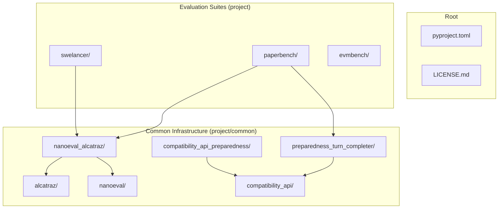

**Sources:** [README.md:27-35](), [README.md:37-38]()

### Component Summary

| Component | Path | Description |
| :--- | :--- | :--- |
| **PaperBench** | `project/paperbench/` | Evaluates end-to-end replication of state-of-the-art AI papers. [README.md:5]() |
| **SWE-Lancer** | `project/swelancer/` | Evaluates models on real freelance software engineering tasks with end-to-end tests. [README.md:6]() |
| **EVMbench** | `project/evmbench/` | Evaluates smart contract security capabilities (Ethereum Virtual Machine). [README.md:7]() |
| **Alcatraz** | `project/common/alcatraz/` | Orchestration system for Docker containers and Jupyter kernels. |
| **Nanoeval** | `project/common/nanoeval/` | Shared evaluation framework (Task/Solver/Eval primitives). |
| **Compatibility API**| `project/common/compatibility_api/` | Abstract interface for storage and task definition. |

## Evaluation Projects

### PaperBench
PaperBench measures the ability of AI agents to perform high-level research tasks, such as reproducing the results of existing AI papers. It utilizes a multi-stage pipeline involving agent rollout, reproduction of results, and automated grading against established rubrics.
**Sources:** [README.md:5]()

### SWE-Lancer
SWE-Lancer tests models on real-world software engineering tasks sourced from freelance platforms. Unlike synthetic benchmarks, it requires the model to navigate large existing codebases and satisfy complex end-to-end test suites.
**Sources:** [README.md:6]()

### EVMbench
EVMbench provides a benchmark for smart contract security. It evaluates the model's performance in detecting vulnerabilities, patching insecure code, and generating exploits (exploits/ploits) within the Ethereum ecosystem.
**Sources:** [README.md:7]()

## Shared Infrastructure Details

### Alcatraz: Container Orchestration
Alcatraz is the primary execution engine for code-based evaluations. It manages the lifecycle of Docker containers where model-generated code is executed safely and in isolation.

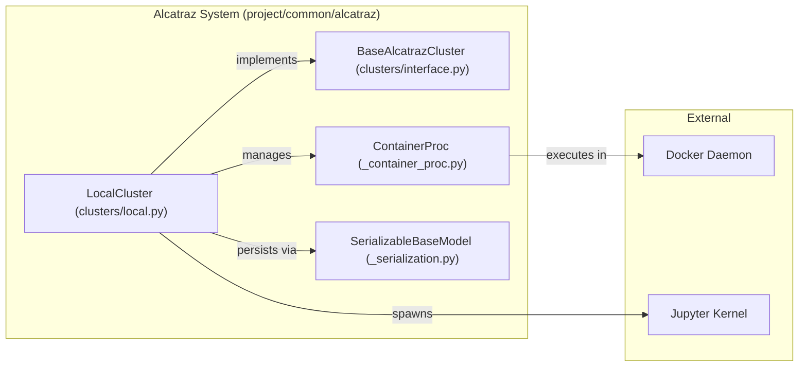

**Sources:** [project/common/alcatraz/alcatraz/clusters/local.py](), [project/common/alcatraz/alcatraz/clusters/interface.py](), [project/common/alcatraz/alcatraz/clusters/_container_proc.py](), [project/common/alcatraz/alcatraz/clusters/_serialization.py]()

### Nanoeval: Evaluation Framework
Nanoeval provides the common logic for running evaluations. It abstracts the concepts of a `Task` (the problem), a `Solver` (the model/agent), and an `Eval` (the orchestration logic).

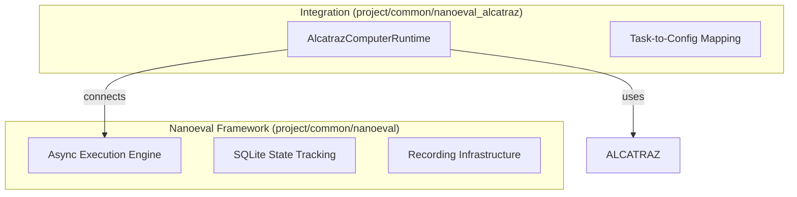

**Sources:** [README.md:31-34]()

## Development Workflow

The repository uses `uv` for dependency management and environment isolation. Each project directory is treated as a standalone workspace.

1. **Environment Setup**: Run `uv sync` within a project directory to install dependencies from the `uv.lock` file. [README.md:13-21]()
2. **Tooling**: Shared configuration for `Ruff` (linting) and `Black` (formatting) is defined in the root `pyproject.toml`. [README.md:29-45]()
3. **Shared Changes**: Modifications to `project/common/` libraries require bumping editable dependencies in the consuming evaluation projects. [README.md:46-47]()

**Sources:** [README.md:13-21](), [README.md:40-47]()

---

# Page: Getting Started

# Getting Started

<details>
<summary>Relevant source files</summary>

The following files were used as context for generating this wiki page:

- [.gitignore](.gitignore)
- [.lfsconfig](.lfsconfig)
- [README.md](README.md)

</details>


This document provides a comprehensive guide for setting up the frontier-evals repository, managing environments with `uv`, and running your first evaluation. It covers the basic workflow for getting started with any of the evaluation projects in the repository.

## Prerequisites

The frontier-evals repository requires the following tools and dependencies:

| Requirement | Purpose | Installation |
|-------------|---------|--------------|
| `uv` | Python package and environment manager | [Install from astral-sh/uv](https://github.com/astral-sh/uv) |
| Docker | Container runtime for evaluation execution | Platform-specific installation |
| Git / Git LFS | Version control and large file support | Platform-specific installation |
| Python 3.8+ | Runtime environment | Managed by `uv` |

Sources: [README.md:10-12](), [.lfsconfig:1-4]()

## Repository Structure

The frontier-evals repository follows a monorepo structure with shared infrastructure and isolated evaluation projects. Each project is self-contained with its own dependency lock file.

**Repository Layout**
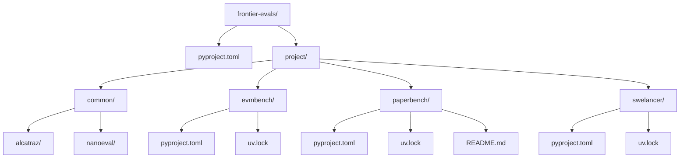

Sources: [README.md:25-36]()

## Environment Management with uv

The repository uses `uv` for dependency management. Each evaluation project maintains its own isolated environment with a dedicated `pyproject.toml` and `uv.lock` file. This ensures that dependencies for one benchmark (e.g., PaperBench) do not conflict with another (e.g., EVMbench).

**Environment Setup Workflow**
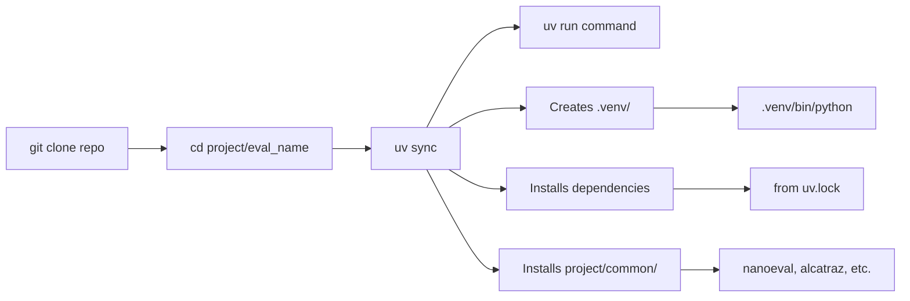

### Setting Up an Evaluation Environment

1.  **Navigate to the evaluation project**:
    ```bash
    cd project/paperbench  # or swelancer, evmbench
    ```

2.  **Create and activate the environment**:
    ```bash
    uv sync
    ```

3.  **Verify the installation**:
    ```bash
    uv run pytest  # Run tests if available
    ```

The `uv sync` command reads the `uv.lock` file and creates a virtual environment in `.venv/` with all required dependencies installed, including editable installations of shared libraries from `project/common/`.

Sources: [README.md:12-14](), [README.md:39-44]()

## Running Your First Evaluation

Each evaluation project provides specific instructions in its `README.md` file. The general workflow follows this pattern:

### Basic Evaluation Execution Pattern

1.  **Enter the project directory and setup environment**:
    ```bash
    cd project/paperbench
    uv sync
    ```

2.  **Review project-specific documentation**:
    - Read the local `README.md` for configuration options.
    - Check `scripts/` or `runtime_*/` directories for orchestration details.

3.  **Execute the evaluation**:
    Follow the specific commands outlined in the project's README. Most evals use `uv run` to ensure the correct environment is used.

### Evaluation Project Quick Start

| Project | Directory | Purpose |
|---------|-----------|---------|
| **PaperBench** | `project/paperbench/` | End-to-end replication of AI papers |
| **SWE-Lancer** | `project/swelancer/` | Real freelance software engineering tasks |
| **EVMbench** | `project/evmbench/` | Smart contract security tasks |

Sources: [README.md:5-7](), [README.md:14-21]()

## Development Workflow

The repository uses `ruff` for linting and formatting. Configuration is shared via the root `pyproject.toml` and specialized profiles in `project/common/tooling/`.

### Quality Assurance

- **Linting**: Use `uv run ruff check --fix` to automatically fix common issues.
- **Formatting**: The project uses `ruff` (Black-compatible) for formatting.
- **Shared Utilities**: Shared libraries live in `project/common/`. Changes here may affect multiple evals. If you add a new shared subpackage, ensure you update the editable dependencies in the project-level `pyproject.toml` files.

Sources: [README.md:43-47]()

## Data Management

The repository uses **Git LFS** for large datasets, particularly for PaperBench.

- **Exclusion**: By default, some large data paths like `project/paperbench/data/**` are excluded from standard fetches to save bandwidth.
- **Errors**: The configuration `skipdownloaderrors = true` is used to prevent setup failures if specific large blobs are temporarily unavailable.

Sources: [.lfsconfig:1-4]()

## Next Steps

After completing the basic setup:

1.  **Explore specific evaluation projects**: Navigate to the `project/` subdirectories to read detailed instructions for PaperBench, SWE-Lancer, or EVMbench.
2.  **Understand the common framework**: Learn how `nanoeval` provides the base `Eval` and `Task` classes used by the benchmarks.
3.  **Execution Environment**: Familiarize yourself with `alcatraz`, the system responsible for managing Docker containers and Jupyter kernels during evaluation rollouts.

---

# Page: Repository Structure

# Repository Structure

<details>
<summary>Relevant source files</summary>

The following files were used as context for generating this wiki page:

- [.gitignore](.gitignore)
- [.lfsconfig](.lfsconfig)
- [.pre-commit-config.yaml](.pre-commit-config.yaml)
- [README.md](README.md)

</details>


This document explains the monorepo organization of the `frontier-evals` repository, covering directory hierarchies, shared library patterns, project isolation mechanisms, and dependency management strategies.

## Repository Organization

The `frontier-evals` repository follows a monorepo pattern with clear separation between shared infrastructure and individual evaluation projects. The top-level structure establishes shared tooling configuration while maintaining project isolation through individual `pyproject.toml` and `uv.lock` files.

### Monorepo Directory Structure

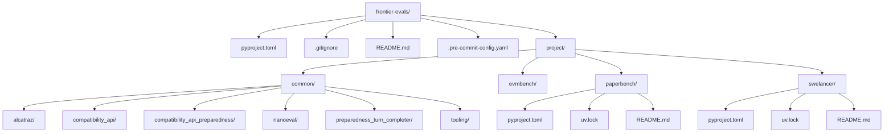

**Sources:** [README.md:25-37](), [.gitignore:1-168](), [.pre-commit-config.yaml:11-51]()

### Configuration Hierarchy

The repository uses a hierarchical configuration approach where shared tooling is defined at the root level and project-specific configurations extend these defaults.

| Configuration File | Scope | Purpose |
|-------------------|-------|---------|
| `pyproject.toml` (root) | Repository-wide | Shared tooling configuration for Ruff, Black, etc. [README.md:29]() |
| `project/*/pyproject.toml` | Project-specific | Dependencies, build settings, and metadata. [README.md:37]() |
| `uv.lock` (per project) | Project-specific | Locked dependency versions for reproducibility. [README.md:37]() |
| `.gitignore` (root) | Repository-wide | Standard Python exclusions and build artifacts. [.gitignore:1-168]() |
| `.pre-commit-config.yaml` | Repository-wide | Orchestrates `ruff` and `uv-lock` hooks across projects. [.pre-commit-config.yaml:1-51]() |

**Sources:** [README.md:29-37](), [.pre-commit-config.yaml:1-51]()

## Shared Libraries Architecture

The `project/common/` directory contains reusable infrastructure components that provide core functionality to evaluation projects. These shared libraries implement the foundational abstractions for evaluation execution, container management, and environment compatibility.

### Core Shared Components

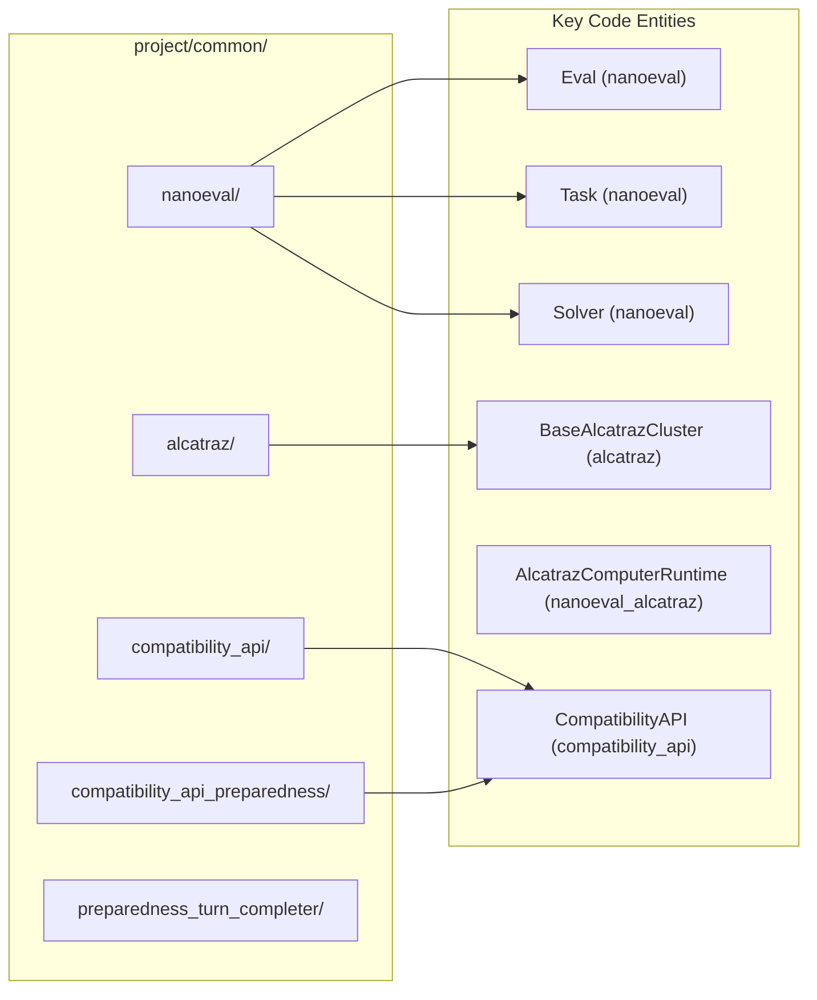

**Sources:** [README.md:31](), [.pre-commit-config.yaml:11-51]()

### Dependency Flow and Tooling

Shared utilities live under `project/common`. Changes to these components may affect multiple evaluations, requiring updates to editable dependencies in project-specific `pyproject.toml` files [README.md:46]().

The `.pre-commit-config.yaml` defines specific scopes for linting and formatting:
- **Ruff Format/Strict**: Targets `alcatraz`, `paperbench`, `swelancer`, `compatibility_api`, `compatibility_api_preparedness`, and `preparedness_turn_completer` [.pre-commit-config.yaml:11-28]().
- **UV Lock**: Manages independent lock files for `paperbench`, `swelancer`, `alcatraz`, and `preparedness_turn_completer` [.pre-commit-config.yaml:34-51]().

**Sources:** [README.md:45-47](), [.pre-commit-config.yaml:11-51]()

## Project Structure Patterns

Each evaluation project (e.g., PaperBench, SWE-Lancer, EVMbench) is an isolated project with its own environment [README.md:37]().

### Standard Project Layout

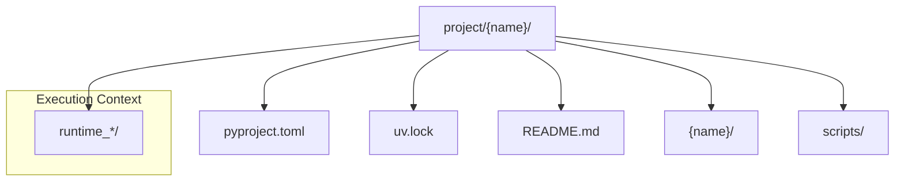

**Sources:** [README.md:17-21](), [README.md:37]()

### Project Isolation Mechanisms

| Mechanism | Implementation | Purpose |
|-----------|----------------|---------|
| Virtual Environments | `uv sync` per project | Isolated Python dependencies. [README.md:13]() |
| Lock Files | `uv.lock` per project | Reproducible builds. [README.md:37]() |
| Configuration | `pyproject.toml` per project | Project-specific settings. [README.md:37]() |
| Entry Points | `scripts/` or `runtime_*/` | Orchestration details. [README.md:17]() |

**Sources:** [README.md:13-37]()

## Dependency Management Strategy

The repository uses `uv` for modern Python dependency management with emphasis on reproducibility and isolation [README.md:13]().

### Development Workflow Integration

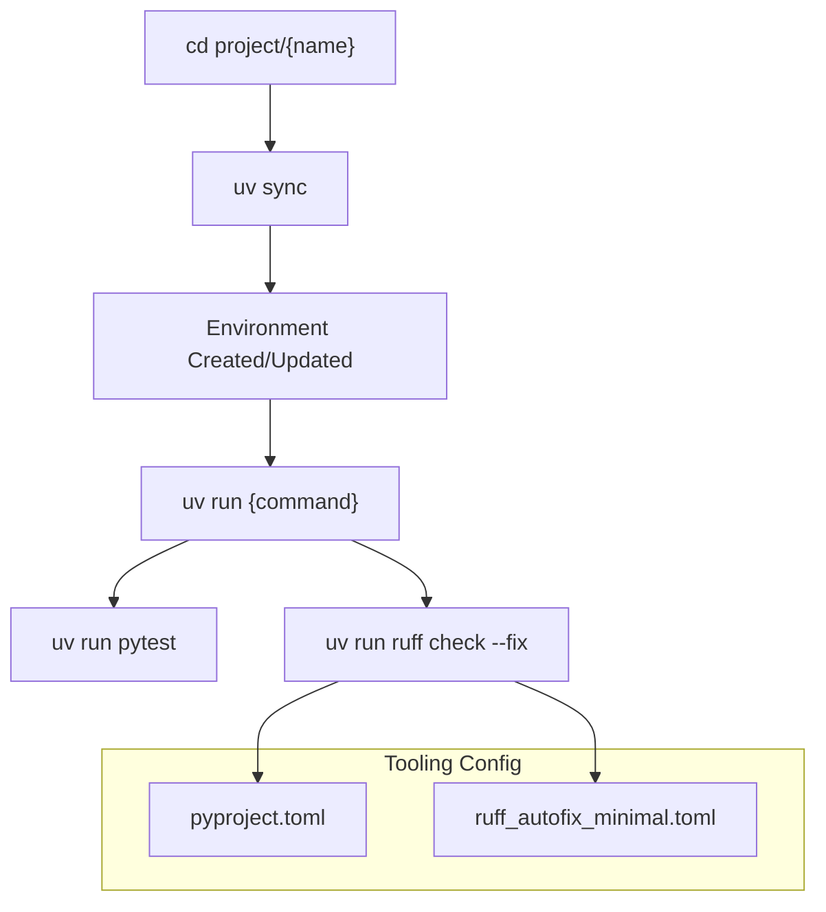

**Sources:** [README.md:41-45](), [.pre-commit-config.yaml:17-19]()

## File Management and LFS

The repository uses Git LFS to manage large datasets, particularly for PaperBench.

### Large File Storage (LFS)
The `.lfsconfig` file is configured to exclude `project/paperbench/data/**` by default during fetches to save bandwidth, unless explicitly requested [.lfsconfig:1-4]().

### Ignored File Categories
The root `.gitignore` handles standard Python artifacts and environment-specific files:
- **Byte-code**: `__pycache__/`, `*.pyc` [.gitignore:7-9]()
- **Environments**: `.venv/`, `venv/`, `.env` [.gitignore:128-130]()
- **IDE Settings**: `.idea/`, `.vscode/` [.gitignore:159-168]()
- **Builds**: `dist/`, `build/`, `*.egg-info/` [.gitignore:16-29]()

**Sources:** [.lfsconfig:1-4](), [.gitignore:1-168]()

---

# Page: Core Evaluation Framework

# Core Evaluation Framework

<details>
<summary>Relevant source files</summary>

The following files were used as context for generating this wiki page:

- [project/common/compatibility_api/compatibility_api/api.py](project/common/compatibility_api/compatibility_api/api.py)
- [project/common/compatibility_api/compatibility_api/task.py](project/common/compatibility_api/compatibility_api/task.py)
- [project/common/nanoeval/README.md](project/common/nanoeval/README.md)
- [project/common/nanoeval/nanoeval/eval.py](project/common/nanoeval/nanoeval/eval.py)
- [project/common/nanoeval/nanoeval/evaluation.py](project/common/nanoeval/nanoeval/evaluation.py)

</details>


## Purpose and Scope

The Core Evaluation Framework provides the shared infrastructure components that enable scalable, reproducible AI model testing across the frontier-evals repository. Located in `project/common/`, these components are designed as modular, reusable libraries that evaluation projects compose to build complete evaluation systems.

This page provides an overview of the core infrastructure components and their roles. For detailed coverage of specific components:
- **Compatibility API**: Abstract environment interfaces. See [Compatibility API](#4.1) and [Compatibility API Preparedness](#4.2).
- **Nanoeval Framework**: The core evaluation engine. See [Nanoeval Framework](#4.3).
- **Alcatraz Integration**: Containerized execution for nanoeval. See [Nanoeval-Alcatraz Integration](#4.4) and [Alcatraz System](#5).

Sources: [project/common/nanoeval/README.md:1-11](), [project/common/compatibility_api/compatibility_api/api.py:7-10]()

## Infrastructure Components Overview

The common infrastructure is organized into specialized components that evaluation projects compose as needed.

### Component Architecture

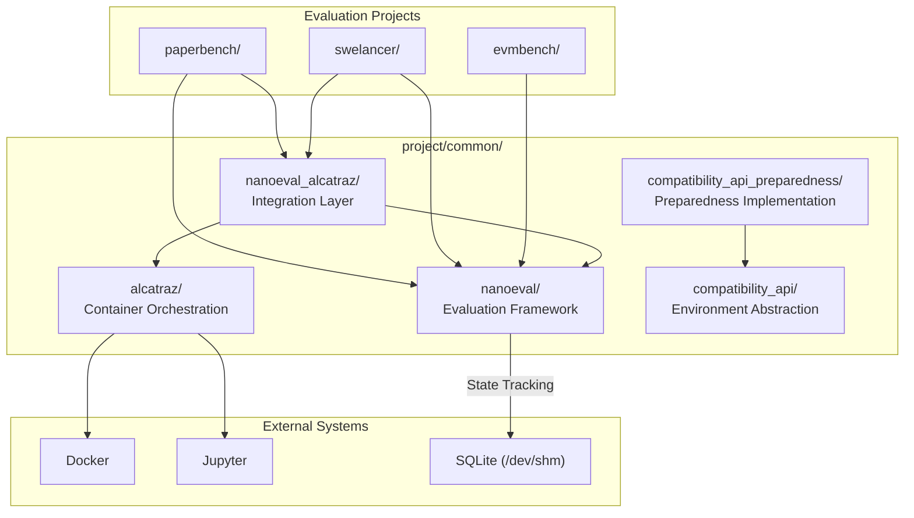

Sources: [project/common/nanoeval/README.md:32-38](), [project/common/compatibility_api/compatibility_api/api.py:7-10]()

### Component Responsibilities

| Component | Location | Purpose | Key Code Entities |
|-----------|----------|---------|-------------------|
| `nanoeval` | `project/common/nanoeval/` | Core evaluation engine | `Eval`, `Task`, `Solver`, `run_eval_in_database` |
| `compatibility_api` | `project/common/compatibility_api/` | Environment-agnostic storage and task subset | `CompatibilityAPI`, `CompatibleComputerTask` |
| `alcatraz` | `project/common/alcatraz/` | Container orchestration | `LocalCluster`, `ContainerProc` |
| `nanoeval_alcatraz` | `project/common/nanoeval_alcatraz/` | Bridge between framework and containers | `AlcatrazComputerRuntime` |

Sources: [project/common/nanoeval/nanoeval/eval.py:112](), [project/common/compatibility_api/compatibility_api/api.py:7](), [project/common/compatibility_api/compatibility_api/task.py:10]()

## Nanoeval Framework

`nanoeval` is a high-performance library designed for ergonomic evaluation development. It operates like a tiny distributed system, using a per-process SQLite database (typically in `/dev/shm`) to track task state and results.

### Core Primitives
- **`Eval`**: A `chz` class that defines how to get tasks and evaluate them [project/common/nanoeval/nanoeval/eval.py:112-120]().
- **`Task`**: A separable, scoreable unit of work [project/common/nanoeval/nanoeval/eval.py:29-32]().
- **`Solver`**: A strategy to solve a task, often involving model sampling [project/common/nanoeval/README.md:20-22]().
- **`EvalSpec`**: Configuration for a specific run, including concurrency and recording settings [project/common/nanoeval/README.md:17-18]().

### Execution Flow
When `nanoeval.run()` is called, it queues tasks in SQLite. One or more executors (in-process or multiprocessing) poll the database, execute `evaluate()`, and persist results [project/common/nanoeval/README.md:32-44]().

For details, see [Nanoeval Framework](#4.3).

Sources: [project/common/nanoeval/README.md:13-44](), [project/common/nanoeval/nanoeval/evaluation.py:163-197]()

## Compatibility API: Environment Abstraction

The `CompatibilityAPI` provides an abstract interface for operations that vary across deployment environments, such as blob storage access.

### Abstract Interface Definition
The `CompatibilityAPI` class defines abstract properties for storage access:
- `blobstore_root_read`: For read-only access to datasets [project/common/compatibility_api/compatibility_api/api.py:25-32]().
- `blobstore_root_write`: For temporary write access [project/common/compatibility_api/compatibility_api/api.py:14-22]().

### Portable Computer Tasks
`CompatibleComputerTask` restricts the features of `ComputerTask` to a subset that is portable between the Alcatraz container system and other internal environments. It enforces:
- No internet access (`NetworkMode.NONE`) [project/common/compatibility_api/compatibility_api/task.py:30-32]().
- No volume mounts or side images [project/common/compatibility_api/compatibility_api/task.py:33-34]().
- Specific allowed Docker images [project/common/compatibility_api/compatibility_api/task.py:50-54]().

For details, see [Compatibility API](#4.1) and [Compatibility API Preparedness](#4.2).

Sources: [project/common/compatibility_api/compatibility_api/api.py:7-32](), [project/common/compatibility_api/compatibility_api/task.py:10-56]()

## Nanoeval-Alcatraz Integration

This integration layer allows `nanoeval` to execute tasks within isolated Docker containers managed by the Alcatraz system.

### Bridging Code to Containers

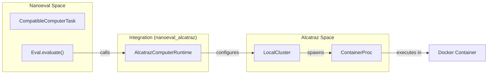

The `AlcatrazComputerRuntime` implements the `ComputerInterface` required by `nanoeval` solvers, translating high-level commands into Alcatraz container operations.

For details, see [Nanoeval-Alcatraz Integration](#4.4) and [Alcatraz System](#5).

Sources: [project/common/compatibility_api/compatibility_api/task.py:10-17](), [project/common/nanoeval/README.md:15-22]()

---

# Page: Compatibility API

# Compatibility API

<details>
<summary>Relevant source files</summary>

The following files were used as context for generating this wiki page:

- [.github/workflows/compatibility_api_lint.yml](.github/workflows/compatibility_api_lint.yml)
- [project/common/compatibility_api/compatibility_api/api.py](project/common/compatibility_api/compatibility_api/api.py)
- [project/common/compatibility_api/compatibility_api/task.py](project/common/compatibility_api/compatibility_api/task.py)
- [project/common/compatibility_api/pyproject.toml](project/common/compatibility_api/pyproject.toml)

</details>


## Purpose and Scope

The Compatibility API provides an abstract interface for writing environment-agnostic evaluations. It abstracts two critical areas of divergence between supported evaluation environments:

1.  **Blob storage access patterns** - Different environments may store and access persistent data differently.
2.  **Task definition constraints** - Different container orchestration systems support different feature sets.

This page documents the abstract interface defined in the `compatibility_api` package. For the concrete implementation used in the openai/preparedness environment, see [Compatibility API Preparedness](). For information about the Alcatraz container orchestration system that implements some of these abstractions, see [Alcatraz System]().

**Sources:** [project/common/compatibility_api/compatibility_api/api.py:1-33](), [project/common/compatibility_api/compatibility_api/task.py:1-57]()

---

## System Architecture

The Compatibility API consists of two main components that work together to enable portable evaluations:

**Architecture Overview**
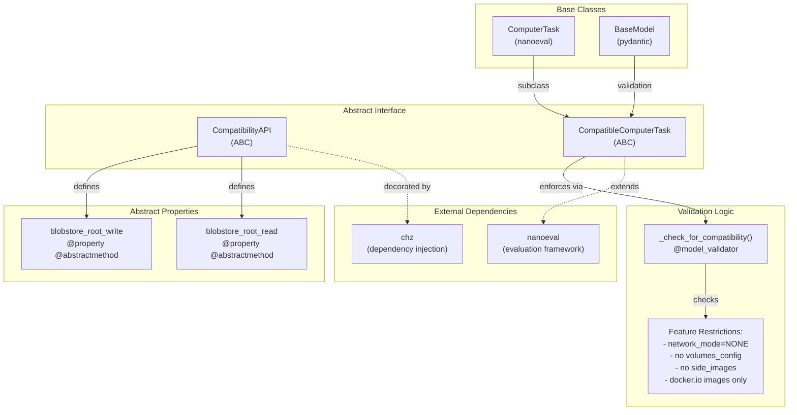

**Sources:** [project/common/compatibility_api/compatibility_api/api.py:1-33](), [project/common/compatibility_api/compatibility_api/task.py:1-57](), [project/common/compatibility_api/pyproject.toml:1-36]()

---

## CompatibilityAPI Abstract Class

The `CompatibilityAPI` class [project/common/compatibility_api/compatibility_api/api.py:7]() provides an abstract interface for blob storage access. It uses the `chz` dependency injection framework [project/common/compatibility_api/compatibility_api/api.py:6]() and defines two abstract properties.

### Class Definition

| Component | Type | Purpose |
| :--- | :--- | :--- |
| `CompatibilityAPI` | Abstract Base Class | Root interface for environment abstraction [project/common/compatibility_api/compatibility_api/api.py:7]() |
| `@chz.chz` decorator | Dependency Injection | Enables injection of concrete implementations [project/common/compatibility_api/compatibility_api/api.py:6]() |
| `blobstore_root_write` | Abstract Property | Root path for write access to blob storage [project/common/compatibility_api/compatibility_api/api.py:14]() |
| `blobstore_root_read` | Abstract Property | Root path for read-only blob storage access [project/common/compatibility_api/compatibility_api/api.py:26]() |

**Sources:** [project/common/compatibility_api/compatibility_api/api.py:6-32]()

### Blob Storage Properties

**Data Flow for Storage Access**
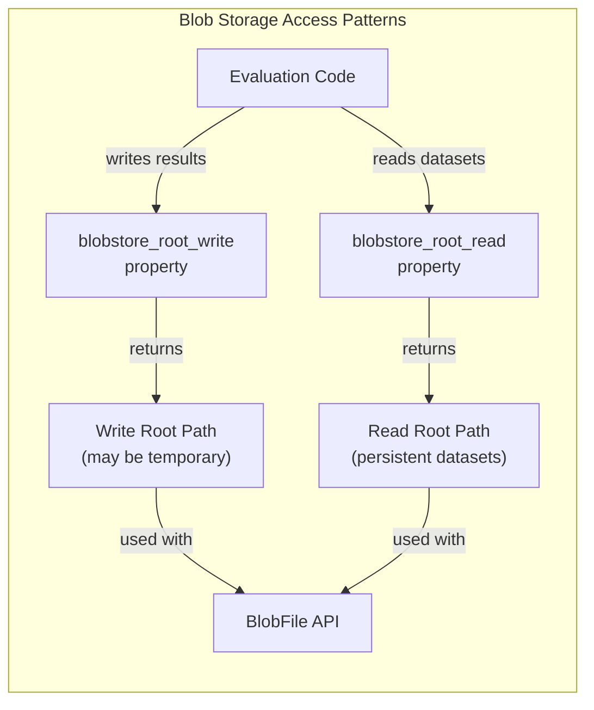

**Sources:** [project/common/compatibility_api/compatibility_api/api.py:12-32]()

#### blobstore_root_write

This property [project/common/compatibility_api/compatibility_api/api.py:14]() returns a root folder path for write access to blob storage via `BlobFile`.

**Key Characteristics:**
*   Data written to this path is readable **in the current process** [project/common/compatibility_api/compatibility_api/api.py:18]().
*   Data **MAY NOT** be readable at the same path after process exit [project/common/compatibility_api/compatibility_api/api.py:18-19]().
*   Should **NOT** be used for storing datasets (use `blobstore_root_read` instead) [project/common/compatibility_api/compatibility_api/api.py:19-20]().
*   Intended for temporary output, results, and intermediate artifacts.

**Sources:** [project/common/compatibility_api/compatibility_api/api.py:12-22]()

#### blobstore_root_read

This property [project/common/compatibility_api/compatibility_api/api.py:26]() returns a root folder path for read-only access to blob storage.

**Key Characteristics:**
*   Data at this path is **NOT writable** [project/common/compatibility_api/compatibility_api/api.py:31]().
*   Intended for accessing persistent datasets and shared resources.
*   Guarantees stable read access across process boundaries.

**Sources:** [project/common/compatibility_api/compatibility_api/api.py:24-32]()

---

## CompatibleComputerTask Class

The `CompatibleComputerTask` class [project/common/compatibility_api/compatibility_api/task.py:10]() extends `ComputerTask` from `nanoeval` and enforces restrictions to ensure portability across different container orchestration systems like Alcatraz.

### Class Hierarchy

**Inheritance and Structure**
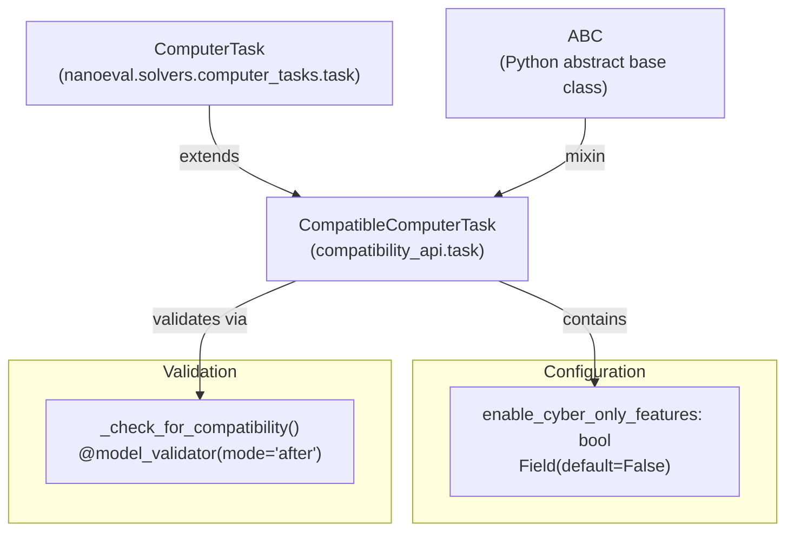

**Sources:** [project/common/compatibility_api/compatibility_api/task.py:10-56]()

### Compatibility Restrictions

The `_check_for_compatibility` validator [project/common/compatibility_api/compatibility_api/task.py:25]() enforces the following restrictions:

#### Network Restrictions

| Restriction | Requirement | Rationale |
| :--- | :--- | :--- |
| `network_mode` | Must be `NetworkMode.NONE` [project/common/compatibility_api/compatibility_api/task.py:30]() | Internet access is not portable across evaluation environments [project/common/compatibility_api/compatibility_api/task.py:27-29]() |

**Sources:** [project/common/compatibility_api/compatibility_api/task.py:27-32]()

#### Volume and Side Container Restrictions

| Feature | Restriction | Line Reference |
| :--- | :--- | :--- |
| `volumes_config` | Must be empty `{}` | [project/common/compatibility_api/compatibility_api/task.py:33]() |
| `volume_mounts` | Must be falsy | [project/common/compatibility_api/compatibility_api/task.py:33]() |
| `side_images` | Must be falsy | [project/common/compatibility_api/compatibility_api/task.py:34]() |

**Sources:** [project/common/compatibility_api/compatibility_api/task.py:33-34]()

#### Docker Compose Restrictions

| Feature | Restriction | Condition |
| :--- | :--- | :--- |
| `docker_compose_yaml` | Must be falsy | Unless `enable_cyber_only_features=True` [project/common/compatibility_api/compatibility_api/task.py:36-37]() |

**Sources:** [project/common/compatibility_api/compatibility_api/task.py:36-37]()

#### Unsupported Features

The following `ComputerTask` features are explicitly disallowed (might work but are untested):

| Feature | Status |
| :--- | :--- |
| `mem_limit` | Not supported [project/common/compatibility_api/compatibility_api/task.py:41]() |
| `shm_size` | Not supported [project/common/compatibility_api/compatibility_api/task.py:42]() |
| `timeout` | Not supported [project/common/compatibility_api/compatibility_api/task.py:43]() |
| `alcatraz_limits` | Not supported [project/common/compatibility_api/compatibility_api/task.py:44]() |
| `jupyter_setup` | Not supported [project/common/compatibility_api/compatibility_api/task.py:45]() |
| `disk_mount_path` | Not supported [project/common/compatibility_api/compatibility_api/task.py:46]() |

**Sources:** [project/common/compatibility_api/compatibility_api/task.py:40-47]()

#### Container Registry Requirements

| Requirement | Details |
| :--- | :--- |
| `docker_image` | Must be specified [project/common/compatibility_api/compatibility_api/task.py:51]() |
| Image source | Must start with `"docker.io"` OR be `"jupyter/base-notebook:3.11"` [project/common/compatibility_api/compatibility_api/task.py:52-53]() |
| Purpose | Ensures use of shared container registries for portability [project/common/compatibility_api/compatibility_api/task.py:54]() |

**Sources:** [project/common/compatibility_api/compatibility_api/task.py:50-54]()

### Validation Flow Diagram

**Task Compatibility Validation Sequence**
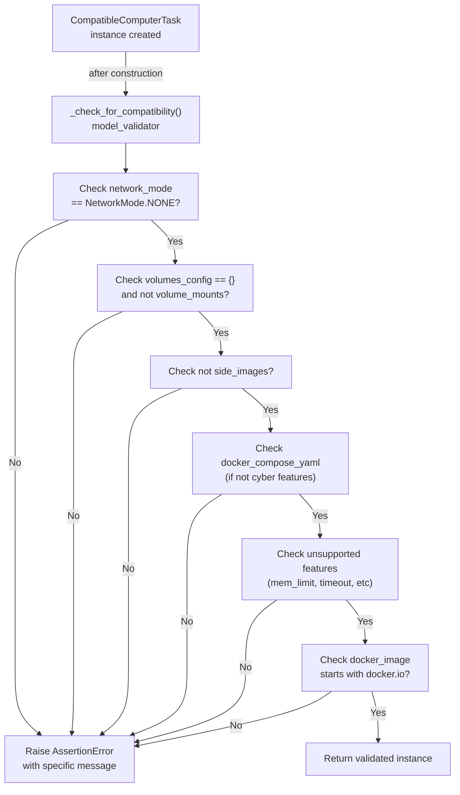

**Sources:** [project/common/compatibility_api/compatibility_api/task.py:24-56]()

---

## enable_cyber_only_features Flag

The `enable_cyber_only_features` field [project/common/compatibility_api/compatibility_api/task.py:19]() allows selective relaxation of restrictions for cyber-specific environments that have additional validation mechanisms.

**Behavior:**
*   When `False` (default): `docker_compose_yaml` is not allowed [project/common/compatibility_api/compatibility_api/task.py:37]().
*   When `True`: `docker_compose_yaml` is permitted, assuming the cyber environment handles validation [project/common/compatibility_api/compatibility_api/task.py:20]().

**Sources:** [project/common/compatibility_api/compatibility_api/task.py:19-22](), [project/common/compatibility_api/compatibility_api/task.py:36-37]()

---

## Dependencies

The compatibility API has minimal, well-defined dependencies:

| Dependency | Purpose | Configuration |
| :--- | :--- | :--- |
| `chz` | Dependency injection for `CompatibilityAPI` | Git source: `https://github.com/openai/chz.git` [project/common/compatibility_api/pyproject.toml:15]() |
| `pydantic` | Data validation for `CompatibleComputerTask` | Standard dependency [project/common/compatibility_api/pyproject.toml:5]() |
| `nanoeval` | Base `ComputerTask` class | Local editable dependency [project/common/compatibility_api/pyproject.toml:16]() |

**Development Dependencies:**

| Tool | Purpose | Version |
| :--- | :--- | :--- |
| `mypy` | Type checking | ≥1.15.0 [project/common/compatibility_api/pyproject.toml:10]() |
| `ruff` | Linting and formatting | ≥0.11.7 [project/common/compatibility_api/pyproject.toml:11]() |

**Sources:** [project/common/compatibility_api/pyproject.toml:1-36]()

---

## Usage Patterns

### Implementing a Concrete CompatibilityAPI

To create a concrete implementation (see [Compatibility API Preparedness]() for an example):

1.  Subclass `CompatibilityAPI` [project/common/compatibility_api/compatibility_api/api.py:7]().
2.  Implement `blobstore_root_write` property to return environment-specific write path [project/common/compatibility_api/compatibility_api/api.py:14]().
3.  Implement `blobstore_root_read` property to return environment-specific read path [project/common/compatibility_api/compatibility_api/api.py:26]().
4.  Register implementation with `chz` dependency injection framework [project/common/compatibility_api/compatibility_api/api.py:6]().

### Creating Compatible Tasks

To create a task definition that works across environments:

1.  Subclass `CompatibleComputerTask` instead of `ComputerTask` [project/common/compatibility_api/compatibility_api/task.py:10]().
2.  Ensure `network_mode` is set to `NetworkMode.NONE` [project/common/compatibility_api/compatibility_api/task.py:30]().
3.  Use Docker images from `docker.io` registry [project/common/compatibility_api/compatibility_api/task.py:52]().
4.  Avoid unsupported features (volumes, side containers, resource limits) [project/common/compatibility_api/compatibility_api/task.py:33-47]().
5.  Set `enable_cyber_only_features=True` only if specifically targeting a cyber environment [project/common/compatibility_api/compatibility_api/task.py:19]().

**Sources:** [project/common/compatibility_api/compatibility_api/api.py:6-32](), [project/common/compatibility_api/compatibility_api/task.py:10-56]()

---

## Network Access Rationale

The compatibility API enforces `network_mode = NetworkMode.NONE` for architectural consistency:

> "The only class of eval which is truly 'portable' is one that doesn't require external Internet access at all. This is definitely a large restriction in the design space. My guess is that this matters much more for setup scripts than actually permitting the model network access (e.g., maybe we could disable internet during setup, but re-enable for agent rollout), but I think it seems simpler to drop network access fully." [project/common/compatibility_api/compatibility_api/task.py:27-32]()

This design decision prioritizes **portability** over **flexibility**, ensuring evaluations can run in any environment without external network dependencies.

**Sources:** [project/common/compatibility_api/compatibility_api/task.py:27-32]()

---

# Page: Compatibility API Preparedness

# Compatibility API Preparedness

<details>
<summary>Relevant source files</summary>

The following files were used as context for generating this wiki page:

- [.github/workflows/compatibility_api_preparedness_lint.yml](.github/workflows/compatibility_api_preparedness_lint.yml)
- [project/common/compatibility_api_preparedness/compatibility_api_preparedness/api.py](project/common/compatibility_api_preparedness/compatibility_api_preparedness/api.py)
- [project/common/compatibility_api_preparedness/pyproject.toml](project/common/compatibility_api_preparedness/pyproject.toml)

</details>


## Purpose and Scope

This document describes the `CompatibilityAPIPreparedness` class, which is a concrete implementation of the abstract `CompatibilityAPI` interface for the `openai/preparedness` environment. This implementation provides environment-specific blob storage path resolution for evaluations running in the preparedness infrastructure.

The package is managed using `uv` and includes dependencies on `chz` and the base `compatibility_api` package. It is subject to strict linting and type-checking via `ruff` and `mypy` as part of the repository's CI/CD pipeline.

**Sources**: [project/common/compatibility_api_preparedness/compatibility_api_preparedness/api.py:1-29](), [.github/workflows/compatibility_api_preparedness_lint.yml:1-51]()

## Architecture Overview

The `CompatibilityAPIPreparedness` class extends the abstract `CompatibilityAPI` interface to provide a simple, local directory-based implementation suitable for the `openai/preparedness` environment.

```mermaid
classDiagram
    class CompatibilityAPI {
        <<abstract>>
        +blobstore_root_write: str
        +blobstore_root_read: str
    }
    
    class CompatibilityAPIPreparedness {
        +override_use_local_dir: str
        -_base_dir: str
        +blobstore_root_write: str
        +blobstore_root_read: str
    }
    
    CompatibilityAPI <|-- "CompatibilityAPIPreparedness"
    
    note for CompatibilityAPI "Abstract interface defined in\ncompatibility_api/api.py"
    note for CompatibilityAPIPreparedness "Preparedness implementation\nin compatibility_api_preparedness/api.py"
```

**Diagram: Class Inheritance Structure**

The inheritance relationship is straightforward: `CompatibilityAPIPreparedness` implements all abstract properties defined in `CompatibilityAPI` by delegating to a single configurable base directory.

**Sources**: [project/common/compatibility_api_preparedness/compatibility_api_preparedness/api.py:6-28](), [project/common/compatibility_api_preparedness/pyproject.toml:1-6]()

## Implementation Details

### Class Structure and Configuration

The `CompatibilityAPIPreparedness` class uses the `chz` library for configuration management. It defines a single configuration field and derives all blob storage paths from it:

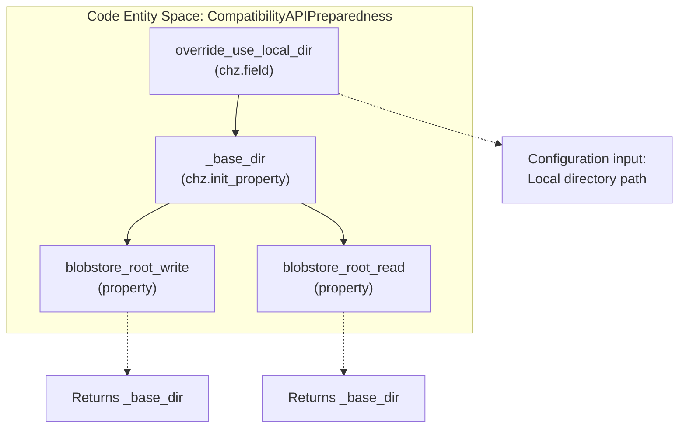

**Diagram: Data Flow from Configuration to Properties**

| Component | Type | Purpose |
|-----------|------|---------|
| `override_use_local_dir` | `chz.field` | Configuration field that specifies the local directory to use as the base path |
| `_base_dir` | `@chz.init_property` | Internal property that returns the configured base directory |
| `blobstore_root_write` | `@property` | Public interface for write-accessible blob storage root |
| `blobstore_root_read` | `@property` | Public interface for read-only blob storage root |

**Sources**: [project/common/compatibility_api_preparedness/compatibility_api_preparedness/api.py:14-28]()

### Base Directory Configuration

The `override_use_local_dir` field allows users to specify the base directory path when instantiating the class. The `_base_dir` property is decorated with `@chz.init_property`, which means it's initialized once during object construction:

[project/common/compatibility_api_preparedness/compatibility_api_preparedness/api.py:14-20]()

This design ensures that the base directory is immutable after initialization, preventing accidental path changes during evaluation execution.

**Sources**: [project/common/compatibility_api_preparedness/compatibility_api_preparedness/api.py:14-20]()

### Blob Storage Path Implementation

Both `blobstore_root_write` and `blobstore_root_read` return the same `_base_dir` value. This unified approach differs from the abstract interface's conceptual separation of read and write paths:

[project/common/compatibility_api_preparedness/compatibility_api_preparedness/api.py:22-28]()

| Property | Return Value | Access Pattern |
|----------|--------------|----------------|
| `blobstore_root_write` | `self._base_dir` | Read/write access |
| `blobstore_root_read` | `self._base_dir` | Read-only access (by convention) |

The preparedness implementation treats both as the same local directory, assuming the preparedness environment provides appropriate persistence guarantees.

**Sources**: [project/common/compatibility_api_preparedness/compatibility_api_preparedness/api.py:22-28]()

## Design Decisions

### Unified Path Strategy

The decision to return the same path for both read and write operations simplifies the preparedness implementation:

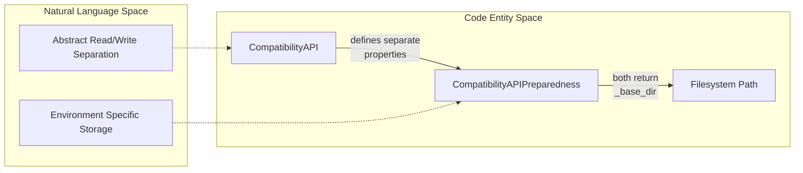

**Diagram: Path Resolution Strategy**

This approach works because:
1. The preparedness environment uses a local filesystem for blob storage.
2. The local directory provides both read and write capabilities.
3. Persistence guarantees are handled at the infrastructure level, not within the API.

**Sources**: [project/common/compatibility_api_preparedness/compatibility_api_preparedness/api.py:22-28]()

### Environment-Specific Implementation

The class documentation explicitly states it is "the openai/preparedness implementation" [project/common/compatibility_api_preparedness/compatibility_api_preparedness/api.py:8-11](). This indicates that:

- Other environments (client repos) have their own implementations.
- Each implementation adapts the abstract interface to its specific infrastructure.
- The preparedness environment uses a simple local directory model.

This design pattern allows evaluations to be written against the abstract `CompatibilityAPI` interface while supporting multiple deployment environments.

**Sources**: [project/common/compatibility_api_preparedness/compatibility_api_preparedness/api.py:7-12]()

## Dependency Management and CI

The package uses `uv` for dependency management, linking to other local components like `nanoeval` and `alcatraz` in editable mode.

[project/common/compatibility_api_preparedness/pyproject.toml:14-20]()

Continuous integration ensures code quality through two primary tools:
- **Mypy**: Performs static type checking using the configuration in `pyproject.toml`. [project/common/compatibility_api_preparedness/pyproject.toml:29-31]()
- **Ruff**: Executes strict linting checks. [.github/workflows/compatibility_api_preparedness_lint.yml:47-51]()

**Sources**: [project/common/compatibility_api_preparedness/pyproject.toml:14-31](), [.github/workflows/compatibility_api_preparedness_lint.yml:42-51]()

## Configuration Management with chz

The implementation leverages the `chz` library for declarative configuration:

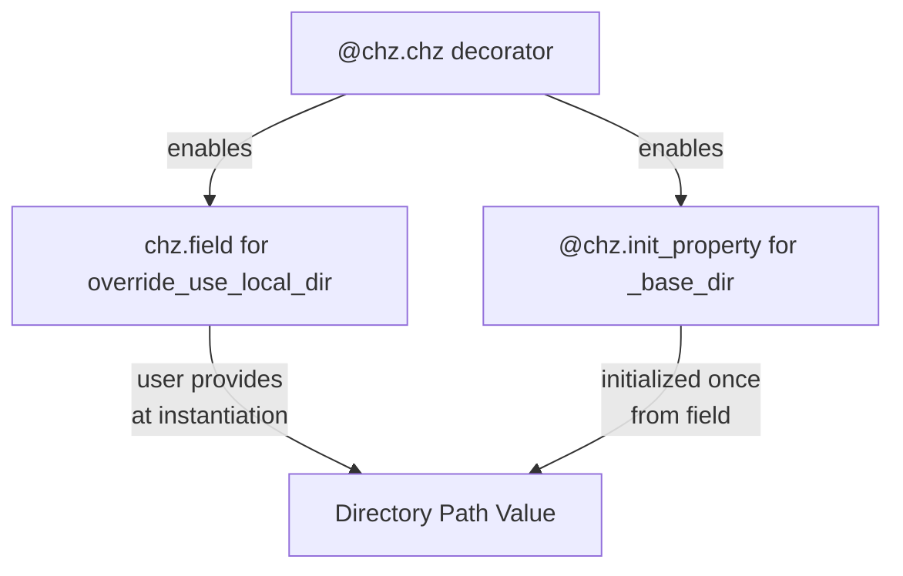

**Diagram: chz Configuration Flow**

The `@chz.chz` decorator [project/common/compatibility_api_preparedness/compatibility_api_preparedness/api.py:6]() enables:
- Automatic constructor generation from field definitions.
- Type-safe configuration with documentation.
- Initialization-time property evaluation with `@chz.init_property`.

This pattern ensures configuration is validated at instantiation time and remains immutable throughout the object's lifecycle.

**Sources**: [project/common/compatibility_api_preparedness/compatibility_api_preparedness/api.py:6-20]()

---

# Page: Nanoeval Framework

# Nanoeval Framework

<details>
<summary>Relevant source files</summary>

The following files were used as context for generating this wiki page:

- [project/common/nanoeval/README.md](project/common/nanoeval/README.md)
- [project/common/nanoeval/docs/computer_tasks.md](project/common/nanoeval/docs/computer_tasks.md)
- [project/common/nanoeval/nanoeval/_db.py](project/common/nanoeval/nanoeval/_db.py)
- [project/common/nanoeval/nanoeval/_executor_worker.py](project/common/nanoeval/nanoeval/_executor_worker.py)
- [project/common/nanoeval/nanoeval/_persistent_db.py](project/common/nanoeval/nanoeval/_persistent_db.py)
- [project/common/nanoeval/nanoeval/eval.py](project/common/nanoeval/nanoeval/eval.py)
- [project/common/nanoeval/nanoeval/evaluation.py](project/common/nanoeval/nanoeval/evaluation.py)
- [project/common/nanoeval/nanoeval/recorder.py](project/common/nanoeval/nanoeval/recorder.py)
- [project/common/nanoeval/nanoeval/recorder_protocol.py](project/common/nanoeval/nanoeval/recorder_protocol.py)
- [project/common/nanoeval/nanoeval/recorders.py](project/common/nanoeval/nanoeval/recorders.py)
- [project/common/nanoeval/nanoeval/solvers/computer_tasks/code_execution_interface.py](project/common/nanoeval/nanoeval/solvers/computer_tasks/code_execution_interface.py)
- [project/common/nanoeval/nanoeval/solvers/computer_tasks/limits.py](project/common/nanoeval/nanoeval/solvers/computer_tasks/limits.py)
- [project/common/nanoeval/nanoeval/solvers/computer_tasks/solver.py](project/common/nanoeval/nanoeval/solvers/computer_tasks/solver.py)
- [project/common/nanoeval/nanoeval/solvers/computer_tasks/steps.py](project/common/nanoeval/nanoeval/solvers/computer_tasks/steps.py)
- [project/common/nanoeval/nanoeval/solvers/computer_tasks/task.py](project/common/nanoeval/nanoeval/solvers/computer_tasks/task.py)
- [project/common/nanoeval/nanoeval/solvers/mcq.py](project/common/nanoeval/nanoeval/solvers/mcq.py)
- [project/common/nanoeval/nanoeval/solvers/mcq_api.py](project/common/nanoeval/nanoeval/solvers/mcq_api.py)
- [project/common/nanoeval/pyproject.toml](project/common/nanoeval/pyproject.toml)

</details>


The `nanoeval` library is a high-performance, minimalist evaluation framework designed for fast iteration and low indirection. It operates as a distributed system on a single machine, using a SQLite-backed state tracking mechanism to manage task execution across multiple processes.

## 1. Overview and Core Primitives

Nanoeval is built around four primary primitives that separate data loading, execution strategy, and scoring.

| Primitive | Class/Entity | Description |
| :--- | :--- | :--- |
| **Eval** | `Eval` | A `chz` class that enumerates tasks, executes them via a solver, and records results. [project/common/nanoeval/nanoeval/eval.py:112-112]() |
| **EvalSpec** | `EvalSpec` | Defines the evaluation to run along with runtime characteristics like concurrency and recording. [project/common/nanoeval/README.md:17-18]() |
| **Task** | `Task` | A separable, scoreable unit of work (e.g., a single question or coding problem). [project/common/nanoeval/nanoeval/eval.py:29-29]() |
| **Solver** | `Solver` | A strategy (often involving an LLM) to transform a `Task` into a result. [project/common/nanoeval/README.md:20-22]() |

### Natural Language to Code Entity Mapping: Core Primitives
The following diagram bridges the conceptual evaluation space to the specific classes defined in `nanoeval/eval.py`.

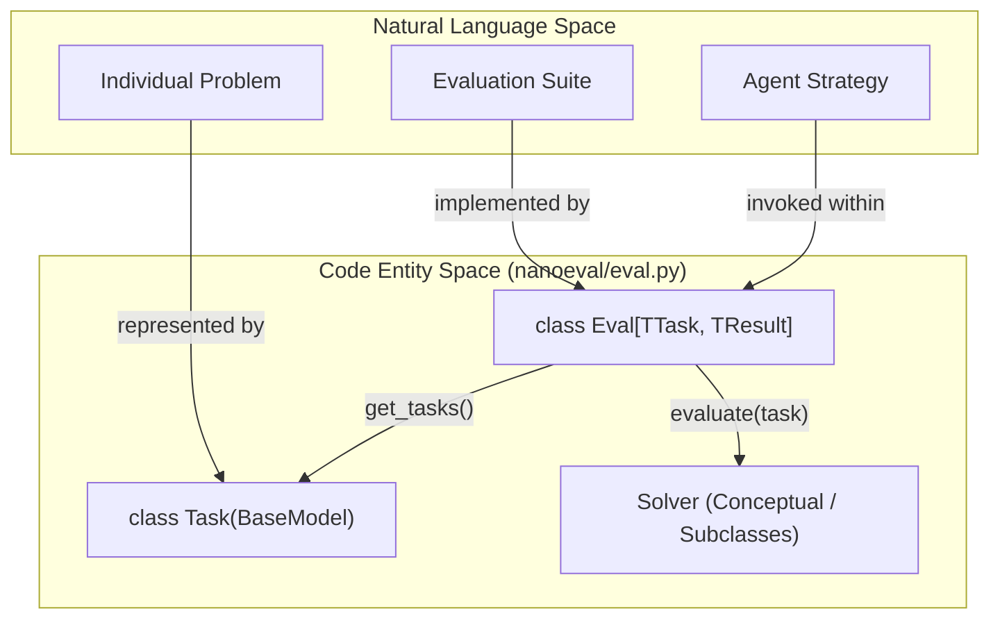
**Sources:** [project/common/nanoeval/nanoeval/eval.py:29-122](), [project/common/nanoeval/README.md:13-23]()

---

## 2. Execution Engine and State Tracking

Nanoeval functions like a tiny distributed system. When `nanoeval.run()` is called, the framework initializes a SQLite database to track the lifecycle of every task.

### SQLite-Backed State Management
The state is stored in a per-process SQLite database, typically located in `/dev/shm` (Linux) or `/tmp` (macOS) for performance. [project/common/nanoeval/README.md:35-36]()

*   **Database Schema:** The database contains tables for `eval` (metadata), `executor` (worker status), `task` (individual task state), and `metadata` (global configuration). [project/common/nanoeval/nanoeval/_db.py:68-124]()
*   **Persistence:** The `PersistentDb` class handles periodic backups of the local SQLite file to Azure Blob Storage, allowing for resumption after crashes. [project/common/nanoeval/nanoeval/_persistent_db.py:36-44]()
*   **WAL Mode:** The database uses Write-Ahead Logging (`PRAGMA journal_mode=WAL`) to support concurrent access by multiple executors. [project/common/nanoeval/nanoeval/_db.py:65-65]()

### Async Execution Flow
The `run_eval_in_database` function acts as the driver. [project/common/nanoeval/nanoeval/evaluation.py:99-99]() It monitors the database and waits for executors to update task results.

1.  **Queueing:** Tasks are inserted into the `task` table with `executor_pid` as `NULL`. [project/common/nanoeval/nanoeval/_db.py:88-100]()
2.  **Polling:** Executors poll the database using an `EXCLUSIVE` transaction to claim tasks by setting the `executor_pid`. [project/common/nanoeval/nanoeval/_executor_worker.py:161-200]()
3.  **Execution:** The executor runs `eval.evaluate(task)` asynchronously. [project/common/nanoeval/nanoeval/_executor_worker.py:86-86]()
4.  **Completion:** Results are serialized via `dill` and written back to the `task` table. [project/common/nanoeval/nanoeval/_executor_worker.py:94-108]()

### Natural Language to Code Entity Mapping: Execution System
This diagram maps the conceptual "Worker/Queue" model to the specific internal modules and database interactions.

```mermaid
graph LR
    subgraph "Natural Language Space"
        Q["Task Queue"]
        W["Worker Process"]
        DB["State Store"]
    end

    subgraph "Code Entity Space"
        Q_sql["TABLE task (nanoeval/_db.py)"]
        W_proc["_executor_worker.py"]
        DB_file["PersistentDb (nanoeval/_persistent_db.py)"]
        Driver["evaluation.py:run_eval_in_database"]
    end

    Q -- "stored in" --> Q_sql
    W -- "logic in" --> W_proc
    DB -- "managed by" --> DB_file

    W_proc -->|"poll & update"| Q_sql
    Driver -->|"monitor"| Q_sql
    Q_sql -- "part of" --> DB_file
```
**Sources:** [project/common/nanoeval/nanoeval/_db.py:88-100](), [project/common/nanoeval/nanoeval/_executor_worker.py:161-210](), [project/common/nanoeval/nanoeval/evaluation.py:99-105]()

---

## 3. Recording Infrastructure

Nanoeval uses a `RecorderProtocol` to decouple the evaluation logic from the logging backend. [project/common/nanoeval/nanoeval/recorder_protocol.py:23-23]()

*   **Recorder Context:** The `recorder` is managed via `ContextVar`, allowing different async tasks to log to their respective run streams without explicit passing of recorder objects. [project/common/nanoeval/nanoeval/recorder.py:14-14]()
*   **Key Methods:**
    *   `record_match`: Logs whether a model's answer was correct. [project/common/nanoeval/nanoeval/recorder_protocol.py:42-50]()
    *   `record_sampling`: Logs the prompt and the model's generated response. [project/common/nanoeval/nanoeval/recorder_protocol.py:52-59]()
    *   `record_error`: Captures system or model exceptions. [project/common/nanoeval/nanoeval/recorder_protocol.py:63-63]()

**Sources:** [project/common/nanoeval/nanoeval/recorder.py:14-28](), [project/common/nanoeval/nanoeval/recorder_protocol.py:23-70]()

---

## 4. Built-in Solvers and Computer Tasks

Nanoeval provides specialized infrastructure for complex evaluations, specifically Multiple Choice Questions (MCQ) and Computer Tasks.

### Multiple Choice Questions (MCQ)
The framework includes `MCQEval` and associated solvers for standardized prompting and logit-based or consensus-based scoring of multiple-choice tasks. [project/common/nanoeval/README.md:20-22](), [project/common/nanoeval/README.md:53-55]()

### Computer Tasks
`ComputerTask` represents evaluations involving code execution in isolated environments. [project/common/nanoeval/docs/computer_tasks.md:3-4]()

*   **ComputerInterface:** An abstract base class defining how an agent interacts with a container (shell commands, file uploads/downloads). [project/common/nanoeval/nanoeval/solvers/computer_tasks/code_execution_interface.py:71-71]()
*   **JupyterComputerInterface:** Extends the interface to support Python code execution via a Jupyter kernel. [project/common/nanoeval/nanoeval/solvers/computer_tasks/code_execution_interface.py:132-132]()
*   **Execution Lifecycle:**
    1.  `ComputerRuntime` initializes the environment from a `ComputerTask`.
    2.  `task.setup()` prepares the container.
    3.  The agent interacts via `send_shell_command` or `execute`.
    4.  `task.grade()` computes the final score. [project/common/nanoeval/docs/computer_tasks.md:7-12]()

### Rollout Limits
The `LimitsHelper` class enforces constraints on computer tasks to prevent runaway processes. [project/common/nanoeval/nanoeval/solvers/computer_tasks/limits.py:27-27]()

| Limit | Default | Description |
| :--- | :--- | :--- |
| `max_actions` | 100 | Maximum number of commands/executions allowed. |
| `max_time_seconds` | 3600 | Maximum duration for the agent rollout. |
| `total_sample_timeout`| 14400 | Total wall-clock time allowed for the task. |

**Sources:** [project/common/nanoeval/docs/computer_tasks.md:1-12](), [project/common/nanoeval/nanoeval/solvers/computer_tasks/code_execution_interface.py:71-152](), [project/common/nanoeval/nanoeval/solvers/computer_tasks/limits.py:27-45]()

---

# Page: Nanoeval-Alcatraz Integration

# Nanoeval-Alcatraz Integration

<details>
<summary>Relevant source files</summary>

The following files were used as context for generating this wiki page:

- [project/common/nanoeval_alcatraz/nanoeval_alcatraz/__init__.py](project/common/nanoeval_alcatraz/nanoeval_alcatraz/__init__.py)
- [project/common/nanoeval_alcatraz/nanoeval_alcatraz/alcatraz_computer_interface.py](project/common/nanoeval_alcatraz/nanoeval_alcatraz/alcatraz_computer_interface.py)
- [project/common/nanoeval_alcatraz/nanoeval_alcatraz/task_to_alcatraz_config.py](project/common/nanoeval_alcatraz/nanoeval_alcatraz/task_to_alcatraz_config.py)
- [project/common/nanoeval_alcatraz/pyproject.toml](project/common/nanoeval_alcatraz/pyproject.toml)

</details>


The `nanoeval_alcatraz` package serves as the bridge between the `nanoeval` evaluation framework and the `alcatraz` container orchestration system. It implements the `ComputerInterface` and `ComputerRuntime` abstractions defined in `nanoeval`, allowing evaluation solvers to execute code and manage files within isolated Alcatraz-managed environments.

### Implementation Overview

The integration relies on two primary components:
1.  **Interface Wrappers**: Classes that map `nanoeval`'s shell and Jupyter execution calls to Alcatraz cluster commands.
2.  **Runtime Management**: Classes that handle the lifecycle of Alcatraz clusters (creation, setup, and teardown) based on task-specific configurations.

**System Interaction Flow**

"This diagram illustrates how `nanoeval` entities interact with `alcatraz` entities through the bridge classes."

```mermaid
graph TD
    subgraph "Nanoeval Space"
        A["ComputerRuntime"]
        B["ComputerInterface"]
    end

    subgraph "Nanoeval-Alcatraz Bridge"
        C["AlcatrazComputerRuntime"]
        D["AlcatrazComputerInterface"]
        E["task_to_alcatraz_config()"]
    end

    subgraph "Alcatraz Space"
        F["BaseAlcatrazCluster"]
        G["LocalCluster / AzureCluster"]
        H["Jupyter Kernel"]
    end

    A -- "Inherited by" --> C
    B -- "Inherited by" --> D
    C -- "Uses" --> E
    C -- "Creates" --> D
    D -- "Wraps" --> F
    F -- "Implemented by" --> G
    D -- "Manages" --> H
```
Sources: [project/common/nanoeval_alcatraz/nanoeval_alcatraz/alcatraz_computer_interface.py:14-25](), [project/common/nanoeval_alcatraz/nanoeval_alcatraz/alcatraz_computer_interface.py:192-200]()

---

### Computer Interface Implementation

The `AlcatrazComputerInterface` implements the `JupyterComputerInterface` and `ComputerInterface` protocols. It delegates low-level operations to an underlying `BaseAlcatrazCluster` instance.

#### Shell and File Operations
*   **Shell Commands**: Executed via `run_command_streaming` which interacts with the Alcatraz cluster's container process management [project/common/nanoeval_alcatraz/nanoeval_alcatraz/alcatraz_computer_interface.py:86-88]().
*   **File Transfer**: `upload` and `download` methods directly wrap the cluster's native file handling capabilities [project/common/nanoeval_alcatraz/nanoeval_alcatraz/alcatraz_computer_interface.py:80-84]().
*   **Network Control**: If `allow_internet` is false, the interface uses `iptables` via the cluster to block container network access [project/common/nanoeval_alcatraz/nanoeval_alcatraz/alcatraz_computer_interface.py:58-68]().

#### Jupyter Execution
The interface manages a Jupyter kernel for stateful code execution. The `execute` method [project/common/nanoeval_alcatraz/nanoeval_alcatraz/alcatraz_computer_interface.py:106-140]() handles:
1.  **Lazy Initialization**: The kernel is started only upon the first `execute` call using `_start_jupyter_kernel_once` [project/common/nanoeval_alcatraz/nanoeval_alcatraz/alcatraz_computer_interface.py:142-146]().
2.  **Message Parsing**: Iterates through Jupyter protocol messages (`error`, `execute_result`, `stream`) to construct a `JupyterExecutionResult` [project/common/nanoeval_alcatraz/nanoeval_alcatraz/alcatraz_computer_interface.py:117-133]().
3.  **Exception Serialization**: Errors are captured into a `Python3ExceptionDict` for structured reporting [project/common/nanoeval_alcatraz/nanoeval_alcatraz/alcatraz_computer_interface.py:32-45]().

Sources: [project/common/nanoeval_alcatraz/nanoeval_alcatraz/alcatraz_computer_interface.py:48-159]()

---

### Task to Config Mapping

The `task_to_alcatraz_config` function is responsible for translating `ComputerConfiguration` (from `nanoeval`) into a `ClusterConfig` (for `alcatraz`). This mapping ensures that task requirements like specific Docker images, memory limits, or volume mounts are respected by the container runtime.

**Configuration Mapping Logic**

| Nanoeval Attribute (`ComputerConfiguration`) | Alcatraz Attribute (`ClusterConfig`) | Notes |
| :--- | :--- | :--- |
| `network_mode` | `no_network` | Only `NONE` and `UNPROXIED` are supported [project/common/nanoeval_alcatraz/nanoeval_alcatraz/task_to_alcatraz_config.py:19-26]() |
| `docker_image` | `image` | Specifies the primary container image [project/common/nanoeval_alcatraz/nanoeval_alcatraz/task_to_alcatraz_config.py:31-33]() |
| `mem_limit` | `mem_limit` | Sets container memory constraints [project/common/nanoeval_alcatraz/nanoeval_alcatraz/task_to_alcatraz_config.py:72-74]() |
| `volume_mounts` | `volumes_config` | Maps host paths to container paths [project/common/nanoeval_alcatraz/nanoeval_alcatraz/task_to_alcatraz_config.py:56-65]() |
| `alcatraz_limits` | `limits` | Direct passthrough of Alcatraz-specific resource limits [project/common/nanoeval_alcatraz/nanoeval_alcatraz/task_to_alcatraz_config.py:49-51]() |

Sources: [project/common/nanoeval_alcatraz/nanoeval_alcatraz/task_to_alcatraz_config.py:16-84]()

---

### Computer Runtime Lifecycle

The `AlcatrazComputerRuntime` manages the lifecycle of the environment using an asynchronous context manager.

**Runtime Lifecycle Flow**

"This diagram shows the sequence of entities and function calls involved in setting up and tearing down an evaluation environment."

```mermaid
sequenceDiagram
    participant R as AlcatrazComputerRuntime
    participant M as task_to_alcatraz_config
    participant C as BaseAlcatrazCluster
    participant I as AlcatrazComputerInterface

    R->>M: Call with ComputerConfiguration
    M-->>R: Return ClusterConfig
    R->>C: .build() (Context Manager Start)
    C->>C: Provision Docker/Azure Resources
    R->>I: Initialize with Cluster instance
    R->>R: _do_runtime_setup()
    Note over R,I: Solver executes tasks...
    R->>C: Context Manager Exit
    C->>C: _stop() / Cleanup Resources
```

*   **Setup**: The `_start_computer` method calls `task_to_alcatraz_config` and then invokes `.build()` on the resulting config to provision the cluster [project/common/nanoeval_alcatraz/nanoeval_alcatraz/alcatraz_computer_interface.py:183-189]().
*   **Validation**: `_do_runtime_setup` verifies that the requested network mode is supported before proceeding [project/common/nanoeval_alcatraz/nanoeval_alcatraz/alcatraz_computer_interface.py:177-181]().
*   **Cleanup**: When the context manager exits, the Alcatraz cluster is automatically stopped and resources are reclaimed [project/common/nanoeval_alcatraz/nanoeval_alcatraz/alcatraz_computer_interface.py:93-94]().

Sources: [project/common/nanoeval_alcatraz/nanoeval_alcatraz/alcatraz_computer_interface.py:163-200](), [project/common/nanoeval_alcatraz/nanoeval_alcatraz/task_to_alcatraz_config.py:16-22]()

---

# Page: Alcatraz System

# Alcatraz System

<details>
<summary>Relevant source files</summary>

The following files were used as context for generating this wiki page:

- [project/common/alcatraz/alcatraz/__init__.py](project/common/alcatraz/alcatraz/__init__.py)
- [project/common/alcatraz/alcatraz/clusters/__init__.py](project/common/alcatraz/alcatraz/clusters/__init__.py)
- [project/common/alcatraz/alcatraz/clusters/interface.py](project/common/alcatraz/alcatraz/clusters/interface.py)
- [project/common/alcatraz/alcatraz/clusters/local.py](project/common/alcatraz/alcatraz/clusters/local.py)
- [project/common/alcatraz/pyproject.toml](project/common/alcatraz/pyproject.toml)

</details>


## Purpose and Scope

The Alcatraz System is a container orchestration framework that provides isolated execution environments for AI model evaluations. It manages Docker containers, Jupyter kernel connections, network isolation, and file transfer operations. This page provides an overview of the system's architecture, core components, and configuration model.

For detailed information about specific subsystems:
- Core architecture and `LocalCluster` implementation: see [Core Architecture and Local Cluster](#5.1)
- Container process management: see [Container Process Management](#5.2)
- Configuration serialization: see [Serialization and Configuration](#5.3)
- Utility functions: see [Utilities and Commands](#5.4)

**Sources:** [project/common/alcatraz/alcatraz/clusters/interface.py:1-41](), [project/common/alcatraz/alcatraz/clusters/local.py:1-100]()

---

## System Overview

Alcatraz provides sandboxed execution environments where evaluation code can run safely with controlled network access, resource limits, and state management. The system abstracts Docker operations behind a clean API that supports both synchronous shell commands and asynchronous Jupyter kernel execution.

### Key Capabilities

| Capability | Description |
|------------|-------------|
| **Container Management** | Create, configure, and manage Docker containers with GPU support, volume mounts, and custom runtimes |
| **Jupyter Integration** | Spawn and connect to Jupyter kernels inside containers with automatic port forwarding |
| **Network Isolation** | Configure firewall rules via iptables for container-specific internet blocking |
| **File Operations** | Upload/download files and directories using tar archives |
| **Process Control** | Execute shell commands, spawn processes with I/O control, and manage long-running tasks |
| **Docker Compose** | Support multi-container setups via docker-compose configuration |

**Sources:** [project/common/alcatraz/alcatraz/clusters/local.py:99-140]()

---

## Architecture Diagram

```mermaid
graph TB
    subgraph "Configuration Layer"
        ClusterConfig["ClusterConfig<br/>(Abstract)"]
        LocalConfig["LocalConfig"]
    end
    
    subgraph "Core Abstractions"
        BaseAlcatrazCluster["BaseAlcatrazCluster<br/>(Abstract Interface)"]
        SerializableBaseModel["SerializableBaseModel"]
    end
    
    subgraph "Implementation"
        LocalCluster["LocalCluster"]
        ContainerProc["ContainerProc"]
    end
    
    subgraph "Docker Infrastructure"
        DockerClient["DockerClient"]
        Container["Container"]
        Network["Network"]
        Images["Images"]
    end
    
    subgraph "Jupyter System"
        AsyncKernelManager["AsyncKernelManager"]
        AsyncKernelClient["AsyncKernelClient"]
        SocatContainer["Socat Container<br/>(Port Forwarding)"]
    end
    
    subgraph "Network Control"
        IPTables["iptables Rules"]
        FirewallStubs["Container-Specific<br/>Firewall Chains"]
    end
    
    subgraph "Results & Exceptions"
        ExecutionResult["ExecutionResult"]
        AlcatrazException["AlcatrazException<br/>+ Subclasses"]
    end
    
    LocalConfig -->|"build()"| LocalCluster
    ClusterConfig -->|"build()"| BaseAlcatrazCluster
    
    BaseAlcatrazCluster -->|"implements"| LocalCluster
    SerializableBaseModel -->|"extends"| ClusterConfig
    
    LocalCluster -->|"uses"| DockerClient
    LocalCluster -->|"creates"| Container
    LocalCluster -->|"creates"| Network
    LocalCluster -->|"pulls"| Images
    LocalCluster -->|"spawns"| ContainerProc
    
    LocalCluster -->|"manages"| AsyncKernelManager
    AsyncKernelManager -->|"creates"| AsyncKernelClient
    LocalCluster -->|"creates"| SocatContainer
    
    LocalCluster -->|"configures"| IPTables
    LocalCluster -->|"installs"| FirewallStubs
    
    LocalCluster -->|"returns"| ExecutionResult
    LocalCluster -->|"raises"| AlcatrazException
    
    style LocalCluster fill:#e1f5ff
    style BaseAlcatrazCluster fill:#fff4e1
    style DockerClient fill:#ffe1e1
```

**Diagram: Alcatraz System Architecture**

This diagram shows the relationship between configuration classes, abstract interfaces, concrete implementations, and external dependencies. The `LocalConfig.build()` method instantiates a `LocalCluster`, which manages Docker resources, Jupyter kernels, and network isolation.

**Sources:** [project/common/alcatraz/alcatraz/clusters/local.py:99-167](), [project/common/alcatraz/alcatraz/clusters/interface.py:1-41](), [project/common/alcatraz/alcatraz/clusters/local.py:43-44]()

---

## Core Components

### Abstract Interface: `BaseAlcatrazCluster`

The `BaseAlcatrazCluster` class defines the contract for cluster implementations. It provides abstract methods for Docker client creation and cluster serialization, while implementing common functionality for container management.

**Key Abstract Methods:**
- `_get_docker_client()` - Returns platform-specific Docker client
- `serialize()` - Serializes cluster configuration for persistence

**Common Functionality:**
- Container lifecycle management
- Jupyter kernel operations
- Network configuration and blocking
- File transfer operations
- Process spawning and monitoring

**Sources:** [project/common/alcatraz/alcatraz/clusters/local.py:325-373]()

### Configuration Classes

```mermaid
graph LR
    SerializableBaseModel["SerializableBaseModel"]
    ClusterConfig["ClusterConfig<br/>(ABC)"]
    LocalConfig["LocalConfig"]
    
    SerializableBaseModel -->|"extends"| ClusterConfig
    ClusterConfig -->|"extends"| LocalConfig
    
    ClusterConfig -->|"defines"| Fields["image<br/>side_images<br/>pull_from_registry<br/>wait_for_health<br/>is_nvidia_gpu_env<br/>jupyter_setup<br/>environment<br/>docker_compose_yaml<br/>tmux_enabled<br/>no_network"]
    
    LocalConfig -->|"adds"| LocalFields["docker_host<br/>local_network<br/>volumes_config"]
    
    LocalConfig -->|"build()"| LocalCluster["LocalCluster"]
```

**Diagram: Configuration Hierarchy**

The configuration system uses Pydantic models with validation. `ClusterConfig` defines common settings while `LocalConfig` adds Docker-specific fields.

**Sources:** [project/common/alcatraz/alcatraz/clusters/local.py:99-167]()

### Type Definitions

| Type | Definition | Usage |
|------|------------|-------|
| `ExecutionResult` | `TypedDict` with `exit_code: int` and `result: bytes` | Return type for shell commands |
| `VolumeConfig` | `TypedDict` with `bind_source`, `bind_dest`, `mode` | Volume mount configuration |
| `ContainerNetConfig` | `TypedDict` with `gateway`, `vm_private_ip`, `subnet` | Network configuration |
| `CommandOutputResult` | `TypedDict` with `exit_code`, `result`, `running` | Async command status |

**Sources:** [project/common/alcatraz/alcatraz/clusters/interface.py:4-7](), [project/common/alcatraz/alcatraz/clusters/local.py:66-97]()

---

## Exception Hierarchy

```mermaid
graph TB
    Exception["Exception"]
    AlcatrazException["AlcatrazException"]
    
    Timeout["AlcatrazCodeExecutorTimeoutError"]
    InterruptTimeout["AlcatrazTimeoutInterruptError"]
    Cancelled["AlcatrazAsyncioCancelledError"]
    Unexpected["AlcatrazUnexpectedSystemError"]
    DiskSpace["AlcatrazOutOfDiskSpaceError"]
    
    Exception -->|"extends"| AlcatrazException
    AlcatrazException -->|"extends"| Timeout
    AlcatrazException -->|"extends"| InterruptTimeout
    AlcatrazException -->|"extends"| Cancelled
    AlcatrazException -->|"extends"| Unexpected
    AlcatrazException -->|"extends"| DiskSpace
```

**Diagram: Alcatraz Exception Hierarchy**

All Alcatraz-specific exceptions inherit from `AlcatrazException`, which represents system errors that are not client errors (e.g., authentication failures).

**Sources:** [project/common/alcatraz/alcatraz/clusters/interface.py:9-41]()

---

## Container Lifecycle

```mermaid
sequenceDiagram
    participant Client
    participant LocalCluster
    participant DockerClient
    participant Container
    participant ExitStack
    
    Client->>LocalCluster: __aenter__()
    LocalCluster->>LocalCluster: _start()
    
    LocalCluster->>DockerClient: login to registry
    LocalCluster->>DockerClient: images.pull(main_image)
    loop For each side_image
        LocalCluster->>DockerClient: images.pull(side_image)
    end
    
    LocalCluster->>DockerClient: networks.create(network_name)
    LocalCluster->>ExitStack: register network cleanup
    
    LocalCluster->>LocalCluster: _create_container()
    LocalCluster->>DockerClient: containers.run(config)
    DockerClient-->>Container: created container
    LocalCluster->>ExitStack: register container cleanup
    
    alt docker_compose_yaml provided
        LocalCluster->>LocalCluster: _start_docker_compose()
    end
    
    alt tmux_enabled
        LocalCluster->>LocalCluster: _setup_tmux()
    end
    
    LocalCluster-->>Client: cluster ready
    
    Client->>LocalCluster: ...operations...
    
    Client->>LocalCluster: __aexit__()
    LocalCluster->>LocalCluster: _stop()
    LocalCluster->>ExitStack: aclose()
    ExitStack->>Container: remove(force=True)
    ExitStack->>Network: remove()
```

**Diagram: Container Lifecycle Sequence**

The `LocalCluster` uses an `AsyncExitStack` to ensure proper cleanup of Docker resources. Resources are registered for cleanup as they're created, guaranteeing cleanup even if initialization fails partway through.

**Sources:** [project/common/alcatraz/alcatraz/clusters/local.py:545-741](), [project/common/alcatraz/alcatraz/clusters/local.py:742-758]()

---

## Jupyter Kernel Integration

The Alcatraz system integrates Jupyter kernels for interactive code execution inside containers. This requires port forwarding, connection file management, and kernel lifecycle control.

### Kernel Startup Flow

```mermaid
graph TB
    Start["create_kernel_on_machine()"]
    
    CheckInstalled["_ensure_jupyter_installed()"]
    StartKernel["_jupyter_start_kernel()"]
    WaitConnection["_jupyter_wait_for_connection_file()"]
    
    CreateSocat["Create socat container"]
    ForwardPorts["Forward kernel ports<br/>(control, shell, stdin, iopub, hb)"]
    
    CreateKM["Create AsyncKernelManager"]
    LoadConnection["load_connection_info()"]
    CreateClient["Create AsyncKernelClient"]
    StartChannels["start_channels()"]
    WaitReady["wait_for_ready()"]
    
    RegisterCleanup["Register cleanup callback"]
    
    Start --> CheckInstalled
    CheckInstalled --> StartKernel
    StartKernel --> WaitConnection
    WaitConnection --> CreateSocat
    CreateSocat --> ForwardPorts
    ForwardPorts --> CreateKM
    CreateKM --> LoadConnection
    LoadConnection --> CreateClient
    CreateClient --> StartChannels
    StartChannels --> WaitReady
    WaitReady --> RegisterCleanup
    RegisterCleanup --> Done["Kernel Ready"]
```

**Diagram: Jupyter Kernel Initialization**

The kernel runs inside the main container, but clients connect from the host. A socat container forwards the five ZeroMQ ports (control, shell, stdin, iopub, heartbeat) from the main container to the host.

**Sources:** [project/common/alcatraz/alcatraz/clusters/local.py:1293-1380]()

### Kernel Execution

The `send_kernel_command()` method executes code in the Jupyter kernel with timeout handling:

1. **Execute Code**: Send command via `AsyncKernelClient.execute()`
2. **Pull Messages**: Asynchronously read iopub messages via `_pull_messages()`
3. **Handle Timeout**: If timeout occurs, send SIGINT to kernel via `_interrupt_kernel()`
4. **Capture Output**: Wait additional time to capture keyboard interrupt traceback
5. **Handle Cancellation**: If asyncio task cancelled, interrupt kernel and raise `AlcatrazAsyncioCancelledError`

**Sources:** [project/common/alcatraz/alcatraz/clusters/local.py:1401-1482](), [project/common/alcatraz/alcatraz/clusters/local.py:199-263]()

---

## Network Isolation

Alcatraz provides two approaches to network isolation using iptables:

### Container-Specific Blocking

The `add_container_network_block_via_ip_tables()` method creates a unique iptables chain for each container:

```mermaid
graph TB
    subgraph "iptables Chains"
        DOCKERUSER["DOCKER-USER<br/>(FORWARD chain)"]
        INPUT["INPUT chain"]
        CTRCID["CTR-{cid}<br/>(Container-specific)"]
    end
    
    subgraph "Rules in CTR-{cid}"
        R1["Allow ESTABLISHED,RELATED"]
        R2["Allow subnet-to-subnet"]
        R3["Reject all other"]
    end
    
    subgraph "INPUT Rules"
        I1["Allow ESTABLISHED,RELATED<br/>on veth interface"]
        I2["Reject all other<br/>on veth interface"]
    end
    
    DOCKERUSER -->|"Jump if source=container_ip"| CTRCID
    CTRCID --> R1
    R1 --> R2
    R2 --> R3
    
    INPUT --> I1
    I1 --> I2
```

**Diagram: Container-Specific Network Isolation**

The system creates a unique chain `CTR-{cid}` for each container (where `cid` is the first 12 characters of the container ID). The `DOCKER-USER` chain jumps to this container-specific chain based on source IP, allowing different containers to have different rules.

**Sources:** [project/common/alcatraz/alcatraz/clusters/local.py:1095-1120](), [project/common/alcatraz/alcatraz/clusters/local.py:429-481](), [project/common/alcatraz/alcatraz/clusters/local.py:1127-1181](), [project/common/alcatraz/alcatraz/clusters/local.py:1183-1215]()

---

## Command Execution

### Synchronous Commands: `send_shell_command()`

Executes commands using Docker's `exec_run()` API with optional timeout:

**Parameters:**
- `cmd: str` - Shell command to execute
- `timeout: int | None` - Optional timeout in seconds
- `user: str | None` - User to run as (defaults to root)
- `container_id: int` - Container index (default 0)
- `environment: dict[str, str] | None` - Environment variables
- `workdir: str | None` - Working directory

**Returns:** `ExecutionResult` with `exit_code` and `result` (bytes)

**Sources:** [project/common/alcatraz/alcatraz/clusters/local.py:802-843]()

### Process Spawning: `spawn_proc()`

For fine-grained I/O control, spawn processes using `ContainerProc`:

```python
handle = await cluster.spawn_proc(cmd=["python", "script.py"], stdin=True)
await cluster.proc_write_stdin(handle, b"input data\n")
await cluster.proc_close_stdin(handle)
```

This uses Docker's exec API with socket mode to access raw I/O streams via the `ContainerProc` class.

**Sources:** [project/common/alcatraz/alcatraz/clusters/local.py:936-972](), [project/common/alcatraz/alcatraz/clusters/_container_proc.py:1-100]()

---

## Configuration Reference

### `LocalConfig` Fields

| Field | Type | Default | Description |
|-------|------|---------|-------------|
| `image` | `str` | `"quay.io/jupyter/base-notebook:python-3.11"` | Main container image |
| `side_images` | `list[str]` | `[]` | Additional containers to start |
| `docker_host` | `str` | `"unix:///var/run/docker.sock"` | Docker daemon URL |
| `pull_from_registry` | `bool` | `True` | Pull images before starting |
| `wait_for_health` | `bool` | `True` | Wait for health check before proceeding |
| `local_network` | `bool` | `False` | Use `network_mode="host"` |
| `is_nvidia_gpu_env` | `bool` | `False` | Enable GPU support |
| `jupyter_setup` | `list[str]` | `["jupyter", "kernel", "--ip", "0.0.0.0"]` | Jupyter kernel startup command |
| `environment` | `dict[str, Any]` | `{}` | Environment variables |
| `volumes_config` | `VolumesConfig` | `{}` | Volume mounts |
| `docker_compose_yaml` | `str \| None` | `None` | Docker compose configuration |
| `tmux_enabled` | `bool` | `False` | Enable tmux support |
| `no_network` | `bool` | `False` | Start container with `network_mode="none"` |

**Sources:** [project/common/alcatraz/alcatraz/clusters/local.py:99-167]()

---

## Garbage Collection

`LocalCluster` implements automatic garbage collection of orphaned Docker resources using file locks:

**Mechanism:**
1. Each cluster instance holds a lock on `~/.alcatraz/local_cluster_docker_resource_locks/{container_group_name}.lock`
2. One instance acquires the leader lock at `~/.alcatraz/{docker_id}.lock`
3. Leader periodically scans for networks/containers without corresponding lock files
4. Leader removes orphaned resources and stale lock files

**Sources:** [project/common/alcatraz/alcatraz/clusters/local.py:1771-1775](), [project/common/alcatraz/alcatraz/clusters/local.py:1986-2016](), [project/common/alcatraz/alcatraz/clusters/local.py:2018-2087]()

---

# Page: Core Architecture and Local Cluster

# Core Architecture and Local Cluster

<details>
<summary>Relevant source files</summary>

The following files were used as context for generating this wiki page:

- [project/common/alcatraz/alcatraz/__init__.py](project/common/alcatraz/alcatraz/__init__.py)
- [project/common/alcatraz/alcatraz/clusters/__init__.py](project/common/alcatraz/alcatraz/clusters/__init__.py)
- [project/common/alcatraz/alcatraz/clusters/interface.py](project/common/alcatraz/alcatraz/clusters/interface.py)
- [project/common/alcatraz/alcatraz/clusters/local.py](project/common/alcatraz/alcatraz/clusters/local.py)

</details>


## Purpose and Scope

This document covers the core architecture of the Alcatraz container orchestration system, focusing on the `BaseAlcatrazCluster` interface and its `LocalCluster` implementation. It explains Docker container lifecycle management, Jupyter kernel integration, network isolation, and the cleanup mechanisms that ensure proper resource deallocation.

For container process I/O management details, see [5.2 Container Process Management](). For cluster configuration persistence, see [5.3 Serialization and Configuration](). For utility functions like `run_command_streaming`, see [5.4 Utilities and Commands]().

**Sources:** [project/common/alcatraz/alcatraz/clusters/local.py:1-2092]()

---

## System Architecture Overview

```mermaid
graph TB
    subgraph "Configuration Layer"
        ClusterConfig["ClusterConfig<br/>(Abstract)"]
        LocalConfig["LocalConfig"]
        SerializableBaseModel["SerializableBaseModel"]
    end
    
    subgraph "Core Cluster Interface"
        BaseAlcatrazCluster["BaseAlcatrazCluster<br/>(Abstract)"]
    end
    
    subgraph "Implementation"
        LocalCluster["LocalCluster"]
    end
    
    subgraph "Infrastructure Components"
        DockerClient["DockerClient<br/>(docker-py)"]
        Container["Container"]
        Network["Network"]
        AsyncKernelManager["AsyncKernelManager<br/>(Jupyter)"]
        AsyncKernelClient["AsyncKernelClient<br/>(Jupyter)"]
        ContainerProc["ContainerProc"]
    end
    
    subgraph "Configuration Types"
        VolumesConfig["VolumesConfig"]
        ContainerNetConfig["ContainerNetConfig"]
        Limits["Limits"]
        ExecutionResult["ExecutionResult"]
    end
    
    SerializableBaseModel --> ClusterConfig
    ClusterConfig --> LocalConfig
    LocalConfig -->|"build()"| LocalCluster
    
    BaseAlcatrazCluster <|-- LocalCluster
    
    LocalCluster -->|"manages"| DockerClient
    LocalCluster -->|"creates"| Container
    LocalCluster -->|"creates"| Network
    LocalCluster -->|"spawns"| AsyncKernelManager
    LocalCluster -->|"connects via"| AsyncKernelClient
    LocalCluster -->|"uses"| ContainerProc
    
    LocalCluster -->|"configured by"| Limits
    LocalCluster -->|"uses"| VolumesConfig
    LocalCluster -->|"returns"| ExecutionResult
    LocalCluster -->|"provides"| ContainerNetConfig
```

**Sources:** [project/common/alcatraz/alcatraz/clusters/local.py:99-167](), [project/common/alcatraz/alcatraz/clusters/local.py:325-373](), [project/common/alcatraz/alcatraz/clusters/local.py:1816-1868]()

---

## Configuration Models

Alcatraz uses Pydantic models to define cluster configurations with validation.

### ClusterConfig (Abstract Base)

The `ClusterConfig` class defines common configuration parameters for all cluster types:

| Field | Type | Default | Description |
|-------|------|---------|-------------|
| `image` | `str` | `"quay.io/jupyter/base-notebook:python-3.11"` | Main Docker image |
| `side_images` | `list[str]` | `[]` | Additional images to start |
| `pull_from_registry` | `bool` | `True` | Whether to pull images from registry |
| `wait_for_health` | `bool` | `True` | Wait for container health checks |
| `is_nvidia_gpu_env` | `bool` | `False` | Enable NVIDIA GPU support |
| `jupyter_setup` | `list[str]` | `["jupyter", "kernel", "--ip", "0.0.0.0"]` | Jupyter kernel startup command |
| `environment` | `dict[str, Any]` | `{}` | Environment variables |
| `docker_compose_yaml` | `str \| None` | `None` | Docker Compose configuration |
| `tmux_enabled` | `bool` | `False` | Enable tmux for command execution |
| `no_network` | `bool` | `False` | Disable networking entirely |

The abstract `build()` method must be implemented to construct a cluster instance.

**Sources:** [project/common/alcatraz/alcatraz/clusters/local.py:99-140]()

### LocalConfig

The `LocalConfig` extends `ClusterConfig` for local Docker environments:

| Field | Type | Default | Description |
|-------|------|---------|-------------|
| `docker_host` | `str` | `"unix:///var/run/docker.sock"` | Docker daemon socket URL |
| `local_network` | `bool` | `False` | Use `network_mode="host"` |
| `volumes_config` | `VolumesConfig` | `{}` | Volume mount configurations |

The `build()` method returns a `LocalCluster` instance with all configuration parameters.

**Sources:** [project/common/alcatraz/alcatraz/clusters/local.py:142-167]()

### Supporting Types

```python
# Volume configuration
class VolumeConfig(TypedDict):
    bind_source: str  # Host path
    bind_dest: str    # Container path
    mode: NotRequired[Literal["ro", "rw"]]  # Default: "ro"

# Network configuration
class ContainerNetConfig(TypedDict):
    gateway: str        # Gateway IP address
    vm_private_ip: str  # Host machine IP
    subnet: str         # Subnet in X.X.X.X/Y format

# Resource limits
class Limits(TypedDict):
    docker_client_timeout_seconds: int
    image_pull_timeout_seconds: int
    initialization_concurrency: int
```

**Sources:** [project/common/alcatraz/alcatraz/clusters/local.py:66-316]()

---

## BaseAlcatrazCluster Interface

The `BaseAlcatrazCluster` abstract class defines the contract for all cluster implementations.

### Core Architecture

```mermaid
graph TB
    subgraph "Abstract Methods"
        GetDockerClient["_get_docker_client()<br/>→ DockerClient"]
        Serialize["serialize()<br/>→ ClusterConfig"]
    end
    
    subgraph "Lifecycle Methods"
        Init["__init__()"]
        AEnter["__aenter__()"]
        AExit["__aexit__()"]
        Start["_start()"]
        Stop["_stop()"]
    end
    
    subgraph "Container Operations"
        CreateContainer["_create_container()"]
        SendShellCommand["send_shell_command()"]
        SpawnProc["spawn_proc()"]
        FetchLogs["fetch_container_logs()"]
    end
    
    subgraph "Jupyter Operations"
        CreateKernel["create_kernel_on_machine()"]
        SendKernelCommand["send_kernel_command()"]
        KernelIsAlive["kernel_is_alive()"]
        InterruptKernel["_interrupt_kernel()"]
    end
    
    subgraph "File Operations"
        Upload["upload()"]
        Download["download()"]
        DownloadTar["download_tar()"]
    end
    
    subgraph "Network Operations"
        GetNetConfig["get_container_net_config()"]
        AddNetworkBlock["add_container_network_block_via_ip_tables()"]
        AddWeakBlock["add_weak_network_block_via_ip_tables()"]
        UndoBlock["undo_weak_network_block_via_ip_tables()"]
    end
    
    subgraph "State Management"
        ExitStack["AsyncExitStack<br/>_exit_stack"]
        Containers["containers: list[Container]"]
        DockerClient["docker_client: DockerClient"]
        Kernel["_kernel: AsyncKernelClient"]
    end
```

**Sources:** [project/common/alcatraz/alcatraz/clusters/local.py:325-373]()

### Initialization Parameters

The `BaseAlcatrazCluster.__init__()` accepts:

| Parameter | Type | Description |
|-----------|------|-------------|
| `main_image` | `str` | Primary Docker image |
| `side_images` | `list[str]` | Additional images to run alongside main |
| `runtime` | `str \| None` | Docker runtime (`"nvidia"`, `"sysbox-runc"`, `"runc"`) |
| `pull_from_registry` | `bool` | Whether to pull images |
| `health_check` | `bool` | Wait for health checks |
| `local_network` | `bool` | Use host networking |
| `jupyter_setup` | `list[str] \| None` | Jupyter kernel startup command |
| `is_nvidia_gpu_env` | `bool` | Enable GPU support |
| `privileged` | `bool` | Run containers in privileged mode |
| `shm_size` | `str \| None` | Shared memory size |
| `mem_limit` | `str \| None` | Memory limit |
| `limits` | `Limits` | Timeout and concurrency limits |
| `container_registry_credentials` | `ContainerRegistryCredentials \| None` | Registry auth |
| `docker_compose_yaml` | `str \| None` | Docker Compose configuration |
| `tmux_enabled` | `bool` | Use tmux for detached commands |
| `docker_host` | `str` | Docker daemon URL |
| `no_network` | `bool` | Disable networking |

**Sources:** [project/common/alcatraz/alcatraz/clusters/local.py:329-373]()

---

## Container Lifecycle

### Startup Flow

```mermaid
sequenceDiagram
    participant Client
    participant LocalCluster
    participant ExitStack
    participant Docker
    participant ACR as "Azure Container Registry"
    participant Container
    participant Network
    
    Client->>LocalCluster: async with LocalCluster(...)
    LocalCluster->>LocalCluster: __aenter__()
    LocalCluster->>LocalCluster: _start()
    
    alt Azure images present
        LocalCluster->>ACR: _acr_login(registry_name)
        ACR-->>LocalCluster: authenticated
    end
    
    LocalCluster->>Docker: from_env()
    Docker-->>LocalCluster: DockerClient
    LocalCluster->>ExitStack: register client.close()
    
    loop For each image
        LocalCluster->>Docker: images.pull(image)
        Docker-->>LocalCluster: image pulled
    end
    
    alt not no_network
        LocalCluster->>Docker: networks.create("tinydockernet-{uuid}")
        Docker-->>LocalCluster: Network
        LocalCluster->>ExitStack: register network.remove()
    end
    
    loop For main_image + side_images
        LocalCluster->>LocalCluster: _create_container()
        LocalCluster->>Docker: containers.run()
        Docker-->>Container: Container created
        LocalCluster->>ExitStack: register container.remove()
    end
    
    alt docker_compose_yaml
        LocalCluster->>LocalCluster: _start_docker_compose()
        LocalCluster->>Docker: docker-compose up
    end
    
    alt tmux_enabled
        LocalCluster->>LocalCluster: _setup_tmux()
        LocalCluster->>Container: exec_run("tmux -V")
    end
    
    LocalCluster-->>Client: LocalCluster instance
```

**Sources:** [project/common/alcatraz/alcatraz/clusters/local.py:545-720](), [project/common/alcatraz/alcatraz/clusters/local.py:742-749]()

### Container Creation

The `_create_container()` method orchestrates container creation with port allocation:

1. **Port Allocation**: Allocates random ports from `_FREE_PORTS` (default: 10000-32767) [project/common/alcatraz/alcatraz/clusters/local.py:169-184]().
2. **Container Creation**: Calls `docker_client.containers.run()` with port mappings [project/common/alcatraz/alcatraz/clusters/local.py:385-427]().
3. **Exit Stack Registration**: Registers cleanup callbacks for port deallocation and container removal.
4. **Returns**: `(host_port_leases, container)` tuple.

**Sources:** [project/common/alcatraz/alcatraz/clusters/local.py:385-427](), [project/common/alcatraz/alcatraz/clusters/local.py:169-184]()

### Shutdown Flow

```mermaid
sequenceDiagram
    participant Client
    participant LocalCluster
    participant ExitStack
    participant Kernel
    participant Docker
    
    Client->>LocalCluster: exit async with block
    LocalCluster->>LocalCluster: __aexit__()
    LocalCluster->>LocalCluster: _stop()
    
    LocalCluster->>ExitStack: aclose()
    
    Note over ExitStack: Callbacks executed in LIFO order
    
    ExitStack->>Kernel: stop_channels()
    ExitStack->>Kernel: context.destroy()
    ExitStack->>Kernel: cleanup_resources()
    
    ExitStack->>Docker: container.remove(force=True)
    Note over Docker: Removes all containers
    
    ExitStack->>Docker: network.remove()
    
    ExitStack->>Docker: client.close()
    
    ExitStack-->>LocalCluster: cleanup complete
    LocalCluster-->>Client: exit complete
```

**Sources:** [project/common/alcatraz/alcatraz/clusters/local.py:735-758]()

### Resource Cleanup with AsyncExitStack

The `_exit_stack` uses LIFO (Last-In-First-Out) ordering to ensure proper cleanup:

```python
# During startup (_start method):
self._exit_stack.push_async_callback(lambda: asyncio.to_thread(self.docker_client.close))
self._exit_stack.push_async_callback(lambda: asyncio.to_thread(self.docker_network.remove))
self._exit_stack.push_async_callback(lambda: asyncio.to_thread(ctr.remove, force=True))

# During container creation (_create_container):
self._exit_stack.push_async_callback(lambda: asyncio.to_thread(ctr.remove, force=True))
self._exit_stack.push(stack.__exit__)  # Port deallocation
```

This ensures containers are removed before networks, and networks are removed before the Docker client closes.

**Sources:** [project/common/alcatraz/alcatraz/clusters/local.py:414-420](), [project/common/alcatraz/alcatraz/clusters/local.py:577-614]()

---

## LocalCluster Implementation

### Docker Client Initialization

```mermaid
graph TB
    LocalCluster["LocalCluster"]
    GetDockerClient["_get_docker_client()"]
    DockerFromEnv["docker.from_env()"]
    GCLeaderLock["Garbage Collector<br/>Leader Lock"]
    ResourceLock["Resource Lock<br/>(container_group_name)"]
    GCTask["_garbage_collector_leader_resource_cleanup()"]
    
    LocalCluster -->|"calls"| GetDockerClient
    GetDockerClient -->|"creates"| DockerFromEnv
    GetDockerClient -->|"attempts acquire"| GCLeaderLock
    GetDockerClient -->|"always acquires"| ResourceLock
    
    GCLeaderLock -->|"if acquired"| GCTask
    GCTask -->|"every 60s"| CleanupNets["Remove orphaned networks<br/>and containers"]
    
    ResourceLock -->|"registered with"| ExitStack["_exit_stack"]
```

The `LocalCluster._get_docker_client()` method:

1. **Creates Docker Client**: Connects to Docker daemon via `docker_host` (default: Unix socket) [project/common/alcatraz/alcatraz/clusters/local.py:1970-1975]().
2. **Garbage Collector Leader Election**: Attempts to acquire a file lock at `~/.alcatraz/{docker_id}.lock`.
   - If acquired, starts background cleanup task `_garbage_collector_leader_resource_cleanup()` [project/common/alcatraz/alcatraz/clusters/local.py:1990-2010]().
   - Cleans up orphaned networks and containers from crashed LocalCluster instances.
3. **Resource Lock**: Acquires a file lock at `~/.alcatraz/local_cluster_docker_resource_locks/{container_group_name}.lock` [project/common/alcatraz/alcatraz/clusters/local.py:2011-2016]().
   - Indicates this LocalCluster instance is using Docker resources.
   - Prevents garbage collector from removing active resources.
4. **Exit Stack Registration**: Registers lock release callbacks.

**Sources:** [project/common/alcatraz/alcatraz/clusters/local.py:1970-2016](), [project/common/alcatraz/alcatraz/clusters/local.py:2018-2088]()

### Garbage Collection Mechanism

```mermaid
sequenceDiagram
    participant GC as "Garbage Collector Leader"
    participant Disk as "Lock Files on Disk"
    participant Docker
    
    loop Every 60 seconds
        GC->>Disk: list lock files
        Disk-->>GC: {network_name}.lock files
        
        GC->>Docker: networks.list()
        Docker-->>GC: all networks
        
        GC->>GC: find networks NOT in lock files
        
        loop For each orphaned network
            GC->>Docker: get containers in network
            loop For each container
                GC->>Docker: container.remove(force=True)
            end
            GC->>Docker: network.remove()
        end
        
        loop For each lock file
            GC->>GC: try acquire lock (timeout=0)
            alt Lock acquired (no active LocalCluster)
                GC->>Docker: find network by name
                GC->>Docker: remove containers
                GC->>Docker: remove network
                GC->>Disk: delete lock file
            end
        end
    end
```

**Sources:** [project/common/alcatraz/alcatraz/clusters/local.py:2018-2088]()

---

## Docker Image Management

### Image Pulling with Retry Logic

```mermaid
graph TB
    Start["_pull_image(image)"]
    InnerFunc["_pull_image_inner()"]
    PullImage["docker_client.images.pull(image)"]
    RetryLogic["@tenacity.retry"]
    Success["Image pulled successfully"]
    Error["Exception raised"]
    
    Start --> RetryLogic
    RetryLogic --> InnerFunc
    InnerFunc --> PullImage
    
    PullImage -->|"success"| Success
    PullImage -->|"failure"| Error
    
    Error -->|"wait exponential (max 60s)"| InnerFunc
    Error -->|"stop after image_pull_timeout_seconds"| Failure["Raise final exception"]
```

The `_pull_image()` method uses `tenacity` for robust retries [project/common/alcatraz/alcatraz/clusters/local.py:530-543]():

- **Wait Strategy**: Exponential backoff with max 60 seconds between attempts.
- **Stop Strategy**: After `limits["image_pull_timeout_seconds"]` (default: 5 minutes).
- **Logging**: Logs warnings before each retry attempt.
- **Reraise**: Raises the final exception if all retries exhausted.

**Sources:** [project/common/alcatraz/alcatraz/clusters/local.py:530-543]()

### Azure Container Registry Authentication

The `_acr_login()` function extracts ACR registry names from images containing `.azurecr.io` and authenticates using Azure CLI (`az acr login`) with a 5-minute retry policy [project/common/alcatraz/alcatraz/clusters/local.py:266-293]().

**Sources:** [project/common/alcatraz/alcatraz/clusters/local.py:266-293](), [project/common/alcatraz/alcatraz/clusters/local.py:567-572]()

---

## Network Configuration and Isolation

### Network Topology

```mermaid
graph TB
    subgraph "Host Machine"
        Host["Host<br/>(vm_private_ip)"]
        Docker["Docker Daemon"]
        
        subgraph "Docker Network: tinydockernet-{uuid}"
            Gateway["Gateway<br/>(e.g., 172.18.0.1)"]
            
            MainContainer["Main Container<br/>(e.g., 172.18.0.2)"]
            SideContainer1["Side Container 1<br/>(e.g., 172.18.0.3)"]
            SideContainer2["Side Container 2<br/>(e.g., 172.18.0.4)"]
            SocatContainer["Socat Container<br/>(Port Forwarder)"]
        end
    end
    
    Internet["Internet"]
    
    Host -->|"creates"| Docker
    Docker -->|"creates"| Gateway
    Gateway -.->|"subnet: X.X.X.X/Y"| MainContainer
    Gateway -.-> SideContainer1
    Gateway -.-> SideContainer2
    Gateway -.-> SocatContainer
    
    MainContainer <-->|"container-to-container"| SideContainer1
    MainContainer <-->|"container-to-container"| SideContainer2
    
    SocatContainer -->|"forwards ports"| MainContainer
    Host -->|"connects to forwarded ports"| SocatContainer
    
    MainContainer -.->|"BLOCKED by iptables"| Internet
    MainContainer -.->|"BLOCKED by iptables"| Host
```

**Network Modes:**

| Mode | Value | Description |
|------|-------|-------------|
| Custom Network | `tinydockernet-{uuid}` | Default: Isolated network per cluster [project/common/alcatraz/alcatraz/clusters/local.py:600-614]() |
| Host Network | `network_mode="host"` | When `local_network=True` [project/common/alcatraz/alcatraz/clusters/local.py:683-689]() |
| No Network | `network_mode="none"` | When `no_network=True` [project/common/alcatraz/alcatraz/clusters/local.py:683-689]() |

**Sources:** [project/common/alcatraz/alcatraz/clusters/local.py:600-614](), [project/common/alcatraz/alcatraz/clusters/local.py:683-689]()

### Network Isolation via iptables

#### Firewall Stub Installation

The firewall stub creates infrastructure for container-specific network rules by creating a unique chain `CTR-{cid}` and jumping from `DOCKER-USER` to it [project/common/alcatraz/alcatraz/clusters/local.py:429-481]().

**Sources:** [project/common/alcatraz/alcatraz/clusters/local.py:429-481]()

#### Container-Specific Network Blocking

The `add_container_network_block_via_ip_tables()` method implements full network isolation by populating the `CTR-{cid}` chain with rules to reject outbound traffic while allowing internal subnet communication [project/common/alcatraz/alcatraz/clusters/local.py:1095-1119]().

**Sources:** [project/common/alcatraz/alcatraz/clusters/local.py:1095-1119](), [project/common/alcatraz/alcatraz/clusters/local.py:1127-1181](), [project/common/alcatraz/alcatraz/clusters/local.py:1183-1215]()

---

## Jupyter Kernel Management

### Kernel Startup Architecture

Jupyter kernels are managed by `AsyncKernelManager` and connected via `AsyncKernelClient` [project/common/alcatraz/alcatraz/clusters/local.py:1293-1380](). Because kernels run inside containers, Alcatraz uses `socat` containers to forward Jupyter's ZeroMQ ports (shell, iopub, stdin, control, heartbeat) from the host to the main container.

**Sources:** [project/common/alcatraz/alcatraz/clusters/local.py:1293-1380]()

### Code Execution with Timeout and Interrupt

The `send_kernel_command()` method executes code and monitors the IOPub channel for results [project/common/alcatraz/alcatraz/clusters/local.py:1401-1482]().

**Timeout Handling:** 
- On timeout, it calls `_interrupt_kernel()`, which sends `SIGINT` to the `ipykernel_launcher` process via `pkill` [project/common/alcatraz/alcatraz/clusters/local.py:1388-1399]().
- It then waits an additional 10 seconds to capture any final output or tracebacks.

**Sources:** [project/common/alcatraz/alcatraz/clusters/local.py:1401-1482](), [project/common/alcatraz/alcatraz/clusters/local.py:199-263](), [project/common/alcatraz/alcatraz/clusters/local.py:1388-1399]()

---

## Command Execution

### Detached Command Execution

For long-running commands, Alcatraz supports detached execution via `send_shell_command_and_get_cmd_id()` [project/common/alcatraz/alcatraz/clusters/local.py:1693-1742]().
- If `tmux_enabled` is true, it creates a tmux session to host the process.
- Otherwise, it uploads a wrapper script and starts a detached Docker exec session.
- Results are written to `/tmp/{cmd_id}_out` and the exit code to `/tmp/{cmd_id}_exit_code` [project/common/alcatraz/alcatraz/clusters/local.py:848-893]().

**Sources:** [project/common/alcatraz/alcatraz/clusters/local.py:1693-1742](), [project/common/alcatraz/alcatraz/clusters/local.py:848-893]()

### PTY Socket Management

PTY sockets provide interactive terminal sessions by creating a socket connection to a `docker exec` process with `tty=True` [project/common/alcatraz/alcatraz/clusters/local.py:905-934]().

**Sources:** [project/common/alcatraz/alcatraz/clusters/local.py:905-934]()

---

## File Transfer Operations

### Upload and Download

- **Upload**: Creates an in-memory tar archive and uses `container.put_archive()`. It includes a size check against `_MAX_UPLOAD_SIZE` (1GB) [project/common/alcatraz/alcatraz/clusters/local.py:1509-1564]().
- **Download**: Uses `container.get_archive()` to retrieve a tar stream, which is then extracted to return raw bytes [project/common/alcatraz/alcatraz/clusters/local.py:1489-1507]().

**Sources:** [project/common/alcatraz/alcatraz/clusters/local.py:1489-1507](), [project/common/alcatraz/alcatraz/clusters/local.py:1509-1564]()

---

## Exception Hierarchy

| Exception | Purpose |
|-----------|---------|
| `AlcatrazException` | Base exception for all Alcatraz-specific errors [project/common/alcatraz/alcatraz/clusters/interface.py:9-12]() |
| `AlcatrazCodeExecutorTimeoutError` | Raised when kernel code execution exceeds timeout [project/common/alcatraz/alcatraz/clusters/interface.py:15-16]() |
| `AlcatrazTimeoutInterruptError` | Raised if interrupting a timed-out execution fails [project/common/alcatraz/alcatraz/clusters/interface.py:19-22]() |
| `AlcatrazOutOfDiskSpaceError` | Raised when execution runs out of disk space [project/common/alcatraz/alcatraz/clusters/interface.py:37-40]() |

**Sources:** [project/common/alcatraz/alcatraz/clusters/interface.py:1-41]()

---

# Page: Container Process Management

# Container Process Management

<details>
<summary>Relevant source files</summary>

The following files were used as context for generating this wiki page:

- [project/common/alcatraz/alcatraz/clusters/_container_proc.py](project/common/alcatraz/alcatraz/clusters/_container_proc.py)

</details>


This document covers the low-level technical details of container process interaction within the `alcatraz` system. It focuses on the mechanics of process communication and Docker stream demultiplexing through the `ContainerProc` class.

## Container Process Interface

The `ContainerProc` class provides the primary interface for managing processes running inside Docker containers. It encapsulates the socket-based communication with Docker's exec API and handles the multiplexed stream protocol used by Docker.

### Process Communication Architecture

```mermaid
graph TD
    subgraph "Alcatraz Core Space"
        Cluster["BaseAlcatrazCluster"]
    end

    subgraph "Code Entity Space: ContainerProc"
        Proc["ContainerProc"]
        Sock["self.sock: socket.socket"]
        Client["self.client: APIClient"]
        ExecID["self.exec_id: Any"]
    end

    subgraph "Docker API Space"
        Daemon["Docker Daemon"]
        ExecInspect["exec_inspect()"]
    end

    Cluster -->|instantiates| Proc
    Proc --> Sock
    Proc --> Client
    Proc --> ExecID

    Proc -->|calls| ExecInspect
    ExecInspect -.->|queries| Daemon
    Sock <-->|bidirectional stream| Daemon
```

**Container Process Communication Flow**

Sources: [project/common/alcatraz/alcatraz/clusters/_container_proc.py:9-13]()

The `ContainerProc` class manages three key components:
- A `socket.socket` for bidirectional communication with the container process [project/common/alcatraz/alcatraz/clusters/_container_proc.py:11]().
- A `docker.APIClient` for querying process status [project/common/alcatraz/alcatraz/clusters/_container_proc.py:12]().
- An `exec_id` identifier for the specific execution instance [project/common/alcatraz/alcatraz/clusters/_container_proc.py:13]().

### Process Lifecycle and I/O Operations

| Method | Purpose | Implementation Detail |
|--------|---------|-----------------------|
| `write_stdin(data: bytes)` | Send data to process stdin | Uses `self.sock.sendall(data)` [project/common/alcatraz/alcatraz/clusters/_container_proc.py:15-16](). |
| `close_stdin()` | Close stdin stream | Uses `self.sock.shutdown(socket.SHUT_WR)` [project/common/alcatraz/alcatraz/clusters/_container_proc.py:18-19](). |
| `is_running()` | Check if process is still running | Calls `self.client.exec_inspect(self.exec_id)` [project/common/alcatraz/alcatraz/clusters/_container_proc.py:21-23](). |
| `read_output(timeout_sec: float)` | Read stdout/stderr with timeout | Uses `select.select` on the socket [project/common/alcatraz/alcatraz/clusters/_container_proc.py:25-38](). |

The `read_output` method returns a tuple where the first element indicates the stream type [project/common/alcatraz/alcatraz/clusters/_container_proc.py:25-33]():
- `0`: No data available within timeout.
- `1`: Data from `stdout`.
- `2`: Data from `stderr`.
- `None`: Process has ended (connection closed).

Sources: [project/common/alcatraz/alcatraz/clusters/_container_proc.py:15-38]()

## Stream Multiplexing and Demultiplexing

Docker uses a multiplexed stream protocol to combine `stdout` and `stderr` into a single socket connection when the TTY is disabled. The `_demux_multiplexed_stream` function handles the protocol parsing.

### Docker Multiplexed Stream Protocol

```mermaid
graph LR
    subgraph "Natural Language: Docker Header"
        H1["Stream Type (1 byte)"]
        H2["Reserved (3 bytes)"]
        H3["Payload Size (4 bytes)"]
    end

    subgraph "Code Entity Space: _demux_multiplexed_stream"
        Header["header = read_sock.recv(8)"]
        SType["stream_type = header[0]"]
        PSize["payload_size = struct.unpack('>I', header[4:8])[0]"]
        Payload["payload = read_sock.recv(...)"]
    end

    H1 --> SType
    H3 --> PSize
    PSize --> Payload
```

**Docker Stream Demultiplexing Logic**

Sources: [project/common/alcatraz/alcatraz/clusters/_container_proc.py:41-65]()

The demultiplexing process follows a strict 8-byte header format:

1. **Header Reading**: The function reads exactly 8 bytes from the socket. If 0 bytes are read, it indicates the connection is closed and returns `None` [project/common/alcatraz/alcatraz/clusters/_container_proc.py:47-50]().
2. **Stream Identification**: The first byte (`header[0]`) identifies the stream type (1 for stdout, 2 for stderr) [project/common/alcatraz/alcatraz/clusters/_container_proc.py:55]().
3. **Size Unpacking**: The payload size is extracted from the last 4 bytes of the header using big-endian unsigned integer unpacking (`">I"`) [project/common/alcatraz/alcatraz/clusters/_container_proc.py:56]().
4. **Payload Assembly**: The function enters a loop to read from the socket until the full `payload_size` has been received, handling potential partial reads [project/common/alcatraz/alcatraz/clusters/_container_proc.py:59-64]().

Sources: [project/common/alcatraz/alcatraz/clusters/_container_proc.py:41-65]()

---

# Page: Serialization and Configuration

# Serialization and Configuration

<details>
<summary>Relevant source files</summary>

The following files were used as context for generating this wiki page:

- [project/common/alcatraz/alcatraz/clusters/_serialization.py](project/common/alcatraz/alcatraz/clusters/_serialization.py)
- [project/common/alcatraz/uv.lock](project/common/alcatraz/uv.lock)

</details>


## Purpose and Scope

This page documents the serialization and configuration system in Alcatraz that enables cluster state persistence and restoration. The system allows cluster configurations to be serialized to JSON and later deserialized to reconnect to existing remote instances without losing connection details or configuration state.

For information about the core cluster architecture and lifecycle management, see [Core Architecture and Local Cluster](#5.1).

**Sources:** [project/common/alcatraz/alcatraz/clusters/_serialization.py:1-10]()

---

## Overview

The serialization system consists of two primary components:

1. **`SerializableBaseModel`** - A Pydantic-based model that automatically preserves class and module information during serialization, enabling polymorphic deserialization. [project/common/alcatraz/alcatraz/clusters/_serialization.py:19-26]()
2. **`ClusterConfig` hierarchy** - Abstract configuration classes that define cluster parameters and provide a `build()` method to instantiate actual cluster objects. [project/common/alcatraz/alcatraz/clusters/local.py:99-167]()

The system enables two workflows:
- **Configuration serialization**: Save cluster configuration before instantiation.
- **State serialization**: Save cluster state after instantiation (limited support).

**Important limitation**: Serialization is NOT guaranteed to be stable across commits. Serialized data should not be saved in persistent storage and loaded in future versions of Alcatraz. [project/common/alcatraz/alcatraz/clusters/_serialization.py:8-9]()

**Sources:** [project/common/alcatraz/alcatraz/clusters/_serialization.py:1-53](), [project/common/alcatraz/alcatraz/clusters/local.py:99-167]()

---

## Serialization Architecture

The following diagram shows the relationship between serialization components and configuration classes:

**Serialization and Configuration Hierarchy**
```mermaid
graph TB
    subgraph "Serialization Layer"
        SBM["SerializableBaseModel<br/>(Pydantic BaseModel)"]
        SERIALIZE["@model_serializer<br/>_save_class_and_module_fields()"]
        DESERIALIZE["@classmethod<br/>deserialize()"]
    end
    
    subgraph "Configuration Hierarchy"
        CC["ClusterConfig<br/>(Abstract)"]
        LC["LocalConfig<br/>(Concrete)"]
    end
    
    subgraph "Cluster Instances"
        BAC["BaseAlcatrazCluster<br/>(Abstract)"]
        LCI["LocalCluster<br/>(Concrete)"]
    end
    
    SBM -->|"inherits"| CC
    CC -->|"inherits"| LC
    
    CC -.->|"abstractmethod<br/>build()"| BAC
    LC -->|"build()<br/>returns"| LCI
    
    BAC -.->|"abstractmethod<br/>serialize()"| CC
    LCI -.->|"NotImplementedError"| LC
    
    SERIALIZE -->|"adds __class_name__<br/>__module_name__"| SBM
    DESERIALIZE -->|"dynamic import<br/>& instantiate"| SBM
```

**Sources:** [project/common/alcatraz/alcatraz/clusters/_serialization.py:19-52](), [project/common/alcatraz/alcatraz/clusters/local.py:99-167]()

---

## SerializableBaseModel

`SerializableBaseModel` extends Pydantic's `BaseModel` to support polymorphic serialization and deserialization without requiring advance knowledge of the concrete class type. [project/common/alcatraz/alcatraz/clusters/_serialization.py:19-26]()

### Implementation Details

| Component | Description | Location |
|-----------|-------------|----------|
| `_save_class_and_module_fields()` | Model serializer that injects `__class_name__` and `__module_name__` into serialized data. | [_serialization.py:28-36]() |
| `deserialize()` | Class method that dynamically imports the module and reconstructs the instance. | [_serialization.py:38-52]() |

### Serialization Flow

**Class Metadata Injection**
```mermaid
sequenceDiagram
    participant Client
    participant Instance as "SerializableBaseModel Instance"
    participant Serializer as "_save_class_and_module_fields"
    participant JSON as "JSON Data"
    
    Client->>Instance: model_dump_json()
    Instance->>Serializer: Trigger wrap-mode serialization
    Serializer->>Serializer: data["__class_name__"] = self.__class__.__name__
    Serializer->>Serializer: data["__module_name__"] = self.__module__
    Serializer->>JSON: Return dict with metadata
    JSON->>Client: JSON string
```

**Sources:** [project/common/alcatraz/alcatraz/clusters/_serialization.py:28-36]()

### Deserialization Flow

**Dynamic Polymorphic Reconstruction**
```mermaid
sequenceDiagram
    participant Client
    participant JSON as "JSON Data"
    participant Deserializer as "SerializableBaseModel.deserialize()"
    participant Import as "importlib"
    participant Klass as "Target Class"
    participant Instance as "Restored Instance"
    
    Client->>Deserializer: deserialize(data)
    Deserializer->>JSON: Extract __class_name__ & __module_name__
    Deserializer->>Import: import_module(module_name)
    Import->>Klass: getattr(module, class_name)
    Deserializer->>Klass: issubclass(klass, cls) check
    Klass->>Instance: klass.model_validate(data)
    Instance->>Client: Return instance
```

**Sources:** [project/common/alcatraz/alcatraz/clusters/_serialization.py:38-52]()

### Key Methods

**Serialization:**
```python
# Returns JSON string with class metadata
config.model_dump_json()  
```
[project/common/alcatraz/alcatraz/clusters/_serialization.py:5]()

**Deserialization:**
```python
# Returns typed instance using metadata in json_data
config = SerializableBaseModel.deserialize(json_data)  
```
[project/common/alcatraz/alcatraz/clusters/_serialization.py:6]()

**Sources:** [project/common/alcatraz/alcatraz/clusters/_serialization.py:1-10](), [project/common/alcatraz/alcatraz/clusters/_serialization.py:38-52]()

---

## Configuration Class Hierarchy

### ClusterConfig (Abstract Base)

`ClusterConfig` is the abstract base class for all cluster configurations. It inherits from `SerializableBaseModel` and defines common configuration parameters shared across different cluster types. [project/common/alcatraz/alcatraz/clusters/local.py:99-105]()

**Sources:** [project/common/alcatraz/alcatraz/clusters/local.py:99-140]()

### Configuration Fields

The following table categorizes the configuration fields by purpose:

| Category | Field | Type | Default | Description |
|----------|-------|------|---------|-------------|
| **Images** | `image` | `str` | `"quay.io/jupyter/base-notebook:python-3.11"` | Main container image (format: `repo:tag`) |
| | `side_images` | `list[str]` | `[]` | Additional container images to start |
| | `pull_from_registry` | `bool` | `True` | Whether to pull images from registry |
| **Behavior** | `wait_for_health` | `bool` | `True` | Wait for container health checks |
| | `tmux_enabled` | `bool` | `False` | Enable tmux for command execution |
| | `no_network` | `bool` | `False` | Disable network access |
| **Jupyter** | `jupyter_setup` | `list[str]` | `["jupyter", "kernel", "--ip", "0.0.0.0"]` | Jupyter kernel startup command |
| **Environment** | `environment` | `dict[str, Any]` | `{}` | Environment variables for containers |
| | `is_nvidia_gpu_env` | `bool` | `False` | Enable NVIDIA GPU support |
| **Azure** | `azure_files_config` | `dict \| None` | `None` | Azure Files mount configuration |
| | `azure_container_config` | `dict \| None` | `None` | Azure container storage configuration |
| **Compose** | `docker_compose_yaml` | `str \| None` | `None` | Docker Compose YAML content |

**Sources:** [project/common/alcatraz/alcatraz/clusters/local.py:99-120]()

### LocalConfig Additional Fields

`LocalConfig` extends `ClusterConfig` with local Docker-specific settings:

| Field | Type | Default | Description |
|-------|------|---------|-------------|
| `docker_host` | `str` | `"unix:///var/run/docker.sock"` | Docker daemon connection URL |
| `local_network` | `bool` | `False` | Use `network_mode="host"` |
| `volumes_config` | `VolumesConfig` | `{}` | Volume mount configurations |

**Sources:** [project/common/alcatraz/alcatraz/clusters/local.py:142-147]()

---

## Volume Configuration

The `VolumesConfig` type defines how host directories are mounted into containers. It is a mapping where the key is a name/identifier and the value is a `VolumeConfig` TypedDict. [project/common/alcatraz/alcatraz/clusters/local.py:66-79]()

**TypedDict Definition:**
- `bind_source` (str): Absolute path on host filesystem. [project/common/alcatraz/alcatraz/clusters/local.py:75-75]()
- `bind_dest` (str): Absolute path in container filesystem. [project/common/alcatraz/alcatraz/clusters/local.py:76-76]()
- `mode` (Literal["ro", "rw"]): Access mode, defaults to read-only. [project/common/alcatraz/alcatraz/clusters/local.py:77-77]()

**Sources:** [project/common/alcatraz/alcatraz/clusters/local.py:66-79]()

---

## Configuration Validation

`ClusterConfig` includes Pydantic field validators to ensure configuration correctness:

### Image Validation

The `_validate_image` method ensures the `image` string follows the `repo:tag` format. [project/common/alcatraz/alcatraz/clusters/local.py:122-126]()

### Side Images Validation

The `_validate_side_images` method checks that the list of side images is within size limits (60) and each image follows the `repo:tag` format. [project/common/alcatraz/alcatraz/clusters/local.py:128-135]()

**Sources:** [project/common/alcatraz/alcatraz/clusters/local.py:122-135]()

---

## Pydantic Configuration

`ClusterConfig` uses Pydantic's `ConfigDict` to control behavior:

| Setting | Value | Purpose |
|---------|-------|---------|
| `extra` | `"ignore"` | Ignore unknown fields in input data (forward compatibility). |
| `revalidate_instances` | `"always"` | Force revalidation on `model_copy()`. |

**Sources:** [project/common/alcatraz/alcatraz/clusters/local.py:115-120]()

---

## Build Pattern

The configuration classes implement a builder pattern where configurations construct cluster instances.

### LocalConfig.build() Implementation

The `build()` method extracts configuration fields and passes them to the `LocalCluster` constructor. [project/common/alcatraz/alcatraz/clusters/local.py:148-166]()

**Key steps:**
1. Extract all configuration fields from `self` using `model_dump`.
2. Filter or pass fields as keyword arguments to `LocalCluster.__init__()`.
3. Return an instantiated `LocalCluster` ready for use.

**Sources:** [project/common/alcatraz/alcatraz/clusters/local.py:148-166]()

---

## Limitations and Warnings

### Serialization Stability

**Critical Warning:** Serialization format is NOT stable across commits. Serialized data should not be saved in persistent storage. [project/common/alcatraz/alcatraz/clusters/_serialization.py:8-9]()

### LocalCluster Serialization

The `BaseAlcatrazCluster.serialize()` method is abstract, but `LocalCluster` explicitly does not implement it for instance state:

```python
@override
def serialize(self) -> ClusterConfig:
    raise NotImplementedError("LocalCluster cannot be serialized")
```
[project/common/alcatraz/alcatraz/clusters/local.py:2089-2091]()

This means only configurations (pre-instantiation) can be reliably serialized. State preservation after cluster creation is not supported for `LocalCluster`.

**Sources:** [project/common/alcatraz/alcatraz/clusters/local.py:2089-2091](), [project/common/alcatraz/alcatraz/clusters/_serialization.py:8-9]()

---

## Related Systems

- **[Core Architecture and Local Cluster](#5.1)**: For cluster lifecycle and Docker orchestration details.
- **[Container Process Management](#5.2)**: For process execution within configured containers.
- **[Utilities and Commands](#5.4)**: For command execution utilities used by configured clusters.

---

# Page: Utilities and Commands

# Utilities and Commands

<details>
<summary>Relevant source files</summary>

The following files were used as context for generating this wiki page:

- [project/common/alcatraz/alcatraz/utils/cmds.py](project/common/alcatraz/alcatraz/utils/cmds.py)

</details>


This document covers utility functions and data structures for command execution within the Alcatraz system. The primary focus is the `run_command_streaming` function for reliable command execution, the `ExecutionResult` structure for capturing command outputs, and the exception hierarchy for error handling during command execution.

For details on the cluster interface that these utilities operate on, see [Core Architecture and Local Cluster](#5.1). For information on container process management and low-level I/O handling, see [Container Process Management](#5.2).

## Command Execution Overview

The Alcatraz utilities layer provides a simplified interface for executing shell commands within containerized environments. This layer abstracts the complexity of the underlying cluster operations and provides consistent error handling.

**Diagram: Command Execution Flow**

```mermaid
graph TB
    Client["Client Code"]
    Util["run_command_streaming()<br/>(alcatraz/utils/cmds.py)"]
    Cluster["BaseAlcatrazCluster<br/>send_shell_command()"]
    Result["ExecutionResult<br/>{exit_code, result}"]
    Exceptions["AlcatrazException<br/>Hierarchy"]
    
    Client -->|"awaits"| Util
    Util -->|"delegates to"| Cluster
    Cluster -->|"returns"| Result
    Util -->|"returns"| Result
    Cluster -->|"may raise"| Exceptions
    Util -->|"propagates"| Exceptions
```

**Sources:**
- [project/common/alcatraz/alcatraz/utils/cmds.py:1-19]()
- [project/common/alcatraz/alcatraz/clusters/interface.py:1-7]()

## run_command_streaming Function

The `run_command_streaming` function provides a reliable interface for executing long-running shell commands within Alcatraz clusters. It is located in [project/common/alcatraz/alcatraz/utils/cmds.py:9-18]().

**Function Signature:**

```python
async def run_command_streaming(cluster: BaseAlcatrazCluster, command: str) -> ExecutionResult
```

**Parameters:**

| Parameter | Type | Description |
|-----------|------|-------------|
| `cluster` | `BaseAlcatrazCluster` | The cluster instance on which to execute the command |
| `command` | `str` | The shell command to execute |

**Return Value:**

Returns an `ExecutionResult` TypedDict containing the exit code and output bytes.

**Key Benefits:**

The function documentation at [project/common/alcatraz/alcatraz/utils/cmds.py:10-15]() highlights two primary benefits:

1. **Iterative Logging**: The function logs command output every 5 seconds, providing visibility into long-running operations.
2. **Reliability**: More reliable than HTTP long polling on the underlying `send_shell_command` API.

**Implementation Details:**

The current implementation is a thin wrapper that delegates to `cluster.send_shell_command()`. The streaming and polling logic is handled by the underlying cluster implementation:

```python
result = await cluster.send_shell_command(command)
return result
```

**Sources:**
- [project/common/alcatraz/alcatraz/utils/cmds.py:9-18]()

## ExecutionResult Structure

The `ExecutionResult` TypedDict is defined at [project/common/alcatraz/alcatraz/clusters/interface.py:4-6]() and serves as the standardized return type for command execution operations.

**Diagram: ExecutionResult Data Structure**

```mermaid
graph LR
    ER["ExecutionResult<br/>(TypedDict)"]
    EC["exit_code: int"]
    R["result: bytes"]
    
    ER --> EC
    ER --> R
```

**Structure Definition:**

| Field | Type | Description |
|-------|------|-------------|
| `exit_code` | `int` | The exit code returned by the command (0 for success, non-zero for errors) |
| `result` | `bytes` | The raw byte output from the command execution |

**Usage Example Context:**

The `ExecutionResult` is returned by:
- `run_command_streaming()` in the utilities layer [project/common/alcatraz/alcatraz/utils/cmds.py:9-18]()
- `send_shell_command()` in the cluster interface [project/common/alcatraz/alcatraz/clusters/interface.py:4-6]()

**Sources:**
- [project/common/alcatraz/alcatraz/clusters/interface.py:4-6]()

## Exception Hierarchy

Alcatraz provides a comprehensive exception hierarchy for handling errors during command execution and cluster operations. All exceptions inherit from the base `AlcatrazException` class, defined at [project/common/alcatraz/alcatraz/clusters/interface.py:9-12]().

**Diagram: Exception Hierarchy**

```mermaid
graph TB
    Base["AlcatrazException<br/>(Base exception)"]
    Timeout["AlcatrazCodeExecutorTimeoutError<br/>(Execution timeout)"]
    Interrupt["AlcatrazTimeoutInterruptError<br/>(Interrupt failed)"]
    Cancelled["AlcatrazAsyncioCancelledError<br/>(User cancellation)"]
    System["AlcatrazUnexpectedSystemError<br/>(Unexpected errors)"]
    Disk["AlcatrazOutOfDiskSpaceError<br/>(Disk space exhausted)"]
    
    Base --> Timeout
    Base --> Interrupt
    Base --> Cancelled
    Base --> System
    Base --> Disk
```

**Exception Classes:**

| Exception | Location | Purpose |
|-----------|----------|---------|
| `AlcatrazException` | [interface.py:9-12]() | Base exception for all Alcatraz errors that are not client errors (e.g., improper auth) |
| `AlcatrazCodeExecutorTimeoutError` | [interface.py:15-16]() | Raised when code execution exceeds the specified timeout |
| `AlcatrazTimeoutInterruptError` | [interface.py:19-22]() | Raised when interrupting code execution is unsuccessful |
| `AlcatrazAsyncioCancelledError` | [interface.py:25-27]() | Raised when asyncio execution is cancelled by the user/client |
| `AlcatrazUnexpectedSystemError` | [interface.py:31-34]() | Catch-all for unexpected errors during code execution |
| `AlcatrazOutOfDiskSpaceError` | [interface.py:37-40]() | Raised when code execution runs out of disk space |

**Sources:**
- [project/common/alcatraz/alcatraz/clusters/interface.py:9-40]()

## Integration with Cluster Operations

The utilities and commands layer integrates with the broader Alcatraz system through the `BaseAlcatrazCluster` interface.

**Diagram: Utilities Integration Architecture**

```mermaid
graph TB
    subgraph "Utilities_Layer"
        RCS["run_command_streaming()<br/>(cmds.py)"]
        Logger["structlog.stdlib.get_logger()"]
    end
    
    subgraph "Cluster_Interface_Layer"
        BAC["BaseAlcatrazCluster<br/>(local.py)"]
        SSC["send_shell_command()"]
    end
    
    subgraph "Data_Structures"
        ER["ExecutionResult<br/>(interface.py)"]
        Exc["AlcatrazException<br/>hierarchy<br/>(interface.py)"]
    end
    
    RCS -->|"logs via"| Logger
    RCS -->|"calls"| SSC
    BAC -->|"provides"| SSC
    SSC -->|"returns"| ER
    SSC -->|"may raise"| Exc
    RCS -->|"returns"| ER
    RCS -->|"propagates"| Exc
```

**Component Dependencies:**

The utilities layer has minimal dependencies:
- `structlog.stdlib` for logging at [project/common/alcatraz/alcatraz/utils/cmds.py:1]()
- `alcatraz.clusters.interface` for `ExecutionResult` at [project/common/alcatraz/alcatraz/utils/cmds.py:3]()
- `alcatraz.clusters.local` for `BaseAlcatrazCluster` at [project/common/alcatraz/alcatraz/utils/cmds.py:4]()

**Logger Configuration:**

The logger is configured with a component identifier at [project/common/alcatraz/alcatraz/utils/cmds.py:6]():

```python
logger = structlog.stdlib.get_logger(component=__name__)
```

This allows tracking of command execution through structured logging.

**Sources:**
- [project/common/alcatraz/alcatraz/utils/cmds.py:1-6]()
- [project/common/alcatraz/alcatraz/clusters/interface.py:4-40]()

## Usage Patterns

### Basic Command Execution

To execute a shell command using the utilities layer:

```python
from alcatraz.clusters.local import LocalCluster
from alcatraz.utils.cmds import run_command_streaming

# Assume cluster is already initialized
result = await run_command_streaming(cluster, "ls -la /workspace")
print(f"Exit code: {result['exit_code']}")
print(f"Output: {result['result'].decode('utf-8')}")
```

### Error Handling

Implement robust error handling using the exception hierarchy:

```python
from alcatraz.clusters.interface import (
    AlcatrazCodeExecutorTimeoutError,
    AlcatrazOutOfDiskSpaceError,
    AlcatrazException
)

try:
    result = await run_command_streaming(cluster, command)
except AlcatrazCodeExecutorTimeoutError:
    # Handle timeout specifically
    pass
except AlcatrazOutOfDiskSpaceError:
    # Handle disk space issues
    pass
except AlcatrazException:
    # Handle all other Alcatraz errors
    pass
```

**Sources:**
- [project/common/alcatraz/alcatraz/utils/cmds.py:9-18]()
- [project/common/alcatraz/alcatraz/clusters/interface.py:4-40]()

---

# Page: Evaluation Projects

# Evaluation Projects

<details>
<summary>Relevant source files</summary>

The following files were used as context for generating this wiki page:

- [.github/workflows/paperbench_lint.yml](.github/workflows/paperbench_lint.yml)
- [.github/workflows/swelancer_lint.yml](.github/workflows/swelancer_lint.yml)
- [README.md](README.md)

</details>


## Purpose and Scope

This page provides an overview of the three main evaluation benchmarks in the frontier-evals repository: PaperBench, SWE-Lancer, and EVMbench. These evaluation projects measure frontier AI model capabilities across different domains. Each project is an independent evaluation suite with its own configuration, dependencies, and execution environment.

For detailed information about individual evaluations, see:
- PaperBench: [PaperBench](#6.1)
- SWE-Lancer: [SWE-Lancer](#6.2)
- Preparedness Turn Completer: [Preparedness Turn Completer](#6.3)
- EVMbench: [EVMbench](#6.4)

For information about the shared infrastructure these projects use, see:
- Alcatraz container orchestration: [Alcatraz System](#5)
- Compatibility API: [Compatibility API](#4.1)
- Core Evaluation Framework: [Core Evaluation Framework](#4)

**Sources:** [README.md:1-47]()

---

## Evaluation Project Overview

The repository contains three distinct evaluation benchmarks, each targeting different aspects of AI model capabilities:

```mermaid
graph TB
    subgraph "Evaluation Projects"
        PB["PaperBench<br/>project/paperbench/"]
        SWL["SWE-Lancer<br/>project/swelancer/"]
        EVM["EVMbench<br/>project/evmbench/"]
    end
    
    subgraph "Target Capabilities"
        PB_CAP["Scientific Research<br/>- Paper replication<br/>- Experiment execution<br/>- Result validation"]
        SWL_CAP["Software Engineering<br/>- Real-world tasks<br/>- End-to-end tests<br/>- Code implementation"]
        EVM_CAP["Security Analysis<br/>- Smart contracts<br/>- Vulnerability detection<br/>- EVM bytecode"]
    end
    
    subgraph "External Resources"
        PB_DOC["Paper + Blog<br/>arxiv.org/abs/2504.01848"]
        SWL_DOC["Paper + Blog<br/>arxiv.org/abs/2502.12115"]
        EVM_DOC["Paper + Blog<br/>cdn.openai.com/evmbench"]
    end
    
    PB --> PB_CAP
    SWL --> SWL_CAP
    EVM --> EVM_CAP
    
    PB -.-> PB_DOC
    SWL -.-> SWL_DOC
    EVM -.-> EVM_DOC
```

**Diagram: Evaluation Projects and Their Target Capabilities**

| Project | Directory | Purpose | External Links |
|---------|-----------|---------|----------------|
| **PaperBench** | `project/paperbench/` | End-to-end replication of state-of-the-art AI papers | [Paper](https://arxiv.org/abs/2504.01848), [Blog](https://openai.com/index/paperbench) |
| **SWE-Lancer** | `project/swelancer/` | Real freelance software engineering tasks with end-to-end tests | [Paper](https://arxiv.org/abs/2502.12115), [Blog](https://openai.com/index/swe-lancer) |
| **EVMbench** | `project/evmbench/` | Smart contract security tasks | [Paper](https://cdn.openai.com/evmbench/evmbench.pdf), [Blog](https://openai.com/index/introducing-evmbench) |

**Sources:** [README.md:3-7]()

---

## Project Structure and Organization

Each evaluation project follows the monorepo pattern with isolated dependencies and configuration:

```mermaid
graph TB
    subgraph "Repository Root"
        ROOT["project/"]
    end
    
    subgraph "Common Infrastructure"
        COMMON["common/<br/>Shared libraries"]
        ALC["common/alcatraz/<br/>Container orchestration"]
        COMPAT["common/compatibility_api/<br/>Environment abstraction"]
        NANOEVAL["common/nanoeval/<br/>Evaluation framework"]
        NANOEVAL_ALC["common/nanoeval_alcatraz/<br/>Integration layer"]
        PREP_TC["common/preparedness_turn_completer/<br/>Turn completion logic"]
    end
    
    subgraph "PaperBench"
        PB_ROOT["paperbench/"]
        PB_README["paperbench/README.md"]
        PB_PYPROJECT["paperbench/pyproject.toml"]
        PB_LOCK["paperbench/uv.lock"]
    end
    
    subgraph "SWE-Lancer"
        SWL_ROOT["swelancer/"]
        SWL_README["swelancer/README.md"]
        SWL_PYPROJECT["swelancer/pyproject.toml"]
        SWL_LOCK["swelancer/uv.lock"]
    end
    
    subgraph "EVMbench"
        EVM_ROOT["evmbench/"]
        EVM_README["evmbench/README.md"]
        EVM_PYPROJECT["evmbench/pyproject.toml"]
        EVM_LOCK["evmbench/uv.lock"]
    end
    
    ROOT --> COMMON
    ROOT --> PB_ROOT
    ROOT --> SWL_ROOT
    ROOT --> EVM_ROOT
    
    COMMON --> ALC
    COMMON --> COMPAT
    COMMON --> NANOEVAL
    COMMON --> NANOEVAL_ALC
    COMMON --> PREP_TC
    
    PB_ROOT --> PB_README
    PB_ROOT --> PB_PYPROJECT
    PB_ROOT --> PB_LOCK
    
    SWL_ROOT --> SWL_README
    SWL_ROOT --> SWL_PYPROJECT
    SWL_ROOT --> SWL_LOCK
    
    EVM_ROOT --> EVM_README
    EVM_ROOT --> EVM_PYPROJECT
    EVM_ROOT --> EVM_LOCK
```

**Diagram: Directory Structure and Project Organization**

Each evaluation project is self-contained with:
- **`README.md`**: Project-specific documentation for setup and execution [README.md:37]()
- **`pyproject.toml`**: Python project configuration and dependency declarations [README.md:37]()
- **`uv.lock`**: Locked dependency versions managed by `uv` [README.md:37]()
- **Project-specific directories**: Scripts, runtime configurations, and evaluation data [README.md:17-18]()

**Sources:** [README.md:25-37]()

---

## Common Patterns Across Projects

All evaluation projects share common architectural patterns:

### Isolated Virtual Environments

Each project maintains its own virtual environment through `uv`:

```bash
cd project/paperbench    # or swelancer, evmbench
uv sync                  # Create/update environment from uv.lock
uv run pytest            # Execute tests in project environment
```

**Sources:** [README.md:11-13](), [README.md:40-44]()

### Dependency Management

Projects use `uv` for deterministic dependency resolution:

| File | Purpose |
|------|---------|
| `pyproject.toml` | Declares direct dependencies and development tools [README.md:29]() |
| `uv.lock` | Locks all transitive dependencies with exact versions [README.md:13]() |

Shared utilities from `project/common/` are typically included as editable dependencies, allowing changes to propagate immediately during development [README.md:46-47]().

**Sources:** [README.md:11-13](), [README.md:46-47]()

### Execution Workflow

The standard workflow for running evaluations:

1. Navigate to the evaluation directory [README.md:19]()
2. Run `uv sync` to ensure dependencies are installed [README.md:20]()
3. Follow project-specific instructions in `README.md` [README.md:21]()
4. Check `scripts/` or `runtime_*/` directories for orchestration details [README.md:17]()

**Sources:** [README.md:15-22]()

---

## Infrastructure Dependencies

Each evaluation project composes different subsets of the common infrastructure based on its needs:

```mermaid
graph TB
    subgraph "PaperBench Dependencies"
        PB["paperbench/"]
        PB_ALC["alcatraz<br/>Docker + Jupyter"]
        PB_NE["nanoeval<br/>Eval framework"]
        PB_NEA["nanoeval_alcatraz<br/>Integration"]
        PB_PTC["preparedness_turn_completer<br/>Turn logic"]
    end
    
    subgraph "SWE-Lancer Dependencies"
        SWL["swelancer/"]
        SWL_ALC["alcatraz<br/>Docker + Jupyter"]
        SWL_NE["nanoeval<br/>Eval framework"]
        SWL_NEA["nanoeval_alcatraz<br/>Integration"]
    end
    
    subgraph "EVMbench Dependencies"
        EVM["evmbench/"]
    end
    
    subgraph "Shared Infrastructure"
        ALCATRAZ["project/common/alcatraz/"]
        NANOEVAL["project/common/nanoeval/"]
        NANOEVAL_ALC["project/common/nanoeval_alcatraz/"]
        PREP_TC["project/common/preparedness_turn_completer/"]
    end
    
    PB --> ALCATRAZ
    PB --> NANOEVAL
    PB --> NANOEVAL_ALC
    PB --> PREP_TC
    
    SWL --> ALCATRAZ
    SWL --> NANOEVAL
    SWL --> NANOEVAL_ALC
```

**Diagram: Evaluation Projects and Infrastructure Dependencies**

### Dependency Triggers in CI/CD

The CI/CD system uses path-based filters to determine which projects are affected by changes to common infrastructure:

| Common Component Change | Triggers CI/CD For |
|------------------------|-------------------|
| `project/common/alcatraz/**` | PaperBench, SWE-Lancer |
| `project/common/nanoeval/**` | PaperBench, SWE-Lancer |
| `project/common/nanoeval_alcatraz/**` | PaperBench, SWE-Lancer |
| `project/common/preparedness_turn_completer/**` | PaperBench |

**Sources:** [.github/workflows/paperbench_lint.yml:6-10](), [.github/workflows/swelancer_lint.yml:6-9]()

---

## Key Infrastructure Components Used

### Alcatraz Container Orchestration

Both PaperBench and SWE-Lancer rely on Alcatraz for container lifecycle management. Changes to `project/common/alcatraz/` trigger linting and testing for both projects.

See [Alcatraz System](#5) for detailed Alcatraz documentation.

**Sources:** [.github/workflows/paperbench_lint.yml:7](), [.github/workflows/swelancer_lint.yml:9]()

### Nanoeval Framework

The `nanoeval` library provides the core evaluation framework that both PaperBench and SWE-Lancer build upon. The `nanoeval_alcatraz` integration layer connects the evaluation framework to the container orchestration system.

**Sources:** [.github/workflows/paperbench_lint.yml:8-9](), [.github/workflows/swelancer_lint.yml:7-8]()

### Preparedness Turn Completer

PaperBench specifically uses the `preparedness_turn_completer` component for managing turn-based interaction logic.

See [Preparedness Turn Completer](#6.3) for detailed documentation.

**Sources:** [.github/workflows/paperbench_lint.yml:10]()

---

## Development and Testing Infrastructure

Each evaluation project has dedicated CI/CD workflows:

### PaperBench

- **Linting:** [.github/workflows/paperbench_lint.yml]()
  - Type checking with `mypy` [line 50]()
  - Style checking with `ruff` [line 55]()
  - Triggers on changes to `project/paperbench/**` and shared dependencies [lines 6-10]()
  - Uses `uv sync` for dependency installation [line 45]()

### SWE-Lancer

- **Linting:** [.github/workflows/swelancer_lint.yml]()
  - Type checking with `poe typecheck` [line 49]()
  - Style checking with `ruff` [line 54]()
  - Triggers on changes to `project/swelancer/**` and shared dependencies [lines 6-9]()

### EVMbench

EVMbench currently has limited CI/CD coverage in the main repository workflow files. Developers should consult `project/evmbench/README.md` for project-specific instructions.

**Sources:** [README.md:7](), [.github/workflows/paperbench_lint.yml](), [.github/workflows/swelancer_lint.yml]()

---

## Project-Specific Characteristics

### PaperBench

- **Focus:** End-to-end replication of state-of-the-art AI papers [README.md:5]().
- **Tooling:** Uses `mypy` and `ruff` directly via `uv run` in CI [.github/workflows/paperbench_lint.yml:50-55]().

### SWE-Lancer

- **Focus:** Real freelance software engineering tasks with end-to-end tests [README.md:6]().
- **Tooling:** Uses `poe` as a task runner for type checking in CI [.github/workflows/swelancer_lint.yml:49]().

### EVMbench

- **Domain:** Smart contract security tasks and Ethereum Virtual Machine analysis [README.md:7]().
- **Independence:** While part of the monorepo, it has fewer documented dependencies on the `common/` infrastructure in the CI configuration compared to the other two projects.

**Sources:** [README.md:5-7](), [.github/workflows/paperbench_lint.yml](), [.github/workflows/swelancer_lint.yml]()

---

# Page: PaperBench

# PaperBench

<details>
<summary>Relevant source files</summary>

The following files were used as context for generating this wiki page:

- [.github/workflows/paperbench_lint.yml](.github/workflows/paperbench_lint.yml)
- [.github/workflows/paperbench_tests.yml](.github/workflows/paperbench_tests.yml)

</details>


PaperBench is an evaluation project that measures AI model capabilities on end-to-end replication of state-of-the-art AI research papers. The system provides a containerized environment for reproducibly executing paper implementations and assessing whether models can replicate published research results.

**External Resources:**
- [Paper](https://arxiv.org/abs/2504.01848)
- [Blog Post](https://openai.com/index/paperbench)

This document covers the PaperBench system architecture, CI/CD workflows, container infrastructure, and data management. For information about the underlying evaluation framework, see page 4. For details about container orchestration, see page 5.1.

Sources: [README.md:5]()

## System Overview

PaperBench implements paper replication evaluations by leveraging shared frontier-evals infrastructure. The system executes model-generated code in isolated Docker containers (`pb-env`) to replicate research papers, using the `alcatraz` container orchestration system for process management and the `nanoeval` framework for evaluation logic.

Project Location: `project/paperbench/`

### Core Architecture

The PaperBench evaluation is built as a specialized application of the `nanoeval` framework. It utilizes the `nanoeval_alcatraz` bridge to run code within a specialized `pb-env` Docker container.

```mermaid
graph TB
    subgraph "PaperBench Project (project/paperbench)"
        PB_EVAL["PaperBench Eval Implementation"]
        PB_TASKS["Paper Replication Tasks"]
        PB_SOLVERS["Research Task Solvers"]
    end
    
    subgraph "Container Environment"
        PB_ENV["pb-env Docker Image"]
        DOCKERFILE["paperbench/Dockerfile.base"]
        BASE_DEPS["Research Tools & Libraries"]
    end
    
    subgraph "Shared Infrastructure"
        NANOEVAL["nanoeval Framework"]
        ALCATRAZ["alcatraz (BaseAlcatrazCluster)"]
        NANO_ALC["AlcatrazComputerRuntime"]
        PREP_TC["preparedness_turn_completer"]
    end
    
    PB_EVAL --> PB_TASKS
    PB_EVAL --> PB_SOLVERS
    PB_EVAL --> NANOEVAL
    
    PB_TASKS --> PB_ENV
    PB_SOLVERS --> PB_ENV
    DOCKERFILE --> PB_ENV
    DOCKERFILE --> BASE_DEPS
    
    NANOEVAL --> ALCATRAZ
    NANOEVAL --> NANO_ALC
    PB_EVAL --> PREP_TC
    
    ALCATRAZ --> PB_ENV
```

Sources: [.github/workflows/paperbench_tests.yml:54-62](), [.github/workflows/paperbench_lint.yml:6-10](), [README.md:5]()

### Dependency Structure

PaperBench depends on multiple shared infrastructure components. The CI workflows monitor these dependencies and trigger when any of them change:

| Component | Purpose | CI Trigger Path |
|-----------|---------|-----------------|
| `nanoeval` | Core evaluation framework (Eval/Task/Solver) | `project/common/nanoeval/**` |
| `alcatraz` | Container orchestration and `ContainerProc` management | `project/common/alcatraz/**` |
| `nanoeval_alcatraz` | Bridge connecting `ComputerInterface` to `AlcatrazComputerRuntime` | `project/common/nanoeval_alcatraz/**` |
| `preparedness_turn_completer` | Turn-based completion logic for model interactions | `project/common/preparedness_turn_completer/**` |

Sources: [.github/workflows/paperbench_lint.yml:6-10](), [.github/workflows/paperbench_tests.yml:6-10]()

## Evaluation Pipeline

The PaperBench evaluation follows a multi-stage pipeline integrated into the `nanoeval` execution flow.

### Three-Stage Pipeline

1.  **Agent Rollout**: The solver (agent) interacts with the `pb-env` environment via `AlcatrazComputerRuntime` to attempt the replication task.
2.  **Reproduction**: The generated code and experimental setup are executed within the container to produce results (plots, metrics, logs).
3.  **Grading**: A judge system (typically a model-based judge) evaluates the reproduction outputs against a structured rubric.

### Judge and Rubric Structure
PaperBench uses a sophisticated grading system where a judge model compares the agent's findings against the original paper's results. This uses the `preparedness_turn_completer` to handle complex multi-turn reasoning if required during the grading phase.

Sources: [.github/workflows/paperbench_lint.yml:10](), [.github/workflows/paperbench_tests.yml:10]()

## Development Workflow

### CI/CD Pipeline

PaperBench implements a comprehensive development workflow with separate linting and testing pipelines managed via `uv`.

```mermaid
graph LR
    subgraph "Code Changes"
        PR["Pull Request"]
        PATHS["paperbench/** changes"]
    end
    
    subgraph "Quality Gates"
        LINT_JOB["paperbench_lint.yml"]
        TEST_JOB["paperbench_tests.yml"]
    end
    
    subgraph "Linting Pipeline"
        UV_SYNC_L["uv sync"]
        MYPY["mypy paperbench tests"]
        RUFF["ruff check"]
    end
    
    subgraph "Testing Pipeline"
        UV_SYNC_T["uv sync"]
        DOCKER_BUILD["docker buildx build pb-env"]
        PYTEST["pytest -n 10"]
    end
    
    PR --> PATHS
    PATHS --> LINT_JOB
    PATHS --> TEST_JOB
    
    LINT_JOB --> UV_SYNC_L
    UV_SYNC_L --> MYPY
    UV_SYNC_L --> RUFF
    
    TEST_JOB --> UV_SYNC_T
    UV_SYNC_T --> DOCKER_BUILD
    DOCKER_BUILD --> PYTEST
```

Sources: [.github/workflows/paperbench_lint.yml:25-56](), [.github/workflows/paperbench_tests.yml:21-66]()

### Code Quality Standards

The linting workflow enforces two quality gates:

1.  **Type Checking**: `uv run mypy paperbench tests` validates type annotations for the PaperBench implementation and its test suite.
2.  **Style Enforcement**: `uv run ruff check --output-format=github --no-fix` enforces strict style rules.

Sources: [.github/workflows/paperbench_lint.yml:47-56]()

### Testing Infrastructure

The testing workflow executes the following steps:

1.  **Data Hydration**: Selectively fetches paper data using Git LFS (e.g., `lca-on-the-line`).
2.  **Dependency Installation**: Runs `uv sync` with `UV_GIT_LFS=1` to ensure LFS-backed dependencies are resolved.
3.  **Container Build**: Builds the `pb-env` Docker image from `paperbench/Dockerfile.base`.
4.  **Test Execution**: Runs `pytest -n 10 -vrs` using `pytest-xdist` for parallel execution.

Sources: [.github/workflows/paperbench_tests.yml:34-67]()

## Container Environment

### Docker Integration

PaperBench uses a containerized execution environment to ensure that research code (which often has complex library dependencies) runs in a controlled setting.

**Container Build Process**
```mermaid
graph TB
    subgraph "Docker Setup"
        BUILDX["docker/setup-buildx-action"]
        DRIVER["driver: docker"]
    end
    
    subgraph "pb-env Build"
        BUILD_CMD["docker buildx build"]
        TAG["-t pb-env"]
        FILE["-f paperbench/Dockerfile.base"]
        PLATFORM["--platform=linux/amd64"]
        LOAD["--load"]
    end
    
    subgraph "Runtime"
        ALCATRAZ_EXEC["Alcatraz LocalCluster"]
        PB_CONTAINER["pb-env Instance"]
    end
    
    BUILDX --> BUILD_CMD
    BUILD_CMD --> TAG
    BUILD_CMD --> FILE
    TAG --> PB_CONTAINER
    ALCATRAZ_EXEC --> PB_CONTAINER
```

Sources: [.github/workflows/paperbench_tests.yml:49-62]()

### Build Configuration

The `pb-env` image is built using the following parameters:

| Parameter | Value | Purpose |
|-----------|-------|---------|
| `--platform` | `linux/amd64` | Ensures consistency for research libraries (e.g., PyTorch/CUDA deps) |
| `--load` | (flag) | Exports the build result to the local Docker daemon for `alcatraz` to use |
| `-t` | `pb-env` | The standard tag used by PaperBench tasks to identify the runtime image |
| `-f` | `paperbench/Dockerfile.base` | The definition of the research environment |

Sources: [.github/workflows/paperbench_tests.yml:54-62]()

## Data Management

### Git LFS Configuration

PaperBench uses Git LFS to manage the large datasets associated with AI papers. The CI pipeline uses a selective hydration strategy to minimize overhead.

**LFS Hydration Process**
```mermaid
graph LR
    subgraph "Initial Checkout"
        CHECKOUT["actions/checkout"]
        LFS_OFF["lfs: false"]
    end
    
    subgraph "Selective Fetch"
        FETCH["git lfs fetch"]
        INCLUDE["--include project/paperbench/data/papers/lca-on-the-line/**"]
        CHECKOUT_LFS["git lfs checkout"]
    end
    
    CHECKOUT --> LFS_OFF
    LFS_OFF --> FETCH
    FETCH --> INCLUDE
    INCLUDE --> CHECKOUT_LFS
```

Sources: [.github/workflows/paperbench_tests.yml:29-37]()

This strategy ensures that only the data required for specific tests (like the `lca-on-the-line` paper) is downloaded during CI, rather than the entire corpus of research papers.

### Dependency Management

The `uv sync` command is the primary tool for environment management. When running in the PaperBench context, `UV_GIT_LFS=1` is set to allow `uv` to correctly resolve any python packages or resources that might be stored via LFS.

Sources: [.github/workflows/paperbench_tests.yml:42-47](), [.github/workflows/paperbench_lint.yml:40-45]()

---

# Page: SWE-Lancer

# SWE-Lancer

<details>
<summary>Relevant source files</summary>

The following files were used as context for generating this wiki page:

- [.github/workflows/swelancer_lint.yml](.github/workflows/swelancer_lint.yml)

</details>


## Purpose and Scope

SWE-Lancer is an evaluation benchmark that measures AI model capabilities on real freelance software engineering tasks with end-to-end tests. The benchmark uses authentic programming challenges sourced from real freelance work, enabling assessment of model performance on practical software development tasks including implementation, debugging, and testing.

The evaluation leverages the shared evaluation infrastructure (nanoeval, nanoeval_alcatraz, alcatraz) to execute code in isolated containers and validate solutions against comprehensive test suites. SWE-Lancer specifically focuses on two roles:
- **IC SWE**: Individual Contributor tasks involving direct code implementation and bug fixing.
- **SWE Manager**: Higher-level tasks involving technical planning and coordination.

**Key Resources:**
- Paper: https://arxiv.org/abs/2502.12115
- Blog: https://openai.com/index/swe-lancer
- Project Directory: [project/swelancer/]()

This document covers the SWE-Lancer project structure, its integration with core evaluation infrastructure, and its CI/CD quality gates. For the underlying evaluation framework, see page 4. For container orchestration, see page 5.

Sources: [README.md:6](), [README.md:34]()

## Project Structure

SWE-Lancer is organized as a self-contained evaluation project within the monorepo structure at [project/swelancer/](). The project follows the standard pattern of having its own `pyproject.toml`, `uv.lock`, and `README.md` for isolated dependency management.

```mermaid
graph TB
    subgraph "project/swelancer/"
        README["README.md<br/>(Setup & Usage)"]
        PYPROJECT["pyproject.toml<br/>(Dependencies & Config)"]
        UVLOCK["uv.lock<br/>(Locked Dependencies)"]
        TASKS["Task Definitions<br/>(Freelance Challenges)"]
        TESTS["End-to-End Tests<br/>(Solution Validation)"]
        SCRIPTS["scripts/<br/>(Orchestration)"]
    end
    
    subgraph "Shared Infrastructure"
        NANOEVAL["project/common/nanoeval/"]
        NANOEVAL_ALC["project/common/nanoeval_alcatraz/"]
        ALCATRAZ["project/common/alcatraz/"]
    end
    
    PYPROJECT -->|"editable dependency"| NANOEVAL
    PYPROJECT -->|"editable dependency"| NANOEVAL_ALC
    PYPROJECT -->|"editable dependency"| ALCATRAZ
    
    TASKS -->|"uses"| NANOEVAL
    TESTS -->|"validates via"| NANOEVAL_ALC
    SCRIPTS -->|"orchestrates"| ALCATRAZ
```

**SWE-Lancer Project Structure**

The SWE-Lancer directory contains task definitions for freelance software engineering challenges, end-to-end tests for solution validation, and orchestration scripts. The project declares editable dependencies on the shared infrastructure components through its `pyproject.toml`.

Sources: [README.md:34](), [README.md:37](), [.github/workflows/swelancer_lint.yml:6-9]()

## Framework Integration

SWE-Lancer integrates with the core evaluation framework through explicit dependencies monitored by the CI/CD system. It utilizes the `Alcatraz` system for Docker-based isolation.

```mermaid
graph LR
    subgraph "project/swelancer/"
        SWE["SWE-Lancer<br/>Evaluation Logic"]
    end
    
    subgraph "project/common/nanoeval/"
        EVAL["Eval<br/>(Base Class)"]
        TASK["Task<br/>(Task Abstraction)"]
        SOLVER["Solver<br/>(Model Interface)"]
    end
    
    subgraph "project/common/nanoeval_alcatraz/"
        INTEGRATION["AlcatrazEval<br/>(Container Integration)"]
    end
    
    subgraph "project/common/alcatraz/"
        CLUSTER["LocalCluster<br/>(Docker Orchestration)"]
        JUPYTER["Jupyter Kernels<br/>(Code Execution)"]
    end
    
    SWE -->|"extends"| EVAL
    SWE -->|"defines"| TASK
    SWE -->|"configures"| SOLVER
    
    EVAL -->|"uses"| INTEGRATION
    INTEGRATION -->|"manages"| CLUSTER
    CLUSTER -->|"spawns"| JUPYTER
```

**SWE-Lancer Framework Dependencies**

SWE-Lancer extends the base `Eval` classes from nanoeval, defines software engineering `Task` instances, and configures `Solver` implementations for code generation. The nanoeval_alcatraz integration layer manages `LocalCluster` instances that orchestrate Docker containers and spawn Jupyter kernels for executing and testing generated code.

Sources: [.github/workflows/swelancer_lint.yml:6-9]()

## CI/CD Pipeline

SWE-Lancer has a dedicated GitHub Actions workflow at [.github/workflows/swelancer_lint.yml]() that enforces code quality through automated linting and type checking.

### Workflow Triggers

The workflow activates on pull requests affecting:
- [project/swelancer/**]()
- [project/common/nanoeval/**]()
- [project/common/nanoeval_alcatraz/**]()
- [project/common/alcatraz/**]()

This path-based triggering ensures that changes to any dependency trigger SWE-Lancer validation, catching breaking changes early.

Sources: [.github/workflows/swelancer_lint.yml:3-16]()

### Quality Gates

```mermaid
graph TD
    subgraph "Workflow: swelancer_lint.yml"
        TRIGGER["PR Event<br/>(opened, synchronize,<br/>reopened, ready_for_review)"]
        CHECKOUT["actions/checkout@v4<br/>(lfs: false, fetch-depth: 1)"]
        UV["astral-sh/setup-uv@v5"]
        SYNC["uv sync<br/>(working-directory:<br/>./project/swelancer)"]
        TYPECHECK["uv run poe typecheck<br/>(mypy validation)"]
        LINT["uv run ruff check<br/>(--output-format=github<br/>--no-fix)"]
    end
    
    TRIGGER --> CHECKOUT
    CHECKOUT --> UV
    UV --> SYNC
    SYNC --> TYPECHECK
    TYPECHECK --> LINT
```

**swelancer_lint.yml Workflow Steps**

The workflow runs on `ubuntu-latest` and executes a series of quality checks in the [project/swelancer/]() directory. It uses the `uv` package manager for dependency management, `poe` task runner for invoking `mypy`, and `ruff` for strict linting with GitHub-formatted output.

Sources: [.github/workflows/swelancer_lint.yml:24-54]()

### Environment Configuration

| Configuration | Value | Purpose |
|--------------|-------|---------|
| `OPENAI_API_KEY` | `${{ secrets.OPENAI_API_KEY }}` | Model API access |
| `UV_GIT_LFS` | `1` | Enable Git LFS support |
| `lfs` | `false` | Skip LFS checkout (not needed for linting) |
| `fetch-depth` | `1` | Shallow clone for performance |
| `working-directory` | `./project/swelancer` | Isolated execution context |

Sources: [.github/workflows/swelancer_lint.yml:26-43]()

### Quality Enforcement

**Type Checking**: Executes `uv run poe typecheck` which invokes `mypy` for static type validation [.github/workflows/swelancer_lint.yml:49](). This ensures type safety across the codebase and catches type-related errors before runtime.

**Strict Linting**: Runs `uv run ruff check --output-format=github --no-fix` [.github/workflows/swelancer_lint.yml:54]() which performs comprehensive linting without auto-fixing, ensuring all code style issues are explicitly addressed. The GitHub output format provides inline PR comments for detected issues.

**Dependency Locking**: The `uv sync` command [.github/workflows/swelancer_lint.yml:44]() ensures reproducible dependency installation from the checked-in `uv.lock` file, preventing environment drift between local development and CI.

Sources: [.github/workflows/swelancer_lint.yml:44-54]()

## Framework Dependencies

SWE-Lancer has explicit dependencies on core framework components that enable its evaluation capabilities:

### Core Dependencies

```mermaid
graph TB
    subgraph "SWE-Lancer Dependencies"
        SWE["project/swelancer"]
        
        NANO_DEP["project/common/nanoeval"]
        NANO_ALC_DEP["project/common/nanoeval_alcatraz"]
        ALC_DEP["project/common/alcatraz"]
    end
    
    subgraph "Monitoring Scope"
        MONITOR["CI/CD Workflow Triggers"]
    end
    
    SWE --> NANO_DEP
    SWE --> NANO_ALC_DEP  
    SWE --> ALC_DEP
    
    NANO_DEP --> MONITOR
    NANO_ALC_DEP --> MONITOR
    ALC_DEP --> MONITOR
    SWE --> MONITOR
```

**SWE-Lancer Dependency Graph**

The CI/CD workflow monitors changes across all dependencies to ensure that modifications to core components trigger appropriate testing of SWE-Lancer functionality. This ensures that breaking changes in the evaluation framework are caught before they impact the software engineering evaluation capabilities.

Sources: [.github/workflows/swelancer_lint.yml:5-8]()

### Environment Configuration

SWE-Lancer uses modern Python tooling for development and deployment:

- **Package Management**: Uses `uv` for fast, reliable dependency resolution [.github/workflows/swelancer_lint.yml:37]()
- **API Access**: Requires `OPENAI_API_KEY` for model evaluation [.github/workflows/swelancer_lint.yml:28]()
- **Git LFS Support**: Configured with `UV_GIT_LFS=1` for handling large datasets often found in software repositories [.github/workflows/swelancer_lint.yml:42]()

The project maintains isolation through dedicated working directory execution and separate dependency management, ensuring that SWE-Lancer evaluations run in controlled, reproducible environments.

Sources: [.github/workflows/swelancer_lint.yml:28-44]()

---

# Page: Preparedness Turn Completer

# Preparedness Turn Completer

<details>
<summary>Relevant source files</summary>

The following files were used as context for generating this wiki page:

- [.github/workflows/preparedness_turncompleter_lint.yml](.github/workflows/preparedness_turncompleter_lint.yml)
- [.github/workflows/preparedness_turncompleter_tests.yml](.github/workflows/preparedness_turncompleter_tests.yml)

</details>


The `preparedness_turn_completer` component provides turn-based completion logic for preparedness evaluations within the frontier-evals repository. Located at [project/common/preparedness_turn_completer/](), this component implements the core evaluation framework for turn-by-turn interaction scenarios used in preparedness assessments. It handles the orchestration of model completions and the management of conversation history between the model and the evaluation environment.

For information about the compatibility API that this component depends on, see [Compatibility API](4.1) and [Compatibility API Preparedness](4.2).

## Architecture Overview

The `preparedness_turn_completer` implements turn-based evaluation logic as a common infrastructure component. It provides abstractions for turn-by-turn completion scenarios where models interact iteratively with tasks, maintaining state across multiple calls to the inference backend.

### Component Dependencies and Data Flow

```mermaid
graph TD
    subgraph "Natural Language Space"
        PROMPT["Evaluation Prompt/Turn"]
        RESPONSE["Model Response"]
    end

    subgraph "Code Entity Space: preparedness_turn_completer"
        PTC_PKG["preparedness_turn_completer<br/>(project/common/preparedness_turn_completer)"]
        COMPLETIONS["OAI Completions Logic"]
        RESP_HANDLING["Response Parsing & Turn Management"]
    end
    
    subgraph "Infrastructure"
        COMPAT["compatibility_api<br/>(project/common/compatibility_api)"]
        OPENAI_API["OpenAI API / Inference Backend"]
    end
    
    PROMPT --> PTC_PKG
    PTC_PKG --> COMPLETIONS
    COMPLETIONS --> OPENAI_API
    OPENAI_API --> RESP_HANDLING
    RESP_HANDLING --> RESPONSE
    RESPONSE -->|Next Turn| PROMPT
    COMPAT -.->|Environment Context| PTC_PKG
```

The turn completer serves as a reusable library component that abstracts turn-based completion patterns. It depends on the `compatibility_api` for environment-agnostic access to task definitions and blob storage.

**Sources:** [.github/workflows/preparedness_turncompleter_lint.yml:6](), [.github/workflows/preparedness_turncompleter_tests.yml:6]()

## Component Structure

The `preparedness_turn_completer` package is located at [project/common/preparedness_turn_completer/]() and follows the standard Python project structure with uv-based dependency management.

### Directory Layout

| Path | Purpose |
|------|---------|
| `project/common/preparedness_turn_completer/` | Root directory containing project configuration and metadata. |
| `project/common/preparedness_turn_completer/preparedness_turn_completer/` | Main Python package containing the turn-based logic and OAI implementations. |
| `project/common/preparedness_turn_completer/tests/` | Test suite for validating turn logic and API interactions. |
| `project/common/preparedness_turn_completer/pyproject.toml` | Project configuration including dependencies and tool settings. |
| `project/common/preparedness_turn_completer/uv.lock` | Locked dependencies for reproducible environments. |

**Sources:** [.github/workflows/preparedness_turncompleter_lint.yml:37](), [.github/workflows/preparedness_turncompleter_tests.yml:33](), [.github/workflows/preparedness_turncompleter_tests.yml:40-42]()

### Implementation Details

The component integrates with the OpenAI API for model inference, as indicated by the `OPENAI_API_KEY` requirement in both linting and testing workflows. The implementation focuses on managing the sequence of `messages` (turns) and ensuring that responses from the model are correctly integrated back into the conversation history for subsequent turns.

```mermaid
graph TD
    subgraph "preparedness_turn_completer Logic"
        TURN_CTRL["Turn Controller"]
        HIST_MGR["History Manager"]
        OAI_WRAP["OAI Completion Wrapper"]
    end
    
    subgraph "Execution Flow"
        STEP1["1. Format History"]
        STEP2["2. Call Inference"]
        STEP3["3. Process Response"]
        STEP4["4. Update State"]
    end
    
    HIST_MGR --> STEP1
    STEP1 --> OAI_WRAP
    OAI_WRAP --> STEP2
    STEP2 --> STEP3
    STEP3 --> HIST_MGR
    STEP3 --> STEP4
```

**Sources:** [.github/workflows/preparedness_turncompleter_lint.yml:25](), [.github/workflows/preparedness_turncompleter_tests.yml:21]()

## Development Workflow

### Continuous Integration

The `preparedness_turn_completer` has two dedicated GitHub Actions workflows for quality assurance, ensuring that changes to the turn-based logic do not break downstream evaluations like PaperBench.

| Workflow | File | Triggers | Quality Checks |
|----------|------|----------|----------------|
| Linting | `preparedness_turncompleter_lint.yml` | PR to `project/common/preparedness_turn_completer/**` | mypy type checking, ruff linting |
| Testing | `preparedness_turncompleter_tests.yml` | PR to `project/common/preparedness_turn_completer/**` | pytest with parallel execution |

Both workflows activate on pull request events and support manual triggering via `workflow_dispatch`. The workflows use `uv` for dependency management and require `OPENAI_API_KEY` as a secret for integration tests that verify API connectivity.

**Sources:** [.github/workflows/preparedness_turncompleter_lint.yml:3-14](), [.github/workflows/preparedness_turncompleter_tests.yml:3-16](), [.github/workflows/preparedness_turncompleter_lint.yml:25](), [.github/workflows/preparedness_turncompleter_tests.yml:21]()

### Linting Workflow

The linting workflow [.github/workflows/preparedness_turncompleter_lint.yml]() performs static analysis to maintain code quality.

**Workflow steps:**
1. **Checkout**: Code is checked out with Git LFS enabled to ensure any large model-related artifacts or data are available [.github/workflows/preparedness_turncompleter_lint.yml:28-31]().
2. **Environment Setup**: Installs the `uv` package manager [.github/workflows/preparedness_turncompleter_lint.yml:33-34]().
3. **Dependency Sync**: Runs `uv sync` with `UV_GIT_LFS=1` to prepare the virtual environment [.github/workflows/preparedness_turncompleter_lint.yml:36-41]().
4. **Type Checking**: Executes `uv run mypy preparedness_turn_completer` to verify type safety [.github/workflows/preparedness_turncompleter_lint.yml:43-46]().
5. **Linting**: Executes `uv run ruff check --output-format=github --no-fix` for strict linting enforcement [.github/workflows/preparedness_turncompleter_lint.yml:48-51]().

**Sources:** [.github/workflows/preparedness_turncompleter_lint.yml:28-51]()

### Testing Workflow

The testing workflow [.github/workflows/preparedness_turncompleter_tests.yml]() executes the test suite, focusing on the correctness of turn management and response handling.

**Workflow configuration:**
- **Checkout**: Shallow checkout (fetch-depth: 1) without Git LFS to optimize for speed in the test environment [.github/workflows/preparedness_turncompleter_tests.yml:24-27]().
- **Execution**: Tests run with `pytest -n auto` for automatic parallelization across CPU cores [.github/workflows/preparedness_turncompleter_tests.yml:39-42]().
- **Output**: Uses verbose output (`-v`) and short tracebacks (`--tb=short`) for better debugging of failed turns.
- **Inference Integration**: The `OPENAI_API_KEY` is injected as an environment variable, allowing the tests to exercise actual model inference paths and turn-based logic against live or mocked endpoints [.github/workflows/preparedness_turncompleter_tests.yml:21]().

**Sources:** [.github/workflows/preparedness_turncompleter_tests.yml:24-42](), [.github/workflows/preparedness_turncompleter_tests.yml:21]()

## Integration with Core Framework

The preparedness evaluation components integrate with the core frontier-evals infrastructure through established patterns:

- **Compatibility API Extension**: The `preparedness_turn_completer` relies on the base compatibility API to provide preparedness-specific environment abstractions.
- **Dependency Management**: Uses `uv` for consistent dependency management across the monorepo, ensuring that `preparedness_turn_completer` versions are pinned and reproducible.
- **Evaluation Projects**: Projects like PaperBench [project/paperbench/]() utilize this component to handle complex, multi-turn interactions required for replicating scientific papers or performing safety assessments.

**Sources:** [.github/workflows/preparedness_turncompleter_lint.yml:6](), [.github/workflows/preparedness_turncompleter_tests.yml:6]()

---

# Page: EVMbench

# EVMbench

<details>
<summary>Relevant source files</summary>

The following files were used as context for generating this wiki page:

- [README.md](README.md)

</details>


## Purpose and Scope

This document provides a technical overview of the **EVMbench** evaluation project, which assesses frontier AI model capabilities in smart contract security. EVMbench is one of three primary evaluation projects in the `frontier-evals` repository, alongside PaperBench ([6.1]()) and SWE-Lancer ([6.2]()).

EVMbench evaluates models across three distinct security modalities: **Detect**, **Patch**, and **Exploit**. It leverages a custom Rust-based toolchain, a specialized JSON-RPC proxy for transaction filtering, and an agentic system designed to simulate professional security auditing workflows.

**Sources**: [README.md:1-7](), [README.md:32-35]()

## Evaluation Modes

EVMbench categorizes smart contract security tasks into three modes to measure different aspects of model reasoning:

| Mode | Objective | Success Metric |
| :--- | :--- | :--- |
| **Detect** | Identify vulnerabilities within a provided codebase. | Precision/Recall of vulnerability labels. |
| **Patch** | Generate code fixes for identified vulnerabilities. | Verification via unit tests and security scanners. |
| **Exploit** | Construct a functional proof-of-concept (PoC) exploit. | Successful execution of the exploit against a local fork. |

**Sources**: [README.md:7]()

## Architecture and Components

The EVMbench architecture bridges high-level agent reasoning with low-level Ethereum Virtual Machine (EVM) execution.

### System Data Flow

```mermaid
graph TD
    subgraph "Agent Workspace"
        AGENT["Agent System<br/>(LLM-driven)"]
        FS["Local File System<br/>(Solidity Source)"]
    end

    subgraph "Tooling Layer"
        PLOIT["ploit (Rust Tool)<br/>Compilation & Deployment"]
        VETO["veto (JSON-RPC Proxy)<br/>Safety & Access Control"]
    end

    subgraph "Execution Environment"
        ANVIL["Anvil/Hardhat<br/>Local EVM Node"]
        STATE["Blockchain State<br/>(Forked Mainnet)"]
    end

    AGENT -->|reads/writes| FS
    AGENT -->|executes| PLOIT
    PLOIT -->|RPC Requests| VETO
    VETO -->|Filtered Requests| ANVIL
    ANVIL -->|State Updates| STATE
```

**Diagram**: The flow of operations from the Agent's reasoning through the security-hardened toolchain to the EVM execution environment.

**Sources**: [README.md:7](), [README.md:32-35]()

### Key Components

1.  **Agent System**: A multi-turn agent capable of using tools, reading complex Solidity codebases, and iterating on exploit scripts.
2.  **`ploit` Rust Tool**: A high-performance utility used for compiling Solidity contracts, managing deployments, and interacting with the local blockchain. It abstracts complex `forge` or `hardhat` commands into a simplified interface for the model.
3.  **`veto` JSON-RPC Proxy**: A security middleware that sits between the agent's tools and the EVM node. It enforces constraints on transaction types, prevents "jailbreaking" the underlying node, and logs all RPC interactions for evaluation analysis.
4.  **Audit Dataset**: A curated collection of real-world smart contract audits, including source code, vulnerability descriptions, and functional test suites.

**Sources**: [README.md:7](), [README.md:31-34]()

## Repository Structure

EVMbench is organized as an isolated project within the `project/` directory.

```
project/
├── common/                # Shared nanoeval and alcatraz libraries
└── evmbench/              # EVMbench implementation
    ├── audit_dataset/     # Curated security vulnerabilities
    ├── ploit/             # Rust source for the ploit tool
    ├── veto/              # JSON-RPC proxy implementation
    ├── agents/            # Agent logic and prompt templates
    ├── pyproject.toml     # Python dependencies
    └── uv.lock            # Locked dependencies
```

**Sources**: [README.md:27-35]()

## Infrastructure Integration

EVMbench utilizes the shared infrastructure of the `frontier-evals` repository to ensure reproducible and isolated execution.

### Code-to-Infrastructure Mapping

```mermaid
graph LR
    subgraph "Python Space (nanoeval)"
        TASK["nanoeval.Task"]
        SOLVER["nanoeval.Solver"]
        REC["nanoeval.Recorder"]
    end

    subgraph "Container Space (alcatraz)"
        CR["AlcatrazComputerRuntime"]
        DOCKER["Docker Container"]
    end

    subgraph "EVMbench Entities"
        PLOIT_BIN["ploit (binary)"]
        VETO_SRV["veto (service)"]
        ANVIL_SRV["anvil (node)"]
    end

    TASK -->|defines| SOLVER
    SOLVER -->|uses| CR
    CR -->|spawns| DOCKER
    DOCKER -->|runs| PLOIT_BIN
    DOCKER -->|runs| VETO_SRV
    DOCKER -->|runs| ANVIL_SRV
```

**Diagram**: Mapping of `nanoeval` abstractions to the physical processes managed by `alcatraz` within the EVMbench environment.

**Sources**: [README.md:31-35]()

### Alcatraz & Nanoeval
EVMbench leverages `alcatraz` ([5.1]()) to spin up Docker containers containing the necessary Ethereum development environment (e.g., Foundry, Hardhat). The `nanoeval` framework ([4.3]()) is used to manage the lifecycle of the evaluation, including:
*   **State Tracking**: Recording the agent's actions and the blockchain's state transitions.
*   **Scoring**: Running the `ploit` verification suite to determine if an exploit was successful or if a patch introduced regressions.

**Sources**: [README.md:31-34]()

## Setup and Usage

EVMbench uses `uv` for dependency management.

### Installation
```bash
# Navigate to the project
cd project/evmbench

# Sync dependencies and build Rust tools (requires Rust toolchain)
uv sync
```

### Execution
Evaluation runs are typically orchestrated via scripts that define the task parameters and model configurations.
1.  **Select Task**: Choose a vulnerability from the `audit_dataset`.
2.  **Initialize Environment**: `alcatraz` creates a container and starts the `veto` proxy and `anvil` node.
3.  **Rollout**: The agent interacts with the codebase until a solution is proposed or the turn limit is reached.
4.  **Verification**: The system executes the `ploit` test suite to grade the output.

**Sources**: [README.md:13-21]()

## Development Standards

EVMbench adheres to the monorepo's quality standards:
*   **Linting**: Ruff is used for Python linting [pyproject.toml:29-30]().
*   **Rust Quality**: The `ploit` tool follows standard `cargo clippy` and `cargo fmt` conventions.
*   **Shared Logic**: Utilities for interacting with `alcatraz` are imported from `project/common/` [README.md:46]().

**Sources**: [README.md:29-30](), [README.md:45-46]()

---

# Page: Development and Maintenance

# Development and Maintenance

<details>
<summary>Relevant source files</summary>

The following files were used as context for generating this wiki page:

- [.github/workflows/ci.yml](.github/workflows/ci.yml)
- [.gitignore](.gitignore)
- [.pre-commit-config.yaml](.pre-commit-config.yaml)

</details>


This page provides an overview of the development workflows, CI/CD infrastructure, and quality assurance processes in the `frontier-evals` repository. The system employs automated quality gates, modern Python tooling, and component-specific workflows to maintain code quality across the monorepo.

The development infrastructure consists of several integrated systems:
- **Pre-commit hooks** enforce local quality standards before code is committed.
- **GitHub Actions workflows** validate changes through path-based triggering.
- **Modern Python tooling** including `uv`, `ruff`, and `mypy` ensure consistency.
- **Component-specific configurations** allow tailored quality enforcement for projects like `alcatraz` and `paperbench`.

For detailed information, see:
- [CI/CD Pipeline Architecture](#7.1) — Overall CI/CD strategy and workflow triggering.
- [Component-Specific Workflows](#7.2) — Individual linting and testing workflows.
- [Code Quality and Tooling](#7.3) — Pre-commit hooks and tool configurations.
- [Dependency Management](#7.4) — `uv`-based dependency management.
- [Version Control Configuration](#7.5) — Git and Git LFS setup.

## Quality Assurance Architecture

The repository implements a multi-layered quality assurance system that operates both locally and in CI/CD pipelines.

### QA Workflow: From Local Dev to CI
```mermaid
graph TB
    subgraph "Local Development"
        DEV["Developer Workstation"]
        PRECOMMIT[".pre-commit-config.yaml"]
        UV_LOCK["uv-lock Hook"]
        
        DEV -->|"git commit"| PRECOMMIT
        PRECOMMIT -->|"Validates"| UV_LOCK
    end
    
    subgraph "Pre-commit Hook Pipeline"
        STAGE1["ruff-format<br/>(black-style)"]
        STAGE2["ruff-lenient<br/>(auto-fix minimal)"]
        STAGE3["ruff-strict<br/>(lint)"]
        
        PRECOMMIT --> STAGE1
        STAGE1 --> STAGE2
        STAGE2 --> STAGE3
    end
    
    subgraph "GitHub Actions CI"
        CI_YML[".github/workflows/ci.yml"]
        RUNNER["ubuntu-latest"]
        PC_RUN["pre-commit run"]
        
        CI_YML --> RUNNER
        RUNNER --> PC_RUN
    end
    
    STAGE3 -.->|"Success"| CI_YML
    PC_RUN -.->|"Triggers"| STAGE1
```
Sources: [.github/workflows/ci.yml:1-25](), [.pre-commit-config.yaml:1-52]()

The system enforces quality at two levels:
1. **Local pre-commit hooks**: Provide immediate feedback during development and prevent malformed code from being committed.
2. **CI/CD workflows**: Validate all changes in a clean environment (`ubuntu-latest`) before merging into `main` [.github/workflows/ci.yml:9-25]().

## Tool Ecosystem and Configuration Files

The development environment relies on a coordinated set of tools and configuration files.

### Tool Association Diagram
```mermaid
graph LR
    subgraph "Code Quality Tools"
        RUFF["ruff-pre-commit"]
        UV["uv-pre-commit"]
    end

    subgraph "Target Components"
        ALC["project/common/alcatraz"]
        PB["project/paperbench"]
        SWE["project/swelancer"]
        COMP["project/common/compatibility_api"]
    end

    RUFF -->|"formats/lints"| ALC
    RUFF -->|"formats/lints"| PB
    RUFF -->|"formats/lints"| SWE
    
    UV -->|"uv-lock-alcatraz"| ALC
    UV -->|"uv-lock-paperbench"| PB
    UV -->|"uv-lock-swelancer"| SWE
```
Sources: [.pre-commit-config.yaml:4-51]()

### Key Configuration Files

| File | Purpose | Scope |
|------|---------|-------|
| `pyproject.toml` (root) | Shared tool configuration for `ruff` and `mypy`. | Repository-wide |
| `.pre-commit-config.yaml` | Pre-commit hook definitions and sequencing [.pre-commit-config.yaml:1-52](). | Repository-wide |
| `project/common/tooling/ruff_autofix_minimal.toml` | Lenient auto-fix configuration used by `ruff-lenient` [.pre-commit-config.yaml:17-17](). | Shared Tooling |
| `project/{project}/pyproject.toml` | Project-specific dependencies and overrides. | Per-project |
| `.gitignore` | Python artifacts, build outputs, and IDE files [.gitignore:1-168](). | Repository-wide |

### Tool Roles

| Tool | Purpose | Invoked By |
|------|---------|------------|
| `uv` | Modern package manager; handles lockfile generation (`uv-lock`) [.pre-commit-config.yaml:34-51](). | Developer, Pre-commit |
| `ruff` | Fast Python linter and formatter; replaces Black/Flake8 [.pre-commit-config.yaml:4-29](). | Pre-commit, CI/CD |
| `pre-commit` | Orchestrator for local quality gates [.github/workflows/ci.yml:22-25](). | Git Hooks, CI/CD |

## Development Environment Setup

### Prerequisites
1. **Python 3.11**: The standardized version across the repository [.github/workflows/ci.yml:17-17]().
2. **uv**: Required for dependency management and lockfile synchronization.
3. **Docker**: Required for `alcatraz` container execution and `swelancer` environments.

### Setup Process
```bash
# Clone repository
git clone https://github.com/openai/frontier-evals

# Install pre-commit (typically via pip or uv)
pip install pre-commit

# Install hooks defined in .pre-commit-config.yaml
pre-commit install

# Run checks manually across all files
pre-commit run --all-files
```
Sources: [.github/workflows/ci.yml:21-25](), [.pre-commit-config.yaml:1-2]()

## Maintenance Practices

### Quality Gate Strategy
The repository uses a three-tier `ruff` enforcement strategy in pre-commit:
1. **ruff-format**: Ensures Black-style formatting across components [.pre-commit-config.yaml:9-11]().
2. **ruff-lenient**: Applies unsafe fixes using a minimal configuration for rapid development [.pre-commit-config.yaml:14-19]().
3. **ruff-strict**: Enforces full linting rules on opted-in projects [.pre-commit-config.yaml:22-28]().

### Dependency Maintenance
Lock files are maintained per-project using `uv`. Pre-commit hooks ensure that `uv.lock` files are updated whenever a project's dependencies change:
- `uv-lock-paperbench` for `project/paperbench/` [.pre-commit-config.yaml:35-37]()
- `uv-lock-alcatraz` for `project/common/alcatraz/` [.pre-commit-config.yaml:47-51]()
- `uv-lock-swelancer` for `project/swelancer/` [.pre-commit-config.yaml:43-45]()

### Version Control Hygiene
The `.gitignore` file is configured to exclude common Python artifacts (`__pycache__`, `.venv`), build directories (`dist/`, `build/`), and IDE-specific metadata (`.idea/`, `.vscode/`) [.gitignore:7-168](). Large datasets or sensitive audit files should be handled via Git LFS or external blob storage as referenced in the `compatibility_api`.

Sources: [.pre-commit-config.yaml:1-52](), [.gitignore:1-168](), [.github/workflows/ci.yml:1-25]()

---

# Page: CI/CD Pipeline Architecture

# CI/CD Pipeline Architecture

<details>
<summary>Relevant source files</summary>

The following files were used as context for generating this wiki page:

- [.github/workflows/alcatraz_lint.yml](.github/workflows/alcatraz_lint.yml)
- [.github/workflows/ci.yml](.github/workflows/ci.yml)
- [.github/workflows/compatibility_api_lint.yml](.github/workflows/compatibility_api_lint.yml)
- [.github/workflows/compatibility_api_preparedness_lint.yml](.github/workflows/compatibility_api_preparedness_lint.yml)
- [.github/workflows/paperbench_lint.yml](.github/workflows/paperbench_lint.yml)
- [.github/workflows/paperbench_tests.yml](.github/workflows/paperbench_tests.yml)
- [.github/workflows/preparedness_turncompleter_lint.yml](.github/workflows/preparedness_turncompleter_lint.yml)
- [.github/workflows/preparedness_turncompleter_tests.yml](.github/workflows/preparedness_turncompleter_tests.yml)
- [.github/workflows/swelancer_lint.yml](.github/workflows/swelancer_lint.yml)

</details>


## Purpose and Scope

This document describes the overall CI/CD pipeline architecture for the frontier-evals repository. It covers the workflow triggering strategy, quality gate architecture, and common patterns used across all workflows. For details on individual component workflows (alcatraz, compatibility_api, paperbench, swelancer, preparedness), see [Component-Specific Workflows](#7.2). For information about pre-commit hooks and local development tooling, see [Code Quality and Tooling](#7.3).

## Overview

The CI/CD pipeline implements a path-based, component-specific workflow architecture. Each component in the repository has dedicated workflows that activate only when relevant files change. This approach optimizes CI resource usage while maintaining comprehensive quality checks. All workflows are triggered by pull request events and enforce a consistent quality gate strategy including type checking, linting, and in some cases, containerized integration testing.

**Sources:** [.github/workflows/alcatraz_lint.yml:1-14](), [.github/workflows/paperbench_lint.yml:1-17](), [.github/workflows/ci.yml:1-6]()

## Workflow Triggering Architecture

### Pull Request Triggers

All component workflows activate on the following pull request events:
- `opened` - When a PR is first created.
- `synchronize` - When new commits are pushed to an existing PR.
- `reopened` - When a closed PR is reopened.
- `ready_for_review` - When a draft PR is marked ready for review.

Additionally, workflows support `workflow_dispatch` for manual execution with an optional `test_branch` parameter.

**Sources:** [.github/workflows/alcatraz_lint.yml:3-19](), [.github/workflows/paperbench_lint.yml:3-23](), [.github/workflows/preparedness_turncompleter_tests.yml:3-15]()

### Path-Based Activation

Each workflow defines specific path filters that determine when it should run. This ensures that only relevant checks execute for a given change:

```mermaid
graph TB
    PR["Pull Request Event"]
    
    PR --> PathCheck{"Path Filter Analysis"}
    
    PathCheck -->|"project/common/alcatraz/**"| AlcatrazLint["alcatraz_lint.yml"]
    PathCheck -->|"project/paperbench/** OR deps"| PaperBenchLint["paperbench_lint.yml"]
    PathCheck -->|"project/swelancer/** OR deps"| SWELancerLint["swelancer_lint.yml"]
    PathCheck -->|"project/common/compatibility_api/**"| CompApiLint["compatibility_api_lint.yml"]
    PathCheck -->|"Any changes"| CI["ci.yml (Pre-commit)"]
    
    subgraph "Paperbench Dependencies"
        PBPaths["project/paperbench/**<br/>project/common/alcatraz/**<br/>project/common/nanoeval/**<br/>project/common/nanoeval_alcatraz/**<br/>project/common/preparedness_turn_completer/**"]
    end
    
    PaperBenchLint -.->|"Monitors"| PBPaths
    
    AlcatrazLint --> AlcatrazJobs["Type Check<br/>Lint<br/>Cyclic Import Check"]
    PaperBenchLint --> PBJobs["Type Check<br/>Lint<br/>Pytest"]
    CI --> CIJobs["All Pre-commit Hooks"]
```

**Diagram: Workflow Triggering and Path Filter Architecture**

The dependency tracking strategy ensures that changes to common infrastructure trigger checks in downstream evaluation projects. For example, `paperbench_lint.yml` and `paperbench_tests.yml` trigger if `project/common/alcatraz/**` or `project/common/nanoeval/**` are modified.

**Sources:** [.github/workflows/paperbench_lint.yml:5-10](), [.github/workflows/paperbench_tests.yml:5-10](), [.github/workflows/swelancer_lint.yml:5-9]()

## Quality Gate Architecture

### Quality Enforcement Flow

Each component workflow implements a consistent quality gate:

```mermaid
graph LR
    Start["Workflow Start"] --> Checkout["actions/checkout@v4"]
    Checkout --> InstallUV["astral-sh/setup-uv@v5"]
    InstallUV --> SyncDeps["uv sync"]
    
    SyncDeps --> Gate1["Gate 1: Type Checking"]
    Gate1 --> Gate2["Gate 2: Linting"]
    Gate2 --> Gate3["Gate 3: Testing"]
    
    Gate1 -.->|"alcatraz"| Mypy1["uv run poe typecheck"]
    Gate1 -.->|"paperbench"| Mypy2["uv run mypy paperbench tests"]
    
    Gate2 -.->|"All components"| Ruff["uv run ruff check --output-format=github --no-fix"]
    
    Gate3 -.->|"paperbench"| Pytest1["uv run pytest -n 10"]
    Gate3 -.->|"alcatraz"| Pylint["uv run poe lint-extra (cyclic check)"]
    
    Gate3 --> Success["Workflow Success"]
```

**Diagram: Quality Gate Execution Flow**

### Gate 1: Type Checking with mypy

Type checking is performed using `mypy`. Components use different invocation patterns based on their local configuration:

- **Alcatraz / SWELancer:** Use a `poe` task for abstraction.
  ```bash
  uv run poe typecheck
  ```
  [.github/workflows/alcatraz_lint.yml:44](), [.github/workflows/swelancer_lint.yml:49]()

- **PaperBench / Compatibility API:** Direct mypy invocation with explicit targets.
  ```bash
  uv run mypy paperbench tests
  ```
  [.github/workflows/paperbench_lint.yml:50](), [.github/workflows/compatibility_api_lint.yml:45]()

**Sources:** [.github/workflows/alcatraz_lint.yml:41-44](), [.github/workflows/paperbench_lint.yml:47-50]()

### Gate 2: Linting with ruff

All components use `ruff` for linting with a strict configuration. The `--output-format=github` flag formats violations as GitHub annotations for better visibility in PRs:

```bash
uv run ruff check --output-format=github --no-fix
```

**Sources:** [.github/workflows/alcatraz_lint.yml:46-49](), [.github/workflows/compatibility_api_preparedness_lint.yml:47-50]()

### Gate 3: Testing and Specialized Analysis

Testing workflows (e.g., `paperbench_tests.yml`) include complex setup steps such as Docker image builds and Git LFS hydration.

- **Docker Integration:** `paperbench_tests.yml` builds a base image `pb-env` using `Dockerfile.base` before running `pytest`.
  [.github/workflows/paperbench_tests.yml:54-62]()
- **LFS Hydration:** Specific data directories are fetched via `git lfs fetch` before execution.
  [.github/workflows/paperbench_tests.yml:34-37]()
- **Cyclic Import Checks:** The `alcatraz` workflow includes `pylint` specifically for cyclic import detection.
  [.github/workflows/alcatraz_lint.yml:51-54]()

**Sources:** [.github/workflows/paperbench_tests.yml:64-67](), [.github/workflows/preparedness_turncompleter_tests.yml:39-42]()

## Workflow Structure and Common Patterns

### Standard Workflow Structure

All linting workflows follow a consistent structure to ensure environment reproducibility:

1.  **Checkout:** Uses `actions/checkout@v4` with `fetch-depth: 1` (shallow clone) to optimize speed.
2.  **UV Setup:** Uses `astral-sh/setup-uv@v5` to manage the Python toolchain.
3.  **Dependency Sync:** Executes `uv sync` within the specific component's `working-directory`. The `UV_GIT_LFS: 1` environment variable is set to ensure LFS-backed dependencies are available.

**Sources:** [.github/workflows/alcatraz_lint.yml:26-39](), [.github/workflows/compatibility_api_lint.yml:27-40]()

### Pre-commit Workflow

The `ci.yml` workflow serves as a repository-wide safety net, running all pre-commit hooks on every pull request to `main`:

```yaml
- name: Run pre-commit hooks
  run: pre-commit run --verbose --all-files
```

Unlike component-specific workflows, this uses a standard `setup-python` action and `pip` to install `pre-commit`.

**Sources:** [.github/workflows/ci.yml:14-25]()

## Dependency Management in CI

### UV Package Manager

The repository standardizes on `uv` for CI. This provides faster installation times and reliable lockfile synchronization across the monorepo's various sub-projects.

```yaml
- name: Install dependencies
  working-directory: ./project/common/alcatraz
  env:
    UV_GIT_LFS: 1
  run: |
    uv sync
```

**Sources:** [.github/workflows/alcatraz_lint.yml:31-39](), [.github/workflows/paperbench_lint.yml:37-45]()

### Secrets Management

Workflows requiring LLM evaluation or external API access define the `OPENAI_API_KEY` at the job or step level using GitHub Secrets.

**Sources:** [.github/workflows/paperbench_lint.yml:27-29](), [.github/workflows/preparedness_turncompleter_tests.yml:20-22]()

---

# Page: Component-Specific Workflows

# Component-Specific Workflows

<details>
<summary>Relevant source files</summary>

The following files were used as context for generating this wiki page:

- [.github/workflows/alcatraz_lint.yml](.github/workflows/alcatraz_lint.yml)
- [.github/workflows/compatibility_api_lint.yml](.github/workflows/compatibility_api_lint.yml)
- [.github/workflows/compatibility_api_preparedness_lint.yml](.github/workflows/compatibility_api_preparedness_lint.yml)
- [.github/workflows/paperbench_lint.yml](.github/workflows/paperbench_lint.yml)
- [.github/workflows/paperbench_tests.yml](.github/workflows/paperbench_tests.yml)
- [.github/workflows/preparedness_turncompleter_lint.yml](.github/workflows/preparedness_turncompleter_lint.yml)
- [.github/workflows/preparedness_turncompleter_tests.yml](.github/workflows/preparedness_turncompleter_tests.yml)
- [.github/workflows/swelancer_lint.yml](.github/workflows/swelancer_lint.yml)

</details>


## Purpose and Scope

This page documents the individual CI/CD workflows for each component in the frontier-evals repository. Each component has dedicated lint workflows that run type checking, linting, and formatting validation. Some components also have test workflows that execute their test suites. These workflows implement path-based triggering to optimize CI resource usage by running only when relevant files change.

For the overall CI/CD architecture and quality gate strategy, see [CI/CD Pipeline Architecture](#7.1). For tool configuration details, see [Code Quality and Tooling](#7.3).

## Workflow Architecture Overview

The repository implements eight component-specific workflows divided into two categories:

**Linting Workflows**: Run type checking (mypy) and code quality checks (ruff) to enforce code standards.

**Testing Workflows**: Execute test suites with component-specific infrastructure requirements (Docker, Git LFS).

```mermaid
graph TB
    subgraph "Common Infrastructure Components"
        ALC["alcatraz/<br/>alcatraz_lint.yml"]
        CA["compatibility_api/<br/>compatibility_api_lint.yml"]
        CAP["compatibility_api_preparedness/<br/>compatibility_api_preparedness_lint.yml"]
        PTC["preparedness_turn_completer/<br/>preparedness_turncompleter_lint.yml<br/>preparedness_turncompleter_tests.yml"]
    end
    
    subgraph "Evaluation Projects"
        PB["paperbench/<br/>paperbench_lint.yml<br/>paperbench_tests.yml"]
        SWL["swelancer/<br/>swelancer_lint.yml"]
    end
    
    subgraph "Workflow Types"
        LINT["Lint Workflows<br/>mypy + ruff"]
        TEST["Test Workflows<br/>pytest"]
    end
    
    ALC --> LINT
    CA --> LINT
    CAP --> LINT
    PTC --> LINT
    PTC --> TEST
    PB --> LINT
    PB --> TEST
    SWL --> LINT
    
    LINT --> MYPY["mypy<br/>Type Checking"]
    LINT --> RUFF["ruff check<br/>Linting"]
    TEST --> PYTEST["pytest<br/>Test Execution"]
```

**Sources**: [.github/workflows/alcatraz_lint.yml](), [.github/workflows/compatibility_api_lint.yml](), [.github/workflows/compatibility_api_preparedness_lint.yml](), [.github/workflows/paperbench_lint.yml](), [.github/workflows/paperbench_tests.yml](), [.github/workflows/preparedness_turncompleter_lint.yml](), [.github/workflows/preparedness_turncompleter_tests.yml](), [.github/workflows/swelancer_lint.yml]()

## Alcatraz Linting Workflow

The alcatraz linting workflow (`alcatraz_lint.yml`) runs type checking, linting, and advanced cyclic import detection for the Alcatraz container orchestration system.

### Workflow Configuration

| Property | Value |
|----------|-------|
| **File** | `.github/workflows/alcatraz_lint.yml` |
| **Trigger Paths** | `project/common/alcatraz/**` |
| **Working Directory** | `./project/common/alcatraz` |
| **Runner** | `ubuntu-latest` |
| **LFS Required** | No |

### Quality Checks

The workflow executes three quality checks in sequence:

1. **Type Checking**: `uv run poe typecheck` - Runs mypy type checking [.github/workflows/alcatraz_lint.yml:41-44]()
2. **Linting**: `uv run ruff check --output-format=github --no-fix` - Runs strict ruff linting with GitHub-formatted output [.github/workflows/alcatraz_lint.yml:46-49]()
3. **Cyclic Import Detection**: `uv run poe lint-extra` - Uses pylint to detect circular import dependencies [.github/workflows/alcatraz_lint.yml:51-54]()

```mermaid
graph LR
    PR["Pull Request<br/>Changes to alcatraz/**"] --> CHECKOUT["actions/checkout@v4<br/>lfs: false"]
    CHECKOUT --> UV["setup-uv@v5"]
    UV --> SYNC["uv sync<br/>Install Dependencies"]
    SYNC --> MYPY["uv run poe typecheck<br/>Type Checking"]
    MYPY --> RUFF["uv run ruff check<br/>Linting"]
    RUFF --> PYLINT["uv run poe lint-extra<br/>Cyclic Import Check"]
    PYLINT --> SUCCESS["Workflow Success"]
```

### Unique Features

Alcatraz is the only component that runs `pylint` for cyclic import detection via `poe lint-extra`. This additional check prevents circular dependencies that can cause import issues in the container orchestration logic [.github/workflows/alcatraz_lint.yml:51-54]().

**Sources**: [.github/workflows/alcatraz_lint.yml:1-55]()

## Compatibility API Linting Workflows

Two separate workflows lint the compatibility API implementations: one for the base API and one for the preparedness-specific implementation.

### Base Compatibility API Workflow

The base compatibility API workflow (`compatibility_api_lint.yml`) validates the abstract environment interface.

| Property | Value |
|----------|-------|
| **File** | `.github/workflows/compatibility_api_lint.yml` |
| **Trigger Paths** | `project/common/compatibility_api/**`<br/>`project/common/nanoeval/**` |
| **Working Directory** | `./project/common/compatibility_api` |
| **Type Check Command** | `uv run mypy compatibility_api` |

The workflow triggers on changes to both `compatibility_api/**` and `nanoeval/**` because nanoeval depends on the compatibility API interface [.github/workflows/compatibility_api_lint.yml:5-7]().

### Preparedness Compatibility API Workflow

The preparedness-specific implementation workflow (`compatibility_api_preparedness_lint.yml`) validates the concrete preparedness environment implementation.

| Property | Value |
|----------|-------|
| **File** | `.github/workflows/compatibility_api_preparedness_lint.yml` |
| **Trigger Paths** | `project/common/compatibility_api_preparedness/**`<br/>`project/common/compatibility_api/**` |
| **Working Directory** | `./project/common/compatibility_api_preparedness` |
| **Type Check Command** | `uv run mypy compatibility_api_preparedness` |

This workflow monitors both the preparedness implementation and the base API because changes to the base interface require validation of the concrete implementation [.github/workflows/compatibility_api_preparedness_lint.yml:5-8]().

```mermaid
graph TB
    subgraph "Compatibility API Workflows"
        BASE["compatibility_api_lint.yml"]
        PREP["compatibility_api_preparedness_lint.yml"]
    end
    
    subgraph "Path Triggers"
        BASE_PATHS["compatibility_api/**<br/>nanoeval/**"]
        PREP_PATHS["compatibility_api_preparedness/**<br/>compatibility_api/**"]
    end
    
    subgraph "Quality Checks"
        BASE_CHECKS["mypy compatibility_api<br/>ruff check"]
        PREP_CHECKS["mypy compatibility_api_preparedness<br/>ruff check"]
    end
    
    BASE_PATHS --> BASE
    PREP_PATHS --> PREP
    BASE --> BASE_CHECKS
    PREP --> PREP_CHECKS
```

**Sources**: [.github/workflows/compatibility_api_lint.yml:1-51](), [.github/workflows/compatibility_api_preparedness_lint.yml:1-51]()

## PaperBench Workflows

PaperBench has both linting and testing workflows due to its complex integration requirements with Docker and Git LFS data.

### PaperBench Linting Workflow

| Property | Value |
|----------|-------|
| **File** | `.github/workflows/paperbench_lint.yml` |
| **Trigger Paths** | `project/paperbench/**`<br/>`project/common/alcatraz/**`<br/>`project/common/nanoeval/**`<br/>`project/common/nanoeval_alcatraz/**`<br/>`project/common/preparedness_turn_completer/**` |
| **Environment Variables** | `OPENAI_API_KEY` (from secrets) |
| **Type Check Command** | `uv run mypy paperbench tests` |

The workflow monitors all PaperBench dependencies, triggering when any common infrastructure component changes [.github/workflows/paperbench_lint.yml:5-10]().

### PaperBench Testing Workflow

The PaperBench testing workflow (`paperbench_tests.yml`) is the most complex workflow, requiring Docker infrastructure and selective Git LFS data hydration.

| Property | Value |
|----------|-------|
| **File** | `.github/workflows/paperbench_tests.yml` |
| **Skip Condition** | `github.event.pull_request.draft == false` |
| **Docker Required** | Yes - builds `pb-env` image |
| **LFS Data** | Selective fetch: `lca-on-the-line` paper only |
| **Test Command** | `uv run pytest -n 10 -vrs` |

#### Test Workflow Steps

```mermaid
graph TD
    PR["Pull Request<br/>Non-draft PRs only"] --> CHECKOUT["actions/checkout@v4<br/>lfs: false"]
    CHECKOUT --> LFS["git lfs fetch --include<br/>project/paperbench/data/papers/lca-on-the-line/**"]
    LFS --> CHECKOUT_LFS["git lfs checkout<br/>lca-on-the-line"]
    CHECKOUT_LFS --> UV["setup-uv@v5"]
    UV --> SYNC["uv sync"]
    SYNC --> DOCKER["docker/setup-buildx-action@v3<br/>driver: docker"]
    DOCKER --> BUILD["docker buildx build<br/>-t pb-env<br/>-f paperbench/Dockerfile.base"]
    BUILD --> PYTEST["uv run pytest -n 10 -vrs<br/>Run tests in parallel"]
    PYTEST --> SUCCESS["Test Success"]
```

#### Selective LFS Hydration

The workflow uses a selective Git LFS fetch strategy to minimize CI time and bandwidth:

```bash
git lfs fetch --include "project/paperbench/data/papers/lca-on-the-line/**" --exclude ""
git lfs checkout project/paperbench/data/papers/lca-on-the-line
```

This fetches only the `lca-on-the-line` paper data required for tests [.github/workflows/paperbench_tests.yml:34-37]().

#### Docker Image Build

The workflow builds the `pb-env` Docker image using Docker Buildx:

```bash
docker buildx build \
  --builder default \
  --platform=linux/amd64 \
  --load \
  -t pb-env \
  -f paperbench/Dockerfile.base .
```

This image provides the execution environment for PaperBench evaluations [.github/workflows/paperbench_tests.yml:54-62]().

#### Parallel Test Execution

Tests run with parallel execution using pytest-xdist: `pytest -n 10 -vrs` runs up to 10 tests concurrently [.github/workflows/paperbench_tests.yml:67]().

**Sources**: [.github/workflows/paperbench_lint.yml:1-56](), [.github/workflows/paperbench_tests.yml:1-68]()

## SWE-Lancer Linting Workflow

The SWE-Lancer workflow (`swelancer_lint.yml`) lints the software engineering evaluation project.

| Property | Value |
|----------|-------|
| **File** | `.github/workflows/swelancer_lint.yml` |
| **Trigger Paths** | `project/swelancer/**`<br/>`project/common/nanoeval/**`<br/>`project/common/nanoeval_alcatraz/**`<br/>`project/common/alcatraz/**` |
| **Environment Variables** | `OPENAI_API_KEY` (from secrets) |
| **Type Check Command** | `uv run poe typecheck` |

### Dependency Monitoring

The workflow monitors all infrastructure dependencies used by SWE-Lancer, including alcatraz, nanoeval, and their integration layer [.github/workflows/swelancer_lint.yml:5-9]().

```mermaid
graph LR
    PATHS["swelancer/**<br/>nanoeval/**<br/>nanoeval_alcatraz/**<br/>alcatraz/**"] --> WORKFLOW["swelancer_lint.yml"]
    WORKFLOW --> CHECKS["poe typecheck<br/>ruff check"]
```

**Sources**: [.github/workflows/swelancer_lint.yml:1-55]()

## Preparedness Turn Completer Workflows

The preparedness turn completer has both linting and testing workflows for its turn-based completion logic.

### Preparedness Turn Completer Linting Workflow

| Property | Value |
|----------|-------|
| **File** | `.github/workflows/preparedness_turncompleter_lint.yml` |
| **Trigger Paths** | `project/common/preparedness_turn_completer/**` |
| **LFS Required** | Yes (`lfs: true`, `fetch-depth: 0`) |
| **Environment Variables** | `OPENAI_API_KEY` (from secrets) |
| **Type Check Command** | `uv run mypy preparedness_turn_completer` |

This workflow requires full LFS checkout and Git history, unlike most other linting workflows [.github/workflows/preparedness_turncompleter_lint.yml:30-31]().

### Preparedness Turn Completer Testing Workflow

| Property | Value |
|----------|-------|
| **File** | `.github/workflows/preparedness_turncompleter_tests.yml` |
| **Trigger Paths** | `project/common/preparedness_turn_completer/**` |
| **LFS Required** | No |
| **Test Command** | `uv run pytest -n auto tests/ -v --tb=short` |

The test workflow uses `pytest -n auto` for automatic parallel test execution based on available CPU cores [.github/workflows/preparedness_turncompleter_tests.yml:42]().

```mermaid
graph TB
    subgraph "Preparedness Turn Completer Workflows"
        LINT["preparedness_turncompleter_lint.yml<br/>LFS: true, fetch-depth: 0"]
        TEST["preparedness_turncompleter_tests.yml<br/>LFS: false"]
    end
    
    subgraph "Quality Checks"
        LINT_STEPS["mypy preparedness_turn_completer<br/>ruff check"]
        TEST_STEPS["pytest -n auto tests/<br/>-v --tb=short"]
    end
    
    LINT --> LINT_STEPS
    TEST --> TEST_STEPS
```

**Sources**: [.github/workflows/preparedness_turncompleter_lint.yml:1-52](), [.github/workflows/preparedness_turncompleter_tests.yml:1-43]()

## Workflow Comparison Matrix

The following table summarizes the configuration differences across all component workflows:

| Component | Workflow File | Type Check Command | Linting | Testing | Docker | LFS | OPENAI_API_KEY |
|-----------|--------------|-------------------|---------|---------|--------|-----|----------------|
| **alcatraz** | `alcatraz_lint.yml` | `poe typecheck` | ✓ (+ pylint) | ✗ | ✗ | ✗ | ✗ |
| **compatibility_api** | `compatibility_api_lint.yml` | `mypy compatibility_api` | ✓ | ✗ | ✗ | ✗ | ✗ |
| **compatibility_api_preparedness** | `compatibility_api_preparedness_lint.yml` | `mypy compatibility_api_preparedness` | ✓ | ✗ | ✗ | ✗ | ✗ |
| **paperbench** (lint) | `paperbench_lint.yml` | `mypy paperbench tests` | ✓ | ✗ | ✗ | ✗ | ✓ |
| **paperbench** (test) | `paperbench_tests.yml` | N/A | ✗ | ✓ (n=10) | ✓ | ✓ (selective) | ✓ |
| **swelancer** | `swelancer_lint.yml` | `poe typecheck` | ✓ | ✗ | ✗ | ✗ | ✓ |
| **preparedness_turn_completer** (lint) | `preparedness_turncompleter_lint.yml` | `mypy preparedness_turn_completer` | ✓ | ✗ | ✗ | ✓ (full) | ✓ |
| **preparedness_turn_completer** (test) | `preparedness_turncompleter_tests.yml` | N/A | ✗ | ✓ (n=auto) | ✗ | ✗ | ✓ |

**Key Observations**:
- Only **alcatraz** runs pylint for cyclic import detection [.github/workflows/alcatraz_lint.yml:51-54]()
- Only **paperbench** requires Docker infrastructure [.github/workflows/paperbench_tests.yml:49-62]()
- Only **paperbench** (test) and **preparedness_turn_completer** (lint) use Git LFS [.github/workflows/paperbench_tests.yml:34-37](), [.github/workflows/preparedness_turncompleter_lint.yml:30-31]()
- All evaluation projects and preparedness components require `OPENAI_API_KEY`
- Common infrastructure components (alcatraz, compatibility_api) do not need API keys

**Sources**: All workflow files listed above

## Path-Based Triggering Patterns

Each workflow uses path filters to trigger only when relevant files change. This section documents the triggering patterns and dependency relationships.

### Direct Component Triggers

| Workflow | Primary Path |
|----------|-------------|
| `alcatraz_lint.yml` | `project/common/alcatraz/**` |
| `compatibility_api_lint.yml` | `project/common/compatibility_api/**` |
| `compatibility_api_preparedness_lint.yml` | `project/common/compatibility_api_preparedness/**` |
| `preparedness_turncompleter_lint.yml` | `project/common/preparedness_turn_completer/**` |
| `preparedness_turncompleter_tests.yml` | `project/common/preparedness_turn_completer/**` |
| `swelancer_lint.yml` | `project/swelancer/**` |

### Cross-Component Dependency Triggers

Several workflows trigger on changes to their dependencies:

```mermaid
graph TB
    subgraph "Common Dependencies"
        ALC["alcatraz/**"]
        NE["nanoeval/**"]
        NEA["nanoeval_alcatraz/**"]
        PTC["preparedness_turn_completer/**"]
        CA["compatibility_api/**"]
    end
    
    subgraph "Workflow Triggers"
        PB_LINT["paperbench_lint.yml"]
        PB_TEST["paperbench_tests.yml"]
        SWL["swelancer_lint.yml"]
        CA_LINT["compatibility_api_lint.yml"]
        CAP_LINT["compatibility_api_preparedness_lint.yml"]
    end
    
    ALC --> PB_LINT
    ALC --> PB_TEST
    ALC --> SWL
    
    NE --> PB_LINT
    NE --> PB_TEST
    NE --> SWL
    NE --> CA_LINT
    
    NEA --> PB_LINT
    NEA --> PB_TEST
    NEA --> SWL
    
    PTC --> PB_LINT
    PTC --> PB_TEST
    
    CA --> CAP_LINT
```

**PaperBench Dependency Triggers** [.github/workflows/paperbench_lint.yml:5-10]():
- `project/paperbench/**`
- `project/common/alcatraz/**`
- `project/common/nanoeval/**`
- `project/common/nanoeval_alcatraz/**`
- `project/common/preparedness_turn_completer/**`

**SWE-Lancer Dependency Triggers** [.github/workflows/swelancer_lint.yml:5-9]():
- `project/swelancer/**`
- `project/common/nanoeval/**`
- `project/common/nanoeval_alcatraz/**`
- `project/common/alcatraz/**`

**Compatibility API Cross-Triggers**:
- `compatibility_api_lint.yml` monitors `nanoeval/**` because nanoeval uses the compatibility API [.github/workflows/compatibility_api_lint.yml:7]()
- `compatibility_api_preparedness_lint.yml` monitors `compatibility_api/**` to validate the implementation when the interface changes [.github/workflows/compatibility_api_preparedness_lint.yml:7]()

**Sources**: [.github/workflows/paperbench_lint.yml:5-10](), [.github/workflows/swelancer_lint.yml:5-9](), [.github/workflows/compatibility_api_lint.yml:5-7](), [.github/workflows/compatibility_api_preparedness_lint.yml:5-8]()

## Common Workflow Patterns

All workflows share these common implementation patterns:

### Standard Checkout Configuration

Most workflows use shallow checkout without LFS:
```yaml
- uses: actions/checkout@v4
  with:
    lfs: false
    fetch-depth: 1
```

**Exception**: `preparedness_turncompleter_lint.yml` uses full LFS and history [.github/workflows/preparedness_turncompleter_lint.yml:30-31]().

### UV Package Manager Setup

All workflows use the `uv` package manager for dependency installation:
```yaml
- name: Install uv
  uses: astral-sh/setup-uv@v5

- name: Install dependencies
  env:
    UV_GIT_LFS: 1
  run: |
    uv sync
```

The `UV_GIT_LFS=1` environment variable enables Git LFS support during dependency resolution across all workflows [.github/workflows/alcatraz_lint.yml:37]().

### GitHub-Formatted Output

All workflows use GitHub's annotation format for linting errors:
```bash
uv run ruff check --output-format=github --no-fix
```

This format creates inline PR annotations for linting violations [.github/workflows/alcatraz_lint.yml:49]().

### Pull Request Trigger Configuration

All workflows use consistent PR trigger configuration:
```yaml
on:
  pull_request:
    paths: [...]
    branches:
      - '**'
    types:
      - opened
      - synchronize
      - reopened
      - ready_for_review
```

This ensures workflows run on all PR events, including when draft PRs are marked ready for review.

**Sources**: All workflow files

## Workflow Execution Commands

This section documents the exact commands executed by each workflow for reference:

### Type Checking Commands

| Component | Command |
|-----------|---------|
| **alcatraz** | `uv run poe typecheck` |
| **compatibility_api** | `uv run mypy compatibility_api` |
| **compatibility_api_preparedness** | `uv run mypy compatibility_api_preparedness` |
| **paperbench** | `uv run mypy paperbench tests` |
| **swelancer** | `uv run poe typecheck` |
| **preparedness_turn_completer** | `uv run mypy preparedness_turn_completer` |

### Linting Commands

All components use the same ruff command:
```bash
uv run ruff check --output-format=github --no-fix
```

### Additional Quality Checks

**Alcatraz Cyclic Import Detection**:
```bash
uv run poe lint-extra
```
This runs pylint configured to detect circular imports [.github/workflows/alcatraz_lint.yml:51-54]().

### Testing Commands

**PaperBench**:
```bash
uv run pytest -n 10 -vrs
```
Runs tests with 10 parallel workers [.github/workflows/paperbench_tests.yml:67]().

**Preparedness Turn Completer**:
```bash
uv run pytest -n auto tests/ -v --tb=short
```
Automatically determines parallelism and uses short traceback format [.github/workflows/preparedness_turncompleter_tests.yml:42]().

**Sources**: All workflow files

## Special Requirements by Component

### Docker Requirements

**Component**: PaperBench (tests only)

**Setup Steps**:
1. Docker Buildx action with default driver [.github/workflows/paperbench_tests.yml:49-52]()
2. Build `pb-env` image from `paperbench/Dockerfile.base` [.github/workflows/paperbench_tests.yml:54-62]()
3. Image tagged as `pb-env` for use by tests

### Git LFS Requirements

**PaperBench Tests** (Selective):
- Fetches only `lca-on-the-line` paper data
- Uses `--include` and `--exclude` flags for selective fetch
- Checkouts specific path after fetch [.github/workflows/paperbench_tests.yml:34-37]()

**Preparedness Turn Completer Lint** (Full):
- Enables full LFS checkout: `lfs: true`
- Requires full history: `fetch-depth: 0` [.github/workflows/preparedness_turncompleter_lint.yml:30-31]()

### Environment Secret Requirements

The following components require the `OPENAI_API_KEY` secret:

- `paperbench_lint.yml` [.github/workflows/paperbench_lint.yml:29]()
- `paperbench_tests.yml` [.github/workflows/paperbench_tests.yml:26]()
- `swelancer_lint.yml` [.github/workflows/swelancer_lint.yml:28]()
- `preparedness_turncompleter_lint.yml` [.github/workflows/preparedness_turncompleter_lint.yml:25]()
- `preparedness_turncompleter_tests.yml` [.github/workflows/preparedness_turncompleter_tests.yml:21]()

**Sources**: [.github/workflows/paperbench_tests.yml:34-62](), [.github/workflows/preparedness_turncompleter_lint.yml:30-31](), all workflow files with environment variables

---

# Page: Code Quality and Tooling

# Code Quality and Tooling

<details>
<summary>Relevant source files</summary>

The following files were used as context for generating this wiki page:

- [.github/workflows/ci.yml](.github/workflows/ci.yml)
- [.pre-commit-config.yaml](.pre-commit-config.yaml)

</details>


This document covers the automated code quality tools and development workflows used across the frontier-evals repository. It details the pre-commit hook system, code formatting with `ruff`, type checking with `mypy`, and dependency management with `uv`.

## Pre-commit Hook System

The repository uses a comprehensive pre-commit hook system to enforce code quality standards before commits are made. The configuration is centralized in [.pre-commit-config.yaml:1-51]() and applies different levels of strictness to different projects within the monorepo. The hooks are also executed in CI to ensure compliance [.github/workflows/ci.yml:24-25]().

### Hook Configuration Overview

```mermaid
flowchart TD
    PreCommit[".pre-commit-config.yaml"] --> RuffHooks["ruff hooks"]
    PreCommit --> UVHooks["uv hooks"]
    
    RuffHooks --> RuffFormat["ruff-format"]
    RuffHooks --> RuffLenient["ruff-lenient"]
    RuffHooks --> RuffStrict["ruff-strict"]
    
    UVHooks --> UVLockPB["uv-lock-paperbench"]
    UVHooks --> UVLockPrep["uv-lock-preparedness_turn_completer"] 
    UVHooks --> UVLockSWE["uv-lock-swelancer"]
    UVHooks --> UVLockAlcatraz["uv-lock-alcatraz"]
    
    RuffFormat --> FormatTargets["paperbench, swelancer, compatibility_api, compatibility_api_preparedness, preparedness_turn_completer, alcatraz"]
    RuffLenient --> AllFiles["All files (auto-fix)"]
    RuffStrict --> StrictTargets["alcatraz, nanoeval, paperbench, swelancer, compatibility_api, compatibility_api_preparedness, preparedness_turn_completer"]
```

**Pre-commit Hook Flow**  
Sources: [.pre-commit-config.yaml:1-51]()

The system implements a multi-tier approach where formatting runs first [.pre-commit-config.yaml:7-11](), followed by lenient auto-fixing [.pre-commit-config.yaml:13-19](), and finally strict linting [.pre-commit-config.yaml:21-28]() for opted-in projects.

### Hook Types and Targets

| Hook Type | Target Projects | Configuration | Purpose |
|-----------|----------------|---------------|---------|
| `ruff-format` | alcatraz, paperbench, swelancer, compatibility_api, compatibility_api_preparedness, preparedness_turn_completer | Default ruff config | Black-compatible code formatting [.pre-commit-config.yaml:9-11]() |
| `ruff-lenient` | All files | `ruff_autofix_minimal.toml` | Auto-fix basic issues with minimal config [.pre-commit-config.yaml:14-19]() |
| `ruff-strict` | alcatraz, nanoeval, paperbench, swelancer, compatibility_api, compatibility_api_preparedness, preparedness_turn_completer | `pyproject.toml` config | Strict linting with project-specific rules [.pre-commit-config.yaml:22-28]() |
| `uv-lock` | paperbench, preparedness_turn_completer, swelancer, alcatraz | Per-project | Dependency lock file management [.pre-commit-config.yaml:30-51]() |

Sources: [.pre-commit-config.yaml:1-51]()

## Code Formatting and Linting Strategy

The repository utilizes a three-tier quality enforcement strategy using `ruff`.

### 1. Formatting
`ruff-format` is used as the primary code formatter, configured to be black-compatible. It runs first in the pre-commit pipeline [.pre-commit-config.yaml:7-11]() to ensure subsequent linting steps see consistently formatted code.

### 2. Lenient Auto-Fixing
The `ruff-lenient` hook [.pre-commit-config.yaml:14-19]() uses a minimal configuration file (`ruff_autofix_minimal.toml`) and applies unsafe fixes with the `--exit-non-zero-on-fix` flag. This ensures the commit fails if auto-fixes are applied, requiring developer review of the changes.

### 3. Strict Linting
The `ruff-strict` hook [.pre-commit-config.yaml:22-28]() targets specific projects and uses their individual `pyproject.toml` configurations. It uses `--fix` and `--fix-only` flags combined with `--exit-non-zero-on-fix` to enforce strict standards while allowing safe automated corrections.

```mermaid
flowchart LR
    StrictLint["ruff-strict (lint)"] --> Config["--config (default)"]
    StrictLint --> FixFlags["--fix --fix-only"]
    StrictLint --> ExitFlag["--exit-non-zero-on-fix"]
    
    ExitFlag --> Failure["Commit Fails if fixes applied"]
    Failure --> Review["Developer Review"]
```

**Strict Linting Enforcement Logic**  
Sources: [.pre-commit-config.yaml:22-28]()

## Dependency Management with uv

The repository uses `uv` for modern Python dependency management. Pre-commit hooks ensure lock files stay synchronized with dependency changes across the monorepo.

### uv Lock File Management

Each major component has a dedicated `uv-lock` hook that triggers when files within its specific project directory are modified [.pre-commit-config.yaml:30-51]().

| Project | Hook Name | Arguments | File Pattern |
|---------|-----------|-----------|--------------|
| paperbench | `uv-lock-paperbench` | `[--project, project/paperbench]` | `^project/paperbench/` [.pre-commit-config.yaml:35-37]() |
| preparedness_turn_completer | `uv-lock-preparedness_turn_completer` | `[--project, project/common/preparedness_turn_completer]` | `^project/common/preparedness_turn_completer/` [.pre-commit-config.yaml:39-41]() |
| swelancer | `uv-lock-swelancer` | `[--project, project/swelancer]` | `^project/swelancer/` [.pre-commit-config.yaml:43-45]() |
| alcatraz | `uv-lock-alcatraz` | `[--project, project/common/alcatraz]` | `^project/common/alcatraz/` [.pre-commit-config.yaml:47-51]() |

## Continuous Integration (CI)

The code quality checks are mirrored in GitHub Actions to prevent regressions from entering the `main` branch.

```mermaid
flowchart TD
    PR["Pull Request to main"] --> CI["Run Pre-commit Checks (.github/workflows/ci.yml)"]
    CI --> Checkout["actions/checkout"]
    CI --> Python["Set up Python 3.11"]
    CI --> Install["pip install pre-commit"]
    CI --> Run["pre-commit run --verbose --all-files"]
    Run --> Status{Success?}
    Status -- Yes --> Merge["Allow Merge"]
    Status -- No --> Block["Block Merge"]
```

**CI Quality Gate Architecture**  
Sources: [.github/workflows/ci.yml:1-25]()

The CI environment specifically uses Python 3.11 [.github/workflows/ci.yml:17]() and runs all hooks against all files in the repository [.github/workflows/ci.yml:25]().

## File Exclusions

Specific paths are excluded from the pre-commit quality checks, typically because they contain external code or large datasets [.pre-commit-config.yaml:52]():

*   `project/paperbench/paperbench/agents/aisi-basic-agent/inspect_ai`: External agent integration code.
*   `project/swelancer/issues/`: Data files related to software engineering issues.

Sources: [.pre-commit-config.yaml:52]()

---

# Page: Dependency Management

# Dependency Management

<details>
<summary>Relevant source files</summary>

The following files were used as context for generating this wiki page:

- [project/common/alcatraz/pyproject.toml](project/common/alcatraz/pyproject.toml)
- [project/common/alcatraz/uv.lock](project/common/alcatraz/uv.lock)
- [project/common/compatibility_api/pyproject.toml](project/common/compatibility_api/pyproject.toml)
- [project/common/compatibility_api_preparedness/pyproject.toml](project/common/compatibility_api_preparedness/pyproject.toml)
- [project/common/nanoeval/pyproject.toml](project/common/nanoeval/pyproject.toml)
- [project/common/nanoeval_alcatraz/pyproject.toml](project/common/nanoeval_alcatraz/pyproject.toml)

</details>


This page documents the dependency management strategy used across the frontier-evals repository. It covers the `uv` package manager, project-level dependency isolation, lock files, and inter-project dependency patterns.

---

## Overview

The repository uses **uv** as the unified package manager for all projects. Each evaluation project and common infrastructure component maintains its own isolated environment with dedicated `pyproject.toml` and `uv.lock` files. A root-level `pyproject.toml` provides shared tooling configuration without creating a workspace-level environment.

**Key Principles:**
- **Per-project isolation**: Each project in `project/` has independent dependencies [project/common/alcatraz/pyproject.toml:1-6]().
- **Reproducible builds**: Lock files pin exact versions for all transitive dependencies [project/common/alcatraz/uv.lock:1-10]().
- **Editable local dependencies**: Projects reference each other as editable path dependencies [project/common/compatibility_api/pyproject.toml:14-19]().
- **Separate dev dependencies**: Development tools are isolated from runtime requirements [project/common/alcatraz/pyproject.toml:42-52]().

**Sources:** [project/common/alcatraz/pyproject.toml:1-52](), [project/common/alcatraz/uv.lock:1-10](), [project/common/compatibility_api/pyproject.toml:14-19]()

---

## UV Package Manager

### Installation and Basic Usage

`uv` is the primary tool for environment synchronization. Each project uses `uv sync` to create its virtual environment from the checked-in lock file.

```bash
# Create/sync environment for a project
cd project/common/alcatraz
uv sync

# Run commands in the environment
uv run pytest
```

### Why UV

UV provides:
- **Fast dependency resolution**: Rust-based resolver significantly faster than pip.
- **Deterministic lock files**: Ensures consistent environments across machines and CI [project/common/alcatraz/uv.lock:1-10]().
- **Native editable installs**: Seamless local development with path dependencies [project/common/compatibility_api/pyproject.toml:16-18]().
- **Development groups**: Separate runtime from development dependencies [project/common/alcatraz/pyproject.toml:42-43]().

**Sources:** [project/common/alcatraz/uv.lock:1-10](), [project/common/alcatraz/pyproject.toml:42-43](), [project/common/compatibility_api/pyproject.toml:16-18]()

---

## Project Structure and Dependency Hierarchy

The following diagram maps the relationships between various components in the monorepo, showing how evaluation projects consume shared infrastructure.

**Diagram: Monorepo Dependency Flow**

```mermaid
graph TB
    subgraph "Evaluation Projects"
        PB["paperbench"]
        SWL["swelancer"]
        EVM["evmbench"]
    end
    
    subgraph "Infrastructure Bridge"
        NEA["nanoeval_alcatraz"]
        CAPIP["compatibility_api_preparedness"]
    end

    subgraph "Core Infrastructure"
        NE["nanoeval"]
        CAPI["compatibility_api"]
        ALC["alcatraz"]
        PTC["preparedness_turn_completer"]
    end
    
    CAPIP -->|"path dependency"| CAPI
    CAPIP -->|"path dependency"| NE
    CAPIP -->|"path dependency"| NEA
    CAPIP -->|"path dependency"| ALC
    CAPIP -->|"path dependency"| PTC
    
    CAPI -->|"path dependency"| NE
    
    NEA -->|"external"| ALC
    
    PB --> NE
    PB --> ALC
    
    SWL --> NE
    SWL --> ALC
```

**Sources:** [project/common/compatibility_api/pyproject.toml:14-19](), [project/common/compatibility_api_preparedness/pyproject.toml:14-20](), [project/common/nanoeval_alcatraz/pyproject.toml:1-4]()

---

## Pyproject.toml Structure

### Core Sections

The `pyproject.toml` file is organized into sections that define the project metadata, dependencies, and local source overrides.

**Diagram: Code Entity Mapping (pyproject.toml)**

```mermaid
graph LR
    subgraph "File: pyproject.toml"
        PROJECT["[project]"]
        DEPGROUPS["[dependency-groups]"]
        SOURCES["[tool.uv.sources]"]
        MYPY["[tool.mypy]"]
    end

    PROJECT -->|"defines"| NAME["name = 'alcatraz'"]
    PROJECT -->|"lists"| RUN_DEPS["dependencies = [...]"]
    
    DEPGROUPS -->|"defines"| DEV_GRP["dev = ['mypy', 'ruff']"]
    
    SOURCES -->|"overrides"| PATH_DEP["nanoeval = { path = '../nanoeval' }"]
    
    MYPY -->|"configures"| MP_PATH["mypy_path = ['../nanoeval']"]
```

**Sources:** [project/common/alcatraz/pyproject.toml:1-70](), [project/common/compatibility_api/pyproject.toml:1-30]()

---

## Dependency Types

### Runtime Dependencies

Declared in the `[project]` dependencies array. These are required for the code to execute.

| Project | Key Runtime Dependencies |
|---------|-------------------------|
| `alcatraz` | `docker`, `jupyter_client`, `pydantic`, `fastapi`, `openai` [project/common/alcatraz/pyproject.toml:6-30]() |
| `nanoeval` | `pydantic`, `openai`, `jinja2`, `pandas`, `blobfile` [project/common/nanoeval/pyproject.toml:4-30]() |
| `compatibility_api` | `chz`, `pydantic`, `nanoeval` [project/common/compatibility_api/pyproject.toml:4-6]() |
| `nanoeval_alcatraz` | `async-lru`, `structlog`, `typing-extensions` [project/common/nanoeval_alcatraz/pyproject.toml:4]() |

### Development Dependencies

Declared in `[dependency-groups] dev`. These include linters, type checkers, and task runners.

**Common dev tools:**
- `mypy`: Pinned to `1.18.2` in Alcatraz for strict type checking [project/common/alcatraz/pyproject.toml:44]().
- `ruff`: Minimum version `0.12.1` for linting [project/common/alcatraz/pyproject.toml:47]().
- `poethepoet`: Used for task automation (e.g., `lint`, `typecheck`) [project/common/alcatraz/pyproject.toml:45,76-80]().

---

## Local Path and Git Dependencies

### Editable Installations

Projects reference local components via `[tool.uv.sources]`. This enables the "Monorepo" feel where changes in `common/` are instantly available in `projects/`.

```toml
[tool.uv.sources]
chz = { git = "https://github.com/openai/chz.git" }
compatibility_api = { path = "../compatibility_api", editable = true }
nanoeval = { path = "../nanoeval", editable = true }
```

**Sources:** [project/common/compatibility_api_preparedness/pyproject.toml:14-17]()

---

## Lock Files

The `uv.lock` file is a machine-generated file that ensures every developer and CI runner uses the exact same version of every library.

**Diagram: Lock File Resolution Logic**

```mermaid
graph TD
    PYP["pyproject.toml"] -->|"uv lock"| LOCK["uv.lock"]
    
    subgraph "uv.lock Entities"
        META["[package.metadata]"]
        PKG["[[package]]"]
        REV["revision = 1"]
    end
    
    LOCK --> PKG
    PKG -->|"Source: editable"| LOCAL_SRC["{ editable = '.' }"]
    PKG -->|"Source: registry"| PYPI_SRC["{ registry = 'https://pypi.org/simple' }"]
```

**Sources:** [project/common/alcatraz/uv.lock:1-12](), [project/common/alcatraz/uv.lock:90-94]()

---

## Mypy Configuration for Monorepo

Since projects depend on each other via relative paths, `mypy` must be configured to look outside the current directory for type stubs.

- `mypy_path`: Points to the source of local dependencies [project/common/compatibility_api/pyproject.toml:30]().
- `ignore_errors`: Often set to `true` for external modules to prevent dependency issues from blocking local checks [project/common/compatibility_api/pyproject.toml:34]().
- `disable_error_code`: Used to handle untyped libraries (e.g., `import-untyped`) [project/common/alcatraz/pyproject.toml:61]().

**Sources:** [project/common/compatibility_api/pyproject.toml:29-36](), [project/common/alcatraz/pyproject.toml:54-61]()

---

## Build System

The codebase uses `setuptools` as the build backend.

```toml
[build-system]
requires = ["setuptools<78.0.0", "wheel"]
build-backend = "setuptools.build_meta"
```

**Sources:** [project/common/alcatraz/pyproject.toml:35-37](), [project/common/nanoeval/pyproject.toml:35-37]()

---

# Page: Version Control Configuration

# Version Control Configuration

<details>
<summary>Relevant source files</summary>

The following files were used as context for generating this wiki page:

- [.gitignore](.gitignore)
- [.lfsconfig](.lfsconfig)
- [project/common/nanoeval/.gitignore](project/common/nanoeval/.gitignore)

</details>


## Purpose and Scope

This page documents the version control configuration for the frontier-evals repository, specifically the `.gitignore` and `.lfsconfig` files that control which files are tracked by Git and how Git Large File Storage (LFS) handles large binary files. This configuration is essential for maintaining a clean repository and managing large evaluation datasets efficiently.

For information about dependency management and lock files, see [Dependency Management](#7.4). For details about PaperBench's large data files, see [PaperBench](#6.1).

## Git Ignore Configuration

The repository uses a comprehensive `.gitignore` file at the root to exclude common Python artifacts, build outputs, and development tool configurations from version control. Additionally, component-specific ignores are used to manage evaluation artifacts.

### Ignored File Categories

The `.gitignore` file excludes the following categories:

| Category | Patterns | Purpose |
|----------|----------|---------|
| **Python Build** | `__pycache__/`, `*.py[cod]`, `*.egg-info/`, `build/`, `dist/` | Compiled bytecode and distribution packages |
| **Testing** | `.pytest_cache/`, `.coverage`, `.hypothesis/`, `htmlcov/` | Test execution artifacts and coverage reports |
| **Virtual Environments** | `.venv`, `venv/`, `ENV/`, `env.bak/` | Python virtual environment directories |
| **Type Checking** | `.mypy_cache/`, `.pytype/`, `.dmypy.json` | Type checker caches |
| **IDEs** | `.idea/`, `.vscode/`, `.spyderproject` | IDE-specific configuration files |
| **Jupyter** | `.ipynb_checkpoints` | Jupyter notebook checkpoints |
| **Environment** | `.env`, `.envrc` | Local environment variable files |
| **Evaluation Records** | `project/common/nanoeval/records/` | Nanoeval execution history and SQLite state |

**Sources:** [.gitignore:1-168](), [project/common/nanoeval/.gitignore:1]()

### Version Control Structure

```mermaid
graph TB
    subgraph "Tracked Files"
        SRC["Source Code<br/>*.py files"]
        CFG["Configuration<br/>pyproject.toml<br/>uv.lock"]
        DOCS["Documentation<br/>README.md<br/>LICENSE.md"]
        CI["CI/CD<br/>.github/workflows/**"]
        GITCFG["Version Control<br/>.gitignore<br/>.lfsconfig"]
    end
    
    subgraph "Ignored Files (.gitignore)"
        PYCACHE["__pycache__/"]
        VENV[".venv/"]
        CACHE[".mypy_cache/"]
        IDE[".idea/<br/>.vscode/"]
        ENV[".env"]
    end

    subgraph "Component Ignores"
        NANO_REC["project/common/nanoeval/records/"]
    end
    
    subgraph "Git LFS Tracked"
        LFSLARGE["Large Binary Files<br/>(with LFS)"]
    end
    
    subgraph "LFS Fetch-Excluded"
        PBDATA["project/paperbench/data/**"]
    end
    
    GIT["Git Repository"]
    
    GIT -->|tracks| SRC
    GIT -->|tracks| CFG
    GIT -->|tracks| DOCS
    GIT -->|tracks| CI
    GIT -->|tracks| GITCFG
    GIT -->|tracks via LFS| LFSLARGE
    
    GIT -.->|ignores| PYCACHE
    GIT -.->|ignores| VENV
    GIT -.->|ignores| CACHE
    GIT -.->|ignores| IDE
    GIT -.->|ignores| ENV
    GIT -.->|ignores via sub-gitignore| NANO_REC
    
    LFSLARGE -.->|excludes from fetch| PBDATA
```

**Sources:** [.gitignore:1-168](), [.lfsconfig:1-4](), [project/common/nanoeval/.gitignore:1]()

### Python and Component-Specific Ignores

The configuration follows Python best practices by excluding all build and runtime artifacts:

- **Compiled Python**: Lines [6-9]() exclude `__pycache__/`, `*.py[cod]`, and `*$py.class`.
- **Distribution artifacts**: Lines [14-32]() exclude packaging outputs like `build/`, `dist/`, `*.egg-info/`.
- **Test artifacts**: Lines [44-57]() exclude `.pytest_cache/`, `.coverage`, `.hypothesis/`.
- **Evaluation Records**: The `nanoeval` library creates a `records/` directory to store SQLite state and execution traces. This is ignored at the component level to prevent large, local execution databases from being committed. [project/common/nanoeval/.gitignore:1]()

**Sources:** [.gitignore:6-57](), [project/common/nanoeval/.gitignore:1]()

### Development Environment Ignores

The repository excludes all virtual environment directories and local configuration files to prevent machine-specific settings from being committed:

- **Virtual environments**: Lines [127-133]() exclude `.env`, `.venv`, `venv/`, `ENV/`, and related directories.
- **Environment variables**: Line [4]() excludes `.envrc` (direnv configuration).
- **IDE configurations**: Lines [159-167]() exclude `.idea/` (JetBrains IDEs) and `.vscode/` (Visual Studio Code).

**Sources:** [.gitignore:4](), [.gitignore:127-133](), [.gitignore:159-167]()

## Git LFS Configuration

The repository uses Git Large File Storage (LFS) to manage large binary files, such as datasets for PaperBench and EVMbench. The `.lfsconfig` file at the repository root provides specialized configuration for LFS behavior.

### LFS Settings

```mermaid
graph LR
    subgraph "Git Clone/Pull Operation"
        CLONE["git clone/pull"]
    end
    
    subgraph "LFS Fetch Behavior"
        FETCH["LFS Fetch"]
        CHECK["Check fetchexclude"]
        DOWNLOAD["Download LFS Objects"]
        SKIP["Skip Excluded Files"]
    end
    
    subgraph "Configuration (.lfsconfig)"
        EXCLUDE["fetchexclude =<br/>project/paperbench/data/**"]
        SKIPERR["skipdownloaderrors = true"]
    end
    
    subgraph "Result"
        MOST["Most LFS Files<br/>Downloaded"]
        PBDATA["paperbench/data/**<br/>NOT Downloaded"]
        ERRIGNORE["Download Errors<br/>Ignored"]
    end
    
    CLONE --> FETCH
    FETCH --> CHECK
    CHECK --> DOWNLOAD
    CHECK --> SKIP
    
    CHECK -.->|reads| EXCLUDE
    DOWNLOAD -.->|respects| SKIPERR
    
    DOWNLOAD --> MOST
    SKIP --> PBDATA
    SKIPERR --> ERRIGNORE
```

**Sources:** [.lfsconfig:1-4]()

### Fetch Exclusion for PaperBench Data

The most significant LFS configuration is the fetch exclusion for PaperBench data:

```
[lfs]
	fetchexclude = project/paperbench/data/**
```

This setting ([.lfsconfig:2]()) prevents Git LFS from automatically downloading files under `project/paperbench/data/**` during clone or fetch operations. This is critical because the PaperBench dataset contains massive evaluation data files that are not required for every developer's workflow.

Developers who need the PaperBench data can explicitly fetch it using:
```bash
git lfs pull --include="project/paperbench/data/**"
```

**Sources:** [.lfsconfig:2]()

### Error Handling Strategy

The configuration enables error tolerance during LFS downloads:

```
[lfs]
	skipdownloaderrors = true
```

This setting ([.lfsconfig:3]()) instructs Git LFS to continue operation even if some LFS objects fail to download. This is particularly useful for handling intermittent network issues or when some archived LFS objects might be temporarily unavailable.

**Sources:** [.lfsconfig:3]()

## Integration with Development Workflow

The version control configuration integrates with other development tools to create a cohesive workflow:

```mermaid
graph TB
    subgraph "Developer Actions"
        CLONE["git clone"]
        COMMIT["git commit"]
        RUN["Run Eval"]
    end
    
    subgraph "Version Control Config"
        GITIGNORE[".gitignore"]
        LFSCONFIG[".lfsconfig"]
        NANO_IGNORE["nanoeval/.gitignore"]
    end
    
    subgraph "System Output"
        NANO_REC["nanoeval/records/"]
    end
    
    CLONE -.->|reads| LFSCONFIG
    COMMIT -.->|checks| GITIGNORE
    RUN -->|creates| NANO_REC
    NANO_REC -.->|ignored by| NANO_IGNORE
```

**Sources:** [.gitignore:1-168](), [.lfsconfig:1-4](), [project/common/nanoeval/.gitignore:1]()

### Interaction with CI/CD

The version control configuration supports the CI/CD pipeline:

- Clean repository state ensures consistent CI builds.
- LFS fetch exclusions reduce CI job setup time when PaperBench data is not needed.
- Ignored artifacts like `nanoeval/records/` ensure that transient test execution data does not pollute the repository state during automated runs.

**Sources:** [.gitignore:1-168](), [.lfsconfig:1-4](), [project/common/nanoeval/.gitignore:1]()

## Best Practices

1. **Respect LFS exclusions**: Only fetch PaperBench data if you're actively working on PaperBench evaluations.
2. **Component-level Ignores**: When adding new evaluation frameworks, ensure transient local state (like SQLite databases) is added to a local `.gitignore` similar to `project/common/nanoeval/.gitignore`.
3. **Commit lock files**: While virtual environments are ignored, `uv.lock` files must be committed to ensure reproducible environments.
4. **Use pre-commit hooks**: Ensure pre-commit is installed to validate the repository state against these configurations before pushing.

**Sources:** [.gitignore:1-168](), [.lfsconfig:1-4](), [project/common/nanoeval/.gitignore:1]()

---

# Page: Glossary

# Glossary

<details>
<summary>Relevant source files</summary>

The following files were used as context for generating this wiki page:

- [README.md](README.md)
- [project/common/alcatraz/alcatraz/clusters/_container_proc.py](project/common/alcatraz/alcatraz/clusters/_container_proc.py)
- [project/common/alcatraz/alcatraz/clusters/interface.py](project/common/alcatraz/alcatraz/clusters/interface.py)
- [project/common/alcatraz/alcatraz/clusters/local.py](project/common/alcatraz/alcatraz/clusters/local.py)
- [project/common/compatibility_api/compatibility_api/api.py](project/common/compatibility_api/compatibility_api/api.py)
- [project/common/compatibility_api/compatibility_api/task.py](project/common/compatibility_api/compatibility_api/task.py)
- [project/common/nanoeval/nanoeval/eval.py](project/common/nanoeval/nanoeval/eval.py)
- [project/common/nanoeval/nanoeval/evaluation.py](project/common/nanoeval/nanoeval/evaluation.py)
- [project/common/nanoeval/nanoeval/recorder.py](project/common/nanoeval/nanoeval/recorder.py)
- [project/common/nanoeval/nanoeval/solvers/computer_tasks/code_execution_interface.py](project/common/nanoeval/nanoeval/solvers/computer_tasks/code_execution_interface.py)
- [project/common/nanoeval/nanoeval/solvers/computer_tasks/solver.py](project/common/nanoeval/nanoeval/solvers/computer_tasks/solver.py)
- [project/common/nanoeval/nanoeval/solvers/computer_tasks/task.py](project/common/nanoeval/nanoeval/solvers/computer_tasks/task.py)
- [project/common/nanoeval_alcatraz/nanoeval_alcatraz/alcatraz_computer_interface.py](project/common/nanoeval_alcatraz/nanoeval_alcatraz/alcatraz_computer_interface.py)

</details>


This glossary defines technical terms, domain concepts, and architectural primitives used across the `frontier-evals` repository.

## Core Evaluation Concepts

### Eval
The high-level abstraction representing a benchmark or a specific suite of tests. An `Eval` is responsible for defining how to retrieve tasks, how to execute them, and how to aggregate results into metrics.
*   **Implementation:** `Eval` is a generic class defined in [project/common/nanoeval/nanoeval/eval.py:112-120]().
*   **Key Methods:**
    *   `get_tasks()`: Returns a sequence of task instances [project/common/nanoeval/nanoeval/eval.py:116-117]().
    *   `evaluate(task)`: The core logic for running a single task [project/common/nanoeval/nanoeval/eval.py:119-120]().
    *   `get_summary(results)`: Computes final metrics (e.g., accuracy, pass@k) [project/common/nanoeval/nanoeval/eval.py:122-140]().

### Task
A single unit of work within an evaluation. It contains all the necessary data to initialize an environment and prompt a model.
*   **Implementation:** [project/common/nanoeval/nanoeval/eval.py:29-63]().
*   **Key Attributes:** `question_id`, `attempt_id`, and `retry_idx` [project/common/nanoeval/nanoeval/eval.py:34-36]().

### Solver
An agent or logic block that attempts to solve a `Task`. Solvers interact with the environment (e.g., a computer shell or Jupyter kernel) to produce a result.
*   **Implementation:** `PythonCodingSolver` [project/common/nanoeval/nanoeval/solvers/computer_tasks/solver.py:35-53]().

---

## Infrastructure & Runtime

### Alcatraz
The container orchestration system used to provide isolated environments for code execution. It manages Docker containers, Jupyter kernels, and process I/O.
*   **Local Cluster:** `LocalCluster` manages the lifecycle of local Docker containers [project/common/alcatraz/alcatraz/clusters/local.py:149-166]().
*   **ContainerProc:** A utility for managing process streams (stdin/stdout/stderr) within an Alcatraz container [project/common/alcatraz/alcatraz/clusters/_container_proc.py:9-39]().

### ComputerInterface
An abstraction that allows a `Solver` to interact with a computer (container) without knowing the underlying backend (e.g., Local Docker vs. Cloud).
*   **Implementation:** [project/common/nanoeval/nanoeval/solvers/computer_tasks/code_execution_interface.py:71-130]().
*   **Key Capabilities:** `upload`, `download`, and `send_shell_command` [project/common/nanoeval/nanoeval/solvers/computer_tasks/code_execution_interface.py:91-113]().

### Compatibility API
A set of abstract interfaces designed to ensure evaluations remain portable across different internal and external storage/execution environments.
*   **Implementation:** [project/common/compatibility_api/compatibility_api/api.py:7-33]().
*   **Blobstore Access:** Provides `blobstore_root_write` and `blobstore_root_read` to abstract away physical storage paths [project/common/compatibility_api/compatibility_api/api.py:14-32]().

---

## Technical Mapping Diagrams

### From Natural Language to Nanoeval Entities
This diagram maps common evaluation concepts to their specific class implementations within the `nanoeval` framework.

**Nanoeval Entity Mapping**
```mermaid
graph TD
    subgraph "Natural Language Concept"
        A["Benchmark Suite"]
        B["Individual Problem"]
        C["Agent Logic"]
        D["Execution Environment"]
    end

    subgraph "Code Entity Space (nanoeval)"
        A1["Eval Class [eval.py]"]
        B1["Task Class [eval.py]"]
        C1["Solver Class [solver.py]"]
        D1["ComputerInterface [code_execution_interface.py]"]
    end

    A --> A1
    B --> B1
    C --> C1
    D --> D1

    A1 -- "calls" --> B1
    C1 -- "uses" --> D1
    B1 -- "configures" --> D1
```
**Sources:** [project/common/nanoeval/nanoeval/eval.py:29-120](), [project/common/nanoeval/nanoeval/solvers/computer_tasks/solver.py:35-49](), [project/common/nanoeval/nanoeval/solvers/computer_tasks/code_execution_interface.py:71-80]().

### Alcatraz Execution Flow
This diagram maps the system-level components involved when a command is executed within an isolated Alcatraz container.

**Alcatraz System Mapping**
```mermaid
graph LR
    subgraph "Execution Request"
        E["send_shell_command()"]
    end

    subgraph "Alcatraz Core [alcatraz/clusters/]"
        F["LocalCluster"]
        G["ContainerProc"]
        H["_demux_multiplexed_stream"]
    end

    subgraph "Docker Engine"
        I["Docker APIClient"]
        J["Container Socket"]
    end

    E --> F
    F -- "manages" --> G
    G -- "calls" --> I
    G -- "reads from" --> J
    J --> H
    H -- "returns" --> G
```
**Sources:** [project/common/alcatraz/alcatraz/clusters/local.py:1-53](), [project/common/alcatraz/alcatraz/clusters/_container_proc.py:9-65](), [project/common/nanoeval/nanoeval/solvers/computer_tasks/code_execution_interface.py:99-113]().

---

## Detailed Terminology Table

| Term | Definition | Code Pointer |
| :--- | :--- | :--- |
| **RolloutSystemError** | An exception blamed on the infrastructure rather than the model. Nanoeval can automatically retry these. | [project/common/nanoeval/nanoeval/eval.py:72-80]() |
| **JupyterComputerInterface** | An extension of `ComputerInterface` that supports executing Python code cells via a Jupyter kernel. | [project/common/nanoeval/nanoeval/solvers/computer_tasks/code_execution_interface.py:132-151]() |
| **Recorder** | A protocol for logging evaluation events, samplings, and results to a database or monitoring service. | [project/common/nanoeval/nanoeval/recorder.py:14-42]() |
| **Demuxing** | The process of separating Docker's multiplexed stream (which combines stdout and stderr) back into distinct buffers. | [project/common/alcatraz/alcatraz/clusters/_container_proc.py:41-65]() |
| **ComputerConfiguration** | A Pydantic model defining the requirements for a task's environment (image, memory, network). | [project/common/nanoeval/nanoeval/solvers/computer_tasks/code_execution_interface.py:180-208]() |
| **CompatibleComputerTask** | A restricted version of `ComputerTask` that enforces portability (e.g., no internet, specific images). | [project/common/compatibility_api/compatibility_api/task.py:10-56]() |
| **ExecutionResult** | A TypedDict or BaseModel containing the `exit_code` and `output` (bytes) of a command execution. | [project/common/alcatraz/alcatraz/clusters/interface.py:4-6]() |

**Sources:** [project/common/nanoeval/nanoeval/eval.py:72-80](), [project/common/nanoeval/nanoeval/solvers/computer_tasks/code_execution_interface.py:132-151](), [project/common/nanoeval/nanoeval/recorder.py:14-42](), [project/common/alcatraz/alcatraz/clusters/_container_proc.py:41-65](), [project/common/compatibility_api/compatibility_api/task.py:10-56](), [project/common/alcatraz/alcatraz/clusters/interface.py:4-6]().