# Page: Overview

# Overview

<details>
<summary>Relevant source files</summary>

The following files were used as context for generating this wiki page:

- [README.md](README.md)

</details>


This document provides a comprehensive introduction to the GPT Discord Bot, a Python-based Discord bot that integrates OpenAI's GPT models to enable conversational AI interactions within Discord servers. For installation instructions, see [Installation & Setup](#1.1).

## Purpose

The GPT Discord Bot enables Discord users to interact with OpenAI's GPT models directly within Discord servers, allowing for AI-assisted conversations in a familiar chat environment. The bot uses OpenAI's chat completions API for generating responses and the moderations API for content filtering.

Sources: [README.md:17-21]()

## Key Features

The bot provides several core capabilities:

| Feature | Description |
|---------|-------------|
| Conversation Threads | Creates dedicated conversation threads using the `/chat` command |
| Context Awareness | Maintains conversation history within threads for contextual responses |
| Content Moderation | Filters inappropriate content using OpenAI's moderation API |
| Customizable Personality | Allows customization of the bot's behavior through configuration |
| Parameter Control | Supports adjusting model parameters like temperature and max tokens |

Sources: [README.md:24-31]()

## System Architecture

The following diagram illustrates the high-level architecture of the GPT Discord Bot:

**System Architecture Diagram**
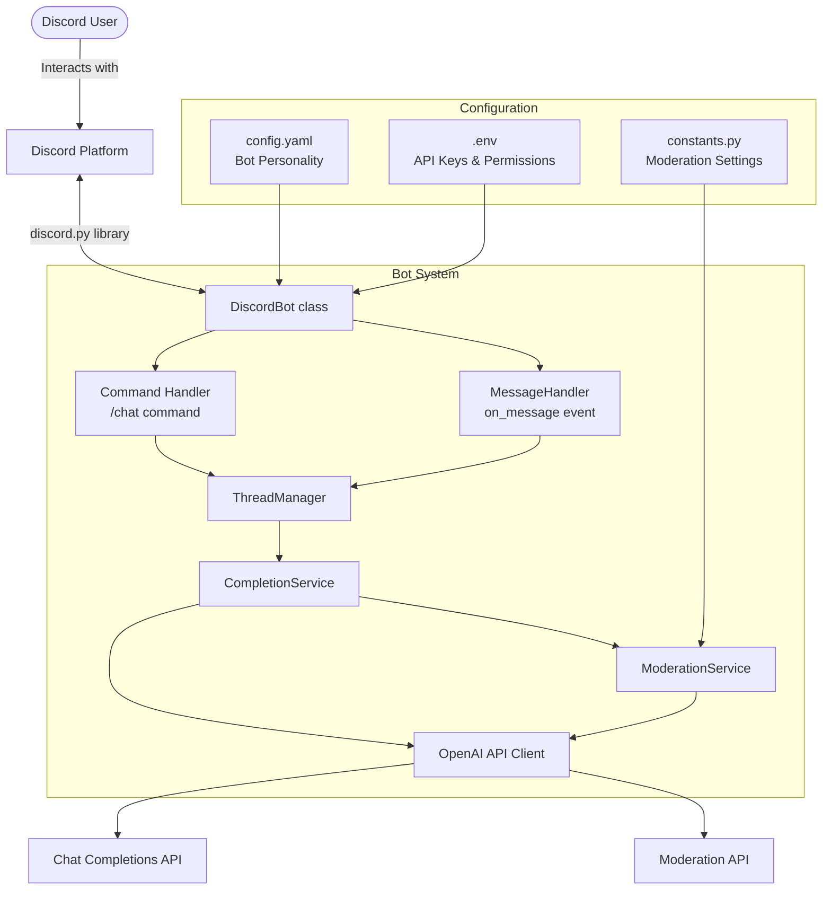

Sources: [README.md:17-21](), [README.md:52-56]()

## Core Data Flow 

The following diagram illustrates how user interactions flow through the system:

**Data Flow Diagram**
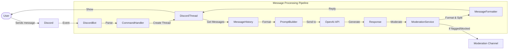

Sources: [README.md:24-31]()

## Core Components

The bot is structured into several key components that work together to process user inputs and generate responses.

### 1. Discord Integration

The bot integrates with Discord using the `discord.py` library, handling commands and messages through event listeners. For more details, see [Discord Integration](#2.1).

### 2. OpenAI Completion System

This component interfaces with OpenAI's API to generate responses using the configured GPT model. The default model is `gpt-3.5-turbo`. For more information, see [OpenAI Completion System](#2.2).

### 3. Moderation System

The moderation system filters inappropriate content using OpenAI's moderation API, with configurable thresholds for different categories. See [Moderation System](#2.3) for details.

### 4. Thread Management

The bot creates and manages Discord threads for ongoing conversations, tracking context and history. Learn more at [Thread Management](#2.4).

Sources: [README.md:24-31](), [README.md:52-56]()

## Key Components Relationship

The following class diagram shows how the core data structures and services interact:

**Component Relationship Diagram**
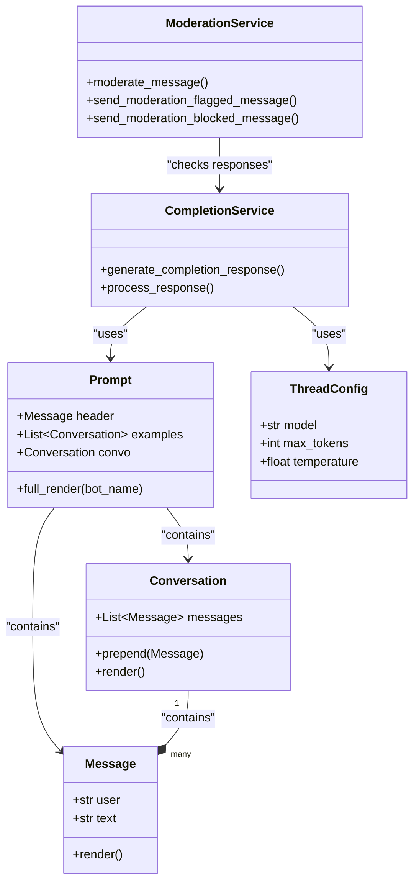

Sources: [README.md:24-31]()

## Configuration System

The bot is highly configurable through several mechanisms:

**Configuration Architecture**
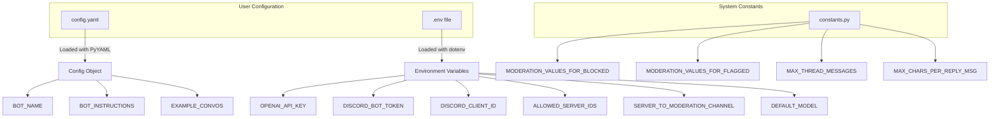

For detailed configuration options, see [Configuration](#1.2).

Sources: [README.md:33-50](), [README.md:52-56]()

## Usage Requirements

To operate correctly, the bot requires specific Discord permissions:

- Send Messages
- Send Messages in Threads
- Create Public Threads
- Manage Messages (for moderation to delete blocked messages)
- Manage Threads
- Read Message History
- Use Application Commands

For detailed usage instructions, see [Usage Guide](#1.3).

Sources: [README.md:58-69]()

## Command Flow

The following sequence diagram illustrates the detailed flow when a user interacts with the bot:

**Command Flow Sequence**
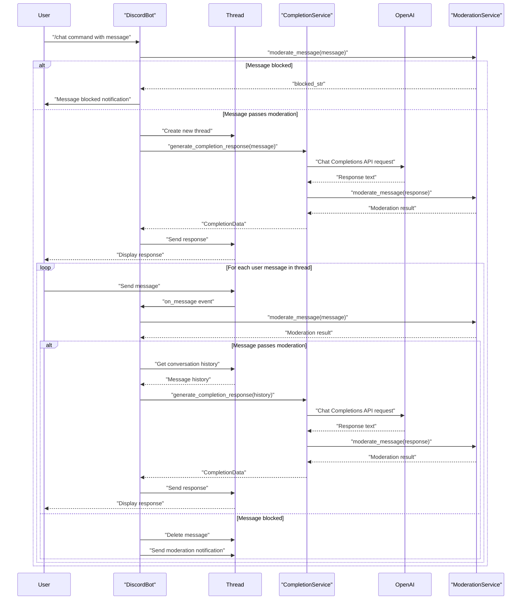

Sources: [README.md:24-31]()

## Further Reading

For more detailed information about specific aspects of the GPT Discord Bot, refer to the following pages:

- [Installation & Setup](#1.1) - Instructions for installing and setting up the bot
- [Configuration](#1.2) - Detailed configuration options
- [Usage Guide](#1.3) - Guide on how to use the bot
- [Core Components](#2) - In-depth documentation of the major components
- [Data Structures](#3) - Details about the key data structures
- [Advanced Topics](#4) - Information for customization and advanced use cases

---

# Page: Installation & Setup

# Installation & Setup

<details>
<summary>Relevant source files</summary>

The following files were used as context for generating this wiki page:

- [.env.example](.env.example)
- [README.md](README.md)
- [requirements.txt](requirements.txt)

</details>


This guide covers the complete installation and configuration process for the GPT Discord Bot. It provides step-by-step instructions for setting up the environment, obtaining necessary API keys, configuring the Discord application, and deploying the bot. For post-installation configuration options, see [Configuration](#1.2).

## Prerequisites

Before starting the installation, ensure you have the following prerequisites:

- Python 3.9 or higher
- A Discord account with permission to create applications
- An OpenAI account with API access
- Git (to clone the repository)

Sources: [README.md:49-50]()

## Installation Workflow

The following diagram illustrates the complete installation process:

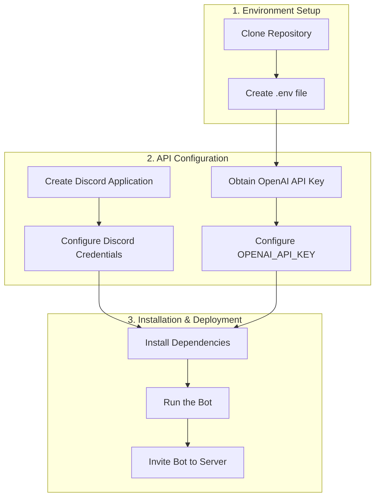

Sources: [README.md:33-50]()

## Step 1: Clone the Repository

Clone the GPT Discord Bot repository to your local machine:

```bash
git clone https://github.com/openai/gpt-discord-bot.git
cd gpt-discord-bot
```

## Step 2: Environment Configuration

1. Copy the example environment file to create your own:

```bash
cp .env.example .env
```

2. Edit the `.env` file with your configuration values (we'll obtain these values in subsequent steps):

```
OPENAI_API_KEY=your_openai_api_key
DISCORD_BOT_TOKEN=your_discord_bot_token
DISCORD_CLIENT_ID=your_discord_client_id
ALLOWED_SERVER_IDS=server_id_1,server_id_2
SERVER_TO_MODERATION_CHANNEL=server_id_1:channel_id_1
DEFAULT_MODEL=gpt-3.5-turbo
```

Sources: [.env.example:1-7]()

## Step 3: OpenAI API Configuration

1. Log in to your OpenAI account at https://platform.openai.com/
2. Navigate to https://platform.openai.com/account/api-keys
3. Click "Create new secret key" 
4. Copy the generated API key
5. Paste the key as the value for `OPENAI_API_KEY` in your `.env` file

Sources: [README.md:36]()

## Step 4: Discord Application Setup

### 4.1 Create Discord Application

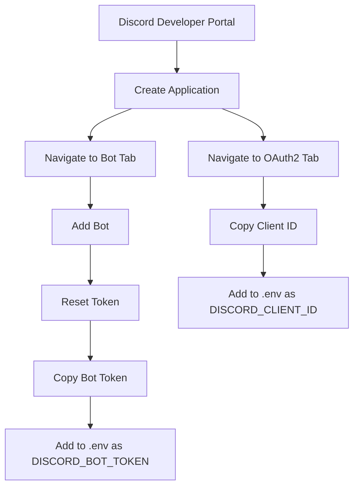

1. Go to https://discord.com/developers/applications
2. Click "New Application" and provide a name for your bot
3. Navigate to the "Bot" tab and click "Add Bot"
4. Under the "Bot" section:
   - Click "Reset Token" to generate a new token
   - Copy the token and set it as `DISCORD_BOT_TOKEN` in your `.env` file
   - Disable "Public Bot" (unless you want it to be publicly available)
   - Enable "Message Content Intent" under "Privileged Gateway Intents"
5. Go to the "OAuth2" tab and copy your "Client ID"
6. Set the copied Client ID as `DISCORD_CLIENT_ID` in your `.env` file

Sources: [README.md:37-43]()

### 4.2 Configure Server Access

1. To allow the bot in specific servers, right-click on your server icon in Discord and select "Copy ID"
2. Add this ID to the `ALLOWED_SERVER_IDS` field in your `.env` file
3. For multiple servers, separate IDs with commas (e.g., `server_id_1,server_id_2`)

Sources: [README.md:43]()

### 4.3 Set Up Moderation Channel (Optional)

If you want to receive moderation messages:

1. Create a channel in your server for moderation messages
2. Copy the channel ID by right-clicking on the channel and selecting "Copy ID"
3. Configure `SERVER_TO_MODERATION_CHANNEL` in the format: `server_id:channel_id`
4. For multiple servers, separate with commas: `server_id_1:channel_id_1,server_id_2:channel_id_2`

Sources: [README.md:54]()

## Step 5: Install Dependencies

Install the required Python packages:

```bash
pip install -r requirements.txt
```

The bot has the following dependencies:

| Package | Version | Purpose |
|---------|---------|---------|
| discord.py | 2.1.* | Discord API integration |
| python-dotenv | 0.21.* | Environment variable loading |
| openai | 1.2.0 | OpenAI API client |
| PyYAML | 6.0 | YAML configuration parsing |
| dacite | 1.6.* | Data class conversion |

Sources: [requirements.txt:1-5]()

## Step 6: Run the Bot

Start the bot with the following command:

```bash
python -m src.main
```

Upon successful startup, the console will display an invite URL. Copy and paste this URL into your web browser to add the bot to your configured server(s).

Sources: [README.md:45-49]()

## Required Discord Permissions

Ensure that your bot has the following permissions in the channels where it will be active:

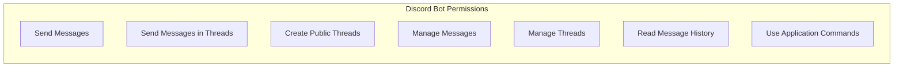

- **Send Messages**: Allow the bot to send messages in channels
- **Send Messages in Threads**: Allow the bot to respond in conversation threads
- **Create Public Threads**: Allow the bot to create new threads for conversations
- **Manage Messages**: Required for moderation to delete blocked messages
- **Manage Threads**: Allow the bot to manage thread lifetime and behavior
- **Read Message History**: Allow the bot to access previous messages in the conversation
- **Use Application Commands**: Allow the bot to respond to slash commands

Sources: [README.md:61-69]()

## Environment Variables and System Components

The following diagram shows how environment variables connect to system components:

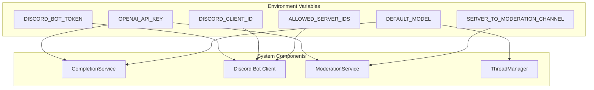

Sources: [.env.example:1-7]()

## Troubleshooting

If your bot isn't responding to commands, verify the following:

1. All environment variables are correctly configured in the `.env` file
2. The bot has been invited to your server using the generated invite URL
3. The bot has all the required permissions in the channels it needs to access
4. The server ID is correctly listed in your `ALLOWED_SERVER_IDS` variable
5. The Python version is 3.9 or higher (`python --version`)
6. All dependencies were successfully installed

For specific issues:
- For problems with this specific bot: Check the [Discord Project Post](https://discord.com/channels/974519864045756446/1055336272543092757)
- For OpenAI API questions: Check the [Discord API Discussions](https://discord.com/channels/974519864045756446/1037561178286739466)

Sources: [README.md:4-6](), [README.md:60-69]()

---

# Page: Configuration

# Configuration

<details>
<summary>Relevant source files</summary>

The following files were used as context for generating this wiki page:

- [.env.example](.env.example)
- [README.md](README.md)
- [src/config.yaml](src/config.yaml)
- [src/constants.py](src/constants.py)

</details>


This page documents the configuration options for the GPT Discord Bot. It covers environment variables, bot personality settings, and system constants that control the bot's behavior, moderation settings, and integration with Discord and OpenAI APIs. For information about installing and setting up the bot, see [Installation & Setup](#1.1).

## Configuration Overview

The GPT Discord Bot uses a three-tier configuration system:

1. **Environment Variables** - API keys, tokens, and server IDs in a `.env` file
2. **Bot Personality** - Name, instructions, and example conversations in `config.yaml`
3. **System Constants** - Moderation thresholds and operational limits in `constants.py`

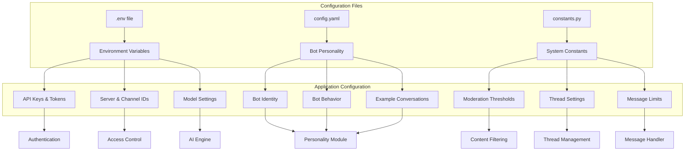

Sources: [.env.example](/.env.example), [src/constants.py](src/constants.py), [src/config.yaml](src/config.yaml)

## Environment Variables

Environment variables contain sensitive information and configuration settings that control which servers the bot can access and which OpenAI model it uses.

### Required Environment Variables

| Variable | Description | Example |
|----------|-------------|---------|
| `OPENAI_API_KEY` | Your OpenAI API key | `sk-abcdef123456` |
| `DISCORD_BOT_TOKEN` | Discord bot token from Developer Portal | `MTAxNTcyNjI5MTUwMzE2NTQ0MA.G3hxbL.abc123` |
| `DISCORD_CLIENT_ID` | Discord application client ID | `1015726291503165440` |
| `ALLOWED_SERVER_IDS` | Comma-separated Discord server IDs where the bot can operate | `1001245072314060810,1015726291503165440` |

### Optional Environment Variables

| Variable | Description | Default | Example |
|----------|-------------|---------|---------|
| `SERVER_TO_MODERATION_CHANNEL` | Maps server IDs to moderation channel IDs | None | `1001245072314060810:1016668746450912256` |
| `DEFAULT_MODEL` | Default OpenAI model to use | `gpt-3.5-turbo` | `gpt-4` |

The environment variables are loaded in [src/constants.py:1-36]() and made available throughout the application.

Sources: [.env.example](/.env.example), [src/constants.py](src/constants.py)

## Bot Personality Configuration

The bot's personality, name, and behavior are defined in `config.yaml`. This file contains:

1. **name**: The bot's display name
2. **instructions**: A prompt that defines the bot's personality and behavior
3. **example_conversations**: Sample dialogs that help shape the bot's conversation style

### Example Configuration

```yaml
name: Lenard
instructions: You're a regular Discord user. You talk casually, use emojis, and don't use capital letters. You talk in internet shorthand like np and lol and idk and nvm. You have many interests and love talking to people.
example_conversations:
  - messages:
    - user: bob
      text: how's it going today?
    - user: Lenard
      text: its going great, im watching youtube videos, hbu?
```

### Personality Configuration Flow

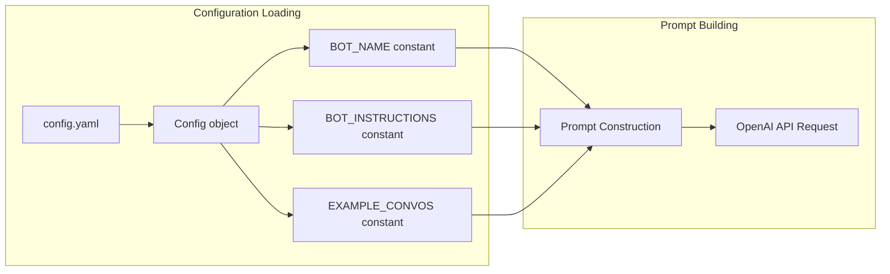

The bot personality configuration is loaded in [src/constants.py:12-20]() using the `dacite` library to convert the YAML structure into a `Config` object defined in the `base` module.

Sources: [src/config.yaml](src/config.yaml), [src/constants.py](src/constants.py)

## System Constants

System constants control various operational aspects of the bot, including moderation thresholds, thread management, and response formatting.

### Moderation Thresholds

The bot uses two sets of moderation thresholds:

1. **`MODERATION_VALUES_FOR_BLOCKED`**: Messages exceeding these thresholds are blocked completely
2. **`MODERATION_VALUES_FOR_FLAGGED`**: Messages exceeding these thresholds are flagged but still processed

These thresholds are defined for different categories like harassment, hate speech, self-harm, sexual content, and violence. Lower values result in stricter moderation.

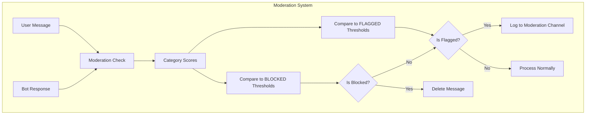

### Thread and Message Settings

| Constant | Description | Default Value |
|----------|-------------|---------------|
| `SECONDS_DELAY_RECEIVING_MSG` | Delay before processing to catch multiple messages | 3 |
| `MAX_THREAD_MESSAGES` | Maximum number of messages in a thread before closing | 200 |
| `ACTIVATE_THREAD_PREFX` | Prefix for active threads | "💬✅" |
| `INACTIVATE_THREAD_PREFIX` | Prefix for inactive threads | "💬❌" |
| `MAX_CHARS_PER_REPLY_MSG` | Character limit per bot message (Discord limit is 2000) | 1500 |
| `AVAILABLE_MODELS` | Available OpenAI models for the bot | A Literal type with options |

Sources: [src/constants.py](src/constants.py)

## Configuration Loading Process

The following diagram illustrates how configuration is loaded and used throughout the application:

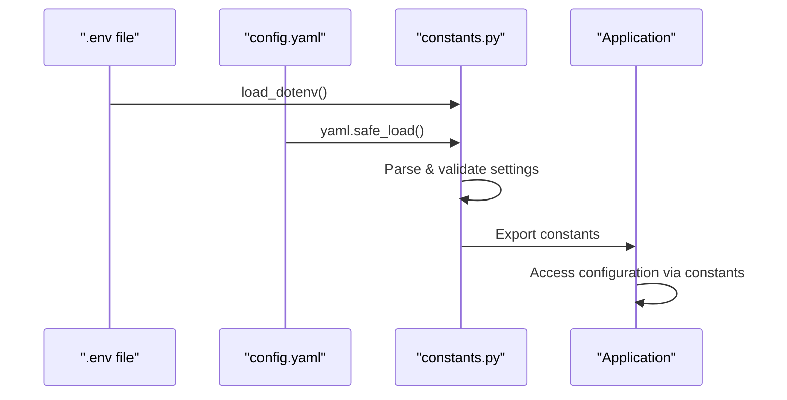

When the application starts:

1. `constants.py` loads environment variables using `load_dotenv()`
2. It then loads the bot personality from `config.yaml`
3. It processes server IDs and moderation channel mappings
4. It defines additional constants for moderation and thread management
5. All these settings are available as importable constants throughout the application

Sources: [src/constants.py](src/constants.py)

## Configuration Entity Relationships

The following diagram shows how configuration entities relate to code components:

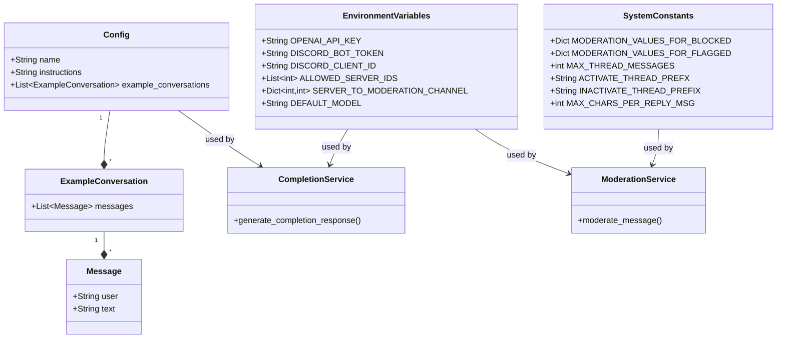

Sources: [src/constants.py](src/constants.py), [src/config.yaml](src/config.yaml), [.env.example](/.env.example)

## Customizing the Configuration

### Modifying the Bot's Personality

To change the bot's personality:

1. Edit `src/config.yaml` to update the name, instructions, and example conversations
2. The changes will take effect the next time the bot is started

### Changing Environment Settings

To modify environment settings:

1. Edit the `.env` file to update API keys, tokens, or server IDs
2. For changes to take effect, restart the bot

### Adjusting Moderation Thresholds

To alter moderation sensitivity:

1. Edit the `MODERATION_VALUES_FOR_BLOCKED` and `MODERATION_VALUES_FOR_FLAGGED` dictionaries in `src/constants.py`
2. Higher values mean less strict moderation (1.0 = no moderation for that category)
3. Restart the bot for changes to take effect

For more detailed information about customizing the bot's personality, see [Customizing Bot Personality](#4.1). For information about adjusting moderation thresholds, see [Moderation Thresholds](#4.2).

Sources: [README.md](README.md), [src/constants.py](src/constants.py)

---

# Page: Usage Guide

# Usage Guide

<details>
<summary>Relevant source files</summary>

The following files were used as context for generating this wiki page:

- [README.md](README.md)
- [src/main.py](src/main.py)

</details>


This document provides instructions for utilizing the GPT Discord Bot's features. It explains how to initiate conversations, use commands, and understand the bot's behavior in Discord servers. For installation instructions, see [Installation & Setup](#1.1), and for configuration options, see [Configuration](#1.2).

## 1. Command Reference

The bot currently supports one primary command:

```
/chat message:"Your message here" [model] [temperature] [max_tokens]
```

### Command Parameters

| Parameter | Description | Default | Constraints |
|-----------|-------------|---------|------------|
| `message` | The initial prompt to start the conversation | *Required* | Must pass moderation |
| `model` | The GPT model to use | gpt-3.5-turbo | Choices defined in `AVAILABLE_MODELS` |
| `temperature` | Controls randomness in responses | 1.0 | Between 0 and 1 |
| `max_tokens` | Maximum response length | 512 | Between 1 and 4096 |

Sources: [src/main.py:63-84](), [README.md:26-31]()

## 2. Starting a Conversation

To begin interacting with the bot:

1. Type `/chat` in any channel where the bot has access
2. Enter your initial message in the prompt field
3. Optionally, adjust model parameters
4. Submit the command

The bot will:
1. Create a new thread with your message
2. Process your prompt through content moderation
3. Generate a response using the OpenAI API
4. Reply in the newly created thread

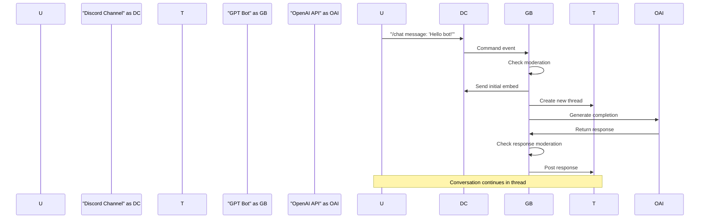

Sources: [src/main.py:77-184](), [README.md:26]()

## 3. Continuing the Conversation

After a thread is created:

1. Simply type additional messages directly in the thread
2. The bot will process each message and respond
3. The entire conversation history is used for context
4. The bot maintains the persona specified in your config

### Thread Behavior

- Each thread maintains its own configuration (model, temperature, max_tokens)
- The bot responds to every user message in active threads it has created
- Threads are automatically closed when they reach the maximum message limit
- The bot briefly waits after receiving a message to allow users to complete multi-part thoughts

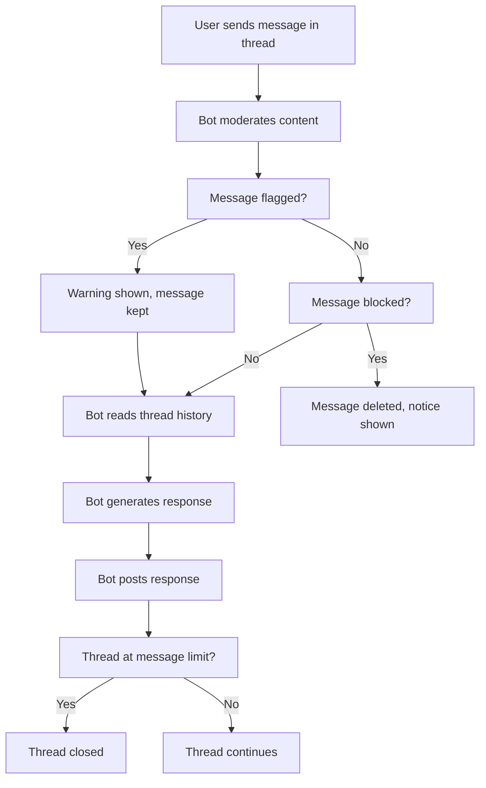

Sources: [src/main.py:188-310](), [README.md:28-29]()

## 4. Message Moderation

The bot uses OpenAI's Moderation API to screen content:

### Moderation Outcomes

| Outcome | User Message | Bot Response |
|---------|--------------|--------------|
| No issues | Processed normally | Processed normally |
| Flagged content | Warning shown, message kept | Warning shown, response sent |
| Blocked content | Message deleted (if bot has permission) | Not applicable (responses are regenerated) |

When content is flagged or blocked, a notification may also be sent to a designated moderation channel if configured.

```mermaid
classDiagram
    class "ModerationService" {
        +moderate_message()
        +send_moderation_flagged_message()
        +send_moderation_blocked_message()
    }
    
    class "CompletionService" {
        +generate_completion_response()
        +process_response()
    }
    
    class "ModeratedContent" {
        +String content
        +Boolean flagged
        +Boolean blocked
        +String flagged_categories
        +String blocked_categories
    }
    
    "ModerationService" -- "ModeratedContent" : produces
    "CompletionService" -- "ModerationService" : uses
```

Sources: [src/main.py:113-128](), [src/main.py:224-265]()

## 5. Thread Limitations

Discord threads have limitations that affect the bot's operation:

| Limitation | Description | Bot Behavior |
|------------|-------------|--------------|
| Message count | Maximum messages in a thread | Thread auto-closes when limit reached |
| Context limit | Maximum tokens for API context | Oldest messages might be excluded |
| Thread lifetime | Discord's archive settings | Thread may auto-archive based on server settings |

The bot's maximum thread message limit is defined in the constants and helps prevent hitting OpenAI's context window limitations.

Sources: [src/main.py:218-221](), [README.md:29]()

## 6. Troubleshooting

If the bot isn't responding as expected, check these common issues:

### Required Permissions

The bot needs these permissions in channels where it operates:

- Send Messages
- Send Messages in Threads
- Create Public Threads
- Manage Messages (for moderation)
- Manage Threads
- Read Message History
- Use Application Commands

### Common Issues

| Problem | Possible Cause | Solution |
|---------|---------------|----------|
| Bot doesn't respond | Missing permissions | Check channel permissions |
| Command not working | Invalid parameters | Ensure temperature is 0-1, max_tokens is 1-4096 |
| Messages being deleted | Content moderation | Adjust your message or review moderation settings |
| Thread closed unexpectedly | Message limit reached | Start a new conversation with `/chat` |

Sources: [README.md:60-69](), [src/main.py:97-110]()

## 7. Command Flow Visualization

This diagram represents the complete flow from issuing a command to receiving responses:

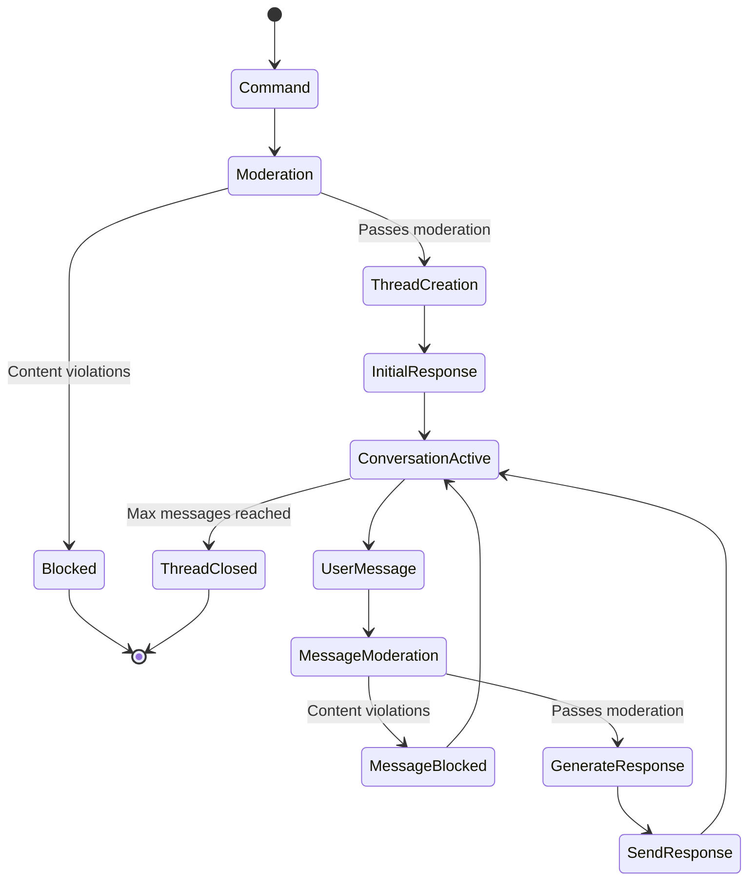

Sources: [src/main.py:77-184](), [src/main.py:188-310]()

## 8. Interactive Components Relationship

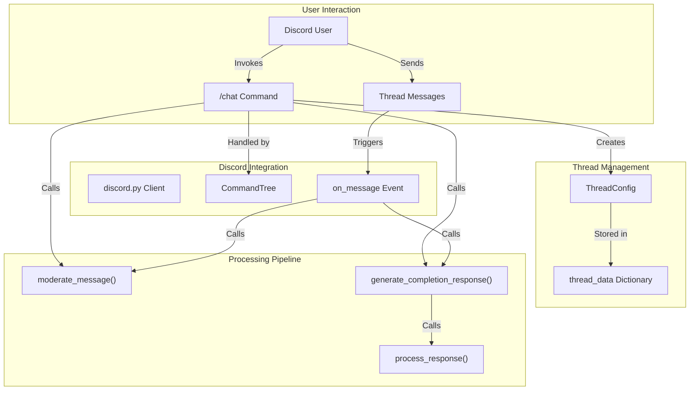

Sources: [src/main.py:43-44](), [src/main.py:63-184](), [src/main.py:188-310]()

By following this guide, you should be able to effectively use the GPT Discord Bot for conversations in your Discord server. The bot is designed to provide a seamless chat experience while maintaining content moderation standards.

---

# Page: Core Components

# Core Components

<details>
<summary>Relevant source files</summary>

The following files were used as context for generating this wiki page:

- [README.md](README.md)
- [src/completion.py](src/completion.py)
- [src/main.py](src/main.py)

</details>


This page provides an overview of the main architectural components that make up the GPT Discord Bot. It explores the system's structure, core modules, and how these elements interact to deliver the bot's functionality. For specific implementation details of individual components, see the related pages: [Discord Integration](#2.1), [OpenAI Completion System](#2.2), [Moderation System](#2.3), and [Thread Management](#2.4).

## System Architecture Overview

The GPT Discord Bot consists of several interconnected components that work together to process user messages, generate AI responses, and manage conversations in Discord threads.

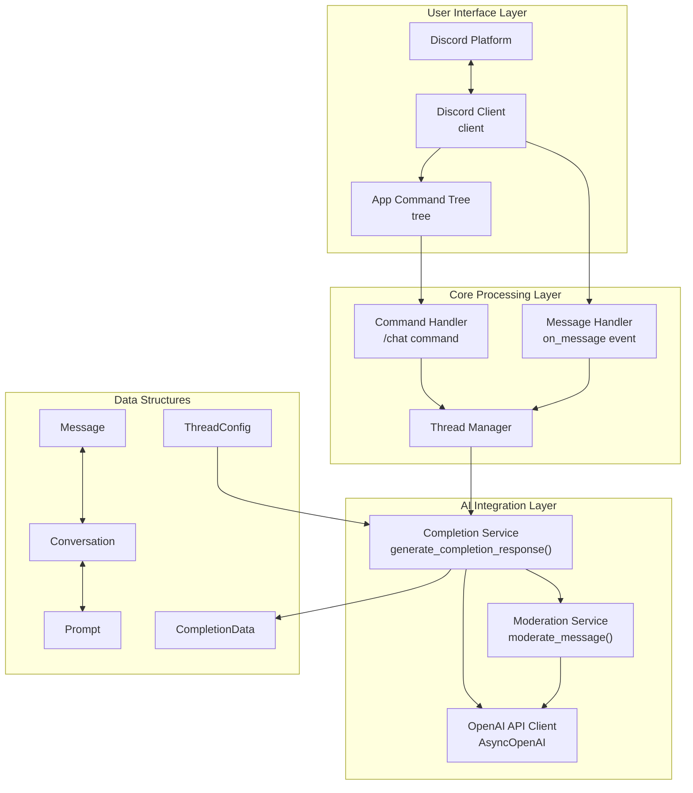

Sources: [src/main.py:41-43](), [src/completion.py:41-42](), [src/main.py:45-185](), [src/main.py:188-310]()

## Core Components Description

### 1. Discord Integration Layer

The Discord integration layer handles all interactions with the Discord platform.

- **Discord Client**: Initialized with appropriate intents and maintains the connection to Discord
- **Command Tree**: Registers and processes slash commands
- **Event Handlers**: Processes events like `on_ready` and `on_message`

Sources: [src/main.py:38-43](), [src/main.py:46-59]()

### 2. Core Processing Layer

The core processing layer manages command handling, message processing, and thread orchestration.

- **Command Handler**: Processes `/chat` commands, creating new conversation threads
- **Message Handler**: Processes messages in existing threads, generating responses
- **Thread Manager**: Creates, tracks, and manages Discord threads for conversations

Sources: [src/main.py:77-185](), [src/main.py:188-310]()

### 3. AI Integration Layer

The AI integration layer manages all interactions with OpenAI's API.

- **Completion Service**: Generates AI responses using the OpenAI Chat Completions API
- **Moderation Service**: Filters inappropriate content using OpenAI's Moderation API
- **OpenAI API Client**: Handles API requests to OpenAI

Sources: [src/completion.py:24-102](), [src/completion.py:41-42]()

### 4. Data Structures

Several key data structures support the operation of the bot:

- **Message**: Represents a single message in a conversation
- **Conversation**: A collection of messages
- **Prompt**: Structures conversations for the OpenAI API
- **ThreadConfig**: Stores configuration for a specific conversation thread
- **CompletionData**: Contains response data from the completion service

Sources: [src/completion.py:34-39](), [README.md:25-31]()

## Data Flow

The following diagram illustrates how data flows through the system from a user message to a bot response:

```mermaid
flowchart TD
    subgraph "User Input"
        UserCommand["User /chat Command"]
        UserMessage["User Message in Thread"]
    end
    
    subgraph "Command Processing"
        CommandHandler["chat_command()"]
        MessageHandler["on_message()"]
    end
    
    subgraph "Thread Management"
        CreateThread["Create Thread"]
        GetHistory["Get Thread History"]
    end
    
    subgraph "Content Processing"
        Moderation["moderate_message()"]
        ComposeMessages["Format Messages"]
        GenerateCompletion["generate_completion_response()"]
        ProcessResponse["process_response()"]
    end
    
    subgraph "External API"
        OpenAIChat["OpenAI Chat Completions API"]
        OpenAIMod["OpenAI Moderation API"]
    end
    
    subgraph "Response Handling"
        FormatResponse["Split Response"]
        SendResponse["Send to Thread"]
    end
    
    UserCommand --> CommandHandler
    UserMessage --> MessageHandler
    
    CommandHandler --> Moderation
    MessageHandler --> Moderation
    
    Moderation -->|"Passes"| CreateThread
    Moderation -->|"Passes"| GetHistory
    
    CreateThread --> ComposeMessages
    GetHistory --> ComposeMessages
    
    ComposeMessages --> GenerateCompletion
    GenerateCompletion --> OpenAIChat
    OpenAIChat --> ProcessResponse
    ProcessResponse --> Moderation
    
    Moderation -->|"Check Bot Response"| OpenAIMod
    Moderation -->|"Passes"| FormatResponse
    FormatResponse --> SendResponse
```

Sources: [src/main.py:77-185](), [src/main.py:188-310](), [src/completion.py:44-102]()

## Component Integration Model

The following class diagram shows how the core components are structured and integrated:

```mermaid
classDiagram
    class DiscordClient {
        +handle_events()
        +register_commands()
    }
    
    class ChatCommand {
        +execute(interaction, message, model, temperature, max_tokens)
    }
    
    class MessageHandler {
        +process_message(message)
    }
    
    class ThreadManager {
        +create_thread(message)
        +get_thread_history(thread)
        +close_thread(thread)
    }
    
    class CompletionService {
        +generate_completion_response(messages, user, thread_config)
        +process_response(user, thread, response_data)
    }
    
    class ModerationService {
        +moderate_message(message, user)
        +send_moderation_flagged_message(guild, user, flagged_str, message, url)
        +send_moderation_blocked_message(guild, user, blocked_str, message)
    }
    
    class OpenAIClient {
        +chat.completions.create()
    }
    
    class Message {
        +user: string
        +text: string
    }
    
    class Conversation {
        +messages: List~Message~
    }
    
    class Prompt {
        +header: Message
        +examples: List~Conversation~
        +convo: Conversation
        +full_render(bot_name)
    }
    
    class ThreadConfig {
        +model: string
        +max_tokens: int
        +temperature: float
    }
    
    class CompletionData {
        +status: CompletionResult
        +reply_text: string
        +status_text: string
    }
    
    DiscordClient --> ChatCommand: uses
    DiscordClient --> MessageHandler: uses
    ChatCommand --> ThreadManager: uses
    MessageHandler --> ThreadManager: uses
    ThreadManager --> CompletionService: uses
    CompletionService --> ModerationService: uses
    CompletionService --> OpenAIClient: uses
    ModerationService --> OpenAIClient: uses
    CompletionService --> CompletionData: returns
    CompletionService --> Prompt: builds
    Prompt --> Message: contains
    Prompt --> Conversation: contains
    Conversation --> Message: contains
    ThreadManager --> ThreadConfig: maintains
```

Sources: [src/main.py:41-43](), [src/completion.py:34-39](), [src/completion.py:44-102](), [src/main.py:77-185](), [src/main.py:188-310]()

## Core Components Details

### Discord Client and Command Handler

The Discord client is the entry point for all interactions with the Discord API. It handles authentication, event processing, and command registration.

Key features:
- Discord client initialization with message content intents
- Command tree setup for slash commands
- Event handlers for message processing

The bot primarily responds to two key events:
1. `/chat` command invocations (starting new conversations)
2. Messages in active conversation threads (continuing conversations)

Sources: [src/main.py:38-43](), [src/main.py:46-59](), [src/main.py:77-185]()

### Completion Service

The completion service is responsible for generating AI responses using OpenAI's API.

```mermaid
flowchart TD
    subgraph "CompletionService"
        GenerateCompletion["generate_completion_response()"]
        ProcessResponse["process_response()"]
    end
    
    subgraph "Components"
        BuildPrompt["Build Prompt"]
        CallAPI["Call OpenAI API"]
        CheckModeration["Check Moderation"]
        FormatResponse["Format Response"]
        HandleError["Handle Errors"]
    end
    
    subgraph "Results"
        OK["OK"]
        TooLong["TOO_LONG"]
        InvalidRequest["INVALID_REQUEST"]
        OtherError["OTHER_ERROR"]
        ModerationFlagged["MODERATION_FLAGGED"]
        ModerationBlocked["MODERATION_BLOCKED"]
    end
    
    GenerateCompletion --> BuildPrompt
    BuildPrompt --> CallAPI
    CallAPI --> CheckModeration
    CheckModeration --> CompletionData
    CallAPI -->|"Error"| HandleError
    HandleError --> CompletionData
    
    CompletionData --> ProcessResponse
    ProcessResponse --> FormatResponse
    ProcessResponse --> HandleError
    
    CompletionData -->|"status"| OK
    CompletionData -->|"status"| TooLong
    CompletionData -->|"status"| InvalidRequest
    CompletionData -->|"status"| OtherError
    CompletionData -->|"status"| ModerationFlagged
    CompletionData -->|"status"| ModerationBlocked
```

Key features:
- `generate_completion_response`: Builds a prompt, sends it to OpenAI, and handles moderation of the response
- `process_response`: Processes the completion data and sends appropriate messages to the thread
- Comprehensive error handling for API errors and moderation issues

Sources: [src/completion.py:24-102](), [src/completion.py:105-168]()

### Moderation Service

The moderation service filters inappropriate content in both user messages and bot responses.

Key features:
- Message moderation using OpenAI's Moderation API
- Handling of flagged content (allowed but with warning)
- Handling of blocked content (not allowed)
- Logging of moderation events

Sources: [src/main.py:224-264](), [src/completion.py:66-81]()

### Thread Management

Thread management is responsible for creating, tracking, and managing Discord threads.

Key features:
- Thread creation when a user starts a chat
- Storing thread configuration (model, temperature, max tokens)
- Managing thread history
- Closing threads when they reach limits

Sources: [src/main.py:161-169](), [src/main.py:218-221]()

## Data Structures

The bot uses several key data structures to organize and process information:

| Data Structure | Purpose | Key Properties |
|----------------|---------|----------------|
| Message | Represents a single message | user, text |
| Conversation | Collection of messages | messages |
| Prompt | Format for OpenAI API | header, examples, convo |
| ThreadConfig | Thread-specific settings | model, max_tokens, temperature |
| CompletionData | Response from completion service | status, reply_text, status_text |
| CompletionResult | Enum of possible completion statuses | OK, TOO_LONG, INVALID_REQUEST, etc. |

Sources: [src/completion.py:24-39](), [src/base.py]() (referenced but not shown)

## System Initialization Flow

The following diagram shows the initialization flow of the bot when it starts up:

```mermaid
sequenceDiagram
    participant Main as main.py
    participant Client as Discord Client
    participant CompSvc as Completion Service
    participant OpenAI as OpenAI API
    
    Main->>Client: Initialize client
    Main->>Client: Register commands
    Main->>Client: Run client
    Client->>Client: on_ready event
    Client->>CompSvc: Set bot name
    Client->>CompSvc: Set example conversations
    Client->>Client: Sync command tree
    Note over Client: Bot ready to process commands and messages
```

Sources: [src/main.py:46-59](), [src/main.py:312]()

## Message Processing Flow

The message processing flow shows how user messages are handled in existing threads:

```mermaid
sequenceDiagram
    participant User
    participant Thread
    participant Handler as on_message handler
    participant Moderation
    participant CompSvc as Completion Service
    participant OpenAI
    
    User->>Thread: Send message
    Thread->>Handler: on_message event
    Handler->>Handler: Validate thread
    Handler->>Moderation: moderate_message()
    
    alt Message blocked
        Moderation-->>Handler: blocked_str
        Handler->>Thread: Delete message
        Handler->>Thread: Send block notification
    else Message passes/flagged
        alt Message flagged
            Moderation-->>Handler: flagged_str
            Handler->>Thread: Send flag notification
        end
        
        Handler->>Thread: Get thread history
        Thread-->>Handler: Message history
        Handler->>CompSvc: generate_completion_response()
        CompSvc->>OpenAI: Chat completions request
        OpenAI-->>CompSvc: Response
        CompSvc->>Moderation: Check response
        Moderation-->>CompSvc: Moderation result
        CompSvc-->>Handler: CompletionData
        Handler->>CompSvc: process_response()
        CompSvc->>Thread: Send formatted response
        Thread-->>User: Display response
    end
```

Sources: [src/main.py:188-310](), [src/completion.py:44-102](), [src/completion.py:105-168]()

---

# Page: Discord Integration

# Discord Integration

<details>
<summary>Relevant source files</summary>

The following files were used as context for generating this wiki page:

- [README.md](README.md)
- [src/main.py](src/main.py)
- [src/utils.py](src/utils.py)

</details>


## Purpose and Scope

This document explains how the GPT Discord Bot interacts with Discord, including the initialization process, command handling, message processing, and thread management. The integration uses the [discord.py](https://discordpy.readthedocs.io) library to communicate with Discord's API and manage bot functionality. For information about how the bot generates responses using OpenAI's API, see [OpenAI Completion System](#2.2). For details on content moderation, see [Moderation System](#2.3).

## Discord Bot Initialization

The GPT Discord Bot is initialized using the `discord.py` library, which provides the framework for interacting with Discord's API.

```mermaid
flowchart TD
    subgraph "Bot Initialization"
        A["Configure Intents"] --> B["Create Discord Client"]
        B --> C["Setup Command Tree"]
        C --> D["Define Event Handlers"]
        D --> E["Run Bot with Token"]
    end
```

Sources: [src/main.py:38-42](). [src/main.py:312]()

The bot requires specific intents and permissions to function properly:

| Intent/Permission | Purpose |
|-------------------|---------|
| `message_content` | Access message contents |
| `send_messages` | Send responses in channels |
| `send_messages_in_threads` | Reply in threads |
| `create_public_threads` | Create new conversation threads |
| `manage_messages` | Delete blocked messages |
| `manage_threads` | Archive or close threads |
| `read_message_history` | Retrieve conversation history |
| `use_application_commands` | Enable slash commands |

Sources: [README.md:62-69]()

## Command System

The bot implements Discord's slash command system using the application commands framework from discord.py.

### `/chat` Command

The primary interaction point is the `/chat` command which creates a new conversation thread.

```mermaid
sequenceDiagram
    participant User as "Discord User"
    participant Command as "chat_command()"
    participant Moderation as "moderate_message()"
    participant Thread as "Discord Thread"
    participant CompletionSvc as "generate_completion_response()"
    
    User->>Command: "/chat message: Hello!"
    Note over Command: Validate parameters
    Command->>Moderation: Check message content
    
    alt Message blocked
        Moderation-->>Command: Return blocked_str
        Command-->>User: Send ephemeral blocked message
    else Message allowed
        Command->>User: Send confirmation embed
        Command->>Thread: Create new thread
        Thread->>CompletionSvc: Send initial message
        CompletionSvc-->>Thread: Return AI response
        Thread-->>User: Display response
    end
```

Sources: [src/main.py:62-184]()

The `/chat` command accepts the following parameters:

| Parameter | Type | Description | Default |
|-----------|------|-------------|---------|
| `message` | String | Initial prompt for the conversation | Required |
| `model` | String | AI model to use | Based on DEFAULT_MODEL |
| `temperature` | Float | Controls randomness (0-1) | 1.0 |
| `max_tokens` | Integer | Maximum tokens per response | 512 |

Sources: [src/main.py:77-82]()

## Message Handling System

After thread creation, the bot processes further messages through the `on_message` event handler.

```mermaid
flowchart TD
    A["on_message Event"] --> B{"Is Valid Thread?"}
    B -->|No| C["Ignore Message"]
    B -->|Yes| D{"Check Moderation"}
    D -->|Blocked| E["Delete & Notify"]
    D -->|Flagged| F["Flag & Continue"]
    D -->|Passed| G["Wait for User Input"]
    G --> H["Process Thread History"]
    H --> I["Generate AI Response"]
    I --> J["Send Response to Thread"]
```

Sources: [src/main.py:188-309]()

### Message Processing Logic

The bot implements several checks before processing a message:

1. Ignores messages from itself
2. Only processes messages in threads
3. Only responds in threads it created
4. Checks if threads are archived or locked
5. Enforces message count limits

```mermaid
classDiagram
    class DiscordMessage {
        +author
        +content
        +channel
        +type
    }
    
    class Message {
        +user: str
        +text: str
    }
    
    class MessageProcessor {
        +discord_message_to_message()
        +is_last_message_stale()
        +should_block()
    }
    
    DiscordMessage --> Message: converted via
    MessageProcessor --> DiscordMessage: processes
```

Sources: [src/utils.py:15-28](), [src/utils.py:38-46](), [src/utils.py:60-70]()

## Thread Management

The bot uses Discord's thread feature to maintain separate conversations with users.

```mermaid
flowchart TD
    A["User Invokes /chat"] --> B["Create Thread"]
    B --> C["Store ThreadConfig"]
    C --> D["Process Messages"]
    D --> E{"Thread Limit Reached?"}
    E -->|Yes| F["Close Thread"]
    E -->|No| D
    
    subgraph "ThreadConfig"
        TC1["model"]
        TC2["temperature"]
        TC3["max_tokens"]
    end
    
    C --- ThreadConfig
```

Sources: [src/main.py:161-169](), [src/main.py:218-221]()

### Thread Configuration

Each thread has a dedicated `ThreadConfig` object stored in the `thread_data` dictionary, containing:

| Property | Description |
|----------|-------------|
| `model` | The OpenAI model used for this thread |
| `temperature` | The randomness parameter for responses |
| `max_tokens` | Maximum token limit for responses |

Sources: [src/main.py:43](), [src/main.py:167-169]()

### Thread Lifecycle

Threads progress through these states:

1. **Creation**: Thread is created with the `ACTIVATE_THREAD_PREFX` in its name
2. **Active**: Users can interact with the bot in the thread
3. **Closed**: When message limit is reached, the thread is renamed, archived, and locked

Sources: [src/utils.py:49-57]()

## Discord-OpenAI Integration Flow

The following diagram illustrates how data flows between Discord and the OpenAI API:

```mermaid
graph TD
    subgraph "Discord Layer"
        A["Discord User Input"] --> B["Command Handler"]
        B --> C["Thread Creation"]
        D["User Message in Thread"] --> E["on_message Event"]
    end
    
    subgraph "Processing Layer"
        C --> F["discord_message_to_message()"]
        E --> G["Moderation Check"]
        G --> H["Thread History Collection"]
        H --> F
    end
    
    subgraph "OpenAI Layer"
        F --> I["generate_completion_response()"]
        I --> J["OpenAI API Request"]
        J --> K["process_response()"]
    end
    
    subgraph "Response Layer"
        K --> L["split_into_shorter_messages()"]
        L --> M["Send to Discord Thread"]
    end
    
    M --> A
```

Sources: [src/main.py:172-179](), [src/main.py:289-307](), [src/utils.py:31-35]()

## Security and Rate Limiting

The bot implements several security measures:

1. **Server Allowlist**: Bot only responds in servers listed in `ALLOWED_SERVER_IDS`
2. **Message Delay**: Small delay (configurable) before processing messages to batch multiple user inputs
3. **Thread Limits**: Maximum number of messages per thread to prevent context overflow
4. **Message Size Limits**: Long responses are split into multiple messages

```mermaid
sequenceDiagram
    participant User as "Discord User"
    participant Bot as "GPT Discord Bot"
    participant OpenAI as "OpenAI API"
    
    User->>Bot: Send message
    Bot->>Bot: Check server allowlist
    Bot->>Bot: Wait delay period
    Note over Bot: Check if newer messages exist
    Bot->>Bot: Moderate message
    Bot->>OpenAI: Request completion
    OpenAI-->>Bot: Return response
    Bot->>Bot: Split long response
    Bot->>User: Send response parts
```

Sources: [src/utils.py:31-35](), [src/utils.py:60-70](), [src/main.py:266-275]()

## Core Discord.py Components

The bot leverages several key discord.py components:

| Component | Description | Usage in Bot |
|-----------|-------------|--------------|
| `Client` | Main interface to Discord API | Handles events and communication |
| `app_commands` | Slash command framework | Implements the `/chat` command |
| `Thread` | Discord thread object | Manages conversation contexts |
| `Embed` | Rich message format | Displays command results and notifications |
| `Intents` | Permission scopes | Defines what the bot can access |

Sources: [src/main.py:38-42](), [src/main.py:64-76]()

## Integration with Other Bot Components

The Discord integration layer connects with other components of the bot system:

```mermaid
graph TD
    subgraph "Discord Integration"
        A["Command Handler"] 
        B["Event Handler"]
        C["Thread Manager"]
    end
    
    subgraph "Completion System"
        D["generate_completion_response()"]
        E["process_response()"]
    end
    
    subgraph "Moderation System"
        F["moderate_message()"]
        G["send_moderation_blocked_message()"]
        H["send_moderation_flagged_message()"]
    end
    
    A --> C
    B --> C
    C --> D
    C --> F
    D --> E
    F --> G
    F --> H
    E --> C
```

Sources: [src/main.py:114-179](), [src/main.py:224-307]()

This diagram shows how the Discord integration (command handler, event handler, and thread manager) interfaces with the completion system and moderation system, forming the complete bot architecture.

---

# Page: OpenAI Completion System

# OpenAI Completion System

<details>
<summary>Relevant source files</summary>

The following files were used as context for generating this wiki page:

- [src/base.py](src/base.py)
- [src/completion.py](src/completion.py)
- [src/constants.py](src/constants.py)

</details>


## Purpose and Scope

The OpenAI Completion System is the core component responsible for generating AI responses by interfacing with OpenAI's Chat Completions API. This system handles the construction of prompts, API communication, and processing of responses. It works closely with the [Moderation System](#2.3) for content filtering and the [Thread Management](#2.4) system for Discord conversation handling.

Sources: [src/completion.py:1-169]()

## System Architecture

The Completion System transforms Discord messages into properly formatted OpenAI API requests and then processes the responses for delivery back to Discord users.

```mermaid
flowchart TD
    DiscordMessage[Discord Message] --> MessageList["Message List"]
    MessageList --> Prompt["Prompt Construction"]
    Prompt --> APIRequest["OpenAI API Request"]
    ThreadConfig["ThreadConfig
    - model
    - max_tokens
    - temperature"] --> APIRequest
    BotInstructions["BOT_INSTRUCTIONS"] --> Prompt
    ExampleConversations["EXAMPLE_CONVOS"] --> Prompt
    
    APIRequest --> OpenAIAPI["OpenAI Chat Completions API"]
    OpenAIAPI --> APIResponse["API Response"]
    APIResponse --> ModCheck["Moderation Check"]
    ModCheck --> ProcessedResponse["CompletionData"]
    ProcessedResponse --> ResponseHandler["Response Processing"]
    ResponseHandler --> DiscordThread["Discord Thread"]
```

Sources: [src/completion.py:44-102](), [src/base.py:40-89]()

## Key Components

### Core Classes

The Completion System relies on several data classes to manage the flow of information:

| Class | Purpose | File |
|-------|---------|------|
| `CompletionResult` | Enum for different response statuses (OK, TOO_LONG, etc.) | [src/completion.py:25-31]() |
| `CompletionData` | Holds the response status, text, and any status messages | [src/completion.py:34-39]() |
| `Prompt` | Structures the conversation for the OpenAI API | [src/base.py:47-89]() |
| `ThreadConfig` | Contains model, max_tokens, and temperature settings | [src/base.py:40-45]() |

Sources: [src/completion.py:25-39](), [src/base.py:40-89]()

### Response Status Types

The `CompletionResult` enum defines the possible outcomes of a completion request:

```mermaid
classDiagram
    class CompletionResult {
        OK
        TOO_LONG
        INVALID_REQUEST
        OTHER_ERROR
        MODERATION_FLAGGED
        MODERATION_BLOCKED
    }
```

Sources: [src/completion.py:25-31]()

## Data Flow Process

The OpenAI Completion System follows a specific flow for generating and processing responses:

```mermaid
sequenceDiagram
    participant Discord as Discord Thread
    participant CompGen as generate_completion_response()
    participant OpenAI as OpenAI API
    participant Mod as Moderation System
    participant ProcResp as process_response()
    
    Discord->>CompGen: Message list, user, ThreadConfig
    
    CompGen->>CompGen: Create Prompt object
    CompGen->>CompGen: Render full prompt
    CompGen->>OpenAI: API request with rendered prompt
    OpenAI-->>CompGen: Response text
    
    CompGen->>Mod: Check response for moderation issues
    Mod-->>CompGen: Moderation results
    
    CompGen-->>Discord: Return CompletionData
    Discord->>ProcResp: Pass CompletionData
    
    alt CompletionResult.OK or MODERATION_FLAGGED
        ProcResp->>Discord: Send response (split if needed)
        alt MODERATION_FLAGGED
            ProcResp->>Discord: Send flagged notification
        end
    else CompletionResult.MODERATION_BLOCKED
        ProcResp->>Discord: Send blocked notification
    else CompletionResult.TOO_LONG
        ProcResp->>Discord: Close thread
    else CompletionResult.INVALID_REQUEST or OTHER_ERROR
        ProcResp->>Discord: Send error message
    end
```

Sources: [src/completion.py:44-168]()

## Key Functions

### `generate_completion_response()`

This function is the primary interface for generating responses from OpenAI:

1. Creates a `Prompt` object with:
   - System instructions for the bot
   - Example conversations
   - Current conversation history
2. Renders the prompt for OpenAI's API format
3. Makes the API request with specified model parameters
4. Handles the response, including moderation checks
5. Returns a `CompletionData` object with results

```mermaid
flowchart TD
    Start["generate_completion_response()"] --> CreatePrompt["Create Prompt object"]
    CreatePrompt --> RenderPrompt["Render full prompt for API"]
    RenderPrompt --> APICall["Call OpenAI API"]
    APICall --> ProcessReply["Process API reply"]
    
    ProcessReply --> ModerationCheck["Check moderation"]
    ModerationCheck --> ReturnResult["Return CompletionData"]
    
    ErrorHandling["Error handling:
    - Context length
    - Invalid requests
    - Other errors"] --> ReturnResult
```

Sources: [src/completion.py:44-102]()

### `process_response()`

This function handles the `CompletionData` returned by `generate_completion_response()`:

1. Examines the completion status
2. For successful responses:
   - Splits long messages if needed
   - Sends the response to the Discord thread
3. For flagged content:
   - Sends the response but with warning notification
   - Reports to moderation channel
4. For blocked content:
   - Blocks the response
   - Reports to moderation channel
5. Handles various error conditions

Sources: [src/completion.py:105-168]()

## Prompt Construction

A critical aspect of the system is how prompts are constructed for the OpenAI API:

```mermaid
classDiagram
    class Prompt {
        header: Message
        examples: List~Conversation~
        convo: Conversation
        full_render(bot_name)
        render_system_prompt()
        render_messages(bot_name)
    }
    
    class Message {
        user: str
        text: Optional[str]
        render()
    }
    
    class Conversation {
        messages: List~Message~
        prepend(Message)
        render()
    }
    
    Prompt "1" -- "1" Message: has header
    Prompt "1" -- "many" Conversation: has examples
    Prompt "1" -- "1" Conversation: has conversation
    Conversation "1" -- "many" Message: contains
```

The `full_render()` method transforms the prompt into the format expected by OpenAI's API:
1. System message containing instructions and examples
2. User and assistant messages representing the conversation history

Sources: [src/base.py:47-89](), [src/completion.py:48-55]()

## Error Handling

The system handles several types of errors:

1. **Context Length Exceeded**: When conversations become too long for the model's context window, the system detects this and closes the thread.
2. **API Errors**: Invalid requests are caught and reported back to the user.
3. **General Errors**: Any other errors during API communication are logged and reported.

Each error condition results in an appropriate status message sent to the Discord thread.

Sources: [src/completion.py:86-102](), [src/completion.py:153-168]()

## Configuration

The Completion System relies on several configuration values:

1. **From Environment Variables**:
   - `OPENAI_API_KEY`: Authentication for OpenAI API
   - `DEFAULT_MODEL`: The default model to use for completions

2. **From config.yaml** (loaded into `CONFIG` object):
   - `BOT_NAME`: The name of the bot
   - `BOT_INSTRUCTIONS`: System instructions for the bot
   - `EXAMPLE_CONVOS`: Example conversations for few-shot learning

Sources: [src/constants.py:10-20](), [src/completion.py:48-54]()

## Integration with Other Systems

The OpenAI Completion System integrates with:

1. **Discord Integration**: Receives messages from and sends responses to Discord threads
2. **Moderation System**: Checks responses for inappropriate content
3. **Thread Management**: Works with thread configuration and status

For more details on these integrations, see the related wiki pages:
- [Discord Integration](#2.1)
- [Moderation System](#2.3)
- [Thread Management](#2.4)

Sources: [src/completion.py:6-15](), [src/completion.py:105-168]()

---

# Page: Moderation System

# Moderation System

<details>
<summary>Relevant source files</summary>

The following files were used as context for generating this wiki page:

- [src/completion.py](src/completion.py)
- [src/constants.py](src/constants.py)
- [src/moderation.py](src/moderation.py)

</details>


The Moderation System provides content filtering for the GPT Discord Bot, ensuring both user inputs and bot responses adhere to content safety guidelines. This system leverages OpenAI's Moderation API to detect and handle potentially harmful content across various categories such as hate speech, violence, sexual content, harassment, and self-harm.

For information about how to adjust moderation sensitivity, see [Moderation Thresholds](#4.2).

## Architecture Overview

```mermaid
graph TD
    User([Discord User]) -->|Sends message| InputMsg["User Input"]
    Bot([Discord Bot]) -->|Generates| BotResp["Bot Response"]
    
    InputMsg -->|Checked by| ModSvc["Moderation Service<br>moderate_message()"]
    BotResp -->|Checked by| ModSvc
    
    ModSvc -->|Uses| OpenAIMod["OpenAI Moderation API"]
    ModSvc -->|References| ModConstants["Moderation Thresholds<br>MODERATION_VALUES_FOR_BLOCKED<br>MODERATION_VALUES_FOR_FLAGGED"]
    
    ModSvc -->|If flagged| FlagHandler["send_moderation_flagged_message()"]
    ModSvc -->|If blocked| BlockHandler["send_moderation_blocked_message()"]
    
    FlagHandler -->|Reports to| ModChannel["Discord Moderation Channel"]
    BlockHandler -->|Reports to| ModChannel
    
    FlagHandler -->|Adds warning to| DiscThread["Discord Thread"]
    BlockHandler -->|Blocks content in| DiscThread
```

Sources: [src/moderation.py:1-78](), [src/completion.py:65-81]()

## Moderation Flow

The content moderation system operates in two key scenarios:

1. When a user sends a message to the bot
2. When the bot generates a response to send back

```mermaid
sequenceDiagram
    participant User as Discord User
    participant Bot as Discord Bot
    participant ModSvc as moderate_message()
    participant OpenAI as OpenAI Moderation API
    participant ModChannel as Moderation Channel
    
    %% User message moderation
    User->>Bot: Sends message
    Bot->>ModSvc: moderate_message(message, user)
    ModSvc->>OpenAI: Submit content to Moderation API
    OpenAI-->>ModSvc: Return category scores
    
    ModSvc->>ModSvc: Compare scores to thresholds
    
    alt Any category exceeds blocked threshold
        ModSvc-->>Bot: Return blocked_str
        Bot->>User: Block message & notify
        Bot->>ModChannel: Log blocked content
    else Any category exceeds flagged threshold
        ModSvc-->>Bot: Return flagged_str
        Bot->>ModChannel: Log flagged content
        Bot->>Bot: Process message normally
    else Content is safe
        ModSvc-->>Bot: Return empty strings
        Bot->>Bot: Process message normally
    end
    
    %% Bot response moderation (if message was safe)
    Bot->>Bot: Generate response via OpenAI
    Bot->>ModSvc: moderate_message(response, bot_name)
    ModSvc->>OpenAI: Submit response for review
    OpenAI-->>ModSvc: Return category scores
    
    alt Any category exceeds blocked threshold
        ModSvc-->>Bot: Return blocked_str
        Bot->>User: Show blocked response notice
        Bot->>ModChannel: Log blocked response
    else Any category exceeds flagged threshold
        ModSvc-->>Bot: Return flagged_str
        Bot->>User: Send response with warning
        Bot->>ModChannel: Log flagged content
    else Response is safe
        ModSvc-->>Bot: Return empty strings
        Bot->>User: Send response normally
    end
```

Sources: [src/moderation.py:16-36](), [src/completion.py:44-102](), [src/completion.py:105-168]()

## Core Components

### Moderation Function

The heart of the moderation system is the `moderate_message()` function:

```python
def moderate_message(message: str, user: str) -> Tuple[str, str]:  # [flagged_str, blocked_str]
```

This function:
1. Submits content to OpenAI's Moderation API
2. Analyzes the returned category scores
3. Returns two strings:
   - `flagged_str`: Non-empty if content exceeds flagging thresholds
   - `blocked_str`: Non-empty if content exceeds blocking thresholds

Sources: [src/moderation.py:16-36]()

### Notification Handlers

When content is flagged or blocked, these functions report the event:

```python
async def send_moderation_flagged_message(guild, user, flagged_str, message, url)
async def send_moderation_blocked_message(guild, user, blocked_str, message)
```

These functions send notifications to the server's designated moderation channel.

Sources: [src/moderation.py:51-77]()

## Integration with Completion System

Moderation is integrated into the bot's completion system in `generate_completion_response()`:

```mermaid
flowchart TD
    Start["generate_completion_response()"] --> GenResponse["Generate response from OpenAI"]
    GenResponse --> ModCheck["moderate_message()"]
    ModCheck --> Decision{"Check moderation result"}
    
    Decision -->|"Blocked"| ReturnBlocked["Return CompletionResult.MODERATION_BLOCKED"]
    Decision -->|"Flagged"| ReturnFlagged["Return CompletionResult.MODERATION_FLAGGED"]
    Decision -->|"Safe"| ReturnOK["Return CompletionResult.OK"]
    
    ReturnBlocked --> ProcessResponse["process_response()"]
    ReturnFlagged --> ProcessResponse
    ReturnOK --> ProcessResponse
    
    ProcessResponse --> UserNotify["Notify user accordingly"]
```

The code checks both the prompt and response by concatenating them and submitting the last 500 characters:

```python
flagged_str, blocked_str = moderate_message(
    message=(rendered[-1]["content"] + reply)[-500:], user=user
)
```

Sources: [src/completion.py:65-81](), [src/completion.py:105-168]()

## Moderation Categories and Thresholds

The moderation system uses two sets of thresholds defined in `constants.py`:

| Category | Blocked Threshold | Flagged Threshold |
|----------|------------------|------------------|
| harassment | 0.5 | 0.5 |
| harassment/threatening | 0.1 | 0.1 |
| hate | 0.5 | 0.4 |
| hate/threatening | 0.1 | 0.05 |
| self-harm | 0.2 | 0.1 |
| self-harm/instructions | 0.5 | 0.5 |
| self-harm/intent | 0.7 | 0.7 |
| sexual | 0.5 | 0.3 |
| sexual/minors | 0.2 | 0.1 |
| violence | 0.7 | 0.1 |
| violence/graphic | 0.8 | 0.1 |

When the OpenAI Moderation API returns scores for a piece of content, the system compares each category's score against these thresholds to determine whether to flag or block the content.

Sources: [src/constants.py:41-67]()

## Moderation Decision Flow

```mermaid
flowchart TD
    Start["Content to moderate"] --> OpenAI["Send to OpenAI Moderation API"]
    OpenAI --> Scores["Get category scores"]
    
    Scores --> BlockCheck{"Any score > 
    MODERATION_VALUES_FOR_BLOCKED?"}
    
    BlockCheck -->|"Yes"| Blocked["Mark as blocked"]
    BlockCheck -->|"No"| FlagCheck{"Any score > 
    MODERATION_VALUES_FOR_FLAGGED?"}
    
    FlagCheck -->|"Yes"| Flagged["Mark as flagged"]
    FlagCheck -->|"No"| Safe["Mark as safe"]
    
    Blocked --> BlockedHandler["Add to blocked_str
    Log event
    Block content"]
    
    Flagged --> FlaggedHandler["Add to flagged_str
    Log event
    Show warning"]
    
    Safe --> SafeHandler["Process normally"]
```

Sources: [src/moderation.py:16-36]()

## Moderation Channels Configuration

Discord servers can configure a dedicated channel to receive moderation notifications:

```mermaid
flowchart TD
    Setup["ENV: SERVER_TO_MODERATION_CHANNEL"] --> Configuration["Format: server_id_1:channel_id_1,server_id_2:channel_id_2"]
    Configuration --> Parser["Parsed into SERVER_TO_MODERATION_CHANNEL dictionary"]
    
    ModEvent["Moderation event occurs"] --> FetchChannel["fetch_moderation_channel(guild)"]
    FetchChannel --> ChannelCheck{"Channel configured?"}
    
    ChannelCheck -->|"Yes"| SendNotification["Send notification to channel"]
    ChannelCheck -->|"No"| NoAction["No notification sent"]
```

The environment variable `SERVER_TO_MODERATION_CHANNEL` maps server IDs to channel IDs where moderation notifications should be sent.

Sources: [src/moderation.py:39-48](), [src/constants.py:32-36]()

## Error Handling

The moderation system includes error handling for robustness:

1. Messages are truncated before sending to moderation channels
   - Flagged messages truncated to 100 characters
   - Blocked messages truncated to 500 characters
2. Guild and channel existence checks before sending notifications
3. All moderation events are logged with category scores and user information

Sources: [src/moderation.py:51-77]()

## Integration with Discord Bot Response Flow

The following sequence diagram shows how the moderation results affect the bot's response handling:

```mermaid
sequenceDiagram
    participant User as Discord User
    participant Thread as Discord Thread
    participant Bot as Discord Bot
    participant CompSvc as CompletionService
    participant ModSvc as ModerationService
    
    User->>Thread: Send message
    Thread->>Bot: Message event
    Bot->>ModSvc: moderate_message(user_msg)
    
    alt Message is blocked
        ModSvc-->>Bot: blocked_str
        Bot->>Thread: Delete message/notification
    else Message passes moderation
        Bot->>CompSvc: generate_completion_response()
        CompSvc->>ModSvc: moderate_message(bot_response)
        
        alt Response is blocked
            ModSvc-->>CompSvc: blocked_str
            CompSvc-->>Bot: CompletionData(MODERATION_BLOCKED)
            Bot->>Thread: "Response blocked by moderation"
        else Response is flagged
            ModSvc-->>CompSvc: flagged_str
            CompSvc-->>Bot: CompletionData(MODERATION_FLAGGED)
            Bot->>Thread: Send response
            Bot->>Thread: "This conversation has been flagged"
        else Response is safe
            ModSvc-->>CompSvc: empty strings
            CompSvc-->>Bot: CompletionData(OK)
            Bot->>Thread: Send response
        end
    end
```

Sources: [src/completion.py:105-168]()

---

# Page: Thread Management

# Thread Management

<details>
<summary>Relevant source files</summary>

The following files were used as context for generating this wiki page:

- [README.md](README.md)
- [src/main.py](src/main.py)
- [src/utils.py](src/utils.py)

</details>


## Introduction

This document details how the GPT Discord Bot creates, manages, and interacts with Discord threads to maintain coherent conversations with users. Thread management is a core component of the bot that allows for organized, persistent, and context-aware interactions between users and the GPT model.

The thread system handles the complete lifecycle of conversations, from creation to archiving, while maintaining the conversation context and managing configuration settings per thread.

For information about Discord integration more broadly, see [Discord Integration](#2.1). For details on how the OpenAI API processes the messages within threads, see [OpenAI Completion System](#2.2).

Sources: [README.md:18-31](), [src/main.py:1-6]()

## Thread Lifecycle

The thread management system handles three main phases in a conversation's lifecycle:

### Creation Phase

Threads are created when a user initiates a conversation using the `/chat` command with an initial message. The bot:

1. Validates and moderates the user's message
2. Creates a new thread with a standardized naming convention
3. Assigns thread-specific configuration parameters (model, temperature, max_tokens)
4. Generates and sends an initial response to the user's message

```mermaid
sequenceDiagram
    participant "User" as U
    participant "Discord Bot" as D
    participant "CompletionService" as C
    participant "ThreadData Dictionary" as TD
    
    U->>D: "/chat message:hello"
    Note over D: Validate parameters
    Note over D: Moderate message
    D->>D: Create thread
    D->>TD: Store ThreadConfig
    D->>C: Generate initial response
    C-->>D: Response data
    D->>U: Send response in thread
```

Sources: [src/main.py:63-86](), [src/main.py:162-179]()

### Active Phase

Once created, the thread enters its active phase where:

1. The bot monitors all messages in the thread
2. Each user message is moderated and processed
3. The bot retrieves the thread's conversation history
4. A response is generated based on this history and the thread's configuration
5. The response is sent back to the thread

The bot implements a brief waiting period after receiving a message to allow users to finish typing multi-part thoughts before responding.

```mermaid
flowchart TD
    subgraph "Thread Active Phase"
        A["New message in thread"] --> B{"Is valid thread?"}
        B -->|"Yes"| C["Check message count"]
        B -->|"No"| Z["Ignore message"]
        
        C -->|"< MAX_THREAD_MESSAGES"| D["Moderate message"]
        C -->|"≥ MAX_THREAD_MESSAGES"| Y["Close thread"]
        
        D -->|"Passes moderation"| E["Wait for more messages"]
        D -->|"Flagged/Blocked"| X["Handle moderation action"]
        
        E --> F["Fetch thread history"]
        F --> G["Generate response"]
        G --> H["Send response to thread"]
    end
```

Sources: [src/main.py:188-309](), [src/utils.py:38-46]()

### Closing Phase

Threads are automatically closed when they reach their limits:

1. When the message count exceeds `MAX_THREAD_MESSAGES` (defined in constants)
2. When the context limit is reached (mentioned in documentation)

When closing a thread, the bot:
1. Renames the thread to indicate it's inactive
2. Sends a closing message explaining why the thread was closed
3. Archives and locks the thread to prevent further interaction

```mermaid
sequenceDiagram
    participant "Discord Bot" as D
    participant "Thread" as T
    
    D->>D: Detect thread limit reached
    D->>T: Edit name (add inactive prefix)
    D->>T: Send closure notification
    D->>T: Archive and lock thread
```

Sources: [src/utils.py:49-58](), [src/main.py:218-221]()

## Thread Configuration

Each thread maintains its own configuration settings, stored in a global `thread_data` dictionary with thread IDs as keys.

### ThreadConfig Class

The `ThreadConfig` class stores thread-specific parameters that affect how the GPT model generates responses:

| Parameter | Type | Purpose | Default |
|-----------|------|---------|---------|
| model | string | The GPT model to use | gpt-3.5-turbo |
| temperature | float | Controls randomness (0-1) | 1.0 |
| max_tokens | int | Maximum token length for responses | 512 |

This configuration is created when a thread is initialized and referenced whenever generating responses within that thread.

```mermaid
classDiagram
    class ThreadConfig {
        +string model
        +int max_tokens
        +float temperature
    }
    
    class thread_data {
        +Dict[thread_id, ThreadConfig]
    }
    
    thread_data -- ThreadConfig : contains
```

Sources: [src/main.py:43](), [src/main.py:167-169]()

## Message Processing in Threads

The thread management system includes specialized handling for messages within threads:

### History Retrieval

When processing a message, the bot:
1. Retrieves the thread's message history (up to `MAX_THREAD_MESSAGES`)
2. Converts Discord messages to the internal `Message` format
3. Orders messages chronologically to maintain conversation flow

```mermaid
flowchart TD
    A["Thread message received"] --> B["Fetch thread history"]
    B --> C["Convert to internal Message format"]
    C --> D["Reverse order (oldest first)"]
    D --> E["Pass to CompletionService"]
```

Sources: [src/main.py:281-286](), [src/utils.py:15-28]()

### Message Formatting and Delivery

For sending responses in threads:
1. Long responses are split into multiple messages (if they exceed `MAX_CHARS_PER_REPLY_MSG`)
2. The bot checks if newer messages have arrived before sending its response
3. Responses are properly formatted and sent to the thread

```mermaid
flowchart TD
    A["Generate response"] --> B["Check if response is stale"]
    B -->|"Not stale"| C["Split if too long"]
    B -->|"Stale"| Z["Discard response"]
    C --> D["Send to thread"]
```

Sources: [src/utils.py:31-35](), [src/main.py:296-307]()

## Thread Data Storage

Thread configuration and state management rely on in-memory storage:

```mermaid
classDiagram
    class main {
        +defaultdict thread_data
        +on_message()
        +chat_command()
    }
    
    class ThreadConfig {
        +str model
        +int max_tokens
        +float temperature
    }
    
    class discord.Thread {
        +id
        +name
        +message_count
        +last_message
    }
    
    main -- ThreadConfig : creates
    main -- "discord.Thread" : interacts with
    ThreadConfig -- "discord.Thread" : configures for
```

The diagram above shows how thread data is stored and related to Discord threads. The `thread_data` dictionary maintains a mapping between thread IDs and their corresponding `ThreadConfig` objects.

Sources: [src/main.py:43](), [src/main.py:167-169]()

## Thread-Related Utility Functions

Several utility functions support the thread management system:

| Function | Purpose |
|----------|---------|
| `discord_message_to_message` | Converts Discord message objects to internal Message format |
| `split_into_shorter_messages` | Divides long responses into Discord-compatible chunks |
| `is_last_message_stale` | Determines if newer messages have arrived while processing |
| `close_thread` | Handles the thread closing procedure |

These utilities ensure that thread interactions are properly formatted, timely, and conform to Discord's requirements.

Sources: [src/utils.py:15-58]()

## Thread Initialization and Naming Conventions

Threads follow specific naming conventions to help identify their status:

```mermaid
flowchart LR
    A["Thread Creation"] --> B["ACTIVATE_THREAD_PREFIX + user name + message preview"]
    C["Thread Closing"] --> D["INACTIVATE_THREAD_PREFIX + original name"]
```

These prefixes help the bot quickly determine which threads to monitor and respond in, without having to check thread metadata each time.

Sources: [src/main.py:162-166](), [src/utils.py:49-50]()

## System Integration

The thread management system integrates with other components of the bot:

```mermaid
flowchart TD
    subgraph "Thread Management System"
        A["Thread Creation"]
        B["Message Processing"]
        C["Thread Configuration"]
        D["Thread Closing"]
    end
    
    subgraph "Other Systems"
        E["Moderation System"]
        F["Completion Service"]
        G["Discord Integration"]
    end
    
    A --> G
    B --> E
    B --> F
    G --> B
    E --> B
    F --> B
    D --> G
```

This integration ensures that threads properly leverage the moderation system to filter content, the completion service to generate responses, and Discord's API for message delivery.

Sources: [src/main.py:114-152](), [src/main.py:224-264](), [src/main.py:289-294]()

---

# Page: Data Structures

# Data Structures

<details>
<summary>Relevant source files</summary>

The following files were used as context for generating this wiki page:

- [src/base.py](src/base.py)

</details>


This document provides a comprehensive overview of the core data structures that power the GPT Discord Bot. These data structures form the foundation for message handling, conversation management, configuration, and prompt construction throughout the system. For information about how these structures are used in conversation management, see [Thread Management](#2.4), and for details on how they facilitate prompt construction for the OpenAI API, see [Prompt Construction](#3.2).

## Core Data Model Overview

The GPT Discord Bot's architecture is built around several key data structures that enable it to process messages, maintain conversation context, and generate appropriate responses.

```mermaid
classDiagram
    class Message {
        +str user
        +str text
        +render()
    }
    
    class Conversation {
        +List~Message~ messages
        +prepend(Message)
        +render()
    }
    
    class Config {
        +str name
        +str instructions
        +List~Conversation~ example_conversations
    }
    
    class ThreadConfig {
        +str model
        +int max_tokens
        +float temperature
    }
    
    class Prompt {
        +Message header
        +List~Conversation~ examples
        +Conversation convo
        +full_render(bot_name)
        +render_system_prompt()
        +render_messages(bot_name)
    }
    
    Conversation "1" o-- "many" Message: contains
    Config o-- "many" Conversation: contains examples
    Prompt o-- "1" Message: has header
    Prompt o-- "many" Conversation: contains examples
    Prompt o-- "1" Conversation: contains current
```

Sources: [src/base.py:7-89]()

## Message Structure

The `Message` class represents an individual message within a conversation, encapsulating both the sender's identity and the content.

```mermaid
classDiagram
    class Message {
        +str user
        +Optional[str] text
        +render() str
    }
```

**Properties:**
- `user`: The name or identifier of the message sender
- `text`: The content of the message (optional)

**Methods:**
- `render()`: Formats the message as "user: text" for display or API consumption

The `Message` class is implemented as a frozen dataclass, meaning it's immutable once created.

Sources: [src/base.py:7-16]()

## Conversation Structure

The `Conversation` class represents a sequence of messages between users and the bot.

```mermaid
classDiagram
    class Conversation {
        +List~Message~ messages
        +prepend(Message) Conversation
        +render() str
    }
```

**Properties:**
- `messages`: A list of `Message` objects representing the conversation history

**Methods:**
- `prepend(message)`: Adds a message to the beginning of the conversation
- `render()`: Converts the entire conversation to a formatted string with messages separated by the `SEPARATOR_TOKEN`

The `Conversation` class is mutable, allowing new messages to be added as the conversation progresses.

Sources: [src/base.py:19-30]()

## Configuration Structures

### Config

The `Config` class encapsulates the bot's personality and behavior settings.

```mermaid
classDiagram
    class Config {
        +str name
        +str instructions
        +List~Conversation~ example_conversations
    }
```

**Properties:**
- `name`: The name of the bot
- `instructions`: The behavioral instructions for the bot
- `example_conversations`: A list of example conversations that guide the bot's responses

The `Config` class is implemented as a frozen dataclass to ensure configuration consistency.

### ThreadConfig

The `ThreadConfig` class defines parameters for OpenAI API calls within a specific conversation thread.

```mermaid
classDiagram
    class ThreadConfig {
        +str model
        +int max_tokens
        +float temperature
    }
```

**Properties:**
- `model`: The OpenAI model to use (e.g., "gpt-4")
- `max_tokens`: The maximum number of tokens to generate
- `temperature`: Controls randomness in responses (lower values are more deterministic)

Sources: [src/base.py:33-44]()

## Prompt Structure

The `Prompt` class is responsible for constructing appropriate prompts for the OpenAI API.

```mermaid
classDiagram
    class Prompt {
        +Message header
        +List~Conversation~ examples
        +Conversation convo
        +full_render(bot_name) List~Dict~
        +render_system_prompt() str
        +render_messages(bot_name) Generator
    }
```

**Properties:**
- `header`: A `Message` containing system instructions
- `examples`: A list of example `Conversation` objects
- `convo`: The current `Conversation` with the user

**Methods:**
- `full_render(bot_name)`: Generates the complete prompt for the OpenAI API
- `render_system_prompt()`: Creates the system portion of the prompt
- `render_messages(bot_name)`: Yields formatted messages from the conversation

The prompt structure follows OpenAI's Chat Completions API format:
1. A system message with instructions and examples
2. User and assistant messages from the actual conversation

Sources: [src/base.py:47-89]()

## Data Flow in Conversation Processing

This diagram illustrates how data flows through the structures during a typical conversation with the bot:

```mermaid
flowchart TD
    subgraph "User Input"
        UserMsg["Discord Message"]
    end

    subgraph "Processing"
        UserMsg --> M1["Message Object"]
        M1 --> C1["Add to Conversation"]
        C1 --> P1["Build Prompt"]
        P1 --> API["OpenAI API Call"]
        API --> RawResp["Raw Response"]
        RawResp --> M2["Message Object\n(Bot Response)"]
        M2 --> C2["Add to Conversation"]
    end

    subgraph "Configuration"
        CF["Config"]
        TC["ThreadConfig"]
        CF --> P1
        TC --> API
    end

    subgraph "Output"
        C2 --> Discord["Discord Reply"]
    end
```

Sources: [src/base.py:7-89]()

## Message Transformation Pipeline

This diagram shows how a message is transformed from Discord input to OpenAI API format and back:

```mermaid
flowchart LR
    subgraph "Discord"
        DUMsg["User Message"]
        DBMsg["Bot Response"]
    end

    subgraph "Internal Representation"
        M1["Message\n(user: text)"]
        M2["Message\n(bot: text)"]
        C["Conversation\n(List of Messages)"]
    end

    subgraph "OpenAI API Format"
        P["Prompt"]
        Sys["System Message\n(instructions + examples)"]
        UMsg["User Role Message"]
        AMsg["Assistant Role Message"]
        Resp["API Response"]
    end

    DUMsg --> M1
    M1 --> C
    C --> P
    P --> Sys
    P --> UMsg
    P --> AMsg
    P --> Resp
    Resp --> M2
    M2 --> C
    M2 --> DBMsg
```

Sources: [src/base.py:7-89]()

## Constants and Separators

A key constant used throughout the data structures is the `SEPARATOR_TOKEN`:

```
SEPARATOR_TOKEN = "<|endoftext|>"
```

This token is used to separate messages when rendering conversations, particularly for constructing system prompts for the OpenAI API.

Sources: [src/base.py:4]()

## Message Format for OpenAI API

When the `Prompt` class renders messages for the OpenAI API, it formats them according to the required structure:

| Role | Content | Description |
|------|---------|-------------|
| system | Rendered system prompt | Contains instructions and examples |
| user | Message text | User messages from the conversation |
| assistant | Message text | Bot responses from the conversation |

The `full_render()` method creates a list of dictionaries with this structure, ready to be sent to the OpenAI API.

Sources: [src/base.py:53-89]()

## Data Structure Relationships in Thread Management

The following diagram illustrates how these data structures relate to the thread management system:

```mermaid
flowchart TB
    subgraph "Thread Creation"
        Command["Discord /chat Command"] --> NewThread["New Discord Thread"]
        NewThread --> TC["ThreadConfig\n(model, tokens, temp)"]
        Config["Bot Config\n(name, instructions, examples)"] --> P["Initial Prompt"]
    end

    subgraph "Message Processing"
        NewMsg["User Message in Thread"] --> M1["Message Object"]
        M1 --> C1["Add to Conversation"]
        C1 --> P1["Update Prompt"]
        P1 --> API["OpenAI API Call\n(with ThreadConfig)"]
        API --> Resp["Response"]
        Resp --> M2["Bot Message Object"]
        M2 --> C2["Updated Conversation"]
        C2 --> Reply["Discord Reply"]
    end
```

Sources: [src/base.py:7-89]()

## Data Structures in the Overall System Architecture

This diagram places the data structures in the context of the overall bot architecture:

```mermaid
flowchart TD
    subgraph "External Systems"
        Discord["Discord API"]
        OpenAI["OpenAI API"]
    end

    subgraph "Bot Components"
        CmdHandler["Command Handler"]
        MsgHandler["Message Handler"]
        CompSvc["Completion Service"]
        ModSvc["Moderation Service"]
        ThreadMgr["Thread Manager"]
    end

    subgraph "Data Structures"
        Message["Message"]
        Conv["Conversation"]
        Prompt["Prompt"]
        ThreadCfg["ThreadConfig"]
        BotCfg["Config"]
    end

    Discord <--> CmdHandler
    Discord <--> MsgHandler
    CmdHandler --> ThreadMgr
    MsgHandler --> ThreadMgr
    ThreadMgr --> CompSvc
    CompSvc --> ModSvc
    CompSvc --> OpenAI
    ModSvc --> OpenAI

    Message --> Conv
    Conv --> Prompt
    BotCfg --> Prompt
    ThreadCfg --> CompSvc
    Prompt --> CompSvc
```

Sources: [src/base.py:7-89]()

In summary, the data structures in the GPT Discord Bot provide a robust framework for managing conversations, configuring behavior, and interfacing with the OpenAI API to generate contextually appropriate responses.

---

# Page: Message and Conversation Models

# Message and Conversation Models

<details>
<summary>Relevant source files</summary>

The following files were used as context for generating this wiki page:

- [src/base.py](src/base.py)
- [src/utils.py](src/utils.py)

</details>


## Purpose and Scope

This document explains the core data structures used to represent and manage messages and conversations in the GPT Discord Bot. These models serve as the foundation for capturing user input, structuring bot responses, and maintaining conversation context for interactions with the OpenAI API. For information about how these models are used to construct prompts for the OpenAI API, see [Prompt Construction](#3.2).

## Core Data Models

The GPT Discord Bot uses two primary data structures to model conversations: `Message` and `Conversation`. These classes provide a clean abstraction layer between Discord's message representation and the format required by the OpenAI API.

```mermaid
classDiagram
    class Message {
        +str user
        +str text
        +render()
    }
    
    class Conversation {
        +List~Message~ messages
        +prepend(Message)
        +render()
    }
    
    Conversation "1" o-- "many" Message: contains
```

Sources: [src/base.py:7-30]()

### Message Class

The `Message` class represents a single message in a conversation. It is a simple, immutable data structure implemented as a frozen dataclass.

#### Properties:
- `user`: The name of the user who sent the message
- `text`: The content of the message (optional)

#### Methods:
- `render()`: Formats the message as "user: text" for inclusion in prompts

#### Usage Example:
```python
# Create a user message
user_message = Message(user="John", text="Hello, how are you?")

# Create a bot message
bot_message = Message(user="GPTBot", text="I'm doing well, thank you!")

# Render the message for display or API submission
rendered = user_message.render()  # "John: Hello, how are you?"
```

Sources: [src/base.py:7-16]()

### Conversation Class

The `Conversation` class represents a sequence of messages between users and the bot. It maintains the conversation history and provides methods for manipulating and rendering the conversation.

#### Properties:
- `messages`: A list of `Message` objects in chronological order

#### Methods:
- `prepend(message)`: Adds a message to the beginning of the conversation
- `render()`: Converts the conversation to a string format with messages separated by `SEPARATOR_TOKEN`

#### Usage Example:
```python
# Create a new conversation
conversation = Conversation(messages=[
    Message(user="John", text="Hello"),
    Message(user="GPTBot", text="Hi there! How can I help you?"),
    Message(user="John", text="Tell me a joke")
])

# Add a system message at the beginning
conversation.prepend(Message(user="System", text="The following is a conversation with GPTBot."))

# Render the conversation for the OpenAI API
rendered_conversation = conversation.render()
```

Sources: [src/base.py:19-30]()

## Message Flow and Transformations

Messages flow through the system with various transformations occurring along the way. Discord messages are converted to the internal `Message` format, used to build conversations, and then formatted for the OpenAI API.

```mermaid
flowchart LR
    subgraph "Discord"
        discordMsg["Discord Message"]
    end
    
    subgraph "Internal Models"
        message["Message"]
        conversation["Conversation"]
    end
    
    subgraph "OpenAI API"
        prompt["Formatted Prompt"]
        apiResp["API Response"]
    end
    
    discordMsg -->|"discord_message_to_message()"| message
    message -->|"Added to"| conversation
    conversation -->|"Rendered as part of"| prompt
    prompt --> apiResp
    apiResp -->|"Converted to"| message
    message -->|"Formatted & Split"| discordMsg
```

Sources: [src/base.py:7-30](), [src/utils.py:15-28]()

### Discord Message Conversion

The bot converts Discord messages to the internal `Message` format using the `discord_message_to_message` utility function:

```mermaid
classDiagram
    class DiscordMessage {
        +author
        +content
        +type
        +reference
    }
    
    class Message {
        +str user
        +str text
        +render()
    }
    
    DiscordMessage --> Message : converted via discord_message_to_message()
```

The conversion function handles two main cases:
1. Regular user messages
2. Thread starter messages that may contain embedded content

This abstraction allows the bot to process messages consistently regardless of their original format in Discord.

Sources: [src/utils.py:15-28]()

## Message and Conversation in the Prompt Construction Process

The `Message` and `Conversation` classes are key components in building the prompts sent to the OpenAI API via the `Prompt` class.

```mermaid
classDiagram
    class Message {
        +str user
        +str text
        +render()
    }
    
    class Conversation {
        +List~Message~ messages
        +prepend(Message)
        +render()
    }
    
    class Prompt {
        +Message header
        +List~Conversation~ examples
        +Conversation convo
        +full_render(bot_name)
        +render_system_prompt()
        +render_messages(bot_name)
    }
    
    Prompt "1" *-- "1" Message : contains header
    Prompt "1" *-- "many" Conversation : contains examples
    Prompt "1" *-- "1" Conversation : contains convo
    Conversation "1" *-- "many" Message : contains
```

The `Prompt` class uses these models to structure a complete prompt for the OpenAI API:

1. **Header**: A system message providing instructions to the model
2. **Examples**: Sample conversations demonstrating the desired interaction style
3. **Conversation**: The actual ongoing conversation between the user and the bot

When rendered for the API using `full_render()`, these components are formatted into the specific structure expected by OpenAI's Chat Completions API, with appropriate role mappings:
- User messages get the "user" role
- Bot messages get the "assistant" role
- The system prompt gets the "system" role

Sources: [src/base.py:47-89]()

## Message Handling and Processing

The bot includes several utilities for handling messages beyond the core models:

### Message Splitting

Long messages are split into smaller chunks to comply with Discord's character limits using the `split_into_shorter_messages` function:

```mermaid
flowchart LR
    longMsg["Long Message"] -->|"split_into_shorter_messages()"| chunk1["Chunk 1"]
    longMsg -->|"split_into_shorter_messages()"| chunk2["Chunk 2"]
    longMsg -->|"split_into_shorter_messages()"| chunkN["Chunk N"]
    
    chunk1 --> discordReply1["Discord Reply 1"]
    chunk2 --> discordReply2["Discord Reply 2"]
    chunkN --> discordReplyN["Discord Reply N"]
```

This allows the bot to send responses that exceed Discord's per-message character limit by breaking them into sequential messages.

Sources: [src/utils.py:31-35]()

## Role in the Broader System

The Message and Conversation models serve as the foundation for several key components of the bot:

```mermaid
flowchart TD
    subgraph "Data Models"
        message["Message Model"]
        conversation["Conversation Model"]
    end
    
    subgraph "Services"
        completion["Completion Service"]
        moderation["Moderation Service"]
    end
    
    subgraph "Discord Integration"
        thread["Thread Management"]
        commands["Command Handling"]
    end
    
    message --> conversation
    conversation --> completion
    message --> moderation
    completion --> thread
    moderation --> thread
    commands --> message
    thread --> conversation
```

These models enable:
1. **Stateless processing**: By encapsulating message data in a consistent format
2. **Context preservation**: Through the Conversation class that maintains message history
3. **Clean integration**: Between Discord's message format and OpenAI's expected input format

Sources: [src/base.py:7-30](), [src/utils.py:15-28]()

## Technical Implementation Details

### Message Immutability

The `Message` class is implemented as a frozen dataclass, meaning that once created, its values cannot be changed. This ensures message integrity throughout the processing pipeline.

```python
@dataclass(frozen=True)
class Message:
    user: str
    text: Optional[str] = None
```

### Conversation Mutability

Unlike `Message`, the `Conversation` class is mutable, allowing new messages to be added. This is necessary for building conversation history incrementally as users interact with the bot.

```python
@dataclass
class Conversation:
    messages: List[Message]
```

### Separator Token

Messages within a conversation are separated by a special token `<|endoftext|>` when rendered. This token is used by language models to clearly delineate the boundaries between different messages.

Sources: [src/base.py:4](), [src/base.py:7-30]()

## Summary

The Message and Conversation models form the backbone of the GPT Discord Bot's data handling system. They provide:

1. A structured way to represent individual messages and their senders
2. A mechanism for organizing messages into coherent conversations
3. Methods for formatting these conversations for the OpenAI API
4. A clear separation between Discord's message representation and the bot's internal data model

Understanding these models is essential for working with or extending the bot's functionality, particularly when modifying how the bot processes messages or constructs prompts for the OpenAI API.

---

# Page: Prompt Construction

# Prompt Construction

<details>
<summary>Relevant source files</summary>

The following files were used as context for generating this wiki page:

- [src/base.py](src/base.py)
- [src/completion.py](src/completion.py)

</details>


## Purpose and Scope

This document explains how prompts are constructed for the OpenAI API in the GPT Discord Bot. It covers the key data structures involved in prompt construction, the process of formatting conversations for the API, and how different components like system instructions, example conversations, and user interactions are combined to create effective prompts. For information about the broader OpenAI integration, see [OpenAI Completion System](#2.2), and for details about the underlying message structures, see [Message and Conversation Models](#3.1).

## Core Prompt Structure

The GPT Discord Bot uses a structured approach to construct prompts for the OpenAI API. The prompt construction is primarily handled by the `Prompt` class defined in the base module.

```mermaid
classDiagram
    class Prompt {
        +Message header
        +List~Conversation~ examples
        +Conversation convo
        +full_render(bot_name)
        +render_system_prompt()
        +render_messages(bot_name)
    }
    
    class Message {
        +str user
        +str text
        +render()
    }
    
    class Conversation {
        +List~Message~ messages
        +prepend(Message)
        +render()
    }
    
    Prompt --> Message: "contains header"
    Prompt --> Conversation: "contains examples"
    Prompt "1" --> "1" Conversation: "contains convo"
    Conversation "1" *-- "*" Message: "contains"
```

Sources: [src/base.py:47-89]()

## Prompt Components

A prompt in the GPT Discord Bot consists of three main components:

1. **Header** - A system message that contains the bot's instructions
2. **Examples** - A list of example conversations to guide the bot's behavior
3. **Conversation** - The actual current conversation between users and the bot

### Header

The header is a `Message` object with the user set to "system" and text containing instructions for the bot. This sets the overall personality and operational guidelines for the bot.

### Examples

Examples are provided as a list of `Conversation` objects. These demonstrate expected interactions and help the bot understand the desired response style.

### Conversation

The actual ongoing conversation between the user and the bot, represented as a `Conversation` object containing a list of `Message` objects.

Sources: [src/base.py:47-52](), [src/completion.py:48-54]()

## Prompt Construction Flow

The following diagram illustrates how a prompt is constructed from its components:

```mermaid
flowchart TD
    subgraph "Prompt Components"
        A["BOT_INSTRUCTIONS"] --> B["Header Message"]
        C["EXAMPLE_CONVOS"] --> D["Examples List"]
        E["User Messages"] --> F["Conversation"]
    end
    
    subgraph "Prompt Object"
        B --> G["Prompt"]
        D --> G
        F --> G
    end
    
    G --> H["full_render(bot_name)"]
    H --> I["OpenAI API Format"]
    
    subgraph "Rendering Process"
        J["render_system_prompt()"] --> H
        K["render_messages(bot_name)"] --> H
    end
```

Sources: [src/base.py:53-62](), [src/completion.py:48-55]()

## Prompt Rendering Process

The `Prompt` class has methods to render the prompt into the format expected by the OpenAI API:

### System Prompt Rendering

The `render_system_prompt` method combines:
1. The header message
2. A system message announcing example conversations
3. All example conversations
4. A system message transitioning to the current conversation

These components are joined using the `SEPARATOR_TOKEN` ("<|endoftext|>") to create a clear separation between different parts of the prompt.

```mermaid
flowchart LR
    A["Header Message"] --> E["render()"]
    B["System Message\n(Example conversations:)"] --> F["render()"]
    C["Example Conversations"] --> G["render()"]
    D["System Message\n(Now, you will work with...)"] --> H["render()"]
    
    E --> I["Join with SEPARATOR_TOKEN"]
    F --> I
    G --> I
    H --> I
    
    I --> J["System Prompt"]
```

Sources: [src/base.py:64-74]()

### Message Rendering

The `render_messages` method converts each message in the conversation to the format expected by the OpenAI API:

1. User messages are assigned the "user" role
2. Bot messages are assigned the "assistant" role

```mermaid
flowchart TD
    A["Conversation Messages"] --> B["For each message"]
    B --> C{"Is bot message?"}
    
    C -->|"No"| D["Format as user message\nrole: user\nname: message.user\ncontent: message.text"]
    C -->|"Yes"| E["Format as assistant message\nrole: assistant\nname: bot_name\ncontent: message.text"]
    
    D --> F["Append to messages list"]
    E --> F
```

Sources: [src/base.py:76-89]()

## Complete Prompt Structure

The final output of `full_render` is a list of message objects in the format expected by the OpenAI API, with the following structure:

| Position | Role | Content |
|----------|------|---------|
| First | system | The rendered system prompt |
| Subsequent | user/assistant | Individual messages from the conversation |

The system prompt contains:
- Bot instructions
- Example conversations
- Transition to current conversation

The subsequent messages maintain the flow of the actual conversation between the user and bot.

Sources: [src/base.py:53-62](), [src/completion.py:55-56]()

## Prompt Usage in Completion Generation

The prompt construction is used in the `generate_completion_response` function, which:

1. Creates a new `Prompt` object with:
   - Header containing bot instructions
   - Example conversations
   - Current conversation
2. Renders the prompt using `full_render`
3. Sends the rendered prompt to OpenAI's chat completions API
4. Processes and moderates the response

```mermaid
sequenceDiagram
    participant D as "Discord Thread"
    participant C as "CompletionService"
    participant P as "Prompt Construction"
    participant O as "OpenAI API"
    participant M as "Moderation Service"
    
    D->>C: Messages & ThreadConfig
    C->>P: Create Prompt(header, examples, convo)
    P->>P: full_render(BOT_NAME)
    P-->>C: Rendered prompt
    C->>O: chat.completions.create(model, messages, etc.)
    O-->>C: Response
    C->>M: moderate_message(response)
    M-->>C: Moderation result
    C-->>D: CompletionData
```

Sources: [src/completion.py:44-102]()

## Separator Token

The `SEPARATOR_TOKEN` ("<|endoftext|>") serves two important functions:

1. It clearly separates different parts of the system prompt during rendering
2. It's used as a stop sequence in the OpenAI API call to prevent the model from continuing beyond the response

This token helps maintain the conversation structure and prevents the model from generating content beyond what's requested.

Sources: [src/base.py:4](), [src/base.py:28-30](), [src/completion.py:62]()

## Integration with Bot Configuration

The prompt construction pulls key information from the bot's configuration:

- `BOT_INSTRUCTIONS` - Used in the header message
- `BOT_NAME` - Used for message role identification
- `EXAMPLE_CONVOS` - Used as examples in the prompt

This allows the bot's personality and behavior to be configured through these settings.

Sources: [src/completion.py:8-12](), [src/completion.py:21-22](), [src/completion.py:49-53]()

## Practical Example

Below is a representation of how a prompt flows from components to the final OpenAI API format:

```mermaid
flowchart TD
    subgraph "Input Components"
        A["BOT_INSTRUCTIONS:\n'Be friendly and helpful'"]
        B["EXAMPLE_CONVOS:\n- User asks question\n- Bot responds helpfully"]
        C["Current Messages:\n- User: 'Hello'\n- Bot: 'Hi there!'\n- User: 'How are you?'"]
    end
    
    subgraph "Prompt Construction"
        D["Header: system('Instructions for BotName: Be friendly and helpful')"]
        E["Examples: [Conversation with example messages]"]
        F["Convo: Conversation with current messages"]
        
        D --> G["Prompt Object"]
        E --> G
        F --> G
    end
    
    subgraph "OpenAI API Format"
        H["[{\nrole: 'system',\ncontent: 'Instructions for BotName...<|endoftext|>Example conversations...<|endoftext|>Now, you will work with...',\n},\n{\nrole: 'user',\nname: 'User',\ncontent: 'Hello',\n},\n{\nrole: 'assistant',\nname: 'BotName',\ncontent: 'Hi there!',\n},\n{\nrole: 'user',\nname: 'User',\ncontent: 'How are you?',\n}]"]
    end
    
    G --> H
```

Sources: [src/base.py:47-89](), [src/completion.py:48-55]()

---

# Page: Thread Configuration

# Thread Configuration

<details>
<summary>Relevant source files</summary>

The following files were used as context for generating this wiki page:

- [src/base.py](src/base.py)
- [src/main.py](src/main.py)

</details>


## Purpose and Scope

The Thread Configuration system manages the parameters that control how the GPT Discord Bot generates responses in each conversation thread. This document explains the `ThreadConfig` class, its parameters, and how thread configurations are created, stored, and used throughout the bot. The thread configuration serves as a bridge between Discord's interface and the OpenAI API by maintaining specific generation parameters for each active conversation thread.

For information about how threads are managed in Discord, see [Thread Management](#2.4). For details on how the completion system works, see [OpenAI Completion System](#2.2).

## ThreadConfig Class Structure

At the core of the thread configuration system is the `ThreadConfig` class, a frozen dataclass that encapsulates three key parameters for OpenAI API requests:

```mermaid
classDiagram
    class "ThreadConfig" {
        +str model
        +int max_tokens
        +float temperature
    }
```

The `ThreadConfig` class is immutable (frozen), ensuring that thread parameters remain consistent throughout a conversation's lifecycle.

Sources: [src/base.py:40-44]()

## Configuration Parameters

Each `ThreadConfig` instance contains three essential parameters that control response generation:

| Parameter | Description | Range | Default |
|-----------|-------------|-------|---------|
| `model` | OpenAI model identifier | Values from `AVAILABLE_MODELS` | `DEFAULT_MODEL` |
| `max_tokens` | Maximum tokens per generated response | 1-4096 | 512 |
| `temperature` | Randomness control (higher = more random) | 0.0-1.0 | 1.0 |

### Model

The model parameter determines which OpenAI language model will generate responses. The available options are defined in the `AVAILABLE_MODELS` constant, with `DEFAULT_MODEL` used when no specific model is requested.

### Max Tokens

The `max_tokens` parameter limits the length of generated responses. Higher values allow for more detailed replies but may consume more API tokens. The system enforces a range of 1-4096 tokens.

### Temperature

The `temperature` parameter controls the randomness of the model's output:
- Values closer to 0.0 produce more deterministic, consistent responses
- Values closer to 1.0 produce more creative, varied responses
- The default value is 1.0, which provides a good balance for casual conversation

Sources: [src/main.py:80-82](), [src/main.py:97-110]()

## ThreadConfig Lifecycle

```mermaid
flowchart TD
    A["User invokes /chat command"] --> B["Validate parameters"]
    B -->|"Invalid"| C["Error message to user"]
    B -->|"Valid"| D["Create ThreadConfig instance"]
    D --> E["Store in thread_data dictionary<br>keyed by thread.id"]
    E --> F["Pass to generate_completion_response()"]
    G["User sends message in thread"] --> H["Retrieve ThreadConfig<br>from thread_data"]
    H --> F
    F --> I["OpenAI API request with<br>model, max_tokens, temperature"]
```

Sources: [src/main.py:167-169](), [src/main.py:173-175](), [src/main.py:290-294]()

### Creation and Storage

When a user invokes the `/chat` command, they can optionally specify the model, temperature, and max_tokens parameters. The bot validates these parameters and then:

1. Creates a new `ThreadConfig` instance with the provided parameters (or defaults)
2. Stores this instance in the global `thread_data` dictionary using the Discord thread ID as the key
3. Uses this configuration for all completion requests in that thread

```python
thread_data[thread.id] = ThreadConfig(
    model=model, max_tokens=max_tokens, temperature=temperature
)
```

### Parameter Validation

The bot enforces parameter constraints to ensure valid OpenAI API requests:

- Temperature must be between 0 and 1
- Max tokens must be between 1 and 4096

If validation fails, the bot sends an error message and aborts thread creation.

Sources: [src/main.py:97-110]()

## Thread Configuration Integration

```mermaid
graph TD
    subgraph "Discord Interface"
        A["ChatCommand<br>/chat"]
        B["DiscordThread"]
    end
    
    subgraph "Configuration Storage"
        C["thread_data Dictionary"]
        D["ThreadConfig Instances"]
    end
    
    subgraph "Completion Service"
        E["generate_completion_response()"]
        F["OpenAI API Call"]
    end
    
    A -->|"Creates"| B
    A -->|"Creates & stores"| D
    D -->|"Stored in"| C
    B -->|"Uses thread.id<br>as key"| C
    C -->|"Retrieves config"| E
    E -->|"Uses parameters"| F
```

Sources: [src/main.py:43](), [src/main.py:167-169](), [src/main.py:173-175](), [src/main.py:290-294]()

### In Command Interface

Users can specify thread configuration parameters directly in the `/chat` command:

```
/chat message:"What is quantum computing?" model:gpt-4 temperature:0.7 max_tokens:1024
```

These parameters are displayed in the initial embed message when creating a thread, providing transparency about the configuration.

### Multiple Concurrent Configurations

A key feature of the thread configuration system is that it allows multiple concurrent conversations with different settings. Users can maintain:

- One thread with high temperature for creative writing
- Another with low temperature for precise factual information
- Different threads using different models based on task complexity

```mermaid
graph LR
    subgraph "Discord Server"
        U["User"]
        
        subgraph "Thread 1: Creative"
            T1["thread_id: 123456"]
            C1["ThreadConfig<br>model: gpt-4<br>temperature: 0.9<br>max_tokens: 1024"]
        end
        
        subgraph "Thread 2: Technical"
            T2["thread_id: 789012"]
            C2["ThreadConfig<br>model: gpt-4<br>temperature: 0.2<br>max_tokens: 2048"]
        end
    end
    
    subgraph "Bot System"
        TD["thread_data Dictionary"]
    end
    
    U -->|"Interacts with"| T1
    U -->|"Interacts with"| T2
    T1 --- C1
    T2 --- C2
    C1 -->|"Stored as"| TD
    C2 -->|"Stored as"| TD
```

Sources: [src/main.py:43](), [src/main.py:167-169]()

## Usage in the Completion Process

The `ThreadConfig` instance is passed to the completion service for every response generation:

1. For the initial response when a thread is created:
```python
response_data = await generate_completion_response(
    messages=messages, user=user, thread_config=thread_data[thread.id]
)
```

2. For each subsequent user message in the thread:
```python
response_data = await generate_completion_response(
    messages=channel_messages,
    user=message.author,
    thread_config=thread_data[thread.id],
)
```

The completion service uses these parameters when calling the OpenAI API, ensuring consistency in response behavior within each thread.

Sources: [src/main.py:173-175](), [src/main.py:290-294]()

## Summary

The Thread Configuration system provides a clean, type-safe way to manage and pass generation parameters throughout the GPT Discord Bot. It ensures that:

1. Each conversation thread maintains consistent parameters
2. Users can customize the AI's response characteristics for different conversations
3. Parameters are validated before use
4. The OpenAI completion service receives the correct parameters for each request

This configuration system is fundamental to providing a flexible, customizable AI chat experience in Discord.

---

# Page: Advanced Topics

# Advanced Topics

<details>
<summary>Relevant source files</summary>

The following files were used as context for generating this wiki page:

- [README.md](README.md)
- [src/config.yaml](src/config.yaml)
- [src/constants.py](src/constants.py)

</details>


This document covers advanced configuration and customization options for the GPT Discord Bot. It is intended for users who want to fine-tune the bot's behavior, adjust moderation settings, manage security, or understand legal considerations. For basic setup and usage, please refer to [Installation & Setup](#1.1) and [Usage Guide](#1.3).

## Customizing Bot Personality

The GPT Discord Bot allows extensive customization of its personality through configuration files. This allows you to tailor the bot's tone, behavior, and knowledge to suit your server's needs.

### Modifying the Bot's Identity

The bot's personality is defined in the `config.yaml` file. This file contains three primary components:

1. **Name**: The bot's identity name
2. **Instructions**: System prompt that defines the bot's core personality and behavior
3. **Example conversations**: Sample dialog demonstrating expected interaction patterns

```mermaid
flowchart TD
    subgraph "Personality Configuration"
        CF["config.yaml"] --> |Parsed by| CON["constants.py"]
        CON --> |Loads into| Vars["System Variables"]
        Vars --> |Name| BN["BOT_NAME"]
        Vars --> |Instructions| BI["BOT_INSTRUCTIONS"]
        Vars --> |Examples| BE["EXAMPLE_CONVOS"]
    end
    
    subgraph "Message Processing"
        BN --> |Used in| Prompt["Prompt Construction"]
        BI --> |Used in| Prompt
        BE --> |Used in| Prompt
        Prompt --> OpenAI["OpenAI API Call"]
        OpenAI --> Response["Bot Response"]
    end
```

Sources: [src/constants.py:12-20](), [src/config.yaml:1-27]()

### Effective Instructions Design

The instructions field (found in `config.yaml`) acts as the "system prompt" for the OpenAI model. This defines the bot's core personality and behavior pattern.

Example from default configuration:

```yaml
name: Lenard
instructions: You're a regular Discord user. You talk casually, use emojis, and don't use capital letters. You talk in internet shorthand like np and lol and idk and nvm. You have many interests and love talking to people.
```

Best practices for instructions:

| Aspect | Recommendation |
|--------|----------------|
| Length | Keep concise but descriptive (1-3 sentences) |
| Specificity | Provide clear behavioral patterns (e.g., "use emojis") |
| Tone | Define communication style (formal, casual, etc.) |
| Knowledge | Specify subject expertise or limitations if relevant |

Sources: [src/config.yaml:1-3]()

### Example Conversations

The example conversations section demonstrates to the model how the bot should interact. These examples are extremely powerful for shaping the bot's behavior.

Example conversations follow this structure:

```yaml
example_conversations:
  - messages:
    - user: bob
      text: how's it going today?
    - user: Lenard
      text: its going great, im watching youtube videos, hbu?
```

Effective example conversation practices:

- Include 2-5 examples showing different interaction styles
- Demonstrate expected responses to common questions
- Show the exact tone and style you want the bot to use
- Include examples of both short and lengthy exchanges

Sources: [src/config.yaml:3-27]()

## Moderation Thresholds

The GPT Discord Bot includes a robust content moderation system that filters both user messages and bot responses.

### Moderation System Architecture

```mermaid
flowchart TD
    subgraph "Moderation Configuration"
        MV["MODERATION_VALUES_FOR_BLOCKED"] --> |Defines| MB["Blocking Thresholds"]
        MF["MODERATION_VALUES_FOR_FLAGGED"] --> |Defines| MFL["Flagging Thresholds"]
    end
    
    subgraph "Moderation Flow"
        UM["User Message"] --> MS["ModerationService"]
        BR["Bot Response"] --> MS
        MS --> |Uses| OpenAIMod["OpenAI Moderation API"]
        OpenAIMod --> |Returns| Scores["Moderation Scores"]
        Scores --> |Compared with| MB
        Scores --> |Compared with| MFL
    end
    
    subgraph "Outcomes"
        MB --> |If exceeded| Block["Block Message"]
        MFL --> |If exceeded| Flag["Flag to Moderation Channel"]
        Block --> |Notify| User["User"]
        Flag --> |Log to| MC["Moderation Channel"]
    end
```

Sources: [src/constants.py:41-67]()

### Understanding Moderation Categories

The moderation system checks content against the following categories:

| Category | Description | Default Block Threshold | Default Flag Threshold |
|----------|-------------|-------------------------|------------------------|
| harassment | General harassment content | 0.5 | 0.5 |
| harassment/threatening | Threatening harassment | 0.1 | 0.1 |
| hate | Hate speech | 0.5 | 0.4 |
| hate/threatening | Threatening hate speech | 0.1 | 0.05 |
| self-harm | Self-harm content | 0.2 | 0.1 |
| self-harm/instructions | Instructions for self-harm | 0.5 | 0.5 |
| self-harm/intent | Expressing intent to self-harm | 0.7 | 0.7 |
| sexual | Sexual content | 0.5 | 0.3 |
| sexual/minors | Sexual content involving minors | 0.2 | 0.1 |
| violence | Violent content | 0.7 | 0.1 |
| violence/graphic | Graphic violence | 0.8 | 0.1 |

Sources: [src/constants.py:41-67]()

### Adjusting Moderation Sensitivity

Moderation thresholds are defined in `constants.py`. Lower values make moderation more strict, while higher values make it more lenient. The range is between 0 and 1, where:

- `0` = Always block/flag content in this category
- `1` = Never block/flag content in this category

To modify these thresholds:

1. Edit the `MODERATION_VALUES_FOR_BLOCKED` dictionary to adjust when messages are completely blocked
2. Edit the `MODERATION_VALUES_FOR_FLAGGED` dictionary to adjust when messages are flagged but still allowed

Example adjustment to make the bot more permissive about general sexual content:

```python
MODERATION_VALUES_FOR_BLOCKED = {
    # Other values remain the same
    "sexual": 0.7,  # Increased from 0.5
    # Other values remain the same
}
```

Sources: [src/constants.py:41-67]()

### Setting Up Moderation Channels

To receive notifications about flagged content, you can set up dedicated moderation channels:

1. Create a channel in your Discord server dedicated to moderation logs
2. Copy the channel ID (right-click on the channel and select "Copy ID")
3. Add the server ID and channel ID to your `.env` file in the format:
   ```
   SERVER_TO_MODERATION_CHANNEL=server_id:channel_id,server_id_2:channel_id_2
   ```

The bot will then send detailed reports about flagged content to these channels, including the content, the user who sent it, and which moderation categories were triggered.

Sources: [src/constants.py:32-36](), [README.md:54]()

## Security and Access Control

### Server Allowlisting

The bot uses a server allowlisting system to control which Discord servers it can be used in:

```mermaid
flowchart TD
    subgraph "Access Control System"
        ENV["ALLOWED_SERVER_IDS"] --> |Loaded by| CON["constants.py"]
        CON --> |Populates| ASL["ALLOWED_SERVER_IDS List"]
        ASL --> |Referenced by| Bot["Discord Bot"]
        Bot --> |For each command| Check["Check Server ID"]
        Check --> |If allowed| Execute["Execute Command"]
        Check --> |If not allowed| Ignore["Ignore Command"]
    end
```

To configure allowed servers:

1. Obtain the server ID by right-clicking on the server icon and selecting "Copy ID"
2. Set the `ALLOWED_SERVER_IDS` variable in your `.env` file, separating multiple IDs with commas:
   ```
   ALLOWED_SERVER_IDS=server_id_1,server_id_2
   ```

Sources: [src/constants.py:27-30](), [README.md:43]()

### Required Bot Permissions

For the bot to function properly, it needs specific permissions in Discord:

| Permission | Purpose |
|------------|---------|
| Send Messages | Allows the bot to reply to users |
| Create Public Threads | Needed for the `/chat` command to create conversation threads |
| Send Messages in Threads | Allows the bot to continue conversations in threads |
| Manage Messages | Required to delete messages that violate moderation rules |
| Manage Threads | Allows the bot to close threads when they reach limits |
| Read Message History | Enables the bot to maintain context in conversations |
| Use Application Commands | Required for slash commands like `/chat` |

The bot invite URL (generated in `constants.py`) automatically includes these permissions.

Sources: [src/constants.py:38-39](), [README.md:62-69]()

### Invitation Links with Proper Scopes

When inviting the bot to a new server, use the automatically generated invitation link that includes the correct permissions scope. The link follows this format:

```
https://discord.com/api/oauth2/authorize?client_id={DISCORD_CLIENT_ID}&permissions=328565073920&scope=bot
```

The permission integer `328565073920` corresponds to the required permissions listed above.

Sources: [src/constants.py:38-39]()

## Conversation Management

### Thread Limits and Handling

The bot manages conversation threads with several configurable limits:

```mermaid
flowchart TD
    subgraph "Thread Management"
        MAX["MAX_THREAD_MESSAGES"] --> |Controls| TMC["Thread Message Count"]
        TMC --> |When exceeded| Close["Close Thread"]
        MAX_CHARS["MAX_CHARS_PER_REPLY_MSG"] --> |Controls| LS["Large Response Splitting"]
        LS --> |Creates| MP["Multiple Messages"]
        DELAY["SECONDS_DELAY_RECEIVING_MSG"] --> |Controls| MD["Message Delay"]
        MD --> |Helps bot| Batch["Batch Process Messages"]
    end
```

Key configuration values:

| Setting | Default | Purpose |
|---------|---------|---------|
| `MAX_THREAD_MESSAGES` | 200 | Maximum messages in a thread before it closes |
| `MAX_CHARS_PER_REPLY_MSG` | 1500 | Character limit per message (Discord limit is 2000) |
| `SECONDS_DELAY_RECEIVING_MSG` | 3 | Delay to batch process multiple messages |

Sources: [src/constants.py:69-77]()

### Thread Status Indicators

The bot uses specific prefixes to indicate thread status:

- `💬✅` (ACTIVATE_THREAD_PREFX): Indicates an active conversation thread
- `💬❌` (INACTIVATE_THREAD_PREFIX): Indicates a closed/inactive conversation thread

These visual indicators help users identify which threads are still active and accepting messages.

Sources: [src/constants.py:73-74]()

## Model Configuration

### Available Models

The bot supports multiple OpenAI models with different capabilities:

| Model | Description | Use Case |
|-------|-------------|----------|
| gpt-3.5-turbo | Fast, cost-effective | General conversation |
| gpt-4 | More capable, slower | Complex reasoning |
| gpt-4-1106-preview | Latest GPT-4 preview | Access to newest features |
| gpt-4-32k | Extended context window | Very long conversations |

The default model is specified in the `.env` file as `DEFAULT_MODEL`.

Sources: [src/constants.py:25](), [src/constants.py:79]()

### Changing the Model

Users can:

1. Change the default model for all conversations by modifying the `DEFAULT_MODEL` in the `.env` file
2. Specify a different model when starting a conversation using the `/chat` command's options

```mermaid
flowchart TD
    subgraph "Model Selection Process"
        CMD["/chat Command"] --> |Has model parameter?| Check["Check Parameter"]
        Check --> |Yes| CustomModel["Use Specified Model"]
        Check --> |No| DefaultModel["Use DEFAULT_MODEL"]
        ENV["DEFAULT_MODEL"] --> DefaultModel
        DefaultModel --> |Passed to| API["OpenAI API Call"]
        CustomModel --> |Passed to| API
    end
```

Sources: [src/constants.py:25](), [src/constants.py:79](), [README.md:31]()

## License and Legal

### OpenAI API Usage

When using this bot, you are responsible for compliance with OpenAI's terms of service. Key considerations include:

1. API usage costs - all conversations will count toward your OpenAI API quota
2. Data privacy - conversations with the bot are sent to OpenAI's API
3. Content policy compliance - ensure your bot's instructions don't violate OpenAI's content policies

### Open Source License

The GPT Discord Bot is provided as an example application. For specific license information and limitations regarding usage, modification, and distribution:

1. Check the repository's license file
2. Note that the repository accepts only bug fix PRs, not feature requests
3. For feature development, you should fork the repository

Sources: [README.md:11-14]()

---

# Page: Customizing Bot Personality

# Customizing Bot Personality

<details>
<summary>Relevant source files</summary>

The following files were used as context for generating this wiki page:

- [src/base.py](src/base.py)
- [src/config.yaml](src/config.yaml)

</details>


This document explains how to customize the personality and behavior of the GPT Discord Bot by modifying its configuration settings. By adjusting the bot's name, instructions, and example conversations, you can create a variety of personas with different communication styles that suit your community's needs.

For information about adjusting content moderation settings, see [Moderation Thresholds](#4.2). For general configuration options, see [Configuration](#1.2).

## Configuration Components for Bot Personality

The bot's personality is primarily defined in `config.yaml`, which contains three key components:

1. **Name**: The bot's identity in conversations
2. **Instructions**: Natural language directions that guide the bot's behavior
3. **Example conversations**: Sample interactions that demonstrate expected conversation patterns

```mermaid
graph TD
    subgraph "Configuration Files"
        CONFIG["config.yaml"]
    end
    
    subgraph "Core Classes"
        CONFIG_CLASS["Config (base.py)"]
        PROMPT["Prompt (base.py)"]
        CONV["Conversation (base.py)"]
        MSG["Message (base.py)"]
    end
    
    CONFIG -->|"Loaded into"| CONFIG_CLASS
    CONFIG_CLASS -->|"Used to create"| PROMPT
    PROMPT -->|"Contains"| CONV
    CONV -->|"Contains"| MSG
    
    PROMPT -->|"full_render()"| API["OpenAI API"]
    API -->|"Shapes"| RESPONSE["Bot Responses"]
```

Sources: [src/base.py:33-37](). [src/config.yaml:1-3]()

## Understanding the Configuration File

The `config.yaml` file contains the personality definition in a simple YAML format:

```yaml
name: Lenard
instructions: You're a regular Discord user. You talk casually, use emojis, and don't use capital letters. You talk in internet shorthand like np and lol and idk and nvm. You have many interests and love talking to people.
example_conversations:
  - messages:
    - user: bob
      text: how's it going today?
    - user: Lenard
      text: its going great, im watching youtube videos, hbu?
    - user: bob
      text: I'm doing great too!
    - user: Lenard
      text: cool cool
  # Additional example conversations follow...
```

Sources: [src/config.yaml:1-27]()

### Configuration Structure Relationship to Code

```mermaid
classDiagram
    class Config {
        +str name
        +str instructions
        +List~Conversation~ example_conversations
    }
    
    class Conversation {
        +List~Message~ messages
        +prepend(Message)
        +render()
    }
    
    class Message {
        +str user
        +str text
        +render()
    }
    
    class Prompt {
        +Message header
        +List~Conversation~ examples
        +Conversation convo
        +full_render(bot_name)
    }
    
    Config "1" --* "many" Conversation : contains
    Conversation "1" --* "many" Message : contains
    Prompt --> Config : uses data from
```

Sources: [src/base.py:7-52]()

## How to Modify Bot Personality

### Changing the Bot's Name

The `name` field in `config.yaml` sets how the bot identifies itself:

```yaml
name: Lenard  # Change this to your preferred bot name
```

**Important**: The bot name specified here must match the name used in example conversations to ensure proper message attribution.

Sources: [src/config.yaml:1](), [src/base.py:76-89]()

### Crafting Effective Instructions

The `instructions` field is where you define the bot's personality and communication style. This text is passed directly to the language model as part of the system prompt.

When writing instructions, consider including:

- **Communication style**: Formal vs. casual, emoji usage, capitalization patterns
- **Knowledge domain**: Specialties, interests, or role-specific knowledge
- **Response format**: Preferred length, structure, or specialized formatting
- **Behavioral traits**: Personality characteristics, humor style, tone

**Example Instructions for Different Personalities:**

| Personality Type | Sample Instructions |
|------------------|---------------------|
| Casual Discord User | You're a regular Discord user. You talk casually, use emojis, and don't use capital letters. You talk in internet shorthand like np and lol and idk and nvm. |
| Professional Assistant | You are a professional assistant with formal language. You write in complete sentences with proper grammar and punctuation. You provide thorough, helpful responses. |
| Fantasy Character | You are a wizard from the magical realm. You speak with archaic terms, make references to spells and magical concepts, and maintain a wise, mysterious demeanor. |
| Technical Expert | You are an expert programmer. You provide concise, technically accurate information with code examples when relevant. You prioritize clarity and precision. |

Sources: [src/config.yaml:2](), [src/base.py:54-58]()

### Designing Example Conversations

Example conversations demonstrate how the bot should interact with users. The language model will use these examples to infer appropriate response patterns, tone, and style.

Each example conversation consists of a list of messages, where each message has:
- `user`: The name of the speaker (either a user's name or the bot's name)
- `text`: The content of the message

```mermaid
graph TD
    subgraph "Example Conversation Structure"
        EC["example_conversations"]
        C1["Conversation 1"]
        C2["Conversation 2"]
        C3["Conversation 3"]
        
        M1["Message 1 (user)"]
        M2["Message 2 (bot)"]
        M3["Message 3 (user)"]
        M4["Message 4 (bot)"]
    end
    
    EC -->|"contains"| C1
    EC -->|"contains"| C2
    EC -->|"contains"| C3
    
    C1 -->|"starts with"| M1
    M1 -->|"followed by"| M2
    M2 -->|"followed by"| M3
    M3 -->|"followed by"| M4
```

**Guidelines for effective examples:**

1. **Variety**: Include different conversation topics and scenarios
2. **Consistency**: Maintain the same personality traits across all examples
3. **Realism**: Create natural-sounding dialog that represents actual Discord interactions
4. **Demonstration**: Show specific response patterns you want the bot to emulate
5. **Completeness**: Include full exchanges with user questions and bot responses

Sources: [src/config.yaml:3-27](), [src/base.py:19-30]()

## How Personality Configuration Works

The following diagram illustrates how the bot's personality configuration influences response generation:

```mermaid
flowchart TD
    subgraph "Configuration Loading"
        CONFIG["config.yaml"] -->|"Loaded into"| CONFIG_OBJ["Config Object"]
    end
    
    subgraph "Prompt Construction"
        CONFIG_OBJ -->|"name"| BOT_NAME["Bot Name"]
        CONFIG_OBJ -->|"instructions"| HEADER["Prompt Header"]
        CONFIG_OBJ -->|"example_conversations"| EXAMPLES["Example Conversations"]
        
        HEADER -->|"used as"| SYSTEM_MSG["System Message"]
        EXAMPLES -->|"added to"| SYSTEM_MSG
        CONV_HISTORY["Conversation History"] -->|"added as"| USER_MSGS["User Messages"]
        
        SYSTEM_MSG --> FINAL_PROMPT["Final Prompt"]
        USER_MSGS --> FINAL_PROMPT
    end
    
    FINAL_PROMPT -->|"full_render()"| API_REQUEST["OpenAI API Request"]
    API_REQUEST -->|"influences"| BOT_RESPONSE["Bot Response"]
```

The personality configuration flows through the system as follows:

1. The `config.yaml` file is loaded into a `Config` object
2. When a user message is received, a `Prompt` object is created
3. The `Prompt` combines the bot's instructions, example conversations, and the current conversation history
4. This formatted prompt is sent to the OpenAI API via the `full_render()` method
5. The API returns a response influenced by the personality defined in the prompt

Sources: [src/base.py:47-89]()

## Best Practices for Customization

### Testing Your Personality Configuration

After modifying the bot's personality, test various conversation scenarios to ensure the bot behaves as expected:

1. Start new conversations with different opening prompts
2. Test how the bot handles questions about itself
3. Verify the bot maintains its defined communication style
4. Check responses to different types of user messages

### Finding the Right Balance

When crafting instructions and examples:
- **Specificity**: Be specific about important traits but leave room for the model's capabilities
- **Conciseness**: Focus on key personality aspects rather than exhaustive descriptions
- **Consistency**: Ensure instructions align with example conversations

### Iterative Refinement

Refining a bot's personality typically requires multiple iterations:
1. Make changes to the configuration
2. Test the bot's behavior in different scenarios
3. Identify areas for improvement
4. Adjust the configuration accordingly

## Technical Implementation Details

The bot personality configuration is implemented through several key classes:

- `Config` class ([src/base.py:33-37]()) - Stores the name, instructions, and example conversations
- `Message` class ([src/base.py:7-16]()) - Represents individual messages in conversations
- `Conversation` class ([src/base.py:19-30]()) - Contains collections of messages
- `Prompt` class ([src/base.py:47-89]()) - Constructs the prompt sent to the OpenAI API

The system concatenates the instructions, example conversations, and current conversation into a structured prompt that guides the model's responses.

Sources: [src/base.py:7-89]()

## Advanced Customization Tips

### Example Conversation Strategies

1. **Progressive Complexity**: Start with simple exchanges, then include more complex interactions
2. **Persona Reinforcement**: Include interactions where users ask about the bot itself
3. **Edge Case Handling**: Show examples of how the bot should handle unusual or off-topic questions
4. **Contextual Memory**: Demonstrate the bot referencing earlier parts of the conversation

### Personality Depth

Create a more nuanced personality by including examples that show:
- Preferences and opinions (within appropriate boundaries)
- Consistent knowledge domains
- Characteristic phrases or speech patterns
- Appropriate humor or tone

Remember that the bot's personality is formed by both explicit instructions and implicit patterns in the example conversations. Both elements should work together to create a coherent persona.

---

# Page: Moderation Thresholds

# Moderation Thresholds

<details>
<summary>Relevant source files</summary>

The following files were used as context for generating this wiki page:

- [src/constants.py](src/constants.py)
- [src/moderation.py](src/moderation.py)

</details>


This document explains how content moderation sensitivity is controlled in the GPT Discord Bot. It covers the threshold values that determine when content is flagged or blocked, and how to adjust these settings to suit your moderation needs. For a broader overview of the entire moderation system, see [Moderation System](#2.3).

## How Moderation Works

The GPT Discord Bot uses OpenAI's moderation API to analyze all user input and bot responses for potentially harmful content. Each message is scored across multiple content categories, and these scores are compared against predefined thresholds to determine whether content should be flagged (for review) or blocked (prevented entirely).

```mermaid
flowchart TD
    subgraph "Moderation Process"
        UserMsg["User Message"] -->|Input to| ModAPI["OpenAI Moderation API"]
        BotResp["Bot Response"] -->|Input to| ModAPI
        ModAPI -->|Returns| CatScores["Category Scores"]
        CatScores -->|Compare with| Thresholds
        
        Thresholds -->|Greater than blocked threshold| Blocked["Blocked Content"]
        Thresholds -->|Greater than flagged threshold<br>but below blocked| Flagged["Flagged Content"]
        Thresholds -->|Below all thresholds| Allowed["Allowed Content"]
        
        Blocked -->|Report to| ModChannel["Moderation Channel"]
        Flagged -->|Report to| ModChannel
        Allowed -->|Deliver| Message["Message Delivered"]
    end
```

Sources: [src/moderation.py:16-36]()

## Threshold Configuration

The moderation system uses two sets of thresholds defined in `constants.py`:

1. **Blocked Thresholds** - When a category score exceeds these values, the content is blocked entirely
2. **Flagged Thresholds** - When a category score exceeds these values (but is below blocked threshold), the content is delivered but flagged for review

### Default Threshold Values

The following table shows the default threshold values for each content category:

| Category | Blocked Threshold | Flagged Threshold |
|----------|------------------|------------------|
| harassment | 0.5 | 0.5 |
| harassment/threatening | 0.1 | 0.1 |
| hate | 0.5 | 0.4 |
| hate/threatening | 0.1 | 0.05 |
| self-harm | 0.2 | 0.1 |
| self-harm/instructions | 0.5 | 0.5 |
| self-harm/intent | 0.7 | 0.7 |
| sexual | 0.5 | 0.3 |
| sexual/minors | 0.2 | 0.1 |
| violence | 0.7 | 0.1 |
| violence/graphic | 0.8 | 0.1 |

Sources: [src/constants.py:41-67]()

## Understanding the Moderation System

The moderation system integrates with OpenAI's API and the Discord bot infrastructure as follows:

```mermaid
classDiagram
    class OpenAIModeration {
        +create(input, model)
    }
    
    class ModerateMessage {
        +moderate_message(message, user)
        -Returns: Tuple[flagged_str, blocked_str]
    }
    
    class ModerationReporting {
        +send_moderation_flagged_message()
        +send_moderation_blocked_message()
        +fetch_moderation_channel()
    }
    
    class ModerationConstants {
        +MODERATION_VALUES_FOR_BLOCKED
        +MODERATION_VALUES_FOR_FLAGGED
        +SERVER_TO_MODERATION_CHANNEL
    }
    
    ModerateMessage --> OpenAIModeration: calls
    ModerateMessage --> ModerationConstants: uses thresholds
    ModerationReporting --> ModerationConstants: uses channel mapping
    
    class DiscordBot {
        +on_message()
        +chat_command()
    }
    
    class CompletionService {
        +generate_completion_response()
    }
    
    DiscordBot --> ModerateMessage: validates user input
    CompletionService --> ModerateMessage: validates bot responses
```

Sources: [src/moderation.py:1-78](), [src/constants.py:41-67]()

## Moderation Process Details

When content moderation is triggered by either user input or bot responses, the following process occurs:

```mermaid
sequenceDiagram
    participant User
    participant DiscordBot
    participant ModerateFunc as "moderate_message()"
    participant OpenAI as "OpenAI Moderation API"
    participant Thresholds as "Threshold Dictionaries"
    participant ModChannel as "Moderation Channel"
    
    User->>DiscordBot: Send message
    DiscordBot->>ModerateFunc: moderate_message(message, user)
    ModerateFunc->>OpenAI: client.moderations.create(input=message)
    OpenAI-->>ModerateFunc: category_scores
    
    loop For each category, score
        ModerateFunc->>Thresholds: Check against MODERATION_VALUES_FOR_BLOCKED
        alt Score > Blocked Threshold
            ModerateFunc-->>DiscordBot: Return blocked_str
            DiscordBot->>ModChannel: Report blocked content
            DiscordBot->>User: Block message
        else Score > Flagged Threshold
            ModerateFunc->>Thresholds: Check against MODERATION_VALUES_FOR_FLAGGED
            ModerateFunc-->>DiscordBot: Return flagged_str
            DiscordBot->>ModChannel: Report flagged content
            DiscordBot->>User: Allow but flag message
        else Score below all thresholds
            ModerateFunc-->>DiscordBot: Return empty strings
            DiscordBot->>User: Deliver message normally
        end
    end
```

Sources: [src/moderation.py:16-36](), [src/moderation.py:51-77]()

## Customizing Moderation Thresholds

To adjust the sensitivity of content moderation, modify the threshold dictionaries in `constants.py`:

### Adjusting Blocked Thresholds

To make blocking more strict (block more content), lower the threshold values in `MODERATION_VALUES_FOR_BLOCKED`. To make blocking more lenient (block less content), increase these values.

### Adjusting Flagged Thresholds

Similarly, adjust the values in `MODERATION_VALUES_FOR_FLAGGED` to control how much content gets flagged for review but still delivered.

### Threshold Scale

OpenAI's moderation API returns scores between 0.0 and 1.0:
- 0.0: No confidence that content belongs to the category
- 1.0: Maximum confidence that content belongs to the category

Setting a threshold of 0.0 would flag/block almost everything in that category, while 1.0 would allow almost everything.

### Important Considerations

1. **Category Hierarchies**: Some categories have subcategories (e.g., "harassment" and "harassment/threatening"). Consider the relationship between these when adjusting thresholds.

2. **Server-Specific Moderation**: The system is designed to report moderation events to server-specific moderation channels. Configure these channels in the environment variables using the `SERVER_TO_MODERATION_CHANNEL` setting.

3. **Moderation Feedback**: All moderation actions are logged. Monitor these logs to fine-tune your thresholds based on false positives or missed content.

Sources: [src/constants.py:41-67](), [src/moderation.py:39-48]()

## Implementation in the Codebase

The moderation threshold mechanism is implemented through the `moderate_message` function:

```mermaid
flowchart LR
    subgraph "moderate_message Function"
        Input["Input: message, user"] --> CallAPI["Call OpenAI Moderation API"]
        CallAPI --> GetScores["Get category scores"]
        GetScores --> CompareBlocked["Compare scores with<br>MODERATION_VALUES_FOR_BLOCKED"]
        CompareBlocked --> ScoreAbove{Score > Blocked Threshold?}
        
        ScoreAbove -->|Yes| AddBlocked["Add to blocked_str"]
        ScoreAbove -->|No| CompareFlag["Compare with<br>MODERATION_VALUES_FOR_FLAGGED"]
        
        CompareFlag --> ScoreAboveFlag{Score > Flagged Threshold?}
        ScoreAboveFlag -->|Yes| AddFlagged["Add to flagged_str"]
        ScoreAboveFlag -->|No| NextCategory["Check next category"]
        
        AddBlocked --> Return["Return flagged_str, blocked_str"]
        AddFlagged --> NextCategory
        NextCategory --> Return
    end
```

Sources: [src/moderation.py:16-36]()

## Best Practices for Adjusting Thresholds

1. **Start conservative**: Begin with the default thresholds and adjust gradually based on observation.

2. **Different thresholds for different contexts**: Consider that some categories may need different sensitivities depending on your community (e.g., educational contexts vs. general audiences).

3. **Monitor false positives**: Keep track of legitimate content that gets incorrectly flagged/blocked and adjust accordingly.

4. **Regular reviews**: The effectiveness of moderation systems can change over time as language patterns evolve. Periodically review your thresholds.

5. **Test changes**: After adjusting thresholds, test with sample content to ensure the changes have the intended effect.

Sources: [src/constants.py:41-67](), [src/moderation.py:16-36]()

---

# Page: Security and Access Control

# Security and Access Control

<details>
<summary>Relevant source files</summary>

The following files were used as context for generating this wiki page:

- [.env.example](.env.example)
- [src/constants.py](src/constants.py)
- [src/utils.py](src/utils.py)

</details>


This page documents the security features and access control mechanisms implemented in the GPT Discord Bot. It covers server access restrictions, API key management, bot permissions, and other security-related aspects of the system.

For information about content moderation and filtering, see [Moderation System](#2.3). For information about adjusting moderation sensitivity, see [Moderation Thresholds](#4.2).

## Server Access Restriction

The GPT Discord Bot implements server-level access control to ensure it can only be used in authorized Discord servers. This is a crucial security feature that prevents unauthorized use of the bot and the associated OpenAI API resources.

```mermaid
flowchart TD
    subgraph "Environment Configuration"
        envFile[".env file"] --> ALLOWED_SERVER_IDS
    end

    subgraph "Constants Loading"
        ALLOWED_SERVER_IDS --> serverIdsArray["ALLOWED_SERVER_IDS array<br>in constants.py"]
    end

    subgraph "Access Control Flow"
        Message["Discord Message<br>or Interaction"] --> checkServer["should_block(guild)"]
        checkServer --> isDM{"Is Direct<br>Message?"}
        isDM -->|Yes| blockAccess["Block Access<br>(DMs not supported)"]
        isDM -->|No| checkAllowed{"Server ID in<br>ALLOWED_SERVER_IDS?"}
        checkAllowed -->|No| blockAccess
        checkAllowed -->|Yes| allowAccess["Allow Access<br>Process message"]
    end

    serverIdsArray --> checkAllowed
```

The server access restriction is implemented through:

1. **Configuration in Environment Variables**: Administrators specify allowed server IDs in the `.env` file.
2. **Loading into Application Constants**: The application loads these IDs at startup and converts them to integers.
3. **Access Control Check**: Each interaction is checked against this list before processing.

The `should_block()` function returns `True` if the message should be blocked:
- If the message is a direct message (DM)
- If the server (guild) ID is not in the `ALLOWED_SERVER_IDS` list

Sources: [.env.example:5](), [src/constants.py:27-30](), [src/utils.py:60-70]()

## API Key and Credentials Management

The bot uses environment variables to securely store API keys and other sensitive credentials.

```mermaid
flowchart TD
    subgraph "Configuration Files"
        envFile[".env File"] --> envVars["Environment Variables"]
    end

    subgraph "Credential Loading"
        envVars --> loadDotenv["load_dotenv()"]
        loadDotenv --> loadKeys["Load API Keys<br>into Constants"]
    end

    subgraph "API Keys"
        loadKeys --> openaiKey["OPENAI_API_KEY"]
        loadKeys --> discordToken["DISCORD_BOT_TOKEN"]
        loadKeys --> discordClientId["DISCORD_CLIENT_ID"]
    end

    subgraph "API Services"
        openaiKey --> openaiAPI["OpenAI API<br>Completions & Moderation"]
        discordToken --> discordAPI["Discord API<br>Bot Authentication"]
        discordClientId --> botInvite["Bot Invite URL<br>OAuth2 Process"]
    end
```

Key security points:
- API keys are never hardcoded in the application
- The `.env` file should be excluded from version control (via `.gitignore`)
- The application loads credentials via environment variables at runtime using `dotenv`

Sources: [.env.example:1-3](), [src/constants.py:1-2](), [src/constants.py:22-24]()

## Bot Permission Management

The bot's Discord permissions are carefully controlled to provide necessary functionality while limiting potential security risks.

```mermaid
flowchart LR
    subgraph "Permission Configuration"
        clientId["DISCORD_CLIENT_ID"] --> inviteURL["Bot Invite URL with<br>Permission Integer"]
    end

    subgraph "Bot Permissions"
        inviteURL --> sendMessages["Send Messages"]
        inviteURL --> createThreads["Create Public Threads"]
        inviteURL --> sendThreadMessages["Send Messages in Threads"]
        inviteURL --> manageMessages["Manage Messages"]
        inviteURL --> manageThreads["Manage Threads"]
        inviteURL --> readHistory["Read Message History"]
        inviteURL --> useCommands["Use Slash Commands"]
    end

    inviteURL --> oauth["OAuth2 Authorization<br>Permission Bitmask: 328565073920"]
```

The bot requires specific Discord permissions to function properly:
- **Send Messages**: To respond to user queries
- **Create Public Threads**: To create conversation threads
- **Send Messages in Threads**: To continue conversations
- **Manage Messages**: For moderation purposes
- **Manage Threads**: To close threads when necessary
- **Read Message History**: To understand conversation context
- **Use Slash Commands**: To respond to `/chat` commands

These permissions are combined into a single permission integer (328565073920) used in the OAuth2 invitation URL.

Sources: [src/constants.py:38-39]()

## Server-Moderation Channel Mapping

The bot supports a mapping between servers and dedicated moderation channels where flagged content can be reported.

```mermaid
flowchart TD
    subgraph "Environment Configuration"
        envFile[".env File"] --> moderationMapping["SERVER_TO_MODERATION_CHANNEL<br>1:1,2:2,..."]
    end

    subgraph "Mapping Processing"
        moderationMapping --> parseMappings["Parse server:channel<br>mappings"]
        parseMappings --> mappingDict["SERVER_TO_MODERATION_CHANNEL<br>Dictionary {serverId: channelId}"]
    end

    subgraph "Usage Flow"
        contentFlagged["Content Flagged<br>by Moderation"] --> lookupChannel["Look up moderation<br>channel for server"]
        lookupChannel --> channelFound{"Channel<br>configured?"}
        channelFound -->|Yes| sendToChannel["Send report to<br>moderation channel"]
        channelFound -->|No| skipReporting["Skip detailed<br>reporting"]
    end

    mappingDict --> lookupChannel
```

When content is flagged by the moderation system:
1. The bot looks up the appropriate moderation channel for the current server
2. If found, it sends a detailed report to that channel
3. This provides server administrators visibility into potentially problematic content

Sources: [.env.example:6](), [src/constants.py:32-36]()

## Direct Message Restrictions

The bot is designed to reject direct messages (DMs), limiting its use to authorized servers only.

```mermaid
flowchart TD
    User["Discord User"] -->|"Sends DM"| Bot["GPT Discord Bot"]
    Bot --> checkGuild{"Is message<br>in a guild?"}
    checkGuild -->|"No (is DM)"| logDM["Log: DM not supported"]
    logDM --> rejectMessage["Reject Message"]
    checkGuild -->|"Yes"| continueChecks["Continue with<br>server ID checks"]
```

Direct messages are rejected because:
- They can't be moderated by server administrators
- They may bypass server-based access controls
- They could potentially lead to abuse of API resources

Sources: [src/utils.py:60-65]()

## Permissions and Security Model

The following table summarizes the key security boundaries and access controls in the GPT Discord Bot:

| Boundary Type | Implementation | Purpose |
|---------------|----------------|---------|
| Server Access | `ALLOWED_SERVER_IDS` | Restrict bot to authorized servers only |
| API Security | Environment variables | Protect OpenAI and Discord credentials |
| Discord Permissions | Permission integer in invite URL | Limit bot capabilities to necessary functions |
| DM Prevention | `should_block()` check | Prevent unmonitored private interactions |
| Moderation Channels | Server-to-channel mapping | Enable oversight of flagged content |

To add a new server to the allowed list:
1. Add the server ID to the `ALLOWED_SERVER_IDS` environment variable
2. Optionally, configure a moderation channel using `SERVER_TO_MODERATION_CHANNEL`
3. Restart the bot to apply the changes

Sources: [.env.example:5-6](), [src/constants.py:27-36](), [src/utils.py:60-70]()

## Security Best Practices

When deploying and maintaining the GPT Discord Bot, follow these security best practices:

1. **API Key Protection**:
   - Never commit `.env` files to version control
   - Regularly rotate API keys
   - Use separate API keys for development and production

2. **Server Allowlist Management**:
   - Only add trusted servers to the allowlist
   - Regularly audit the allowed server list
   - Remove servers that no longer need access

3. **Moderation Channel Setup**:
   - Configure moderation channels with limited visibility
   - Ensure only trusted moderators have access to these channels
   - Regularly review moderation logs

4. **Bot Hosting Security**:
   - Host the bot on a secure server with access controls
   - Keep the hosting environment updated with security patches
   - Monitor for unusual activity or API usage spikes

Sources: [.env.example](), [src/constants.py]()

---

# Page: License and Legal

# License and Legal

<details>
<summary>Relevant source files</summary>

The following files were used as context for generating this wiki page:

- [LICENSE](LICENSE)

</details>


This document outlines the licensing terms of the GPT Discord Bot project and addresses the key legal considerations when deploying and using the bot. It provides essential information about rights granted to users of the software, external API compliance requirements, and important legal aspects related to content moderation and privacy.

For information about security measures and access control mechanisms, see [Security and Access Control](#4.3).

## License Information

### MIT License

The GPT Discord Bot is released under the MIT License, a permissive open-source license that grants extensive freedoms to users while providing minimal restrictions. The full license text is available in the LICENSE file at the repository root.

The key aspects of the MIT License include:

- **Copyright Holder**: OpenAI (Copyright © 2022 OpenAI)
- **Permissions**: Users may use, copy, modify, merge, publish, distribute, sublicense, and/or sell copies of the software
- **Conditions**: The original copyright notice and permission notice must be included in all copies or substantial portions of the software
- **Limitations**: No warranty is provided; the software is offered "as is"

```
MIT License

Copyright (c) 2022 OpenAI

Permission is hereby granted, free of charge, to any person obtaining a copy
of this software and associated documentation files (the "Software"), to deal
in the Software without restriction, including without limitation the rights
to use, copy, modify, merge, publish, distribute, sublicense, and/or sell
copies of the Software, and to permit persons to whom the Software is
furnished to do so, subject to the following conditions:

The above copyright notice and this permission notice shall be included in all
copies or substantial portions of the Software.

THE SOFTWARE IS PROVIDED "AS IS", WITHOUT WARRANTY OF ANY KIND, EXPRESS OR
IMPLIED, INCLUDING BUT NOT LIMITED TO THE WARRANTIES OF MERCHANTABILITY,
FITNESS FOR A PARTICULAR PURPOSE AND NONINFRINGEMENT. IN NO EVENT SHALL THE
AUTHORS OR COPYRIGHT HOLDERS BE LIABLE FOR ANY CLAIM, DAMAGES OR OTHER
LIABILITY, WHETHER IN AN ACTION OF CONTRACT, TORT OR OTHERWISE, ARISING FROM,
OUT OF OR IN CONNECTION WITH THE SOFTWARE OR THE USE OR OTHER DEALINGS IN THE
SOFTWARE.
```

Sources: [LICENSE:1-21]()

## External API Legal Considerations

When deploying the GPT Discord Bot, you must comply with the terms of service for both OpenAI and Discord APIs, as the bot acts as an integration between these platforms.

### OpenAI API Terms

The bot relies heavily on OpenAI's services through API calls from the `completion_service.py` and other components. When using the bot, you must:

1. Have a valid OpenAI API key and account in good standing
2. Comply with OpenAI's usage policies regarding content generation
3. Adhere to rate limits and billing terms
4. Ensure proper moderation of generated content

### Discord API Terms

As the bot operates on Discord's platform, you must comply with Discord's Developer Terms of Service, which include:

1. Following Discord's rate limits and API guidelines
2. Respecting user privacy and data handling requirements
3. Adhering to Discord's bot verification process if deployed at scale
4. Not using the bot for prohibited activities outlined in Discord's terms

## Liability and Responsibility Framework

When deploying the GPT Discord Bot, it's essential to understand the distribution of legal responsibilities:

```mermaid
graph TD
    A["Project License"] -->|"Governs codebase" | B["GPT Discord Bot"]
    C["Bot Deployer"] -->|"Accepts terms of" | A
    C -->|"Responsible for" | D["API Compliance"]
    C -->|"Responsible for" | E["Content Moderation"]
    C -->|"Responsible for" | F["User Privacy"]
    
    D -->|"Includes" | G["OpenAI Terms"]
    D -->|"Includes" | H["Discord Terms"]
    
    E -->|"Configured via" | I["ModerationService"]
    F -->|"Involves" | J["User Data Handling"]
    
    K["End Users"] -->|"Interact with" | B
    K -->|"Protected by" | F
    K -->|"Subject to" | E
```

Sources: [LICENSE:1-21]()

## Legal Touchpoints in Code Architecture

The following diagram illustrates where legal considerations intersect with the codebase components:

```mermaid
graph TD
    A["User Message"] -->|"Processed by" | B["ModerationService"]
    B -->|"Calls" | C["OpenAI Moderation API"]
    C -->|"Subject to" | D["OpenAI Terms"]
    
    E["Bot Response"] -->|"Generated via" | F["CompletionService"]
    F -->|"Calls" | G["OpenAI Chat Completions API"]
    G -->|"Subject to" | D
    
    H["Discord Interaction"] -->|"Handled by" | I["bot.py handlers"]
    I -->|"Subject to" | J["Discord Developer Terms"]
    
    K["config.yaml"] -->|"Defines" | L["Bot Personality"]
    L -->|"Legal responsibility of" | M["Bot Deployer"]
    
    N["constants.py"] -->|"Sets" | O["Moderation Thresholds"]
    O -->|"Legal implications for" | M
    
    P[".env file"] -->|"Contains" | Q["API Keys"]
    Q -->|"Requires adherence to" | D
    Q -->|"Requires adherence to" | J
```

Sources: [LICENSE:1-21]()

## Content Moderation Legal Implications

The bot includes a content moderation system that filters both user inputs and AI-generated outputs. This system has important legal implications:

| Component | Legal Consideration | Responsible Party |
|-----------|---------------------|------------------|
| User Input Moderation | Preventing harmful/illegal content | Bot deployer |
| AI Output Moderation | Ensuring generated content is appropriate | Bot deployer + OpenAI |
| Moderation Thresholds | Setting appropriate sensitivity levels | Bot deployer |
| Flagged Content Handling | Proper reporting and management | Bot deployer |
| Content Storage | Compliance with data retention laws | Bot deployer |

While the moderation system provides a baseline protection, bot deployers remain ultimately responsible for ensuring that the bot's operation complies with all applicable laws regarding content.

## Privacy Considerations

When operating the GPT Discord Bot, deployers should be aware of several privacy considerations:

1. **User Message Processing**: All messages are sent to OpenAI's API for processing
2. **Conversation History**: The bot maintains conversation history to provide context
3. **Moderation Logging**: Flagged content may be logged in moderation channels
4. **API Key Protection**: Credentials in the `.env` file must be properly secured

Depending on your jurisdiction and user base, you may need to:

- Provide clear privacy notices to users
- Obtain appropriate consent for data processing
- Implement data retention and deletion policies
- Comply with applicable privacy regulations (GDPR, CCPA, etc.)

## Compliance Checklist

When deploying the GPT Discord Bot, ensure you have addressed these key legal requirements:

- [ ] Include the MIT License notice with any distribution of the code
- [ ] Obtain and validate API keys for both OpenAI and Discord
- [ ] Review and comply with current OpenAI API terms of service
- [ ] Review and comply with current Discord Developer terms of service
- [ ] Configure appropriate moderation thresholds in `constants.py`
- [ ] Implement proper privacy notices for end users
- [ ] Secure API credentials and sensitive configuration data
- [ ] Establish a process for handling moderation flags and reports

Sources: [LICENSE:1-21]()