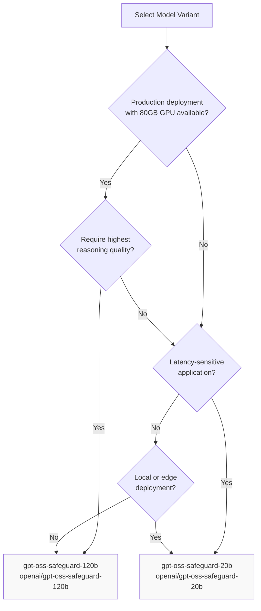
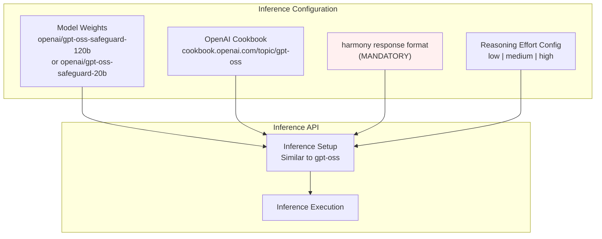
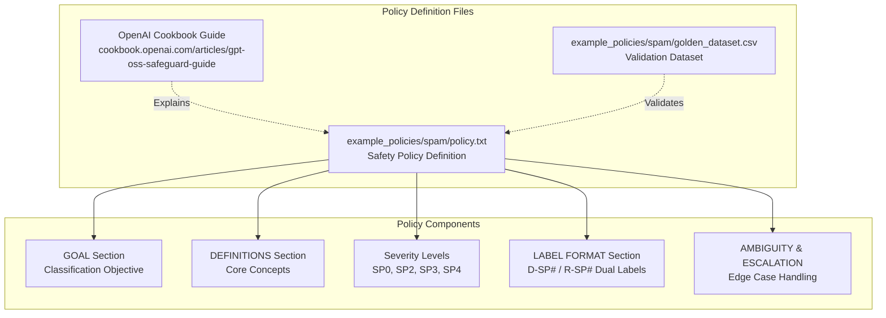
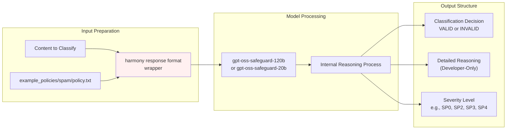
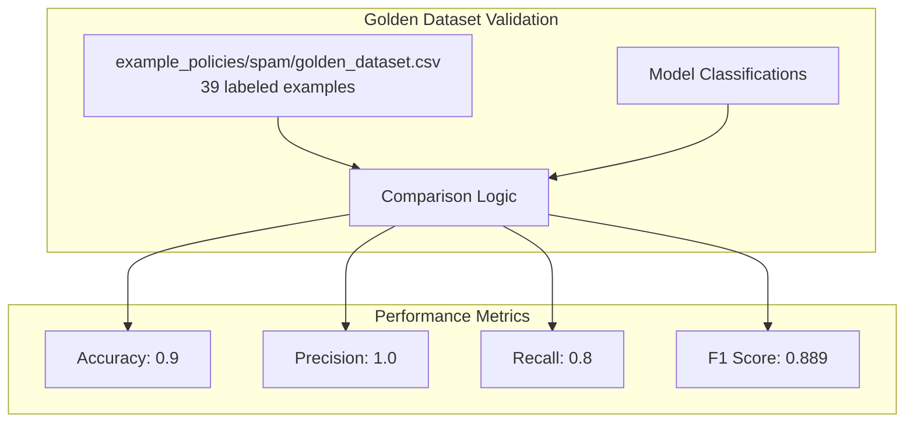

<!-- source: DeepWiki mcp.deepwiki.com · repo openai/gpt-oss-safeguard · page 2 Getting Started · fetched 2026-10-26 -->

# Getting Started

Relevant source files

The following files were used as context for generating this wiki page:

- [README.md](README.md)
- [docs/gpt-oss-safeguard-120b.png](docs/gpt-oss-safeguard-120b.png)
- [docs/gpt-oss-safeguard-20b.png](docs/gpt-oss-safeguard-20b.png)

This guide walks you through the initial setup and configuration required to use the gpt-oss-safeguard models. You will learn how to select the appropriate model variant, download it from Hugging Face, configure the required harmony response format, and run your first safety classification.

For detailed information about model architecture and capabilities, see [Model Variants](#3). For in-depth policy creation guidance, see [Working with Policies](#5). For production deployment considerations, see [Deployment and Integration](#8).

---

## Overview

The gpt-oss-safeguard models provide safety reasoning capabilities through a policy-driven classification workflow. Before performing any classifications, you must understand three critical requirements:

1. **Model Selection**: Choose between the 120B variant (production, high-reasoning) or 20B variant (lower latency, specialized)
2. **Harmony Response Format**: All inputs must use the harmony response format [README.md:20]()
3. **Custom Policy**: Define a safety policy that specifies your classification criteria

### Getting Started Workflow

```mermaid
graph LR
    subgraph "Setup Phase"
        A["Select Model Variant"]
        B["Download from<br/>Hugging Face Hub"]
        C["Configure Environment"]
    end
    
    subgraph "Configuration Phase"
        D["Define Safety Policy<br/>example_policies/spam/policy.txt"]
        E["Format Input<br/>harmony response format"]
        F["Configure Reasoning Effort<br/>low/medium/high"]
    end
    
    subgraph "Execution Phase"
        G["Run Inference"]
        H["Receive Classification<br/>+ Reasoning"]
        I["Evaluate Against<br/>Golden Dataset"]
    end
    
    A --> B
    B --> C
    C --> D
    D --> E
    E --> F
    F --> G
    G --> H
    H --> I
    
    style A fill:#f9f9f9
    style D fill:#f9f9f9
    style G fill:#f9f9f9
```

**Sources**: [README.md:1-46]()

---

## Prerequisites

### Hardware Requirements

The hardware requirements vary significantly between model variants. Consult the table below to determine which variant fits your infrastructure:

| Model Variant | Total Parameters | Active Parameters | Minimum GPU | Use Cases |
|--------------|------------------|-------------------|-------------|-----------|
| `gpt-oss-safeguard-120b` | 117B | 5.1B | Single 80GB GPU (H100, MI300X) | Production, general purpose, high-reasoning tasks |
| `gpt-oss-safeguard-20b` | 21B | 3.6B | Lower memory requirement | Lower latency, local deployment, specialized tasks |

The 120B model is specifically designed to fit within a single 80GB GPU [README.md:17](), eliminating multi-GPU orchestration complexity.

### Software Requirements

- **Inference Framework**: Compatible with the same inference APIs used by gpt-oss models [README.md:32]()
- **Format Compliance**: Harmony response format support (mandatory - models will not work without it) [README.md:20]()
- **Python Environment**: Follow setup instructions similar to gpt-oss models

**Sources**: [README.md:17-18](), [README.md:20](), [README.md:32]()

---

## Step-by-Step Setup

### Step 1: Choose Your Model Variant

Use this decision tree to select the appropriate variant:

**Sources**: [README.md:17-18]()

### Step 2: Download the Model

Download the model weights from the Hugging Face Hub collection:

**Hugging Face Hub Locations:**
- 120B variant: `openai/gpt-oss-safeguard-120b` [README.md:3]()
- 20B variant: `openai/gpt-oss-safeguard-20b` [README.md:3]()
- Collection: [Hugging Face Collections](https://huggingface.co/collections/openai/gpt-oss-safeguard) [README.md:40]()

The download process follows the same instructions as `gpt-oss-120b` [README.md:40](). Refer to the gpt-oss cookbook for detailed download procedures.

### Step 3: Configure Inference Environment

Configure your inference environment using patterns similar to the gpt-oss models:

**Critical Configuration Requirements:**
1. **Harmony Response Format**: Both models were trained using the harmony response format and will not function without it [README.md:20]()
2. **Reasoning Effort**: Configure one of three levels (low, medium, high) based on latency requirements [README.md:27]()
3. **Inference Patterns**: Follow cookbook examples at [cookbook.openai.com/topic/gpt-oss](https://cookbook.openai.com/topic/gpt-oss) [README.md:32]()

**Sources**: [README.md:20](), [README.md:27](), [README.md:32]()

### Step 4: Define Your Safety Policy

Before running classifications, you must define a safety policy. The repository provides a complete example in `example_policies/spam/`:

**Policy File Locations:**
- Example policy: [example_policies/spam/policy.txt:1-end]()
- Golden dataset: [example_policies/spam/golden_dataset.csv:1-end]()
- Prompting guide: [cookbook.openai.com/articles/gpt-oss-safeguard-guide](https://cookbook.openai.com/articles/gpt-oss-safeguard-guide) [README.md:36]()

**Sources**: [README.md:36]()

---

## Running Your First Classification

### Input Structure

The gpt-oss-safeguard models require inputs structured in the harmony response format. The workflow connects your policy definition, content to classify, and model inference:

**Important**: The reasoning explanation output is intended for developers and debugging, not for display to end users [README.md:26]().

**Sources**: [README.md:20](), [README.md:26]()

### Example Workflow

A complete classification workflow involves these steps:

1. **Load your policy** from a policy file (e.g., `example_policies/spam/policy.txt`)
2. **Format the input** using the harmony response format with your content and policy
3. **Configure reasoning effort** (low for speed, high for accuracy)
4. **Execute inference** using the model
5. **Parse the output** to extract classification and reasoning

### Validation

After running classifications, validate model performance using a golden dataset:

The spam policy example achieves 90% accuracy with perfect precision [README.md:36](). For details on metrics interpretation, see [Performance Metrics](#7.2).

**Sources**: [README.md:36]()

---

## Understanding Core Concepts

### Harmony Response Format Requirement

The harmony response format is a mandatory input structure for both model variants. Without proper formatting, the models will not function correctly [README.md:20]().

**Critical Warning**: Do not attempt to use these models without the harmony response format. This is not a configuration option - it is an architectural requirement based on the training methodology.

For detailed format specifications, see [Harmony Response Format](#4.2).

### Reasoning Effort Configuration

The models support three reasoning effort levels [README.md:27]():

| Effort Level | Use Case | Trade-off |
|-------------|----------|-----------|
| Low | High-throughput, latency-sensitive applications | Faster inference, reduced reasoning depth |
| Medium | Balanced general-purpose applications | Moderate latency, good reasoning quality |
| High | Accuracy-critical, complex safety decisions | Higher latency, maximum reasoning depth |

For detailed guidance on selecting reasoning effort, see [Configurable Reasoning Effort](#4.4).

**Sources**: [README.md:27]()

### Policy-Driven Classification

Unlike traditional safety systems with fixed rules, gpt-oss-safeguard uses a "bring your own policy" approach [README.md:25]():

- **Custom Policies**: You define the safety criteria, not the model
- **Flexible Taxonomy**: Create severity levels that match your use case
- **Domain-Specific**: Adapt to spam, misinformation, hate speech, or custom categories

For comprehensive policy creation guidance, see [Working with Policies](#5).

**Sources**: [README.md:25]()

---

## Next Steps

Once you have completed the initial setup and run your first classification:

1. **Explore the Spam Example**: Study the complete spam detection policy in [example_policies/spam/policy.txt:1-end]() to understand policy structure. See [Example: Spam Detection Policy](#6).

2. **Create Custom Policies**: Use the prompting guide at [cookbook.openai.com/articles/gpt-oss-safeguard-guide](https://cookbook.openai.com/articles/gpt-oss-safeguard-guide) to craft policies for your use case. See [Creating Custom Policies](#5.5).

3. **Optimize Deployment**: Review hardware requirements, batch processing strategies, and monitoring approaches. See [Deployment and Integration](#8).

4. **Build Golden Datasets**: Create validation datasets for your custom policies to measure performance. See [Golden Datasets](#7.1).

5. **Join the Community**: Engage with the ROOST Model Community to share feedback and influence future development. See [ROOST Model Community Partnership](#9.3).

### Additional Resources

- **Interactive Demo**: Try the model at [huggingface.co/spaces/openai/gpt-oss-safeguard-20b](https://huggingface.co/spaces/openai/gpt-oss-safeguard-20b) [README.md:6]()
- **Cookbook Guide**: [cookbook.openai.com/articles/gpt-oss-safeguard-guide](https://cookbook.openai.com/articles/gpt-oss-safeguard-guide) [README.md:7]()
- **Model Card**: [arxiv.org/abs/2508.10925](https://arxiv.org/abs/2508.10925) [README.md:8]()
- **Announcement Blog**: [openai.com/index/introducing-gpt-oss-safeguard/](https://openai.com/index/introducing-gpt-oss-safeguard) [README.md:9]()

**Sources**: [README.md:6-9](), [README.md:36](), [README.md:42-45]()

---

