# Page: Overview

# Overview

<details>
<summary>Relevant source files</summary>

The following files were used as context for generating this wiki page:

- [AGENTS.md](AGENTS.md)
- [Cargo.toml](Cargo.toml)
- [README.md](README.md)
- [run_checks.sh](run_checks.sh)

</details>


This document provides a comprehensive overview of the `openai-harmony` repository, a multi-platform library implementing OpenAI's harmony response format for the gpt-oss model series. The harmony format defines conversation structures, reasoning output channels, and function calling mechanisms specifically designed for open-weight models [README.md:1-13]().

For detailed information about the library's internal Rust structure, see [Core Library Architecture](#1.1). For information on how the Rust core is exposed to other environments, see [Language Bindings](#1.2).

## System Purpose and Architecture

The `openai-harmony` library serves as the canonical implementation for parsing and rendering conversations in the harmony format [README.md:48-53](). The system is architected as a high-performance Rust core with language bindings for Python and WebAssembly environments [README.md:132-141]().

### Core System Architecture

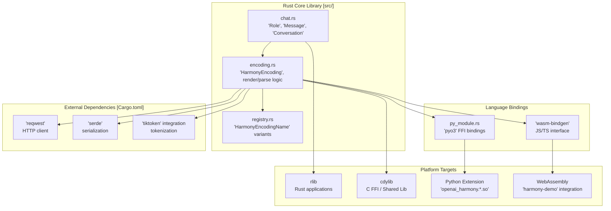

**Sources:** [Cargo.toml:9-16](), [README.md:144-159](), [AGENTS.md:1-5]()

### Multi-Platform Compilation Strategy

The library uses Cargo's `crate-type` configuration and feature flags to generate multiple compilation targets from a single Rust codebase [Cargo.toml:9-16]().

*   **Rust Native**: Compiled as an `rlib` for use in other Rust projects [Cargo.toml:11]().
*   **Python**: Uses the `python-binding` feature and `pyo3` to create a native extension [Cargo.toml:15](), [Cargo.toml:45-48]().
*   **WebAssembly**: Uses the `wasm-binding` feature and `wasm-bindgen` for browser-based environments like the harmony-demo [Cargo.toml:16](), [Cargo.toml:49-53]().

**Sources:** [Cargo.toml:9-16](), [Cargo.toml:45-53]()

## Core Data Structures and Message Flow

The harmony format centers around structured conversations with specific role-based message types and multi-channel assistant responses.

### Message Type Hierarchy

The core data structures are defined in `src/chat.rs` and mirrored in the Python wrapper `python/openai_harmony/__init__.py` [README.md:144-159]().

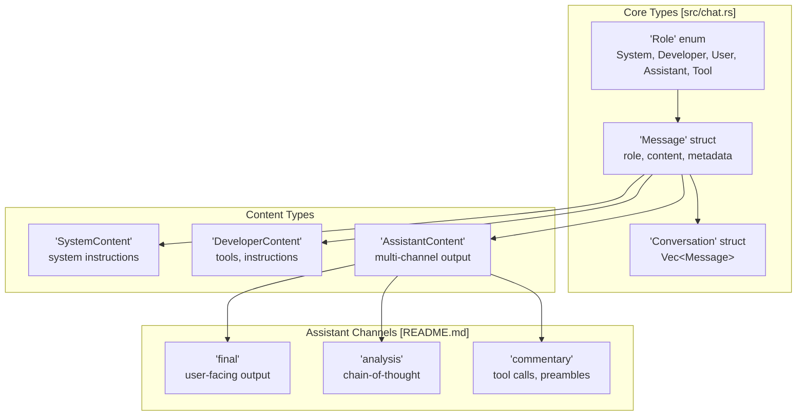

**Sources:** [README.md:72-93](), [README.md:116-126](), [README.md:148-155]()

### Encoding and Parsing Pipeline

The `HarmonyEncoding` handles the conversion between structured objects and token sequences [README.md:48-53]().

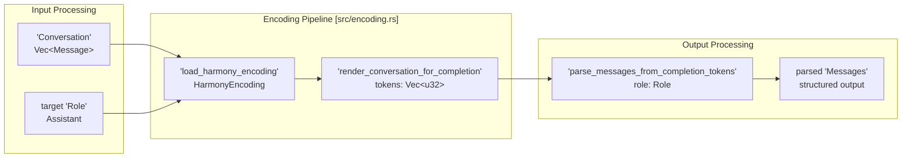

**Sources:** [README.md:72-99](), [README.md:116-128](), [README.md:149]()

## Dependency Ecosystem and Integration Points

The library integrates with a specific set of dependencies to provide comprehensive functionality while maintaining cross-platform compatibility.

| Dependency | Purpose | Configuration |
|------------|---------|---------------|
| `pyo3` | Python FFI bindings | Optional feature `python-binding` [Cargo.toml:15, 45]() |
| `wasm-bindgen` | WebAssembly FFI bindings | Optional feature `wasm-binding` [Cargo.toml:16, 49]() |
| `reqwest` | HTTP client for tool/image fetching | Uses `rustls-tls` for cross-platform CI [Cargo.toml:32-42]() |
| `serde` | Serialization/Deserialization | Derived for most chat structures [Cargo.toml:22]() |
| `tiktoken` | Tokenization engine | Integrated via `encoding.rs` [README.md:139, 149]() |

**Sources:** [Cargo.toml:13-53](), [README.md:132-141]()

## Build System Integration

The project uses `maturin` for Python packaging and `cargo` for the native Rust core.

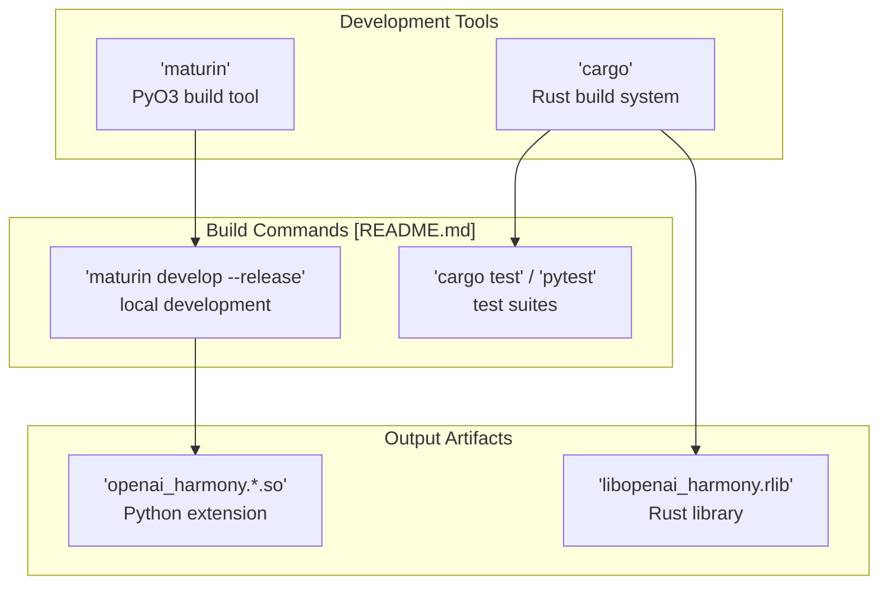

**Sources:** [README.md:163-207](), [AGENTS.md:7-9](), [run_checks.sh:5-7]()

For more details on the architecture, see [Core Library Architecture](#1.1). For more on language-specific implementations, see [Language Bindings](#1.2).

---

# Page: Core Library Architecture

# Core Library Architecture

<details>
<summary>Relevant source files</summary>

The following files were used as context for generating this wiki page:

- [Cargo.lock](Cargo.lock)
- [Cargo.toml](Cargo.toml)
- [src/lib.rs](src/lib.rs)
- [src/registry.rs](src/registry.rs)

</details>


This document describes the core architecture of the `openai-harmony` Rust library, including its crate structure, multi-platform compilation targets, and dependency graph. The library serves as the reference implementation for the harmony response format used in OpenAI's `gpt-oss` model series.

## Library Structure and Build Configuration

The `openai-harmony` crate is organized as a multi-target library. The internal module structure separates core encoding logic, registry management, and platform-specific bindings.

### Module Organization
The root of the library `src/lib.rs` defines the public API and manages conditional compilation for language bindings.

| Module | File | Purpose |
| :--- | :--- | :--- |
| `chat` | `src/chat.rs` | Defines the high-level chat message structures. |
| `encoding` | `src/encoding.rs` | Contains the core `HarmonyEncoding` and `StreamableParser` logic. |
| `registry` | `src/registry.rs` | Manages the instantiation of specific harmony configurations (e.g., `HarmonyGptOss`). |
| `tiktoken` | `src/tiktoken.rs` | Internal BPE tokenizer integration. |
| `tiktoken_ext` | `src/tiktoken_ext.rs` | Extensions for specific OpenAI tokenizers like `O200kHarmony`. |
| `py_module` | `src/py_module.rs` | Python FFI logic (enabled via `python-binding`). |
| `wasm_module` | `src/wasm_module.rs` | WebAssembly FFI logic (enabled via `wasm-binding`). |

Sources: [src/lib.rs:3-21]()

### Build Targets and Features
The library supports several compilation targets through Cargo's `crate-type` and feature gates.

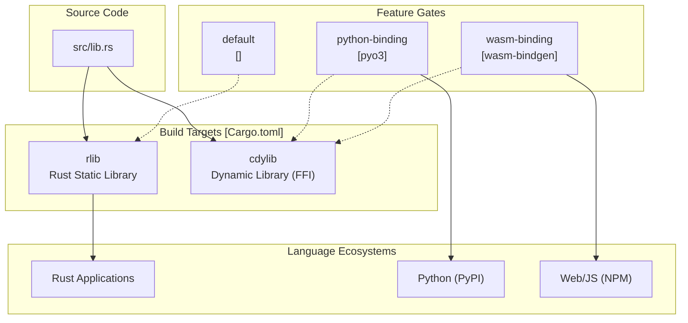

Sources: [Cargo.toml:9-16](), [src/lib.rs:16-20]()

## Core Dependencies Architecture

The library relies on a specific set of dependencies to handle text processing, networking, and serialization.

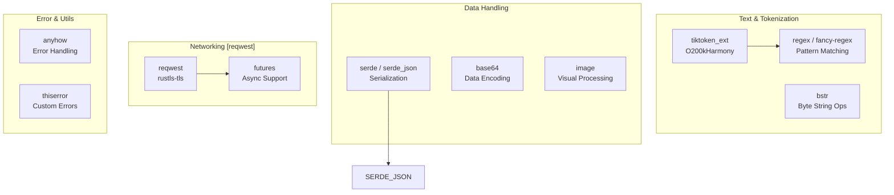

Sources: [Cargo.toml:18-43]()

## Platform-Specific Implementation

The library uses conditional compilation to handle architectural differences, particularly between standard targets and WebAssembly.

### Registry and Encoding Loading
The `load_harmony_encoding` function is the primary entry point for obtaining a `HarmonyEncoding` instance. Its implementation differs based on the target architecture to accommodate `wasm32` constraints.

*   **Standard Targets:** Uses a synchronous `load_harmony_encoding` function. [src/registry.rs:45-82]()
*   **Wasm Targets:** Uses an `async` version of `load_harmony_encoding` to handle asynchronous resource fetching in browser environments. [src/registry.rs:85-123]()

### Token Mapping Configuration
The library defines a specific set of `FormattingToken` variants mapped to special string sequences used by the `gpt-oss` models.

| FormattingToken Variant | String Literal |
| :--- | :--- |
| `Start` | `<|start|>` |
| `Message` | `<|message|>` |
| `EndMessage` | `<|end|>` |
| `EndMessageDoneSampling` | `<|return|>` |
| `Refusal` | `<|refusal|>` |
| `ConstrainedFormat` | `<|constrain|>` |
| `Channel` | `<|channel|>` |
| `EndMessageAssistantToTool` | `<|call|>` |
| `BeginUntrusted` | `<|untrusted|>` |
| `EndUntrusted` | `<|end_untrusted|>` |

Sources: [src/registry.rs:58-69](), [src/registry.rs:98-109]()

## Multi-Platform Compilation Strategy

### TLS Backend Configuration
To ensure compatibility across CI runners and avoid local OpenSSL dependencies, the library explicitly configures `reqwest` to use the `rustls-tls` backend.

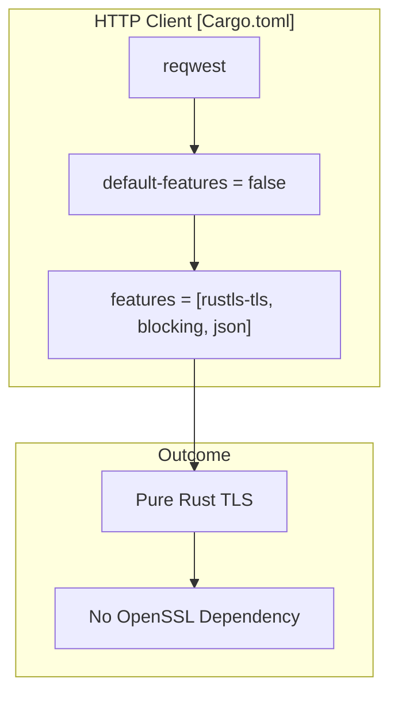

Sources: [Cargo.toml:32-42]()

### Package Metadata
The library is versioned and licensed for open-weight model ecosystem support.

| Field | Value |
| :--- | :--- |
| Package Name | `openai-harmony` |
| Version | `0.0.8` |
| License | `Apache-2.0` |
| Edition | `2021` |

Sources: [Cargo.toml:1-5]()

---

# Page: Language Bindings

# Language Bindings

<details>
<summary>Relevant source files</summary>

The following files were used as context for generating this wiki page:

- [javascript/README.md](javascript/README.md)
- [javascript/package.json](javascript/package.json)
- [pyproject.toml](pyproject.toml)
- [src/py_module.rs](src/py_module.rs)
- [src/wasm_module.rs](src/wasm_module.rs)

</details>


This document covers how the core Rust implementation of `openai-harmony` is exposed to other programming languages through language bindings. The library provides native interfaces for Python applications via PyO3 and for JavaScript/Web environments via WebAssembly.

For information about the core Rust library architecture, see [Core Library Architecture](). For Python-specific API documentation, see [Python API Reference]().

## Binding Architecture Overview

The `openai-harmony` library uses a multi-target compilation strategy to expose its Rust core to different runtime environments. The core logic remains in Rust while language-specific bindings provide idiomatic interfaces for each target platform.

### Multi-Target Compilation Strategy

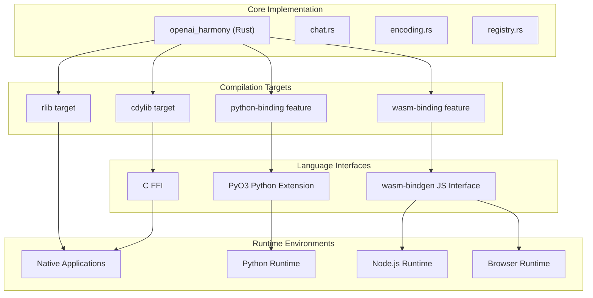

**Sources:** [pyproject.toml:21-23](), [src/py_module.rs:1-13](), [src/wasm_module.rs:1-10]()

## Python Bindings via PyO3

The Python bindings expose the Rust functionality through the `pyo3` crate, creating a native Python extension module. To keep the FFI boundary light-weight, complex data structures like `Conversation` and `Message` are passed as JSON strings and deserialized within the Rust binding layer.

### PyO3 Integration Architecture

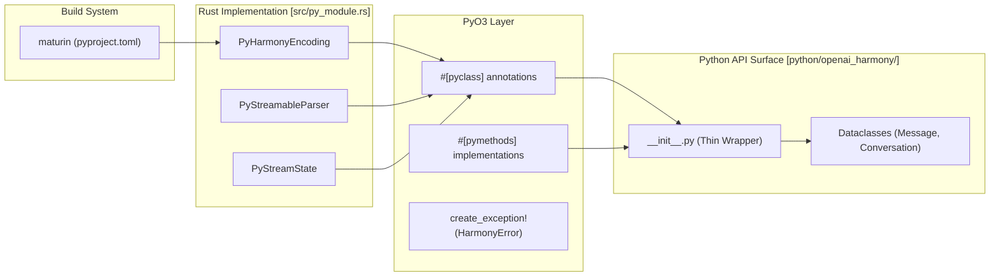

**Sources:** [src/py_module.rs:1-13](), [src/py_module.rs:35-52](), [pyproject.toml:1-14]()

### Data Flow and Serialization

The Python interface uses `serde_json` to bridge the gap between Python's high-level types and Rust's internal representation.

*   **Rendering:** Python dataclasses are serialized to JSON in the Python wrapper and passed to `PyHarmonyEncoding::render_conversation_for_completion` [src/py_module.rs:87-92]().
*   **Parsing:** Tokens are passed to `PyHarmonyEncoding::parse_messages_from_completion_tokens`, which returns a JSON string [src/py_module.rs:242-263](). This string is then parsed back into Python objects.
*   **Error Handling:** A custom `HarmonyError` exception is defined using `create_exception!` to allow Python users to catch library-specific failures [src/py_module.rs:25-26]().

**Sources:** [src/py_module.rs:94-100](), [src/py_module.rs:264-266]()

## WebAssembly Bindings via wasm-bindgen

The WebAssembly bindings enable the harmony library to run in browser and Node.js environments. Unlike the Python bindings which use JSON strings, the WASM layer uses `serde-wasm-bindgen` to convert between JavaScript objects and Rust structs directly.

### WASM Implementation Detail

The `JsHarmonyEncoding` struct wraps the core `HarmonyEncoding` and exposes methods via `#[wasm_bindgen]` [src/wasm_module.rs:61-67]().

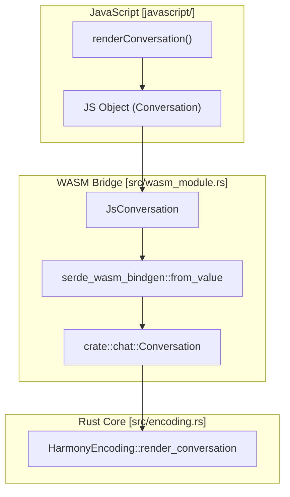

**Sources:** [src/wasm_module.rs:104-112](), [src/wasm_module.rs:127-130]()

### TypeScript Definitions

To ensure type safety in the demo application and for library consumers, a `typescript_custom_section` defines the interfaces for `Message`, `Author`, and `Content` [src/wasm_module.rs:26-59]().

| JS Interface | Rust Equivalent | Role |
|--------------|-----------------|------|
| `Message` | `crate::chat::Message` | Represents a single message in a thread [src/wasm_module.rs:38-44]() |
| `Content` | `crate::chat::Content` | Sum type for text, system, or developer content [src/wasm_module.rs:33-36]() |
| `JsHarmonyEncoding` | `crate::encoding::HarmonyEncoding` | Main entry point for rendering and parsing [src/wasm_module.rs:61-64]() |

**Sources:** [src/wasm_module.rs:26-59]()

## Cross-Language API Surface

The language bindings maintain API parity while adapting to each language's idioms and type systems.

### Key Shared Functionality

Both bindings expose the following critical operations from the Rust core:

1.  **Rendering:** `render_conversation_for_completion` converts high-level conversation objects into a sequence of token IDs (`Vec<u32>`) [src/py_module.rs:87-122](), [src/wasm_module.rs:73-102]().
2.  **Parsing:** `parse_messages_from_completion_tokens` converts model-generated tokens back into structured `Message` objects [src/py_module.rs:242-267](), [src/wasm_module.rs:164-188]().
3.  **Decoding:** Access to the underlying tokenizer for `decode_utf8` and `decode_bytes` [src/py_module.rs:269-282](), [src/wasm_module.rs:190-202]().
4.  **Streaming:** The `StreamableParser` is exposed to support incremental parsing of model output [src/py_module.rs:41-44](), [src/wasm_module.rs:205-208]().

### Distribution and Packaging

| Language | Package Name | Build Tool | Configuration |
|----------|--------------|------------|---------------|
| Python | `openai-harmony` | `maturin` | [pyproject.toml:1-25]() |
| JavaScript | `@openai/harmony` | `wasm-pack` | [javascript/package.json:1-12]() |

**Sources:** [pyproject.toml:5-15](), [javascript/package.json:1-4]()

---

# Page: Harmony Response Format

# Harmony Response Format

<details>
<summary>Relevant source files</summary>

The following files were used as context for generating this wiki page:

- [docs/format.md](docs/format.md)
- [src/chat.rs](src/chat.rs)
- [src/encoding.rs](src/encoding.rs)

</details>


## Purpose and Scope

This document provides a comprehensive technical specification of the harmony response format used by OpenAI's `gpt-oss` model series. The harmony format defines structured conversation patterns, multi-channel output routing, tool calling mechanisms, and special token sequences that enable sophisticated model behaviors including chain-of-thought reasoning and function execution.

The format is designed to mimic the OpenAI Responses API while providing a specific token-level structure required for `gpt-oss` to function correctly [docs/format.md:1-3]().

For information about the Python API implementation details, see [Python API Reference](#2.1). For the Rust core implementation, see [Rust API Reference](#2.2).

## Core Format Concepts

The harmony response format is built around several fundamental concepts that structure how messages flow between different participants in a conversation.

### Message Roles and Hierarchy

The format defines five distinct message roles with a clear instruction hierarchy:

| Role | Purpose |
| :--- | :--- |
| `system` | Specifies reasoning effort, knowledge cutoff, and built-in tools [docs/format.md:13](). |
| `developer` | Contains instructions (system prompt) and available function tools [docs/format.md:14](). |
| `user` | Represents the input to the model [docs/format.md:15](). |
| `assistant` | Model output (tool calls or messages) associated with a "channel" [docs/format.md:16](). |
| `tool` | Represents the output of a tool call [docs/format.md:17](). |

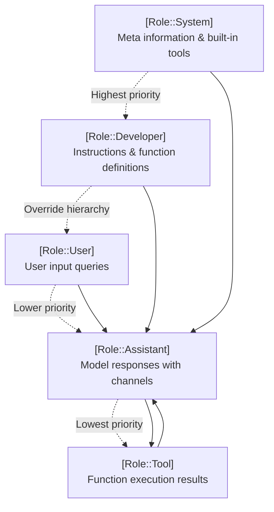

Sources: [docs/format.md:7-19](), [src/chat.rs:31-39]()

### Assistant Channel System

Assistant messages are routed through three distinct channels that separate content by intended audience and purpose:

| Channel | Purpose | Safety Level |
| :--- | :--- | :--- |
| `final` | Intended for the end-user [docs/format.md:27](). | Full safety standards. |
| `analysis` | Used for Chain of Thought (CoT) and built-in tools [docs/format.md:28-29](). | **Reduced safety standards.** |
| `commentary` | Function tool calls and preambles [docs/format.md:29](). | Standard safety. |

```mermaid
graph LR
    assistant["`Role::Assistant`"]
    
    final["`final` channel<br/>User responses"]
    analysis["`analysis` channel<br/>Chain-of-thought"]
    commentary["`commentary` channel<br/>Tool calls & preambles"]
    
    functions["`functions.*`<br/>Custom tools"]
    browser["`browser.*`<br/>Built-in Search"]
    python["`python`<br/>Code execution"]
    
    assistant --> final
    assistant --> analysis
    assistant --> commentary
    
    commentary --> functions
    commentary --> browser
    analysis --> python
```

Sources: [docs/format.md:22-30](), [src/chat.rs:126-138]()

## Special Token Specifications

The harmony format uses specific `FormattingToken` variants that are mapped to actual vocabulary tokens during rendering [src/encoding.rs:42-55]().

| Token (Internal) | String Representation | Purpose |
| :--- | :--- | :--- |
| `Start` | `<\|start\|>` | Message beginning marker [src/encoding.rs:60](). |
| `EndMessage` | `<\|end\|>` | Message completion marker [src/encoding.rs:62](). |
| `Message` | `<\|message\|>` | Separates metadata/header from content [src/encoding.rs:61](). |
| `Channel` | `<\|channel\|>` | Channel specification marker [src/encoding.rs:67](). |
| `ConstrainedFormat` | `<\|constrain\|>` | Data type specification (e.g., json) [src/encoding.rs:66](). |
| `EndMessageAssistantToTool` | `<\|call\|>` | Stop token for tool invocation [src/encoding.rs:64](). |
| `EndMessageDoneSampling` | `<\|return\|>` | Stop token for final response [src/encoding.rs:63](). |

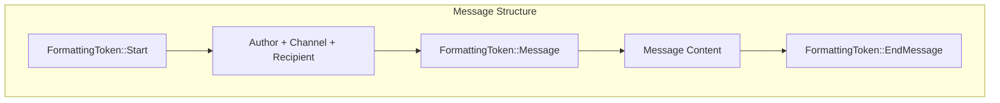

Sources: [src/encoding.rs:57-74](), [docs/format.md:184-206]()

## Implementation Class Structure

The harmony format is implemented through a hierarchy of Rust data structures in `src/chat.rs` and `src/encoding.rs`.

```mermaid
graph TB
    subgraph "Core Data Types [src/chat.rs]"
        Role["`Role` (enum)"]
        Message["`Message` (struct)"]
        Conversation["`Conversation` (struct)"]
        Author["`Author` (struct)"]
    end
    
    subgraph "Content Types [src/chat.rs]"
        SystemContent["`SystemContent`"]
        DeveloperContent["`DeveloperContent`"]
        ToolDescription["`ToolDescription`"]
    end
    
    subgraph "Encoding System [src/encoding.rs]"
        HarmonyEncoding["`HarmonyEncoding`"]
        FormattingToken["`FormattingToken` (enum)"]
        ParsedHeader["`ParsedHeader` (struct)"]
    end
    
    Role --> Author
    Author --> Message
    Message --> Conversation
    SystemContent --> Message
    DeveloperContent --> Message
    ToolDescription --> DeveloperContent
    
    HarmonyEncoding --> FormattingToken
    HarmonyEncoding --> ParsedHeader
```

Sources: [src/chat.rs:11-138](), [src/encoding.rs:15-94]()

## Built-in Tool Specifications

### Browser Tool Namespace
The `browser` tool provides search and navigation. It typically triggers on the `analysis` channel [docs/format.md:29]().
- **Methods**: `search`, `open`, `find` [docs/format.md:515-575]().
- **Citations**: Uses the `【{cursor}†L{line}】` format for grounding [docs/format.md:550]().

### Python Tool Integration
The `python` tool enables code execution.
- **Channel**: Always routes to the `analysis` channel [docs/format.md:576]().
- **Recipient**: The string `python` [docs/format.md:576]().
- **Environment**: Stateful Jupyter notebook with access to `/mnt/data` [docs/format.md:580-590]().

## Reasoning and Chain-of-Thought

The format supports three reasoning levels via `ReasoningEffort` [src/chat.rs:209-213]():
1. **Low**: Minimal internal processing.
2. **Medium**: Balanced reasoning.
3. **High**: Extensive chain-of-thought in the `analysis` channel.

**Important**: Content in the `analysis` channel should be hidden from end-users as it does not adhere to standard safety filters [docs/format.md:28]().

Sources: [docs/format.md:278-309](), [src/chat.rs:209-213]()

---

# Page: Python API Reference

# Python API Reference

<details>
<summary>Relevant source files</summary>

The following files were used as context for generating this wiki page:

- [docs/python.md](docs/python.md)
- [python/openai_harmony/__init__.py](python/openai_harmony/__init__.py)
- [tests/test_harmony.py](tests/test_harmony.py)

</details>


This document provides comprehensive reference documentation for the Python bindings of the `openai-harmony` library. The Python API exposes the core Rust functionality through PyO3-generated bindings, providing dataclasses that mirror Rust structures and encoding helpers for working with the harmony response format.

## Installation and Imports

The `openai-harmony` package is distributed via PyPI and installs a module named `openai_harmony`. The package provides a complete Python interface to the harmony format renderer and parser.

Installation:
```bash
pip install openai-harmony
```

Common import patterns include importing specific classes or using wildcard imports for convenience:

```python
from openai_harmony import Message, Conversation, load_harmony_encoding
# or
from openai_harmony import *
```

Sources: [docs/python.md:5-17]()

## Python Bindings Architecture

The Python API is built on PyO3 bindings that expose the Rust core functionality. The architecture follows a layered approach where Python dataclasses mirror Rust structures, and encoding helpers provide high-level interfaces to the underlying tokenization and parsing logic.

**Python to Rust Entity Mapping**
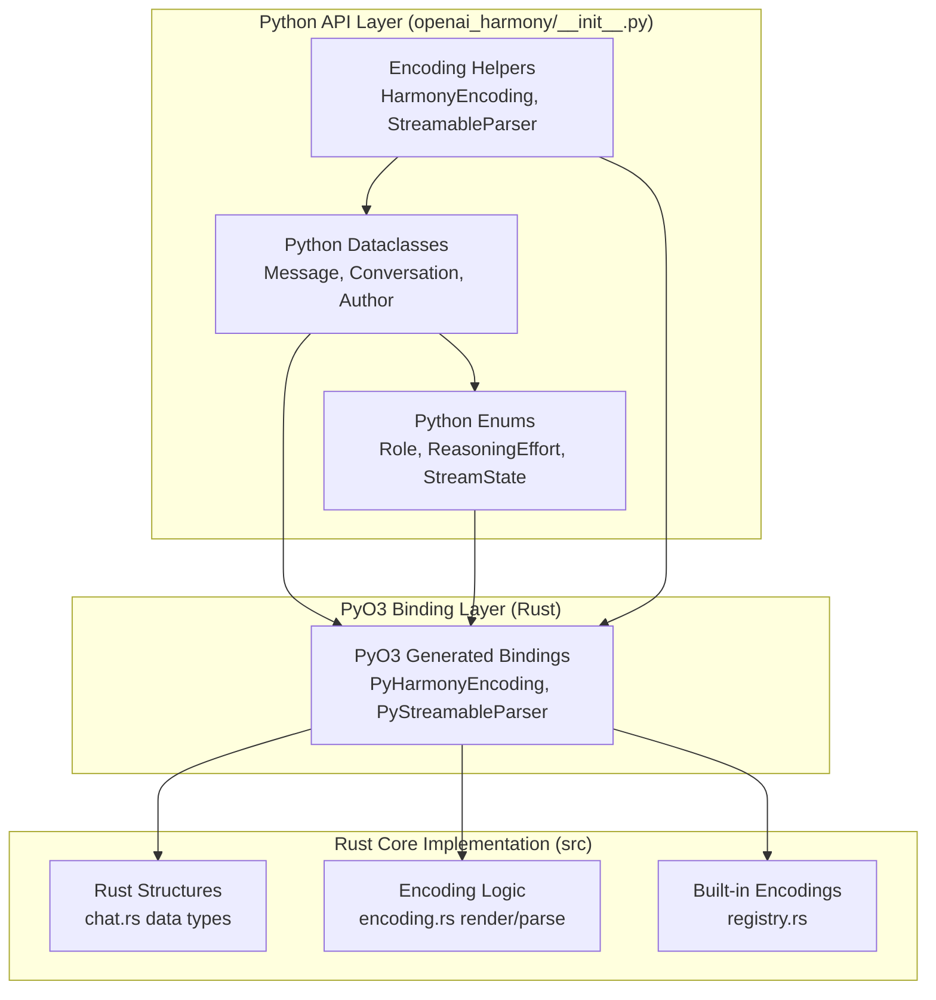

Sources: [python/openai_harmony/__init__.py:1-46](), [docs/python.md:1-3]()

## Core Data Structures and Relationships

The Python API provides a rich set of dataclasses that represent messages, conversations, and configuration. These classes form a hierarchy where `Message` objects contain `Content` implementations, and `Conversation` objects aggregate multiple messages.

**Class Relationship Diagram**
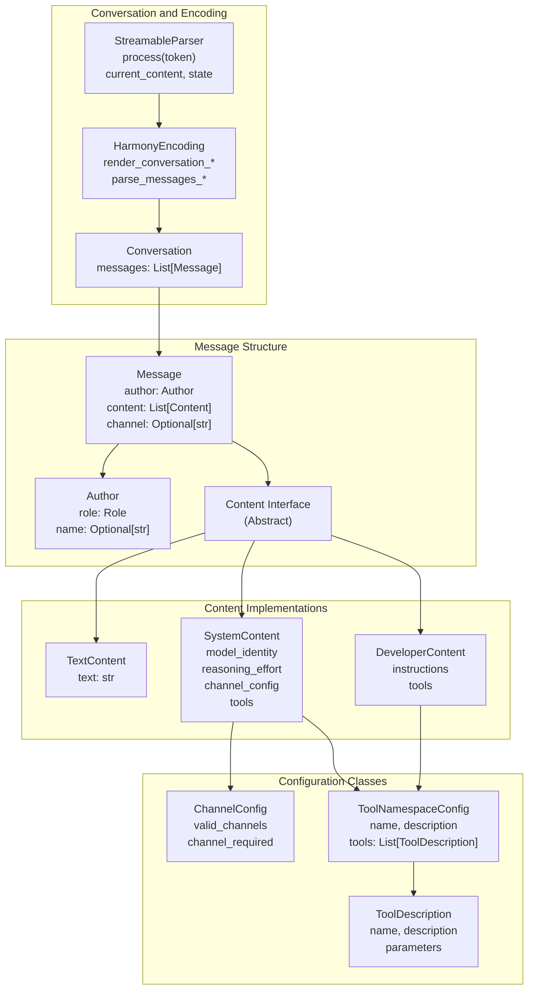

Sources: [python/openai_harmony/__init__.py:89-250](), [docs/python.md:32-92]()

## Encoding and Parsing Workflow

The encoding workflow transforms conversations into tokens for model consumption and parses model outputs back into structured messages. The `HarmonyEncoding` class provides the primary interface, with `StreamableParser` offering incremental parsing capabilities.

**Data Flow: Natural Language to Token Space**
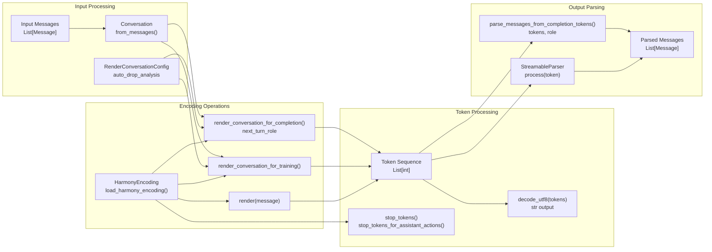

Sources: [python/openai_harmony/__init__.py:438-550](), [docs/python.md:101-119]()

## Enumerations

The Python API includes several enumerations that mirror the Rust implementation:

| Enumeration | Values | Purpose |
|-------------|--------|---------|
| `Role` | `USER`, `ASSISTANT`, `SYSTEM`, `DEVELOPER`, `TOOL` | Identifies message author type [python/openai_harmony/__init__.py:89-96]() |
| `ReasoningEffort` | `LOW`, `MEDIUM`, `HIGH` | Controls assistant reasoning depth [python/openai_harmony/__init__.py:142-145]() |
| `StreamState` | `EXPECT_START`, `HEADER`, `CONTENT` | Tracks incremental parser state [docs/python.md:28-28]() |
| `HarmonyEncodingName` | `HARMONY_GPT_OSS` | Available encoding identifiers [tests/test_harmony.py:74-74]() |

Sources: [python/openai_harmony/__init__.py:89-145](), [docs/python.md:21-28]()

## Message Construction and Content Types

Messages are constructed using the `Message` class with various content types. The library provides convenience constructors and builder patterns for common use cases:

```python
# Basic message construction
Message.from_role_and_content(Role.USER, "Hello")
Message.from_role_and_contents(Role.ASSISTANT, [TextContent("Response")])

# System message with configuration
SystemContent.new() \
    .with_model_identity("Custom identity") \
    .with_reasoning_effort(ReasoningEffort.HIGH) \
    .with_channel_config(ChannelConfig.require_channels(["analysis", "final"])) \
    .with_browser_tool()

# Developer message with instructions
DeveloperContent.new() \
    .with_instructions("Use these tools carefully")
```

Sources: [python/openai_harmony/__init__.py:181-280](), [docs/python.md:62-85]()

## Tool Configuration

The API provides built-in tool configurations and supports custom tool definitions:

| Tool Component | Purpose | Key Methods |
|----------------|---------|-------------|
| `ToolDescription` | Individual tool definition | `new(name, description, parameters)` [python/openai_harmony/__init__.py:130-140]() |
| `ToolNamespaceConfig` | Tool grouping | `browser()`, `python()` [python/openai_harmony/__init__.py:157-179]() |

Custom tools can be defined using `ToolDescription` objects and grouped into namespaces via `ToolNamespaceConfig`.

Sources: [python/openai_harmony/__init__.py:130-179](), [docs/python.md:44-54]()

## Serialization and Persistence

Conversations and messages support JSON serialization for persistence and data exchange:

```python
# Conversation serialization
conversation.to_json()  # -> str
Conversation.from_json(json_str)  # -> Conversation

# Message serialization
message.to_dict()  # -> dict
Message.from_dict(message_dict)  # -> Message
```

Sources: [python/openai_harmony/__init__.py:365-430](), [docs/python.md:85-91]()

## Error Handling

The Python bindings raise standard Python exceptions and custom `HarmonyError` instances for error conditions:

| Exception Type | Common Causes | Usage Context |
|----------------|---------------|---------------|
| `HarmonyError` | Disallowed special tokens, Rust-level logic errors | Core library operations [python/openai_harmony/__init__.py:38-39]() |
| `RuntimeError` | Rendering/parsing failures, malformed tokens | Encoding operations [docs/python.md:165-167]() |
| `ValueError` | Invalid arguments, unknown enum values | Parameter validation [python/openai_harmony/__init__.py:100-100]() |
| `ModuleNotFoundError` | Missing compiled extension | Installation/Build issues [python/openai_harmony/__init__.py:48-59]() |

Recommended error handling pattern:
```python
try:
    tokens = encoding.render_conversation_for_completion(conversation, Role.ASSISTANT)
    parsed = encoding.parse_messages_from_completion_tokens(tokens, Role.ASSISTANT)
except (RuntimeError, HarmonyError) as err:
    print(f"Encoding/parsing failed: {err}")
```

Sources: [python/openai_harmony/__init__.py:38-73](), [docs/python.md:160-179]()

## Complete Usage Example

The following example demonstrates the complete workflow from message creation through token rendering and parsing:

```python
from openai_harmony import (
    Role, Message, Conversation, SystemContent,
    load_harmony_encoding, HarmonyEncodingName
)

# Create messages
system = Message.from_role_and_content(Role.SYSTEM, SystemContent.new())
user = Message.from_role_and_content(Role.USER, "What is 2 + 2?")

# Build conversation
conversation = Conversation.from_messages([system, user])

# Load encoding and render
encoding = load_harmony_encoding(HarmonyEncodingName.HARMONY_GPT_OSS)
tokens = encoding.render_conversation_for_completion(conversation, Role.ASSISTANT)

# Parse and decode
text_output = encoding.decode_utf8(tokens)
parsed_messages = encoding.parse_messages_from_completion_tokens(tokens, role=Role.ASSISTANT)
```

Sources: [tests/test_harmony.py:77-101](), [docs/python.md:126-158]()

---

# Page: Rust API Reference

# Rust API Reference

<details>
<summary>Relevant source files</summary>

The following files were used as context for generating this wiki page:

- [docs/rust.md](docs/rust.md)
- [src/chat.rs](src/chat.rs)
- [src/encoding.rs](src/encoding.rs)
- [src/tiktoken.rs](src/tiktoken.rs)
- [src/tiktoken_ext/mod.rs](src/tiktoken_ext/mod.rs)
- [src/tiktoken_ext/public_encodings.rs](src/tiktoken_ext/public_encodings.rs)

</details>


The Rust crate serves as the core engine for the Harmony format, providing high-performance tokenization, rendering, and parsing logic. It is designed to be used both as a native Rust library and as the foundation for Python and WebAssembly bindings.

## Crate Architecture

The crate is organized into several key modules, with primary entities re-exported at the root for ease of use [docs/rust.md:3-27]().

| Module | Responsibility |
| :--- | :--- |
| `chat` | Data structures for messages, authors, and conversation state [src/chat.rs:1-240](). |
| `encoding` | The core `HarmonyEncoding` logic, including token rendering and parsing [src/encoding.rs:84-160](). |
| `registry` | Utilities for loading predefined encodings like `HarmonyGptOss` [docs/rust.md:103-117](). |
| `tiktoken` | A Rust-native implementation of OpenAI's Byte Pair Encoding (BPE) [src/tiktoken.rs:164-183](). |

### Entity Mapping: Natural Language to Code Space

The following diagram maps high-level Harmony concepts to their specific Rust implementations.

**Harmony Concept Mapping**
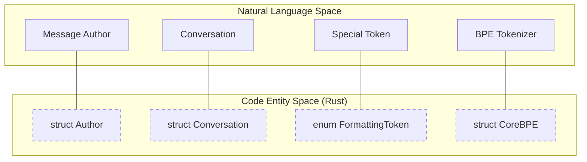
Sources: [src/chat.rs:11-14](), [src/chat.rs:273-276](), [src/encoding.rs:42-55](), [src/tiktoken.rs:164-172]()

---

## Core Data Structures

### Chat Module
The `chat` module defines the structural components of a Harmony interaction.

*   **`Role`**: An enum representing the participant type: `User`, `Assistant`, `System`, `Developer`, or `Tool` [src/chat.rs:33-39]().
*   **`Author`**: Combines a `Role` with an optional `name` string [src/chat.rs:11-14]().
*   **`Message`**: The primary unit of communication. It includes the `author`, `recipient`, a vector of `Content`, and optional `channel` or `content_type` fields [src/chat.rs:106-138]().
*   **`Content`**: An enum that can be `Text`, `SystemContent`, or `DeveloperContent` [src/chat.rs:75-81]().

Sources: [src/chat.rs:11-138](), [docs/rust.md:34-75]()

---

## HarmonyEncoding

`HarmonyEncoding` is the central struct used for converting between high-level `Message` objects and low-level token sequences (`Vec<Rank>`).

### Key Methods
*   **`render_conversation_for_completion`**: Renders a conversation and appends the necessary tokens to prompt the model for a specific role's response [docs/rust.md:87-87]().
*   **`parse_messages_from_completion_tokens`**: Converts a sequence of tokens back into `Message` objects using strict validation [docs/rust.md:91-91]().
*   **`stop_tokens()`**: Returns a `HashSet<Rank>` of tokens that should trigger the end of generation [src/encoding.rs:132-144]().

### Token Rendering Data Flow
The diagram below illustrates how a `Message` is transformed into tokens using `HarmonyEncoding`.

**Message Rendering Pipeline**
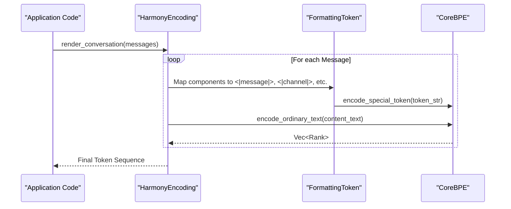
Sources: [src/encoding.rs:164-210](), [src/encoding.rs:42-74](), [src/tiktoken.rs:69-77]()

---

## StreamableParser

The `StreamableParser` provides an incremental way to parse model output as it is being generated (streaming).

*   **Initialization**: Created via `StreamableParser::new(encoding, role)` [docs/rust.md:98-98]().
*   **Processing**: Tokens are fed one-by-one into the `process(token)` method.
*   **State Access**: Developers can query the current state of the parser, including `current_content`, `current_role`, and the accumulated `messages` [docs/rust.md:98-99]().
*   **Options**: Supports `ParseOptions` to toggle `strict` validation. Disabling strict mode allows the parser to attempt recovery from malformed model output [docs/rust.md:95-99]().

Sources: [docs/rust.md:97-100](), [src/encoding.rs:16-21]()

---

## Tiktoken Integration

Harmony relies on a custom implementation of the Tiktoken tokenizer for performance and environment flexibility (e.g., WASM support).

### CoreBPE
The `CoreBPE` struct manages the vocabulary and the regex-based splitting logic [src/tiktoken.rs:164-183]().
*   **Thread Safety**: Uses a vector of Regex instances (`regex_tls`) to avoid contention across multiple threads [src/tiktoken.rs:175-180]().
*   **Encoding**: Implements `byte_pair_encode` to merge byte sequences into ranks based on the provided vocabulary [src/tiktoken.rs:69-77]().

### Loading Encodings
Encodings are loaded via the `registry` module, which handles downloading vocab files or loading them from a local cache.

```rust
use openai_harmony::{load_harmony_encoding, HarmonyEncodingName};

// Load the standard Harmony GPT-OSS encoding
let enc = load_harmony_encoding(HarmonyEncodingName::HarmonyGptOss)?;
```
Sources: [docs/rust.md:103-117](), [src/tiktoken_ext/public_encodings.rs:78-105]()

---

## Usage Example: Render and Parse

This example demonstrates the round-trip flow from a Rust `Conversation` to tokens and back to parsed messages.

```rust
use openai_harmony::chat::{Conversation, Message, Role};
use openai_harmony::{load_harmony_encoding, HarmonyEncodingName};

fn main() -> anyhow::Result<()> {
    // 1. Initialize Encoding
    let enc = load_harmony_encoding(HarmonyEncodingName::HarmonyGptOss)?;

    // 2. Build Conversation
    let convo = Conversation::from_messages([
        Message::from_role_and_content(Role::User, "Hello, world!"),
    ]);

    // 3. Render for Completion (Assistant response)
    let tokens = enc.render_conversation_for_completion(&convo, Role::Assistant, None)?;

    // 4. Parse tokens back to messages
    let parsed = enc.parse_messages_from_completion_tokens(tokens, Some(Role::Assistant))?;
    
    Ok(())
}
```
Sources: [docs/rust.md:128-151](), [src/encoding.rs:164-169]()

---

# Page: Test Fixtures and Golden Files

# Test Fixtures and Golden Files

<details>
<summary>Relevant source files</summary>

The following files were used as context for generating this wiki page:

- [src/tests.rs](src/tests.rs)
- [test-data/test_dropping_cot_by_default.txt](test-data/test_dropping_cot_by_default.txt)
- [test-data/test_reasoning_system_message.txt](test-data/test_reasoning_system_message.txt)
- [test-data/test_simple_convo.txt](test-data/test_simple_convo.txt)
- [test-data/test_simple_tool_call.txt](test-data/test_simple_tool_call.txt)
- [test-data/test_streamable_parser.txt](test-data/test_streamable_parser.txt)
- [tests/test_harmony.py](tests/test_harmony.py)

</details>


The `openai-harmony` repository utilizes a central repository of "golden" test fixtures located in the `test-data/` directory. These fixtures provide a source of truth for validating the rendering and parsing logic across both the Rust core and the Python bindings. By using shared text and token files, the system ensures that the Harmony response format is handled identically regardless of the host language.

### Data Flow and Verification

The testing strategy relies on comparing the output of the library's rendering functions against pre-defined golden files. Conversely, parsing tests use these golden files as input to ensure they produce the expected high-level `Message` and `Conversation` objects.

#### Shared Testing Architecture
The following diagram illustrates how the `test-data/` directory serves as the synchronization point between the two language implementations.

**Harmony Test Synchronization**
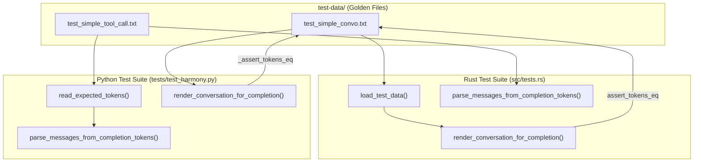
**Sources:** [src/tests.rs:22-32](), [tests/test_harmony.py:61-63](), [tests/test_harmony.py:80-85]()

### Implementation Details

#### Rust Test Utilities
In the Rust crate, tests are primarily defined in `src/tests.rs`. The utility function `load_test_data` is used to resolve paths relative to the `CARGO_MANIFEST_DIR` and normalize line endings to `\n` to ensure cross-platform consistency [src/tests.rs:22-32]().

Key Rust functions involved in fixture testing:
*   `parse_tokens`: Converts a whitespace-separated string of integers from a fixture file into a `Vec<Rank>` (token IDs) [src/tests.rs:15-20]().
*   `assert_tokens_eq`: A helper that compares two token sequences and provides a human-readable diff using `pretty_assertions` if they mismatch [src/tests.rs:12]().

#### Python Test Utilities
The Python suite in `tests/test_harmony.py` is a 1-1 port of the Rust tests [tests/test_harmony.py:1-6](). It uses `pytest` and `pathlib` to locate the same `test-data/` directory.

Key Python entities:
*   `read_expected_tokens`: Reads files containing space-separated token IDs [tests/test_harmony.py:61-63]().
*   `_assert_tokens_eq`: Mimics the Rust assertion logic, providing decoded UTF-8 strings in the error message to help debug tokenization issues [tests/test_harmony.py:46-59]().

### Fixture Formats

The fixtures are stored in two primary formats:

1.  **Plain Text (`.txt`)**: Contains the raw string representation of a Harmony conversation, including special tokens like `<|start|>` and `<|message|>`. These are used to verify that the `render_conversation_for_completion` method produces the correct sequence [test-data/test_simple_convo.txt:1-6]().
2.  **Token Sequences**: Some fixtures (like `test_simple_tool_call.txt`) contain space-separated integer token IDs. These are used to test the `StreamableParser` and `parse_messages_from_completion_tokens` methods without relying on the tokenizer's current state [test-data/test_simple_tool_call.txt:1-5]().

| Fixture Name | Type | Purpose |
| :--- | :--- | :--- |
| `test_simple_convo.txt` | Text | Validates standard system/user message rendering [src/tests.rs:37-61]() |
| `test_simple_convo_low_effort.txt` | Text | Validates rendering of reasoning effort parameters [src/tests.rs:64-70]() |
| `test_simple_reasoning_response.txt` | Tokens | Validates parsing of analysis/final channel splits [src/tests.rs:137-140]() |
| `test_simple_tool_call.txt` | Tokens | Validates parsing of tool calls and recipients [src/tests.rs:162-186]() |
| `test_streamable_parser.txt` | Text | Validates the incremental `StreamableParser` logic [test-data/test_streamable_parser.txt:1-2]() |

### Cross-Language Consistency
The tests ensure that the `HarmonyEncoding` loaded via `load_harmony_encoding` behaves identically in both environments. For example, `test_simple_convo` in Rust [src/tests.rs:37]() and `test_simple_convo` in Python [tests/test_harmony.py:77]() both load the `HarmonyGptOss` encoding and verify against `test_simple_convo.txt`.

**Code Entity Mapping**
```mermaid
classDiagram
    class HarmonyEncoding {
        +render_conversation_for_completion()
        +parse_messages_from_completion_tokens()
    }
    class RustTests {
        +load_test_data()
        +test_simple_convo()
    }
    class PythonTests {
        +read_expected_tokens()
        +test_simple_convo()
    }
    
    RustTests ..> HarmonyEncoding : exercises
    PythonTests ..> HarmonyEncoding : exercises
    RustTests --|> test_data_dir : reads
    PythonTests --|> test_data_dir : reads
```

**Sources:** [src/tests.rs:39-59](), [tests/test_harmony.py:78-102](), [test-data/test_simple_convo.txt:1-6]()

---

# Page: Demo Application

# Demo Application

<details>
<summary>Relevant source files</summary>

The following files were used as context for generating this wiki page:

- [demo/harmony-demo/README.md](demo/harmony-demo/README.md)
- [demo/harmony-demo/components.json](demo/harmony-demo/components.json)
- [demo/harmony-demo/package-lock.json](demo/harmony-demo/package-lock.json)
- [demo/harmony-demo/package.json](demo/harmony-demo/package.json)

</details>


This document provides an overview of the Next.js demo application that showcases the functionality of the `openai-harmony` library. The demo serves as an interactive example of how to integrate and use the harmony response format in web applications.

For detailed technical breakdown of the core demo component, see [Demo Core Component](#3.1). For comprehensive architecture details including WebAssembly integration, see [Demo Application Architecture](#3.2). For information about the harmony response format itself, see [Harmony Response Format](#2).

## Purpose and Scope

The `harmony-demo` application is a Next.js web application located in `demo/harmony-demo/` that demonstrates real-world usage of the `openai-harmony` library. It provides an interactive interface for users to experiment with harmony format parsing, rendering, and message handling capabilities.

The demo application serves multiple purposes:
- Interactive showcase of harmony format capabilities
- Reference implementation for web developers
- Testing environment for WebAssembly bindings
- Documentation of integration patterns

## Application Overview

### Demo Application Structure

```mermaid
graph TB
    subgraph "Next.js Application"
        APP["`app/page.tsx`<br/>Main Application Entry"]
        QUERY["`QueryClientProvider`<br/>React Query Wrapper"]
        DEMO["`HarmonyDemo`<br/>Core Demo Component"]
    end
    
    subgraph "Dependencies"
        HARMONY["`@openai/harmony`<br/>Local Package Dependency"]
        RADIX["`@radix-ui/*`<br/>UI Component Library"]
        TANSTACK["`@tanstack/react-query`<br/>Data Fetching"]
        TAILWIND["`tailwindcss`<br/>Styling Framework"]
    end
    
    subgraph "Build Assets"
        WASM["`*.wasm`<br/>WebAssembly Files"]
        TIKTOKEN["`o200k_base.tiktoken`<br/>Tokenizer Data"]
        PUBLIC["`public/`<br/>Static Assets"]
    end
    
    APP --> QUERY
    QUERY --> DEMO
    
    DEMO --> HARMONY
    DEMO --> RADIX
    QUERY --> TANSTACK
    DEMO --> TAILWIND
    
    HARMONY --> WASM
    HARMONY --> TIKTOKEN
    WASM --> PUBLIC
    TIKTOKEN --> PUBLIC
```

Sources: [demo/harmony-demo/package.json:1-37](), [demo/harmony-demo/package-lock.json:1-40]()

### Package Configuration

The demo application is configured as a standard Next.js project with specific integration requirements for the harmony library:

| Component | Version | Purpose |
|-----------|---------|---------|
| `next` | 15.4.10 | Web application framework [demo/harmony-demo/package.json:23-23]() |
| `react` | 19.1.0 | UI library [demo/harmony-demo/package.json:24-24]() |
| `@openai/harmony` | file:../../javascript | Local harmony library package [demo/harmony-demo/package.json:13-13]() |
| `@radix-ui/*` | ^1.1.11+ | Accessible UI components [demo/harmony-demo/package.json:14-18]() |
| `@tanstack/react-query` | ^5.83.0 | Data fetching and state management [demo/harmony-demo/package.json:19-19]() |

The package includes a critical `postinstall` script that handles WebAssembly file deployment and tokenizer acquisition:

```bash
cp ./node_modules/@openai/harmony/dist/web/*.wasm ./public/ && 
curl -L https://openaipublic.blob.core.windows.net/encodings/o200k_base.tiktoken -o ./public/o200k_base.tiktoken
```

Sources: [demo/harmony-demo/package.json:6-6](), [demo/harmony-demo/package.json:12-26]()

## Integration Architecture

### Library Integration Pattern

```mermaid
graph LR
    subgraph "Harmony Library"
        RUST_CORE["`openai-harmony`<br/>Rust Core"]
        WASM_BINDING["`wasm-bindgen`<br/>WebAssembly Interface"]
        JS_PACKAGE["`@openai/harmony`<br/>JavaScript Package"]
    end
    
    subgraph "Demo Application"
        NEXTJS["`Next.js App`<br/>Client-side Framework"]
        DEMO_COMPONENT["`HarmonyDemo`<br/>Main Demo Component"]
        UI_COMPONENTS["`Radix UI`<br/>Component Library"]
    end
    
    subgraph "Runtime Assets"
        WASM_FILES["`*.wasm`<br/>Compiled WebAssembly"]
        TIKTOKEN_DATA["`o200k_base.tiktoken`<br/>Tokenizer Database"]
    end
    
    RUST_CORE --> WASM_BINDING
    WASM_BINDING --> JS_PACKAGE
    JS_PACKAGE --> NEXTJS
    NEXTJS --> DEMO_COMPONENT
    DEMO_COMPONENT --> UI_COMPONENTS
    
    JS_PACKAGE -.-> WASM_FILES
    JS_PACKAGE -.-> TIKTOKEN_DATA
```

Sources: [demo/harmony-demo/package.json:6-6](), [demo/harmony-demo/package.json:13-13]()

## Application Entry Point

The main application entry point is implemented as a client-side React component that establishes the foundational application structure.

### Main Application Component

The demo uses a standard React Query pattern where a `QueryClientProvider` wraps the core logic. This ensures that the WebAssembly-backed harmony library can be initialized and managed effectively within the React lifecycle.

Key architectural decisions:
- **Client-side rendering**: Uses interactive functionality for real-time parsing.
- **State management**: Implements React Query (via `@tanstack/react-query`) for managing the library's asynchronous state [demo/harmony-demo/package.json:19-19]().
- **Component isolation**: Delegates core functionality to the `HarmonyDemo` component.

### Component Hierarchy

```mermaid
graph TD
    HOME["`Home`<br/>App Entry Point"]
    PROVIDER["`QueryClientProvider`<br/>React Query Context"]
    HARMONY_DEMO["`HarmonyDemo`<br/>Core Demo Logic"]
    
    QUERY_CLIENT["`queryClient`<br/>Query Client Instance"]
    
    HOME --> PROVIDER
    PROVIDER --> HARMONY_DEMO
    QUERY_CLIENT -.-> PROVIDER
    
    subgraph "External Dependencies"
        TANSTACK["`@tanstack/react-query`"]
        RADIX["`@radix-ui/react-*`"]
    end
    
    PROVIDER --> TANSTACK
    HARMONY_DEMO --> RADIX
```

Sources: [demo/harmony-demo/package.json:14-19](), [demo/harmony-demo/components.json:13-19]()

## Build Process and Asset Management

The demo application requires specific build-time configuration to properly integrate WebAssembly assets and tokenizer data. The `postinstall` script in [demo/harmony-demo/package.json:6-6]() ensures that essential runtime files are available in the `public/` directory:

1. **WebAssembly files**: Copied from the `@openai/harmony` package distribution (`dist/web/*.wasm`).
2. **Tokenizer data**: Downloaded from OpenAI's public blob storage (`o200k_base.tiktoken`).
3. **Static serving**: Assets are made available through Next.js static file serving so the WASM module can fetch them at runtime.

This build process enables the demo to function with the harmony library's WebAssembly bindings while maintaining Next.js deployment compatibility.

Sources: [demo/harmony-demo/package.json:6-6](), [demo/harmony-demo/package.json:13-13]()

---

# Page: Demo Core Component

# Demo Core Component

<details>
<summary>Relevant source files</summary>

The following files were used as context for generating this wiki page:

- [demo/harmony-demo/src/app/layout.tsx](demo/harmony-demo/src/app/layout.tsx)
- [demo/harmony-demo/src/app/page.tsx](demo/harmony-demo/src/app/page.tsx)
- [demo/harmony-demo/src/components/HarmonyDemo.tsx](demo/harmony-demo/src/components/HarmonyDemo.tsx)

</details>


This document covers the `HarmonyDemo` React component, which serves as the primary demonstration interface for the openai-harmony library's WebAssembly integration. The component provides an interactive playground for exploring harmony response format tokenization, message parsing, and visualization.

For information about the broader demo application architecture, see [Demo Application Architecture](#3.2). For details on the UI component system used throughout the demo, see [UI Component System](#3.3).

## Purpose and Scope

The `HarmonyDemo` component demonstrates the core functionality of the openai-harmony library in a web browser environment. It showcases WebAssembly integration, real-time tokenization, message parsing, and interactive token visualization. The component serves as both a functional demo and a reference implementation for integrating the harmony library into web applications.

## Component Architecture

The demo is built using a modular React architecture with specialized hooks for harmony library integration and custom components for token visualization.

```mermaid
graph TB
    subgraph "HarmonyDemo Component Structure"
        HarmonyDemo["HarmonyDemo<br/>(dynamic import)"]
        App["App<br/>(main component)"]
        
        subgraph "Custom Hooks"
            useHarmony["useHarmony<br/>(WASM integration)"]
            useTokens["useTokens<br/>(tokenization logic)"]
        end
        
        subgraph "Display Components"
            HighlightedTokens["HighlightedTokens<br/>(token visualization)"]
            MessageItem["MessageItem<br/>(message display)"]
            WrappedSpecialToken["WrappedSpecialToken<br/>(tooltip wrapper)"]
        end
        
        subgraph "UI Components"
            Button["Button"]
            Collapsible["Collapsible"]
            Tooltip["Tooltip"]
            Switch["Switch"]
        end
    end
    
    HarmonyDemo --> App
    App --> useHarmony
    App --> useTokens
    App --> HighlightedTokens
    App --> MessageItem
    
    HighlightedTokens --> WrappedSpecialToken
    MessageItem --> Collapsible
    WrappedSpecialToken --> Tooltip
    
    useTokens --> useHarmony
```

Sources: [demo/harmony-demo/src/components/HarmonyDemo.tsx:1-487]()

## WebAssembly Integration Pattern

The component implements a comprehensive WebAssembly loading and initialization pattern for the harmony library.

```mermaid
graph LR
    subgraph "WASM Loading Flow"
        fetch["fetch('/openai_harmony_bg.wasm')"]
        arrayBuffer["response.arrayBuffer()"]
        initSync["initHarmony({ module: wasm })"]
        load_harmony_encoding["load_harmony_encoding('HarmonyGptOss', baseUrl)"]
        setHarmony["setHarmony(encoding)"]
    end
    
    subgraph "Hook State"
        useState_harmony["useState<JsHarmonyEncoding | null>"]
        useEffect_init["useEffect initialization"]
    end
    
    subgraph "Library Imports"
        openai_harmony["@openai/harmony"]
        JsHarmonyEncoding["JsHarmonyEncoding"]
        initSync_import["initSync"]
        JsStreamableParser["JsStreamableParser"]
    end
    
    useEffect_init --> fetch
    fetch --> arrayBuffer
    arrayBuffer --> initSync
    initSync --> load_harmony_encoding
    load_harmony_encoding --> setHarmony
    setHarmony --> useState_harmony
    
    openai_harmony --> JsHarmonyEncoding
    openai_harmony --> initSync_import
    openai_harmony --> JsStreamableParser
```

The `useHarmony` hook manages WebAssembly module loading and harmony encoding initialization. It fetches the WASM binary from the public directory, initializes the module using `initSync`, and creates a `HarmonyGptOss` encoding instance.

Sources: [demo/harmony-demo/src/components/HarmonyDemo.tsx:293-312](), [demo/harmony-demo/src/components/HarmonyDemo.tsx:17-22]()

## Token Processing and State Management

The `useTokens` hook orchestrates the core harmony library operations, converting text input into tokens, token texts, and parsed messages.

```mermaid
graph TB
    subgraph "useTokens Hook Data Flow"
        text_input["text: string"]
        encoding_instance["encoding: JsHarmonyEncoding"]
        
        subgraph "Token Processing"
            encode_call["encoding.encode(text, encoding.specialTokens())"]
            decode_call["encoding.decodeUtf8([token])"]
            tokens_array["tokens: number[]"]
            tokenTexts_array["tokenTexts: string[]"]
        end
        
        subgraph "Message Parsing"
            JsStreamableParser_instance["new JsStreamableParser(encoding, 'user')"]
            process_tokens["parser.process(token) for each token"]
            parser_messages["JSON.parse(parser.messages)"]
            messages_formatted["messages: Message[]"]
        end
        
        subgraph "State Management"
            setTokenData["setTokenData({ tokens, tokenTexts, messages })"]
            highlightedIndex["highlightedIndex state"]
            setHighlightedIndex["setHighlightedIndex function"]
        end
    end
    
    text_input --> encode_call
    encoding_instance --> encode_call
    encode_call --> tokens_array
    tokens_array --> decode_call
    decode_call --> tokenTexts_array
    
    encoding_instance --> JsStreamableParser_instance
    tokens_array --> process_tokens
    JsStreamableParser_instance --> process_tokens
    process_tokens --> parser_messages
    parser_messages --> messages_formatted
    
    tokens_array --> setTokenData
    tokenTexts_array --> setTokenData
    messages_formatted --> setTokenData
```

Sources: [demo/harmony-demo/src/components/HarmonyDemo.tsx:314-356](), [demo/harmony-demo/src/components/HarmonyDemo.tsx:326-349]()

## Special Token System

The component implements a comprehensive special token recognition and documentation system using predefined token mappings.

| Token | ID | Description |
|-------|----|----|
| `<|start|>` | 200006 | Indicates the start of a new message |
| `<|end|>` | 200007 | Indicates the end of a message |
| `<|message|>` | 200008 | Completes the message header |
| `<|channel|>` | 200005 | Part of message header to indicate channel |
| `<|constrain|>` | 200003 | Indicates content type constraint |
| `<|call|>` | 200012 | Stop token for function call completion |
| `<|return|>` | 200002 | Stop token indicating response completion |

The `isSpecialToken` function checks both string and numeric representations, while `getSpecialTokenDescription` provides contextual documentation for each token type in tooltip displays.

Sources: [demo/harmony-demo/src/components/HarmonyDemo.tsx:32-101]()

## Token Visualization Components

The `HighlightedTokens` component provides sophisticated token display with interactive highlighting, editing capabilities, and special token recognition.

```mermaid
graph TB
    subgraph "HighlightedTokens Component Features"
        props_input["Props: tokens, highlightedIndex, onHover, etc."]
        
        subgraph "Display Modes"
            token_ids["Token IDs (number[])<br/>JSON.stringify format"]
            token_texts["Token Texts (string[])<br/>concatenated display"]
        end
        
        subgraph "Interactive Features"
            hover_highlighting["onMouseEnter/onMouseLeave<br/>setHighlightedIndex"]
            edit_mode["onClick editing<br/>textarea overlay"]
            color_coding["TOKEN_COLORS array<br/>17 distinct colors"]
        end
        
        subgraph "Special Token Enhancement"
            WrappedSpecialToken_component["WrappedSpecialToken wrapper"]
            Tooltip_display["Tooltip with getSpecialTokenDescription"]
            font_styling["font-semibold and underline styling"]
        end
    end
    
    props_input --> token_ids
    props_input --> token_texts
    
    hover_highlighting --> color_coding
    edit_mode --> hover_highlighting
    
    token_ids --> WrappedSpecialToken_component
    token_texts --> WrappedSpecialToken_component
    WrappedSpecialToken_component --> Tooltip_display
    WrappedSpecialToken_component --> font_styling
```

The component supports both read-only and editable modes, with a `textarea` overlay for text editing. Token highlighting uses a 17-color rotation system defined in the `TOKEN_COLORS` array, enabling visual distinction between adjacent tokens.

Sources: [demo/harmony-demo/src/components/HarmonyDemo.tsx:121-214](), [demo/harmony-demo/src/components/HarmonyDemo.tsx:52-70]()

## Message Structure Display

The `MessageItem` component renders parsed harmony messages with collapsible headers and structured content display.

```mermaid
graph TB
    subgraph "MessageItem Component Structure"
        Message_type["Message type definition<br/>role, channel, recipient, content_type, content"]
        
        subgraph "Header Section"
            Collapsible_wrapper["Collapsible (defaultOpen)"]
            header_label["'header' label"]
            CollapsibleTrigger_button["CollapsibleTrigger button<br/>ChevronsUpDown icon"]
        end
        
        subgraph "Header Fields Display"
            role_field["role: blue highlighted"]
            channel_field["channel: conditional display"]
            recipient_field["recipient: conditional display"]
            content_type_field["content_type: conditional display"]
        end
        
        subgraph "Content Section"
            content_array["content array iteration"]
            pre_formatted["pre element<br/>bg-gray-100/50 styling"]
            text_content["content.text display"]
        end
    end
    
    Message_type --> Collapsible_wrapper
    Collapsible_wrapper --> header_label
    Collapsible_wrapper --> CollapsibleTrigger_button
    
    Collapsible_wrapper --> role_field
    Collapsible_wrapper --> channel_field
    Collapsible_wrapper --> recipient_field
    Collapsible_wrapper --> content_type_field
    
    Message_type --> content_array
    content_array --> pre_formatted
    pre_formatted --> text_content
```

Each message field uses conditional rendering and consistent styling with `bg-blue-300/50` highlighting for field values. The content section handles both string and structured content formats through type transformation.

Sources: [demo/harmony-demo/src/components/HarmonyDemo.tsx:227-291](), [demo/harmony-demo/src/components/HarmonyDemo.tsx:216-225]()

## Application State and Integration

The main `App` component coordinates all subsystems and maintains the primary application state for text input, token processing, and display configuration.

```mermaid
graph LR
    subgraph "App Component State Flow"
        default_text["Default text state<br/>harmony format example"]
        setText["setText function"]
        
        subgraph "Token Processing Chain"
            useTokens_hook["useTokens(text)"]
            tokens_output["tokens, tokenTexts, messages"]
            highlight_state["highlightedIndex, setHighlightedIndex"]
        end
        
        subgraph "Display Configuration"
            wrapWhitespace["wrapWhitespace: boolean"]
            highlightTokens["highlightTokens: boolean"]
            setWrapWhitespace["setWrapWhitespace"]
            setHighlightTokens["setHighlightTokens"]
        end
        
        subgraph "UI Layout"
            messages_column["Messages column<br/>MessageItem components"]
            tokens_column["Tokens column<br/>HighlightedTokens components"]
            controls_section["Controls section<br/>Switch components"]
        end
    end
    
    default_text --> useTokens_hook
    setText --> useTokens_hook
    useTokens_hook --> tokens_output
    useTokens_hook --> highlight_state
    
    wrapWhitespace --> controls_section
    highlightTokens --> controls_section
    
    tokens_output --> messages_column
    tokens_output --> tokens_column
    highlight_state --> tokens_column
```

The component uses a two-column grid layout with responsive design, displaying parsed messages on the left and token visualizations on the right. Interactive features include hover highlighting coordination between token displays and editable token text input.

Sources: [demo/harmony-demo/src/components/HarmonyDemo.tsx:358-481](), [demo/harmony-demo/src/components/HarmonyDemo.tsx:483-487]()

---

# Page: Demo Application Architecture

# Demo Application Architecture

<details>
<summary>Relevant source files</summary>

The following files were used as context for generating this wiki page:

- [demo/harmony-demo/next.config.ts](demo/harmony-demo/next.config.ts)
- [demo/harmony-demo/package-lock.json](demo/harmony-demo/package-lock.json)
- [demo/harmony-demo/package.json](demo/harmony-demo/package.json)
- [demo/harmony-demo/tsconfig.json](demo/harmony-demo/tsconfig.json)
- [src/wasm_module.rs](src/wasm_module.rs)

</details>


This document covers the technical architecture of the Next.js demonstration application located in `demo/harmony-demo/`. It details the application structure, WebAssembly integration configuration, and build system setup that enables the harmony library to run in a web browser environment.

## Next.js Application Structure

The demo application follows Next.js 15 App Router conventions, utilizing React 19 and a specialized post-install build step to bridge the Rust-based harmony library with the web frontend.

### Dependency and Asset Orchestration

The application architecture relies on a critical `postinstall` script to stage binary assets and model data required for the harmony environment.

| Asset | Source | Destination | Purpose |
|-------|--------|-------------|---------|
| `*.wasm` | `@openai/harmony/dist/web/` | `public/` | WebAssembly binary containing the compiled Rust core. |
| `o200k_base.tiktoken` | OpenAI Public Blob | `public/` | Tokenizer vocabulary for the `o200k_base` encoding. |

**Sources:** [demo/harmony-demo/package.json:6-6](), [demo/harmony-demo/package.json:12-26]()

### Component Path Resolution

The application uses a comprehensive alias system defined in `tsconfig.json` for clean import statements and maintainable code organization:

| Alias | Target Path | Purpose |
|-------|-------------|---------|
| `@/*` | `./src/*` | Main source directory access |

**Sources:** [demo/harmony-demo/tsconfig.json:21-23]()

## WebAssembly Integration Configuration

The demo application requires specialized Next.js configuration to support WebAssembly modules exported by the harmony library.

### Webpack Configuration Architecture

```mermaid
graph LR
    subgraph "webpack_Function [next.config.ts]"
        CONFIG["config"]
        ISSERVER["isServer"]
        DEV["dev"]
    end
    
    subgraph "WebAssembly_Output"
        FILENAME["webassemblyModuleFilename"]
        SERVER_PATH["../static/[modulehash].wasm"]
        CLIENT_PATH["static/[modulehash].wasm"]
    end
    
    subgraph "Experiments_Configuration"
        ASYNC_WASM["asyncWebAssembly: true"]
        EXPERIMENTS["config.experiments"]
    end
    
    subgraph "Infrastructure_Logging"
        LOGGING["infrastructureLogging"]
        DEBUG_FILTER["debug: /PackFileCache/"]
    end
    
    CONFIG --> FILENAME
    ISSERVER --> SERVER_PATH
    DEV --> CLIENT_PATH
    
    CONFIG --> EXPERIMENTS
    EXPERIMENTS --> ASYNC_WASM
    
    CONFIG --> LOGGING
    LOGGING --> DEBUG_FILTER
```

The `webpack` function in `next.config.ts` handles critical WebAssembly integration concerns:

1.  **Module Path Resolution**: Configures different WASM file paths for server-side rendering versus client-side execution to prevent prerendering failures. [demo/harmony-demo/next.config.ts:7-10]()
2.  **Async WebAssembly Support**: Manually enables `asyncWebAssembly` in `config.experiments`, as Webpack 5 does not enable it by default. [demo/harmony-demo/next.config.ts:13-13]()
3.  **Build Debugging**: Configures `infrastructureLogging` to monitor `PackFileCache`, addressing potential issues with Next.js persistent caching and WASM modules. [demo/harmony-demo/next.config.ts:24-24]()

**Sources:** [demo/harmony-demo/next.config.ts:3-28]()

## Wasm Module Bridge

The harmony library is exposed to the Next.js application via `wasm-bindgen` bindings. This bridge translates TypeScript interfaces to Rust data structures.

### Data Flow: TS to Rust

```mermaid
graph TD
    subgraph "TypeScript_Space [wasm_module.rs]"
        JS_CONV["JsConversation"]
        JS_MSG["JsMessage"]
        JS_CONFIG["JsRenderConversationConfig"]
    end

    subgraph "Binding_Layer [wasm_module.rs]"
        SERDE_WB["serde_wasm_bindgen::from_value"]
        JS_HARMONY["JsHarmonyEncoding"]
    end

    subgraph "Rust_Core_Entity_Space [src/chat.rs]"
        RUST_CONV["Conversation"]
        RUST_MSG["Message"]
        RUST_ROLE["Role"]
    end

    JS_CONV -- "serde_wasm_bindgen" --> RUST_CONV
    JS_MSG -- "serde_wasm_bindgen" --> RUST_MSG
    JS_CONFIG -- "serde_wasm_bindgen" --> RUST_CONV
    
    JS_HARMONY -- "render_conversation" --> RUST_CONV
```

The `JsHarmonyEncoding` struct acts as the primary interface for the frontend. Key methods include:
*   `render_conversation`: Converts a `JsConversation` into a token sequence (`Vec<u32>`). [src/wasm_module.rs:105-130]()
*   `parse_messages_from_completion_tokens`: Deserializes raw tokens back into JSON-compatible message strings. [src/wasm_module.rs:164-188]()
*   `decode_utf8`: Decodes token IDs back into human-readable text. [src/wasm_module.rs:190-196]()

**Sources:** [src/wasm_module.rs:61-130](), [src/wasm_module.rs:164-196]()

## UI and Styling Integration

The application utilizes a modern frontend stack to provide a responsive interface for exploring the harmony format.

### Tech Stack

*   **Next.js 15.4.10**: React framework with App Router. [demo/harmony-demo/package.json:23-23]()
*   **React 19.1.0**: UI library. [demo/harmony-demo/package.json:24-24]()
*   **Tailwind CSS 4**: Utility-first styling with `@tailwindcss/postcss`. [demo/harmony-demo/package.json:29-33]()
*   **Radix UI**: Primitive components for accessibility (Collapsible, Switch, Tooltip, etc.). [demo/harmony-demo/package.json:14-18]()
*   **TanStack Query**: State management for asynchronous data fetching and WASM module loading. [demo/harmony-demo/package.json:19-19]()

### Development and Build Pipeline

The application supports standard Next.js scripts:
*   `npm run dev`: Starts the development server.
*   `npm run build`: Generates the production build, triggering the WASM-aware Webpack configuration.
*   `npm run postinstall`: Essential for local development as it links the local library via `file:../../javascript`.

**Sources:** [demo/harmony-demo/package.json:5-13]()

---

# Page: UI Component System

# UI Component System

<details>
<summary>Relevant source files</summary>

The following files were used as context for generating this wiki page:

- [.gitignore](.gitignore)
- [demo/harmony-demo/src/components/ui/button.tsx](demo/harmony-demo/src/components/ui/button.tsx)
- [demo/harmony-demo/src/components/ui/collapsible.tsx](demo/harmony-demo/src/components/ui/collapsible.tsx)
- [demo/harmony-demo/src/components/ui/label.tsx](demo/harmony-demo/src/components/ui/label.tsx)
- [demo/harmony-demo/src/components/ui/switch.tsx](demo/harmony-demo/src/components/ui/switch.tsx)
- [demo/harmony-demo/src/components/ui/tooltip.tsx](demo/harmony-demo/src/components/ui/tooltip.tsx)
- [demo/harmony-demo/src/lib/utils.ts](demo/harmony-demo/src/lib/utils.ts)

</details>


This document covers the UI component library used in the `harmony-demo` Next.js application. The component system provides a set of reusable React components built on top of Radix UI primitives with consistent styling and behavior patterns.

For information about the overall demo application architecture, see [Demo Application Architecture](#3.2). For details about the core demo functionality, see [Demo Core Component](#3.1).

## Architecture Overview

The UI component system is implemented as a collection of React components located in [demo/harmony-demo/src/components/ui/](), following a standardized architecture pattern built on Radix UI primitives.

### Component Foundation Architecture

```mermaid
graph TB
    subgraph "External Dependencies"
        RadixUI["@radix-ui/*"]
        CVA["class-variance-authority"]
        React["react"]
    end
    
    subgraph "Utility Layer"
        Utils["@/lib/utils.ts"]
        CN["cn() function"]
    end
    
    subgraph "UI Components"
        Button["Button"]
        Collapsible["Collapsible"]
        Label["Label"] 
        Switch["Switch"]
        Tooltip["Tooltip"]
    end
    
    subgraph "Component Features"
        Variants["Variant System"]
        DataSlots["data-slot attributes"]
        TypeSafety["TypeScript Props"]
        Styling["Tailwind Classes"]
    end
    
    RadixUI --> Button
    RadixUI --> Collapsible
    RadixUI --> Label
    RadixUI --> Switch
    RadixUI --> Tooltip
    
    CVA --> Variants
    React --> Button
    React --> Collapsible
    React --> Label
    React --> Switch
    React --> Tooltip
    
    Utils --> CN
    CN --> Button
    CN --> Collapsible
    CN --> Label
    CN --> Switch
    CN --> Tooltip
    
    Button --> DataSlots
    Button --> Variants
    Button --> TypeSafety
    Button --> Styling
    
    Collapsible --> DataSlots
    Collapsible --> TypeSafety
    Collapsible --> Styling
    
    Label --> DataSlots
    Label --> TypeSafety
    Label --> Styling
    
    Switch --> DataSlots
    Switch --> TypeSafety
    Switch --> Styling
    
    Tooltip --> DataSlots
    Tooltip --> TypeSafety
    Tooltip --> Styling
```

**Sources:** [demo/harmony-demo/src/components/ui/button.tsx:1-59](), [demo/harmony-demo/src/components/ui/collapsible.tsx:1-34](), [demo/harmony-demo/src/components/ui/label.tsx:1-24](), [demo/harmony-demo/src/components/ui/switch.tsx:1-31](), [demo/harmony-demo/src/components/ui/tooltip.tsx:1-61](), [demo/harmony-demo/src/lib/utils.ts:1-7]()

## Component Patterns

### Common Implementation Pattern

All UI components follow a consistent implementation pattern with the following characteristics:

| Pattern Element | Implementation | Purpose |
|----------------|---------------|---------|
| **Radix Primitive** | Import from `@radix-ui/react-*` | Provides accessible, unstyled component logic |
| **TypeScript Props** | `React.ComponentProps<typeof Primitive>` | Ensures type safety and prop forwarding |
| **Data Slots** | `data-slot="component-name"` | Enables component identification for testing/styling |
| **Class Merging** | `cn()` utility function | Combines default and custom classes safely using `clsx` and `tailwind-merge` |
| **Prop Spreading** | `{...props}` pattern | Forwards all additional props to underlying element |

**Sources:** [demo/harmony-demo/src/lib/utils.ts:4-6](), [demo/harmony-demo/src/components/ui/button.tsx:51-56](), [demo/harmony-demo/src/components/ui/label.tsx:13-21]()

### Variant System Architecture

The system uses `class-variance-authority` (CVA) to manage complex component states, particularly for the `Button` component.

```mermaid
graph LR
    subgraph "Button Variant System"
        CVA["cva() in button.tsx"]
        ButtonVariants["buttonVariants constant"]
        VariantProps["VariantProps type"]
    end
    
    subgraph "Variant Options"
        VariantType["variant: default | destructive | outline | secondary | ghost | link"]
        SizeType["size: default | sm | lg | icon"]
    end
    
    subgraph "Runtime Usage"
        ButtonComponent["Button function component"]
        CN["cn() utility"]
        ClassNames["Generated classNames"]
    end
    
    CVA --> ButtonVariants
    ButtonVariants --> VariantProps
    VariantProps --> ButtonComponent
    
    VariantType --> ButtonVariants
    SizeType --> ButtonVariants
    
    ButtonComponent --> CN
    CN --> ClassNames
```

**Sources:** [demo/harmony-demo/src/components/ui/button.tsx:7-36](), [demo/harmony-demo/src/lib/utils.ts:4-6]()

## Component Implementations

### Button Component

The `Button` component implements a comprehensive variant system and supports the `asChild` pattern via `@radix-ui/react-slot` to allow for polymorphic rendering (e.g., rendering a button as a link).

```typescript
// Key implementation details from button.tsx
const buttonVariants = cva(
  "inline-flex items-center justify-center gap-2 ...",
  {
    variants: {
      variant: {
        default: "bg-primary text-primary-foreground shadow-xs hover:bg-primary/90",
        destructive: "bg-destructive text-white shadow-xs hover:bg-destructive/90 ...",
        outline: "border bg-background shadow-xs hover:bg-accent ...",
        secondary: "bg-secondary text-secondary-foreground shadow-xs hover:bg-secondary/80",
        ghost: "hover:bg-accent hover:text-accent-foreground dark:hover:bg-accent/50",
        link: "text-primary underline-offset-4 hover:underline",
      },
      size: {
        default: "h-9 px-4 py-2 has-[>svg]:px-3",
        sm: "h-8 rounded-md gap-1.5 px-3 has-[>svg]:px-2.5",
        lg: "h-10 rounded-md px-6 has-[>svg]:px-4",
        icon: "size-9",
      },
    },
    defaultVariants: {
      variant: "default",
      size: "default",
    },
  }
)
```

**Sources:** [demo/harmony-demo/src/components/ui/button.tsx:7-36](), [demo/harmony-demo/src/components/ui/button.tsx:38-57]()

### Primitive-Based Components

These components wrap Radix UI primitives to apply consistent Tailwind CSS styling and accessibility behaviors.

| Component | Radix Primitive | Key Features |
|-----------|----------------|--------------|
| **Collapsible** | `@radix-ui/react-collapsible` | Exports `Collapsible`, `CollapsibleTrigger`, and `CollapsibleContent`. [demo/harmony-demo/src/components/ui/collapsible.tsx:5-33]() |
| **Label** | `@radix-ui/react-label` | Handles peer-disabled states and medium font weights. [demo/harmony-demo/src/components/ui/label.tsx:8-22]() |
| **Switch** | `@radix-ui/react-switch` | Custom thumb translation using `data-[state=checked]:translate-x-[calc(100%-2px)]`. [demo/harmony-demo/src/components/ui/switch.tsx:8-29]() |
| **Tooltip** | `@radix-ui/react-tooltip` | Includes `TooltipProvider`, `TooltipTrigger`, and `TooltipContent` with portal and arrow. [demo/harmony-demo/src/components/ui/tooltip.tsx:8-61]() |

### Component Interface Pattern

```mermaid
graph TB
    subgraph "Component Interface Layer"
        ComponentProps["React.ComponentProps<typeof RadixPrimitive>"]
        AdditionalProps["asChild | variant | size"]
        ForwardedProps["{...props}"]
    end
    
    subgraph "Processing Layer"
        CNFunction["cn() in utils.ts"]
        DataSlot["data-slot attribute"]
        ClassNameMerging["twMerge(clsx(inputs))"]
    end
    
    subgraph "Radix Layer"
        RadixPrimitive["Radix UI Primitive (e.g. SwitchPrimitive.Root)"]
        AccessibilityFeatures["ARIA attributes"]
        UnstyledBehavior["State management (e.g. checked/unchecked)"]
    end
    
    ComponentProps --> CNFunction
    AdditionalProps --> CNFunction
    CNFunction --> ClassNameMerging
    ClassNameMerging --> DataSlot
    
    DataSlot --> RadixPrimitive
    ForwardedProps --> RadixPrimitive
    
    RadixPrimitive --> AccessibilityFeatures
    RadixPrimitive --> UnstyledBehavior
```

**Sources:** [demo/harmony-demo/src/lib/utils.ts:4-6](), [demo/harmony-demo/src/components/ui/switch.tsx:11-28](), [demo/harmony-demo/src/components/ui/tooltip.tsx:43-58]()

## Component Integration

### Data Slot System

All components implement a `data-slot` attribute system for consistent component identification in the DOM:

- `data-slot="button"`: [demo/harmony-demo/src/components/ui/button.tsx:52-52]()
- `data-slot="collapsible"`: [demo/harmony-demo/src/components/ui/collapsible.tsx:8-8]()
- `data-slot="label"`: [demo/harmony-demo/src/components/ui/label.tsx:14-14]()
- `data-slot="switch"`: [demo/harmony-demo/src/components/ui/switch.tsx:14-14]()
- `data-slot="tooltip-content"`: [demo/harmony-demo/src/components/ui/tooltip.tsx:47-47]()

### Styling Integration

The components integrate with the demo's Tailwind CSS configuration through:

- **Theme tokens**: Uses variables like `bg-primary`, `text-primary-foreground`, and `focus-visible:ring-ring/50`. [demo/harmony-demo/src/components/ui/button.tsx:13-15]()
- **Transitions**: Components utilize `transition-all` and `transition-transform` for smooth UI interactions. [demo/harmony-demo/src/components/ui/switch.tsx:16-24]()
- **Animations**: Tooltips use `animate-in`, `fade-in-0`, and `zoom-in-95` classes for entrance/exit effects. [demo/harmony-demo/src/components/ui/tooltip.tsx:49-49]()
- **Dark Mode**: Explicit support via `dark:` prefixes (e.g., `dark:bg-input/30`). [demo/harmony-demo/src/components/ui/button.tsx:17-17]()

**Sources:** [demo/harmony-demo/src/components/ui/button.tsx:7-35](), [demo/harmony-demo/src/components/ui/switch.tsx:15-26](), [demo/harmony-demo/src/components/ui/tooltip.tsx:48-55]()

---

# Page: Demo Styling and Configuration

# Demo Styling and Configuration

<details>
<summary>Relevant source files</summary>

The following files were used as context for generating this wiki page:

- [demo/harmony-demo/postcss.config.mjs](demo/harmony-demo/postcss.config.mjs)
- [demo/harmony-demo/public/openai_logo.svg](demo/harmony-demo/public/openai_logo.svg)
- [demo/harmony-demo/src/app/globals.css](demo/harmony-demo/src/app/globals.css)
- [demo/harmony-demo/tsconfig.json](demo/harmony-demo/tsconfig.json)

</details>


This document covers the styling system and configuration setup for the `harmony-demo` Next.js application, including PostCSS integration, Tailwind CSS configuration, typography system, theme management, and TypeScript compiler settings. For information about the UI component library used in the demo, see [UI Component System](3.3). For details about the overall demo architecture, see [Demo Application Architecture](3.2).

## Styling System Architecture

The demo application uses a modern CSS-in-JS approach built on Tailwind CSS with PostCSS processing, custom font loading, and a comprehensive design token system.

```mermaid
graph TB
    subgraph "Build Pipeline"
        PostCSS["postcss.config.mjs<br/>PostCSS Configuration"]
        TailwindPlugin["@tailwindcss/postcss<br/>Tailwind Plugin"]
    end
    
    subgraph "CSS Processing"
        GlobalCSS["globals.css<br/>Global Styles"]
        TailwindImports["@import tailwindcss<br/>@import tw-animate-css"]
        FontFaces["@font-face definitions<br/>OpenAI Sans variants"]
        ThemeVars["CSS Custom Properties<br/>Design tokens"]
    end
    
    subgraph "Theme System"
        RootVars[":root<br/>Light theme variables"]
        DarkVars[".dark<br/>Dark theme variables"]
        BaseLayer["@layer base<br/>Global resets"]
    end
    
    subgraph "Runtime"
        NextApp["Next.js Application"]
        Components["React Components"]
        TailwindClasses["Tailwind Utility Classes"]
    end
    
    PostCSS --> TailwindPlugin
    TailwindPlugin --> GlobalCSS
    GlobalCSS --> TailwindImports
    GlobalCSS --> FontFaces
    GlobalCSS --> ThemeVars
    
    ThemeVars --> RootVars
    ThemeVars --> DarkVars
    ThemeVars --> BaseLayer
    
    GlobalCSS --> NextApp
    NextApp --> Components
    Components --> TailwindClasses
```

Sources: [demo/harmony-demo/postcss.config.mjs:1-5](), [demo/harmony-demo/src/app/globals.css:1-197]()

## PostCSS and Tailwind Integration

The build system uses PostCSS with the Tailwind CSS plugin for processing styles. The configuration is minimal and leverages Tailwind's built-in PostCSS integration.

### PostCSS Configuration

| Configuration Key | Value | Purpose |
|-------------------|-------|---------|
| `plugins` | `["@tailwindcss/postcss"]` | Enables Tailwind CSS processing |

The `postcss.config.mjs` file exports a simple configuration that delegates style processing to Tailwind's PostCSS plugin, which handles CSS generation, purging, and optimization automatically [demo/harmony-demo/postcss.config.mjs:1-5]().

Sources: [demo/harmony-demo/postcss.config.mjs:1-5]()

## Typography System

The demo application implements a comprehensive typography system using OpenAI's custom font family with multiple weights and styles loaded from the OpenAI CDN [demo/harmony-demo/src/app/globals.css:4-74]().

```mermaid
graph TB
    subgraph "Font Loading Strategy"
        CDN["OpenAI CDN<br/>cdn.openai.com/common/fonts"]
        FontDisplay["font-display: swap<br/>Performance optimization"]
        WOFF2["WOFF2 Format<br/>Modern compression"]
    end
    
    subgraph "Font Variants"
        Regular["OpenAISans-Regular<br/>font-weight: 400"]
        RegularItalic["OpenAISans-RegularItalic<br/>font-weight: 400, italic"]
        Medium["OpenAISans-Medium<br/>font-weight: 500"]
        MediumItalic["OpenAISans-MediumItalic<br/>font-weight: 500, italic"]
        Semibold["OpenAISans-Semibold<br/>font-weight: 600"]
        SemiboldItalic["OpenAISans-SemiboldItalic<br/>font-weight: 600, italic"]
        Bold["OpenAISans-Bold<br/>font-weight: 700"]
        BoldItalic["OpenAISans-BoldItalic<br/>font-weight: 700, italic"]
    end
    
    subgraph "CSS Integration"
        FontFamily["font-family: 'OpenAI Sans'"]
        DefaultFont["--default-font-family: 'OpenAI Sans'"]
        TailwindFont["--font-sans: var(--font-geist-sans)"]
    end
    
    CDN --> Regular
    CDN --> RegularItalic
    CDN --> Medium
    CDN --> MediumItalic
    CDN --> Semibold
    CDN --> SemiboldItalic
    CDN --> Bold
    CDN --> BoldItalic
    
    Regular --> FontFamily
    FontFamily --> DefaultFont
    DefaultFont --> TailwindFont
    
    FontDisplay --> Regular
    WOFF2 --> Regular
```

### Font Face Definitions

The typography system defines eight font variants with optimized loading:

| Weight | Style | File | CSS Declaration |
|--------|-------|------|----------------|
| 400 | Normal | `OpenAISans-Regular.woff2` | [demo/harmony-demo/src/app/globals.css:4-11]() |
| 400 | Italic | `OpenAISans-RegularItalic.woff2` | [demo/harmony-demo/src/app/globals.css:13-20]() |
| 500 | Normal | `OpenAISans-Medium.woff2` | [demo/harmony-demo/src/app/globals.css:22-29]() |
| 500 | Italic | `OpenAISans-MediumItalic.woff2` | [demo/harmony-demo/src/app/globals.css:31-38]() |
| 600 | Normal | `OpenAISans-Semibold.woff2` | [demo/harmony-demo/src/app/globals.css:40-47]() |
| 600 | Italic | `OpenAISans-SemiboldItalic.woff2` | [demo/harmony-demo/src/app/globals.css:49-56]() |
| 700 | Normal | `OpenAISans-Bold.woff2` | [demo/harmony-demo/src/app/globals.css:58-65]() |
| 700 | Italic | `OpenAISans-BoldItalic.woff2` | [demo/harmony-demo/src/app/globals.css:67-74]() |

All fonts use `font-display: swap` for optimal loading performance and WOFF2 format for compression efficiency [demo/harmony-demo/src/app/globals.css:5-10]().

Sources: [demo/harmony-demo/src/app/globals.css:4-74]()

## Theme and Design Token System

The application implements a comprehensive design token system using CSS custom properties with support for light and dark themes [demo/harmony-demo/src/app/globals.css:78-187]().

### CSS Custom Property Architecture

```mermaid
graph TB
    subgraph "Theme Infrastructure"
        ThemeInline["@theme inline<br/>Tailwind integration"]
        CustomVariant["@custom-variant dark<br/>Dark mode selector"]
    end
    
    subgraph "Color Categories"
        Semantic["Semantic Colors<br/>background, foreground, primary"]
        UI["UI Components<br/>card, popover, input, border"]
        Interactive["Interactive States<br/>accent, muted, destructive, ring"]
        Sidebar["Sidebar Theme<br/>sidebar-*, navigation colors"]
        Charts["Chart Colors<br/>chart-1 through chart-5"]
    end
    
    subgraph "Value Systems"
        OKLCH["OKLCH Color Space<br/>Modern color representation"]
        Radius["Border Radius<br/>sm, md, lg, xl variants"]
        Fonts["Font Families<br/>sans, mono, OpenAI Sans"]
    end
    
    subgraph "Theme Modes"
        RootTheme[":root<br/>Light theme values"]
        DarkTheme[".dark<br/>Dark theme overrides"]
    end
    
    ThemeInline --> Semantic
    ThemeInline --> UI
    ThemeInline --> Interactive
    ThemeInline --> Sidebar
    ThemeInline --> Charts
    
    CustomVariant --> DarkTheme
    
    Semantic --> OKLCH
    UI --> OKLCH
    Interactive --> OKLCH
    
    OKLCH --> RootTheme
    OKLCH --> DarkTheme
    
    Radius --> RootTheme
    Fonts --> RootTheme
```

### Color System Mapping

The theme system maps semantic color names to CSS custom properties for both light and dark modes using the OKLCH color space:

| Token Category | Light Mode | Dark Mode | Purpose |
|----------------|------------|-----------|---------|
| `--background` | `oklch(1 0 0)` | `oklch(0.145 0 0)` | Page background [demo/harmony-demo/src/app/globals.css:120,155]() |
| `--foreground` | `oklch(0.145 0 0)` | `oklch(0.985 0 0)` | Primary text [demo/harmony-demo/src/app/globals.css:121,156]() |
| `--primary` | `oklch(0.205 0 0)` | `oklch(0.922 0 0)` | Primary actions [demo/harmony-demo/src/app/globals.css:126,161]() |
| `--secondary` | `oklch(0.97 0 0)` | `oklch(0.269 0 0)` | Secondary elements [demo/harmony-demo/src/app/globals.css:128,163]() |
| `--muted` | `oklch(0.97 0 0)` | `oklch(0.269 0 0)` | Subdued content [demo/harmony-demo/src/app/globals.css:130,165]() |
| `--border` | `oklch(0.922 0 0)` | `oklch(1 0 0 / 10%)` | Element borders [demo/harmony-demo/src/app/globals.css:135,170]() |
| `--destructive` | `oklch(0.577 0.245 27.325)` | `oklch(0.704 0.191 22.216)` | Error states [demo/harmony-demo/src/app/globals.css:134,169]() |

### Border Radius System

The design system includes a consistent border radius scale defined in the `@theme inline` block [demo/harmony-demo/src/app/globals.css:112-116]():

```css
--radius: 0.625rem;           /* Base radius [demo/harmony-demo/src/app/globals.css:119] */
--radius-sm: calc(var(--radius) - 4px);   /* 6px [demo/harmony-demo/src/app/globals.css:112] */
--radius-md: calc(var(--radius) - 2px);   /* 8px [demo/harmony-demo/src/app/globals.css:113] */
--radius-lg: var(--radius);               /* 10px [demo/harmony-demo/src/app/globals.css:114] */
--radius-xl: calc(var(--radius) + 4px);   /* 14px [demo/harmony-demo/src/app/globals.css:115] */
```

Sources: [demo/harmony-demo/src/app/globals.css:76-187]()

## Global Styles and Base Layer

The application applies global styles through Tailwind's layer system to ensure consistent baseline styling across all components.

### Base Layer Implementation

The `@layer base` directive applies global resets and default styles:

| Selector | Properties | Purpose |
|----------|------------|---------|
| `*` | `@apply border-border outline-ring/50` | Consistent borders and focus rings [demo/harmony-demo/src/app/globals.css:190-192]() |
| `body` | `@apply bg-background text-foreground` | Theme-aware background and text [demo/harmony-demo/src/app/globals.css:193-195]() |

This approach ensures that all elements inherit consistent styling while allowing component-level overrides through Tailwind utilities.

Sources: [demo/harmony-demo/src/app/globals.css:189-196]()

## TypeScript Configuration

The demo application uses a modern TypeScript configuration (`tsconfig.json`) optimized for Next.js development with strict type checking and modern ECMAScript features.

```mermaid
graph TB
    subgraph "TypeScript Compiler Options"
        Target["target: ES2017<br/>Modern JavaScript output"]
        Module["module: esnext<br/>Modern module system"]
        Resolution["moduleResolution: bundler<br/>Next.js bundler resolution"]
        JSX["jsx: preserve<br/>Next.js JSX handling"]
    end
    
    subgraph "Type Checking"
        Strict["strict: true<br/>Strict type checking"]
        SkipLib["skipLibCheck: true<br/>Skip library checking"]
        NoEmit["noEmit: true<br/>No JavaScript output"]
    end
    
    subgraph "Module Resolution"
        PathMapping["paths: @/* -> ./src/*<br/>Import path aliasing"]
        JSON["resolveJsonModule: true<br/>JSON import support"]
        Interop["esModuleInterop: true<br/>CommonJS compatibility"]
    end
    
    subgraph "Next.js Integration"
        NextPlugin["plugins: [{ name: 'next' }]<br/>Next.js TypeScript plugin"]
        Incremental["incremental: true<br/>Fast rebuilds"]
        Include["include: **.ts, **.tsx<br/>TypeScript file patterns"]
    end
    
    Target --> Strict
    Module --> JSON
    Resolution --> PathMapping
    JSX --> NextPlugin
    
    Strict --> NextPlugin
    JSON --> NextPlugin
    PathMapping --> NextPlugin
    NextPlugin --> Incremental
```

### Compiler Configuration Details

| Option | Value | Purpose |
|--------|-------|---------|
| `target` | `"ES2017"` | Modern JavaScript features [demo/harmony-demo/tsconfig.json:3]() |
| `lib` | `["dom", "dom.iterable", "esnext"]` | Browser and modern JavaScript APIs [demo/harmony-demo/tsconfig.json:4]() |
| `moduleResolution` | `"bundler"` | Next.js-compatible module resolution [demo/harmony-demo/tsconfig.json:11]() |
| `jsx` | `"preserve"` | Let Next.js handle JSX transformation [demo/harmony-demo/tsconfig.json:14]() |
| `paths` | `{"@/*": ["./src/*"]}` | Absolute imports from src directory [demo/harmony-demo/tsconfig.json:21-23]() |

The configuration enables strict type checking [demo/harmony-demo/tsconfig.json:7]() while optimizing for development experience and build performance via incremental builds [demo/harmony-demo/tsconfig.json:15]().

Sources: [demo/harmony-demo/tsconfig.json:1-27]()

## Build Integration

The styling and configuration systems integrate seamlessly with the Next.js build pipeline to provide optimized production builds and efficient development workflows.

### Build Process Flow

```mermaid
graph LR
    subgraph "Development"
        TSFiles["TypeScript Files<br/>*.ts, *.tsx"]
        CSSFiles["CSS Files<br/>globals.css"]
        Config["Configuration Files<br/>tsconfig.json, postcss.config.mjs"]
    end
    
    subgraph "Processing"
        TSCompiler["TypeScript Compiler<br/>Type checking + transpilation"]
        PostCSSProcessor["PostCSS<br/>Tailwind processing"]
        NextBundler["Next.js Bundler<br/>Webpack optimization"]
    end
    
    subgraph "Output"
        OptimizedJS["Optimized JavaScript<br/>ES2017 target"]
        OptimizedCSS["Optimized CSS<br/>Purged + minified"]
        StaticAssets["Static Assets<br/>Fonts, images"]
    end
    
    TSFiles --> TSCompiler
    CSSFiles --> PostCSSProcessor
    Config --> TSCompiler
    Config --> PostCSSProcessor
    
    TSCompiler --> NextBundler
    PostCSSProcessor --> NextBundler
    NextBundler --> OptimizedJS
    NextBundler --> OptimizedCSS
    NextBundler --> StaticAssets
```

The build system automatically handles CSS purging, font optimization, and TypeScript compilation while maintaining the design system's integrity and performance characteristics. Static assets such as the `openai_logo.svg` [demo/harmony-demo/public/openai_logo.svg:1-21]() are served from the public directory.

Sources: [demo/harmony-demo/postcss.config.mjs:1-5](), [demo/harmony-demo/tsconfig.json:1-27](), [demo/harmony-demo/src/app/globals.css:1-197](), [demo/harmony-demo/public/openai_logo.svg:1-21]()

---

# Page: Development and Build System

# Development and Build System

<details>
<summary>Relevant source files</summary>

The following files were used as context for generating this wiki page:

- [README.md](README.md)
- [run_checks.sh](run_checks.sh)
- [test_python.sh](test_python.sh)

</details>


This document covers the development workflow, build system, and continuous integration pipeline for the `openai-harmony` project. It explains how to set up a local development environment, build the library for different target platforms, and understand the automated release process.

For details about the CI/CD pipeline specifically, see [CI/CD Pipeline](#4.1). For information about project metadata and licensing, see [Project Configuration](#4.2).

## Overview

The `openai-harmony` project uses a multi-target build system centered around Rust's `cargo` build tool, with specialized builders for Python (`maturin`) and WebAssembly (`wasm-pack`) targets. The development workflow supports local iteration across all target platforms while maintaining automated cross-platform builds and PyPI releases through GitHub Actions.

## Build System Architecture

The build system employs different tools for each compilation target, bridging the Rust core to other ecosystems.

Title: Harmony Build Flow
```mermaid
graph TB
    subgraph "Source Code"
        RUST_SRC["src/"]
        PY_MODULE["src/py_module.rs"]
        CARGO_TOML["Cargo.toml"]
        PYPROJECT["pyproject.toml"]
    end
    
    subgraph "Build Tools"
        CARGO["cargo"]
        MATURIN["maturin"]
        WASM_PACK["wasm-pack"]
    end
    
    subgraph "Build Targets"
        NATIVE["Native Rust Library"]
        PYTHON_WHEELS["Python Wheels (.whl)"]
        WASM_WEB["WebAssembly (web target)"]
        WASM_NODE["WebAssembly (nodejs target)"]
    end
    
    subgraph "Build Commands"
        CARGO_BUILD["cargo build"]
        MATURIN_DEV["maturin develop"]
        WASM_WEB_CMD["wasm-pack build --target web"]
        WASM_NODE_CMD["wasm-pack build --target nodejs"]
    end
    
    RUST_SRC --> CARGO
    PY_MODULE --> MATURIN
    CARGO_TOML --> CARGO
    CARGO_TOML --> MATURIN
    CARGO_TOML --> WASM_PACK
    PYPROJECT --> MATURIN
    
    CARGO --> CARGO_BUILD
    MATURIN --> MATURIN_DEV
    WASM_PACK --> WASM_WEB_CMD
    WASM_PACK --> WASM_NODE_CMD
    
    CARGO_BUILD --> NATIVE
    MATURIN_DEV --> PYTHON_WHEELS
    WASM_WEB_CMD --> WASM_WEB
    WASM_NODE_CMD --> WASM_NODE
```
Sources: [README.md:143-161](), [README.md:181-188](), [Cargo.toml:1-15]()

## Local Development Setup

### Python Development

For local Python development, the project uses `maturin` to build and install the Python extension. The extension is compiled as a native shared object (e.g., `openai_harmony.<abi>.so`) and placed within the `python/openai_harmony/` directory [README.md:152-155]().

```bash
# Compile Rust and install in editable mode
maturin develop --release
```

This command uses `pyo3` bindings defined in `src/py_module.rs` to expose Rust logic to the Python wrapper [README.md:132-141]().

### Testing Strategy

The project maintains 100% test parity between the Rust and Python suites [README.md:52-53](). 

| Suite | Command | File Reference |
|-------|---------|----------------|
| Rust | `cargo test` | `src/tests.rs` |
| Python | `pytest` | `tests/` |

A convenience script `run_checks.sh` is provided to run formatting, linting, and tests in sequence [run_checks.sh:1-8](). For Python-specific iteration, `test_python.sh` automates the `maturin develop` and `pytest` cycle [test_python.sh:1-7]().

Sources: [README.md:189-208](), [run_checks.sh:1-8](), [test_python.sh:1-7]()

## Build Configuration and Features

The build system uses Cargo feature flags and conditional compilation to manage the `pyo3` and `wasm-bindgen` dependencies.

Title: Feature-Based Compilation
```mermaid
graph LR
    subgraph "Feature Flags"
        PYTHON_BINDING["python-binding"]
        WASM_BINDING["wasm-binding"]
        DEFAULT["default features"]
    end
    
    subgraph "Build Configurations"
        PY_BUILD["maturin build"]
        WASM_BUILD["wasm-pack build"]
        NATIVE_BUILD["cargo build"]
    end
    
    subgraph "Target Outputs"
        PY_WHEEL["openai_harmony.so"]
        WASM_PKG["harmony_wasm.wasm"]
        RUST_LIB["libopenai_harmony.rlib"]
    end
    
    PYTHON_BINDING --> PY_BUILD
    WASM_BINDING --> WASM_BUILD
    DEFAULT --> NATIVE_BUILD
    
    PY_BUILD --> PY_WHEEL
    WASM_BUILD --> WASM_PKG
    NATIVE_BUILD --> RUST_LIB
```
Sources: [README.md:132-141](), [README.md:152-152](), [Cargo.toml:1-20]()

## Release and Distribution Pipeline

The project utilizes a comprehensive CI/CD pipeline for cross-platform distribution. For a detailed breakdown of the GitHub Actions workflow, including the build matrix for Linux, Windows, and macOS, see [CI/CD Pipeline](#4.1).

### Distribution Artifacts
- **PyPI Wheels**: Compiled for various Python versions and architectures using `maturin`.
- **Rust Crate**: Available via Git dependency for Rust projects [README.md:107-112]().
- **WASM Modules**: Used by the Next.js demo application.

Sources: [README.md:60-68](), [README.md:105-112](), [README.md:181-188]()

## Development Commands Reference

| Task | Command | Description |
|------|---------|-------------|
| Full Check | `./run_checks.sh` | Runs `fmt`, `clippy`, and `cargo test` [run_checks.sh:1-8]() |
| Python Iteration | `./test_python.sh` | Rebuilds extension and runs `pytest` [test_python.sh:1-7]() |
| Local Install | `maturin develop --release` | Installs the library into the active venv [README.md:182-182]() |
| Rust Tests | `cargo test` | Runs the canonical Rust test suite [README.md:194-194]() |
| Python Tests | `pytest` | Runs the mirrored Python test suite [README.md:200-200]() |

Sources: [README.md:181-208](), [run_checks.sh:1-8](), [test_python.sh:1-7]()

---

# Page: CI/CD Pipeline

# CI/CD Pipeline

<details>
<summary>Relevant source files</summary>

The following files were used as context for generating this wiki page:

- [.github/actions/run-rust-python-tests/action.yml](.github/actions/run-rust-python-tests/action.yml)
- [.github/workflows/CI.yml](.github/workflows/CI.yml)

</details>


This document provides a comprehensive overview of the automated continuous integration and continuous deployment (CI/CD) pipeline for the openai-harmony repository. The pipeline handles cross-platform compilation, Python wheel generation, and automated publishing to PyPI using GitHub Actions and Maturin.

For information about the overall development workflow and project configuration, see [Development and Build System](#4) and [Project Configuration](#4.2).

## Pipeline Overview

The CI/CD pipeline is implemented as a GitHub Actions workflow that automates building, testing, and releasing the openai-harmony library across multiple platforms and architectures. The workflow supports both development builds and production releases.

**CI/CD Workflow Architecture**

```mermaid
graph TD
    TRIGGER["Workflow Triggers"]
    PUSH["Push to main/master"]
    TAG["Tag Creation"]
    PR["Pull Request"]
    MANUAL["Manual Dispatch"]
    
    TESTS["tests (Job)"]
    BUILD_JOBS["Build Jobs"]
    LINUX["linux"]
    MUSLLINUX["musllinux"] 
    WINDOWS["windows"]
    MACOS["macos"]
    SDIST["sdist"]
    
    ARTIFACTS["Artifact Storage"]
    WHEELS_LINUX["wheels-linux-*"]
    WHEELS_MUSLLINUX["wheels-musllinux-*"]
    WHEELS_WINDOWS["wheels-windows-*"]
    WHEELS_MACOS["wheels-macos-*"]
    WHEELS_SDIST["wheels-sdist"]
    
    RELEASE["release (Job)"]
    ATTESTATION["Artifact Attestation"]
    PYPI["PyPI Publishing"]
    
    TRIGGER --> PUSH
    TRIGGER --> TAG
    TRIGGER --> PR
    TRIGGER --> MANUAL
    
    PUSH --> TESTS
    TAG --> TESTS
    PR --> TESTS
    MANUAL --> TESTS

    TESTS --> BUILD_JOBS
    
    BUILD_JOBS --> LINUX
    BUILD_JOBS --> MUSLLINUX
    BUILD_JOBS --> WINDOWS
    BUILD_JOBS --> MACOS
    BUILD_JOBS --> SDIST
    
    LINUX --> WHEELS_LINUX
    MUSLLINUX --> WHEELS_MUSLLINUX
    WINDOWS --> WHEELS_WINDOWS
    MACOS --> WHEELS_MACOS
    SDIST --> WHEELS_SDIST
    
    WHEELS_LINUX --> RELEASE
    WHEELS_MUSLLINUX --> RELEASE
    WHEELS_WINDOWS --> RELEASE
    WHEELS_MACOS --> RELEASE
    WHEELS_SDIST --> RELEASE
    
    RELEASE --> ATTESTATION
    RELEASE --> PYPI
```

Sources: [.github/workflows/CI.yml:6-190]()

## Automated Test Suite

Before any build jobs proceed, the pipeline executes a comprehensive test suite via the `tests` job. This job runs on `ubuntu-latest`, `macos-14`, and `windows-latest` across Python versions 3.11, 3.12, and 3.13 [.github/workflows/CI.yml:22-29]().

The testing logic is encapsulated in a composite action `run-rust-python-tests` [.github/workflows/CI.yml:33]().

**Test Execution Flow**

```mermaid
graph TD
    subgraph "run-rust-python-tests (Composite Action)"
        FMT["cargo fmt --check"]
        CLIPPY["cargo clippy"]
        RUST_TEST["cargo test (unit/integration)"]
        DOC_TEST["cargo test --doc"]
        PY_BUILD["pip install ."]
        PYTEST["pytest -q"]
    end

    FMT --> CLIPPY
    CLIPPY --> RUST_TEST
    RUST_TEST --> DOC_TEST
    DOC_TEST --> PY_BUILD
    PY_BUILD --> PYTEST
```

| Step | Command | Description |
|------|---------|-------------|
| Formatting | `cargo fmt --all --check` | Validates Rust code style [.github/actions/run-rust-python-tests/action.yml:39-42]() |
| Linting | `cargo clippy --all-targets --all-features -- -D warnings` | Ensures code quality and idiomatic Rust [.github/actions/run-rust-python-tests/action.yml:44-47]() |
| Rust Tests | `cargo test --all-targets --all-features` | Runs unit and integration tests [.github/actions/run-rust-python-tests/action.yml:49-52]() |
| Doctests | `cargo test --doc` | Validates code examples in documentation [.github/actions/run-rust-python-tests/action.yml:54-57]() |
| Python Integration | `pip install .` followed by `pytest` | Builds the local extension and runs Python-side tests [.github/actions/run-rust-python-tests/action.yml:59-69]() |

Sources: [.github/actions/run-rust-python-tests/action.yml:1-70](), [.github/workflows/CI.yml:22-37]()

## Trigger Conditions

The pipeline automatically executes under the following conditions:

| Trigger Type | Condition | Purpose |
|-------------|-----------|---------|
| Push | Branches `main` or `master` | Development builds and testing [.github/workflows/CI.yml:9-12]() |
| Tag | Any tag creation `*` | Production release builds [.github/workflows/CI.yml:13-14]() |
| Pull Request | Any PR opened/updated | Code validation builds [.github/workflows/CI.yml:15]() |
| Manual Dispatch | `workflow_dispatch` event | On-demand builds [.github/workflows/CI.yml:16]() |

Sources: [.github/workflows/CI.yml:8-20]()

## Cross-Platform Build Matrix

The pipeline employs a comprehensive build matrix strategy to generate Python wheels for multiple platforms and architectures using the `PyO3/maturin-action`. All build jobs depend on the successful completion of the `tests` job [.github/workflows/CI.yml:39,77,113,142,170]().

### Linux and MuslLinux Jobs

The Linux builds target standard glibc-based distributions, while MuslLinux builds target Alpine and other musl-based distributions:

- **Linux targets**: `x86_64`, `x86`, `aarch64`, `armv7`, `ppc64le` on `ubuntu-22.04` [.github/workflows/CI.yml:43-53]()
- **MuslLinux targets**: `x86_64`, `x86`, `aarch64`, `armv7` on `ubuntu-22.04` with `manylinux: musllinux_1_2` [.github/workflows/CI.yml:81-104]()
- **Special Config**: For `aarch64` targets, `CFLAGS` are set to ensure `ring`'s assembly sees the correct architecture (`-D__ARM_ARCH=8`) [.github/workflows/CI.yml:63,99]().

### Windows and macOS Jobs

- **Windows**: `x64` and `x86` on `windows-latest` [.github/workflows/CI.yml:116-121]().
- **macOS**: `aarch64` on `macos-14` and `macos-15` [.github/workflows/CI.yml:145-150]().

Sources: [.github/workflows/CI.yml:38-168]()

## Artifact Management

Each build job generates Python wheels that are uploaded as GitHub Actions artifacts. Artifacts are only uploaded for tag pushes or manual dispatches [.github/workflows/CI.yml:70,106,135,163,180]().

The artifact naming follows the pattern `wheels-{platform}-{target}` where:
- `platform`: `linux`, `musllinux`, `windows`, `macos`, or `sdist`
- `target`: Architecture-specific identifier (e.g., `x86_64`, `aarch64`)

Sources: [.github/workflows/CI.yml:71-74,107-110,136-139,164-167,181-184]()

## Release and Publishing

The `release` job coordinates artifact collection, security attestation, and PyPI publishing. It requires successful completion of all build jobs [.github/workflows/CI.yml:190]().

### Security and Attestation

The pipeline implements modern security practices:

| Security Feature | Implementation | Purpose |
|-----------------|----------------|---------|
| Artifact Attestation | `actions/attest-build-provenance@v2` | Cryptographic proof of build integrity [.github/workflows/CI.yml:201]() |
| ID Token | `id-token: write` permission | OIDC-based authentication [.github/workflows/CI.yml:193]() |
| Content Signing | `contents: write` permission | Used to upload release artifacts [.github/workflows/CI.yml:195]() |

### PyPI Publishing

The final step publishes to PyPI using `PyO3/maturin-action` with the `upload` command. This occurs only when a tag is pushed [.github/workflows/CI.yml:189]().

Sources: [.github/workflows/CI.yml:186-202]()

## Build Optimization

The pipeline includes performance optimizations for development workflows:

- **sccache**: Enabled for non-tag builds (`${{ !startsWith(github.ref, 'refs/tags/') }}`) to cache compilation artifacts [.github/workflows/CI.yml:67,103,133,161]().
- **find-interpreter**: Used in `maturin-action` to automatically locate Python interpreters for wheel generation [.github/workflows/CI.yml:66,102,132,160]().

The workflow is autogenerated by `maturin v1.8.7` using the `maturin generate-ci github` command [.github/workflows/CI.yml:1-4]().

Sources: [.github/workflows/CI.yml:1-161]()

---

# Page: Project Configuration

# Project Configuration

<details>
<summary>Relevant source files</summary>

The following files were used as context for generating this wiki page:

- [.gitignore](.gitignore)
- [AGENTS.md](AGENTS.md)
- [LICENSE](LICENSE)
- [demo/harmony-demo/src/lib/utils.ts](demo/harmony-demo/src/lib/utils.ts)
- [pyproject.toml](pyproject.toml)

</details>


This document covers the foundational configuration aspects of the `openai-harmony` project, including licensing, version control setup, and repository metadata. It details the interaction between the Rust core and Python bindings as defined in the project configuration files.

## License and Legal Framework

The `openai-harmony` project is licensed under the Apache License, Version 2.0. This license provides broad permissions for use, modification, and distribution while requiring attribution and license preservation.

### License Configuration

```mermaid
graph TB
    subgraph "Legal_Framework"
        ["LICENSE file (Apache 2.0)"]
        ["Copyright 2025 OpenAI"]
        ["Terms and Conditions"]
    end
    
    subgraph "License_Permissions"
        ["Commercial Use"]
        ["Modification"]
        ["Distribution"]
        ["Sublicensing"]
    end
    
    subgraph "License_Requirements"
        ["Include License"]
        ["State Changes"]
        ["Preserve Attribution"]
        ["Include Disclaimer"]
    end
    
    ["LICENSE file (Apache 2.0)"] --> ["Copyright 2025 OpenAI"]
    ["LICENSE file (Apache 2.0)"] --> ["Terms and Conditions"]
    
    ["Terms and Conditions"] --> ["Commercial Use"]
    ["Terms and Conditions"] --> ["Modification"]
    ["Terms and Conditions"] --> ["Distribution"]
    ["Terms and Conditions"] --> ["Sublicensing"]
    
    ["Terms and Conditions"] --> ["Include License"]
    ["Terms and Conditions"] --> ["State Changes"]
    ["Terms and Conditions"] --> ["Preserve Attribution"]
    ["Terms and Conditions"] --> ["Include Disclaimer"]
```

The license grants perpetual, worldwide, non-exclusive, royalty-free rights to use, reproduce, prepare derivative works, publicly display, perform, sublicense, and distribute the work. The copyright notice is specified as "Copyright 2025 OpenAI" in [LICENSE:189]().

**Sources:** [LICENSE:1-201]()

## Project Metadata and Python Integration

The project uses `pyproject.toml` to define its identity and build requirements. It is configured as a hybrid Rust/Python project using `maturin` as the build backend [pyproject.toml:1-3]().

### Package Specification

| Metadata Field | Value | Code Reference |
| :--- | :--- | :--- |
| **Name** | `openai-harmony` | [pyproject.toml:6]() |
| **Description** | OpenAI's response format for gpt-oss | [pyproject.toml:15]() |
| **Python Version** | `>=3.8` | [pyproject.toml:7]() |
| **Dependencies** | `pydantic>=2.11.7` | [pyproject.toml:14]() |
| **Optional Deps** | `uvicorn`, `fastapi` (demo) | [pyproject.toml:19]() |

### Maturin Configuration
The project bridges Rust and Python via `maturin`. The configuration specifies that the Rust code provides an extension module named `openai_harmony` and looks for Python source in the `python` directory [pyproject.toml:21-24]().

**Sources:** [pyproject.toml:1-29](), [AGENTS.md:5-7]()

## Version Control Configuration

The project uses Git with comprehensive `.gitignore` configurations for both the main Rust project and the Next.js demo application.

### Repository Ignore Patterns

```mermaid
graph LR
    subgraph "Root_Project_Space"
        ["/target (Rust build)"]
        ["__pycache__ (Python)"]
        ["dist/ (Distribution)"]
        [".venv/ (Environment)"]
    end
    
    subgraph "Demo_App_Space"
        ["node_modules (NPM)"]
        [".next/ (Build)"]
        ["*.wasm (WASM binaries)"]
        ["*.tiktoken (Tokenizer)"]
    end
    
    subgraph "Development_Files"
        [".vscode/ (IDE)"]
        [".DS_Store (OS)"]
        [".env* (Secrets)"]
    end
    
    ["/target (Rust build)"] --> ["dist/ (Distribution)"]
    ["__pycache__ (Python)"] --> [".venv/ (Environment)"]
    ["node_modules (NPM)"] --> [".next/ (Build)"]
    ["*.wasm (WASM binaries)"] --> ["*.tiktoken (Tokenizer)"]
```

The main `.gitignore` file covers Rust build artifacts in `/target` [.gitignore:1](), Python-related files including `__pycache__/` [.gitignore:4]() and virtual environments [.gitignore:13-27](), and distribution packages [.gitignore:18-30]().

**Sources:** [.gitignore:1-73](), [pyproject.toml:28]()

## Build Artifact Management

The project generates multiple types of build artifacts across different platforms and languages.

### Artifact Categories

| Category | Pattern | Location | Purpose |
|----------|---------|----------|---------|
| **Rust Build** | `/target` | Root | Compiled Rust code and dependencies |
| **Python Build** | `__pycache__/`, `*.py[cod]` | Throughout | Python bytecode and cache files |
| **Python Packages** | `dist/`, `*.egg-info/` | Root | Wheel files and package metadata |
| **C Extensions** | `*.so` | Throughout | Compiled native extensions |
| **Node.js** | `node_modules`, `.next/` | Demo | JavaScript dependencies and builds |
| **WebAssembly** | `*.wasm` | Demo public | Compiled WASM binaries |

### Styling and Utility Configuration
For the demo application, the project uses a utility function `cn` to merge Tailwind CSS classes, utilizing `clsx` and `tailwind-merge` [demo/harmony-demo/src/lib/utils.ts:1-6](). This file is explicitly excluded from the ignore list to ensure UI utilities are tracked [.gitignore:75]().

**Sources:** [.gitignore:1-76](), [demo/harmony-demo/src/lib/utils.ts:1-7]()

---

# Page: Assets and Resources

# Assets and Resources

<details>
<summary>Relevant source files</summary>

The following files were used as context for generating this wiki page:

- [demo/harmony-demo/public/openai_logo.svg](demo/harmony-demo/public/openai_logo.svg)
- [demo/harmony-demo/src/app/favicon.ico](demo/harmony-demo/src/app/favicon.ico)
- [docs/header.png](docs/header.png)

</details>


This section documents the visual assets, logos, and supplementary files used throughout the `openai-harmony` project, particularly in the demo application and documentation. These resources support the branding and visual presentation of the harmony response format library.

## Asset Organization

The project contains a focused set of visual assets primarily located in the demo application's public directory structure and the root documentation folder. These assets serve the Next.js demo application and provide visual context for project documentation.

```mermaid
graph TB
    subgraph "Repository Assets"
        ROOT_DOCS["docs/"]
        HEADER["header.png"]
        PUB["demo/harmony-demo/public/"]
        LOGO["openai_logo.svg"]
        APP["demo/harmony-demo/src/app/"]
        FAVICON["favicon.ico"]
    end
    
    ROOT_DOCS --> HEADER
    PUB --> LOGO
    APP --> FAVICON
    
    subgraph "Asset Types"
        SVG["SVG Vector Graphics"]
        ICO["ICO Icon Format"]
        PNG["PNG Raster Image"]
    end
    
    LOGO --> SVG
    FAVICON --> ICO
    HEADER --> PNG
    
    subgraph "Usage Context"
        BRAND["Brand Identity"]
        NAV["Browser Tab Icon"]
        DOC_UI["Documentation Header"]
    end
    
    SVG --> BRAND
    ICO --> NAV
    PNG --> DOC_UI
```

**Sources:** [demo/harmony-demo/public/openai_logo.svg:1-21](), [demo/harmony-demo/src/app/favicon.ico:1-80](), [docs/header.png:1-43]()

## OpenAI Logo Specification

The primary brand asset is the OpenAI logo implemented as an SVG vector graphic. This logo maintains the official OpenAI visual identity within the harmony demo application.

### Logo Technical Details

| Property | Value |
|----------|-------|
| Format | SVG (Scalable Vector Graphics) |
| Dimensions | 127×127 viewBox |
| Background | White circle fill |
| Logo | Black OpenAI symbol |
| File Size | ~2KB optimized vector |

The logo implementation uses SVG masking and clipping paths to achieve precise rendering at any scale while maintaining small file size.

```mermaid
graph LR
    subgraph "SVG Structure"
        ROOT["svg"]
        CLIP["clipPath id='clip0_2048_18'"]
        MASK["mask id='mask0_2048_18'"]
        CIRCLE["circle cx='63.5' cy='63.5' r='63.5'"]
        PATH["path d='M54.0593...'"]
    end
    
    ROOT --> CLIP
    ROOT --> MASK
    ROOT --> CIRCLE
    ROOT --> PATH
    
    subgraph "Visual Properties"
        WHITE["White Background Circle"]
        BLACK["Black Logo Symbol"]
        SCALE["Scalable Vector"]
    end
    
    CIRCLE --> WHITE
    PATH --> BLACK
    ROOT --> SCALE
```

**Sources:** [demo/harmony-demo/public/openai_logo.svg:1-21]()

## Documentation Header

The project includes a high-resolution PNG header image located in the `docs/` directory. This asset is used to provide visual branding for the repository's documentation and GitHub presence.

### Header Specifications

| Property | Value |
|----------|-------|
| Format | PNG (Portable Network Graphics) |
| Color Space | ICC Profile (Adobe RGB/sRGB) |
| Dimensions | 1025×310 pixels |
| Metadata | XML:com.adobe.xmp (Screenshot) |

The image contains embedded XMP metadata and an ICC profile to ensure consistent color rendering across different display devices.

**Sources:** [docs/header.png:1-26](), [docs/header.png:17-23]()

## Favicon Implementation

The demo application includes a multi-resolution favicon in ICO format to ensure proper display across different browsers and contexts.

### Favicon Specifications

| Property | Value |
|----------|-------|
| Format | ICO (Icon) |
| Location | `/src/app/favicon.ico` |
| Resolutions | Multiple embedded sizes (16x16, 32x32, 48x48) |
| Color Depth | 32-bit with alpha transparency |

The favicon appears to contain the OpenAI logo symbol optimized for small icon display contexts such as browser tabs and taskbar representations.

**Sources:** [demo/harmony-demo/src/app/favicon.ico:1-80]()

## Asset Usage in Demo Application

The assets integrate with the Next.js demo application through standard web conventions and framework-specific patterns.

### Integration Patterns

The SVG logo is accessible via the public directory serving mechanism, making it available at `/openai_logo.svg` for use in React components. The favicon follows Next.js App Router conventions by being placed in the `app` directory where it is automatically detected.

```mermaid
graph LR
    subgraph "Asset Serving"
        PUBLIC["public/ Directory"]
        STATIC["Static File Serving"]
        APPDIR["app/ Directory"]
        AUTO["Automatic Favicon Detection"]
    end
    
    PUBLIC --> STATIC
    APPDIR --> AUTO
    
    subgraph "Client Access"
        LOGO_URL["/openai_logo.svg"]
        FAVICON_URL["/favicon.ico"]
        COMPONENTS["React Components"]
        BROWSER["Browser Automatic"]
    end
    
    STATIC --> LOGO_URL
    AUTO --> FAVICON_URL
    LOGO_URL --> COMPONENTS
    FAVICON_URL --> BROWSER
```

**Sources:** [demo/harmony-demo/public/openai_logo.svg:1-21](), [demo/harmony-demo/src/app/favicon.ico:1-80]()

## Asset Management Strategy

The project maintains a minimal but effective asset management approach focused on essential branding elements. This strategy prioritizes performance and maintainability while ensuring consistent visual identity across the library's demo and documentation.

### Key Principles

- **Minimal Asset Footprint**: Only essential visual assets are included to keep the repository lightweight.
- **Vector-First Approach**: SVG format is prioritized for the logo to ensure perfect scaling without quality loss.
- **Framework Conventions**: Assets are placed in directories that leverage Next.js built-in handling (e.g., `public/` and `src/app/`).
- **Standardized Formats**: Uses universal formats (SVG, ICO, PNG) for maximum compatibility.

**Sources:** [demo/harmony-demo/public/openai_logo.svg:1-21](), [demo/harmony-demo/src/app/favicon.ico:1-80](), [docs/header.png:1-43]()

---

# Page: Glossary

# Glossary

<details>
<summary>Relevant source files</summary>

The following files were used as context for generating this wiki page:

- [.github/workflows/CI.yml](.github/workflows/CI.yml)
- [Cargo.toml](Cargo.toml)
- [README.md](README.md)
- [docs/format.md](docs/format.md)
- [python/openai_harmony/__init__.py](python/openai_harmony/__init__.py)
- [run_checks.sh](run_checks.sh)
- [src/encoding.rs](src/encoding.rs)

</details>


This page provides definitions for codebase-specific terms, jargon, and domain concepts used throughout the Harmony library. It serves as a reference for onboarding engineers to understand the internal nomenclature of the `gpt-oss` response format and the multi-language build system.

## Harmony Format Concepts

### Roles
The model categorizes every message by a "role" which defines its position in the information hierarchy. This hierarchy is used to resolve instruction conflicts.
*   **System**: Used for high-level configuration such as reasoning effort, knowledge cutoffs, and built-in tools [docs/format.md:13-13]().
*   **Developer**: Contains instructions (the "system prompt") and function tool definitions [docs/format.md:14-14]().
*   **User**: Represents input from the human user [docs/format.md:15-15]().
*   **Assistant**: Output from the model, which may include text or tool calls [docs/format.md:16-16]().
*   **Tool**: Output from a specific tool call, where the tool name acts as the role [docs/format.md:17-17]().

**Code Entity:** `openai_harmony::chat::Role` [python/openai_harmony/__init__.py:89-96]().

### Channels
Assistant messages are further subdivided into channels to separate internal processing from user-facing output [docs/format.md:23-23]().
*   **Final**: Messages intended for the end-user [docs/format.md:27-27]().
*   **Analysis**: Used for Chain of Thought (CoT). These do not adhere to the same safety standards as `final` messages and should be hidden from users [docs/format.md:28-28]().
*   **Commentary**: Used for triggering function tool calls or generating preambles for multiple tool calls [docs/format.md:29-29]().

### Formatting Tokens
Abstract tokens used by the renderer to structure the conversation. During the encoding process, these are mapped to specific integer IDs (Ranks) from the tokenizer's vocabulary [src/encoding.rs:37-39]().

| Token | String Representation | Purpose |
| :--- | :--- | :--- |
| `Start` | `<|start|>` | Marks the beginning of a message block [src/encoding.rs:60-60](). |
| `Message` | `<|message|>` | Separates the header from the message content [src/encoding.rs:61-61](). |
| `EndMessage` | `<|end|>` | Standard message terminator [src/encoding.rs:62-62](). |
| `EndMessageDoneSampling` | `<|return|>` | Indicates the model has finished its turn [src/encoding.rs:63-63](). |
| `EndMessageAssistantToTool` | `<|call|>` | Signals a transition from assistant text to a tool call [src/encoding.rs:64-64](). |
| `ConstrainedFormat` | `<|constrain|>` | Used to specify expected output formats like JSON [src/encoding.rs:66-66](). |

**Code Entity:** `openai_harmony::encoding::FormattingToken` [src/encoding.rs:42-55]().

## Codebase and Tooling Terms

### FFI (Foreign Function Interface)
The mechanism by which the Rust core logic is exposed to Python. The project uses **PyO3** to create native Python extensions. The Rust code is compiled into a shared library (`.so` or `.pyd`) which is then imported by the pure-Python wrapper [README.md:132-140]().

### Maturin
The build system used to bridge the Rust and Python environments. It handles compiling the Rust crate and installing it into a Python virtual environment [README.md:169-182]().

### CoreBPE / Rank
*   **CoreBPE**: The core Byte Pair Encoding logic provided by the `tiktoken` library [src/encoding.rs:3-3]().
*   **Rank**: A type alias for the integer ID of a token in the vocabulary [src/encoding.rs:3-3]().

### Golden Files
Reference token-sequence fixtures located in the `test-data` directory. These are used to ensure that both the Rust and Python implementations produce identical, bit-perfect token sequences for the same input conversation [README.md:50-52]().

## Architecture Diagrams

### From Natural Language to Code Entities
This diagram maps the conceptual "Harmony Format" (Natural Language Space) to the specific structs and enums used in the implementation (Code Entity Space).

**Conceptual Mapping**
```mermaid
graph TD
    subgraph "Natural Language Space (Harmony Concepts)"
        A["Conversation"]
        B["Message"]
        C["Role (e.g., Assistant)"]
        D["Channel (e.g., Analysis)"]
        E["Tool Call"]
    end

    subgraph "Code Entity Space (Rust/Python Entities)"
        A1["Conversation Class"]
        B1["Message Class"]
        C1["Role Enum"]
        D1["channel field (String)"]
        E1["ToolDescription Class"]
    end

    A --- A1
    B --- B1
    C --- C1
    D --- D1
    E --- E1

    style A1 stroke-dasharray: 5 5
    style B1 stroke-dasharray: 5 5
    style C1 stroke-dasharray: 5 5
```
**Sources:** [python/openai_harmony/__init__.py:89-140](), [src/encoding.rs:16-21]().

### Data Flow: Rendering and Parsing
This diagram illustrates how a conversation moves from high-level objects through the Rust core to become tokens, and back again.

**System Logic Flow**
```mermaid
graph LR
    subgraph "Input Space"
        Input["Conversation Object"]
    end

    subgraph "Rust Core (openai_harmony)"
        direction TB
        Render["HarmonyEncoding::render_conversation_into"]
        Mapping["FormattingToken mapping"]
        BPE["tiktoken::CoreBPE"]
    end

    subgraph "Output Space"
        Tokens["List of Ranks (integers)"]
    end

    Input --> Render
    Render --> Mapping
    Mapping --> BPE
    BPE --> Tokens
    Tokens -- "StreamableParser" --> Input
```
**Sources:** [src/encoding.rs:164-173](), [src/encoding.rs:90-91](), [README.md:136-140]().

## Domain Abbreviations

| Abbreviation | Full Term | Definition |
| :--- | :--- | :--- |
| **CoT** | Chain of Thought | The internal reasoning process of the model, typically output to the `analysis` channel [docs/format.md:28-28](). |
| **BPE** | Byte Pair Encoding | The subword tokenization method used by `tiktoken` [src/encoding.rs:3-3](). |
| **gpt-oss** | GPT Open Source Series | The specific series of models the Harmony format was designed for [README.md:4-6](). |
| **sdist** | Source Distribution | A Python package format containing the source code, used during the release process [CI.yml:169-175](). |

**Sources:**
*   `docs/format.md`
*   `src/encoding.rs`
*   `python/openai_harmony/__init__.py`
*   `README.md`
*   `.github/workflows/CI.yml`