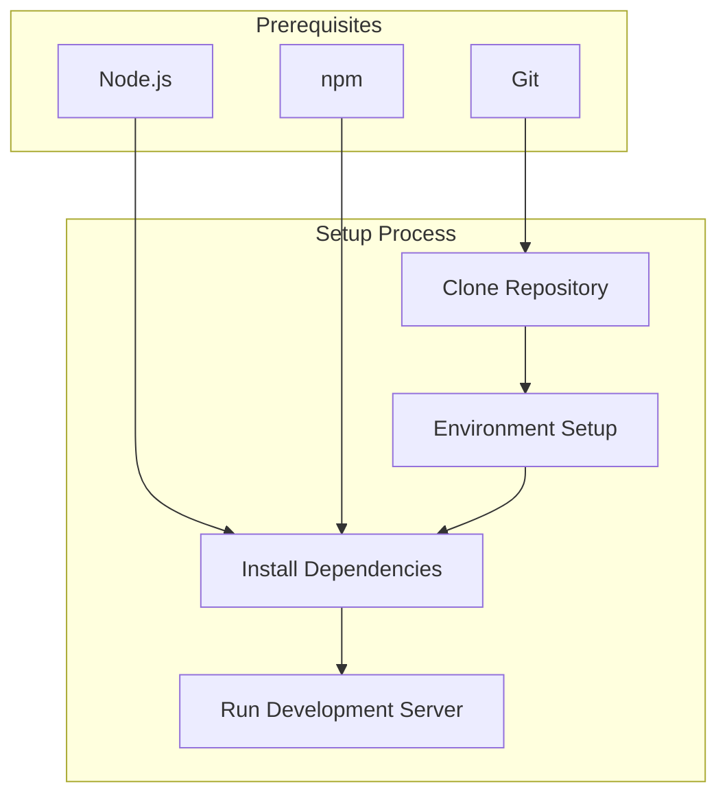
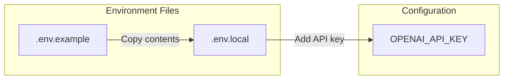
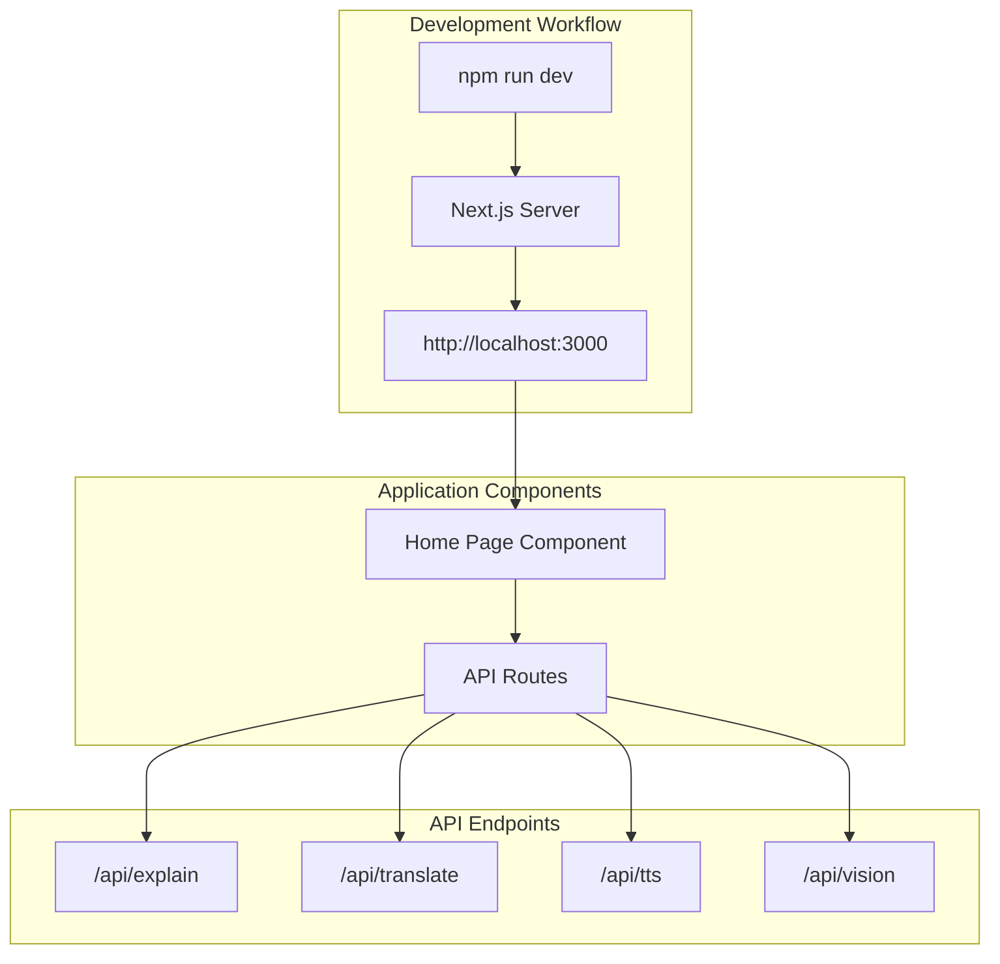

<!-- source: DeepWiki mcp.deepwiki.com · repo openai/interactive-textbook-demo · page 1.1 Getting Started · fetched 2026-10-26 -->

# Getting Started

<details>
<summary>Relevant source files</summary>

The following files were used as context for generating this wiki page:

- [.env.example](.env.example)
- [.pre-commit-config.yaml](.pre-commit-config.yaml)
- [README.md](README.md)

</details>


This document provides instructions for setting up and running the Interactive Textbook Demo application. It covers environment setup, installation of dependencies, and running the development server. For information about security configuration and pre-commit hooks, see [Security Configuration](#1.2).

## Prerequisites

Before you begin, ensure you have the following installed:
- Node.js (latest LTS version recommended)
- npm (comes with Node.js)
- Git



Sources: [README.md:10-22]()

## Environment Setup

1. Clone the repository:
   ```bash
   git clone https://github.com/openai/interactive-textbook-demo.git
   cd interactive-textbook-demo
   ```

2. Create a `.env.local` file in the project root directory
3. Copy the contents from `.env.example` into your `.env.local` file
4. Add your OpenAI API key to the `.env.local` file:
   ```
   OPENAI_API_KEY=your_openai_api_key_here
   ```

You can obtain an OpenAI API key from the [OpenAI platform](https://platform.openai.com/api-keys).



Sources: [README.md:12](), [.env.example:1]()

## Installing Dependencies

After setting up your environment, install the required dependencies by running:

```bash
npm install
```

This command installs all the packages defined in the `package.json` file.

Sources: [README.md:14-17]()

## Running the Development Server

Once the dependencies are installed, you can start the development server:

```bash
npm run dev
```

This command starts the Next.js development server. By default, the application will be available at `http://localhost:3000`.



Sources: [README.md:19-22]()

## Project Structure Overview

The Interactive Textbook Demo is built with Next.js and integrates with OpenAI's APIs to provide accessibility features for textbook content.

| Directory/File | Purpose |
|----------------|---------|
| `/app` | Contains the main application components and pages |
| `/app/api` | API routes that connect to OpenAI services |
| `/components` | Reusable UI components |
| `/public` | Static assets like images |
| `/styles` | Global CSS and styling configurations |
| `.env.local` | Local environment variables (not committed to Git) |
| `.env.example` | Template for environment variables |

The application provides several AI-powered features:
- Text explanations
- Text translations
- Text-to-speech conversion
- Image descriptions

Sources: [README.md:3-7]()

## Accessing the Demo

A hosted version of the demo is available at [https://interactive-textbook-demo.vercel.app/](https://interactive-textbook-demo.vercel.app). Note that access to the hosted demo may be restricted.

Sources: [README.md:7]()

## Troubleshooting

### Common Issues

1. **API Key Issues**: If you encounter errors related to the OpenAI API, verify that your API key is correctly set in the `.env.local` file and that it has the necessary permissions.

2. **Port Conflicts**: If port 3000 is already in use, Next.js will automatically suggest using another port. You can also specify a different port manually:
   ```bash
   npm run dev -- -p 3001
   ```

3. **Dependency Issues**: If you encounter dependency-related errors, try removing the `node_modules` folder and the `package-lock.json` file, then run `npm install` again.

Sources: [README.md:10-22](), [.env.example:1]()

---

