# Page: Overview

# Overview

<details>
<summary>Relevant source files</summary>

The following files were used as context for generating this wiki page:

- [.env.example](.env.example)
- [README.md](README.md)
- [app/page.tsx](app/page.tsx)

</details>


This document provides a comprehensive overview of the Interactive Textbook Demo application, which showcases how OpenAI's technologies can be used to make educational content more accessible to people with visual disabilities or language and learning barriers.

The Interactive Textbook Demo is a web application that allows users to interact with textbook content in various ways, including getting explanations, translations, text-to-speech narration, and image descriptions. This document covers the high-level architecture, key features, and components of the application.

Sources: [README.md:3-5]()

## Purpose and Scope

The Interactive Textbook Demo demonstrates how AI technologies can enhance accessibility in educational materials through:

1. **Text explanations** - Simplifying complex concepts for different learning levels
2. **Translation** - Converting content to different languages
3. **Text-to-speech** - Reading content aloud for visually impaired users
4. **Image descriptions** - Providing detailed descriptions of visual content

This overview document focuses on the high-level architecture and features. For detailed setup instructions, see [Getting Started](#1.1), and for security configuration information, see [Security Configuration](#1.2).

Sources: [README.md:5-5](), [app/page.tsx:458-459]()

## System Architecture

The Interactive Textbook Demo is built as a Next.js application with a client-side frontend and serverless API routes that integrate with OpenAI's services.

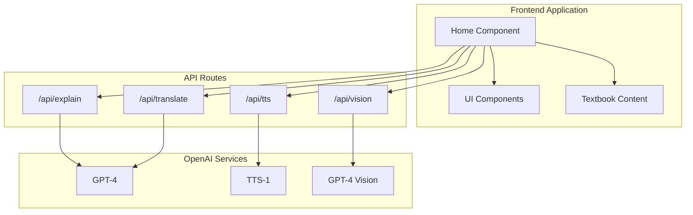

The application consists of three main components:

1. **Frontend Application**: A React-based UI that displays textbook content and provides interactive features
2. **API Routes**: Serverless functions that handle requests from the frontend and communicate with OpenAI services
3. **OpenAI Services**: External AI services that power the application's features

Sources: [app/page.tsx:1-572](), [README.md:3-7]()

## Key Features

### Text Selection and Explanation

Users can select text in the textbook and request different types of explanations:

- **ELI5 (Explain Like I'm 5)**: Simplifies complex concepts
- **Summarize**: Provides a concise summary of the selected text
- **Make a poem**: Transforms the content into a poetic form

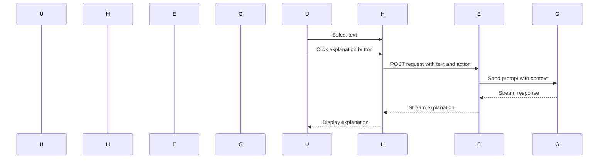

Sources: [app/page.tsx:171-199](), [app/page.tsx:484-501]()

### Translation

Users can translate selected text to any language and have it read aloud:

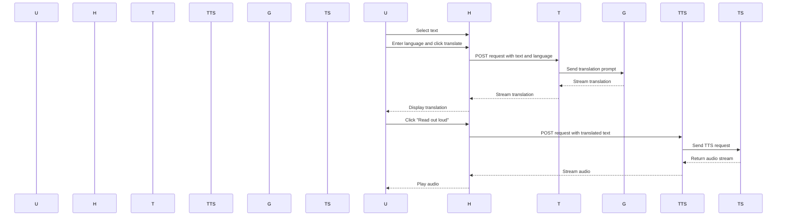

Sources: [app/page.tsx:201-232](), [app/page.tsx:510-524]()

### Text-to-Speech Mode

The application includes a dedicated TTS mode for visually impaired users:

1. Users can toggle TTS mode on
2. Press Tab to navigate through sections of the textbook
3. The application reads each section aloud automatically
4. Images are described using GPT-4 Vision

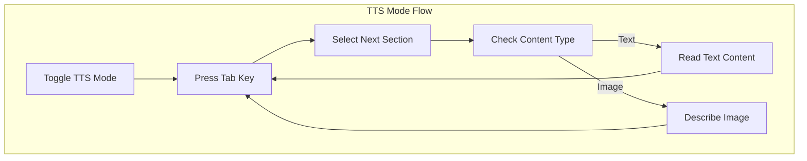

Sources: [app/page.tsx:380-430](), [app/page.tsx:534-540]()

### Image Description

The application can describe images in the textbook using GPT-4 Vision:

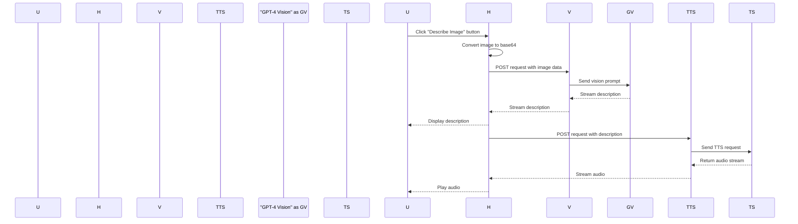

Sources: [app/page.tsx:310-358](), [app/page.tsx:544-565]()

## Component Structure

The application's UI is organized into several key components:

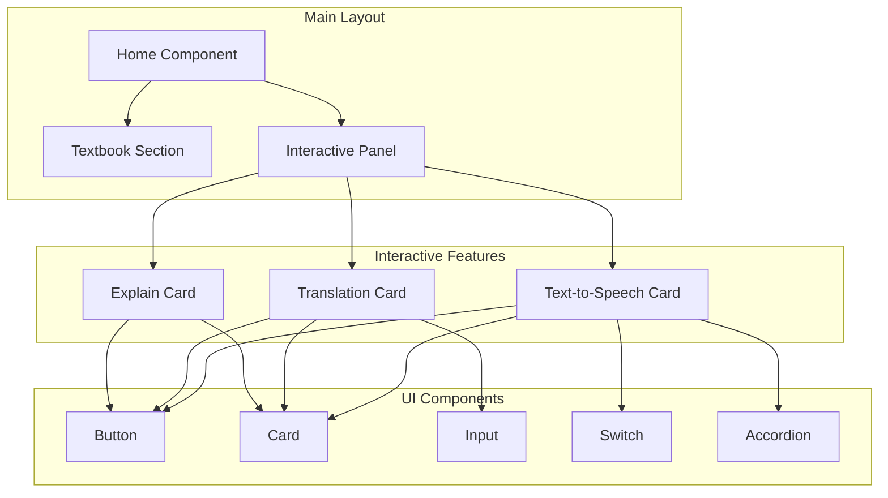

The UI is divided into two main sections:
1. **Textbook Section**: Displays the educational content
2. **Interactive Panel**: Contains cards for different features (Explain, Translation, Text-to-Speech)

Sources: [app/page.tsx:453-569]()

## Data Flow

The application uses a streaming architecture to provide real-time feedback to users:

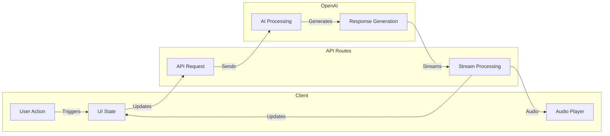

Key aspects of the data flow:

1. **User Actions**: Text selection, button clicks, and keyboard navigation
2. **UI State Management**: React state hooks track application state
3. **API Communication**: Fetch API with streaming responses
4. **Response Processing**: Chunk decoders for text streams and MediaSource API for audio

Sources: [app/page.tsx:171-199](), [app/page.tsx:201-232](), [app/page.tsx:235-278](), [app/page.tsx:310-358]()

## Configuration and Security

The application requires an OpenAI API key to function, which is configured through environment variables:

| Configuration File | Purpose |
|-------------------|---------|
| `.env.example`    | Template for environment variables |
| `.env.local`      | Local environment configuration (not committed to repository) |

Security measures include:
- Pre-commit hooks with TruffleHog to prevent accidental exposure of API keys
- Proper environment variable management
- Comprehensive `.gitignore` configuration

Sources: [README.md:10-22](), [.env.example:1-1](), [README.md:24-41]()

## Technical Implementation

The application is built with the following technologies:

| Technology | Purpose |
|------------|---------|
| Next.js    | Web framework for frontend and API routes |
| React      | UI component library |
| OpenAI API | AI services for text generation, translation, TTS, and vision |
| Tailwind CSS | Styling framework |
| Radix UI   | Accessible UI components |

The main application logic is contained in the `app/page.tsx` file, which implements the Home component and all the interactive features.

Sources: [app/page.tsx:1-572](), [README.md:3-7]()

## Summary

The Interactive Textbook Demo showcases how AI technologies can enhance accessibility in educational materials. By integrating OpenAI's capabilities for text explanation, translation, text-to-speech, and image description, the application provides a more inclusive learning experience for users with different needs and abilities.

The application's architecture is designed to be responsive and user-friendly, with a focus on real-time feedback through streaming responses. The codebase is organized in a modular way, making it easy to understand and extend.

Sources: [README.md:3-7](), [app/page.tsx:458-459]()

---

# Page: Getting Started

# Getting Started

<details>
<summary>Relevant source files</summary>

The following files were used as context for generating this wiki page:

- [.env.example](.env.example)
- [.pre-commit-config.yaml](.pre-commit-config.yaml)
- [README.md](README.md)

</details>


This document provides instructions for setting up and running the Interactive Textbook Demo application. It covers environment setup, installation of dependencies, and running the development server. For information about security configuration and pre-commit hooks, see [Security Configuration](#1.2).

## Prerequisites

Before you begin, ensure you have the following installed:
- Node.js (latest LTS version recommended)
- npm (comes with Node.js)
- Git

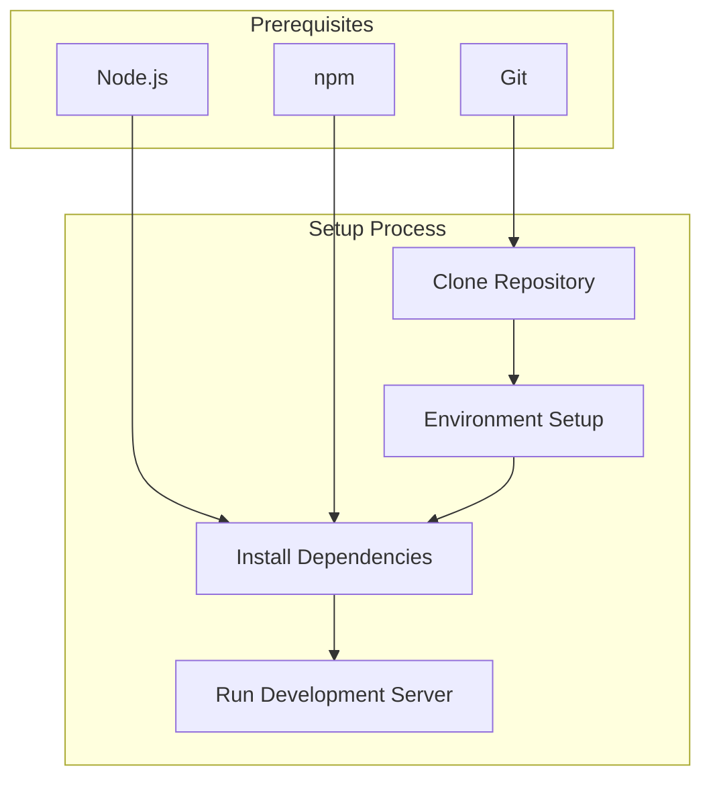

Sources: [README.md:10-22]()

## Environment Setup

1. Clone the repository:
   ```bash
   git clone https://github.com/openai/interactive-textbook-demo.git
   cd interactive-textbook-demo
   ```

2. Create a `.env.local` file in the project root directory
3. Copy the contents from `.env.example` into your `.env.local` file
4. Add your OpenAI API key to the `.env.local` file:
   ```
   OPENAI_API_KEY=your_openai_api_key_here
   ```

You can obtain an OpenAI API key from the [OpenAI platform](https://platform.openai.com/api-keys).

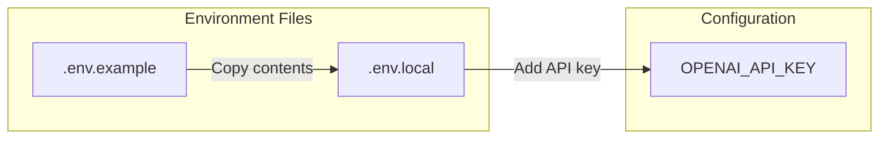

Sources: [README.md:12](), [.env.example:1]()

## Installing Dependencies

After setting up your environment, install the required dependencies by running:

```bash
npm install
```

This command installs all the packages defined in the `package.json` file.

Sources: [README.md:14-17]()

## Running the Development Server

Once the dependencies are installed, you can start the development server:

```bash
npm run dev
```

This command starts the Next.js development server. By default, the application will be available at `http://localhost:3000`.

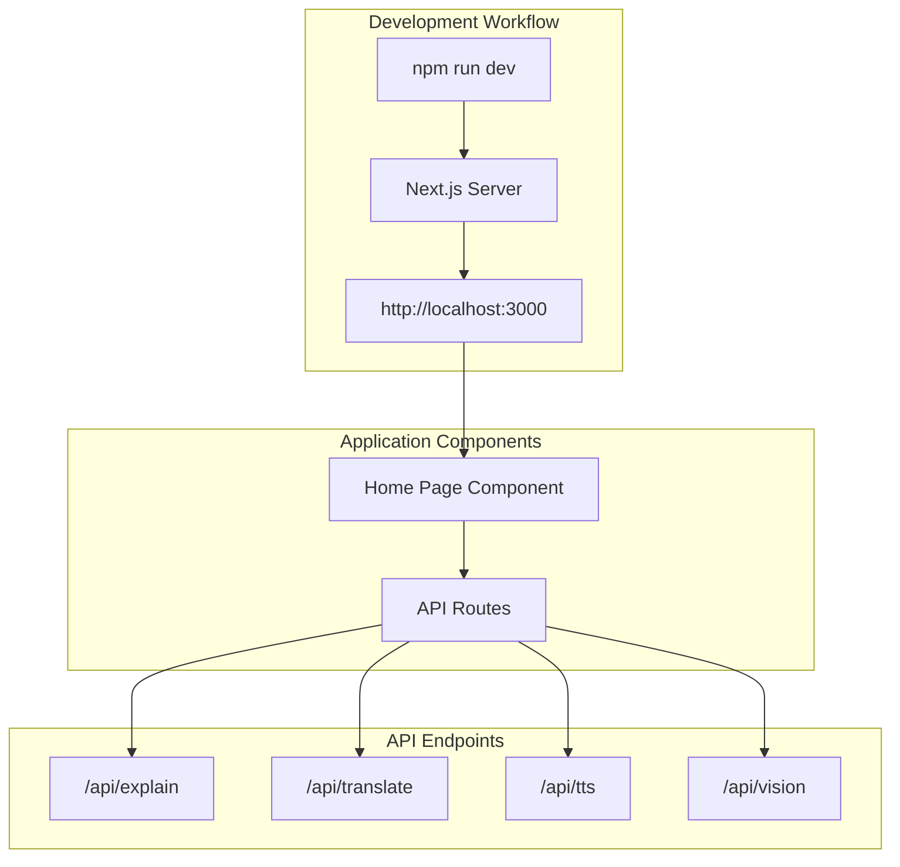

Sources: [README.md:19-22]()

## Project Structure Overview

The Interactive Textbook Demo is built with Next.js and integrates with OpenAI's APIs to provide accessibility features for textbook content.

| Directory/File | Purpose |
|----------------|---------|
| `/app` | Contains the main application components and pages |
| `/app/api` | API routes that connect to OpenAI services |
| `/components` | Reusable UI components |
| `/public` | Static assets like images |
| `/styles` | Global CSS and styling configurations |
| `.env.local` | Local environment variables (not committed to Git) |
| `.env.example` | Template for environment variables |

The application provides several AI-powered features:
- Text explanations
- Text translations
- Text-to-speech conversion
- Image descriptions

Sources: [README.md:3-7]()

## Accessing the Demo

A hosted version of the demo is available at [https://interactive-textbook-demo.vercel.app/](https://interactive-textbook-demo.vercel.app). Note that access to the hosted demo may be restricted.

Sources: [README.md:7]()

## Troubleshooting

### Common Issues

1. **API Key Issues**: If you encounter errors related to the OpenAI API, verify that your API key is correctly set in the `.env.local` file and that it has the necessary permissions.

2. **Port Conflicts**: If port 3000 is already in use, Next.js will automatically suggest using another port. You can also specify a different port manually:
   ```bash
   npm run dev -- -p 3001
   ```

3. **Dependency Issues**: If you encounter dependency-related errors, try removing the `node_modules` folder and the `package-lock.json` file, then run `npm install` again.

Sources: [README.md:10-22](), [.env.example:1]()

---

# Page: Security Configuration

# Security Configuration

<details>
<summary>Relevant source files</summary>

The following files were used as context for generating this wiki page:

- [.gitignore](.gitignore)
- [.pre-commit-config.yaml](.pre-commit-config.yaml)
- [README.md](README.md)
- [SECURITY.md](SECURITY.md)

</details>


This document outlines the security measures implemented in the Interactive Textbook Demo project, focusing on protecting sensitive information such as API keys and preventing accidental exposure of secrets during development.

## Purpose and Scope

The security configuration in this project addresses:
- Protection of OpenAI API keys
- Prevention of accidental secret exposure in code commits
- Environment variable management
- Git security practices

For information about the general project setup, see [Getting Started](#1.1).

## Security Architecture Overview

The project implements a multi-layered security approach to protect sensitive information, particularly the OpenAI API key required for accessing AI services.

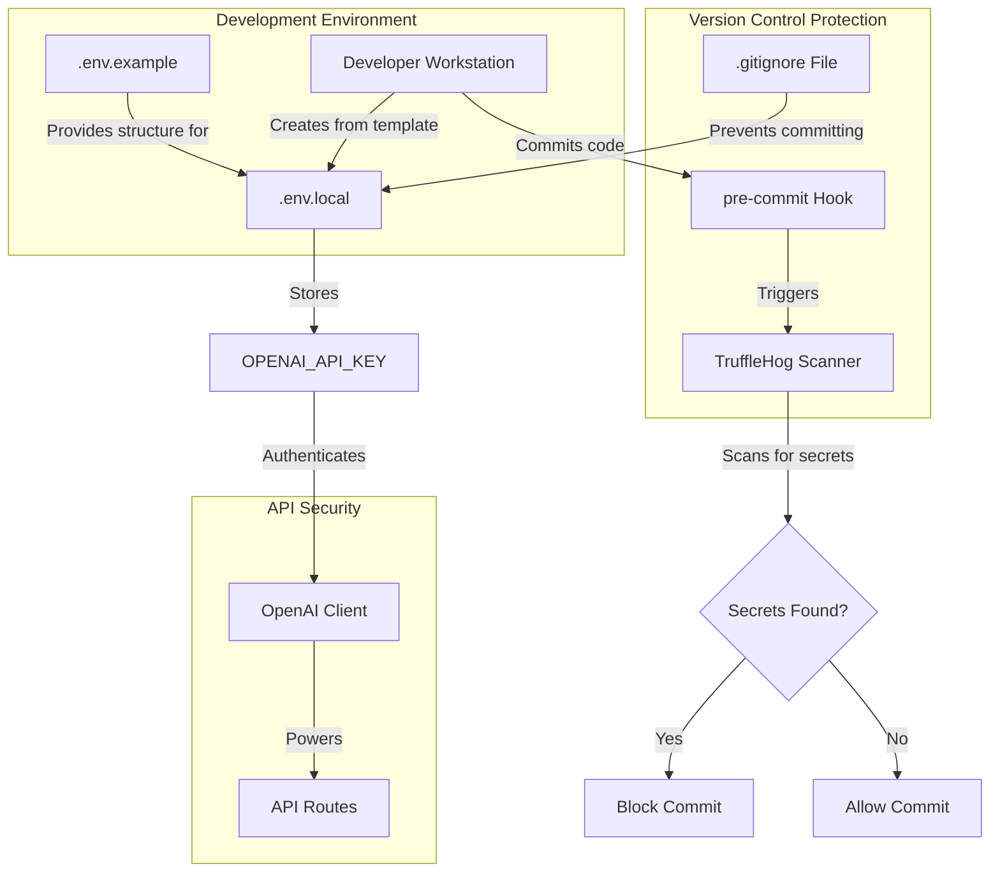

Sources: [README.md:9-22](), [.pre-commit-config.yaml:1-9](), [.gitignore:103-111](), [.gitignore:154-156]()

## Environment Variable Management

### Configuration Files

The project uses environment variables to securely store sensitive information:

1. `.env.example` - Template file committed to the repository that shows the required environment variables without actual values
2. `.env.local` - Local environment file containing actual API keys (not committed to the repository)

### Setup Process

Developers must:
1. Create a `.env.local` file in the project root
2. Copy the structure from `.env.example`
3. Add their personal OpenAI API key to the `.env.local` file

```
# Example .env.local file structure
OPENAI_API_KEY=your-api-key-here
```

### Git Protection

The `.gitignore` file explicitly excludes environment files containing secrets:

```
# Environments
.env
.venv
env/
venv/
ENV/
env.bak/
venv.bak/

# local env files
.env*.local
```

This prevents accidental commits of files containing API keys or other sensitive information.

Sources: [README.md:10-12](), [.gitignore:103-111](), [.gitignore:154-156]()

## Pre-commit Hook with TruffleHog

The project implements a pre-commit hook using TruffleHog to scan code for secrets before each commit, providing an additional layer of protection against accidental secret exposure.

### TruffleHog Configuration

TruffleHog is configured in the `.pre-commit-config.yaml` file:

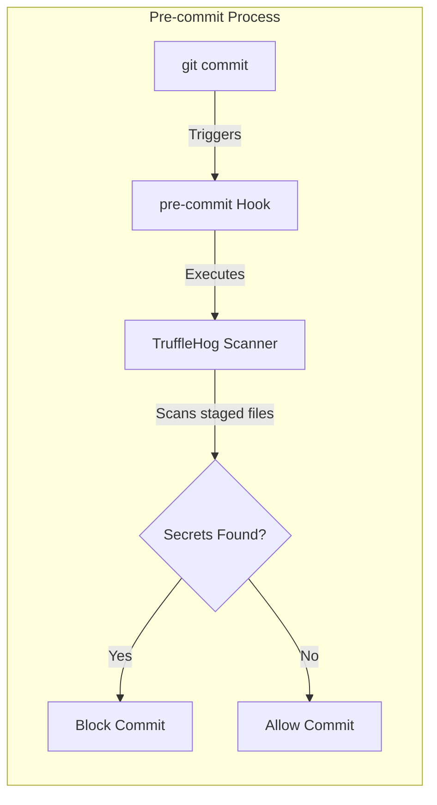

The pre-commit hook is defined in the `.pre-commit-config.yaml` file and executes TruffleHog to scan for secrets in the staged changes:

```yaml
repos:
- repo: local
  hooks:
    - id: trufflehog
      name: TruffleHog
      description: Detect secrets in your data.
      entry: bash -c 'trufflehog git file://. --since-commit HEAD --fail'
      language: system
      stages: ["commit", "push"]
```

### Setup and Usage

Developers need to:

1. Install pre-commit:
   ```bash
   pip3 install pre-commit
   ```

2. Install TruffleHog:
   ```bash
   brew install trufflehog
   ```

3. Install the pre-commit hooks:
   ```bash
   pre-commit install
   ```

Once installed, the pre-commit hook automatically runs before each commit, scanning for potential secrets like API keys. If secrets are detected, the commit is blocked, and the developer is prompted to remove them before trying again.

Sources: [README.md:24-42](), [.pre-commit-config.yaml:1-9]()

## Security Policy

The project adheres to OpenAI's Coordinated Vulnerability Disclosure Policy. For security-related concerns, developers can refer to the `SECURITY.md` file which provides links to:

1. OpenAI's Coordinated Vulnerability Disclosure Policy
2. OpenAI's PGP key for secure communication

This ensures that any security vulnerabilities discovered in the project can be reported and addressed appropriately.

Sources: [SECURITY.md:1-5]()

## Security Integration with API Routes

The security configuration directly impacts the API routes that communicate with OpenAI services. The OpenAI API key stored in the environment variables is used to authenticate requests to the OpenAI API.

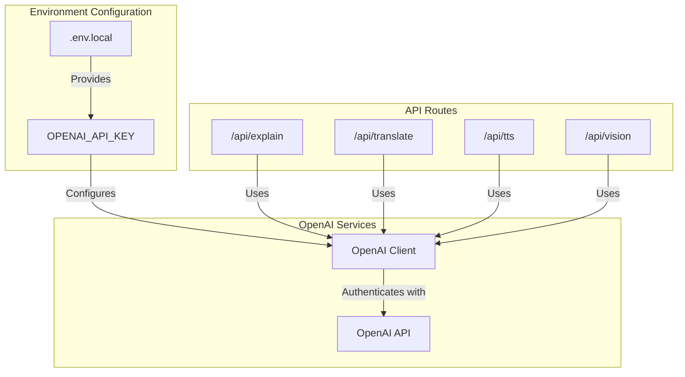

Each API route in the application requires the OpenAI API key to function properly. The security measures ensure this key remains protected while still being accessible to the application.

Sources: [README.md:10-12]()

## Best Practices for Developers

When working with this codebase, developers should follow these security best practices:

1. **Never commit API keys**: Always store API keys in `.env.local` which is excluded from git
2. **Use the pre-commit hook**: Ensure pre-commit is installed and running to catch accidental secret exposure
3. **Don't disable security measures**: Don't bypass the pre-commit hook or modify the `.gitignore` to include sensitive files
4. **Rotate compromised keys**: If an API key is accidentally exposed, generate a new one immediately
5. **Keep dependencies updated**: Regularly update project dependencies to address security vulnerabilities

Sources: [README.md:24-42](), [.gitignore:103-111](), [.gitignore:154-156]()

## Security Measures Summary

| Security Measure | Implementation | Purpose |
|------------------|----------------|---------|
| Environment Variables | `.env.local` file | Store API keys securely |
| Git Exclusions | `.gitignore` entries | Prevent committing sensitive files |
| Pre-commit Hook | TruffleHog scanner | Detect secrets before they're committed |
| Security Policy | `SECURITY.md` | Guide for reporting vulnerabilities |

Sources: [README.md:10-12](), [README.md:24-42](), [.pre-commit-config.yaml:1-9](), [.gitignore:103-111](), [.gitignore:154-156](), [SECURITY.md:1-5]()

---

# Page: Frontend Architecture

# Frontend Architecture

<details>
<summary>Relevant source files</summary>

The following files were used as context for generating this wiki page:

- [app/globals.css](app/globals.css)
- [app/layout.tsx](app/layout.tsx)
- [app/page.tsx](app/page.tsx)

</details>


This document provides an overview of the frontend architecture for the Interactive Textbook Demo application. It covers the main components, structure, and UI elements that make up the frontend portion of the application.

For information about the API routes that connect the frontend to OpenAI services, see [API Routes](#3).

## Overview

The Interactive Textbook Demo is a Next.js application designed to enhance textbook accessibility through AI-powered features. The frontend architecture follows a component-based approach with a single main page that provides various interactive features.

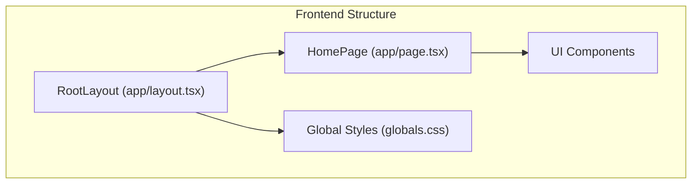

Sources: [app/layout.tsx:16-30](), [app/page.tsx:23-572](), [app/globals.css:1-89]()

## Component Hierarchy

The application follows a simple component hierarchy with a root layout that wraps the main page component. The main page contains various UI components for different features.

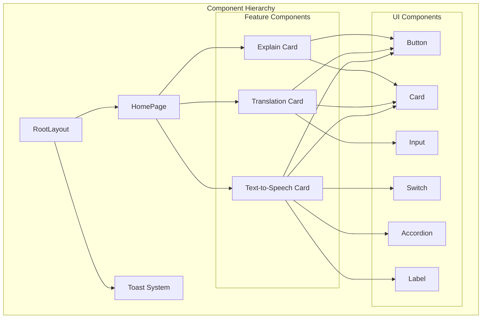

Sources: [app/layout.tsx:16-30](), [app/page.tsx:453-570]()

## Main Page Component

The main page component (`HomePage`) is the core of the application, defined in [app/page.tsx]() as a client-side component. It contains:

1. A textbook content area on the left side
2. Interactive feature cards on the right side
3. State management for various features
4. Event handlers for user interactions

The component is marked with `"use client"` directive to enable client-side rendering and interactivity.

Sources: [app/page.tsx:1-23](), [app/page.tsx:453-570]()

## State Management

The application uses React's `useState` and `useRef` hooks for state management. Key state variables include:

| State Variable | Purpose |
|----------------|---------|
| `selectedText` | Stores text highlighted by the user |
| `explainLoading` | Tracks loading state for explanation features |
| `explainCompletion` | Stores explanation text from the API |
| `currentExplainAction` | Tracks which explanation action is active |
| `language` | Stores the target language for translation |
| `translation` | Stores translated text from the API |
| `ttsMode` | Toggles text-to-speech mode |
| `describeImageText` | Stores image descriptions from the API |

References are used to track DOM elements and asynchronous operations:

| Reference | Purpose |
|-----------|---------|
| `textbookRef` | References the textbook content container |
| `playerRef` | References the audio player element |
| `asyncIdRef` | Tracks asynchronous operations to prevent race conditions |
| `sectionIdxRef` | Tracks the current section index in TTS mode |

Sources: [app/page.tsx:24-45]()

## User Interaction Flow

The application supports several user interaction flows:

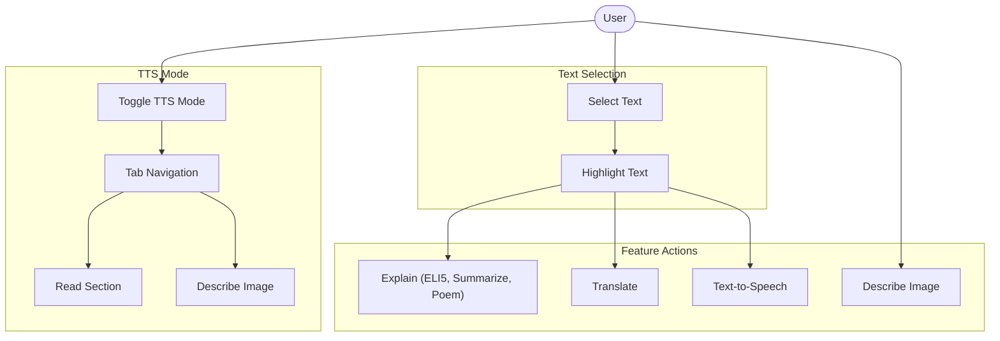

Sources: [app/page.tsx:62-169](), [app/page.tsx:380-430]()

## Feature Implementation

### Text Selection and Highlighting

The application implements a sophisticated text selection and highlighting mechanism using the DOM Selection API. When a user selects text in the textbook area, the application:

1. Captures the selected text using `document.getSelection()`
2. Creates highlight elements by wrapping the selected text in `<span>` elements
3. Updates the `selectedText` state with the selected text content

This functionality is implemented in the `handleMouseUp` event handler within a `useEffect` hook.

Sources: [app/page.tsx:62-169]()

### Explanation Feature

The explanation feature allows users to get AI-powered explanations of selected text in three formats:

1. ELI5 (Explain Like I'm 5)
2. Summarize
3. Make a poem

The implementation uses the `/api/explain` endpoint with streaming responses to provide real-time feedback to the user.

Sources: [app/page.tsx:171-199](), [app/page.tsx:484-502]()

### Translation Feature

The translation feature translates selected text to a user-specified language using the `/api/translate` endpoint. It also supports reading the translation aloud using the text-to-speech feature.

Sources: [app/page.tsx:201-232](), [app/page.tsx:510-525]()

### Text-to-Speech Feature

The application provides two text-to-speech modes:

1. On-demand TTS for selected text or translations
2. TTS mode for navigating through the textbook using the Tab key

The TTS feature uses the `/api/tts` endpoint to convert text to speech using OpenAI's TTS model.

Sources: [app/page.tsx:235-278](), [app/page.tsx:380-430](), [app/page.tsx:534-540]()

### Image Description Feature

The image description feature uses OpenAI's Vision capabilities to describe images in the textbook. It sends the image data to the `/api/vision` endpoint and receives a textual description, which can also be read aloud using TTS.

Sources: [app/page.tsx:310-378](), [app/page.tsx:544-566]()

## UI Components

The application uses a set of reusable UI components imported from the `@/components/ui` directory:

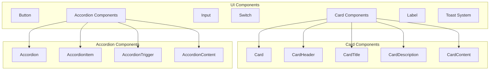

Sources: [app/page.tsx:3-16](), [app/page.tsx:478-567]()

## Styling

The application uses Tailwind CSS for styling, with global styles defined in [app/globals.css](). The styling includes:

1. Tailwind base, components, and utilities
2. Custom CSS variables for theming (light and dark modes)
3. Custom styles for headings and TTS highlighting

The layout uses a split-screen approach with the textbook content on the left and interactive features on the right.

Sources: [app/globals.css:1-89](), [app/page.tsx:454-569]()

## Toast Notification System

The application includes a toast notification system for displaying temporary messages to the user. The system is implemented using:

1. A `Toaster` component in the root layout
2. The `useToast` hook for creating and managing toasts
3. Toast actions for interactive notifications

The toast system is used to notify users when text is being read aloud and provides a way to stop the audio playback.

Sources: [app/layout.tsx:5-26](), [app/page.tsx:16-45](), [app/page.tsx:432-451]()

## Root Layout

The root layout component (`RootLayout`) provides the basic HTML structure for the application, including:

1. HTML and body tags with language and font settings
2. The `Toaster` component for toast notifications
3. Analytics integration with Vercel

The layout uses the Inter font from Google Fonts and sets metadata for the application.

Sources: [app/layout.tsx:1-30]()

## Conclusion

The frontend architecture of the Interactive Textbook Demo is built around a single main page component that provides various AI-powered features to enhance textbook accessibility. The application uses React hooks for state management, custom event handlers for user interactions, and a set of reusable UI components for the interface.

For more detailed information about specific components and features, refer to the following pages:
- [Main Page Component](#2.1)
- [UI Components](#2.2)
- [Toast Notification System](#2.3)
- [Styling and CSS](#2.4)

---

# Page: Main Page Component

# Main Page Component

<details>
<summary>Relevant source files</summary>

The following files were used as context for generating this wiki page:

- [app/page.tsx](app/page.tsx)

</details>


This document provides a detailed explanation of the Home component in the interactive textbook demo application. The Home component serves as the main page of the application, implementing the user interface and core functionality for making textbook content more accessible through AI-powered features.

## Purpose and Scope

The Main Page Component is responsible for:
- Rendering the interactive textbook content
- Implementing text selection and highlighting functionality
- Providing AI-powered explanation, translation, and text-to-speech features
- Enabling image description using GPT-4 Vision
- Managing the application's state and user interactions

For information about the UI components used in this page, see [UI Components](#2.2).

## Component Structure

The Home component is defined in the `app/page.tsx` file and is the default export. It is a client-side component as indicated by the `"use client"` directive at the top of the file.

### Main Page Layout

The page is divided into two main sections:
1. Left side (50% width): Displays the textbook content
2. Right side (50% width): Contains the interactive features (Explain, Translation, Text-to-Speech)

Sources: [app/page.tsx:453-569]()

## Component State Management

The component uses React's `useState` hook to manage various states:

```
State Variable          Purpose
----------------        -------------------------------------------------
selectedText            Stores the text currently highlighted by the user
explainLoading          Tracks loading state for explanation features
explainCompletion       Stores the AI-generated explanation text
currentExplainAction    Tracks which explanation action is currently active
language                Stores the target language for translation
translateLoading        Tracks loading state for translation
translation             Stores the translated text
translationTTSLoading   Tracks loading state for translation TTS
ttsMode                 Toggles the text-to-speech navigation mode
describeImageIdxLoading Tracks which image is being processed
describeImageText       Stores the AI-generated image description
```

Additionally, several `useRef` hooks are used to maintain references:
- `sectionIdxRef`: Tracks the current section index in TTS mode
- `textbookRef`: References the textbook content container
- `playerRef`: References the audio player element
- `asyncIdRef`: Manages asynchronous operations

Sources: [app/page.tsx:23-45]()

## Text Selection and Highlighting

The component implements a sophisticated text selection and highlighting system using the browser's Selection API.

### Text Selection Flow

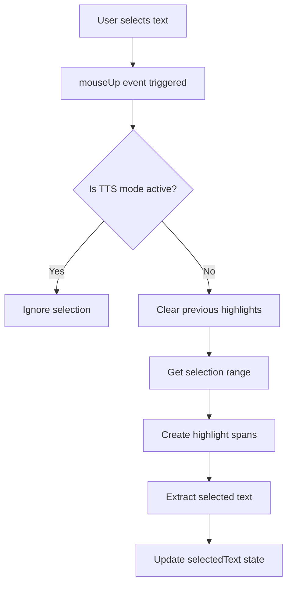

Sources: [app/page.tsx:62-169]()

The text selection functionality:
1. Listens for `mouseup` events to detect when the user has selected text
2. Checks if the selection is within the textbook content
3. Creates highlight spans around the selected text
4. Updates the `selectedText` state with the selected text content

The highlighting process handles complex selections that span multiple DOM nodes by creating multiple ranges and wrapping each in a highlight span.

Sources: [app/page.tsx:62-169]()

## AI-Powered Features

The component implements several AI-powered features using OpenAI's models through API routes.

### Explanation Feature

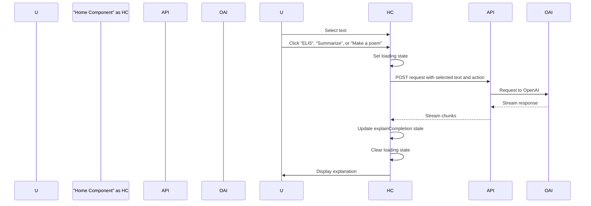

The explanation feature allows users to:
- Get an "Explain Like I'm 5" (ELI5) explanation of selected text
- Generate a summary of selected text
- Transform selected text into a poem

The component uses streaming responses to display the AI-generated content as it's being generated.

Sources: [app/page.tsx:171-199](), [app/page.tsx:484-501]()

### Translation Feature

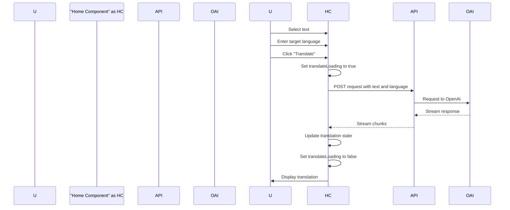

The translation feature:
- Allows users to specify a target language
- Translates selected text to the target language
- Supports reading the translation aloud using text-to-speech

Sources: [app/page.tsx:201-232](), [app/page.tsx:504-525]()

### Text-to-Speech Feature

The component implements two TTS approaches:

1. **On-demand TTS**: Reading selected text or translations
2. **TTS Navigation Mode**: Navigating through textbook sections using the Tab key

```mermaid
flowchart TD
    A["User toggles TTS mode"] --> B{"TTS mode active?"}
    B -->|"Yes"| C["Clear document"]
    B -->|"No"| D["Clear highlights"]
    
    C --> E["Add Tab key listener"]
    E --> F["User presses Tab"]
    F --> G["Highlight next section"]
    G --> H{"Is section an image?"}
    H -->|"Yes"| I["Describe image using Vision API"]
    H -->|"No"| J["Read section text"]
    I --> K["Read description aloud"]
    J --> L["Read text aloud"]
```

The TTS navigation mode:
- Allows users to navigate through textbook sections using the Tab key
- Automatically reads the content of each section
- Uses GPT-4 Vision to describe images when encountered

Sources: [app/page.tsx:235-246](), [app/page.tsx:248-278](), [app/page.tsx:380-430](), [app/page.tsx:528-567]()

### Image Description Feature

```mermaid
sequenceDiagram
    participant "User" as U
    participant "Home Component" as HC
    participant "/api/vision" as API
    participant "OpenAI" as OAI
    
    U->>HC: Click "Describe Image" button
    HC->>HC: Set describeImageIdxLoading
    HC->>HC: Clear previous content
    HC->>HC: Convert image to base64
    HC->>API: POST request with image data
    API->>OAI: Request to GPT-4 Vision
    OAI-->>API: Stream response
    API-->>HC: Stream chunks
    HC->>HC: Update describeImageText state
    HC->>HC: Clear loading state
    HC->>U: Display image description
    HC->>HC: Read description aloud (optional)
```

The image description feature:
- Allows users to get AI-generated descriptions of images in the textbook
- Uses GPT-4 Vision to analyze and describe images
- Can read the descriptions aloud using text-to-speech

Sources: [app/page.tsx:310-378](), [app/page.tsx:542-565]()

## User Interface Components

The main page UI is composed of several sections:

1. **Textbook Content**: Displays the textbook content with images and text
2. **Explanation Card**: Provides options to explain, summarize, or transform selected text
3. **Translation Card**: Allows translating selected text to different languages
4. **Text-to-Speech Card**: Provides TTS navigation mode and image description features

### UI Layout

```mermaid
graph TD
    subgraph "Main Page"
        A["main element"]
        B["Hidden video player"]
        C["Flex container"]
        
        subgraph "Left Side (Textbook)"
            D["Title"]
            E["Description"]
            F["Textbook content"]
        end
        
        subgraph "Right Side (Features)"
            G["Explain Card"]
            H["Translation Card"]
            I["Text-to-Speech Card"]
        end
    end
    
    A --> B
    A --> C
    C --> D
    C --> E
    C --> F
    C --> G
    C --> H
    C --> I
    
    subgraph "Explain Card"
        G1["ELI5 Button"]
        G2["Summarize Button"]
        G3["Make a poem Button"]
        G4["Explanation display"]
    end
    
    subgraph "Translation Card"
        H1["Language Input"]
        H2["Translate Button"]
        H3["Read aloud Button"]
        H4["Translation display"]
    end
    
    subgraph "Text-to-Speech Card"
        I1["TTS Mode Switch"]
        I2["Image description buttons"]
        I3["Image description display"]
    end
    
    G --> G1
    G --> G2
    G --> G3
    G --> G4
    
    H --> H1
    H --> H2
    H --> H3
    H --> H4
    
    I --> I1
    I --> I2
    I --> I3
```

Sources: [app/page.tsx:453-569]()

## Toast Notification System

The component uses a toast notification system to provide feedback to users:

- Displays a loading toast when reading text aloud
- Provides a "Stop" action to cancel the current TTS operation

The toast system is implemented using the `useToast` hook from the UI components.

Sources: [app/page.tsx:432-451]()

## Key Functions

### Text Selection and Highlighting

- `clearDocument()`: Clears all highlights and resets the component state
- `handleMouseUp()`: Handles text selection and highlighting

Sources: [app/page.tsx:47-60](), [app/page.tsx:62-169]()

### AI Feature Handlers

- `handleExplainAction()`: Processes explanation requests
- `handleTranslate()`: Processes translation requests
- `handleReadTranslation()`: Processes translation TTS requests
- `tts()`: Handles text-to-speech conversion
- `describeImage()`: Processes image description requests
- `handleDescribeImageFromIdx()`: Handles image description button clicks

Sources: [app/page.tsx:171-199](), [app/page.tsx:201-232](), [app/page.tsx:248-278](), [app/page.tsx:310-378]()

### TTS Navigation Mode

- `handleTtsModeChange()`: Toggles TTS navigation mode
- `handleTabPress()`: Handles Tab key presses in TTS mode

Sources: [app/page.tsx:291-308](), [app/page.tsx:380-430]()

## API Integration

The component integrates with four API routes:

1. `/api/explain`: Provides text explanations, summaries, and transformations
2. `/api/translate`: Translates text to different languages
3. `/api/tts`: Converts text to speech
4. `/api/vision`: Describes images using GPT-4 Vision

Each API route is called with appropriate parameters and handles streaming responses.

Sources: [app/page.tsx:175-196](), [app/page.tsx:203-228](), [app/page.tsx:236-245](), [app/page.tsx:326-355]()

## Summary

The Main Page Component is the central piece of the interactive textbook demo, implementing all the user interface and functionality for making textbook content more accessible. It leverages OpenAI's capabilities through API routes to provide AI-powered explanations, translations, text-to-speech, and image descriptions.

The component is designed with accessibility in mind, providing features that help users with visual disabilities or language and learning barriers to better understand textbook content.

---

# Page: UI Components

# UI Components

<details>
<summary>Relevant source files</summary>

The following files were used as context for generating this wiki page:

- [components/ui/accordion.tsx](components/ui/accordion.tsx)
- [components/ui/button.tsx](components/ui/button.tsx)
- [components/ui/card.tsx](components/ui/card.tsx)
- [components/ui/checkbox.tsx](components/ui/checkbox.tsx)
- [components/ui/input.tsx](components/ui/input.tsx)
- [components/ui/label.tsx](components/ui/label.tsx)
- [components/ui/switch.tsx](components/ui/switch.tsx)

</details>


This document provides a comprehensive overview of the reusable UI components used in the interactive textbook demo application. These components serve as the building blocks for the user interface, providing consistent styling and behavior throughout the application.

For information about the main page structure and implementation, see [Main Page Component](#2.1). For details on the toast notification system, see [Toast Notification System](#2.3).

## Component Overview

The application uses a set of reusable UI components built with React and enhanced with Radix UI primitives. These components provide accessible, customizable interface elements that maintain a consistent design language throughout the application.

```mermaid
graph TD
    subgraph "UI Components Library"
        Button["Button"]
        Card["Card"]
        Input["Input"]
        Switch["Switch"]
        Accordion["Accordion"]
        Checkbox["Checkbox"]
        Label["Label"]
    end

    subgraph "Implementation Details"
        RadixUI["Radix UI Primitives"]
        Styling["Tailwind CSS + cn utility"]
        ForwardRef["React.forwardRef Pattern"]
    end

    Button --> RadixUI
    Card --> Styling
    Input --> Styling
    Switch --> RadixUI
    Accordion --> RadixUI
    Checkbox --> RadixUI
    Label --> RadixUI

    RadixUI --> ForwardRef
    Styling --> ForwardRef
```

Sources: [components/ui/button.tsx](). [components/ui/card.tsx](). [components/ui/input.tsx](). [components/ui/switch.tsx](). [components/ui/accordion.tsx](). [components/ui/checkbox.tsx](). [components/ui/label.tsx]().

## Component Architecture

Each UI component follows a consistent architecture pattern:

1. Components are built using React's `forwardRef` to properly handle ref forwarding
2. Many components are built on top of Radix UI primitives for accessibility
3. Styling is applied using Tailwind CSS classes combined with the `cn` utility function
4. Components accept standard HTML attributes plus additional custom props when needed

```mermaid
flowchart TD
    subgraph "Component Architecture Pattern"
        A["Import Dependencies"]
        B["Define Component with forwardRef"]
        C["Apply Styling with cn utility"]
        D["Forward Props and Ref"]
        E["Set displayName"]
        F["Export Component"]
    end

    A --> B --> C --> D --> E --> F
```

Sources: [components/ui/button.tsx:42-54](). [components/ui/input.tsx:8-23](). [components/ui/switch.tsx:8-27]().

## Button Component

The Button component provides a customizable button with various styles and sizes.

### Features

- Multiple variants: default, destructive, outline, secondary, ghost, link
- Multiple sizes: default, sm, lg, icon
- Support for asChild pattern to change the underlying element

### Implementation

```mermaid
graph TD
    subgraph "Button Component"
        ButtonComponent["Button"]
        ButtonVariants["buttonVariants"]
        SlotComponent["Slot (from Radix UI)"]
    end

    subgraph "Props"
        Variant["variant: default | destructive | outline | secondary | ghost | link"]
        Size["size: default | sm | lg | icon"]
        AsChild["asChild: boolean"]
        OtherProps["...other button props"]
    end

    ButtonComponent --> ButtonVariants
    ButtonComponent --> SlotComponent
    
    Variant --> ButtonComponent
    Size --> ButtonComponent
    AsChild --> ButtonComponent
    OtherProps --> ButtonComponent
```

Sources: [components/ui/button.tsx]().

## Card Component

The Card component provides a container with consistent styling for grouping related content.

### Features

- Composed of multiple sub-components: Card, CardHeader, CardTitle, CardDescription, CardContent, CardFooter
- Consistent styling with rounded corners, border, and shadow

### Implementation

```mermaid
graph TD
    subgraph "Card Component Family"
        Card["Card"]
        CardHeader["CardHeader"]
        CardTitle["CardTitle"]
        CardDescription["CardDescription"]
        CardContent["CardContent"]
        CardFooter["CardFooter"]
    end

    Card --> CardHeader
    Card --> CardContent
    Card --> CardFooter
    
    CardHeader --> CardTitle
    CardHeader --> CardDescription
```

Sources: [components/ui/card.tsx]().

## Input Component

The Input component provides a styled input field.

### Features

- Consistent styling with the design system
- Supports all standard HTML input attributes

### Implementation

The Input component is a simple wrapper around the HTML `<input>` element with consistent styling applied.

Sources: [components/ui/input.tsx]().

## Switch Component

The Switch component provides a toggle switch for binary choices.

### Features

- Accessible toggle switch built on Radix UI primitives
- Animated state transitions
- Support for disabled state

### Implementation

```mermaid
graph TD
    subgraph "Switch Component"
        SwitchRoot["SwitchPrimitives.Root"]
        SwitchThumb["SwitchPrimitives.Thumb"]
    end

    SwitchRoot --> SwitchThumb
```

Sources: [components/ui/switch.tsx]().

## Accordion Component

The Accordion component provides collapsible content sections.

### Features

- Animated expand/collapse transitions
- Accessible implementation using Radix UI primitives
- Composed of multiple sub-components: Accordion, AccordionItem, AccordionTrigger, AccordionContent

### Implementation

```mermaid
graph TD
    subgraph "Accordion Component Family"
        Accordion["Accordion"]
        AccordionItem["AccordionItem"]
        AccordionTrigger["AccordionTrigger"]
        AccordionContent["AccordionContent"]
    end

    Accordion --> AccordionItem
    AccordionItem --> AccordionTrigger
    AccordionItem --> AccordionContent
```

Sources: [components/ui/accordion.tsx]().

## Checkbox Component

The Checkbox component provides a styled checkbox input.

### Features

- Accessible implementation using Radix UI primitives
- Visual indicator for checked state
- Support for disabled state

### Implementation

```mermaid
graph TD
    subgraph "Checkbox Component"
        CheckboxRoot["CheckboxPrimitive.Root"]
        CheckboxIndicator["CheckboxPrimitive.Indicator"]
        CheckIcon["Check (from lucide-react)"]
    end

    CheckboxRoot --> CheckboxIndicator
    CheckboxIndicator --> CheckIcon
```

Sources: [components/ui/checkbox.tsx]().

## Label Component

The Label component provides a styled label for form elements.

### Features

- Accessible implementation using Radix UI primitives
- Consistent styling with the design system

### Implementation

The Label component is a wrapper around the Radix UI Label primitive with consistent styling applied.

Sources: [components/ui/label.tsx]().

## Common Patterns

### The `cn` Utility Function

All UI components use the `cn` utility function from `@/lib/utils` to conditionally merge Tailwind CSS classes. This function is a wrapper around the `clsx` and `tailwind-merge` libraries, allowing for dynamic class composition while properly handling Tailwind class conflicts.

### Radix UI Integration

Many components are built on top of Radix UI primitives, which provide accessible, unstyled components that can be customized with Tailwind CSS. This approach ensures that the components are accessible while maintaining design flexibility.

### Component Composition

The UI components are designed to be composed together to create more complex interfaces. For example, the Card component family includes several sub-components that can be combined in different ways to create various card layouts.

## Usage in the Application

These UI components are used throughout the application to create a consistent user interface. The main page component imports and uses these components to build the interactive textbook interface.

```mermaid
graph TD
    subgraph "Application Structure"
        HomePage["Home Page Component"]
        UIComponents["UI Components"]
    end

    subgraph "UI Components Used"
        Button["Button"]
        Card["Card"]
        Input["Input"]
        Switch["Switch"]
        Accordion["Accordion"]
        Checkbox["Checkbox"]
        Label["Label"]
    end

    HomePage --> UIComponents
    UIComponents --> Button
    UIComponents --> Card
    UIComponents --> Input
    UIComponents --> Switch
    UIComponents --> Accordion
    UIComponents --> Checkbox
    UIComponents --> Label
```

Sources: [components/ui/button.tsx](). [components/ui/card.tsx](). [components/ui/input.tsx](). [components/ui/switch.tsx](). [components/ui/accordion.tsx](). [components/ui/checkbox.tsx](). [components/ui/label.tsx]().

## Component Props Table

Below is a summary of the key props for each UI component:

| Component | Key Props | Description |
|-----------|-----------|-------------|
| Button | variant, size, asChild | Controls button appearance and behavior |
| Card | className, ...props | Standard HTML div attributes |
| CardHeader | className, ...props | Standard HTML div attributes |
| CardTitle | className, ...props | Standard HTML h3 attributes |
| CardDescription | className, ...props | Standard HTML p attributes |
| CardContent | className, ...props | Standard HTML div attributes |
| CardFooter | className, ...props | Standard HTML div attributes |
| Input | type, className, ...props | Standard HTML input attributes |
| Switch | className, ...props | Standard switch attributes from Radix UI |
| Accordion | type, collapsible | Controls accordion behavior |
| AccordionItem | value, className, ...props | Identifies the accordion item |
| AccordionTrigger | className, ...props | Controls the clickable trigger |
| AccordionContent | className, ...props | Contains the collapsible content |
| Checkbox | checked, onCheckedChange, ...props | Controls checkbox state |
| Label | className, ...props | Standard label attributes from Radix UI |

Sources: [components/ui/button.tsx:36-40](). [components/ui/input.tsx:5-6](). [components/ui/card.tsx]().

---

# Page: Toast Notification System

# Toast Notification System

<details>
<summary>Relevant source files</summary>

The following files were used as context for generating this wiki page:

- [components/ui/toast.tsx](components/ui/toast.tsx)
- [components/ui/toaster.tsx](components/ui/toaster.tsx)
- [components/ui/use-toast.ts](components/ui/use-toast.ts)

</details>


## Purpose and Scope

This document describes the Toast Notification System used in the Interactive Textbook Demo application. The system provides a way to display temporary notifications to users, typically to confirm actions or display status messages. This document covers the components, hooks, and utilities that make up the toast system, as well as how to implement and use toasts in the application.

Sources: [components/ui/toast.tsx:1-127](), [components/ui/toaster.tsx:1-35](), [components/ui/use-toast.ts:1-192]()

## System Overview

The Toast Notification System consists of three main parts:

1. **Toast UI Components**: The visual elements that make up a toast notification
2. **Toaster Component**: A client component that renders active toasts
3. **Toast Hook and State Management**: A custom hook and state management system for creating and controlling toasts

The following diagram illustrates the high-level architecture of the Toast Notification System:

```mermaid
flowchart TD
    subgraph "Toast Components"
        ToastUI["Toast UI Components"]
        ToastProvider["ToastProvider"]
        ToastViewport["ToastViewport"]
    end

    subgraph "State Management"
        UseToast["useToast Hook"]
        ToastState["Toast State"]
        Reducer["Reducer"]
    end

    subgraph "Client Component"
        Toaster["Toaster Component"]
    end

    UseToast --> ToastState
    ToastState --> Reducer
    Reducer --> ToastState

    Toaster --> UseToast
    Toaster --> ToastUI
    Toaster --> ToastProvider
    Toaster --> ToastViewport
    
    Application["Application"] --> UseToast
    Application --> Toaster
```

Sources: [components/ui/toast.tsx:1-127](), [components/ui/toaster.tsx:1-35](), [components/ui/use-toast.ts:1-192]()

## Toast UI Components

The toast UI components are built using Radix UI's Toast primitives, which provide accessible toast notifications with keyboard navigation support.

### Component Hierarchy

```mermaid
classDiagram
    class ToastProvider {
        +Provides context for toasts
    }
    class ToastViewport {
        +Container for toast notifications
    }
    class Toast {
        +Root toast component
        +variant: "default" | "destructive"
    }
    class ToastTitle {
        +Title of the toast
    }
    class ToastDescription {
        +Description text of the toast
    }
    class ToastAction {
        +Action button within toast
    }
    class ToastClose {
        +Close button for toast
    }

    ToastProvider --> ToastViewport
    Toast --> ToastTitle
    Toast --> ToastDescription
    Toast --> ToastAction
    Toast --> ToastClose
```

Sources: [components/ui/toast.tsx:8-127]()

### Component Details

1. **ToastProvider**: Provides context for the toast system
   ```typescript
   const ToastProvider = ToastPrimitives.Provider
   ```

2. **ToastViewport**: Container where toasts are rendered, positioned at the top of the screen on mobile and bottom-right on larger screens
   ```typescript
   const ToastViewport = React.forwardRef<...>
   ```

3. **Toast**: The main toast component with variant support (default or destructive)
   ```typescript
   const Toast = React.forwardRef<...>
   ```

4. **ToastTitle**: Component for the toast title
   ```typescript
   const ToastTitle = React.forwardRef<...>
   ```

5. **ToastDescription**: Component for the toast description
   ```typescript
   const ToastDescription = React.forwardRef<...>
   ```

6. **ToastAction**: Component for action buttons within a toast
   ```typescript
   const ToastAction = React.forwardRef<...>
   ```

7. **ToastClose**: Component for the close button
   ```typescript
   const ToastClose = React.forwardRef<...>
   ```

Sources: [components/ui/toast.tsx:8-127]()

## Toaster Component

The `Toaster` component is a client component that renders all active toasts. It uses the `useToast` hook to access the current toast state and renders each toast with its title, description, and action.

```typescript
export function Toaster() {
  const { toasts } = useToast()

  return (
    <ToastProvider>
      {toasts.map(function ({ id, title, description, action, ...props }) {
        return (
          <Toast key={id} {...props}>
            <div className="grid gap-1">
              {title && <ToastTitle>{title}</ToastTitle>}
              {description && (
                <ToastDescription>{description}</ToastDescription>
              )}
            </div>
            {action}
            <ToastClose />
          </Toast>
        )
      })}
      <ToastViewport />
    </ToastProvider>
  )
}
```

The `Toaster` component should be included once in your application, typically in the root layout, to ensure toasts can be displayed from anywhere in the application.

Sources: [components/ui/toaster.tsx:1-35]()

## Toast State Management

The toast system uses a custom state management solution inspired by the react-hot-toast library. It consists of:

1. **State**: Stores the current toasts
2. **Reducer**: Handles state updates based on actions
3. **Dispatch**: Updates the state and notifies listeners
4. **Listeners**: Components that subscribe to state changes

### Toast State Flow

```mermaid
flowchart LR
    subgraph "Action Creators"
        toast["toast()"]
        dismiss["dismiss()"]
        update["update()"]
    end

    subgraph "State Management"
        dispatch["dispatch()"]
        reducer["reducer()"]
        memoryState["memoryState"]
        listeners["listeners[]"]
    end

    subgraph "Actions"
        ADD["ADD_TOAST"]
        UPDATE["UPDATE_TOAST"]
        DISMISS["DISMISS_TOAST"]
        REMOVE["REMOVE_TOAST"]
    end

    toast --> dispatch
    dismiss --> dispatch
    update --> dispatch
    
    dispatch --> reducer
    reducer --> memoryState
    memoryState --> listeners
    
    dispatch --> ADD
    dispatch --> UPDATE
    dispatch --> DISMISS
    dispatch --> REMOVE
    
    ADD --> reducer
    UPDATE --> reducer
    DISMISS --> reducer
    REMOVE --> reducer
```

Sources: [components/ui/use-toast.ts:19-190]()

### Toast Types and Interfaces

The toast system defines several types and interfaces:

```typescript
// Toast properties
type ToasterToast = ToastProps & {
  id: string
  title?: React.ReactNode
  description?: React.ReactNode
  action?: ToastActionElement
}

// State interface
interface State {
  toasts: ToasterToast[]
}

// Action types
const actionTypes = {
  ADD_TOAST: "ADD_TOAST",
  UPDATE_TOAST: "UPDATE_TOAST",
  DISMISS_TOAST: "DISMISS_TOAST",
  REMOVE_TOAST: "REMOVE_TOAST",
} as const
```

Sources: [components/ui/use-toast.ts:12-54]()

## Using the Toast System

### The `useToast` Hook

The `useToast` hook provides access to the toast state and methods to create, update, and dismiss toasts.

```typescript
function useToast() {
  const [state, setState] = React.useState<State>(memoryState)

  React.useEffect(() => {
    listeners.push(setState)
    return () => {
      const index = listeners.indexOf(setState)
      if (index > -1) {
        listeners.splice(index, 1)
      }
    }
  }, [state])

  return {
    ...state,
    toast,
    dismiss: (toastId?: string) => dispatch({ type: "DISMISS_TOAST", toastId }),
  }
}
```

Sources: [components/ui/use-toast.ts:172-190]()

### Creating Toasts

To create a toast, import the `useToast` hook and call the `toast` function:

```typescript
import { useToast } from "@/components/ui/use-toast"

function MyComponent() {
  const { toast } = useToast()
  
  const handleClick = () => {
    toast({
      title: "Success",
      description: "Your action was completed successfully.",
    })
  }
  
  return <button onClick={handleClick}>Show Toast</button>
}
```

### Toast Configuration Options

When creating a toast, you can provide the following options:

| Option | Type | Description |
|--------|------|-------------|
| `title` | React.ReactNode | The title of the toast |
| `description` | React.ReactNode | The description text |
| `action` | ToastActionElement | An optional action button |
| `variant` | "default" \| "destructive" | The visual style of the toast |

Sources: [components/ui/use-toast.ts:141-170](), [components/ui/toast.tsx:25-39]()

## Implementation Details

### Toast Limits and Behavior

The toast system is configured with the following constants:

```typescript
const TOAST_LIMIT = 1
const TOAST_REMOVE_DELAY = 1000000
```

This means:
- Only one toast can be displayed at a time
- Toasts have a very long display duration (effectively permanent until dismissed)

Note: The automatic removal functionality is commented out in the code, meaning toasts will remain visible until explicitly dismissed.

Sources: [components/ui/use-toast.ts:9-10](), [components/ui/use-toast.ts:59-73]()

### Toast Reducer

The reducer handles four types of actions:

1. **ADD_TOAST**: Adds a new toast to the state
2. **UPDATE_TOAST**: Updates an existing toast
3. **DISMISS_TOAST**: Marks a toast as closed
4. **REMOVE_TOAST**: Removes a toast from the state

```typescript
export const reducer = (state: State, action: Action): State => {
  switch (action.type) {
    case "ADD_TOAST":
      return {
        ...state,
        toasts: [action.toast, ...state.toasts].slice(0, TOAST_LIMIT),
      }
    // Other cases...
  }
}
```

Sources: [components/ui/use-toast.ts:75-128]()

## Integration with the Application

The Toast Notification System is integrated into the application through the `Toaster` component, which should be included in the root layout. This allows toasts to be displayed from any component in the application.

```mermaid
flowchart TD
    subgraph "Application Structure"
        RootLayout["RootLayout"]
        HomePage["HomePage"]
        OtherComponents["Other Components"]
    end

    subgraph "Toast System"
        Toaster["Toaster Component"]
        UseToast["useToast Hook"]
    end

    RootLayout --> Toaster
    HomePage --> UseToast
    OtherComponents --> UseToast
    
    UseToast --> Toaster
```

Sources: [components/ui/toaster.tsx:1-35](), [components/ui/use-toast.ts:172-190]()

## Summary

The Toast Notification System provides a flexible and accessible way to display notifications to users. It consists of UI components built with Radix UI, a client component for rendering toasts, and a custom state management solution. The system is designed to be easy to use through the `useToast` hook, which provides methods for creating, updating, and dismissing toasts.

Key features of the system include:
- Accessible toast notifications with keyboard navigation
- Support for different toast variants (default and destructive)
- Customizable toast content with title, description, and action
- Client-side state management with a reducer pattern

Sources: [components/ui/toast.tsx:1-127](), [components/ui/toaster.tsx:1-35](), [components/ui/use-toast.ts:1-192]()

---

# Page: Styling and CSS

# Styling and CSS

<details>
<summary>Relevant source files</summary>

The following files were used as context for generating this wiki page:

- [app/globals.css](app/globals.css)
- [components.json](components.json)
- [lib/utils.ts](lib/utils.ts)

</details>


This document covers the styling approach used in the Interactive Textbook Demo application. It details the Tailwind CSS configuration, global styles, and utility functions for managing CSS classes. For information about UI components, see [UI Components](#2.2).

## Overview

The application uses Tailwind CSS as its primary styling framework, with CSS variables for theming and a utility function for class name management. The styling system supports both light and dark modes through CSS variables.

```mermaid
graph TD
    subgraph "Styling System"
        TailwindConfig["tailwind.config.js"]
        GlobalCSS["globals.css"]
        UtilsFunction["cn() utility function"]
    end

    subgraph "Components"
        UIComponents["UI Components"]
    end

    subgraph "Configuration"
        ComponentsJSON["components.json"]
    end

    TailwindConfig --> GlobalCSS
    GlobalCSS --> UIComponents
    UtilsFunction --> UIComponents
    ComponentsJSON --> TailwindConfig
```

Sources: [app/globals.css](), [lib/utils.ts](), [components.json]()

## Tailwind CSS Configuration

The application uses Tailwind CSS with a configuration defined in `tailwind.config.js` and referenced in `components.json`. The configuration specifies:

- Base color scheme: slate
- CSS variables for theming
- Path to global CSS file

```mermaid
graph LR
    subgraph "Tailwind Configuration"
        ComponentsJSON["components.json"]
        TailwindConfig["tailwind.config.js"]
        GlobalCSS["globals.css"]
    end

    ComponentsJSON -- "references" --> TailwindConfig
    ComponentsJSON -- "specifies CSS path" --> GlobalCSS
    TailwindConfig -- "applies to" --> GlobalCSS
```

Sources: [components.json]()

### Components JSON Configuration

The `components.json` file contains the configuration for the shadcn/ui components and Tailwind CSS:

```
{
  "style": "default",
  "tailwind": {
    "config": "tailwind.config.js",
    "css": "app/globals.css",
    "baseColor": "slate",
    "cssVariables": true
  },
  "aliases": {
    "components": "@/components",
    "utils": "@/lib/utils"
  }
}
```

This configuration:
- Sets the component style to "default"
- Enables React Server Components (RSC)
- Configures Tailwind CSS with CSS variables
- Defines path aliases for components and utilities

Sources: [components.json:1-16]()

## Global CSS

The global CSS file (`app/globals.css`) defines the application's base styles, including:

1. Tailwind CSS directives
2. CSS variables for theming (light and dark modes)
3. Base element styles
4. Typography styles for headings
5. Special utility classes

### Tailwind Directives

The file begins with the standard Tailwind CSS directives:

```css
@tailwind base;
@tailwind components;
@tailwind utilities;
```

Sources: [app/globals.css:1-3]()

### CSS Variables

CSS variables are defined for both light and dark modes, providing a consistent theming system:

| Category | Variables |
|----------|-----------|
| Colors | `--background`, `--foreground`, `--card`, `--card-foreground`, etc. |
| UI Elements | `--primary`, `--secondary`, `--muted`, `--accent`, `--destructive` |
| Borders | `--border`, `--input`, `--ring` |
| Other | `--radius` |

The variables are defined within the `:root` selector for light mode and within the `.dark` class for dark mode.

Sources: [app/globals.css:5-67]()

### Base Styles

Base styles apply Tailwind classes to HTML elements:

```css
@layer base {
  * {
    @apply border-border;
  }
  body {
    @apply bg-background text-foreground;
    overscroll-behavior-y: none;
  }
}
```

This sets default border colors for all elements and background/text colors for the body, along with preventing overscroll behavior.

Sources: [app/globals.css:69-77]()

### Typography Styles

Heading styles are defined using Tailwind's `@apply` directive:

```css
h1 {
  @apply scroll-m-20 text-4xl font-extrabold tracking-tight lg:text-5xl
}

h2 {
  @apply scroll-m-20 border-b pb-2 text-3xl font-semibold tracking-tight first:mt-0
}
```

Sources: [app/globals.css:79-85]()

### Utility Classes

The application includes special utility classes for specific features:

```css
.tts-highlight {
  @apply bg-yellow-400 border-4 border-yellow-400;
}
```

This class is used to highlight text during text-to-speech playback.

Sources: [app/globals.css:87-89]()

## CSS Utility Functions

The application includes a utility function for managing CSS class names in `lib/utils.ts`:

```typescript
export function cn(...inputs: ClassValue[]) {
  return twMerge(clsx(inputs))
}
```

This function combines:
- `clsx`: For conditionally joining class names
- `tailwind-merge`: For resolving Tailwind CSS class conflicts

The `cn()` function is used throughout the application to manage component class names, especially when combining default styles with conditional or user-provided classes.

```mermaid
graph LR
    subgraph "Class Name Management"
        Component["Component"]
        CNFunction["cn() function"]
        CLSX["clsx library"]
        TailwindMerge["tailwind-merge library"]
    end

    Component -- "passes classes" --> CNFunction
    CNFunction -- "uses" --> CLSX
    CNFunction -- "uses" --> TailwindMerge
    CLSX -- "returns" --> CNFunction
    TailwindMerge -- "returns" --> CNFunction
    CNFunction -- "returns merged classes" --> Component
```

Sources: [lib/utils.ts:1-6]()

## Styling Workflow

The application follows a consistent styling workflow:

1. Global styles are defined in `globals.css`
2. Component-specific styles use Tailwind CSS classes
3. The `cn()` utility function manages class combinations
4. CSS variables provide theming capabilities

```mermaid
flowchart TD
    subgraph "Styling Workflow"
        GlobalCSS["Define global styles\nin globals.css"]
        ComponentStyles["Apply Tailwind classes\nto components"]
        ConditionalStyles["Add conditional\nclasses"]
        MergeClasses["Merge classes with\ncn() function"]
        RenderComponent["Render component\nwith final classes"]
    end

    GlobalCSS --> ComponentStyles
    ComponentStyles --> ConditionalStyles
    ConditionalStyles --> MergeClasses
    MergeClasses --> RenderComponent
```

Sources: [app/globals.css](), [lib/utils.ts]()

## Summary

The styling system in the Interactive Textbook Demo uses:

1. **Tailwind CSS** as the primary styling framework
2. **CSS variables** for consistent theming across light and dark modes
3. **Global styles** for typography and base elements
4. The **`cn()` utility function** for managing class names
5. **Special utility classes** for specific features like text-to-speech highlighting

This approach provides a flexible, maintainable styling system that supports the application's accessibility features while maintaining a consistent visual design.

---

# Page: API Routes

# API Routes

<details>
<summary>Relevant source files</summary>

The following files were used as context for generating this wiki page:

- [app/api/explain/route.ts](app/api/explain/route.ts)
- [app/api/translate/route.ts](app/api/translate/route.ts)
- [app/api/tts/route.ts](app/api/tts/route.ts)
- [app/api/vision/route.ts](app/api/vision/route.ts)

</details>


This document provides a comprehensive overview of the API routes in the Interactive Textbook Demo application. These routes serve as the bridge between the frontend interface and OpenAI's AI services, enabling the core functionality of the application.

For information about the frontend components that use these API routes, see [Frontend Architecture](#2). For details on the specific OpenAI integration, see [OpenAI Integration](#4).

## Overview of API Routes

The Interactive Textbook Demo implements four distinct API routes, each responsible for a specific AI-powered feature:

1. **Explain API** - Provides explanations, summaries, and creative transformations of text
2. **Translate API** - Translates text into different languages
3. **Text-to-Speech (TTS) API** - Converts text to spoken audio
4. **Vision API** - Generates descriptions of images

These routes are implemented as Next.js API routes in the `/app/api` directory, following Next.js App Router conventions.

```mermaid
flowchart TD
    subgraph "Frontend"
        UI["User Interface"]
    end
    
    subgraph "API Routes"
        ExplainRoute["/api/explain"]
        TranslateRoute["/api/translate"]
        TTSRoute["/api/tts"]
        VisionRoute["/api/vision"]
    end
    
    subgraph "OpenAI Services"
        ChatCompletions["Chat Completions API"]
        AudioSpeech["Audio Speech API"]
        VisionAPI["Vision API"]
    end
    
    UI --> ExplainRoute
    UI --> TranslateRoute
    UI --> TTSRoute
    UI --> VisionRoute
    
    ExplainRoute --> ChatCompletions
    TranslateRoute --> ChatCompletions
    TTSRoute --> AudioSpeech
    VisionRoute --> VisionAPI
```

Sources:
- [app/api/explain/route.ts]()
- [app/api/translate/route.ts]()
- [app/api/tts/route.ts]()
- [app/api/vision/route.ts]()

## Common Patterns

All API routes in the application follow these common patterns:

1. They are implemented as asynchronous POST handlers
2. They accept JSON request bodies
3. They authenticate with OpenAI using an API key from environment variables
4. They return appropriate response types (streaming text or audio)

### Authentication Pattern

All routes use the OpenAI API key stored in the `OPENAI_API_KEY` environment variable:

```mermaid
flowchart LR
    subgraph "API Route"
        Handler["POST Handler"]
        OpenAIClient["OpenAI Client"]
    end
    
    subgraph "Environment"
        EnvVar["OPENAI_API_KEY"]
    end
    
    Handler --> OpenAIClient
    EnvVar --> OpenAIClient
    OpenAIClient --> OpenAIService["OpenAI Service"]
```

Sources:
- [app/api/explain/route.ts:5-7]()
- [app/api/translate/route.ts:5-7]()
- [app/api/tts/route.ts:8-10]()
- [app/api/vision/route.ts:5-7]()

## Explain API

The Explain API provides different types of text transformations based on the requested action.

### Endpoint Details

- **Route**: `/api/explain`
- **Method**: POST
- **Request Body**:
  ```typescript
  {
    action: "eli5" | "summary" | "poem",
    text: string
  }
  ```
- **Response**: Streaming text response

### Implementation

The Explain API constructs different prompts based on the requested action:

| Action | Prompt |
|--------|--------|
| `eli5` | "Explain this to me like I'm five:" |
| `summary` | "Create a very short and concise summary of the following text:" |
| `poem` | "Make a short poem with proper formatting summarizing the following text:" |

The route uses the OpenAI Chat Completions API with the GPT-4 model and streaming enabled.

```mermaid
flowchart TD
    Request["POST Request"] --> ParseJSON["Parse JSON Body"]
    ParseJSON --> SelectPrompt["Select Prompt Based on Action"]
    SelectPrompt --> CreateCompletion["Create Chat Completion"]
    CreateCompletion --> StreamResponse["Stream Response"]
    
    subgraph "Action Types"
        ELI5["eli5: Explain Like I'm Five"]
        Summary["summary: Concise Summary"]
        Poem["poem: Poetic Transformation"]
    end
    
    SelectPrompt --> ELI5
    SelectPrompt --> Summary
    SelectPrompt --> Poem
```

Sources:
- [app/api/explain/route.ts:4-31]()

## Translate API

The Translate API converts text into different languages.

### Endpoint Details

- **Route**: `/api/translate`
- **Method**: POST
- **Request Body**:
  ```typescript
  {
    language: string,
    text: string
  }
  ```
- **Response**: Streaming text response

### Implementation

The Translate API constructs a prompt that includes the target language and the text to be translated. It uses the OpenAI Chat Completions API with the GPT-4 model and streaming enabled.

```mermaid
flowchart TD
    Request["POST Request"] --> ParseJSON["Parse JSON Body"]
    ParseJSON --> ExtractParams["Extract Language and Text"]
    ExtractParams --> CreatePrompt["Create Translation Prompt"]
    CreatePrompt --> CreateCompletion["Create Chat Completion"]
    CreateCompletion --> StreamResponse["Stream Response"]
```

Sources:
- [app/api/translate/route.ts:4-23]()

## Text-to-Speech API

The Text-to-Speech API converts text into spoken audio.

### Endpoint Details

- **Route**: `/api/tts`
- **Method**: POST
- **Request Body**:
  ```typescript
  {
    text: string
  }
  ```
- **Response**: Audio file (MP3)

### Implementation

Unlike the other APIs, the TTS API directly calls the OpenAI Audio Speech API instead of using the OpenAI SDK. It sends a POST request to the OpenAI API endpoint with the text to be converted and returns the audio response.

```mermaid
flowchart TD
    Request["POST Request"] --> ParseJSON["Parse JSON Body"]
    ParseJSON --> ExtractText["Extract Text"]
    ExtractText --> CallOpenAI["Call OpenAI Audio API"]
    CallOpenAI --> ReturnAudio["Return Audio Response"]
    
    subgraph "OpenAI Audio Parameters"
        Model["model: tts-1"]
        Voice["voice: alloy"]
    end
    
    CallOpenAI --> Model
    CallOpenAI --> Voice
```

Sources:
- [app/api/tts/route.ts:1-20]()

## Vision API

The Vision API generates descriptions of images.

### Endpoint Details

- **Route**: `/api/vision`
- **Method**: POST
- **Request Body**:
  ```typescript
  {
    image64: string  // Base64-encoded image
  }
  ```
- **Response**: Streaming text response

### Implementation

The Vision API sends the base64-encoded image to the OpenAI Vision API, which uses the GPT-4 Vision model to generate a description of the image. The response is streamed back to the client.

```mermaid
flowchart TD
    Request["POST Request"] --> ParseJSON["Parse JSON Body"]
    ParseJSON --> ExtractImage["Extract Base64 Image"]
    ExtractImage --> CreateCompletion["Create Vision Completion"]
    CreateCompletion --> StreamResponse["Stream Response"]
    
    subgraph "Vision Parameters"
        Model["model: gpt-4-vision-preview"]
        MaxTokens["max_tokens: 500"]
        Resize["resize: 768"]
    end
    
    CreateCompletion --> Model
    CreateCompletion --> MaxTokens
    CreateCompletion --> Resize
```

Sources:
- [app/api/vision/route.ts:4-27]()

## Response Handling

The API routes use two different response handling mechanisms:

1. **Streaming Text Responses** - Used by the Explain, Translate, and Vision APIs
2. **Audio Responses** - Used by the TTS API

### Streaming Text Responses

The Explain, Translate, and Vision APIs use the `OpenAIStream` and `StreamingTextResponse` utilities from the `ai` package to stream text responses back to the client. This provides a more responsive user experience as the text appears incrementally.

```mermaid
flowchart LR
    OpenAICompletion["OpenAI Completion Stream"] --> OpenAIStream["OpenAIStream Utility"]
    OpenAIStream --> StreamingTextResponse["StreamingTextResponse"]
    StreamingTextResponse --> Client["Client"]
```

Sources:
- [app/api/explain/route.ts:28-30]()
- [app/api/translate/route.ts:21-22]()
- [app/api/vision/route.ts:25-26]()

### Audio Responses

The TTS API returns an audio file as a Response object with the appropriate content type header.

```mermaid
flowchart LR
    OpenAIAudioResponse["OpenAI Audio Response"] --> ResponseObject["Response Object"]
    ResponseObject --> Client["Client"]
    ContentType["content-type: audio/mp3"] --> ResponseObject
```

Sources:
- [app/api/tts/route.ts:19]()

## API Integration Flow

The following diagram illustrates how the API routes integrate with the frontend and OpenAI services:

```mermaid
sequenceDiagram
    participant User as "User"
    participant Frontend as "Frontend UI"
    participant APIRoute as "API Route"
    participant OpenAI as "OpenAI Service"
    
    User->>Frontend: Interacts with UI
    Frontend->>APIRoute: POST Request with Data
    APIRoute->>OpenAI: API Call with Prompt/Data
    OpenAI-->>APIRoute: Response (Stream/Audio)
    APIRoute-->>Frontend: Processed Response
    Frontend-->>User: Display Result
```

Sources:
- [app/api/explain/route.ts]()
- [app/api/translate/route.ts]()
- [app/api/tts/route.ts]()
- [app/api/vision/route.ts]()

## Summary

The API routes in the Interactive Textbook Demo provide a clean interface between the frontend application and OpenAI's AI services. Each route is specialized for a specific task:

- The Explain API transforms text into explanations, summaries, or poems
- The Translate API converts text into different languages
- The TTS API generates spoken audio from text
- The Vision API describes images

These routes follow consistent patterns for authentication and response handling, making the codebase maintainable and extensible.

---

# Page: Text Explanation API

# Text Explanation API

<details>
<summary>Relevant source files</summary>

The following files were used as context for generating this wiki page:

- [app/api/explain/route.ts](app/api/explain/route.ts)
- [app/page.tsx](app/page.tsx)

</details>


This document details the Text Explanation API, which provides AI-powered explanations of textbook content in various formats. The API is implemented as a Next.js API route that leverages OpenAI's GPT-4 model to generate explanations tailored to different learning needs.

For information about other API routes in the system, see [API Routes](#3).

## Overview

The Text Explanation API allows users to select text from the interactive textbook and receive explanations in three different formats:

1. **ELI5 (Explain Like I'm Five)**: Simplifies complex concepts for easier understanding
2. **Summary**: Creates concise summaries of selected text
3. **Poem**: Transforms the content into a poetic format for creative learning

```mermaid
flowchart TD
    subgraph "Frontend"
        Selection["Text Selection"]
        ExplainButton["Explain Buttons"]
        ResponseDisplay["Response Display"]
    end
    
    subgraph "API Route"
        ExplainRoute["/api/explain"]
        ActionSwitch["Action Switch"]
        PromptGeneration["Prompt Generation"]
        OpenAICall["OpenAI API Call"]
        StreamResponse["Streaming Response"]
    end
    
    subgraph "External Service"
        GPT4["OpenAI GPT-4"]
    end
    
    Selection --> ExplainButton
    ExplainButton --> ExplainRoute
    ExplainRoute --> ActionSwitch
    ActionSwitch --> PromptGeneration
    PromptGeneration --> OpenAICall
    OpenAICall --> GPT4
    GPT4 --> StreamResponse
    StreamResponse --> ResponseDisplay
```

Sources: [app/api/explain/route.ts:1-31](), [app/page.tsx:171-199]()

## Implementation Details

The Text Explanation API is implemented as a Next.js API route that handles POST requests with selected text and the desired explanation type.

### API Route Structure

The API route is defined in `app/api/explain/route.ts` and exports a single `POST` function that processes incoming requests.

```mermaid
sequenceDiagram
    participant Client as "Frontend Client"
    participant Route as "/api/explain Route"
    participant OpenAI as "OpenAI API"
    
    Client->>Route: POST {action, text}
    Note over Route: Determine prompt based on action
    Route->>OpenAI: Create chat completion
    OpenAI-->>Route: Stream response
    Route-->>Client: Stream text response
```

Sources: [app/api/explain/route.ts:4-31]()

### Request Processing

1. The route receives a POST request containing:
   - `action`: The type of explanation requested ("eli5", "summary", or "poem")
   - `text`: The selected textbook content to explain

2. Based on the action, the appropriate prompt is selected:
   - For "eli5": "Explain this to me like I'm five:"
   - For "summary": "Create a very short and concise summary of the following text:"
   - For "poem": "Make a short poem with proper formatting summarizing the following text:"

3. The prompt and text are combined and sent to OpenAI's GPT-4 model

Sources: [app/api/explain/route.ts:11-20]()

### OpenAI Integration

The API route creates an OpenAI client using the API key from environment variables and makes a request to the chat completions endpoint:

```
const chatCompletion = await openai.chat.completions.create({
  messages: [{ role: "user", content: `${prompt}\n${req.text}` }],
  model: "gpt-4",
  stream: true,
});
```

Key aspects of the implementation:
- Uses the GPT-4 model for high-quality explanations
- Enables streaming for real-time response display
- Constructs a simple prompt with the selected action and user text

Sources: [app/api/explain/route.ts:22-26]()

### Response Streaming

The API implements streaming responses to provide a better user experience:

1. The OpenAI response is streamed using the `OpenAIStream` utility
2. A `StreamingTextResponse` is returned to the client
3. The frontend processes this stream to display the explanation as it's generated

This approach allows users to see the explanation being built in real-time rather than waiting for the complete response.

Sources: [app/api/explain/route.ts:28-30]()

## Frontend Integration

The Text Explanation API is integrated into the frontend through the `handleExplainAction` function in the main page component.

### User Interaction Flow

```mermaid
flowchart TD
    UserSelection["User selects text"]
    ClickButton["User clicks explanation button"]
    FrontendFunction["handleExplainAction function"]
    APICall["Fetch request to /api/explain"]
    ProcessStream["Process response stream"]
    UpdateUI["Update UI with explanation"]
    
    UserSelection --> ClickButton
    ClickButton --> FrontendFunction
    FrontendFunction --> APICall
    APICall --> ProcessStream
    ProcessStream --> UpdateUI
```

Sources: [app/page.tsx:171-199]()

### Frontend Implementation

The frontend handles the explanation process through these steps:

1. User selects text in the textbook, which is captured by the `setSelectedText` state
2. User clicks one of the explanation buttons (ELI5, Summarize, or Make a poem)
3. The `handleExplainAction` function is called with the appropriate action type
4. The function:
   - Sets loading state for the selected action
   - Updates the current action state
   - Clears any previous explanation
   - Makes a POST request to `/api/explain` with the action and selected text
   - Processes the streaming response using a chunk decoder
   - Updates the UI with the explanation as it's received

Sources: [app/page.tsx:171-199](), [app/page.tsx:484-497]()

## UI Components

The Text Explanation feature is presented to users through a card component in the main interface with three action buttons:

1. **ELI5 Button**: Requests a simplified explanation
2. **Summarize Button**: Requests a concise summary
3. **Make a poem Button**: Requests a poetic interpretation

Each button shows a loading indicator when active and is disabled when:
- No text is selected
- Another explanation action is in progress

The explanation is displayed in a pre-formatted area below the buttons, with proper whitespace preservation.

Sources: [app/page.tsx:484-501]()

## Error Handling

The API implementation includes basic error handling:

1. The frontend disables buttons when appropriate to prevent invalid requests
2. The streaming response pattern gracefully handles connection issues
3. The OpenAI client will throw errors for API issues, which will be caught by Next.js's error handling

For more robust production use, additional error handling could be implemented to:
- Handle specific OpenAI API errors
- Provide more detailed error messages to users
- Implement retry logic for transient failures

Sources: [app/api/explain/route.ts:4-31](), [app/page.tsx:171-199]()

## Related Features

The Text Explanation API is part of a suite of AI-powered features in the interactive textbook demo:

- **Translation API**: For translating content to other languages (see [Translation API](#3.2))
- **Text-to-Speech API**: For audio narration of content (see [Text-to-Speech API](#3.3))
- **Vision API**: For describing images in the textbook (see [Vision API](#3.4))

These features work together to create a comprehensive accessibility solution for textbook content.

---

# Page: Translation API

# Translation API

<details>
<summary>Relevant source files</summary>

The following files were used as context for generating this wiki page:

- [app/api/translate/route.ts](app/api/translate/route.ts)
- [app/page.tsx](app/page.tsx)

</details>


This document describes the Translation API route in the Interactive Textbook Demo application. The Translation API provides functionality to translate selected text from the textbook into different languages, enhancing accessibility for users who may prefer or require content in languages other than English.

For information about other API routes in the application, see:
- [Text Explanation API](#3.1)
- [Text-to-Speech API](#3.3)
- [Vision API](#3.4)

## Overview

The Translation API is a server-side API route that accepts text content and a target language, then uses OpenAI's GPT-4 model to translate the text. The API returns a streaming response, allowing for real-time display of translation results in the user interface.

```mermaid
flowchart TD
    subgraph "Translation System"
        direction LR
        Client["Client Application"]
        TranslateAPI["/api/translate Route"]
        OpenAI["OpenAI GPT-4 Model"]
        Stream["Streaming Response"]
    end

    Client --"POST request with\ntext and language"--> TranslateAPI
    TranslateAPI --"Chat completion\nrequest"--> OpenAI
    OpenAI --"Streaming\nresponse"--> Stream
    Stream --"Translated text\nchunks"--> Client
```

Sources: [app/api/translate/route.ts:1-23]()

## API Implementation

The Translation API is implemented as a Next.js API route that handles POST requests. The implementation is straightforward and consists of the following components:

1. An OpenAI client initialization
2. Request parsing to extract the text to translate and target language
3. A prompt construction for the translation task
4. A streaming response mechanism to return translated text in real-time

### Route Definition

The API is defined as a POST endpoint at `/api/translate` that processes JSON requests containing text to translate and the target language.

```mermaid
sequenceDiagram
    participant "Client" as C
    participant "/api/translate" as API
    participant "OpenAI API" as OAI

    C->>API: POST {language, text}
    API->>OAI: Create chat completion
    OAI-->>API: Stream response
    API-->>C: Stream translated text
```

Sources: [app/api/translate/route.ts:4-23]()

### Request Processing

The API extracts two key parameters from the incoming request:

1. `language`: The target language for translation (e.g., "Japanese", "Spanish")
2. `text`: The source text to be translated

These parameters are used to construct a prompt for the OpenAI model in the format:
```
Translate the following text into [language]:
[text]
```

Sources: [app/api/translate/route.ts:9-13]()

### OpenAI Integration

The Translation API uses OpenAI's GPT-4 model to perform the translation. The API creates a chat completion request with the following configuration:

- **Model**: `gpt-4`
- **Messages**: A single user message containing the translation prompt and text
- **Stream**: Set to `true` to enable streaming responses

```javascript
const chatCompletion = await openai.chat.completions.create({
  messages: [{ role: "user", content: `${prompt}\n${text}` }],
  model: "gpt-4",
  stream: true,
});
```

Sources: [app/api/translate/route.ts:15-19]()

### Streaming Response

The API uses the `OpenAIStream` and `StreamingTextResponse` utilities from the `ai` package to handle streaming the translation results back to the client. This allows the UI to display translation results progressively as they are generated, providing a more responsive user experience.

```javascript
const stream = OpenAIStream(chatCompletion);
return new StreamingTextResponse(stream);
```

Sources: [app/api/translate/route.ts:21-22]()

## Client Integration

The frontend application interacts with the Translation API through the `handleTranslate` function in the main page component. This function:

1. Sets a loading state to indicate translation is in progress
2. Sends a POST request to the `/api/translate` endpoint with the selected text and target language
3. Processes the streaming response to update the UI in real-time
4. Returns the completed translation for potential further use (such as text-to-speech)

```mermaid
flowchart TD
    subgraph "Client Translation Flow"
        direction TB
        Start["User selects text and language"]
        HandleTranslate["handleTranslate() function"]
        FetchAPI["Fetch /api/translate"]
        ProcessStream["Process streaming response"]
        UpdateUI["Update UI with translation"]
        End["Translation complete"]
    end

    Start --> HandleTranslate
    HandleTranslate --> FetchAPI
    FetchAPI --> ProcessStream
    ProcessStream --> UpdateUI
    UpdateUI --> End
```

Sources: [app/page.tsx:201-232]()

### Translation UI Components

The translation functionality is presented to users through a card component in the main interface that includes:

1. An input field for specifying the target language
2. A "Translate" button to initiate translation
3. A "Read out loud" button to convert the translation to speech (using the [Text-to-Speech API](#3.3))
4. A display area for the translated text

The UI provides visual feedback during translation with loading indicators and disables buttons during processing to prevent multiple concurrent requests.

Sources: [app/page.tsx:504-526]()

## Usage Example

Here's a typical flow for using the Translation API:

1. User highlights text in the textbook
2. User enters a target language (e.g., "Japanese") in the language input field
3. User clicks the "Translate" button
4. The application shows a loading indicator and sends the request to the Translation API
5. As translation chunks are received, they are displayed in the translation area
6. Once complete, the user can read the translation or click "Read out loud" to hear it

## Error Handling

The Translation API implementation relies on the default error handling provided by Next.js API routes and the OpenAI client. If an error occurs during the translation process:

1. The error will be propagated to the client
2. The client-side loading state will be cleared
3. The user can retry the translation

## Integration with Other Features

The Translation API works in conjunction with other features in the application:

1. **Text Selection**: The translation feature operates on text selected by the user from the textbook content
2. **Text-to-Speech**: Translated text can be read aloud using the Text-to-Speech API
3. **TTS Mode**: In TTS mode, the application can automatically translate and read sections of the textbook

Sources: [app/page.tsx:201-232](), [app/page.tsx:280-289]()

## Technical Considerations

### Performance

The Translation API uses streaming responses to improve perceived performance. This allows the UI to display translation results as they are generated rather than waiting for the entire translation to complete.

### Security

The Translation API uses the OpenAI API key stored in environment variables, following security best practices for credential management. The API key is never exposed to the client.

Sources: [app/api/translate/route.ts:5-7]()

### Limitations

- The quality of translation depends on the capabilities of the underlying GPT-4 model
- Very long texts may be truncated due to token limits in the OpenAI API
- Some languages may have better translation quality than others

## Summary

The Translation API provides a streamlined way to translate textbook content into different languages, enhancing accessibility for non-native English speakers. The implementation leverages OpenAI's GPT-4 model and streaming responses to provide a responsive user experience.

---

# Page: Text-to-Speech API

# Text-to-Speech API

<details>
<summary>Relevant source files</summary>

The following files were used as context for generating this wiki page:

- [app/api/tts/route.ts](app/api/tts/route.ts)
- [app/page.tsx](app/page.tsx)

</details>


This document provides technical documentation for the Text-to-Speech (TTS) API in the interactive textbook demo application. The TTS API enables the conversion of text to spoken audio, enhancing accessibility for users with visual impairments or those who prefer auditory learning.

For information about the Vision API that works alongside TTS for image descriptions, see [Vision API](#3.4).

## Overview

The Text-to-Speech API is a server-side endpoint that processes text input and returns audio output using OpenAI's TTS-1 model. This API serves as a bridge between the frontend application and OpenAI's speech synthesis capabilities.

```mermaid
flowchart TD
    subgraph "Frontend"
        UI["User Interface"]
        TTSButton["Read Out Loud Button"]
        TTSMode["TTS Mode Toggle"]
        AudioPlayer["Hidden Audio Player"]
    end
    
    subgraph "API Layer"
        TTSEndpoint["/api/tts Route"]
    end
    
    subgraph "External Service"
        OpenAITTS["OpenAI TTS-1 Model"]
    end
    
    UI --> TTSButton
    UI --> TTSMode
    TTSButton --> |"POST Request"| TTSEndpoint
    TTSMode --> |"Tab Navigation"| TTSEndpoint
    TTSEndpoint --> |"POST Request"| OpenAITTS
    OpenAITTS --> |"Audio Stream"| TTSEndpoint
    TTSEndpoint --> |"Audio Response"| AudioPlayer
```

Sources: [app/api/tts/route.ts:1-21](), [app/page.tsx:235-246]()

## API Implementation

The TTS API is implemented as a Next.js API route that handles POST requests containing text to be converted to speech.

### Route Definition

The API route is defined in the file `app/api/tts/route.ts` and consists of a single POST handler function:

```mermaid
sequenceDiagram
    participant Client as "Frontend Client"
    participant Route as "/api/tts Route"
    participant OpenAI as "OpenAI API"
    
    Client->>Route: POST /api/tts {text: "content"}
    Route->>OpenAI: POST /audio/speech {model, input, voice}
    OpenAI->>Route: Audio Stream (MP3)
    Route->>Client: Audio Response
```

Sources: [app/api/tts/route.ts:1-21]()

### Request Processing

The TTS API route:
1. Receives a POST request with JSON body containing a `text` field
2. Forwards the request to OpenAI's `/v1/audio/speech` endpoint
3. Returns the audio stream to the client with appropriate content type headers

The implementation uses the following parameters:
- Model: `tts-1` (OpenAI's text-to-speech model)
- Voice: `alloy` (one of OpenAI's available voice options)
- Input: The text provided in the request body

Sources: [app/api/tts/route.ts:6-17]()

## Frontend Integration

The frontend application integrates with the TTS API through several functions and components.

### API Client Function

The frontend includes a utility function `getTTSResp` that handles communication with the TTS API:

```mermaid
flowchart LR
    subgraph "Frontend Client Functions"
        getTTSResp["getTTSResp(text)"]
        tts["tts(text, asyncId)"]
        handleReadTranslation["handleReadTranslation()"]
    end
    
    subgraph "API"
        TTSEndpoint["/api/tts"]
    end
    
    getTTSResp -->|"POST {text}"| TTSEndpoint
    tts -->|"calls"| getTTSResp
    handleReadTranslation -->|"calls"| tts
    TTSEndpoint -->|"Audio Response"| tts
```

Sources: [app/page.tsx:235-246](), [app/page.tsx:248-278](), [app/page.tsx:280-289]()

### Audio Playback Implementation

The frontend handles the audio response from the TTS API using the MediaSource API:

1. Creates a MediaSource object
2. Connects it to a hidden video element (used for audio playback)
3. Reads the audio stream from the API response
4. Appends audio chunks to the MediaSource buffer
5. Plays the audio through the video element

Sources: [app/page.tsx:248-278]()

## Usage Scenarios

The TTS API is used in three main scenarios within the application:

### 1. Reading Selected Text

Users can select text from the textbook and click the "Read out loud" button to have it read aloud.

| Step | Action | Component/Function |
|------|--------|-------------------|
| 1 | User selects text | `handleMouseUp` event handler |
| 2 | User clicks "Read out loud" | `handleReadTranslation` function |
| 3 | Text is sent to TTS API | `tts` function |
| 4 | Audio is played back | MediaSource API |

Sources: [app/page.tsx:280-289](), [app/page.tsx:516-519]()

### 2. Reading Translations

Users can translate selected text and have the translation read aloud:

| Step | Action | Component/Function |
|------|--------|-------------------|
| 1 | User selects text | `handleMouseUp` event handler |
| 2 | User clicks "Translate" | `handleTranslate` function |
| 3 | User clicks "Read out loud" | `handleReadTranslation` function |
| 4 | Translation is sent to TTS API | `tts` function |
| 5 | Audio is played back | MediaSource API |

Sources: [app/page.tsx:201-232](), [app/page.tsx:280-289](), [app/page.tsx:516-519]()

### 3. TTS Mode for Navigation

The application includes a "TTS Mode" that allows users to navigate through the textbook using the Tab key, with each section automatically read aloud:

```mermaid
flowchart TD
    subgraph "TTS Mode Components"
        TTSModeToggle["TTS Mode Switch"]
        TabNavigation["Tab Key Handler"]
        SectionHighlight["Section Highlighting"]
    end
    
    subgraph "Audio Processing"
        tts["tts() Function"]
        AudioPlayer["Hidden Video Element"]
    end
    
    subgraph "API"
        TTSEndpoint["/api/tts Route"]
    end
    
    TTSModeToggle -->|"enables"| TabNavigation
    TabNavigation -->|"selects section"| SectionHighlight
    TabNavigation -->|"extracts text"| tts
    tts -->|"POST request"| TTSEndpoint
    TTSEndpoint -->|"audio stream"| AudioPlayer
```

Sources: [app/page.tsx:380-430](), [app/page.tsx:534-539]()

## Image Description Integration

The TTS API is also used in conjunction with the Vision API to describe images and read those descriptions aloud:

1. User clicks "Describe Image" button or navigates to an image in TTS Mode
2. The application sends the image to the Vision API
3. The resulting description is sent to the TTS API
4. The audio description is played back

Sources: [app/page.tsx:310-358](), [app/page.tsx:360-378](), [app/page.tsx:399-407]()

## User Interface Components

The TTS functionality is exposed through several UI components:

1. **Read Out Loud Button**: For reading translations
2. **TTS Mode Toggle**: For enabling navigation-based TTS
3. **Describe Image Buttons**: For describing and reading image content
4. **Hidden Video Element**: For playing audio (not visible to users)

Sources: [app/page.tsx:516-519](), [app/page.tsx:534-539](), [app/page.tsx:544-557](), [app/page.tsx:455]()

## Error Handling

The TTS implementation includes basic error handling:

1. Asynchronous ID tracking to prevent overlapping audio playback
2. Try-catch blocks around buffer operations to handle potential errors
3. Cleanup of resources when components unmount or when audio playback is stopped

Sources: [app/page.tsx:248-250](), [app/page.tsx:270-274](), [app/page.tsx:444-450]()

## Toast Notifications

The application displays toast notifications during TTS playback to inform users that audio is being played and to provide a way to stop playback:

| Event | Action | UI Effect |
|-------|--------|-----------|
| Audio starts playing | `handlePlay` event handler | Toast notification with "Reading out loud..." |
| Audio stops playing | `handlePause` event handler | Toast notification is dismissed |
| User clicks "Stop" | `clearDocument` function | Audio playback is stopped |

Sources: [app/page.tsx:432-451](), [app/page.tsx:47-59]()

## Technical Limitations

The current implementation has some limitations:

1. Uses a fixed voice (`alloy`) for all TTS operations
2. Does not support voice customization or speed adjustment
3. Relies on the browser's MediaSource API for audio playback
4. Uses a video element for audio playback (a common workaround for streaming audio)

Sources: [app/api/tts/route.ts:13-16](), [app/page.tsx:256-258]()

---

# Page: Vision API

# Vision API

<details>
<summary>Relevant source files</summary>

The following files were used as context for generating this wiki page:

- [app/api/vision/route.ts](app/api/vision/route.ts)
- [app/page.tsx](app/page.tsx)

</details>


This document details the Vision API route in the Interactive Textbook Demo application, which enables image description capabilities using OpenAI's GPT-4 Vision model. The API allows the application to analyze images and generate descriptive text, making visual content accessible to users with visual impairments.

## Purpose and Scope

The Vision API serves as the backend endpoint for processing image data and generating descriptive text. It accepts base64-encoded images from the frontend, sends them to OpenAI's GPT-4 Vision model, and returns a streaming text response containing a detailed description of the image content.

## API Route Implementation

The Vision API is implemented as a Next.js API route that handles POST requests containing base64-encoded image data.

```mermaid
flowchart TD
    subgraph "Vision API Route"
        A["POST Request Handler"] --> B["OpenAI Client Initialization"]
        B --> C["Extract Image Data"]
        C --> D["Create Chat Completion"]
        D --> E["Stream Response"]
    end
    
    F["Frontend"] -- "POST /api/vision\n{image64: base64Data}" --> A
    D -- "GPT-4-Vision-Preview" --> G["OpenAI API"]
    G -- "Streaming Response" --> E
    E -- "StreamingTextResponse" --> F
```

Sources: [app/api/vision/route.ts:1-27]()

### Request Handling

The Vision API route is defined in `route.ts` and exports a `POST` function that processes incoming requests:

1. It initializes an OpenAI client with the API key from environment variables
2. Extracts the base64-encoded image data from the request body
3. Creates a chat completion request to the GPT-4 Vision model
4. Returns a streaming text response

Sources: [app/api/vision/route.ts:4-27]()

### OpenAI Integration

The API uses the OpenAI client to send requests to the GPT-4 Vision model:

```mermaid
sequenceDiagram
    participant "Frontend" as F
    participant "Vision API Route" as V
    participant "OpenAI API" as O
    
    F->>V: POST /api/vision with base64 image
    V->>O: Chat completion with image content
    Note over V,O: Uses "gpt-4-vision-preview" model
    O-->>V: Stream response chunks
    V-->>F: StreamingTextResponse
```

Key configuration parameters for the OpenAI request:

| Parameter | Value | Purpose |
|-----------|-------|---------|
| model | "gpt-4-vision-preview" | Specifies the vision-capable model |
| stream | true | Enables streaming response |
| max_tokens | 500 | Limits response length |
| content | Array with text prompt and image | Provides the image and instruction |

Sources: [app/api/vision/route.ts:11-23]()

## Frontend Integration

The Vision API is called from the frontend to describe images in the textbook content.

### Image Description Flow

```mermaid
flowchart TD
    A["User Clicks 'Describe Image' Button"] --> B["Frontend Converts Image to Base64"]
    B --> C["POST Request to /api/vision"]
    C --> D["Vision API Processes Request"]
    D --> E["OpenAI Generates Description"]
    E --> F["Streaming Response to Frontend"]
    F --> G["Display Description to User"]
    F --> H["Optional: Text-to-Speech Conversion"]
```

Sources: [app/page.tsx:310-358]()

### Implementation Details

The frontend implements two main ways to interact with the Vision API:

1. **Manual image description**: Users can click buttons to describe specific images in the textbook
2. **TTS Mode image description**: When in Text-to-Speech mode, the application automatically describes images when navigating through content

#### Manual Image Description

The frontend provides buttons for users to request descriptions of specific images:

```
handleDescribeImageFromIdx(index) → describeImage(src, asyncId) → fetch("/api/vision")
```

Sources: [app/page.tsx:360-378](), [app/page.tsx:545-556]()

#### TTS Mode Image Description

When in TTS mode, pressing the Tab key navigates through content sections, automatically describing images when encountered:

```
handleTabPress() → describeImage(src, asyncId) → fetch("/api/vision") → tts(description)
```

Sources: [app/page.tsx:380-430]()

### Image Processing

Before sending to the API, images are converted from URLs to base64 format:

1. The frontend fetches the image from its source URL
2. Converts it to a blob
3. Uses FileReader to convert the blob to a base64 data URL
4. Extracts the base64 data portion to send to the API

Sources: [app/page.tsx:315-324]()

## Data Flow

```mermaid
flowchart LR
    subgraph "Frontend"
        A["Image Element"] --> B["toDataURL()"]
        B --> C["Base64 Conversion"]
        C --> D["API Request"]
        H["Display Description"] --> I["Optional TTS"]
    end
    
    subgraph "Vision API"
        E["POST Handler"] --> F["OpenAI Client"]
        F --> G["Streaming Response"]
    end
    
    D --> E
    G --> H
```

Sources: [app/page.tsx:310-358](), [app/api/vision/route.ts:1-27]()

## Response Handling

The Vision API returns a streaming text response that is processed by the frontend:

1. The frontend reads the response stream chunk by chunk
2. Decodes each chunk using a chunk decoder
3. Appends the decoded text to the description state
4. Optionally sends the complete description to the TTS API for audio playback

Sources: [app/page.tsx:336-355]()

## Error Handling

The Vision API implementation includes basic error handling:

1. The frontend tracks asynchronous operations with an ID to prevent race conditions
2. If a new request is made before a previous one completes, the previous operation is abandoned
3. The frontend checks the async ID before processing each chunk of the response

Sources: [app/page.tsx:340-343]()

## Integration with Other Features

The Vision API works in conjunction with other features in the application:

```mermaid
flowchart TD
    subgraph "User Interaction Features"
        A["Vision API"] --- B["Text-to-Speech API"]
        A --- C["Explain API"]
        A --- D["Translate API"]
    end
    
    subgraph "Accessibility Modes"
        E["TTS Mode"] --> A
        E --> B
    end
    
    subgraph "UI Components"
        F["Image Description Buttons"] --> A
        G["Accordion Display"] --> H["Description Text"]
    end
    
    A --> H
    A --> B
```

Sources: [app/page.tsx:558-565](), [app/page.tsx:402-407]()

## Usage Examples

### Manual Image Description

Users can click on buttons to describe specific images in the textbook:

1. User clicks "Describe Image X" button
2. The application converts the image to base64
3. The base64 data is sent to the Vision API
4. The API returns a description that is displayed in an accordion component

Sources: [app/page.tsx:545-565]()

### Automatic Image Description in TTS Mode

When in TTS mode:

1. User presses Tab to navigate through content
2. When an image is encountered, it's automatically sent to the Vision API
3. The resulting description is read aloud using the TTS API

Sources: [app/page.tsx:398-407]()

## Security Considerations

The Vision API handles potentially large image data:

1. Images are resized to 768 pixels before processing by OpenAI
2. The API key is stored in environment variables and not exposed to the client
3. The application uses server-side processing to avoid exposing the OpenAI API key

Sources: [app/api/vision/route.ts:17](), [app/api/vision/route.ts:5-7]()

## Related APIs

The Vision API is part of a suite of APIs that enhance the interactive textbook experience:

- For text explanations, see [Text Explanation API](#3.1)
- For text translation, see [Translation API](#3.2)
- For text-to-speech conversion, see [Text-to-Speech API](#3.3)

Together, these APIs provide a comprehensive set of accessibility features for the interactive textbook.

---

# Page: OpenAI Integration

# OpenAI Integration

<details>
<summary>Relevant source files</summary>

The following files were used as context for generating this wiki page:

- [.env.example](.env.example)
- [app/api/explain/route.ts](app/api/explain/route.ts)
- [app/api/translate/route.ts](app/api/translate/route.ts)
- [app/api/tts/route.ts](app/api/tts/route.ts)
- [app/api/vision/route.ts](app/api/vision/route.ts)

</details>


This document provides a comprehensive overview of how the Interactive Textbook Demo integrates with OpenAI's services. It covers the configuration of OpenAI API keys, the implementation of API routes that leverage OpenAI models, and the specific OpenAI models used throughout the application.

For information about the individual API routes and their specific implementations, see [API Routes](#3).

## 1. OpenAI Integration Architecture

The Interactive Textbook Demo integrates with OpenAI services through four distinct API routes, each utilizing different OpenAI models to provide specific functionality.

```mermaid
graph TD
    subgraph "API Routes"
        explain["/api/explain"]
        translate["/api/translate"]
        tts["/api/tts"]
        vision["/api/vision"]
    end
    
    subgraph "OpenAI Models"
        gpt4["GPT-4"]
        gpt4vision["GPT-4 Vision Preview"]
        tts1["TTS-1"]
    end
    
    subgraph "Response Types"
        streamingText["Streaming Text Response"]
        audioResponse["Audio Response"]
    end
    
    explain --> gpt4
    translate --> gpt4
    vision --> gpt4vision
    tts --> tts1
    
    gpt4 --> streamingText
    gpt4vision --> streamingText
    tts1 --> audioResponse
```

Sources: [app/api/explain/route.ts](), [app/api/translate/route.ts](), [app/api/tts/route.ts](), [app/api/vision/route.ts]()

## 2. API Key Configuration

The application requires an OpenAI API key to authenticate requests to the OpenAI services. This key is stored as an environment variable.

```mermaid
flowchart LR
    envExample[".env.example"]
    envLocal[".env.local"]
    apiRoutes["API Routes"]
    openaiClient["OpenAI Client"]
    
    envExample --> |"Copy and populate"| envLocal
    envLocal --> |"OPENAI_API_KEY"| openaiClient
    openaiClient --> apiRoutes
```

### 2.1 Environment Variable Setup

The OpenAI API key is configured through the `OPENAI_API_KEY` environment variable:

1. The repository includes an `.env.example` file that serves as a template
2. Developers must create a `.env.local` file with their actual OpenAI API key
3. The API key is accessed in the code via `process.env.OPENAI_API_KEY`

Sources: [.env.example]()

## 3. OpenAI Client Initialization

The application initializes the OpenAI client in each API route that requires it. Two different initialization patterns are used:

### 3.1 Standard Client Initialization

For the explain, translate, and vision API routes, the OpenAI client is initialized using the OpenAI SDK:

```mermaid
sequenceDiagram
    participant Route as "API Route"
    participant Client as "OpenAI Client"
    participant API as "OpenAI API"
    
    Route->>Client: "new OpenAI({ apiKey: process.env.OPENAI_API_KEY })"
    Route->>Client: "openai.chat.completions.create()"
    Client->>API: "Request with API Key"
    API-->>Client: "Response"
    Client-->>Route: "Stream or Data"
```

Sources: [app/api/explain/route.ts:5-7](), [app/api/translate/route.ts:5-7](), [app/api/vision/route.ts:5-7]()

### 3.2 Direct API Call

For the text-to-speech API route, a direct fetch to the OpenAI API is used instead of the SDK:

```mermaid
sequenceDiagram
    participant Route as "/api/tts"
    participant API as "OpenAI API"
    
    Route->>API: "fetch('https://api.openai.com/v1/audio/speech')"
    Note over Route,API: Headers include Authorization with API Key
    API-->>Route: "Audio Response"
```

Sources: [app/api/tts/route.ts:6-17]()

## 4. OpenAI Models and Features

The application leverages several OpenAI models to provide different features:

| API Route | OpenAI Model | Feature | Response Type |
|-----------|--------------|---------|---------------|
| `/api/explain` | GPT-4 | Text explanations, summaries, and poems | Streaming text |
| `/api/translate` | GPT-4 | Text translation to different languages | Streaming text |
| `/api/tts` | TTS-1 | Text-to-speech conversion | Audio (MP3) |
| `/api/vision` | GPT-4 Vision Preview | Image description | Streaming text |

Sources: [app/api/explain/route.ts:22-26](), [app/api/translate/route.ts:15-19](), [app/api/tts/route.ts:12-16](), [app/api/vision/route.ts:11-23]()

## 5. Streaming Responses

For text-based responses, the application uses streaming to improve user experience:

```mermaid
flowchart TD
    subgraph "Backend"
        apiRoute["API Route"]
        openaiStream["OpenAIStream"]
        streamingResponse["StreamingTextResponse"]
    end
    
    subgraph "Frontend"
        uiComponent["UI Component"]
        streamingUI["Streaming UI Update"]
    end
    
    apiRoute --> |"openai.chat.completions.create({ stream: true })"| openaiStream
    openaiStream --> streamingResponse
    streamingResponse --> streamingUI
    streamingUI --> uiComponent
```

The application uses the `ai` package's `OpenAIStream` and `StreamingTextResponse` utilities to handle streaming responses from OpenAI:

1. API routes set `stream: true` in the OpenAI request options
2. The response is processed through `OpenAIStream`
3. A `StreamingTextResponse` is returned to the client
4. The frontend progressively displays the response as it arrives

Sources: [app/api/explain/route.ts:22-30](), [app/api/translate/route.ts:15-22](), [app/api/vision/route.ts:11-26]()

## 6. Model-Specific Parameters

Each OpenAI model integration includes specific parameters:

### 6.1 GPT-4 (Explain and Translate)

- **Model**: `gpt-4`
- **Stream**: `true`
- **Messages**: Array with a single user message containing the prompt and text

Sources: [app/api/explain/route.ts:22-26](), [app/api/translate/route.ts:15-19]()

### 6.2 GPT-4 Vision Preview

- **Model**: `gpt-4-vision-preview`
- **Stream**: `true`
- **Max Tokens**: `500`
- **Messages**: Array with a user message containing text and image content
- **Image Resize**: `768` (pixels)

Sources: [app/api/vision/route.ts:11-23]()

### 6.3 TTS-1

- **Model**: `tts-1`
- **Voice**: `alloy`
- **Input**: Text to convert to speech

Sources: [app/api/tts/route.ts:12-16]()

## 7. Error Handling

The application does not implement explicit error handling for OpenAI API calls. In a production environment, it would be advisable to add proper error handling to manage:

- API key validation errors
- Rate limiting issues
- Model-specific errors
- Network failures

## 8. Integration Flow

The following diagram illustrates the complete flow from user interaction to OpenAI integration:

```mermaid
sequenceDiagram
    participant User
    participant Frontend
    participant APIRoute as "API Route"
    participant OpenAIClient
    participant OpenAIAPI as "OpenAI API"
    
    User->>Frontend: Selects text or image
    User->>Frontend: Clicks action button
    Frontend->>APIRoute: POST request with data
    APIRoute->>OpenAIClient: Initialize client
    APIRoute->>OpenAIClient: Create completion/generation request
    OpenAIClient->>OpenAIAPI: Send request with API key
    OpenAIAPI-->>OpenAIClient: Stream response or return data
    OpenAIClient-->>APIRoute: Process response
    APIRoute-->>Frontend: Return streaming text or audio
    Frontend-->>User: Display result
```

Sources: [app/api/explain/route.ts](), [app/api/translate/route.ts](), [app/api/tts/route.ts](), [app/api/vision/route.ts]()

## Summary

The Interactive Textbook Demo integrates with OpenAI services through four API routes, each utilizing different OpenAI models to provide specific functionality. The integration is configured through an environment variable for the API key and uses both the OpenAI SDK and direct API calls. The application leverages streaming responses for text-based features to improve user experience.

---

# Page: Development Workflow

# Development Workflow

<details>
<summary>Relevant source files</summary>

The following files were used as context for generating this wiki page:

- [.eslintrc.json](.eslintrc.json)
- [.gitignore](.gitignore)
- [.pre-commit-config.yaml](.pre-commit-config.yaml)
- [next.config.js](next.config.js)

</details>


This document outlines the development workflow for the Interactive Textbook Demo project. It covers the configuration files, development tools, and best practices used in the project to ensure a smooth and secure development process.

For information about security configuration specifically, see [Security Configuration](#1.2).

## Project Configuration Files

The Interactive Textbook Demo uses several configuration files to manage the development environment and ensure consistent behavior across different development setups.

### Next.js Configuration

The project uses Next.js as its framework, with a minimal configuration defined in the root directory.

```mermaid
graph TD
    subgraph "Next.js Configuration"
        nextConfig["next.config.js"]
        tsConfig["tsconfig.json"]
        nextEnv["next-env.d.ts"]
    end

    nextConfig --> tsConfig
    tsConfig --> nextEnv
```

The `next.config.js` file contains the basic configuration for the Next.js application. Currently, it uses a minimal setup with no custom configuration options.

Sources: [next.config.js]()

### Code Quality Tools

The project employs several tools to maintain code quality and consistency:

```mermaid
graph TD
    subgraph "Code Quality Tools"
        eslint[".eslintrc.json"]
        prettier[".prettierrc"]
        tsconfig["tsconfig.json"]
    end

    eslint --> codeQuality["Code Quality Enforcement"]
    prettier --> codeQuality
    tsconfig --> codeQuality
```

ESLint is configured to extend Next.js core web vitals rules, ensuring that the code follows best practices for Next.js applications.

Sources: [.eslintrc.json]()

## Version Control and Security

The project uses Git for version control with additional security measures to prevent accidental exposure of sensitive information.

### Git Configuration

```mermaid
graph TD
    subgraph "Version Control Configuration"
        gitignore[".gitignore"]
        preCommit[".pre-commit-config.yaml"]
        truffleHog["TruffleHog"]
    end

    gitignore --> versionControl["Secure Version Control"]
    preCommit --> truffleHog
    truffleHog --> versionControl
```

#### .gitignore

The `.gitignore` file is comprehensive and includes patterns for:

1. Node.js specific files (node_modules, npm logs)
2. Next.js build artifacts (.next, out directories)
3. Environment files (.env*.local)
4. Python-related files (for any Python scripts that might be used)
5. System files (.DS_Store)
6. TypeScript build info files

This ensures that sensitive or unnecessary files are not committed to the repository.

Sources: [.gitignore]()

#### Pre-commit Hooks

The project uses pre-commit hooks to enforce security checks before code is committed:

```mermaid
flowchart TD
    subgraph "Pre-commit Workflow"
        developer["Developer"]
        gitCommit["git commit"]
        preCommitHook["Pre-commit Hook"]
        truffleHog["TruffleHog Secret Scanner"]
        commitSuccess["Commit Successful"]
        commitFail["Commit Failed"]
    end

    developer --> gitCommit
    gitCommit --> preCommitHook
    preCommitHook --> truffleHog
    truffleHog -- "No secrets found" --> commitSuccess
    truffleHog -- "Secrets detected" --> commitFail
    commitFail --> developer
```

TruffleHog is configured to scan for secrets in the codebase during the commit and push stages. If any secrets are detected, the commit will fail, preventing accidental exposure of sensitive information.

Sources: [.pre-commit-config.yaml]()

## Environment Configuration

The project uses environment variables for configuration, particularly for API keys and other sensitive information.

```mermaid
flowchart TD
    subgraph "Environment Configuration"
        envExample[".env.example"]
        envLocal[".env.local"]
        nextConfig["next.config.js"]
        apiRoutes["API Routes"]
    end

    envExample -- "Copy and customize" --> envLocal
    envLocal -- "Provides environment variables" --> nextConfig
    envLocal -- "Provides API keys" --> apiRoutes
```

Developers should copy the `.env.example` file to `.env.local` and fill in the required values, particularly the OpenAI API key. The `.env.local` file is excluded from version control via the `.gitignore` file to prevent accidental exposure of sensitive information.

Sources: [.gitignore:154-155]()

## Development Server

To run the development server, the project uses npm scripts defined in the `package.json` file:

| Command | Description |
|---------|-------------|
| `npm run dev` | Starts the development server |
| `npm run build` | Builds the application for production |
| `npm start` | Starts the production server |
| `npm run lint` | Runs ESLint to check for code quality issues |

The development server provides hot reloading, allowing developers to see changes immediately without manually refreshing the browser.

## Deployment Workflow

The project is designed to be deployed to Vercel, with configuration files to ensure smooth deployment:

```mermaid
flowchart TD
    subgraph "Deployment Workflow"
        localDev["Local Development"]
        gitPush["Git Push"]
        vercelBuild["Vercel Build"]
        vercelDeploy["Vercel Deployment"]
    end

    localDev --> gitPush
    gitPush --> vercelBuild
    vercelBuild --> vercelDeploy
```

The `.vercel` directory is excluded from version control via the `.gitignore` file, as it contains deployment-specific information that should not be shared across development environments.

Sources: [.gitignore:157-158]()

## Development Best Practices

To ensure a smooth development experience and maintain code quality, developers should follow these best practices:

1. **Environment Variables**: Always use the `.env.local` file for local development and never commit it to the repository.
2. **Pre-commit Hooks**: Ensure that pre-commit hooks are installed and running to prevent accidental exposure of sensitive information.
3. **Code Quality**: Follow the ESLint rules and use the provided npm scripts to check for code quality issues.
4. **TypeScript**: Use TypeScript for type safety and better developer experience.
5. **Security**: Be mindful of security concerns, particularly when handling API keys and other sensitive information.

## Integration with OpenAI Services

The project integrates with OpenAI services through API routes. Developers need to ensure they have a valid OpenAI API key configured in their `.env.local` file.

```mermaid
flowchart TD
    subgraph "OpenAI Integration"
        envLocal[".env.local"]
        apiRoutes["API Routes"]
        openAI["OpenAI API"]
    end

    envLocal -- "OPENAI_API_KEY" --> apiRoutes
    apiRoutes -- "API Requests" --> openAI
    openAI -- "API Responses" --> apiRoutes
```

For more detailed information about the OpenAI integration, see [OpenAI Integration](#4).

Sources: [.gitignore:154-155]()

## Conclusion

The development workflow for the Interactive Textbook Demo is designed to be secure, efficient, and maintainable. By following the configuration guidelines and best practices outlined in this document, developers can contribute to the project effectively while maintaining high standards of code quality and security.