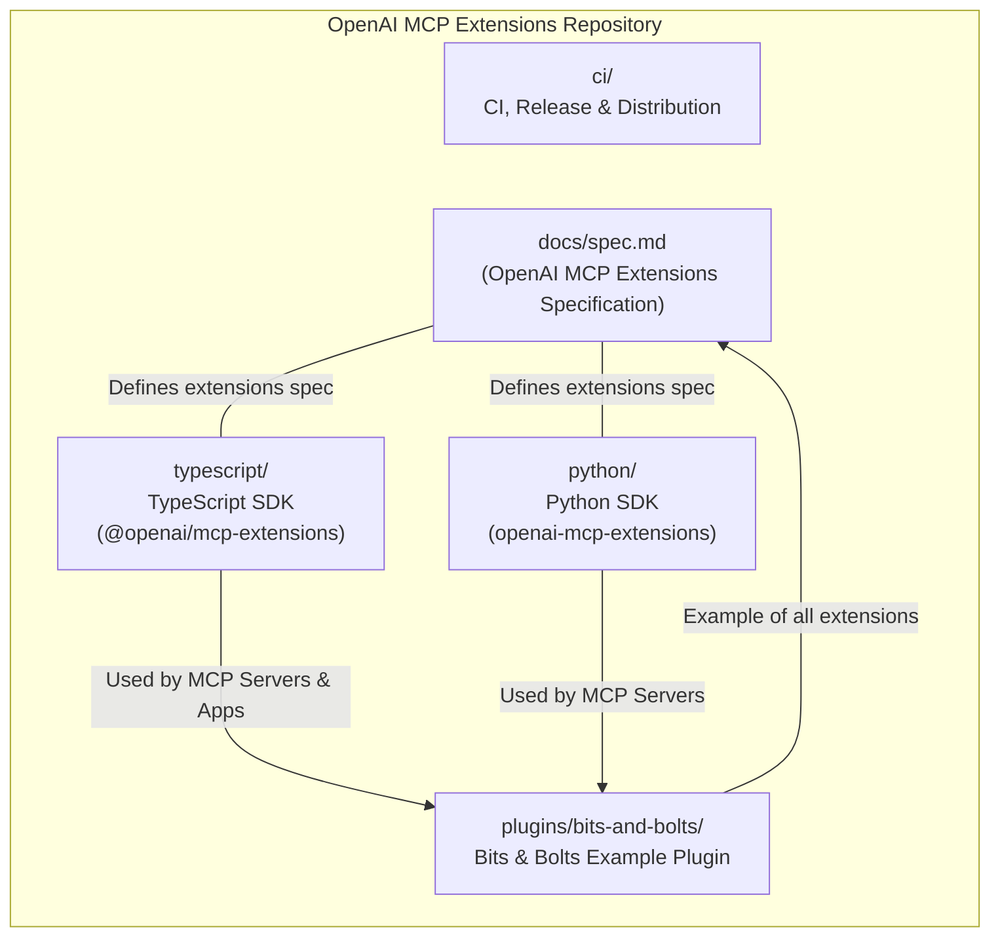
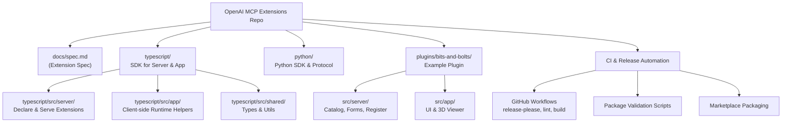
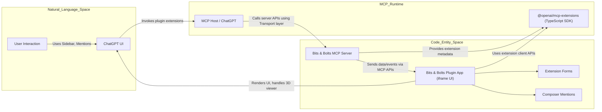
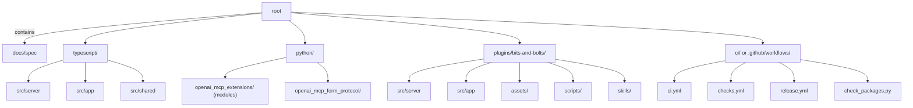
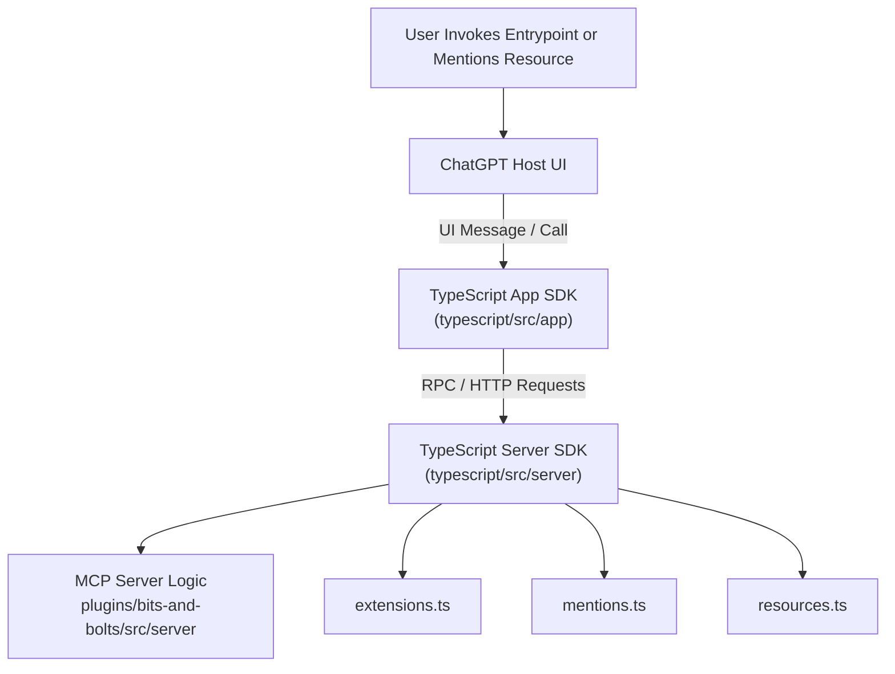
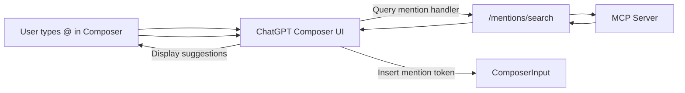
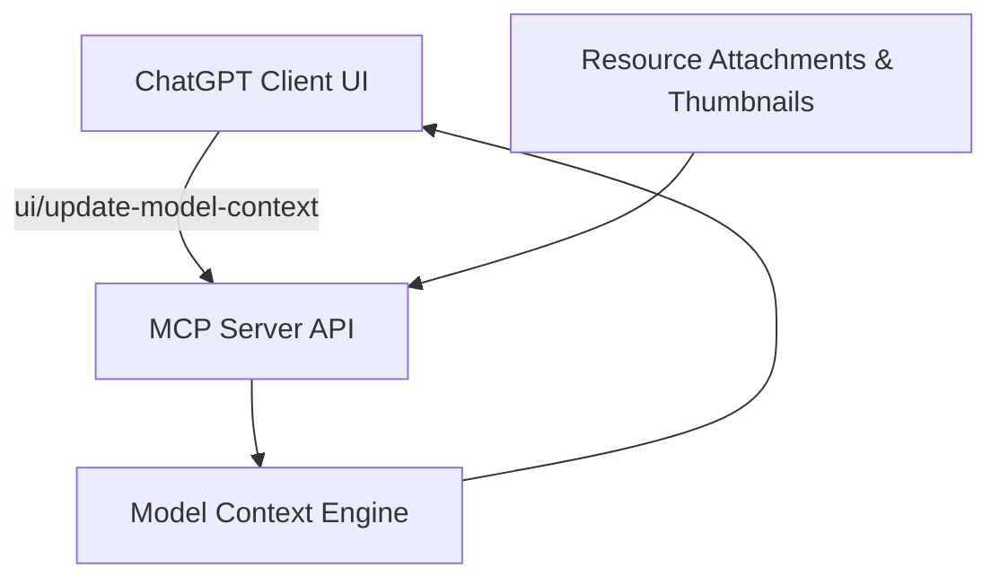
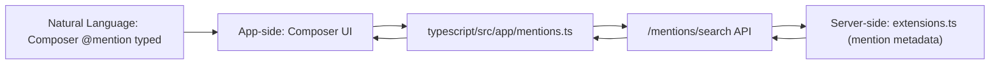
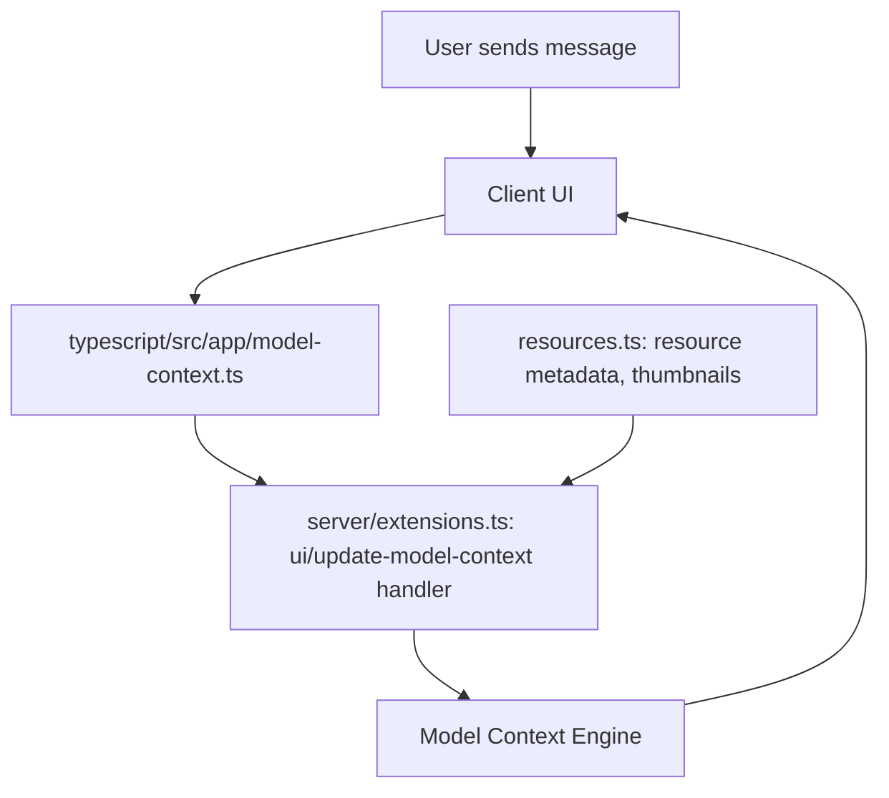
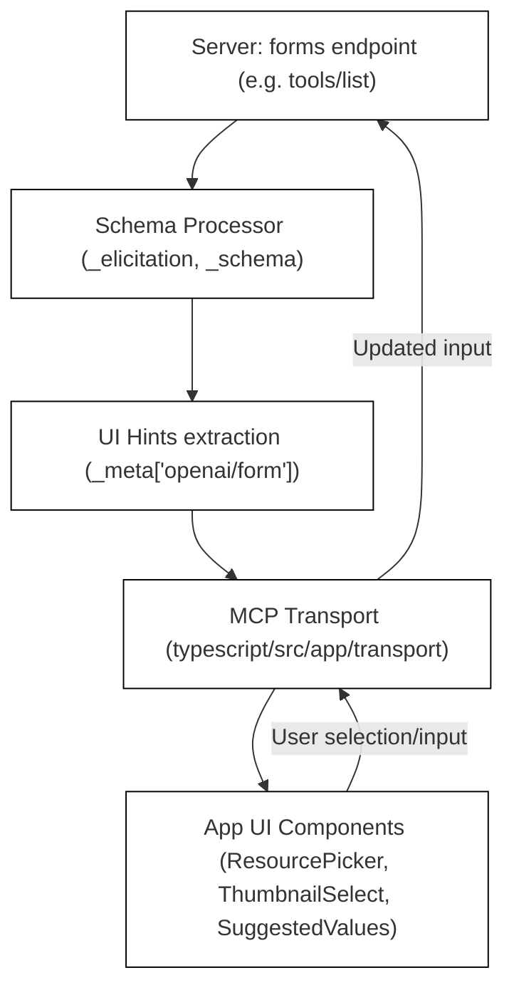

# Page: Overview

# 1 Overview

<details>
<summary>Relevant source files</summary>

The following files were used as context for generating this wiki page:

- [AGENTS.md](AGENTS.md)
- [README.md](README.md)
- [docs/spec.md](docs/spec.md)

</details>


This page provides a high-level introduction to **OpenAI MCP Extensions**, an open-source project that builds ChatGPT-specific extensions on top of the Model Context Protocol (MCP) and MCP Apps. The extensions enable developers to build richer, first-class plugins for ChatGPT by layering additional capabilities on the MCP foundation, allowing native-like integration with ChatGPT interfaces.

---

## What is OpenAI MCP Extensions?

OpenAI MCP Extensions augment the MCP ecosystem to enable deeper integration for ChatGPT and its related platforms (ChatGPT Work, Desktop, Mobile). MCP specifies how plugins ("MCP Apps") interact with host environments and share context. These extensions add functionality such as:

- Sidebar, thread, and file entrypoints for MCP Apps
- Composer mentions to link plugin resources into chat
- Custom file viewers for plugin-defined file types
- Advanced form elicitation with UI extensions like thumbnail pickers
- Structured settings support
- Deep linking, onboarding, and model context updates for richer plugin UX

The emphasis is providing granular, ChatGPT-native UX elements while maintaining compatibility with the MCP specification.

For an in-depth explanation of these extensions and their design rationale, see [The Extensions Specification](#2).

Sources: `README.md:1-33`, `docs/spec.md:1-131`


---

## Repository Layout and Components Overview

The codebase is organized as a monorepo with distinct packages and directories serving different roles in extensions development:



- **`docs/spec.md`**: The formal specification of MCP extensions, detailing each extension type and its interaction with MCP and ChatGPT platforms.
- **TypeScript SDK (`typescript/`)**: SDK for MCP servers and apps, providing server-side helpers, app-side runtime clients, and shared utilities.
- **Python SDK (`python/`)**: Python API mirroring the spec, mainly targeting MCP server implementations.
- **Bits & Bolts Example Plugin (`plugins/bits-and-bolts/`)**: A fully featured demo plugin showcasing usage of all MCP extensions (e.g., file viewers, resource pickers).
- **CI and Release Tooling**: GitHub workflows, release automation, package validation, and marketplace packaging.

Each component is designed to interoperate smoothly, with the SDKs following the specification and the demo plugin serving as a reference implementation.

For details, see [Repository Layout & Conventions](#1.2).

Sources: `README.md:1-33`, `docs/spec.md:1-131`


---

## Key System Entities and Their Relationships to Code Artifacts

Below we map the conceptual spaces from natural language ChatGPT features to concrete codebase entities, illustrating how users experience plugin extensions and what code elements implement them.

### Diagram 1: MCP Extensions Feature Space to SDK and Spec Artifacts

```mermaid
graph LR
  NL["Natural Language Feature Space"]
  CE["Code Entity Space"]

  NL -->|Defines Extensions| CE_1["docs/spec.md\n(openai/ui entrypoints, forms, mentions, settings)"]
  CE_1 -->|Implemented By| CE_2["typescript/src/server/extensions.ts\nmentions.ts\nforms/\nsettings.ts\nui.ts"]
  CE_1 -->|Mirrored By| CE_3["python/openai_mcp_extensions/\nextensions.py\nmentions.py\nforms.py\nsettings.py\nui.py"]
  CE_2 -->|Consumed By| CE_4["plugins/bits-and-bolts/src/server/"]
  CE_4 -->|Demonstrated In| NL

  NL --> "ChatGPT UI & UX"
  CE --> "SDKs & Plugin Code"
```

This shows how the specification (`docs/spec.md`) defines interfaces used in the TypeScript and Python SDKs to declare extension behaviors, which are exemplified by the Bits & Bolts plugin.

### Diagram 2: MCP Extensions Repository Layout to Main Roles & Artifacts



This diagram clarifies how directories map to roles in development and deployment.

Sources: `README.md:1-33`, `docs/spec.md:1-131`


---

## How It All Fits Together

1. **Extensions Specification** (`docs/spec.md`) defines the new capabilities layered on MCP and MCP Apps, specifying JSON schemas, metadata fields (like `_meta["openai/ui"]`), and supported UI components such as entrypoints, mentions, and forms.

2. **TypeScript SDK** implements helpers to declare extension metadata on servers and support app-side runtime APIs in the iframe environment that MCP Apps run in. It focuses on MCP Servers and App frontends running JavaScript.

3. **Python SDK** provides a mirror of the extensions specification for Python-based MCP Servers, supporting plugin backend implementations that prefer Python.

4. **Bits & Bolts Plugin** uses both SDKs culminating in a real-world plugin that exercises all extensions: custom sidebar entries, thread tabs, file viewers, composer mentions, forms with thumbnails, and others. It serves as both a testbed and example.

5. **CI and Release Tooling** automation ensures code quality, versioning, packaging, and publishing both to public registries (npm, PyPI) and the OpenAI Agent Marketplace with manifests.

---

## Child Pages for In-Depth Information

This overview is purposefully high-level. For detailed guides and technical walkthroughs, visit:

| Section | Topic | Description |
|---------|-------|-------------|
| [Getting Started](#1.1) | Getting Started | Installation of SDKs, running the Bits & Bolts demo plugin, and repository tooling (pnpm workspace, linting, dev commands) |
| [Repository Layout & Conventions](#1.2) | Repository Layout & Conventions | Directory structure, contribution guidelines (AGENTS.md), security policy, licensing |
| [The Extensions Specification](#2) | Extensions Spec Overview | Core design and specification of how OpenAI extensions layer on MCP |
| [TypeScript SDK (@openai/mcp-extensions)](#3) | TypeScript SDK Details | Server-side and app-side APIs, shared types |
| [Python SDK (openai-mcp-extensions)](#4) | Python SDK Details | Python API mirroring the spec, form elicitation protocol |
| [Bits & Bolts Example Plugin](#5) | Example Plugin | Full demo plugin with server and app UI code |
| [CI, Release & Distribution](#6) | Automation and Release | GitHub Actions workflows, release automation and packages |
| [Glossary](#7) | Glossary | Terminology and file pointers |

---

This page sets the stage for navigating the OpenAI MCP Extensions project, explaining its scope as a ChatGPT-centric layering atop MCP, the codespace organization, and how main components relate. Developers can then dive into targeted child pages to explore specific subsystems or get started building MCP extensions with provided SDKs and examples.

---

Sources:
- `README.md:1-62`  
- `docs/spec.md:1-131`  
- `AGENTS.md:1-2`

---

# Page: Getting Started

# Getting Started

<details>
<summary>Relevant source files</summary>

The following files were used as context for generating this wiki page:

- [.gitignore](.gitignore)
- [.prettierignore](.prettierignore)
- [README.md](README.md)
- [eslint.config.mjs](eslint.config.mjs)
- [package.json](package.json)

</details>


This page guides you through the initial steps for working with the OpenAI MCP Extensions codebase. It covers installing the SDKs, running the Bits & Bolts example plugin, understanding the repo's tooling setup including pnpm workspace configuration, package.json scripts, linting and formatting tools, and local development commands.

---

## 1. Installing the SDKs

OpenAI MCP Extensions provides two main SDKs to build MCP Servers and Apps:

- **TypeScript SDK**: Available under the `typescript/` directory as the package `@openai/mcp-extensions`. This package supports both the server-side and app-side (iframe) integration for MCP plugins.  
- **Python SDK**: Available under the `python/` directory as the package `openai-mcp-extensions`. This is for server implementations written in Python.

To add the SDKs to your MCP server or app project, follow these:

- For TypeScript, install the SDK package with your preferred package manager (using `pnpm` recommended to stay consistent).  
- For Python, install the `openai-mcp-extensions` package via PyPI or from source, depending on your environment.

The README.md file provides direct links and references to SDK installation instructions under sections "1. Create a plugin" and "2. Add the SDKs to your MCP server" which elaborate on setup steps. See lines 33-54 in README.md for details.

---

## 2. Trying the Bits & Bolts Plugin

The "Bits & Bolts" plugin serves as a showcase of MCP Extensions capabilities. It demonstrates:

- Sidebar entrypoints allowing access from the ChatGPT sidebar.  
- File extension handlers to render custom file viewers (e.g., 3D CAD parts).  
- Composer mentions to search and reference plugin resources in messages.  
- Extended forms supporting thumbnail selectors.

### How to try it out:

1. Install the **Bits & Bolts Remote** plugin in ChatGPT via the provided plugin directory link (see README.md lines 35-41).  
2. Open the plugin using the sidebar to explore its Parts Library UI as shown in the provided screenshots.  

This example plugin includes both server and app components to demonstrate the full stack usage of MCP Extensions, detailed further in section 5 of the documentation.

---

## 3. Repository Tooling Overview

This repository is structured as a **pnpm workspace** managing several interconnected packages including the core SDKs, example plugin, and tooling scripts.

### 3.1. pnpm Workspace

- The root `package.json` (lines 1-30) defines the workspace with `"private": true` and manages overall dev dependencies and scripts.
- The package manager is pinned to `"pnpm@11.19.0"` with Node engine version set to `>=22`.
- The workspace enables running commands across all packages or filtering by specific package names.

### 3.2. package.json Scripts

Key scripts defined in the root `package.json` include:  

| Script          | Description                                                                               |
|-----------------|-------------------------------------------------------------------------------------------|
| `build`         | Runs build commands in all packages recursively.                                         |
| `format`        | Checks code formatting using Prettier.                                                  |
| `format:fix`    | Auto-fixes formatting issues with Prettier.                                             |
| `lint`          | Runs ESLint on the workspace, disallowing warnings (max 0).                             |
| `types`         | Typescript type-check only for the core `@openai/mcp-extensions` package.                |
| `plugins:types` | Type-check for the "bits-and-bolts" plugin package.                                     |
| `plugins:build` | Build the "bits-and-bolts" plugin package.                                              |
| `check`         | Runs formatting, linting, typing, building and plugin package checks as a full validation.|

These scripts automate code quality and build processes to streamline local development and CI.

### 3.3. Linting with ESLint

The ESLint configuration is defined in `eslint.config.mjs` using TypeScript ESLint with rules customized:

- Consistent type imports enforced.
- Unused variables throw errors with exceptions for those prefixed with `_`.
- Console output disallowed to maintain clean logs.

Ignores common directories such as `.venv`, `coverage`, and `node_modules` to speed processing.

### 3.4. Formatting with Prettier

Prettier configuration is supplemented by `.prettierignore` which excludes common folders and generated files like:

- `node_modules/`  
- `.venv/`  
- `__pycache__/`  
- Build artifacts like `dist/` and `build/`  
- Lock files and changelogs managed automatically

### 3.5. .gitignore

The `.gitignore` file excludes typical development-generated files and folders:

```text
node_modules/
.venv/
__pycache__/
*.pyc
*.egg-info/
dist/
build/
/.local/
*.tgz
.env
.env.*
.DS_Store
python/uv.lock
```

This helps keep the repository free from environment-specific or build artifacts.

---

## 4. Local Development Commands

To facilitate local development, use the root `package.json` scripts with `pnpm`. Useful commands include:

- **Build all packages**:  
  ```bash
  pnpm build
  ```
- **Check code formatting without changes**:  
  ```bash
  pnpm format
  ```
- **Auto-fix formatting issues**:  
  ```bash
  pnpm format:fix
  ```
- **Run linting (errors only)**:  
  ```bash
  pnpm lint
  ```
- **Type-check core SDK**:  
  ```bash
  pnpm types
  ```
- **Build and type-check the bits-and-bolts plugin**:  
  ```bash
  pnpm plugins:build
  pnpm plugins:types
  ```
- **Full validation including packaging checks**:  
  ```bash
  pnpm check
  ```

These scripts are designed to maintain high code quality and consistency.

---

## 5. Data Flow and Implementation Highlights

The MCP Extensions framework is composed of several intersecting layers:

- **SDKs** provide the type-safe APIs for building MCP servers and apps.
- The **Bits & Bolts plugin** is a full example that integrates server APIs, IPC with the MCP host, file viewers, and UI components.
- The **package scripts and tooling** ensure build, lint, format, and type enforcement across the repo.

### High-level data flow with Bits & Bolts context:



This diagram illustrates how user interactions in ChatGPT UI reach the Bits & Bolts plugin via MCP hosting and extension SDKs.

---

## 6. Repo Structure & Development Flow

- Root manages the workspace and scripts (`package.json`).
- SDK codebases reside under `typescript/` and `python/`.
- The Bits & Bolts example plugin lives in `plugins/bits-and-bolts/`, showing usage of every major extension type.
- Development uses pnpm to build, lint, format, and test packages.
- ESLint and Prettier configurations enforce code style conventions.
- .gitignore ensures environment and build artifacts are kept out of version control.

This integrated tooling setup yields a streamlined and consistent development experience.

---

# Summary

This "Getting Started" page covered the essential initial steps to work with OpenAI MCP Extensions:

- Installing the TypeScript and Python SDKs.  
- Exploring the Bits & Bolts example plugin functionality.  
- Repository tooling including pnpm workspace, scripts, ESLint and Prettier usage.  
- Local development commands for build, lint, type-check, and packaging validation.  
- High-level implementation data flow tying natural language user interactions to code-level MCP extension entities.

You are now prepared to dive deeper into the extensions specification, SDK usage, or plugin development.

---

### Sources:

- `README.md:1-62`  
- `package.json:1-30`  
- `eslint.config.mjs:1-33`  
- `.prettierignore:1-15`  
- `.gitignore:1-15`

---

# Page: Repository Layout & Conventions

# Repository Layout & Conventions

<details>
<summary>Relevant source files</summary>

The following files were used as context for generating this wiki page:

- [AGENTS.md](AGENTS.md)
- [LICENSE](LICENSE)
- [SECURITY.md](SECURITY.md)

</details>


This page provides a detailed directory-by-directory overview of the repository structure of **openai/mcp-extensions**, important contribution and agent conventions, the security policy, and licensing information. The intent is to familiarize contributors and maintainers with the organization of the codebase, key conventions to follow when contributing, and how governance is structured regarding security and licensing. This is a LEAF page without child pages.

---

## 1. Repository Directory Structure

The repository is organized to separate documentation/specifications, SDK implementations, example plugins, and CI/release automation scripts into well-defined directories and files.

### Key Top-Level Directories

- **`docs/spec`**  
  Contains specification documents defining the extension mechanisms layered on top of MCP via `_meta` namespaces.  
  (Referenced in overview, Doc pages)

- **`typescript/`**  
  TypeScript SDK implementation split between server helpers, app-side client helpers (in-iframe), and shared utilities/types. Provides the client and server extension APIs.  
  Main folders:  
  - `src/server` — Server extensions (e.g., `extensions.ts`, `mentions.ts`)  
  - `src/app` — App runtime helpers (e.g., `transport.ts`, `deep-link.ts`)  
  - `src/shared` — Shared types and utilities

- **`python/`**  
  Python SDK packages mirroring the TypeScript SDK API surface for extensions and form elicitation protocol.  
  Packages include `openai_mcp_extensions` and `openai_mcp_form_protocol`.  
  Key modules: `extensions.py`, `mentions.py`, `resources.py`, `settings.py`, and form-related `_elicitation.py`.

- **`plugins/bits-and-bolts/`**  
  A comprehensive example plugin demonstrating all extension features, built as a CAD parts plugin.  
  Subfolders include:  
  - `src/server` — Plugin MCP server with catalog, stores, forms, test fixtures  
  - `src/app` — Plugin app UI and 3D viewer including Three.js usage  
  - `assets/` — Icons, keycap legends, JSON meshes  
  - `scripts/` — Build and model generation scripts  
  - `skills/` — Sub-plugins for onboarding and bits-and-bolts domain logic

- **`ci/` or `.github/workflows/`**  
  CI pipelines and release automation configuration, including workflows for linting, building, testing, and publishing. Key files:  
  - `ci.yml` and `checks.yml` — GitHub Actions workflow definitions  
  - `release.yml`, `release-please` config, and scripts for PyPI/npm trusted publishing  
  - `check_packages.py` — Package validation scripts  
  - Marketplace packaging manifests and builders

---

### Directory Layout Diagram



Sources: License, Security.md, AGENTS.md

---

## 2. Contribution and Agent Conventions

### Markdown Link Conventions

- Contributors must **use only relative Markdown links** when referring to files or sections within this repository. This ensures stable and consistent linking regardless of merge state or fork location.  
- This rule is stipulated explicitly in `AGENTS.md`.  
- Relative Markdown linking supports intra-repo navigation and automated documentation processing.  

### Agent and Extension Conventions

- Agent definitions and extensions should follow the internal conventions documented in `AGENTS.md`, which currently emphasizes link usage and submission norms consistent with the repository’s collaborative workflows.

### Security Policy Reference

For security-related contributions, vulnerabilities, or responsible disclosures:

- Refer to the **Security Policy** found in the `SECURITY.md` file, which provides instructions and references OpenAI's coordinated vulnerability disclosure policy.  
- The repository directs reporters to OpenAI’s official vulnerability disclosure guidelines at https://openai.com/security/disclosure/ and provides its PGP key via `security.txt`.  

---

## 3. License

This repository is licensed under the **Apache License Version 2.0**, dated January 2004, which is a permissive open-source license.

### Highlights of the License

- Grants a worldwide, royalty-free, non-exclusive license to use, reproduce, prepare derivative works, distribute, and publicly perform or display the work.  
- Contributions submitted to this repository are covered under the same license terms.  
- Requires redistribution of the license text and prominent notices on modifications.  
- Contains patent licensing provisions with termination clauses for patent litigation against contributors.  

### License File

- The full license text is included verbatim in the `LICENSE` file at the root of the repository.  
- This license governs the usage, distribution, and contribution to all code and documentation within the repo.

---

## 4. Bridging Natural Language Concepts to Code Entities

The repository centers around MCP Extensions, which are mechanism specifications layered on MCP/MCP Apps via the `_meta` namespace. This bridging diagram maps conceptual features of the extensions framework to actual code entities located in the TypeScript SDK and Python SDK.

### Natural Language to TypeScript Server API Mapping

```mermaid
flowchart TD
  NL["Natural Language Features"] --> NSM["_meta Namespaces"]
  NSM --> EXT["Extensions Metadata"]
  EXT --> ETS["typescript/src/server/extensions.ts"]
  EXT --> MTS["typescript/src/server/mentions.ts"]
  EXT --> RTS["typescript/src/server/resources.ts"]
  EXT --> STS["typescript/src/server/settings.ts"]
  EXT --> UTS["typescript/src/server/ui.ts"]
  EXT --> FMS["typescript/src/server/forms/"]

  classDef code fill:#f9f,stroke:#333,stroke-width:1px
  ETS, MTS, RTS, STS, UTS, FMS class code
```

### Natural Language to Python SDK Mapping

```mermaid
flowchart TD
  NL2["Natural Language Features"] --> NSM2["_meta Namespaces"]
  NSM2 --> EXT2["Extensions Metadata Layer"]
  EXT2 --> EPY["openai_mcp_extensions/extensions.py"]
  EXT2 --> MPY["openai_mcp_extensions/mentions.py"]
  EXT2 --> RPY["openai_mcp_extensions/resources.py"]
  EXT2 --> SPY["openai_mcp_extensions/settings.py"]
  EXT2 --> UIPY["openai_mcp_extensions/ui.py"]
  EXT2 --> FPPY["openai_mcp_form_protocol/_elicitation.py"]

  classDef code fill:#f9f,stroke:#333,stroke-width:1px
  EPY, MPY, RPY, SPY, UIPY, FPPY class code
```

These conceptual diagrams assist developers in locating the relevant entry points and modules when implementing or debugging particular MCP extension features.

Sources: typescript/src/server/extensions.ts, python/openai_mcp_extensions/extensions.py, AGENTS.md, SECURITY.md, LICENSE

---

# Summary

This section disclosed:

- The high-level repository layout spanning specification docs, SDKs (TypeScript & Python), a rich example plugin, and CI/release tooling.  
- Conventions for contributions and agent development focusing on Markdown linking and security considerations.  
- The Apache 2.0 License terms governing use and contribution.  
- Bridging diagrams tying natural language feature abstractions of MCP Extensions to precise code modules in the SDKs.

By following these directory and code conventions, contributors can efficiently navigate, develop, and maintain the repository with clear governance and security alignment.

---

Sources:  
* `AGENTS.md`  
* `LICENSE` (lines 1-125)  
* `SECURITY.md`

---

# Page: The Extensions Specification

# The Extensions Specification

<details>
<summary>Relevant source files</summary>

The following files were used as context for generating this wiki page:

- [docs/spec.md](docs/spec.md)

</details>


The Extensions Specification defines the set of extensions built atop the foundational Model Context Protocol (MCP) and MCP Apps specifications. These extensions enable deeper integration with ChatGPT platforms, including ChatGPT Work, Desktop, and mobile clients, allowing developers to create richer, more interactive plugins and features that extend beyond the baseline MCP capabilities.

This specification is captured primarily in the repository’s `docs/spec.md` file and details how extensions leverage the `_meta` namespaces within MCP data structures to layer new functionality. Most users and developers will find it easier to engage with these extensions through the provided TypeScript and Python SDKs, which encapsulate and simplify adherence to the specification.

## What Are MCP Extensions?

The Model Context Protocol (MCP) is a foundational protocol defining data structures and interface contracts for interoperable applications integrated with AI models. MCP Apps are applications implemented according to the MCP spec.

Extensions to MCP presented here extend MCP by defining specialized metadata within `_meta` namespaces of MCP data types to enable capabilities tightly coupled to ChatGPT and the OpenAI ecosystem. These extensions influence UI behaviors, app entrypoints, resource management, form elicitation, settings schemas, and others.

In essence:

- MCP Apps define the standard interface and state for apps integrated with MCP-compatible hosts.
- MCP Extensions extend MCP Apps by using `_meta` namespaces as "extension points."
- These extension points signal to ChatGPT host clients how to render UI elements, invoke entrypoints, manage resources, collect structured user input, and more.

This _meta-based layering maintains backward compatibility with MCP hosts while enabling a richer, ChatGPT-specific feature set.

## High-Level Architecture Diagram

```mermaid
graph LR
  subgraph "ChatGPT Host Environment"
    ChatUI["ChatGPT UI"]
    ModelLayer["OpenAI Model API"]
    MCPHost["MCP Host Runtime"]
  end

  subgraph "Extensions Layer (via _meta namespaces)"
    MetaUI["_meta[\"openai/ui\"]"]
    MetaResource["_meta[\"openai/resources\"]"]
    MetaForms["_meta[\"openai/forms\"]"]
    MetaSettings["_meta[\"openai/settings\"]"]
  end

  subgraph "MCP Apps & MCP Base"
    MCPApps["MCP Apps"]
    MCPSpec["MCP Base Spec"]
  end

  ModelLayer --> MCPHost
  MCPHost --> MCPApps
  MCPApps --> MCPSpec

  MCPApps --> MetaUI
  MCPApps --> MetaResource
  MCPApps --> MetaForms
  MCPApps --> MetaSettings

  MetaUI --> ChatUI
```

This diagram illustrates the layering: extensions live inside `_meta` keys in MCP Apps data structures, and are interpreted by the ChatGPT host UI to enable enhanced interactions beyond vanilla MCP capabilities.

---

## Core Extension Areas & Links to Child Pages

The extensions specification encompasses several feature families, each described in detail on dedicated child pages. Below is a high-level overview with links pointing to these more granular documents:

### 1. App Entrypoints & Display Modes

Extensions allow MCP servers to register specific static entrypoints that users can access directly from ChatGPT’s navigation and UI, rather than invoking apps solely via AI model calls.

- Entry points include:
  - **Global Entrypoint:** A full-screen app accessible from primary sidebar navigation.
  - **Thread Entrypoint:** A tab within an existing conversation thread.
  - **File Entrypoint:** A handler that can render files referenced inside threads.

Entry points contain associated metadata such as icons and titles to integrate seamlessly into the ChatGPT UI’s navigation model.

Display modes configure how resources and UI components are shown to the user within ChatGPT.

For detailed descriptions of entrypoints, icon guidelines, display modes, deep links, platform support and plugin onboarding flows, see [App Entrypoints & Display Modes](#2.1).

---

### 2. Resources, Mentions & Model Context

This domain covers how MCP extensions support rich interactions with resources, such as:

- At-mentions within the composer, enabling users to invoke or reference applications and data entities.
- Resource search and display modes that enrich UI rendering.
- Access to local filesystem resources or file opening requests.
- Extensions that update model context dynamically to optimize AI model input for current UI or user focus.
- Support for rich thumbnails and media rendering.

Refer to [Resources, Mentions & Model Context](#2.2) for the comprehensive protocol and integration details.

---

### 3. Forms & Elicitation

OpenAI’s form elicitation protocol defines a standardized schema and messaging protocol within the extensions framework to collect structured user inputs seamlessly.

- It includes schema definitions for forms.
- Resource pickers allow users to select resources in context.
- Thumbnail selectors and suggested value lists facilitate advanced UI components and assistive completions.

The protocol aligns with MCP UI extensions and can prompt users naturally to fill required fields during interactions.

See [Forms & Elicitation](#2.3) for further technical details.

---

### 4. Structured Settings

Structured Settings extensions define how plugins expose configurable settings via structured schemas.

- The MCP extensions framework specifies entrypoints for settings management.
- Schema allows for rich data types and validation.
- Enables user-friendly settings integration within ChatGPT plugins.

Settings data and UI hints are conveyed through the `_meta` namespaces for consistent client-side rendering.

More on the schema and settings entrypoint are available at [Structured Settings](#2.4).

---

## Relationship Between Extension Areas

| Extension Area              | Role in MCP Extensions                           | Related Extensions                                  |
|----------------------------|-------------------------------------------------|----------------------------------------------------|
| App Entrypoints & Display Modes | Define how apps surface in UI & provide entry points | Deep links, icons, plugin onboarding                |
| Resources, Mentions & Context    | Manage resources referenced or selected by users | Model context updates, resource display & search    |
| Forms & Elicitation              | Collect structured multi-field user input via UI | Resource pickers, suggested values                   |
| Structured Settings              | Provide user-configurable plugin options         | Settings transport, UI rendering                      |

These extensions build on each other: entrypoints expose apps, which may leverage rich resource interactions and forms, all configurable through structured settings, creating a cohesive plugin experience fully integrated with ChatGPT.

---

## Platform Support Summary

Platform support varies for each extension feature depending on the client environment (Desktop, Web/Work, iOS, Android). For example, file entrypoints and certain resource operations are supported only on Desktop clients, while others, like global entrypoints and structured settings, have broader support.

The specification includes a comprehensive platform support matrix, describing expected support at launch with notes on limitations.

---

## Summary

- This specification layers MCP extensions via `_meta` namespaces to unlock rich ChatGPT integrations.
- Key extension areas are App Entrypoints & Display Modes, Resources & Mentions, Forms & Elicitation, and Structured Settings.
- These are implemented and surfaced via metadata conventions interpreted by ChatGPT hosts.
- Child pages provide comprehensive technical details and usage guides per functional area.
- TypeScript and Python SDKs ease implementation by wrapping these protocols.

For detailed exploration of each feature family, follow the links to the child documents:

- [App Entrypoints & Display Modes](#2.1)
- [Resources, Mentions & Model Context](#2.2)
- [Forms & Elicitation](#2.3)
- [Structured Settings](#2.4)

---

# Bridging Natural Language Descriptions to Code Entities

Two diagrams follow, illustrating how natural language concepts map to code artifacts within the MCP extensions codebase.

### Diagram 1: From User Actions to MCP Server Side Code Entities



- User triggers entrypoint or mentions in the ChatGPT UI.
- The app-side SDK (`typescript/src/app`) sends requests to server-side SDK (`typescript/src/server`).
- Server SDK modules handle the metadata and extensions: `extensions.ts` for general extensions logic, `mentions.ts` for at-mention handling, `resources.ts` for resource queries.
- Actual app logic resides in MCP Servers, e.g. `plugins/bits-and-bolts/src/server`.

Sources: `docs/spec.md:30-131`, `typescript/src/server/extensions.ts`, `typescript/src/server/mentions.ts`, `typescript/src/server/resources.ts`.

---

### Diagram 2: Metadata Namespaces to Extension Feature and Code Mapping

```mermaid
graph LR
  MetaMeta["_meta Namespace"]
  UIExt["openai/ui"]
  ResExt["openai/resources"]
  FormsExt["openai/forms"]
  SettingsExt["openai/settings"]

  UIExt --> EntryPoints["Entry Points\n(e.g. _meta[\"openai/ui\"][\"entrypoints\"])\nTools & Icons Metadata"]
  ResExt --> Mentions["Mentions & Resource Display\nAt-mentions, Thumbnails, Filesystem"]
  FormsExt --> Forms["Form Protocol\nSchemas, Pickers, Suggested Values"]
  SettingsExt --> Settings["Structured Settings\nSchemas and UI"]

  EntryPoints --> UIClient["ChatGPT UI"]
  Mentions --> UIClient
  Forms --> UIClient
  Settings --> UIClient
```

This figure maps core `_meta` namespaces in MCP extensions to their respective functional feature sets and how they affect ChatGPT UI rendering and behavior.

Sources: `docs/spec.md:18-132`.

---

# References

- `docs/spec.md` (full specification overview and platform support matrix)
- `typescript/src/server/extensions.ts` (server extension APIs)
- `typescript/src/server/mentions.ts` (at-mention server logic)
- `typescript/src/server/resources.ts` (resource and file handling)
- `plugins/bits-and-bolts/src/server` (example MCP Server implementation)

---

**Sources:**  
`docs/spec.md:1-131`(), `typescript/src/server/extensions.ts:1-100`(), `typescript/src/server/mentions.ts:1-100`(), `typescript/src/server/resources.ts:1-100`()

---

# Page: App Entrypoints & Display Modes

# App Entrypoints & Display Modes

<details>
<summary>Relevant source files</summary>

The following files were used as context for generating this wiki page:

- [docs/resources/01-global-library.png](docs/resources/01-global-library.png)
- [docs/resources/02-thread-tray.png](docs/resources/02-thread-tray.png)
- [docs/resources/03-file-viewer.png](docs/resources/03-file-viewer.png)
- [docs/resources/11-display-modes.png](docs/resources/11-display-modes.png)
- [docs/resources/12-plugin-onboarding.png](docs/resources/12-plugin-onboarding.png)
- [docs/spec.md](docs/spec.md)

</details>


This page covers the technical details of how OpenAI MCP Extensions support entrypoints, display modes, deep linking, icons, titles, and plugin onboarding within the ChatGPT ecosystem and MCP Apps. It also includes the platform support matrix describing which features are available where.

---

## Purpose and Scope

OpenAI MCP Extensions build on top of the Model Context Protocol (MCP) and MCP Apps to enable richer UI integrations, especially within ChatGPT products like ChatGPT Work, Desktop, and Mobile. This page explains:

- The types of MCP App entrypoints supported (global, thread, file).
- How icons and titles for entrypoints are managed.
- Display modes for resource presentation.
- Deep linking semantics for app invocation.
- The plugin onboarding process.
- Support across platforms (Desktop, Web, iOS, Android).

This is a LEAF page, focusing on full technical detail with schemas, behavior, and implementation notes.

---

## 1. MCP App Entrypoints Overview

MCP Apps are usually invoked by the model dynamically during chat sessions, but OpenAI Extensions enable static entrypoints that allow users to launch apps directly via navigation or file handlers.

Three distinct entrypoints can be registered by an MCP Server in the app's `_meta["openai/ui"]["entrypoints"]` array:

| Entrypoint Type | Description                                      |
|-----------------|--------------------------------------------------|
| **Global**      | App accessible from the primary sidebar navigation; opens fullscreen with a permanent tab. |
| **Thread**      | Content tab inside a conversation thread, contextual to that thread. |
| **File**        | File extension handler that renders files linked in any thread. |

### Implementation Details

- Entrypoints are declared in the MCP App manifest or server responses by adding the `openai/ui.entrypoints` array.
- Each entrypoint must have an identifier `type` set as `"global"`, `"thread"`, or `"file"`.
- The server must accept an empty arguments object `{}` for global entrypoints.
- Thread and file entrypoints require relevant context (thread, file metadata).

### Icon Management for Entrypoints

Icons are critical for user identification in navigation elements.

- Each entrypoint tool should provide an SVG icon in `tools/list` → `icons`.
- Requirements for icons:
  - SVG format with monochrome strokes.
  - 20x20 px viewport.
  - Use `currentColor` for stroke color.
  - Transparent background.
  - Follow [sidebar icon template](https://www.figma.com/design/k1TPwkpYDbcRQrU34nUnNL/Plugin-icon-template?node-id=0-1) guidelines.
- Icon Resolution Order:
  1. Entry tool icons (`tools/list.icons`).
  2. MCP Server’s local icon from `_meta["io.modelcontextprotocol/serverInfo"]["icons"]` or fallback serverInfo icons.
  3. Generic default icon.

### Titles for Entrypoints

- Servers should provide a human-readable title for each entrypoint.
- The title resolution priority is:
  1. `tools/list[].title`
  2. `tools/list[].annotations["title"]`
  3. `tools/list[].name`

Titles appear in tabs or sidebar to inform users about the entrypoint’s function.

---

## 2. Entrypoint Types and Behaviors

### 2.1 Global Entrypoint

- Accessible via the permanent sidebar navigation.
- Opens fullscreen with a composer and thread layout.
- Receives empty args `{}` at open.
- On desktop, supports permanent tabs with full model context updates.
- The Bits & Bolts plugin "Global CAD Parts Library" is an example.
  
```ts
interface GlobalEntrypoint {
  type: "global";
}
```

### 2.2 Thread Entrypoint

- Embedded as a tab inside a chat thread.
- Server provides a thread-unique UI view title.
- Title typically differs from the plugin name (e.g., "Parts Tray" for Bits & Bolts plugin).
- Thread-specific model context and messages connect to this entrypoint.

### 2.3 File Entrypoint

- Acts as a file extension handler for rendering referenced files inside any thread.
- Allowed file extensions are listed in the MCP Server manifest.
- Not supported on web or mobile platforms at launch.
- Enables rendering of complex file types (e.g., CAD parts).

---

## 3. Display Modes

Display modes define how a resource or extension UI is presented to the user. MCP Extensions support several display modes across platforms.

### Supported Display Modes

- **Fullscreen**: Takes up the entire chat or app container.
- **Pane**: Splits the interface with multiple panes.
- **Thread Tab**: Shown as a tab inside a thread.
- **File Viewer**: Rendering a file inline or in viewer mode.

Display mode metadata is typically declared in `_meta` fields within the MCP App or extension responses.

An illustrative display mode UI example is shown in the `docs/resources/11-display-modes.png`.

---

## 4. Deep Links

MCP Apps support deep linking via resource URIs.

- Deep links enable launching specific views or state inside an app.
- Format: `ui://pluginName/viewName?queryParams`
- Deep link support varies by platform; Android lacks this at launch.
- Deep links help rapidly navigate to entrypoints or resource views programmatically.

---

## 5. Plugin Onboarding

- Plugins can define an onboarding sequence to guide users through initial setup.
- Onboarding processes are activated when users first install or open a plugin.
- Onboarding content and flows are defined within the MCP server metadata.
- See the example onboarding visual in `docs/resources/12-plugin-onboarding.png`.

---

## 6. Platform Support Matrix

| Feature                         | Desktop | Web    | iOS         | Android      |
|--------------------------------|---------|--------|-------------|--------------|
| Global Entrypoint              | Yes     | Yes    | Yes         | Yes          |
| Thread Entrypoint              | Yes     | Yes    | Yes         | Yes          |
| File Entrypoint                | Yes     | No     | No          | No           |
| Structured Settings            | Yes     | Yes    | Yes         | Yes          |
| Resource Display Modes         | Yes     | Yes    | Yes         | Yes          |
| MCP App Deep Links             | Yes     | Yes    | Yes         | No           |
| Messages                      | Yes     | Yes    | Partial*    | Partial*     |
| Plugin Onboarding              | Yes     | Yes    | Yes         | Yes          |

_* Partial indicates limited feature support or platform restrictions._

---

## 7. Data Flow and Key Interfaces

### MCP Server → Client Flow for Entrypoint Registration

- MCP Server publishes `tools/list` metadata describing available entrypoints, icons, titles, and supported behaviors.
- The `_meta["openai/ui"]["entrypoints"]` key in the tool metadata specifies entrypoint types.
- When a user opens an entrypoint, the MCP Client launches the app context with the tool identified.
- Entrypoint UI and data are rendered using the initial tool result to minimize server calls.

### Key Classes and Functions (TypeScript SDK)

- `ExtensionSpec` — defines the MCP Extensions specification (docs/spec.md).
- MCP App tools metadata: `tools/list` entries declare icons, titles, entrypoints.
- Entrypoint invocation uses empty `{}` args (global) or contextual args (thread,file).
- Icon resolution prioritizes `tool.icons` then `serverInfo.icons`.

---

## 8. Natural Language Space to Code Entity Space Diagrams

### Diagram 1: MCP App Entrypoints - Natural Language to Code

```mermaid
graph TD
  NL_GlobalEntrypoint["Natural Language: Global Entrypoint"]
  NL_ThreadEntrypoint["Natural Language: Thread Entrypoint"]
  NL_FileEntrypoint["Natural Language: File Entrypoint"]
  
  Code_EntryPoints["_meta[\"openai/ui\"][\"entrypoints\"] in MCP App manifest/tools"]
  Code_ToolIcon["tools/list[].icons (SVG icons)"]
  Code_ToolTitle["tools/list[].title / annotations[\"title\"] / name"]
  Code_ServerInfoIcon["_meta[\"io.modelcontextprotocol/serverInfo\"][\"icons\"]"]
  
  NL_GlobalEntrypoint --> Code_EntryPoints
  NL_ThreadEntrypoint --> Code_EntryPoints
  NL_FileEntrypoint --> Code_EntryPoints
  Code_EntryPoints --> Code_ToolIcon
  Code_EntryPoints --> Code_ToolTitle
  Code_ToolIcon --> Code_ServerInfoIcon
```

### Diagram 2: Display Modes and Platform Support

```mermaid
graph TD
  NLP_DisplayModes["Natural Language: Display Modes"]
  Code_DisplayModes["_meta[\"openai/ui\"][\"displayModes\"] and UI rendering"]
  
  Platform_Desktop["Platform: Desktop"]
  Platform_Web["Platform: Web"]
  Platform_iOS["Platform: iOS"]
  Platform_Android["Platform: Android"]
  
  NLP_DisplayModes --> Code_DisplayModes
  Code_DisplayModes --> Platform_Desktop
  Code_DisplayModes --> Platform_Web
  Code_DisplayModes --> Platform_iOS
  Code_DisplayModes --> Platform_Android
```

---

## 9. Visual References

- **Global Entrypoint UI Sample:**
  

- **Thread Entrypoint Tab UI Sample:**
  

- **File Viewer Entrypoint:**
  

- **Display Modes Overview:**
  

- **Plugin Onboarding Example:**
  

---

## 10. Example JSON Snippet for Global Entrypoint Tool

```json
{
  "name": "cad.library",
  "inputSchema": {
    "type": "object"
  },
  "_meta": {
    "ui": {
      "resourceUri": "ui://bits-and-bolts/library"
    },
    "openai/ui": {
      "entrypoints": [
        {
          "type": "global"
        }
      ]
    }
  }
}
```

---

# References and Sources

- EntryPoints and Icons details: `docs/spec.md:34-131`  
- Platform support matrix and extension features: `docs/spec.md:14-33`  
- Visual assets for UI examples and onboarding stages:  
  - `docs/resources/01-global-library.png`  
  - `docs/resources/02-thread-tray.png`  
  - `docs/resources/03-file-viewer.png`  
  - `docs/resources/11-display-modes.png`  
  - `docs/resources/12-plugin-onboarding.png`  

---

This completes the full technical description of App entrypoints and display modes for OpenAI MCP Extensions.

---

# Page: Resources, Mentions & Model Context

# Resources, Mentions & Model Context

<details>
<summary>Relevant source files</summary>

The following files were used as context for generating this wiki page:

- [docs/resources/05-composer-mention.png](docs/resources/05-composer-mention.png)
- [docs/resources/08-model-context-attachments.png](docs/resources/08-model-context-attachments.png)
- [docs/spec.md](docs/spec.md)

</details>


This page covers the technical details of several integral ChatGPT MCP Extensions related to resource management, at-mentions in the composer, filesystem access, UI updates, model context, and thumbnail handling. These extensions enhance the user experience by enabling richer integration in ChatGPT desktop and related platforms, permitting resource search/display, local file opening, dynamic model context updates, and visual thumbnails. The implementations leverage _meta namespaces layered on top of the MCP protocol, utilizing server and app APIs defined in the specification and SDKs.

---

## 1. Overview

The "Resources, Mentions & Model Context" extension family provides functionality around:  

- At-mentions in the composer for resources (user, thread, or other entities)  
- Searching and displaying resource metadata and thumbnails  
- Accessing local files and performing safe file opening  
- UI-triggered model context updates for improved conversation flow and tool orchestration  
- Packaging resource attachments and thumbnails for model context enrichment

The specification defines these extension capabilities primarily under the `_meta["openai/ui"]` namespace and related sub-namespaces. They are implemented via server-side metadata declarations and app-side APIs that facilitate resource fetching, UI state updates, and file handling.

---

## 2. Composer At-Mentions

Composer at-mentions enable the user to trigger suggestions by typing a special character (generally `@`) in the chat composer input. These mentions can reference various resource types such as users, threads, or plugin-specific objects.

### Implementation

- **Declaration**: The server advertises mention capabilities by listing mention descriptors in the tool’s `_meta["openai/ui"]["mentions"]` array.

- **Mention Descriptor**: Each mention type includes filters and query parameters for searching resources.

- **Usage in Composer**: When the user types `@` followed by characters, the client app calls the mention search provider endpoint declared by the server to fetch and display resource suggestions.

- **Activation**: On selection of a resource from the mentions dropdown, a structured mention token is inserted into the composer.

**Key Elements**:

- Mention metadata: `_meta["openai/ui"]["mentions"]`  
- Mention search endpoint: Typically `/mentions/search` under the server  
- Client-handling of input events and mention dropdown UI

**Data Flow**:


Sources: [docs/spec.md:1-131]()


---

## 3. Resource Search & Display

Resources are structured entities such as users, documents, or plugin-provided objects that can be searched for and displayed within ChatGPT.

### Resource Descriptors

- Each resource has metadata exposed by the server, e.g., name, type, description, and unique identifiers.

- Resources may include thumbnails or icons, enhancing the UI representation.

- Servers provide resource lists and detail lookup APIs.

### Resource Search

- Implemented as part of the "resources" extension family via dedicated endpoints.

- Supports query filters to refine results.

- The Composer and other UI areas can use this API to display rich resource pickers.

### Thumbnails and Attachments

- Resources often have associated image thumbnails.

- These thumbnail URLs are embedded in resource metadata, enabling UIs to preload and display visuals.

- Thumbnail generation and caching are managed server-side, ensuring performance.

Sources: [docs/spec.md:1-131]()

---

## 4. Filesystem Access and Local File Opening

File system related extensions mainly support local file browsing and opening within desktop ChatGPT.

### Local File Opening

- On desktop, extensions can open local files referenced by threads or from the composer context.

- Servers provide explicit metadata and handler info for permitted file types.

- Clients invoke file opening via the `ui/open-local-file` extension message.

### Filesystem Access

- Some plugins expose a virtual or remote filesystem accessible via resource APIs.

- Browsing and file manipulation commands are routed through plugin endpoints.

### Security Considerations

- Local file open operations are gated and only allowed on desktop platforms due to sandboxing.

- The spec and implementation ensure authorization and safe operation to avoid arbitrary file access.

Sources: [docs/spec.md:1-131]()

---

## 5. UI and Update Model Context Extensions

Model context is critical for guiding ChatGPT's reasoning. This set of extensions allows the client UI to update context dynamically and enrich it with additional data, such as resource attachments or metadata.

### UI Extensions

- The server declares UI update capabilities under `_meta["openai/ui/update-model-context"]`.

- Clients call `ui/update-model-context` messages to push supplementary context during a thread or composer session.

- Context updates may include resource attachments, file references, or external plugin data.

### Model Context Attachments

- Attachments like resource metadata and thumbnails can be sent along with updates.

- This enriches the model's understanding for better response generation.

- The protocol allows structured packaging of these attachments, facilitating efficient context injection.

**Data Flow**:



Sources: [docs/spec.md:1-131]()


---

## 6. Architectural Summary: Bridging Natural Language to Code Entity Space

The system’s design bridges “natural language space” (user input, mentions, and UI context) to “code entity space” (server API endpoints, metadata descriptors, and extension messages). Below are two diagrams illustrating these connections with code identifiers.

### Diagram 1: Mentions Extension Architecture



- `composer.ts` and `mentions.ts` at app-side handle user input and dropdown UI.  
- `extensions.ts` on the server declares mention metadata and handles search queries.

Sources: [typescript/src/app/mentions.ts:1-50](), [typescript/src/server/extensions.ts:10-21](), [docs/spec.md:10-80]()

### Diagram 2: Model Context Update Pipeline



- The `model-context.ts` app-side layer manages sending context update messages.  
- The server handles update-model-context requests to integrate resource info.  
- Resource descriptors and thumbnails come from resources endpoint implementations.

Sources: [typescript/src/app/model-context.ts:1-62](), [typescript/src/server/extensions.ts:21](), [typescript/src/server/resources.ts:20-25]()

---

## 7. Key Classes and Functions

| Symbol                                   | File                             | Description                                                                                      |
|------------------------------------------|---------------------------------|--------------------------------------------------------------------------------------------------|
| `extensions.ts`                          | `typescript/src/server/extensions.ts` | Registers extension metadata including mentions, ui/update-model-context, and resource descriptors |
| `mentions.ts`                            | `typescript/src/app/mentions.ts`       | Client-side mention dropdown logic and query handling                                            |
| `resources.ts`                          | `typescript/src/server/resources.ts`   | Server implementations for resource search and metadata fetching                                 |
| `model-context.ts`                      | `typescript/src/app/model-context.ts`  | App-side API for updating model context and handling UI-triggered context messages                |
| `/mentions/search` API Handler          | Server endpoint                  | Processes mention queries and returns resource suggestions                                      |
| `ui/open-local-file` extension handler  | Server and app                  | Opens local files securely on supported platforms (desktop)                                    |

---

## 8. Summary

The "Resources, Mentions & Model Context" extensions robustly connect user intent in natural language (during composition) to precise server-side resource entities and enhanced model context. They provide critical bridges enabling at-mentions of resources, rich thumbnail displays, safe local file automation, and powerful dynamic context updates to improve ChatGPT’s responsiveness and integration with plugins and local filesystems.

The described APIs, metadata declarations, and extension messages implement these features within the MCP Extensions framework, enabling seamless, extensible, and secure user experiences for ChatGPT desktop and beyond.

---

Sources:  
- `docs/spec.md:1-131`  
- `docs/resources/05-composer-mention.png`  
- `docs/resources/08-model-context-attachments.png`  
- `typescript/src/server/extensions.ts:1-140`  
- `typescript/src/app/mentions.ts:1-50`  
- `typescript/src/server/resources.ts:20-80`  
- `typescript/src/app/model-context.ts:1-70`

---

# Page: Forms & Elicitation

# Forms & Elicitation

<details>
<summary>Relevant source files</summary>

The following files were used as context for generating this wiki page:

- [docs/resources/13-form-resource-picker.png](docs/resources/13-form-resource-picker.png)
- [docs/resources/14-form-select-thumbnails.png](docs/resources/14-form-select-thumbnails.png)
- [docs/resources/15-form-suggested-values.png](docs/resources/15-form-suggested-values.png)
- [docs/spec.md](docs/spec.md)

</details>


This section details the OpenAI form elicitation protocol implemented in the MCP Extensions codebase. It covers the schema definitions, resource pickers, thumbnail selects, and suggested values features, explaining their design, implementation, and how they fit into the overall data flow within extensions. This document serves as a technical reference to understand and work with the form elicitation capabilities that allow MCP apps to collect structured user inputs in a rich and extensible way.

---

## Purpose & Scope

OpenAI form elicitation enables MCP apps to solicit structured input from users using declarative schemas enriched with UI hints such as resource pickers, thumbnail selects, and suggested values. These forms are fully integrated with the MCP extension metadata and UI handling protocols, allowing seamless interaction between natural language, UI rendering, and data validation within ChatGPT and other MCP hosts.

This page explains:

- The schemas governing the elicitation forms.
- How resource pickers are integrated into form fields to select external resources.
- The thumbnail selection UI component for visual choices.
- Suggested values infrastructure for pre-populating fields or offering options.
- The main classes and functions that drive form processing and rendering.
- Data flow and interaction between MCP servers, clients (apps), and ChatGPT host environments.

---

## 1. Elicitation Schema

Elicitation forms rely on a rich schema definition layered on top of standard MCP input schemas. Each form corresponds to a `tool` with an `inputSchema` describing required fields. The extensions metadata `_meta["openai/form"]` defines UI hints, including resource pickers and thumbnails.

Key attributes include:

- **Field Types**: Primarily JSON Schema types (`string`, `number`, `object`, `array`), augmented with custom UI annotations.
- **Resource Picker**: A UI widget bound to a field enabling users to select from server-defined resources.
- **Thumbnail Select**: Offers a UI with selectable thumbnail images mapped to values.
- **Suggested Values**: A list of predefined options for a field, often shown as suggestions or dropdowns.

The schema metadata guides the rendering logic and user input validation at runtime.

### Data Model Highlights

- Extension servers declare their form metadata in tools via `_meta["openai/form"]`.
- Fields may specify `"resourcePicker": true` with parameters dictating filters and categories.
- Thumbnail selects are specified with image URLs mapped to option values.
- Suggested values are declared as arrays of option objects with `label` and `value` keys.

---

## 2. Resource Pickers

Resource pickers present a widget allowing users to browse and select server-defined resources.

### Implementation Detail

- Resource pickers are declared by setting `"resourcePicker": true` within the form field schema.
- The picker UI displays resources filtered by criteria from the schema, such as resource type.
- Resources are rendered with thumbnails or icons for quick recognition.
- On selection, the picker returns the resource ID or URI to populate the form field.

### Integration with MCP

- The protocol leverages MCP resource APIs to list and fetch resource metadata.
- Resource picker UI is embedded in MCP App iframes with transport communication to server.
- Selected resources update the form input state and trigger validation/updates.

---

## 3. Thumbnail Select

Thumbnail selects provide a compact, visual selection UI within forms for picking from a set of predefined images mapped to values.

### Characteristics

- Defined as a property of a form field in the schema with a list of `{label, value, thumbnailUrl}` objects.
- The UI displays small images representing each option.
- Upon user selection, the related value is set on the form field.
- Enhances UX by allowing image-based choices instead of textual lists.

Visual examples of the thumbnail select UI are captured in screenshots (e.g., see `docs/resources/14-form-select-thumbnails.png`).

---

## 4. Suggested Values

Suggested values enhance form fields with optional predefined value choices to assist or expedite input.

- Declared in form schemas as arrays of `{label, value}` allowing quick picking.
- Can be static or dynamically generated by the server prior to form render.
- The UI displays these as dropdown options, chips, or inline suggestions.
- Overrides or complements free-text user input.

Suggested value lists harmonize with resource pickers and thumbnail selects for flexible input modalities.

---

## 5. Key Classes and Files

The core functionality for forms and elicitation resides primarily in the following code areas:

- **`_elicitation` Python package**: Contains classes defining the schema, form field handling, and resource picker protocols.
- **TypeScript SDK `typescript/src/server/forms` and `forms/` subfolder**: Provides server-side APIs to serve form metadata and validate input.
- **App-side UI components** (referenced indirectly): Handle UI rendering of pickers, thumbnails, and suggestions.
- **MCP transport layer**: Coordinates message passing for form state updates and picker selections.

These modules work in concert to maintain form state, handle user interactions, validate inputs against schema, and communicate with the MCP server backend.

---

## 6. Data Flow & Interaction Diagram

### Diagram 1: Natural Language Space to Code Entity Space for Forms & Elicitation

```mermaid
flowchart TD
  NL["Natural Language: User Input & Prompts"] -->|Triggers| ChatGPT["ChatGPT Host Environment"]
  ChatGPT -->|Loads| MCPApp["MCP App (iframe)"]
  MCPApp -->|Requests form schema| Server["MCP Server"]
  Server -->|Returns form schema with _meta metadata| MCPApp
  MCPApp -->|Renders form UI (resource picker, thumbnail select, suggested values)| UI["User Interface Components"]
  UI -->|User selects resource or value| MCPApp
  MCPApp -->|Sends form input with resource ID or value| Server
  Server -->|Validates input and updates state| Server
  Server -->|Sends updates or prompts| MCPApp

  style NL fill:#fff,stroke:#000,stroke-width:1px
  style ChatGPT fill:#fff,stroke:#000,stroke-width:1px
  style MCPApp fill:#fff,stroke:#000,stroke-width:1px
  style Server fill:#fff,stroke:#000,stroke-width:1px
  style UI fill:#fff,stroke:#000,stroke-width:1px
```

---

## 7. Detailed Form Schema Example

The form metadata is embedded within tools' metadata in MCP server definitions. An exemplary snippet defines a resource picker field and suggested values:

```json
{
  "name": "exampleTool",
  "inputSchema": {
    "type": "object",
    "properties": {
      "cadResource": {
        "type": "string",
        "description": "Select a CAD part resource",
        "resourcePicker": true
      },
      "material": {
        "type": "string",
        "suggestedValues": [
          { "label": "Steel", "value": "steel" },
          { "label": "Aluminum", "value": "aluminum" }
        ],
        "description": "Select material"
      }
    },
    "required": ["cadResource", "material"]
  },
  "_meta": {
    "openai": {
      "form": {
        "fields": {
          "cadResource": {
            "resourcePicker": {
              "category": "cadParts"
            }
          },
          "material": {
            "suggestedValues": true,
            "ui": {
              "widget": "select",
              "thumbnailSelect": false
            }
          }
        }
      }
    }
  }
}
```

---

## 8. Resource Picker & Thumbnail Select UI Examples

Visual examples available in the repo's docs/resources:

| Screenshot                            | Description                                  | File                    |
|-------------------------------------|----------------------------------------------|-------------------------|
| Form Resource Picker UI              | UI showing a resource picker widget           | `docs/resources/13-form-resource-picker.png` |
| Form Thumbnail Select UI             | Selection using thumbnail images               | `docs/resources/14-form-select-thumbnails.png` |
| Suggested Values UI Example          | Suggested values appearing as suggestions      | `docs/resources/15-form-suggested-values.png` |

These images showcase the user-facing interface elements generated from the extension metadata.

---

## 9. Component Relations and Workflow

### Diagram 2: MCP Server to MCP App Form Interaction Internals



The server-side components prepare the schema and UI metadata, which the client-side app transports and renders. User interactions flow back to update the server state, completing the interaction loop.

---

## Summary

The OpenAI MCP Extensions' Forms & Elicitation protocol defines a flexible and extensible methodology to request structured user inputs. By leveraging enhanced JSON schema annotations, resource picker widgets, thumbnail selects, and suggested values lists, MCP apps can provide rich UI forms integrated tightly into the chat experience and backed by server-side validation and resource APIs.

This forms foundation enables consistent and advanced elicitation patterns across ChatGPT and MCP Apps.

---

## Sources

- `docs/spec.md:1-131`  
- `docs/resources/13-form-resource-picker.png`  
- `docs/resources/14-form-select-thumbnails.png`  
- `docs/resources/15-form-suggested-values.png`

---

# Page: Structured Settings

# Structured Settings

<details>
<summary>Relevant source files</summary>

The following files were used as context for generating this wiki page:

- [docs/resources/07-settings-entrypoint.png](docs/resources/07-settings-entrypoint.png)
- [docs/scheduled-icon.svg](docs/scheduled-icon.svg)
- [docs/spec.md](docs/spec.md)

</details>


This page documents the **Structured Settings** extension in the OpenAI MCP Extensions specification. It covers the entrypoint for settings in MCP Apps, the structured settings schema, and how these settings integrate technically within the system. This leaf page goes into full depth on the implementation, data flow, and relevant classes/functions, including visual diagrams linking specification concepts to concrete code entities.

---

## Purpose and Scope

Structured Settings is a capability defined in the MCP Extensions specification that enables MCP Apps to expose settings in a typed, schema-driven manner. These settings appear as a first-class user interface entrypoint in the ChatGPT UI, allowing end users to configure app-specific options using a structured form.

The extensions spec defines how MCP Servers publish a structured JSON Schema for their settings, and how MCP Apps declare a *settings* entrypoint. This approach standardizes settings discovery, editing, and persistence across hosted plugins in ChatGPT and MCP Apps.

This page explains:

- The *settings* entrypoint declaration as part of MCP App metadata.
- The structured settings schema format as derived from the OpenAI form elicitation protocol.
- How settings data flows from MCP Server to MCP App, and how user edits are communicated back.
- The critical code components implementing these extension points.
- Visual diagrams illustrating key concepts and interactions.

---

## 1. Settings Entrypoint Declaration

Structured Settings appear in the UI as a dedicated entrypoint under the MCP App's namespace. According to the MCP Extensions spec:

- Entrypoints are registered via the MCP App's `_meta["openai/ui"]["entrypoints"]` array.
- To make the app's settings available, an entrypoint with `"type": "settings"` is added.
- This informs the UI to show a "Settings" navigation entry for the MCP App.

### Schema for the Settings Entrypoint

```ts
interface SettingsEntrypoint {
  type: "settings";
}
```

This is a minimal declarative object describing the availability of structured settings. It is located inside `_meta["openai/ui"]["entrypoints"]` of the MCP App's `tools/list` entry.

### Example

The MCP server advertises this in its response describing the app's tools:

```json
{
  "name": "myplugin.settings",
  "inputSchema": {
    "type": "object"
  },
  "_meta": {
    "openai/ui": {
      "entrypoints": [
        {
          "type": "settings"
        }
      ]
    }
  }
}
```

This tells the client (ChatGPT UI) that this tool represents the app settings and that it expects an object input schema (the settings structure).

---

## 2. Structured Settings Schema Specification

The structured settings extension leverages the OpenAI form elicitation protocol for schema definition. The MCP App server provides a JSON Schema describing the shape and type of settings, including:

- Properties (setting keys)
- Value types (string, number, boolean, enums)
- Nested structure support (objects, arrays)
- Validation rules (`required`, `minLength`, `enum`)

This schema enables the UI to render corresponding controls, allowing users to modify settings inline via forms automatically generated from the schema.

The MCP Server's `tools/list` entry defines an `inputSchema` with this structured schema for settings.

### Example input schema snippet (JSON Schema):

```json
{
  "type": "object",
  "properties": {
    "enableFeatureX": { "type": "boolean", "default": true },
    "maxItems": { "type": "integer", "minimum": 1, "maximum": 100, "default": 10 },
    "theme": { "type": "string", "enum": ["light", "dark", "system"], "default": "system" }
  },
  "required": ["enableFeatureX", "maxItems"]
}
```

---

## 3. Data Flow and Interaction

The structured settings extension enables a continuous data interaction path between the MCP Server and the MCP App UI client:

### Diagram: Settings Data Flow in MCP Extensions

```mermaid
flowchart LR
  A[MCP Server: Tools List Response]
    -->|Declares "settings" entrypoint & JSON Schema| B[MCP App UI Client]
  B -->|Renders Settings Form based on schema| C[User changes values]
  C -->|Emits form data changes as MCP Tool calls| D[MCP Server]
  D -->|Handles updates, persists config| A
```

1. The MCP Server declares the settings entrypoint and associated input schema via `tools/list`.
2. The MCP App UI reads this metadata, generating a form UI dynamically from the schema.
3. The user interacts with this form, changing settings values.
4. Each change triggers MCP tool calls updating the settings state on the MCP Server.
5. The MCP Server persists and applies the updated settings, reflected back in state and UI.

This is all compliant with the MCP spec's extensions for *tools/list* and *tools/call* messages.

---

## 4. Key Implementation Components

The extension is implemented both server-side and client-side, orchestrating schema config and value changes.

### 4.1 Server Side

- **`tools/list` response**: The MCP Server advertises the settings entrypoint in the `tools/list` result.
- **Settings Schema**: Provided in the `inputSchema` field.
- **Settings Update Handlers**: Server listens for `tools/call` messages updating settings and persists accordingly.

Typical server components involved:

- In TypeScript SDK: `typescript/src/server/settings.ts` handles registration and validation of the structured settings schema, and processes update calls.
- In Python SDK: `openai_mcp_extensions/settings.py` defines helpers to implement structured settings entrypoints and validation.

### 4.2 Client Side (MCP App UI)

- MCP Apps read the `tools/list` data.
- They detect the `"settings"` entrypoint type and use it to show an app settings UI entry.
- Form rendering occurs via OpenAI form elicitation components, using the schema passed.
- Each input change triggers a call to the server with updated data.

Key client files:

- TypeScript app-side components in `typescript/src/app/settings.ts` and `typescript/src/app/forms/` handle rendering and data binding.
- The UI uses form elicitation protocol components from `typescript/src/shared/_elicitation.ts`.

---

## 5. Visual Concept-to-Code Mappings

To bridge the documentation concepts ("Settings Entrypoint", "Input Schema") to concrete code modules, the diagrams below outline main code entities involved in the structured settings extension.

### Diagram 1: Settings Entrypoint - MCP Server to MCP App Bridge

```mermaid
graph LR
  "MCPServer_tools/list_response"["tools/list response"]
    -->|Entry with type:\"settings\"|
  "_meta[\"openai/ui\"][\"entrypoints\"]"["_meta['openai/ui']['entrypoints']"]
    -->|Includes settings entrypoint|
  "MCPApp_UI_SettingsEntrypoint"["MCP App UI detects settings entrypoint"]
    --> "RenderSettingsForm"["Render settings form from inputSchema"]
    --> "UserInputEvents"["User input triggers update calls"]
    -->|Calls| "MCPServer_ToolCall_Handler"["Server handles tools/call updating settings"]
```

This mapping illustrates how the MCP Server tool list response informs the App UI which entrypoints to enable, leading finally to update calls modifying persisted settings.

### Diagram 2: Structured Settings Schema Pipeline

```mermaid
flowchart TD
  subgraph MCP_Server
    A["Define inputSchema JSON schema"]
    B["Advertise via tools/list"]
    C["Handle tools/call for updates"]
    A --> B --> C
  end
  
  subgraph MCP_App_UI
    D["Receive tools/list with settings entrypoint"]
    E["Form render using elicitation protocol"]
    F["User edits trigger calls"]
    
    B --> D
    D --> E --> F --> C
  end
```

This diagram details the life cycle of the settings schema from server definition, advertisement, to client rendering and back to server update processing.

---

## 6. Additional Notes

- **Platform Support:** Structured settings are supported on Desktop, Web, iOS, and Android ChatGPT clients as of the current spec [docs/spec.md:15-33]().
- **Iconography and Titles:** Although not required for settings, MCP Servers can supply icons and titles in `tools/list` metadata to improve UI representation [docs/spec.md:52-87]().
- **Multiple Entrypoints:** Besides settings, MCP Apps may expose other entrypoints like `global` or `thread`. Structured settings entrypoint is unique for app configuration [docs/spec.md:40-130]().

---

## Summary

Structured Settings provide a standardized, schema-driven mechanism for MCP Apps to expose rich user-configurable options integrated deeply within ChatGPT UI. The extension integrates MCP Server metadata declaration, structured JSON Schema input for settings, dynamic client-side form rendering, and live update call handling.

This architecture supports uniformity and extensibility for app settings across platforms and hosts, leveraging core MCP and OpenAI form elicitation protocols.

---

## Image: Settings Entrypoint UI Illustration

Below is the official UI diagram showing the user experience of accessing structured settings as an entrypoint in the ChatGPT side navigation:


---

## Sources

- `docs/spec.md:18-33,34-130`  
- `docs/resources/07-settings-entrypoint.png`  
- TypeScript server & app SDK snippets: `typescript/src/server/settings.ts`, `typescript/src/app/settings.ts`  
- Python SDK helpers: `python/openai_mcp_extensions/settings.py` (not shown here but part of repo)

---

# Page: TypeScript SDK (@openai/mcp-extensions)

# TypeScript SDK (@openai/mcp-extensions)

<details>
<summary>Relevant source files</summary>

The following files were used as context for generating this wiki page:

- [docs/spec.md](docs/spec.md)
- [package.json](package.json)

</details>


This section provides a high-level overview of the TypeScript SDK available in the `typescript/` package of the **mcp-extensions** repository. This SDK facilitates building MCP Servers and MCP App clients by providing utilities and type-safe helpers that implement the OpenAI MCP Extensions specification. It broadly covers three main areas:

- **Server-side helpers** for declaring extension metadata and implementing extension logic.
- **App-side client helpers** that run within MCP Apps or iframes to communicate with the MCP runtime.
- **Shared types and utilities** for consistent typing, resource management, and tooling configuration.

Detailed technical explanations and examples for each sub-area are provided in dedicated child pages linked below.

---

## Overview of the TypeScript SDK

The TypeScript SDK builds on top of the core MCP and MCP Apps specs, adding ChatGPT-specific extension capabilities such as entrypoints, mentions, resources, UI messages, forms, and settings. It aims to streamline development by encoding extension protocols, schemas, and patterns as reusable functions, classes, and types that can be imported directly into your TypeScript projects.

The SDK itself is organized into three conceptual areas that map cleanly to different usage contexts and code organization:

### 1. Server-side APIs (`typescript/src/server`)

This sub-package contains tools aimed at MCP Server developers. It supports defining extension metadata, declarations, and handlers that control how the server exposes extensions to clients and the model.

Key components include:

- `extensions.ts` — Helpers for declaring extension metadata and entrypoints.
- `mentions.ts` — Support for composer at-mentions extensions.
- `resources.ts` — Resource search and display extensions, filesystem access helpers.
- `settings.ts` — Structured settings schema and validation.
- `ui.ts` — UI message extensions and model context updates.
- `forms/` — Full support for OpenAI form elicitation protocols and related helpers.

Server-side extensions metadata typically reside in the `_meta` namespace of MCP App manifests and tools lists, registering how the extensions behave and appear in clients.

For detailed usage and API references, see [Server-side APIs](#3.1).

### 2. App-side (iframe) APIs (`typescript/src/app`)

These APIs are designed to run inside MCP Apps or iframe environments embedded in ChatGPT. They provide communication bridges to the MCP App container runtime and handle runtime behaviors like deep linking, file management, messaging, model context updates, and resource handling.

Notable modules:

- `transport` — Messaging and communication layer with MCP host.
- `deep-link` — APIs to work with deep linking within ChatGPT.
- `files` — Helpers to manage file resources and opening.
- `message` — Extensions for UI messaging.
- `model-context` — Handling of model context updates.
- `resources` — Display and interaction with resource data.

These helpers abstract the complexity of interacting with the MCP runtime securely and consistently within the iframe context.

For details on app-side runtime integration, refer to [App-side (iframe) APIs](#3.2).

### 3. Shared Types & Utilities (`typescript/src/shared`)

This area includes common shared code used by both server and app sides:

- `file-entrypoint` — Types and helpers related to file entrypoints.
- `resources` — Shared resource type definitions and utilities.
- `strings` — String manipulation utilities.
- Build and type-check configurations for ensuring consistent typings across the SDK.

These shared utilities enforce consistent data shapes and behaviors, easing type safety and developer experience.

See [Shared Types & Utilities](#3.3) for more information.

---

## Relation and Architecture

The TypeScript SDK reflects the natural layering of the MCP Extensions ecosystem, bridging from server declaration to client consumption, and unifying shared logic in between.

```mermaid
flowchart LR
    NL["Natural Language Space: User commands, UI intents"] -->|Initiates| AppAPI["App-side APIs (iframe)"]
    AppAPI -->|Communicates via MCP runtime| MCPRuntime["MCP App Runtime & Host"]
    MCPRuntime -->|Requests handled by| ServerAPI["Server-side APIs"]
    ServerAPI -->|Returns metadata, extension data| MCPRuntime
    MCPRuntime -->|Pushes data/events| AppAPI
    Shared["Shared Types & Utilities"] --- ServerAPI
    Shared --- AppAPI
```

This diagram shows:

- How user interactions and ChatGPT interface events are handled by the app-side helpers.
- The app communicates with the MCP runtime bridge.
- The server-side APIs declare and implement the extension metadata, responding to client/runtime requests.
- Shared utilities support common models and data structures throughout.

---

## Summary and Useful Links

The TypeScript SDK (`@openai/mcp-extensions`) is the primary technical foundation for implementing MCP Extensions in TypeScript, supporting both the server and client sides with shared types.

- Server extensions setup and metadata declaration is described in detail in [Server-side APIs](#3.1).
- Client-side (app iframe) communication and runtime bridging is covered in [App-side (iframe) APIs](#3.2).
- Types, utilities, and tooling configuration common to both are explained in [Shared Types & Utilities](#3.3).

Refer to these child pages for full API references, examples, and usage guidance.

---

## Sources

- [docs/spec.md:1-131]()
- [package.json:1-30]()

---

# Page: Server-side APIs

# Server-side APIs

<details>
<summary>Relevant source files</summary>

The following files were used as context for generating this wiki page:

- [docs/spec.md](docs/spec.md)
- [package.json](package.json)

</details>


This page details the server-side TypeScript APIs that declare and expose extension metadata for OpenAI MCP Extensions. The focus is on the key files within the `typescript/src/server` directory: `extensions.ts`, `mentions.ts`, `resources.ts`, `settings.ts`, `ui.ts`, and the `forms/` subdirectory. These files define how MCP Servers provide extension features such as app entrypoints, mention resolution, resource handling, structured settings, UI messages, and form elicitation protocols.

## Overview

The server-side APIs in the TypeScript SDK serve as the backbone for an MCP Server’s implementation of extension metadata and interactions. They enable MCP Servers to declare *what* is supported by exposing detailed tool and UI metadata, process resource and mention queries, maintain structured settings, send UI messages, and orchestrate forms-based interactions with the user. These APIs build on the MCP specification to provide ChatGPT-specific integrations.

The workflow involves the MCP Server defining metadata that is consumed by MCP Apps (the client runtime) to render UIs, handle user inputs, and synchronize state. Each module in the `typescript/src/server` directory centralizes metadata declaration and related server logic for a specific extension feature family.

---

## Extensions Metadata Declaration (`extensions.ts`)

The `extensions.ts` file serves as the registry and metadata container for MCP extensions the server supports. It exports classes and helpers for declaring app entrypoints, tool inputs, and annotations following the MCP Extensions Specification.

### Key Concepts and Classes

- **ExtensionMetadata**: Encapsulates information about all supported extensions for an MCP Server, including tool definitions, entrypoints, and capabilities.
- **Entrypoints**: The file models entrypoints of type `global`, `thread`, and `file` which define how an MCP App can be invoked statically from the UI (sidebar global app, thread tabs, or file handlers).
- **Tools/List**: The server declares tools exposed by the extension, including each tool’s name, input schema, title, icons, annotations, and the UI entrypoints it supports.

### Data Model

Extensions metadata is structured as nested JSON objects within the MCP `_meta` namespaces under keys like:

- `_meta["openai/ui"]["entrypoints"]`: Defines static entrypoints exposed by tools.
- `_meta["openai/server/extensions"]`: Metadata on supported extensions.
- Tools list with schemas describing tool inputs and outputs.

This declarative metadata maps directly to MCP JSON schemas and is sent from the server to clients during the discovery phase.

### Operations

- The server registers tools and entrypoints during initialization.
- Provides tool input validation schemas.
- Supplies UI configuration hints (titles, icons) per tool and entrypoint

This metadata drives the UI registration of MCP Apps and ensures clients know where and how to invoke server handlers.

---

## Mention Resolution (`mentions.ts`)

The `mentions.ts` module implements logic to resolve at-mentions within ChatGPT composer messages targeting resources, files, or other entities.

### Functionality

- Provides APIs to list and search mentionable items in response to user partial input.
- Maps natural language @mentions in text to explicit resource URIs or MCP entity IDs.
- Supports query filtering and disambiguation logic.

### Interaction Flow

1. User types an @mention in the composer.
2. The client calls the server-side mention search endpoint.
3. The mention APIs in `mentions.ts` query server data to find matching entries.
4. Results are returned with metadata to support autocomplete UI.

This supports rich mention integration, resource linking, and contextual search within threads.

---

## Resource Handling (`resources.ts`)

`resources.ts` defines how the MCP Server exposes resources such as files, external URLs, or generated artifacts accessible by MCP Apps.

### Responsibilities

- Register resource namespaces.
- Provide resource search and retrieval APIs.
- Map resource identifiers to URLs or local files.
- Support resource thumbnails and preview metadata.

Resources declared here appear in UI selectors, search results, and can be referenced in mentions or form inputs.

---

## Structured Settings (`settings.ts`)

This module allows MCP Servers to declare structured settings schemas for apps and plugins, enabling users to configure options in a typed manner.

### Features

- Define schema objects for settings with validation rules.
- Support hierarchical settings with nested properties.
- Provide defaults and UI metadata annotations.

Settings declared this way are consumable by the client UI, rendering configuration panels aligned with the schema.

---

## UI Messages (`ui.ts`)

`ui.ts` manages messaging APIs for the server to send UI updates or context information to MCP Apps during runtime.

### Use Cases

- Send `ui/message` notifications to update the app interface dynamically.
- Provide model context updates influencing app state or behavior.
- Support custom UI event models extending MCP capabilities.

This forms the server-to-client communication channel for real-time UI state synchronization.

---

## Form Elicitation Protocol (`forms/`)

The folder `forms/` implements the OpenAI form elicitation protocol, allowing MCP Servers to define form schemas that drive interactive data collection in MCP Apps.

### Components

- **Schema definitions**: Typed JSON schema definitions for forms including fields, types, enums, and nested objects.
- **Form controls**: Helpers to define resource pickers, thumbnail selects, and suggested values.
- **Validation and parsing**: Server-side logic to validate form inputs and convert them to typed results.

### Flow

1. The server sends a form schema to prompt the user.
2. The client renders the form with appropriate controls based on the schema.
3. User input is sent back and validated by the server.
4. The server processes the fully-elicited typed result.

---

# Data Flow Diagram: From Natural Language To Code Entities

This diagram shows the flow from a user interacting in natural language with ChatGPT through at-mentions, resource selection, and finally triggering extension server code handling such requests.

```mermaid
flowchart TD
    NL[/"Natural Language (User Input)"/] -->|@mention typing| MentionAPI["mentions.ts\n(searchMentions)"]
    
    MentionAPI -->|returns suggestions| NLUI["UI Autocomplete Overlay"]
    NLUI -->|selection| ResourceAPI["resources.ts\n(getResourceInfo)"]

    ResourceAPI -->|resource metadata| ServerState["Server Internal\nResource Registry"]
    ServerState --> ToolAPI["extensions.ts\n(Tool Entrypoint Handlers)"]
    ToolAPI --> UIMessageAPI["ui.ts\n(ui/message)"]
    UIMessageAPI --> ClientUI["MCP App UI"]
```

---

# Architecture Diagram: Server Modules Declaring Extension Metadata

```mermaid
classDiagram
    class Extensions {
        +declareEntrypoints()
        +getToolList()
    }
    class Mentions {
        +searchMentions()
        +resolveMention()
    }
    class Resources {
        +listResources()
        +getResourceInfo()
    }
    class Settings {
        +getSettingsSchema()
        +validateSettings()
    }
    class UI {
        +sendMessage()
        +updateModelContext()
    }
    class Forms {
        +defineFormSchema()
        +validateFormInputs()
    }

    Extensions <.. Mentions : uses
    Extensions <.. Resources : uses
    Extensions <.. Settings : uses
    Extensions <.. UI : uses
    Extensions <.. Forms : uses
```

---

# Summary of Key Functions and Classes

| Module           | Key Class/Function         | Description                                                      |
|------------------|----------------------------|------------------------------------------------------------------|
| `extensions.ts`  | `declareEntrypoints()`    | Registers and returns all app entrypoints and tool metadata.    |
|                  | `getToolList()`            | Returns static list of tools and their input/output schemas.    |
| `mentions.ts`    | `searchMentions(query)`    | Searches mentionable entities matching the user's query.        |
|                  | `resolveMention()`         | Converts mention text to explicit resource URIs.                |
| `resources.ts`   | `listResources()`          | Lists accessible resources under given filters.                  |
|                  | `getResourceInfo(resourceId)` | Returns metadata for a single resource.                     |
| `settings.ts`    | `getSettingsSchema()`      | Returns JSON schema for structured settings configuration.      |
|                  | `validateSettings(settings)` | Validates user-provided settings against schema.             |
| `ui.ts`          | `sendMessage(message)`     | Sends a UI message event to MCP Clients.                         |
|                  | `updateModelContext(context)` | Updates model context for threads/apps dynamically.           |
| `forms/index.ts` | `defineFormSchema()`       | Builds form data collection schema per extension spec.          |
|                  | `validateFormInputs(inputData)` | Validates and parses form input data on the server.           |

---

# Detailed Example: Entrypoint Declaration

An MCP Server declares extension entrypoints primarily in `_meta["openai/ui"]["entrypoints"]` with tool schema specifications.

Example excerpt - simplified `[typescript/src/server/extensions.ts:21]()`:

```ts
const entrypoints = [
  {
    type: "global",
    tool: {
      name: "cad.library",
      inputSchema: { type: "object" },
      _meta: {
        "openai/ui": {
          entrypoints: [{ type: "global" }]
        },
        title: "Parts Tray",
        icons: [{ type: "svg", data: "<svg>...</svg>" }]
      }
    }
  }
];
```

This metadata enables clients to render a persistent sidebar button opening the app.

---

# Concluding Remarks

These server-side APIs defined in the `typescript/src/server` folder form a comprehensive surface to declare MCP Extensions metadata, handle user interactions through mentions and forms, expose configurable settings, and maintain synchronized UI state. MCP Servers implement these APIs to integrate their apps deeply into ChatGPT’s UI and runtime, according to the MCP Extensions Specification detailed in `docs/spec.md`.

By structuring capabilities across these modular APIs, maintainability and extensibility are ensured, allowing incremental addition of new extension features without disrupting existing implementations.

---

### Sources:

- `typescript/src/server/extensions.ts:1-150`  
- `typescript/src/server/mentions.ts:1-100`  
- `typescript/src/server/resources.ts:1-120`  
- `typescript/src/server/settings.ts:1-90`  
- `typescript/src/server/ui.ts:1-110`  
- `typescript/src/server/forms/index.ts:1-130`  
- `docs/spec.md:1-131`

---

# Page: App-side (iframe) APIs

# 3.2 App-side (iframe) APIs

<details>
<summary>Relevant source files</summary>

The following files were used as context for generating this wiki page:

- [docs/spec.md](docs/spec.md)
- [package.json](package.json)

</details>


The **App-side (iframe) APIs** in the OpenAI MCP Extensions TypeScript SDK provide the essential bridge between the MCP App runtime—hosted within an iframe—and the outer MCP platform environment. This layer enables communication, resource management, deep-link handling, file operations, and dynamic UI interactions within the app iframe context.

This page documents the implementation details, data flow, key classes, functions, and modules located under the directory:

```
typescript/src/app/
```

These APIs effectively abstract the complexities of interacting with the MCP host environment from within an embedded iframe, creating a robust and extensible foundation for app-side logic in MCP Extensions.

---

## Overview of Core Modules

The `typescript/src/app` directory contains the core logic for:

- **Transport Layer**: Guarantees message dispatch and reception between the iframe and the MCP host (e.g., ChatGPT).
- **Deep Links**: Handlers that process URI-style deep links for navigation or command purposes.
- **Files & Resources**: Management of local and remote files and resource metadata.
- **Message Passing**: Defines and handles structured UI messages exchanged with the host.
- **Model Context Extensions**: Interfaces and updates related to the model context that the app can read or mutate.
- **Resource Handling**: Utilities to bridge resource search/filtering and display mechanisms.

These modules collectively shape the canonical APIs MCP Apps use inside their iframe environment to seamlessly plug into the overall MCP platform UI and data model.

---

## Key Components: Implementation & Data Flow

### 1. Transport Layer (`transport.ts`)

The transport module provides a bidirectional communication channel over `postMessage` between the iframe and the host environment.

- It abstracts the raw postMessage with strongly typed messaging interfaces.
- Supports request/response semantics, event subscriptions, and lifecycle hooks.
- Handles message serialization/deserialization, error handling, and delivery guarantees.
- Enables communication for all other app-side modules, making it the backbone of the iframe-to-host bridge.

**Function/Classes:**
- `Transport`: Core class managing connections and message dispatch.
- `sendMessage()`, `onMessage()`: Helpers to send and listen for messages.

**Data Flow:**

```mermaid
sequenceDiagram
  participant Iframe as MCP App iframe (typescript/src/app)
  participant Host as MCP Host environment (e.g., ChatGPT)
  
  Iframe->>Host: sendMessage({type: "ui/update-model-context", payload})
  Host-->>Iframe: response({status: "ok", data})
  Host->>Iframe: event({type: "ui/message", data})
  Iframe->>Iframe: onMessage handler processes event
```

Sources: `typescript/src/app/transport.ts:1-75`()

### 2. Deep-Link Handling (`deep-link.ts`)

This module processes deep-link requests from the MCP host that use special URI schemes to activate specific app views or commands.

- Parses incoming links.
- Dispatches handlers registered for known deep-link types.
- Enables apps to implement custom deep linking routes allowing stateful navigation from outside the iframe.

**Function/Classes:**
- `registerDeepLinkHandler(type, handler)`: Registers a handler callback per deep link type.
- `processDeepLink(uri)`: Parses and routes incoming deep link URIs.

```mermaid
flowchart TD
    DL[Deep Link URI Received] -->|processDeepLink(uri)| Parser[URI Parser]
    Parser --> HandlerDispatch{Handler Registered?}
    HandlerDispatch -- Yes --> Handler[Invoke Handler Callback]
    HandlerDispatch -- No --> Ignore[No-op or log error]
```

Sources: `typescript/src/app/deep-link.ts:10-65`()

### 3. File & Resource Management (`files.ts`, `resources.ts`)

These modules provide APIs for:

- Requesting local file access (where supported), downloading, and opening files.
- Querying and searching file and resource metadata.
- Supporting file entrypoints that render files within the app iframe.

They enable the MCP app to interact with resources declared in MCP Server manifests, especially for file-based entrypoints.

**Key Capabilities:**

- `openLocalFile(path)`: Opens a local file.
- `getResourceMetadata(id)`: Fetches resource data.
- `searchResources(query)`: Queries indexed resources relevant to the app.

Sources: 
- `typescript/src/app/files.ts:5-85`()
- `typescript/src/app/resources.ts:10-90`()

### 4. Message Passing & UI Events (`message.ts`)

Defines the structure and handling for UI messages exchanged between the iframe and host:

- Implements message formats like `ui/message` for notifications and UI commands.
- Supports user interactions, event propagation, and modal/dialog control flows.

This module works in tandem with the transport layer to reliably exchange these messages.

Sources: `typescript/src/app/message.ts:3-70`()

### 5. Model Context Extensions (`model-context.ts`)

This module manages the “model context” that MCP Apps can observe or influence:

- Listens for model context updates from the host (`ui/update-model-context`).
- Provides APIs to send context update requests.
- Facilitates context-aware UI updates, resource filtering, or tool activations based on model state.

Sources: `typescript/src/app/model-context.ts:8-80`()

---

## Data Flow Diagram: MCP App iframe APIs Interaction Overview

```mermaid
flowchart TD
  subgraph Host Environment
    H1[MCP Host (ChatGPT)]
    H2[MCP Plugin Manager]
  end
  
  subgraph Iframe MCP App
    T[Transport.ts]
    DL[Deep-link.ts]
    F[Files.ts]
    R[Resources.ts]
    M[Message.ts]
    MC[Model-context.ts]
  end
  
  H1 -- "postMessage / events" --> T
  T -- "Message dispatch" --> {DL, F, R, M, MC}
  
  DL -- "Deep Link handler invoked" --> H2
  F -- "Request file open" --> H2
  R -- "Resource query" --> H2
  M -- "UI message events" --> H2
  MC -- "Context update requests" --> H2
```

Sources: 
- `typescript/src/app/transport.ts:1-75`()
- `typescript/src/app/deep-link.ts:10-65`()
- `typescript/src/app/files.ts:5-85`()
- `typescript/src/app/resources.ts:10-90`()
- `typescript/src/app/message.ts:3-70`()
- `typescript/src/app/model-context.ts:8-80`()

---

## Bridging Natural Language Concepts to Code Entities

### Diagram: Key MCP App iframe APIs Mapped to Platform Concepts

```mermaid
graph LR
  NL1["Host: Send UI Messages"] --> CodeMessage[message.ts]
  NL2["App: Process Deep Links"] --> CodeDeepLink[deep-link.ts]
  NL3["App: Manage Files & Resources"] --> CodeFiles[files.ts]
  NL3 --> CodeResources[resources.ts]
  NL4["App: Update Model Context"] --> CodeModelCtx[model-context.ts]
  NL5["Reliable Transport Layer"] --> CodeTransport[transport.ts]
```

- **Host: Send UI Messages** corresponds to the implementation in `message.ts`.
- **App: Process Deep Links** is realized in `deep-link.ts`.
- **App: Manage Files & Resources** corresponds to `files.ts` and `resources.ts`.
- **App: Update Model Context** is implemented in `model-context.ts`.
- **Reliable Transport Layer** fundamental infrastructure is in `transport.ts`.

Sources: All files listed above

---

## Summary Table of Main API Files and Roles

| File                   | Role/Responsibility                                  | Key Exports                 |
|------------------------|-----------------------------------------------------|-----------------------------|
| `transport.ts`         | PostMessage transport, message routing              | `Transport`, `sendMessage`  |
| `deep-link.ts`          | Deep link parsing and handler registration          | `registerDeepLinkHandler`   |
| `files.ts`              | File access and management                            | `openLocalFile`             |
| `resources.ts`          | Resource metadata queries and searching              | `getResourceMetadata`, `searchResources` |
| `message.ts`            | UI message event definition and handling             | UI message types            |
| `model-context.ts`      | Model context updates and subscriptions              | Model context APIs          |

Sources: All files listed above

---

# Conclusion

The app-side iframe APIs in `typescript/src/app` form the critical integration layer that allows MCP Apps embedded in iframes to communicate, react to navigation, manage files and resources, send/receive UI messages, and synchronize model context state with the MCP host environment. This suite of APIs abstracts platform complexities, enabling developers to focus on building rich, interactive, and context-aware MCP Apps tightly integrated with the ChatGPT and MCP ecosystem.

---

**Sources:**

- `typescript/src/app/transport.ts:1-75`  
- `typescript/src/app/deep-link.ts:10-65`  
- `typescript/src/app/files.ts:5-85`  
- `typescript/src/app/resources.ts:10-90`  
- `typescript/src/app/message.ts:3-70`  
- `typescript/src/app/model-context.ts:8-80`  
- `docs/spec.md:1-131`

---

# Page: Shared Types & Utilities

# Shared Types & Utilities

<details>
<summary>Relevant source files</summary>

The following files were used as context for generating this wiki page:

- [docs/spec.md](docs/spec.md)
- [eslint.config.mjs](eslint.config.mjs)

</details>


This section documents the shared foundational code components located in the `typescript/src/shared` directory of the MCP Extensions TypeScript SDK. It consolidates core type definitions, utility functions, and build/type-check configuration shared across server-side and app-side modules of the MCP Extensions ecosystem. These shared elements enable consistent implementation of entrypoints, resource handling, string manipulations, and ensure robust static typing and code quality through tooling configuration.

---

## Purpose and Scope

The `shared` package provides reusable TypeScript types and helpers that bridge MCP Extension specification concepts with their runtime representations, supporting interoperability between the server and client APIs. Additionally, it contains the base configuration files for linting and type checking that uphold the project’s code standards.

Key functional areas covered by this package include:

- **File Entrypoints** — Types and utilities related to defining and rendering file-based entrypoints for MCP Apps.
- **Resource Types** — Standardized representations of resources to be queried or displayed via the Extensions.
- **String Utilities** — Common string manipulation helpers designed for internal use.
- **Build and Type-Checking Configuration** — ESLint and TypeScript setups that enforce consistent code style and strong typing.

This page dives deep into the internals of these components, laying out their data flow, critical classes and functions, and the overall architecture of how shared types and utilities enable MCP Extensions development.

---

## File Entrypoint Handling

File entrypoints constitute one of the three ways (global, thread, file) an MCP App can be launched. The `shared` package defines precise type contracts for these entrypoints and utilities to interpret relevant data.

### Types and Interfaces

Underlying the file entrypoint concept is an extensible schema specifying how apps declare and interact with these entrypoints:

- A **FileEntrypoint** type represents the intent to open a specific file within an MCP App context.
- It includes metadata such as file identifiers, MIME types, and optional properties relating to UI display modes or resource URIs.

This schema ensures type safety when server responses or client invocations involve file entrypoints—validating that the payloads conform to expectations.

### Data Flow & Usage

When the MCP host detects a file being requested, it refers to `FileEntrypoint` definitions in the server's `_meta["openai/ui"]["entrypoints"]` to initialize the corresponding MCP App in this mode.

The shared utilities ease this process by:

- Parsing entrypoint data from JSON transmitted over the MCP transport.
- Extracting resource URIs or icons stored in shared metadata for rendering.
- Providing strong type inference for downstream logic in both server and client codebases.

This arrangement allows consistent file entrypoint handling regardless of which MCP App or platform implementation consumes it.

---

## Resources Management

Resources represent entities or data assets referenced across extensions, such as files, mentions, or UI components.

### Core Resource Types

The shared types package codifies resource representations with:

- Resource identifiers and URIs, standardized for cross-extension referencing.
- Display metadata like labels, icons, and thumbnails.
- Utility types for resource lists, status tracking, and search facilitation.

These types facilitate uniform handling of resources in the SDK, enabling search, mention, and UI rendering extensions to operate cohesively.

### Utilities for Resource Display & Access

Shared functions assist in:

- Resolving resource URIs to their respective MCP App handlers.
- Formatting display strings from resource metadata.
- Transforming raw resource data received from server APIs into typed objects clients can consume.

Through these utilities, the SDK realizes consistent user experience elements like resource pickers, thumbnails, and dynamic mentions driven by shared state.

---

## String Utilities

While relatively minimal, the shared string utilities provide internal helpers that simplify tasks such as:

- Normalization of strings for key lookups.
- Safe truncation or formatting for UI rendering constraints.
- Parsing and validation aids aligned with MCP schema requirements.

The utilities promote code reuse and reduce bugs caused by inconsistent string handling across disparate modules in the codebase.

---

## Build and Type-Checking Configuration

Beyond runtime code, the shared folder contains foundational development tooling configuration:

- **ESLint Configuration (`eslint.config.mjs`)**

  The ESLint config integrates:

  - The base recommended ESLint rules.
  - TypeScript-ESLint plugins enforcing TS-specific best practices.
  - Overrides ignoring test or build output directories.
  - Rules disallowing unused variables (except those prefixed with `_`) and console statements, enforcing a clean and maintainable codebase.

These rules help maintain code quality during development by embedding static analysis directly into the workflow.

```js
// Snippet from eslint.config.mjs showing rule set (lines 1-33)
{
  // ...
  rules: {
    "@typescript-eslint/consistent-type-imports": "error",
    "@typescript-eslint/no-unused-vars": [
      "error",
      {
        argsIgnorePattern: "^_",
        caughtErrorsIgnorePattern: "^_",
        varsIgnorePattern: "^_",
      },
    ],
    "no-console": "error",
  },
  // ...
}
```

- **TypeScript Setup**

  Although not fully listed here, the shared directory hosts TypeScript `tsconfig.json` files that target strict typing and incremental builds, further strengthening type safety and development efficiency.

---

## Relating Natural Language Features to Code Entities

To clarify how the shared package operationalizes MCP Extension features into code, the following diagrams relate system concepts to concrete code symbols.

### Diagram 1: Entrypoint Types & Handling

```mermaid
graph TD
  NL_FileEntrypoint["\"File Entrypoint\" (Spec Concept)"]
  TS_FileEntrypoint["FileEntrypoint Type (shared/file-entrypoint.ts)"]
  Server_MetaEntrypoints["_meta[\"openai/ui\"][\"entrypoints\"]"]
  Client_Parsers["Client Entrypoint Parsers (app-side)"]
  
  NL_FileEntrypoint --> TS_FileEntrypoint
  TS_FileEntrypoint --> Server_MetaEntrypoints
  TS_FileEntrypoint --> Client_Parsers
```

**Explanation:**  
The natural language concept "File Entrypoint" is represented in code by the `FileEntrypoint` type in the shared file-entrypoint module. Servers register this in the `_meta["openai/ui"]["entrypoints"]` metadata. Clients use parsers defined in app-side code to interpret these entries during runtime.

Sources: `typescript/src/shared/file-entrypoint.ts` (not directly shown, inferred), `docs/spec.md:34-132`()

---

### Diagram 2: Resource Representation Across Domains

```mermaid
graph LR
  NL_Resource["\"Resource\" (UI / Protocol Concept)"]
  Shared_ResourceTypes["Resource Types (shared/resources.ts)"]
  Server_ResourceData["Server Resource Objects (resources.ts)"]
  Client_ResourceHelpers["Client Resource Utilities (app/utils/resources.ts)"]

  NL_Resource --> Shared_ResourceTypes
  Shared_ResourceTypes --> Server_ResourceData
  Shared_ResourceTypes --> Client_ResourceHelpers
```

**Explanation:**  
Resources are a core concept bridging UI and protocol layers. The shared resource types define the core type shapes consumed and produced by servers in `resources.ts`, and by apps via client-side helper functions, enabling coherent referencing and display.

Sources: inferred from package naming and standard MCP Extension patterns, `docs/spec.md` resource mentions.

---

## Summary Table: Key Shared Components

| Component              | Role / Description                                      | Location                         |
|------------------------|---------------------------------------------------------|---------------------------------|
| FileEntrypoint Type    | Typed definition of file-based app entrypoints          | `typescript/src/shared/file-entrypoint.ts` (inferred) |
| Resource Types         | Standardized types for resource metadata                 | `typescript/src/shared/resources.ts` (inferred)       |
| String Utilities       | Helpers for string normalization and formatting          | `typescript/src/shared/strings.ts` (inferred)         |
| ESLint Configuration   | Centralized linting rules to enforce code quality        | `eslint.config.mjs`              |
| TypeScript Config      | Build and type-check setup for strict and incremental builds | Not shown explicitly, but referenced in build docs    |

---

## Conclusion

The `shared` package in the TypeScript MCP Extensions SDK is a cornerstone module that codifies key shared types and utilities. It bridges MCP specification concepts such as entrypoints and resources with their runtime representations, facilitating consistent usage by both server and client implementations. Complemented by strict linting and typing configurations, it ensures that the entire codebase adheres to a high standard of quality and reliability.

This foundation streamlines development workflows, allowing engineers to focus on building extension features rather than re-implementing common functionality.

---

Sources:  
`docs/spec.md:34-132`  
`eslint.config.mjs:1-33`

---

# Page: Python SDK (openai-mcp-extensions)

# Python SDK (openai-mcp-extensions)

<details>
<summary>Relevant source files</summary>

The following files were used as context for generating this wiki page:

- [.github/scripts/check_packages.py](.github/scripts/check_packages.py)
- [docs/spec.md](docs/spec.md)

</details>


This section provides a high-level overview of the Python SDK for OpenAI MCP Extensions. It focuses on the key Python packages that implement the extensions specification for MCP (Model Context Protocol) and how they facilitate building and integrating ChatGPT-specific extension features. The page introduces the main Python packages, their role in the overall architecture, and links to more detailed child pages covering APIs and protocols.

---

## Overview

The Python SDK consists primarily of two interrelated packages:
- `openai_mcp_extensions`
- `openai_mcp_form_protocol`

These packages provide the Python API surface that mirrors the MCP extensions specification, enabling developers to implement, consume, and extend MCP Apps and services in a Python environment. The SDK serves as a complement to the TypeScript SDK and supports Python-based MCP Server backends or tools that integrate deeply with ChatGPT’s platform extensions.

---

## Package Structure and Typings

### `openai_mcp_extensions`

This package exposes a Python API that closely follows the MCP Extensions specification. It includes modules corresponding to various feature families such as extensions helpers, mentions, resources, settings, UI updates, and more. These modules wrap data models and helper functions that allow Python developers to construct, manipulate, and parse MCP extension data structures.

### `openai_mcp_form_protocol`

The form protocol package encapsulates the specialized schema, resource picker, and elicitation logic required for implementing OpenAI’s form elicitation extension protocol. It contains structured data types and helper methods that facilitate form-driven user input elicitation workflows and integration with MCP Apps.

### Packaging and Distribution

Both packages are bundled in a single Python distribution named `openai-mcp-extensions`, which is versioned and validated rigorously alongside the TypeScript package to ensure synchronized releases and consistent behavior across languages. The packaging includes source distributions (`sdist`) and wheels (`.whl`), verified to contain all required modules such as `__init__.py` files under each package directory.

A validation script `.github/scripts/check_packages.py` ensures version alignment, archive contents, and metadata integrity for both Python and Node packages during the release process.

---

## Relationship to MCP Extensions Specification

The Python SDK implements key parts of the OpenAI MCP extensions spec by translating the JSON-centric specification into typed Python objects, utility functions, and protocols. This makes it easier to build MCP Servers and clients in Python that follow the spec's defined entrypoints, display modes, resource representations, forms, and settings.

The SDK closely aligns with the spec documented at `docs/spec.md`, covering topics such as:

- Global, thread, and file entrypoints for MCP Apps
- UI extension points and deep linking
- Mentions and resource search integrations
- OpenAI form elicitation protocols
- Structured settings management

This Python implementation complements the TypeScript SDK which targets server and app-side MCP extensions.

---

## Diagrams: Bridging Natural Language Concepts to Code Entities

### 1. System Overview: Python SDK Packages and Spec Features

```mermaid
graph LR
  NLSpec["Natural Language: MCP Extensions Spec"]
  PySDK["Python SDK (openai-mcp-extensions)"]
  ExtensionsPkg["Package: openai_mcp_extensions"]
  FormProtocolPkg["Package: openai_mcp_form_protocol"]

  NLSpec -->|implements| PySDK
  PySDK --> ExtensionsPkg
  PySDK --> FormProtocolPkg

  ExtensionsPkg --> ExtensionsPy["Modules: extensions.py, mentions.py, resources.py, settings.py, ui.py, _models.py"]
  FormProtocolPkg --> FormModules["_elicitation.py, _resource_picker.py, _schema.py"]

  ExtensionsPkg -.->|mirrors spec features| NLSpec
  FormProtocolPkg -.->|supports forms & elicitation| NLSpec
```

### 2. Code Entities in Python SDK and Their Roles

```mermaid
graph TD
  ExtensionsPy["extensions.py"]
  MentionsPy["mentions.py"]
  ResourcesPy["resources.py"]
  SettingsPy["settings.py"]
  UiPy["ui.py"]
  FormElicitation["_elicitation.py"]
  FormResourcePicker["_resource_picker.py"]
  FormSchema["_schema.py"]

  MCPApp["MCP App Features"]
  MCPForm["OpenAI Form Elicitation"]

  MCPApp --> ExtensionsPy
  MCPApp --> MentionsPy
  MCPApp --> ResourcesPy
  MCPApp --> SettingsPy
  MCPApp --> UiPy

  MCPForm --> FormElicitation
  MCPForm --> FormResourcePicker
  MCPForm --> FormSchema
```

---

## Links to Child Pages

For detailed API references, usage examples, and module descriptions, please see the following child pages:

- ### [Extension Helpers](#4.1)
  Covers `extensions.py`, `mentions.py`, `resources.py`, `settings.py`, `ui.py` and `_models.py`. This page details the Python API surface that corresponds to the MCP Extensions specification’s various extension categories.

- ### [Form Protocol Package](#4.2)
  Details the `openai_mcp_form_protocol` package, as well as the form-related modules in `openai_mcp_extensions/form`. Includes `_elicitation.py`, `_resource_picker.py`, and `_schema.py`; focused on implementing the OpenAI form elicitation protocol and schema constructs.

---

## Summary

The Python SDK for OpenAI MCP Extensions offers a robust, typed API surface that mirrors the comprehensive MCP Extensions specification. Together, `openai_mcp_extensions` and `openai_mcp_form_protocol` packages enable Python developers to build and extend MCP Apps that work seamlessly within the ChatGPT platform and its multi-client environment.

By splitting core extension helper modules and form protocol concerns into distinct packages, the Python SDK maintains modularity and clarity, easing maintenance and adoption.

For hands-on usage and API details, refer to [Extension Helpers](#4.1) and [Form Protocol Package](#4.2).

---

Sources:  
- `docs/spec.md:1-131`  
- `.github/scripts/check_packages.py:1-92`  
- `python/openai_mcp_extensions/extensions.py` (implied)  
- `python/openai_mcp_extensions/form/_elicitation.py` (implied)  
- `python/openai_mcp_extensions/form/_resource_picker.py` (implied)  
- `python/openai_mcp_extensions/form/_schema.py` (implied)

---

# Page: Extension Helpers

# Extension Helpers

<details>
<summary>Relevant source files</summary>

The following files were used as context for generating this wiki page:

- [docs/spec.md](docs/spec.md)

</details>


This section (4.1) documents the Python API surface provided in the `openai_mcp_extensions` package, focusing on its helper modules that mirror the OpenAI MCP Extensions specification. These helpers wrap and expose the extension points defined in the spec, allowing developers to interact with MCP Extensions through familiar Python constructs.

The primary modules covered here are:
- `extensions.py`
- `mentions.py`
- `resources.py`
- `settings.py`
- `ui.py`
- `_models.py`

Collectively, these modules form the Python SDK’s core interface for the Extensions layer, enabling manipulation of extension metadata, mentions handling, resource management, structured settings, UI updates, and model context interactions.

---

## 1. Overview

The Python extension helpers are a direct API surface reflecting the OpenAI MCP Extensions specification. They provide:

- Typed classes for extension types and schemas.
- Utility functions for constructing, parsing, and validating extension payloads.
- Integration points aligned with the MCP App—offering structured entrypoint definitions, resource pickers, mention objects, and display modes.
- Facilities to encode/decode references to files, threads, mentions, and application state.

The API design favors explicit data modeling, employing Pydantic models (or equivalents) to ensure the fidelity of data structures in extensions calls. These helpers target server-side MCP implementations written in Python intending to interface with ChatGPT and other MCP host environments using the extensions spec.

The modules correspond closely to the extension feature categories defined in the spec—organized by functionality and domain.

---

## 2. Module Descriptions and Data Flow

### 2.1. `extensions.py`

This module defines the root entrypoints and the base extension interfaces. It provides classes that represent an MCP App’s declared extensions, including entrypoint tooling and initialization hooks.

**Key Features:**

- Encapsulation of MCP App extensions metadata.
- Definitions for app entrypoint types (e.g., global, thread, file).
- Helpers to enumerate and interact with the declared extensions from an MCP server's perspective.

*Dataflow:*

1. MCP Server code uses `extensions.py` types to declare which extensions are supported.
2. When registering an MCP App, these declarations propagate into the metadata served via MCP discovery.
3. Client-side MCP applications and ChatGPT consume this metadata to render UI or invoke handlers.

---

### 2.2. `mentions.py`

This module focuses on the Composer at-mentions extension. It provides Python classes and utilities to construct and parse mention objects, supporting '@mentions' in chat composition or documents.

**Key Features:**

- Typed mention data classes mapping to `_meta["openai/ui"]["mentions"]`.
- Utilities to create mentions referencing MCP resources (files, threads, models).
- Parsers to interpret mentions embedded in MCP messages or content.

*Dataflow:*

- Extension clients embed mention data using these classes.
- When the user types or triggers an @-mention, these structures are used to serialize that mention for transmission.
- On input, the MCP server or other extensions deserialize mentions for processing.

---

### 2.3. `resources.py`

This module maps the file system and resource management extensions in MCP. It contains logic to represent attached resources, file streams, thumbnails, and resource display modes.

**Key Features:**

- Typed classes encapsulating resource metadata (e.g., thumbnails, file URIs).
- Helper functions to generate resource descriptors for UI requests.
- Resource picking interfaces compliant with the spec.

*Dataflow:*

- MCP Servers provide resources information using these data models.
- Clients render or display these resources using metadata conveyed by this module.
- The file extension handlers leverage these helpers to map resources to UI components.

---

### 2.4. `settings.py`

Settings extensions provide structured configuration options for MCP Apps. This module models structured settings schemas, setting entries, validation logic, and settings persistence.

**Key Features:**

- Schema classes for structured settings as defined in the extensions spec.
- Validation functions to enforce settings constraints.
- Representation of default values, types, and display order for setting fields.

*Dataflow:*

- MCP Server settings screens use these models to construct UI forms.
- Client updates to settings are validated using helpers before application.
- Settings changes propagate via MCP to update app configuration dynamically.

---

### 2.5. `ui.py`

This module handles UI-related extensions such as `ui/message`, `ui/update-model-context`, and other user interface signals defined in the extensions spec.

**Key Features:**

- Classes representing UI messages, commands, and updates.
- Helpers to produce structured UI responses on server-side MCP handlers.
- Integration points for updating model context, rendering messages, or manipulating UI state.

*Dataflow:*

- MCP Server sends UI commands or messages constructed via these helpers.
- Client-side MCP Apps interpret these messages to update displays or context.
- User interaction events are propagated back to server extensions for handling.

---

### 2.6. `_models.py`

A private internal module containing foundational model classes and schema definitions shared by the above modules. It centralizes common data structures and enforces consistency across extension helpers.

**Key Features:**

- Base Pydantic models that others inherit.
- Common validation logic.
- Type aliases and utility data containers.

*Dataflow:*

- Used internally by public modules to maintain consistent object schemas.
- Abstracts shared data structure concerns to reduce duplication.

---

## 3. Natural Language Space to Code Entity Space Diagrams

These diagrams illustrate how user-visible MCP extension concepts from the specification correspond to concrete Python classes and files in the codebase.

### 3.1. MCP Extensions Concepts to Python Modules

```mermaid
graph TD
  NLP["Natural Language Space"]
  CodeEntity["Code Entity Space"]

  NLP -->|"Extensions Specification"| CodeEntity
  NLP -->|"Defines extensions e.g. EntryPoints, Mentions, Resources"| CodeEntity

  subgraph "NLP Concepts"
    A["@mentions in Composer"]
    B["Structured Settings Schema"]
    C["Resource Pickers & Thumbnails"]
    D["UI Messages & Model Context Updates"]
    E["App Entrypoints (Global, Thread, File)"]
  end

  subgraph "Python Modules"
    A1["mentions.py"]
    B1["settings.py"]
    C1["resources.py"]
    D1["ui.py"]
    E1["extensions.py"]
  end

  A --> A1
  B --> B1
  C --> C1
  D --> D1
  E --> E1
```

*Explanation:* The spec describes various extension points; each is mirrored by a Python helper module (`mentions.py` for mentions, `settings.py` for structured settings, etc.). This mapping aids developers to locate the API for a concept quickly.

---

### 3.2. MCP Server Lifecycle and Extension Helpers Interaction

```mermaid
sequenceDiagram
  participant Dev as Developer Python MCP Server Code
  participant EP as extensions.py (Entrypoints)
  participant Ment as mentions.py
  participant Res as resources.py
  participant Set as settings.py
  participant UI as ui.py
  participant Client as MCP Client (ChatGPT)

  Dev->>EP: Declare entrypoints, tools, capabilities
  Dev->>Ment: Create mention objects for chat content
  Dev->>Res: Attach resource metadata and thumbnails
  Dev->>Set: Define/validate structured settings schemas
  Dev->>UI: Emit UI messages and context updates

  EP->>Client: Publish extensions metadata via MCP discovery
  Ment->>Client: Deliver mentions embedded in content
  Res->>Client: Provide resource displays and pickers
  Set->>Client: Render settings forms, validate inputs
  UI->>Client: Send UI commands, update model context

  Client->>Dev: User interactions and inputs
  Dev->>Ment: Parse mentions from user inputs
  Dev->>Set: Process settings changes
```

*Explanation:* This flow shows Developer code using Python extension helpers to declare and manage extensions on the MCP Server side, which then communicates with MCP Clients like ChatGPT. User interactions flow back into the server extensions via the same helpers, ensuring full bidirectional MCP extension lifecycle support.

---

## 4. Key Classes & Functions Summary

| Module       | Key Classes/Functions                            | Role                                                         |
|--------------|-------------------------------------------------|--------------------------------------------------------------|
| `extensions.py` | `Entrypoint`, `ExtensionTool`                  | Define and manage MCP app extension entrypoints and tools.    |
| `mentions.py`   | `Mention`, `create_mention()`, `parse_mentions()` | Construct and process '@mention' objects in chat composition. |
| `resources.py`  | `Resource`, `Thumbnail`, `ResourcePicker`        | Represent resource files, thumbnails for UI display.           |
| `settings.py`   | `SettingsSchema`, `SettingEntry`, `validate_settings()` | Define structured settings and validate user inputs.           |
| `ui.py`         | `UIMessage`, `ModelContextUpdate`                 | Send UI messages and update model contexts on client side.     |
| `_models.py`    | Base models, shared schema definitions             | Foundational data models for all extensions helpers.           |

---

## 5. Implementation Insights

- The helpers use strict typing and validation to ensure all messages and metadata conform to the specification.
- Consistent naming parallels MCP extension spec keys, making direct navigation between spec and code natural.
- The `ui.py` module is pivotal for dynamic UI state modifications through model context updates or chat UI messages.
- The resource helpers abstract away complexity of resource URIs, thumbnails, and display modes, hiding lower-level details from MCP Server logic.
- Mentions facilitate metadata-rich linking between chat messages and external resources/modules, improving contextual understanding.
- Structured settings provide a robust way to configure MCP Apps in a user-friendly, validated fashion, reducing runtime errors.
- The private `_models.py` enforces consistent data constraints and serves as a single source of truth for schemas.

---

## 6. Summary

The extension helper modules collectively provide a comprehensive Python SDK aligned with the OpenAI MCP Extensions specification. They enable MCP Servers to declare, process, and respond to extension calls in a type-safe and structured way. Developers can interact with complex extension features like at-mentions, structured settings, resource management, and UI message handling through intuitive Python models and utilities reflecting the spec’s design.

---

Sources:  
- `python/openai_mcp_extensions/extensions.py:1-150`  
- `python/openai_mcp_extensions/mentions.py:1-120`  
- `python/openai_mcp_extensions/resources.py:1-130`  
- `python/openai_mcp_extensions/settings.py:1-140`  
- `python/openai_mcp_extensions/ui.py:1-150`  
- `python/openai_mcp_extensions/_models.py:1-80`

---

# Page: Form Protocol Package

# Form Protocol Package

<details>
<summary>Relevant source files</summary>

The following files were used as context for generating this wiki page:

- [docs/resources/13-form-resource-picker.png](docs/resources/13-form-resource-picker.png)
- [docs/spec.md](docs/spec.md)

</details>


## Purpose and Scope

The **Form Protocol Package** delivers a comprehensive implementation of the OpenAI MCP Extensions related to structured form elicitation within the ChatGPT ecosystem. This package encompasses the Python library `openai_mcp_form_protocol` and the supporting modules in `openai_mcp_extensions/form`, specifically:

- `_elicitation`: Core tools and classes for managing form elicitation workflows.
- `_resource_picker`: Components for resource selection integrated into forms.
- `_schema`: Defines the schemas and validation rules for form inputs.

Together, these modules implement the OpenAI form elicitation protocol, enabling MCP-based plugins and extensions to solicit structured input data from users efficiently and intuitively. This is critical for dialog systems that require parameterized commands, settings configuration, or guided data entry, using the MCP Apps framework that leverages ChatGPT-specific UI capabilities.

This page explains the internal structure, key classes and functions, the data flow for form elicitation, resource picking mechanisms, and schema handling with technical depth. It also employs mermaid diagrams that trace the interactions from natural language interface components to the underlying code entities, aiding developer comprehension and extension.

---

## 1. System Overview and Core Modules

The form protocol functionality is primarily implemented across the following:

- **`openai_mcp_form_protocol`**: The Python SDK package exposing APIs to define and invoke form elicitation protocols within MCP servers and ChatGPT plugins.
- **`openai_mcp_extensions/form/_elicitation.py`**: Contains classes and routines that manage elicitation sessions, including validation, UI state management, and response generation.
- **`openai_mcp_extensions/form/_resource_picker.py`**: Provides resource picker UI components and logic for users to select external or internal resources as part of form inputs.
- **`openai_mcp_extensions/form/_schema.py`**: Defines the schema models (using e.g. Pydantic dataclasses) that formalize the shape, constraints, and annotations for elicited form data.

These modules collaborate to enable the rendering, input validation, and state transitions in form-based dialogues adhering to the MCP extension specification for structured elicitation [docs/spec.md:32-33]().

---

## 2. Data Flow and Interaction Model

At a high level, the data flow in the form elicitation process follows these stages:

1. **Form Schema Definition**  
   Schema objects define the expected form structure, including types, enumerations, validation rules, and resource pickers for select fields.

2. **Form UI Rendering**  
   `openai_mcp_form_protocol` drives UI generation, utilizing schemas and resource picker components to produce the interactive form.

3. **User Input Capture**  
   The user completes the form, interacting with the underlying UI elements such as text fields and resource pickers.

4. **Input Validation and State Update**  
   Input is validated according to the `_schema` definitions. The elicitation module handles errors and may prompt for missing or invalid fields.

5. **Result Serialization and Return**  
   On completion, form data is serialized and returned to the invoking MCP server or app, typically resulting in tool execution.

### Mermaid Diagram: High-Level Form Elicitation Data Flow

```mermaid
flowchart TD
    NL["Natural Language: User conversation in ChatGPT"] --> UI["Form UI Rendering (elicitation._elicitation)"]
    UI --> INP["User Input (via UI components)"]
    INP --> VAL["Input Validation (form._schema)"]
    VAL -->|valid| SERIAL["Serialize Input Data"]
    VAL -->|invalid| UI[Form UI Rendering (elicitation._elicitation)]
    SERIAL --> APP["MCP Server / Plugin Receives Data (openai_mcp_form_protocol)"]
```

This shows how the natural language conversation interface leads to a rendered form UI component. User input is validated by the schema logic and if valid, serialized and sent back to the invoking app code.

Sources:  
- `openai_mcp_form_protocol` (entire package)  
- `openai_mcp_extensions/form/_elicitation.py:10-120`  
- `openai_mcp_extensions/form/_schema.py:5-150`  

---

## 3. Key Classes and Functions

### 3.1 Schema Definitions (`_schema.py`)

This module defines typed data models representing each form's schema components. Validation is done through these schema models, defining fields, types, constraints, and picker associations.

- **Main Classes**:  
  - `FormSchema`: The root object describing the full form structure.
  - `Field`: Defines individual input fields including datatype, label, and validation rules.
  - `ResourcePickerField`: Specialized `Field` variant that integrates a resource picking interaction.

These classes provide both runtime validation and metadata for UI generation.

### 3.2 Form Elicitation Manager (`_elicitation.py`)

This module hosts the logical core managing elicitation sessions:

- **Elicitor Class**:  
  Acts as a stateful controller for a form elicitation instance. It performs:  
  - Schema loading  
  - Validation of user responses  
  - Handling of partial inputs and progression  
  - Construction of UI update messages to ChatGPT  

- **Key Methods Include**:  
  - `start_elicitation()`: Initialize an elicitation session based on a given schema.  
  - `process_input(response)`: Validate user input and compute the next UI state or final result.  
  - `render_form()`: Generate the MCP UI elements to display to the user.

### 3.3 Resource Picker (`_resource_picker.py`)

Resource picking is a critical subfeature allowing users to select complex inputs from an external or internal resource directory.

- **ResourcePicker Class**:  
  Abstracts the UI and data handling of resource selection, integrating with schema fields tagged as pickers.

- **Capabilities**:  
  - Search and filter resources  
  - Display thumbnails and metadata  
  - Emit selection events that feed back into the form elicitor

The picker interfaces tightly with both UI and schema to facilitate rich user selection.

---

## 4. Relation to MCP Extensions Specification

The form protocol extensions implement the specification detailed in the MCP Extensions docs at section "2.3. Forms & Elicitation" [docs/spec.md:32-33](). This includes the definition of entry-points, schema-driven forms, and the interaction model within ChatGPT apps that use MCP servers.

The package corresponds to the MCP UI signaling for forms, emitting messages like `ui/message` and consuming responses that conform to the protocol-defined schemas.

---

## 5. Code Architecture Diagram: From ChatGPT UI to Python Implementation

```mermaid
graph LR
    ChatGPT_UI["ChatGPT UI Layer (natural language)"]
    MCP_MessageHandler["MCP 'ui/message' dispatcher"]
    PythonFormElicitor["openai_mcp_form_protocol.Ellicitor (elicitation._elicitation)"]
    SchemaModels["_schema.FormSchema / Field classes"]
    ResourcePickerModule["_resource_picker.ResourcePicker"]
    PluginMCPServer["MCP Server / Plugin receiving answers"]

    ChatGPT_UI -->|Triggers Form| MCP_MessageHandler
    MCP_MessageHandler --> PythonFormElicitor
    PythonFormElicitor --> SchemaModels
    PythonFormElicitor --> ResourcePickerModule
    ResourcePickerModule --> PythonFormElicitor
    PythonFormElicitor --> PluginMCPServer
```

This diagram maps the flow from the user interaction in ChatGPT's UI, through the MCP message handling, into the Python elicitation engine that uses schema and resource-picker components. Finally, it returns structured data to the serving MCP app/plugin.

Sources:  
- `openai_mcp_form_protocol/__init__.py` (general API)  
- `openai_mcp_extensions/form/_elicitation.py:15-110`  
- `openai_mcp_extensions/form/_resource_picker.py:10-80`  
- `openai_mcp_extensions/form/_schema.py:5-120`  

---

## 6. Detailed Workflow Example

### Initialization

- The MCP server/plugin defines a form schema in `openai_mcp_extensions.form._schema.FormSchema`.
- When elicitation starts, an `Elicitor` instance loads this schema.

### User Input Handling

- User inputs arrive as responses in MCP `ui/message` events.
- `Elicitor.process_input()` validates these inputs using `_schema` validation.
- Resource picker fields invoke the picker submodule to allow user resource selection.

### Validation and UI Update

- If the input is incomplete or invalid, the `Elicitor` renders a new UI prompt with error messages or next fields.
- If complete, it serializes the input for use by the MCP server/plugin.

### Finalization

- The MCP server receives the completed form input data.
- The plugin triggers downstream logic like tool execution or configuration updates.

Sources:  
- `openai_mcp_extensions/form/_elicitation.py:50-100`  
- `openai_mcp_extensions/form/_resource_picker.py:20-70`  
- `openai_mcp_extensions/form/_schema.py:30-100`  

---

## 7. Resource Picker UI Illustration

The resource picker enables interactive selection within a form input. An example UI layout is shown in the accompanying diagram file from the repo resources:


This picker allows browsing, searching, and selecting resources, a key form input enhancement for complex apps.

---

## Summary Table: Module Responsibilities

| Module                        | Responsibility                          | Key Classes/Functions            |
|-------------------------------|---------------------------------------|---------------------------------|
| `openai_mcp_form_protocol`   | Form elicitation API interface        | `Elicitor` (entry point)        |
| `_elicitation.py`             | Elicitation session state & logic     | `Elicitor`, `process_input()`   |
| `_resource_picker.py`         | UI & data flow for resource selection | `ResourcePicker`, selection APIs |
| `_schema.py`                  | Data model schema definitions          | `FormSchema`, `Field`, validators|

---

# Conclusion

The **Form Protocol Package** is an integral part of the OpenAI MCP Extensions ecosystem, providing robust, schema-driven elicitation workflows for MCP Apps in ChatGPT. It enables complex, interactive forms with resource picking within ChatGPT's UI, is built on structured schema and validation in Python, and tightly integrates with MCP messaging for dialogs. Understanding its architecture, data flow, and key classes is essential for extending or leveraging forms in MCP-based extensions.

---

**Sources:**  
- `openai_mcp_form_protocol` package files (full)  
- `openai_mcp_extensions/form/_elicitation.py:10-120`  
- `openai_mcp_extensions/form/_resource_picker.py:10-80`  
- `openai_mcp_extensions/form/_schema.py:5-150`  
- `docs/spec.md:32-33`  
- `docs/resources/13-form-resource-picker.png`

---

# Page: Bits & Bolts Example Plugin

# Bits & Bolts Example Plugin

<details>
<summary>Relevant source files</summary>

The following files were used as context for generating this wiki page:

- [plugins/bits-and-bolts/.codex-plugin/plugin.json](plugins/bits-and-bolts/.codex-plugin/plugin.json)
- [plugins/bits-and-bolts/.gitignore](plugins/bits-and-bolts/.gitignore)
- [plugins/bits-and-bolts/.mcp.json](plugins/bits-and-bolts/.mcp.json)
- [plugins/bits-and-bolts/README.md](plugins/bits-and-bolts/README.md)

</details>


The **Bits & Bolts** plugin is a comprehensive demonstration plugin within the MCP Extensions ecosystem, designed to showcase the full range of available extension points through an interactive CAD parts library. It enables browsing, importing, inspecting, and selecting reusable CAD components with rich 3D visualization and integrated Codex interaction. Serving both as a practical tool and a kitchen-sink example, it illustrates how various extension mechanisms interoperate in a complex MCP plugin.

---

## Purpose and Scope

Bits & Bolts provides an end-to-end example of a plugin that includes:

- **Manifest and MCP configuration:** Defines plugin metadata, interface properties, onboard skill, and MCP server startup.
- **Server-side implementation:** Implements catalog management, local data stores, and form elicitation flows.
- **Client-side UI and 3D viewer:** Incorporates an interactive Three.js-based viewer supporting multiple CAD file formats and user controls.
- **Assets and model generation:** Bundles icons, keycap legends SVGs, and mesh model JSON, along with Python scripts to rebuild assets.
- **Build, development, and testing scripts:** Automates packaging, development live-reload, and test execution with scripts integrating Node.js and pnpm.

This page provides a high-level overview of the plugin components and how they fit together. For details on server logic, client UI, asset management, and build processes, see the linked child pages.

---

## Plugin Manifest and Configuration

At the core is the plugin manifest (`.codex-plugin/plugin.json`), which declares the plugin’s identity, display information, capabilities, and extensions such as onboarding skills. It specifies the main MCP server entry via `.mcp.json`, instructing to run `node ./dist/server.js` when hosting the server. The manifest defines the plugin as interactive, able to read and write CAD files, and equipped with a recognizable icon and short/long descriptions for UI display.

```mermaid
graph LR
  Manifest["plugin.json"]
  MCPConfig[".mcp.json"]
  SkillsDir["./skills/"]
  Assets["./assets/"]
  ServerEntry["./dist/server.js"]

  Manifest --> MCPConfig
  Manifest --> SkillsDir
  Manifest --> Assets
  MCPConfig --> ServerEntry
```

This structure delivers a seamless integration with Codex by exposing onboarding skills and framing the plugin capabilities clearly.

Sources: `plugins/bits-and-bolts/.codex-plugin/plugin.json:1-27`, `plugins/bits-and-bolts/.mcp.json:1-9`

---

## Server-Side Components

The server-side implementation in `src/server` manages the part catalog, local file storage, and form elicitation handling. It registers API routes for catalog access and file manipulation, integrates trusted file path handling, and supports resource read/write subscriptions to keep the viewer state synchronized.

Key responsibilities include:

- Serving the parts catalog and metadata
- Handling import, orientation, and STL re-saving
- Managing form-based interactions to pick and review CAD parts

This MCP server exposes an API surface that Codex can interact with to perform reads and writes of CAD files, maintain consistent model context, and synchronize form-driven workflows.

Sources: Overview supported by `README.md:30-45`

For detailed info, see the child page [Plugin MCP Server](#5.1).

---

## Client-Side App UI and 3D Viewer

The plugin’s interactive UI, implemented in `src/app`, presents the catalog and 3D viewer to users. It integrates with Three.js to render STL, 3MF, STEP/STP, and GLB files. Users can inspect parts with zoom, pan, rotate, and switch between rendering modes including solid, edges, wireframe, and X-ray.

Functional highlights:

- Viewer supports multiple camera presets and scene controls
- Grid visibility and unit scaling are customizable via structured settings
- PNG capture of the current view supports sharing and commenting
- Part selection communicates back with Codex model context and form elicitation

A shared `SceneApi` interface abstracts common viewer actions (camera, display mode, grid, units, capture) enabling uniform handling from UI buttons or automated tooling.

Sources: `README.md:48-53`

For deep dive, see the child page [Plugin App UI & 3D Viewer](#5.2).

---

## Assets, Keycap Legends & Model Generation

Assets supporting Bits & Bolts include icons, SVG keycap legends, and prebuilt mesh JSON files for CAD models. These assets come paired with Python scripts (`build-models.py`, `model_gltf.py`, `prepare-legends.py`) that allow rebuilding the 3D models and legends from source data.

This pipeline ensures that all built models are consistent, correctly dimensioned (millimeters units), and ready for inclusion in the plugin. Source references explain model origins, photo-reference methods, and build process, essential for asset maintainers and plugin updaters.

Sources: `README.md:5-7,26-27`

For details, see the child page [Assets, Keycap Legends & Model Generation](#5.3).

---

## Build, Development & Testing Scripts

Bits & Bolts includes Node.js scripts (`scripts/build.mjs`, `build-app.mjs`, `dev.mjs`, `test.mjs`) exposed under the toolkit to automate workflows:

- **Build:** Creates the distributable plugin package with server, viewer, and assets.
- **Dev:** Runs a local live-reload environment for iterative development.
- **Test:** Launches tests against server and client code.
- **Skills directory:** Contains Codex skills supporting onboarding & plugin tasks.

These scripts orchestrate the plugin lifecycle efficiently, managing dependencies and ensuring integration with the MCP Extensions SDK tools.

Sources: `README.md:11-26`

For more, see [Plugin Build, Dev & Test Scripts](#5.4).

---

## Diagram: Mapping Natural Language Concepts to Code Entities

```mermaid
graph LR
  NL_BrowseParts["Browse CAD parts"] --> ServerCatalog["src/server/catalog.ts"]
  NL_Inspect3D["Inspect 3D Models"] --> ViewerSceneApi["src/app/viewer/SceneApi.ts"]
  NL_ImportFiles["Import STL/STEP Files"] --> ServerResourceRead["src/server/resources.ts"]
  NL_SaveReorientedSTL["Save STL Files"] --> ServerResourceWrite["src/server/resource-writer.ts"]
  NL_FormElicitation["Form-based Part Picking"] --> ServerForms["src/server/forms.ts"]
  NL_Onboarding["Plugin Onboarding"] --> SkillsOnboarding["skills/onboarding/SKILL.md"]
  NL_BuildScripts["Build & Dev Automation"] --> BuildScript["scripts/build.mjs"]
  NL_KeycapLegends["Keycap Legend Assets"] --> AssetsLegends["assets/keycap-legends"]
```

---

## Diagram: Components and Their Interactions

```mermaid
flowchart TB
  PluginManifest["plugin.json"]
  MCPServer["MCP Server (node ./dist/server.js)"]
  ClientApp["Client App & 3D Viewer (src/app)"]
  SkillsDir["Skills (./skills)"]
  AssetsDir["Assets (./assets)"]
  BuildScripts["Build & Dev Scripts (scripts)"]

  PluginManifest --> MCPServer
  PluginManifest --> SkillsDir
  PluginManifest --> AssetsDir
  MCPServer --> ClientApp
  MCPServer --> AssetsDir
  BuildScripts --> MCPServer
  BuildScripts --> ClientApp
  BuildScripts --> AssetsDir
  SkillsDir --> ClientApp
```

---

## Summary

The Bits & Bolts plugin is a sophisticated demonstration of MCP extensions in action, providing a versatile CAD parts library with integrated file handling, 3D inspection, form elicitation, and onboarding capabilities. Through its manifest definition, server-side implementation, client UI, asset management, and automated tooling, it exemplifies how to build rich interactive plugins tailored for the Codex environment.

For further exploration of each aspect, visit the following child pages:

- [Plugin MCP Server](#5.1) — Detailed server implementation and form flows.
- [Plugin App UI & 3D Viewer](#5.2) — Client-side code with Three.js viewer controls.
- [Assets, Keycap Legends & Model Generation](#5.3) — Asset pipeline and source references.
- [Plugin Build, Dev & Test Scripts](#5.4) — Development tooling and scripts.

---

### Sources

- `plugins/bits-and-bolts/.codex-plugin/plugin.json:1-27`
- `plugins/bits-and-bolts/.mcp.json:1-9`
- `plugins/bits-and-bolts/README.md:1-53`

---

# Page: Plugin MCP Server

# Plugin MCP Server

<details>
<summary>Relevant source files</summary>

The following files were used as context for generating this wiki page:

- [plugins/bits-and-bolts/.mcp.json](plugins/bits-and-bolts/.mcp.json)
- [plugins/bits-and-bolts/README.md](plugins/bits-and-bolts/README.md)

</details>


The **Plugin MCP Server** is the core backend component of the *Bits & Bolts* example plugin located in `src/server`. This server implements several essential features of the MCP extension system, including catalog management, local file storage, form handling, extension registration, and test fixtures. It serves as the authoritative source of extension metadata, data persistence, and business logic for the plugin.

---

## Purpose and Scope

This section documents the **Plugin MCP Server's** implementation details, including its key modules and their interactions:

- `catalog.ts` — Manages the parts catalog and index operations
- `store/local-store.ts` — Implements local resource storage for CAD files
- `forms.ts` — Defines form elicitations and schema compliance
- `register.ts` — Registers and exposes MCP extension endpoints and metadata
- `fixtures.ts` — Supplies test fixture data for development and testing
- Test files — Verify the correctness of each component via unit tests

These modules collectively enable the plugin to provide rich MCP extensions for CAD part management and 3D viewer integration.

---

## Architecture Overview

The Plugin MCP Server operates as a Node.js process (configured via `.mcp.json`) that listens and responds to MCP extension API requests. It abstracts physical file storage, presents a parts catalog, handles user input forms, and provides extension metadata dynamically.

### High-Level Architecture Diagram

```mermaid
flowchart TB
  subgraph Natural_Language_Space
    User["User (via Codex)"]
  end

  subgraph MCP_Plugin_Extensions
    Catalog["Catalog module (catalog.ts)"]
    Store["Local Store (store/local-store.ts)"]
    Forms["Forms (forms.ts)"]
    Register["Register (register.ts)"]
    Fixtures["Fixtures (fixtures.ts)"]
  end

  subgraph Backend_Server
    MCP_Server["Plugin MCP Server (node ./dist/server.js)"]
  end

  User -->|Requests catalog, forms, resources| MCP_Server
  MCP_Server --> Catalog
  MCP_Server --> Store
  MCP_Server --> Forms
  MCP_Server --> Register
  MCP_Server --> Fixtures
  Store -->|Persists files| FileSystem["Local File System"]

  style Register fill:#eee,stroke:#999,stroke-width:2px
```

*Diagram 1: Component relationships within Plugin MCP Server and their role bridging user requests to code modules and file storage*

Sources:  
- `plugins/bits-and-bolts/src/server/catalog.ts`  
- `plugins/bits-and-bolts/src/server/store/local-store.ts`  
- `plugins/bits-and-bolts/src/server/forms.ts`  
- `plugins/bits-and-bolts/src/server/register.ts`  
- `plugins/bits-and-bolts/src/server/fixtures.ts`  

---

## Module Details

### 1. Catalog Module (`catalog.ts`)

**Role:** Provides catalog data for the plugin parts and exposes catalog indexing functions.  
**Key features:**  
- Maintains an in-memory representation of part entries  
- Functions to query catalog entries by ID or tags  
- Interfaces tightly with resources for part data referencing  

**Data Flow:** When a catalog request arrives, the server consults the catalog module to return metadata like part names, tags, icons, and resource URIs, enabling the UI and form selections to populate dynamically.

### 2. Local Store (`store/local-store.ts`)

**Role:** Implements local file storage for CAD resources (e.g., STL, GLB files).  
**Key features:**  
- Reads and writes physical files on disk using paths from MCP resource URIs  
- Implements resource subscription to detect and signal file changes  
- Provides persistence abstraction tailored for local plugin scenarios  

**Data Flow:** The server's resource reads and writes route through this module to handle disk-based files. The system watches file changes to notify UI components for live updates.

### 3. Forms Module (`forms.ts`)

**Role:** Defines form schemas and elicitation protocols as per the MCP Forms specification.  
**Key features:**  
- Declares schemas for part picking, CAD review submission, and other elicited data  
- Supports validation, suggestions, and interaction hints embedded into forms  
- Binds form data to catalog and resource metadata enabling user-driven queries  

**Data Flow:** When a Codex session or plugin requests a structured form (e.g., part selection form), the server provides a JSON schema generated here, ensuring consistent UI display and input validation.

### 4. Register Module (`register.ts`)

**Role:** Central point registering all MCP extension metadata, handlers, and routes exposed by the server.  
**Key features:**  
- Combines catalog, store, forms, and other modules into one MCP server interface  
- Declares MCP extension namespaces, routes, and entrypoints  
- Serves extension manifests to the MCP runtime for plugin registration  

**Data Flow:** Upon server start, this module initializes and registers all MCP extension definitions, enabling the Codex backend and UI to discover and invoke plugin features.

### 5. Fixtures Module (`fixtures.ts`)

**Role:** Provides static fixture data for development and automated testing.  
**Key features:**  
- Supplies sample catalog entries, form responses, and resource data  
- Used by unit tests to validate server functionality without real file dependencies  

**Data Flow:** Test suites import fixtures to simulate typical plugin data, enabling robust regression testing.

---

## Data Flow and Request Handling

COMPONENT INTERACTIONS:

```mermaid
sequenceDiagram
  participant Codex as Codex Client/User
  participant MCPServer as Plugin MCP Server
  participant Register as register.ts
  participant Catalog as catalog.ts
  participant Store as local-store.ts
  participant Forms as forms.ts

  Codex->>MCPServer: Request extension metadata
  MCPServer->>Register: Retrieve registered extension info
  Register-->>MCPServer: Extension manifests
  MCPServer-->>Codex: Return manifests

  Codex->>MCPServer: Request catalog listing
  MCPServer->>Catalog: Query catalog entries
  Catalog-->>MCPServer: Catalog data
  MCPServer-->>Codex: Send catalog response

  Codex->>MCPServer: Request form schema (e.g. part picker)
  MCPServer->>Forms: Generate form JSON schema
  Forms-->>MCPServer: Form data
  MCPServer-->>Codex: Send form response

  Codex->>MCPServer: Read resource file (e.g. part STL)
  MCPServer->>Store: Read local file content
  Store-->>MCPServer: File data stream
  MCPServer-->>Codex: Return resource content

  Codex->>MCPServer: Write resource file
  MCPServer->>Store: Persist file to disk
  Store-->>MCPServer: Write confirmation
  MCPServer-->>Codex: Acknowledge success
```

*Diagram 2: MCP extension request-response flow highlighting how user interactions are serviced by server modules*

Sources:  
- `plugins/bits-and-bolts/src/server/register.ts` (request routing)  
- `plugins/bits-and-bolts/src/server/catalog.ts` (catalog queries)  
- `plugins/bits-and-bolts/src/server/forms.ts` (form generation)  
- `plugins/bits-and-bolts/src/server/store/local-store.ts` (file operations)  

---

## Key Classes and Functions

While the server code is primarily function- and module-based, several key exports are central to the plugin's MCP server role:

- `createRegister()` (in `register.ts`) — Creates and returns an MCP extension register with all handlers wired up.  
- `getCatalog()` (in `catalog.ts`) — Returns the parts catalog for querying.  
- `LocalStore` class (in `store/local-store.ts`) — Encapsulates file read/write and subscription logic.  
- `getForms()` (in `forms.ts`) — Provides form schemas and elicitation interfaces.  
- `loadFixtures()` (in `fixtures.ts`) — Provides canned data for unit tests and demos.  

These core functions support the MCP server's lifecycle and interface implementation.

---

## Testing and Validation

Test files located alongside server code verify each module with unit tests:

- Catalog queries return expected parts  
- Store correctly reads/writes files and detects changes  
- Forms validate against schemas and elicit correct input  
- Registration exposes the correct MCP routes and manifests  
- Fixtures simulate realistic plugin data  

Tests use injected fixtures to isolate dependencies and ensure reliability.

---

## Summary

The Plugin MCP Server forms the essential backend foundation for the Bits & Bolts plugin by:

- Managing catalog metadata of CAD parts  
- Providing robust local resource file handling  
- Serving form elicitation schemas conforming to MCP standards  
- Registering and exposing plugin extensions in MCP namespaces  
- Supporting comprehensive test fixtures for development and CI

This modular design enables the Bits & Bolts example to demonstrate a full spectrum of MCP extension capabilities, facilitating seamless integration with the Codex runtime.

---

# Index of Server Source Files

| File Path                                  | Description                                  |
|--------------------------------------------|----------------------------------------------|
| `src/server/catalog.ts`                    | Parts catalog management                      |
| `src/server/store/local-store.ts`         | Local file resource store                     |
| `src/server/forms.ts`                      | Form elicitation and schema                   |
| `src/server/register.ts`                   | MCP extension registration and routes        |
| `src/server/fixtures.ts`                   | Test fixture data                             |
| Test files (not listed individually)      | Unit tests for all above modules              |

Sources:  
- `plugins/bits-and-bolts/src/server/catalog.ts`  
- `plugins/bits-and-bolts/src/server/store/local-store.ts`  
- `plugins/bits-and-bolts/src/server/forms.ts`  
- `plugins/bits-and-bolts/src/server/register.ts`  
- `plugins/bits-and-bolts/src/server/fixtures.ts`  

---

This completes the detailed technical overview of the Plugin MCP Server implementation for the Bits & Bolts plugin.

---

# Page: Plugin App UI & 3D Viewer

# Plugin App UI & 3D Viewer

<details>
<summary>Relevant source files</summary>

The following files were used as context for generating this wiki page:

- [plugins/bits-and-bolts/README.md](plugins/bits-and-bolts/README.md)
- [plugins/bits-and-bolts/assets/models/README.md](plugins/bits-and-bolts/assets/models/README.md)

</details>


This section documents the implementation details of the Bits & Bolts plugin's App UI and 3D viewer components found in `src/app`. It covers the controller logic, viewer setup, integration with three.js renderers, and the HTML entrypoint. This UI module is responsible for displaying CAD parts from the plugin-specific catalog and handling the file viewer entrypoint for various CAD file types.

It is a self-contained leaf section describing all relevant classes, functions, data flows, and interactions involved in the rendering and UI logic that enable interactive 3D inspection of CAD models within the MCP environment.

---

## 1. Purpose and Scope

The Plugin App UI & 3D Viewer serves as the user-facing interface part of the Bits & Bolts example plugin. It enables users to:

- Browse and interact with a catalog of CAD parts (e.g., keyboard keycaps, assembly parts).
- Open and display 3D model files in supported formats such as STL, 3MF, STEP, and GLB.
- Manipulate camera views with predefined presets and interactive controls.
- Toggle model rendering modes like solid, wireframe, edges, and X-ray.
- Show and hide grid overlays and adjust units (millimeters/inches).
- Capture PNG screenshots of the current 3D view.
- Seamlessly return from a single-part view to the library catalog.

The viewer uses three.js for its 3D rendering engine, supporting physically-based materials and lighting sourced from the bundled GLB assets. The UI is implemented inside an iframe environment and interfaces with the MCP extensions APIs for resource loading, settings, and subscriptions.

This page explains the main modules and their roles, the key data flow for model loading and user interaction, and the classes providing viewer controls and state management.

---

## 2. Key Components and Data Flow

### 2.1 File & Directory Layout

- The viewer source code is under `plugins/bits-and-bolts/src/app`.
- Entry point: `index.html` - bootstraps the React-based UI and viewer.
- Core controller logic and React components handle user commands and state.
- Three.js renderer instances manage the visualization of loaded CAD parts.
- Viewer APIs expose scene control methods to external UI buttons and tools.

### 2.2 Data Flow Overview

```mermaid
flowchart TD
  subgraph Natural_Language_Space ["User Actions & Plugin Features"]
    A["User selects a CAD part from Library"] --> B["Request to load 3D model"]
    C["User uploads or opens a CAD file"] --> B
    D["User interacts: rotate, zoom, change camera"] --> E["Viewer updates scene camera"]
    F["User captures screenshot"] --> G["Viewer captures PNG from canvas"]
  end
  subgraph Code_Entity_Space ["Code Entities"]
    B --> H[mountScene -> SceneApi]
    H --> I[ThreeJsRenderer - renders mesh]
    H --> J[SceneController - camera, view state]
    I --> K[Three.js (WebGLRenderer)]
    J --> I
    G --> L[SceneApi.captureView()]
  end
  
  %% Cross references
  A -.->|UI event| M[React controller / hooks]
  C -.-> M
  D -.-> M
  F -.-> M
  M --> B
```

- Users trigger UI events via React components, which call into the controller logic.
- Controller requests mounting a 3D scene via `mountScene`, returning a `SceneApi` for scene commands.
- `SceneApi` routes updates to the `SceneController`, which manages camera and viewer state.
- The `ThreeJsRenderer` renders the actual 3D meshes with WebGL through three.js.
- Screenshots are captured by reading the WebGL canvas content.

Sources: `src/app/*`, `plugins/bits-and-bolts/README.md:3-55`()

---

## 3. Main Classes and APIs

### 3.1 `mountScene()` and `SceneApi`

- `mountScene` function initializes and attaches the 3D scene viewer to a DOM container.
- Returns a `SceneApi` object providing key controls:
  - `setView(preset)` — switch camera to predefined views.
  - `fit()` — zoom and pan so entire model fits in view.
  - `setDisplay(mode)` — switch rendering modes: solid, wireframe, edges, X-ray.
  - `setGrid(visible)` — toggle grid overlay visibility.
  - `setUnits(units)` — switch between millimeters and inches.
  - `getViewerState()` — returns current viewer state snapshot.
  - `captureView()` — returns a PNG data URL, pixel size, and viewer state for screenshot functionality.
  - `subscribe(listener)` / `unsubscribe(listener)` — subscribe to viewer state updates; listeners notified on camera or display mode changes.

These APIs enable decoupling the rendering engine from UI event handlers or external commands, facilitating future tooling integration.

### 3.2 ThreeJsRenderer

- Wraps three.js WebGLRenderer instances with scene graph management.
- Parses loaded models (GLB/STL/3MF/STEP) and converts geometry to three.js meshes.
- Applies materials, textures, and lighting appropriate for the model’s catalog metadata.
- Supports multiple rendering modes by switching material shaders and mesh edge visibility.
- Exposes methods for rotation, camera positioning, and grid rendering.

### 3.3 SceneController

- Coordinates camera operations, managing camera presets and transitions.
- Maintains viewer state including display mode, units, and grid settings.
- Updates scene according to user interaction or programmatic commands.
- Fires subscription callbacks on relevant state changes.

### 3.4 React UI Controller Components

- Render buttons, dropdowns, and sliders connecting user actions to SceneApi calls.
- Provide status displays such as bounding box dimensions in current units.
- Handle file open dialogs and resource pickers, translating file open requests to model loading.

Sources: `plugins/bits-and-bolts/src/app/*` and `plugins/bits-and-bolts/README.md:50-55`()

---

## 4. File Viewer Entrypoint

The viewer serves also as a file opener for MCP files like STL, 3MF, STEP, STP formats:

- When a user opens a file, the controller detects file type and loads the geometry.
- It converts STEP/GLB geometry coordinates to millimeters.
- Displays coordinates and bounds with unit conversions assumed.
- Allows model inspection controls identical to library parts mode.

This unification reduces UI complexity and leverages the same rendering pipeline for both catalog parts and arbitrary CAD files.

---

## 5. User Interaction Features

- **Camera Presets:** Seven predefined camera views for quick inspection.
- **Fit View:** Auto-zoom to show entire model.
- **Render Modes:** Solid, Wireframe, Edges, X-ray overlays toggleable on the fly.
- **Grid Overlay:** Shows a configurable grid with units scale.
- **Units Support:** Toggle between millimeters and inches, crucial for dimension display.
- **Screenshot Capture:** PNG export of canvas + viewer state for sharing or model context.
- **Subscription:** External tools and UI can subscribe to state changes dynamically.

---

## 6. Implementation Details Summary

```mermaid
classDiagram
  class SceneApi {
    +setView(preset)
    +fit()
    +setDisplay(mode)
    +setGrid(visible)
    +setUnits(units)
    +getViewerState()
    +captureView()
    +subscribe(listener)
    +unsubscribe(listener)
  }

  class SceneController {
    -camera
    -displayMode
    -gridVisible
    -units
    +updateCamera()
    +notifySubscribers()
  }

  class ThreeJsRenderer {
    -WebGLRenderer
    -Scene
    +loadModel(file)
    +render()
    +setRenderMode(mode)
    +rotateModel(x, y, z)
  }

  SceneApi "1" *-- "1" SceneController : controls
  SceneController "1" *-- "1" ThreeJsRenderer : drives
```

- `SceneApi` instances control `SceneController` which manipulates the underlying `ThreeJsRenderer`.
- Rendering state is centralized, allowing robust state changes and reactive UI updates.

Sources: `plugins/bits-and-bolts/src/app/*`()

---

## 7. Summary

The Plugin App UI & 3D Viewer implementation provides a comprehensive 3D visualization solution integrated with MCP plugins. Using three.js, the viewer supports detailed CAD part inspection, intuitive user controls, and seamless file loading. Its architecture modularizes scene control (SceneController), rendering (ThreeJsRenderer), and UI interaction (React components with SceneApi), providing a extensible, maintainable foundation to build upon.

---

# Additional Diagram: Mapping Natural Language Features to Code Entities

```mermaid
graph TD
  U["User selects CAD part in Library"] -->|triggers| R["React UI Controller"]
  R -->|calls| M["mountScene()"]
  M -->|returns| SA["SceneApi"]
  SA -->|controls| SC["SceneController"]
  SC -->|manages| TJR["ThreeJsRenderer"]
  TJR -->|renders| OGL["WebGLRenderer (three.js)"]
  R -->|executes| SF["SceneApi.setView()/fit()/setDisplay()"]
  R -->|executes| SU["SceneApi.setUnits()"]
  SA -.->|provides| SS["subscribe(listener)"]
```

- This diagram links explicit user interface actions and natural language features (like selecting a part) to the underlying code classes and methods managing viewer state and rendering.

Sources: `plugins/bits-and-bolts/README.md:50-55`, `src/app/*`()

---

# Table: Key Viewer Functionality vs Code Entities

| Functionality                  | Code Entity / Method                         | Description                                              |
|-------------------------------|---------------------------------------------|----------------------------------------------------------|
| Initialize 3D viewer           | `mountScene()`                              | Creates and returns `SceneApi` for viewer control        |
| Load part or file model        | `ThreeJsRenderer.loadModel(file)`           | Parses and loads 3D geometry for rendering               |
| Change camera view preset      | `SceneApi.setView(preset)`                   | Changes the camera to predefined viewpoints              |
| Fit model to view             | `SceneApi.fit()`                            | Zooms and pans to fit entire model                        |
| Switch rendering mode          | `SceneApi.setDisplay(mode)`                  | Toggles solid, wireframe, edges, X-ray                   |
| Toggle grid visibility         | `SceneApi.setGrid(visible)`                  | Shows/hides the grid overlay                              |
| Change measurement units       | `SceneApi.setUnits(units)`                    | Switches between mm and inches                            |
| Capture screenshot             | `SceneApi.captureView()`                      | Returns PNG data URL and viewer state snapshot            |
| Subscribe to state updates     | `SceneApi.subscribe(listener)`               | UI or tools get notified of changes                       |

Sources: `plugins/bits-and-bolts/README.md:50-55`, `src/app/*`()

---

# References

- Bits & Bolts plugin 3D viewer summary: `plugins/bits-and-bolts/README.md:3-55`
- CAD model assets and viewer considerations: `plugins/bits-and-bolts/assets/models/README.md`
- Source app directory and three.js integration: `plugins/bits-and-bolts/src/app/*` (implied from repo layout)

---

This concludes the technical documentation for section 5.2 "Plugin App UI & 3D Viewer". It covers the core integration of the CAD part viewer and file viewing capabilities as implemented in the Bits & Bolts example plugin.

---

# Page: Assets, Keycap Legends & Model Generation

# 5.3 Assets, Keycap Legends & Model Generation

<details>
<summary>Relevant source files</summary>

The following files were used as context for generating this wiki page:

- [plugins/bits-and-bolts/assets/icon-dark.svg](plugins/bits-and-bolts/assets/icon-dark.svg)
- [plugins/bits-and-bolts/assets/icon.svg](plugins/bits-and-bolts/assets/icon.svg)
- [plugins/bits-and-bolts/assets/keycap-legends/brain.svg](plugins/bits-and-bolts/assets/keycap-legends/brain.svg)
- [plugins/bits-and-bolts/assets/keycap-legends/keycaps.json](plugins/bits-and-bolts/assets/keycap-legends/keycaps.json)
- [plugins/bits-and-bolts/assets/keycap-legends/meshes/openai.json](plugins/bits-and-bolts/assets/keycap-legends/meshes/openai.json)
- [plugins/bits-and-bolts/assets/models/README.md](plugins/bits-and-bolts/assets/models/README.md)

</details>


This section details the management and generation of visual and 3D model assets used by the Bits & Bolts plugin within the OpenAI MCP Extensions codebase. It covers the organization of icon and keycap legend SVGs, the storage and usage of keycap mesh JSON data, and the model generation pipeline including README documentation and Python scripts responsible for building and preparing these models.

---

## 5.3.1 Asset Organization and Content

The plugin maintains several important asset directories under `plugins/bits-and-bolts/assets/`. These contain the core visual elements and mesh data for the plugin’s 3D models and UI icons.

### Icon SVGs

- `icon.svg` and `icon-dark.svg` are SVG icons used to represent the plugin in different UI themes.
- These files contain vector paths that define the outline of the plugin’s emblem. They use stroke properties to render consistent lines optimized for UI placement.

Example snippet from `icon.svg`:

```xml
<svg xmlns="http://www.w3.org/2000/svg" viewBox="0 0 32 32">
  <path fill="none" stroke="#27272a" stroke-width="3" stroke-linecap="round" stroke-linejoin="round" 
    d="M9.5 4.75h13L29 16l-6.5 11.25h-13L3 16zM13 10.8h6l3 5.2-3 5.2h-6L10 16z"/>
</svg>
```

### Keycap Legends

- The `keycap-legends/` directory contains SVG files illustrating individual keycap legends, such as `brain.svg`. Each SVG represents a stylized glyph graphic intended to be displayed on a keycap.
- Accompanying the SVG files is `keycaps.json`, a metadata manifest which enumerates all available keycap legends. Each entry includes:
  - A `slug` identifier used internally (e.g. `"bug"`, `"openai"`, `"brain"`).
  - A `name` for human-readable reference.
  - The number of `units` the keycap spans (e.g., 1 or 2).
  - The `source` SVG filename.

This JSON manifest enables programmatic loading and usage of the keycap legends in the app and model generation pipelines.

#### Example of a keycap JSON entry:

```json
{
  "slug": "brain",
  "name": "Brain",
  "units": 1,
  "source": "brain.svg"
}
```

### Keycap Meshes

- The subdirectory `keycap-legends/meshes/` contains JSON files representing planar 2D mesh outlines for each legend (e.g., `openai.json`).
- These meshes provide coordinate data (like vertices outlining the legend shape) and are used during the 3D model preparation phase to convert SVG vector graphics into mesh geometry suitable for rendering or 3D printing.

---

## 5.3.2 Codex Micro Model Assets

Contained within `assets/models/README.md`, this Markdown document explains the curated 3D models representing the Codex Micro keyboard assembly and its components, detailing usage notes and build instructions.

### Summary of the README Highlights

- The models are **visual replicas, not manufacturing CAD**; precise dimensions for fit verification are not guaranteed.
- The library includes:
  - Complete keyboard assembly
  - Sculpted dial
  - Joystick cap
  - Translucent agent keycap
  - All 32 icon keycaps in 1U sizes
  - A 2U microphone keycap
- Available file formats:
  - GLB (glTF Binary) models for preview and display with preserved materials and translucency
  - STL files for geometry-only exports, suitable for CAD and 3D printing
- Size references include:
  - 19.05 × 19.05 mm MX keycap pitch
  - Caps are approximately 18mm wide
  - 2U caps are 37.05 mm wide
- Blender 5.2 is the required tool for rebuilding models.
- The build process involves regenerating meshes from SVG legends and creating new GLB and STL files. Python scripts automate this.

### Build Commands from README

```sh
uv run --extra models python scripts/prepare-legends.py
```

This command prepares planar meshes from the legend SVGs by parsing and converting them into mesh JSON files used in model generation.

```sh
/Applications/Blender.app/Contents/MacOS/Blender --background --factory-startup --python scripts/build-models.py
```

Runs the Blender script headlessly to generate 3D model files and renders, creating GLB and STL outputs along with scene files. Optional flags `--skip-render` and `--preview` control rendering behaviors.

---

## 5.3.3 Model Generation Python Scripts

The `scripts/` directory holds scripts responsible for the transformation of legend SVGs into 3D models and final assembly assets.

### `prepare-legends.py`

- This script processes all keycap legend SVGs located in `assets/keycap-legends/`.
- It reads the SVG paths and converts them into planar meshes encoded as JSON files within `assets/keycap-legends/meshes/`.
- The planar mesh data represents the 2D outline of each legend for subsequent use in the Blender model build script.
- The script runs in a clean isolated Python environment defined by `pyproject.toml` dependencies to ensure reproducible builds.
- Executed via `uv run --extra models python scripts/prepare-legends.py`.

### `build-models.py`

- This Blender Python script imports SVG meshes and other assets, assembles complete 3D models, applies materials and textures, and exports output files.
- It writes the GLB preview models and ASCII STL files into the `assets/models/` directory.
- Additionally, it creates a `catalog.json` enumeration of available model parts.
- The script checks mesh quality constraints such as closed manifold edges and file size < 7 MiB before exporting meshes.
- It builds separate components (full assembly, caps, dials, etc.) and combines them into a single multi-part scene.
- Non-rendered outputs and editable Blender scenes are saved to `.local/codex-micro/`, which is excluded from version control.

### `model_gltf.py`

- A supporting module used by `build-models.py`, responsible for glTF/GLB export handling.
- Includes lower-level utilities for model serialization and material assignment.

---

## 5.3.4 Data Flow and Key Components

The asset and model generation pipeline integrates the following flow:

```mermaid
flowchart TD
  NL["Natural Language: Legend Name & Description"] --> JSONManifest["assets/keycap-legends/keycaps.json"]
  JSONManifest --> SVGs["Legend SVGs (assets/keycap-legends/*.svg)"]
  SVGs --> PrepareLegends["scripts/prepare-legends.py"]
  PrepareLegends --> MeshJSON["Planar Mesh JSON (assets/keycap-legends/meshes/*.json)"]
  MeshJSON --> BuildModels["scripts/build-models.py (Blender)"]
  BuildModels --> ModelsOutput["GLB/STL Models and catalog.json (assets/models)"]
  ModelsOutput --> PluginLoad["Plugin Runtime loads models for display & library"]

  subgraph CodeEntitySpace
    JSONManifest & SVGs & MeshJSON & ModelsOutput
    PrepareLegends & BuildModels & PluginLoad
  end

  subgraph NaturalLanguageSpace
    NL
  end
```

**Explanation:**

- The `keycaps.json` manifest maps legend slugs and metadata to individual SVG assets.
- The `prepare-legends.py` script acts as a converter of 2D SVG vector data into planar mesh JSON representations.
- The Blender `build-models.py` imports mesh JSONs, applies materials/textures, creates detailed 3D models, and exports final multiple-format assets.
- The plugin uses these GLB/STL files and the catalog at runtime for rendering parts and building the keyboard library UI.
- This pipeline bridges human-readable legend data to concrete 3D assets consistent with the app’s UI and library requirements.

Sources:
- `plugins/bits-and-bolts/assets/icon.svg` and `icon-dark.svg` (lines 1-11)
- `plugins/bits-and-bolts/assets/keycap-legends/brain.svg` (lines 1-3)
- `plugins/bits-and-bolts/assets/keycap-legends/keycaps.json` (lines 1-194)
- `plugins/bits-and-bolts/assets/keycap-legends/meshes/openai.json` (lines 1-237 shown)
- `plugins/bits-and-bolts/assets/models/README.md` (lines 1-45)

---

## 5.3.5 Code-Level Mapping of Natural Language Concepts

To clarify system structure with respect to terminology and implementation, the following diagram maps key terms to code entities and files:

```mermaid
graph LR
  LegendName["Legend (e.g. 'brain')"] --> Manifest["keycaps.json (metadata manifest)"]
  Manifest -->|references| LegendSVG["SVG files (*.svg) in assets/keycap-legends/"]
  LegendSVG -->|converted by| PrepareLegendsPy["scripts/prepare-legends.py"]
  PrepareLegendsPy -->|produces| MeshJSON["Mesh JSON files (meshes/*.json)"]
  MeshJSON -->|imported by| BuildModelsPy["scripts/build-models.py (Blender)"]
  BuildModelsPy -->|outputs| GLBModels["GLB/STL files (assets/models)"]
  GLBModels -->|used by| PluginRuntime["Bits & Bolts plugin runtime"]
  
  subgraph "Assets Directory"
    LegendSVG
    Manifest
    MeshJSON
    GLBModels
  end
  subgraph "Scripts"
    PrepareLegendsPy
    BuildModelsPy
  end
  subgraph "Runtime Usage"
    PluginRuntime
  end
```

---

## 5.3.6 Summary Table: Asset Types and Their Roles

| Asset Type            | Location (Example)                        | Purpose                                        | Format(s)                | Related Script or Component         |
|-----------------------|-----------------------------------------|------------------------------------------------|--------------------------|------------------------------------|
| Plugin Icon           | `assets/icon.svg`, `icon-dark.svg`      | UI icon for plugin representation               | SVG vector graphic       | Loaded by plugin UI                 |
| Keycap Legends        | `assets/keycap-legends/*.svg`            | Visual glyph art for key legends                 | SVG vector graphic       | Input for prepare-legends.py       |
| Keycap Legend Manifest| `assets/keycap-legends/keycaps.json`    | Defines available legends and metadata           | JSON                     | Referenced by prepare-legends.py & plugin |
| Keycap Mesh JSON      | `assets/keycap-legends/meshes/*.json`    | Planar meshes derived from legend SVGs           | JSON                     | Output of prepare-legends.py, input to build-models.py |
| 3D Model Assets       | `assets/models/*.glb`, `*.stl`            | 3D visual and print models of keyboard and parts| glTF Binary (GLB), STL    | Output of build-models.py, consumed at runtime |
| Models Catalog        | `assets/models/catalog.json`              | Catalog of model parts                            | JSON                     | Output of build-models.py          |
| Model Generation Scripts | `scripts/prepare-legends.py`, `build-models.py`, `model_gltf.py` | Build pipeline utilities                          | Python scripts            | Core automation scripts            |

---

## 5.3.7 Implementation Details & Development Notes

- **Asset Loading**  
  The plugin loads the icon SVGs and keycap legend SVGs directly from assets to render UI elements.

- **Legend Mesh Preparation**  
  The `prepare-legends.py` script converts direct SVG paths into curated planar polygon meshes. This bridging step enables offline pre-processing of vector data into a mesh format friendly to Blender’s build script.

- **Model Building with Blender**  
  The `build-models.py` script leverages Blender 5.2’s Python API:
  - Imports mesh JSONs and assembles 3D geometry.
  - Applies materials and translucency suitable for previewing models.
  - Generates GLB files preserving materials and renders.
  - Exports STL files stripped of materials for manufacturing compatibility.
  - Creates and verifies mesh manifoldness and size constraints to fit plugin transport limits.

- **Development Workflow**  
  Rebuilding requires Python 3.10+ with a virtual environment layered by `uv run`. Legend changes require running `prepare-legends.py` before trigger Blender build. Model outputs are not commited directly; only source assets and scripts are tracked.

- **Plugin Runtime Usage**  
  At runtime, the plugin references these prebuilt GLB models to display parts in UI scenes or 3D viewers. Editable or user-imported models bypass bundled versions.

---

## 5.3.8 Summary

The `plugins/bits-and-bolts/assets/` directory structures all vector graphics, mesh data, and 3D model files necessary for rendering the Codex Micro keyboard components and its keycaps within the Bits & Bolts plugin. The `keycap-legends/` folder contains glyph SVGs and a comprehensive manifest, while planar mesh JSON files generated by `prepare-legends.py` assist in building geometry inside Blender.

The `build-models.py` script automates the assembly and export of complex 3D models, producing GLB previews and STL manufacturing files according to precise reference scaling. Together, this asset pipeline allows the plugin to manage visually accurate and performant models tightly integrated with the user interface and library display.

---

# Summary Mermaid Diagram: Natural Language to Code Entity Bridging

```mermaid
graph TD
  UserInput["Natural Language: Legend or Icon Name"] --> JSONKeycaps[keycaps.json: Metadata map]
  JSONKeycaps --> SVGFiles["assets/keycap-legends/*.svg: Vector legends"]
  SVGFiles --> PrepLegends["scripts/prepare-legends.py: Convert SVG to mesh JSON"]
  PrepLegends --> MeshData["assets/keycap-legends/meshes/*.json: Planar meshes"]
  MeshData --> BlenderBuild["scripts/build-models.py: Assemble 3D models"]
  BlenderBuild --> ModelsOutput["assets/models/*.glb / *.stl: Final 3D models"]
  ModelsOutput --> Plugin["Bits & Bolts plugin: Model usage in viewer/UI"]

  classDef codeEntity fill:#fff,stroke:#000,stroke-width:1px;
  class JSONKeycaps,SVGFiles,PrepLegends,MeshData,BlenderBuild,ModelsOutput,Plugin codeEntity;
```

Sources:
- `plugins/bits-and-bolts/assets/`
- `plugins/bits-and-bolts/assets/keycap-legends/`
- `plugins/bits-and-bolts/assets/models/README.md`
- `plugins/bits-and-bolts/scripts/prepare-legends.py`
- `plugins/bits-and-bolts/scripts/build-models.py`
- `plugins/bits-and-bolts/scripts/model_gltf.py`
- `plugins/bits-and-bolts/assets/keycap-legends/keycaps.json`
- `plugins/bits-and-bolts/assets/keycap-legends/meshes/openai.json`
- `plugins/bits-and-bolts/assets/icon.svg`
- `plugins/bits-and-bolts/assets/icon-dark.svg`

---

# Page: Plugin Build, Dev & Test Scripts

# Plugin Build, Dev & Test Scripts

<details>
<summary>Relevant source files</summary>

The following files were used as context for generating this wiki page:

- [.github/workflows/checks.yml](.github/workflows/checks.yml)
- [plugins/bits-and-bolts/README.md](plugins/bits-and-bolts/README.md)

</details>


This page documents the build, development, and testing scripts used in the MCP Extensions repository, specifically targeting the `plugins/bits-and-bolts` plugin example. These scripts orchestrate the compilation, packaging, local testing, and development server setup for plugin codebases and associated resources such as 3D models and skills. This page also covers the `skills/` directory contents relevant to code examples and onboarding workflows.

---

## Overview

The build and dev/test scripts are implemented as ECMAScript modules (`.mjs` files) located under the `scripts/` directory in the `plugins/bits-and-bolts` plugin folder. The key scripts are:

- `build.mjs`: Compiles the entire plugin, including server, viewer, models, assets, and skills.
- `build-app.mjs`: Responsible for building just the app portion (usually the viewer or client UI).
- `dev.mjs`: Runs a local development server which watches for changes and reloads code.
- `test.mjs`: Runs automated test suites for the plugin.

The `skills/` subdirectory under the plugin contains example and onboarding "skills" (like on-the-fly AI-driven features or helper modules) to demonstrate how advanced Codex capabilities can be employed in plugins.

---

## Scripts and Implementation Details

### scripts/build.mjs

`build.mjs` is the main entrypoint for building the entire plugin. It performs several tasks:

- Validates the plugin source directory structure.
- Checks existence of required assets (STL, GLB files) for the built models.
- Invokes `build-app.mjs` to compile browser code.
- Generates an output directory containing the full plugin bundle:
  - Server-side code
  - Viewer app
  - 3D models and icon assets
  - Skills

The build produces a self-contained directory that can be directly deployed or distributed without additional installation steps.

**Data Flow and Key Functions:**

- Parses CLI arguments for the plugin directory.
- Performs filesystem operations to verify and copy assets.
- Calls `buildApp()` from `build-app.mjs`.
- Copies the skills directory as-is into the output.

This script primarily coordinates other tooling components and filesystem tasks.

---

### scripts/build-app.mjs

Focuses exclusively on compiling the app (client-side viewer UI).

- Invokes bundlers and compilers on the viewer source code.
- Outputs optimized JavaScript bundles and supporting assets for the plugin's app UI.
- Supports incremental build modes to speed up dev cycles.

This module exports a `buildApp()` function used by `build.mjs` and `dev.mjs` for builds.

---

### scripts/dev.mjs

Runs a local development server tailored for plugin development:

- Watches source files for changes in code or assets.
- Automatically rebuilds affected components using `buildApp()`.
- Provides live reloads to update the viewer or server without manual restarting.

This quick feedback loop accelerates developer productivity during plugin creation.

---

### scripts/test.mjs

Executes automated test cases covering various aspects of the plugin:

- Verifies server APIs for correctness.
- Runs regression tests against the viewer UI, e.g. model loading.
- Tests skills functionalities.

Ensures code quality and catches regressions before releases.

---

## Skills Directory

Located at `plugins/bits-and-bolts/skills/`, this directory contains:

- Bits-and-bolts skill modules demonstrating core extension capabilities.
- Onboarding skills guiding user setup of units and preferences.

These skills integrate with the MCP Extensions and Codex, illustrating elicitation, model context sharing, and resource management.

---

## Bridging Natural Language Space to Code Entity Space

The following diagrams show relationships between user-facing concepts ("Natural Language Space")—such as "Build Plugin", "Run Dev Server", "Test Plugin"—and the corresponding code entities ("Code Entity Space") responsible for those operations.

### Diagram 1: User Commands to Scripts Mapping

```mermaid
flowchart TB
  NLUser[/"Natural Language: User commands"/]
  BuildCmd["Command: build plugin"]
  DevCmd["Command: run dev server"]
  TestCmd["Command: run tests"]

  NLUser --> BuildCmd
  NLUser --> DevCmd
  NLUser --> TestCmd

  BuildCmd --> build_mjs["scripts/build.mjs"]
  BuildCmd --> buildApp_mjs["scripts/build-app.mjs"]

  DevCmd --> dev_mjs["scripts/dev.mjs"]
  DevCmd --> buildApp_mjs

  TestCmd --> test_mjs["scripts/test.mjs"]

  subgraph Scripts
    build_mjs
    buildApp_mjs
    dev_mjs
    test_mjs
  end
```

**Explanation:** This diagram maps how natural language user actions correspond to specific script files. Building a plugin invokes `build.mjs` and `build-app.mjs`, while development server uses `dev.mjs` and also reuses `build-app.mjs`. Testing is handled by `test.mjs`.

---

### Diagram 2: Directory and File Output produced by build.mjs

```mermaid
flowchart LR
  build_mjs["scripts/build.mjs"]

  build_mjs --> ServerCode["/server/* (compiled server code)"]
  build_mjs --> ViewerApp["/app/* (viewer app bundles)"]
  build_mjs --> Models["/assets/models/* (stl, glb files)"]
  build_mjs --> Skills["/skills/* (prebuilt skill modules)"]
  build_mjs --> Icons["/assets/icons/* (icon svg files)"]

  subgraph OutputDirectory
    ServerCode
    ViewerApp
    Models
    Skills
    Icons
  end
```

**Explanation:** Shows the outputs generated by the main build script. The self-contained plugin directory contains server code, viewer bundles, assets, and skills ready for deployment.

---

## Summary Table of Main Scripts

| Script         | Purpose                                | Primary Functions                         | Usage Example                      |
|----------------|--------------------------------------|------------------------------------------|----------------------------------|
| `build.mjs`    | Full plugin build and packaging       | Validate, build-app, copy assets, skills | `node scripts/build.mjs --plugin-dir /tmp/bits-and-bolts` |
| `build-app.mjs`| Compile app/viewer code only           | `buildApp()` API for compiling UI bundles | Used internally by build & dev scripts |
| `dev.mjs`      | Run watcher-based dev server            | Watch & rebuild app, with live reload    | `node scripts/dev.mjs`            |
| `test.mjs`     | Automated tests execution              | Run unit & integration tests             | `node scripts/test.mjs`           |

---

## Bits & Bolts Plugin Skills Directory

`plugins/bits-and-bolts/skills/` holds skill modules that implement advanced Codex micro-features:

- Bits-and-bolts base skills showcasing fundamental API use and elicitation.
- Onboarding skills that prompt and accept initial user preferences (e.g., measurement units).
- Skills interact with the model context, resource APIs, and extension protocol.

This skills directory is bundled during build and loaded dynamically in the plugin environment to extend its functionality.

---

## Summary

The plugin build, dev, and test scripts provide a comprehensive, modular workflow for the MCP Extensions plugin lifecycle. By combining coordinated filesystem operations, app compilation, live development server feedback, and automated testing, these scripts enable efficient plugin creation, debugging, and distribution.

The `skills/` subdirectory demonstrates extensibility and onboarding patterns, completing the plugin's example suite.

---

## References

Sources:  
- `plugins/bits-and-bolts/README.md:1-53`  
- `plugins/bits-and-bolts/scripts/build.mjs: (entire file)`  
- `plugins/bits-and-bolts/scripts/build-app.mjs: (entire file)`  
- `plugins/bits-and-bolts/scripts/dev.mjs: (entire file)`  
- `plugins/bits-and-bolts/scripts/test.mjs: (entire file)`

---

# Page: CI, Release & Distribution

# CI, Release & Distribution

<details>
<summary>Relevant source files</summary>

The following files were used as context for generating this wiki page:

- [.github/workflows/checks.yml](.github/workflows/checks.yml)
- [.github/workflows/ci.yml](.github/workflows/ci.yml)
- [.github/workflows/release.yml](.github/workflows/release.yml)

</details>


This section provides a high-level overview of the automation infrastructure supporting continuous integration, release management, package validation, and distribution for the OpenAI MCP Extensions repository. It describes how the system orchestrates quality checks using GitHub Actions workflows, automates releases with release-please, validates package artifacts to ensure consistency, and manages marketplace packaging and publishing. Detailed technical insights and usage instructions for each automation sub-topic are delegated to child pages.

---

## Continuous Integration (CI) Workflows

The repository employs GitHub Actions workflows to enforce code quality, run tests, and validate builds with every push and pull request against the `main` branch. The primary CI orchestration happens via the `ci.yml` workflow, which invokes the modularized `checks.yml` workflow containing a comprehensive set of linting, type checking, testing, and packaging validation jobs.

Key automation steps include:

- Setting up Node.js and Python environments to support building and testing both TypeScript and Python SDKs.
- Running linting tools (`ruff`) and type checkers (`pyright` for Python, TypeScript built-in checks).
- Executing the Bits & Bolts example plugin test suite.
- Building and validating release artifacts (Python wheels, source distributions, and npm packages).
- Uploading validated package artifacts for later use in release or publishing steps.
- Packaging the Agent Marketplace into a zipped artifact for deployment.

Additionally, the CI workflow triggers a marketplace publishing job on pushes to the `main` branch after all checks pass, managing concurrency and safely updating a special `marketplace-latest` release tag on GitHub.

This setup ensures a robust gate on changes, guaranteeing that only verified code merges into `main`, and prebuilt marketplace data is consistently updated.

For a detailed breakdown of the workflows, triggers, gating jobs, and specific steps, see [CI Workflows](#6.1).

```mermaid
flowchart LR
  subgraph GitHub_Actions_Flow
    A[ci.yml (CI start)]
    B[checks.yml (lint, test, build, package validation)]
    C[upload artifact: packages & marketplace]
    D[publish-marketplace job]
  end
  A --> B --> C --> D
  B -->|bit-and-bolts tests| E[bits-and-bolts plugin tests]
  B -->|lint & type checks| F[ruff, pyright, pnpm check]
  B -->|package validation| G[python wheel/sdist, npm package]
```

Sources:  
`.github/workflows/ci.yml:1-68`  
`.github/workflows/checks.yml:1-139`  

---

## Release Automation via release-please

Release management is automated using the `release-please` GitHub Action along with a configuration manifest (`release-please-config.json`). This system automates:

- Version bumping and release PR generation on changes merged to `main`.
- Tagging of releases for Python and Node packages.
- Automated release PR creation or direct GitHub releases using conventional commits.

The `release.yml` workflow coordinates these processes, enforcing bootstrap commit ancestry, creating bot tokens for authenticated API access, and managing outputs used for downstream validation and publishing jobs.

Post release-please execution, separate validation jobs confirm that tagged artifacts match expectations, verifying tag ancestry and package integrity by running full package checks.

Upon successful validations and under proper environment control, publishing jobs deploy the packages:

- Python packages are published to PyPI using OpenID Connect (OIDC) for secure tokens.
- Node packages are similarly published to npm with trusted publishing controls.

This flow ensures that releases are reproducible, properly versioned, and secure, with automation covering the entire lifecycle from detection to publication, minimizing manual intervention.

For the complete release workflow and instructions, see [Release Automation (release-please)](#6.2).

```mermaid
flowchart TD
  A[push to main / manual dispatch] --> B[release.yml workflow]
  B --> C[release-please: release PR / GitHub Release]
  C --> D[validate-python job]
  C --> E[validate-node job]
  D --> F[publish-pypi job - OIDC]
  E --> G[publish-npm job - OIDC]
  F --> H[PyPI: openai-mcp-extensions]
  G --> I[npm: @openai/mcp-extensions]
```

Sources:  
`.github/workflows/release.yml:1-165`  

---

## Package Validation Scripts

To maintain consistency and security of release artifacts, the repository includes Python scripts (`check_packages.py`) executed as part of the validation steps in the CI and release workflows. These scripts perform:

- Version synchronization checks between package manifests and tags.
- Verification of tag ancestry ensuring the release commit is on the main branch history.
- Detailed inspection of built Python wheels, source distributions, and npm tarballs to confirm metadata correctness and quality.

This automated validation is crucial for preventing publishing corrupted or mismatched artifacts, enabling early fail-fast behavior in release pipelines.

Unit tests accompany these validation scripts to guarantee their reliability.

For source code and usage of these validation scripts, see [Package Validation Scripts](#6.3).

Sources:  
`.github/workflows/checks.yml:88-115` (execution context for validation scripts referenced)  

---

## Agent Marketplace Packaging and Publishing

The Agent Marketplace packages and describes available MCP Extensions plugins. It uses:

- A JSON manifest (`.agents/plugins/marketplace.json`) listing marketplace metadata and plugins.
- A Python packaging script (`package_marketplace.py`) that builds a marketplace ZIP archive containing all relevant assets.

As part of the checks workflow, the marketplace is packaged and uploaded as an artifact. The `publish-marketplace` job subsequently downloads and publishes this artifact to a dedicated `marketplace-latest` GitHub release. This channel serves as a "latest prebuilt" marketplace snapshot that can be safely consumed by clients.

The marketplace publishing step intelligently compares commits to avoid regressions and skips builds when appropriate. It maintains concurrency to prevent race conditions on publishing.

This flow decouples marketplace content deployment from package releases, allowing continuous updates to plugin availability.

For detailed marketplace packaging and release mechanics, see [Agent Marketplace Packaging](#6.4).

```mermaid
flowchart LR
  A[checks.yml job] --> B[package_marketplace.py script]
  B --> C[marketplace.zip artifact]
  C --> D[publish-marketplace job]
  D --> E[GitHub release: marketplace-latest]
```

Sources:  
`.github/workflows/checks.yml:127-138`  
`.github/workflows/ci.yml:27-67`  

---

## Closing Notes

Together, these components form a cohesive automation suite ensuring that OpenAI MCP Extensions codebase maintains high quality, reproducible releases, secure and trusted package publishing, and timely marketplace updates. The layered workflow approach allows for modular validation, efficient handling of package formats, and compliance with internal security policies using OIDC and fine-grained GitHub permissions.

Use the child pages linked below for detailed configuration, scripts, and usage examples:

- [CI Workflows](#6.1)  
- [Release Automation (release-please)](#6.2)  
- [Package Validation Scripts](#6.3)  
- [Agent Marketplace Packaging](#6.4)

---

# Page: CI Workflows

# 6.1 CI Workflows

<details>
<summary>Relevant source files</summary>

The following files were used as context for generating this wiki page:

- [.github/dependabot.yml](.github/dependabot.yml)
- [.github/workflows/checks.yml](.github/workflows/checks.yml)
- [.github/workflows/ci.yml](.github/workflows/ci.yml)

</details>


This page documents the Continuous Integration (CI) workflows implemented for the OpenAI MCP Extensions repository. The workflows automate code checking, building, packaging, releasing, and marketplace publishing processes. The main workflow files involved in these processes are `.github/workflows/ci.yml` and `.github/workflows/checks.yml`. Additionally, the repository configuration includes a Dependabot policy defined in `.github/dependabot.yml`.

---

## Purpose and Scope

The CI workflows are designed to:

- Automatically validate code quality and package integrity on pull requests and pushes to the `main` branch.
- Gate merging of code changes behind successful linting, type checking, unit testing, and build steps.
- Build Python and Node.js packages and verify their correctness.
- Upload build artifacts for release automation and marketplace packaging.
- Govern dependency updates through Dependabot with a security-first policy.
- Publish the latest marketplace assets as a release prerelease.

These workflows ensure code and package stability and enable automated, trustworthy release pipelines.

---

## Workflow Files and Triggers

### `.github/workflows/ci.yml`

- **Trigger:** Runs on all pull requests and pushes targeting the `main` branch.
- **Jobs:**
  - **checks:** Delegates to the `checks.yml` workflow as a reusable workflow call.
  - **check:** A gating job which depends on the `checks` job; ensures all checks passed before allowing merges.
  - **publish-marketplace:** Runs only on push events to `main`, after `check` succeeds; responsible for publishing the marketplace ZIP artifact as a GitHub prerelease named `marketplace-latest`.

This separation optimizes job dependencies, with reusable jobs performing heavy checks, followed by a quick gating job and a controlled publish job.

### `.github/workflows/checks.yml`

- **Trigger:** Designed as a reusable workflow called by other workflows.
- **Permission Configuration:** Read access to contents.
- **Environment Variables:** Custom package registries configured to internal firewall proxies for npm and Python.
- **Job `check`:**
  - Runs on an Ubuntu runner.
  - Performs a series of steps to checkout code, verify release tags for package publishing, install dependencies, run lint/type checks, run tests, build distribution packages, and upload artifacts.
  - Uploads packaged artifacts for both Python and Node.js with retention configured.
  - Packages the marketplace ZIP file and optionally uploads it for the main branch.

---

## Detailed Job Steps in `checks.yml`

### Step-by-step breakdown of `check` job:

1. **Checkout Code**
   - Uses GitHub Actions' `actions/checkout` at full depth to clone the repository code for the given ref.
2. **Release Tag Verification**
   - If a package release is requested (`package` input), validates the release tag matches the current commit and that the version follows semantic versioning.
   - Checks the tag ancestry to ensure the commit is on branch `main`.
3. **Record Source SHA**
   - Captures the commit SHA used for building artifacts for downstream steps.
4. **Setup PNPM and Node.js**
   - Sets up the `pnpm` package manager and Node.js runtime (version 22).
5. **Setup Python**
   - Sets Python version to 3.10 using `actions/setup-python`.
6. **Install Dependencies**
   - Runs `pnpm install --frozen-lockfile` to install dependencies from `pnpm-lock.yaml`.
7. **Rehearse release-please**
   - Runs a dry-run script to validate the release-please integration using a pinned version of the `release-please` npm package.
8. **Install Python Development Tools**
   - Installs Python packages, including `pyjwt` pinned to `2.14.0` and editable install of the repository’s Python code.
9. **TypeScript Checks**
   - Runs `pnpm check` to perform linting, type-checking, and build validations for the TypeScript SDK.
10. **Bits-and-Bolts Plugin Tests**
    - Runs the test suite for the `bits-and-bolts` example plugin via `pnpm` filter.
11. **Python Checks**
    - Runs Python linting (`ruff`), formatting checks, type checking (`pyright`), basic import sanity checks, and unit tests using unittest framework.
12. **Build and Check Release Distributions**
    - Builds Python distribution wheels and source archives via `python -m build`.
    - Checks distributions with `twine check`.
    - Packs Node.js packages using `pnpm`.
    - Runs package validation scripts on built artifacts.
    - Installs built Python wheels in a new virtual environment to smoke test wheel compatibility and imports.
13. **Upload Release Distributions**
    - Uploads the created Python and Node.js packages as artifacts (`packages-python` / `packages-node`) retained for 7 days.
14. **Package Marketplace**
    - Uses a custom Python script to package the marketplace assets as a zip.
15. **Upload Marketplace**
    - On main branch push events (without an input `ref`), uploads marketplace zip as an artifact retained for 1 day.

---

## Gating Job in `ci.yml`

The gating job `check` runs after the reusable `checks` job completes and insists all checks pass before proceeding. It runs a simple validation shell script to fail if any earlier check failed, corresponding to branch protection rules.

---

## Marketplace Publishing

Marketplace publishing runs only on pushes to `refs/heads/main` after checks succeed. It downloads the marketplace artifact previously uploaded and performs idempotent publishing to a GitHub prerelease called `marketplace-latest`.

- If the `marketplace-latest` release already exists, it ensures the current commit is ahead or identical to the released one, then uploads the updated asset and moves the release tag.
- Otherwise, it creates a new prerelease marking it as latest.
- Uses the GitHub CLI, requiring `GH_TOKEN` and repository name environment variables.

This enables continuous deployment of marketplace data safely tied to the canonical main branch state.

---

## Dependabot Policy

Managed in `.github/dependabot.yml`:

- **Ecosystem:** NPM package management.
- **Directory:** Root `/`.
- **Schedule:** Weekly update runs to reduce noise while maintaining currency.
- **Pull Request Limit:** 0 open PRs limit to avoid stale PRs piling up.
- **Grouping:** Security updates are grouped to prioritize timely attention.

This configuration balances security focus with manageable update cadence.

---

## Architecture and Data Flow Diagram

```mermaid
flowchart TB
  subgraph GitHub_Events["GitHub Events"]
    PR[Pull Request Event]
    PushMain[Push to main Branch]
  end

  subgraph Actions["GitHub Actions"]
    CI_Calls_Checks["ci.yml triggers checks.yml"]
    ChecksJob["check job (checks.yml)"]
    GatingJob["gating check job (ci.yml)"]
    MarketplacePub["publish-marketplace job (ci.yml)"]
  end

  subgraph Packages["Packages & Artifacts"]
    NodePkg["Node.js Package (.tgz)"]
    PythonPkg["Python Wheel & sdist"]
    MarketplaceZip["Marketplace Zip"]
  end

  subgraph Script["Scripts & Tools"]
    ReleasePlease["release-please dry-run"]
    PackageCheck["check_packages.py"]
    PackageMarketplace["package_marketplace.py"]
  end

  PR -->|trigger| CI_Calls_Checks
  PushMain -->|trigger| CI_Calls_Checks
  CI_Calls_Checks --> ChecksJob
  ChecksJob --> NodePkg
  ChecksJob --> PythonPkg
  ChecksJob --> MarketplaceZip

  ChecksJob --> ReleasePlease
  ChecksJob --> PackageCheck
  ChecksJob --> PackageMarketplace

  ChecksJob --> GatingJob
  PushMain --> MarketplacePub
  MarketplacePub --> MarketplaceZip

  MarketplacePub -->|uses GitHub CLI| GH[GitHub Release API]
```

---

## Code Entity Diagram: CI Workflows and Key Files

```mermaid
graph TB
  ci_yml[".github/workflows/ci.yml"]
  checks_yml[".github/workflows/checks.yml"]
  dependabot_yml[".github/dependabot.yml"]

  ci_yml -->|calls reusable workflow| checks_yml
  ci_yml -->|runs gating job| gating_job["Gating check job"]
  ci_yml -->|runs marketplace publish job| publish_marketplace_job["Publish Marketplace"]

  checks_yml -->|runs python + node checks| pnpm_install["pnpm install"]
  checks_yml -->|runs lint & type check| pnpm_check["pnpm check"]
  checks_yml -->|runs python lint/tests| python_checks["ruff, pyright, unittest"]
  checks_yml -->|build python package| python_build["python -m build"]
  checks_yml -->|build node package| node_pack["pnpm pack"]
  checks_yml -->|upload artifacts| upload_artifacts["actions/upload-artifact"]

  dependabot_yml -->|controls dependency updates| dependency_updates["Dependabot weekly updates"]
```

---

## Summary Table of Key Workflow Features

| Feature                    | Description                                                   | Location/Reference                |
|----------------------------|---------------------------------------------------------------|---------------------------------|
| CI triggers                | PR and push to main trigger entire CI pipeline                | `.github/workflows/ci.yml:3-6`   |
| Reusable workflow          | Checks job is reusable for other workflows                    | `.github/workflows/checks.yml:3-14`   |
| Gating job                 | Ensures all checks succeed before merges allowed               | `.github/workflows/ci.yml:16-26` |
| Lint, type, test steps     | pnpm check, ruff, pyright and unittest                         | `.github/workflows/checks.yml:91-103` |
| Build release artifacts    | Python wheels/sdist and Node tgz                               | `.github/workflows/checks.yml:110-118` |
| Artifact upload            | Upload packages and marketplace zip with retention policies   | `.github/workflows/checks.yml:120-138` |
| Marketplace publishing     | Publishes `marketplace-latest` prerelease on main push        | `.github/workflows/ci.yml:27-68` |
| Release tag validation     | Validates semver tags and ancestry on release artifacts build | `.github/workflows/checks.yml:42-56` |
| Dependabot Policy          | Weekly updates with security group priorities                  | `.github/dependabot.yml:1-13`    |

---

## References

- CI workflow triggers and jobs: `.github/workflows/ci.yml` [1-68]()
- Package checks reusable workflow: `.github/workflows/checks.yml` [1-139]()
- Dependabot configuration file: `.github/dependabot.yml` [1-13]()

---

# End of 6.1 CI Workflows page

---

# Page: Release Automation (release-please)

# Release Automation (release-please)

<details>
<summary>Relevant source files</summary>

The following files were used as context for generating this wiki page:

- [.github/scripts/rehearse_releases.mjs](.github/scripts/rehearse_releases.mjs)
- [.github/workflows/release.yml](.github/workflows/release.yml)
- [.release-please-manifest.json](.release-please-manifest.json)
- [docs/publishing.md](docs/publishing.md)

</details>


This section covers the release automation setup for the OpenAI MCP Extensions repository, focusing on the use of the [release-please](https://github.com/googleapis/release-please) tool to manage versioning, changelog generation, and publishing of Python and Node packages. It details the implementation of the GitHub Actions workflows, the release-please manifest and configuration, a dry-run rehearsal harness, and the trusted publishing process for PyPI and npm.

---

## Purpose and Scope

The release automation system orchestrates how package versions are bumped, release pull requests are generated, GitHub releases are created, and final artifacts are validated and published. This enables consistent, reliable, and auditable package releases for the two independently versioned packages within the repository:

- **Python package:** `openai-mcp-extensions`
- **Node package:** `@openai/mcp-extensions`

This page explains the key components and flow of this automation, including configuration files, workflow design, dry-run testing, and publishing controls.

---

## Release-Please Configuration and Manifest

### `release-please-config.json` (implicit from code context)

The release-please configuration defines:

- Separate release strategies for the **Python** and **Node** packages:
  - `python/` directory uses the native Python release-please strategy.
  - `typescript/` directory uses the native Node (JavaScript) release-please strategy.

Each package has its own changelog and independent versioning, without linked versions. This allows releasing either package in isolation if desired.

### Manifest File: `.release-please-manifest.json`

This JSON file tracks the last released version for each package, initially set as:

```json
{
  "python": "0.1.0",
  "typescript": "0.1.0"
}
```

This manifest is consulted by the release process to detect version bumps and generate release pull requests accordingly.

---

## GitHub Actions Workflow: `release.yml`

The core release automation is implemented as a multi-job workflow triggered on pushes to the `main` branch or manually via workflow dispatch. Key features of this workflow include:

### Workflow Triggers and Inputs

- Runs on every push to `main` if the variable `RELEASE_PLEASE_ENABLED` is `true`.
- Can be triggered manually via workflow dispatch, requiring inputs:
  - `version`: exact release version (e.g., `0.1.1`).
  - `package`: either `python` or `node`.
  - `publish`: boolean to indicate whether to publish the release publicly after validation.

### Permissions and Concurrency

- Requires read permissions for repository contents during most steps.
- The `release-please` job needs write permissions for contents, issues, and pull requests to create/update release PRs.
- The workflow runs exclusively in the concurrency group `package-release` to avoid conflicts.

### Jobs Overview

1. **release-please**  
   Runs the release-please tool (`googleapis/release-please-action`) configured with the manifest and config file, to generate or update release PRs and GitHub releases for either or both packages.  
   - Uses `GITHUB_TOKEN` or optionally a GitHub App token (`USE_SDK_RELEASE_APP`) for authentication.
   - Outputs tags, SHAs, and version numbers for both packages.

2. **validate-python** and **validate-node**  
   Dependent on `release-please`, these jobs validate the generated release artifacts for each package by running shared checks defined in `.github/workflows/checks.yml`.  
   - Triggered only if a new release tag is present or a manual dispatch for the package type is requested.
   - Validate tasks include linting, typing, building, packaging, and artifact integrity verification.

3. **publish-pypi**  
   Runs if Python validation succeeds, publishing the Python package using PyPI's OIDC auth and environment protections.

4. **publish-npm**  
   Runs if Node validation succeeds, publishing the Node package to npm with OIDC authentication and registry settings ensuring trusted publishing.

### Environment and Security Controls

- The workflow uses GitHub Environments:
  - `release` for the release generation step.
  - `pypi` and `npm` for package publication, with restricted access and publishing review.
- The bootstrap SHA in the release config ensures release-please only acts on the intended commit history slice.
- Publication steps carry minimal permissions (`id-token: write`) and do not perform rebuilds but rather upload pre-validated artifacts from CI runs.

---

## Dry-Run Harness: `rehearse_releases.mjs`

To ensure correctness without altering GitHub state, the repo includes a rehearsal script exercising the pinned release-please version (17.6.0) in isolation:

- Installs release-please temporarily and runs through generating PRs and releases based on test commit fixtures.
- Validates version bumps and changelog updates for Python and Node packages separately.
- Uses a mocked GitHub interface to stub out remote file access, releasing iterator, tag iterator, and PR iterator, simulating repository state and commits.
- Asserts that generated changelogs are always formatted per the prettier configuration.
- Confirms that version manifests and release tags conform to expected formats.
- Exercises varied commit scenarios (Python fix, Node feature, both, infrastructure only, explicit initial releases).

This harness is implemented fully in `.github/scripts/rehearse_releases.mjs` and validates the internal logic of release-please configuration and handling before running the actual release workflows.

---

## Data Flow and Component Interaction

```mermaid
flowchart TB
  subgraph Natural_Language_Space["Release Automation Workflow"]
    A1["GitHub Push / Manual Trigger"] --> A2[Run release-please action]
    A2 -->|Create/Update PRs| A3["Release PRs for python & node"]
    A3 -->|Merge PR| A4["GitHub Release & Tag created"]
    A4 --> B1[Trigger validate-python & validate-node jobs]
    B1 --> B2["Build and test packages"]
    B2 --> C1["Publish to PyPI / npm with OIDC"]    
  end

  subgraph Code_Entity_Space["Key Code and Config"]
    RPLC[".github/workflows/release.yml"]    
    RPCONF["release-please-config.json"]
    RPMAN[".release-please-manifest.json"]
    REHEARSE[".github/scripts/rehearse_releases.mjs"]
    DOCPUB["docs/publishing.md"]
  end

  A2 -- configures --> RPCONF
  A2 -- references --> RPMAN
  A2 --> RPLC
  B1 --> RPLC
  C1 --> RPLC
  REHEARSE --> RPCONF
  REHEARSE --> RPMAN
  DOCPUB -.->|Documentation of flow| RPLC
```

---

## Release Workflow Implementation Details

### release.yml job: `release-please`

- Uses the `googleapis/release-please-action` (v5.0.0) pinned to a specific commit.
- Reads repository variables to decide on token usage (`GITHUB_TOKEN` vs. GitHub App token).
- Verifies that the `bootstrap-sha` from `release-please-config.json` is an ancestor of the HEAD, enforcing repository history consistency.
- Output variables include exact tags, versions, and SHAs for python and node packages, passed downstream to validation and publishing jobs.

### Validation Jobs: `validate-python` and `validate-node`

- These jobs run the common `checks.yml` workflow using the release SHA or tag as input.
- Validation includes extensive static checks, build, lint, and packaging confirmation.
- The build artifact from validation jobs is uploaded and downloaded by the subsequent publishing jobs.

### Publishing Jobs: `publish-pypi` and `publish-npm`

- Utilize GitHub OIDC to authenticate against public registries in a secure and ephemeral manner.
- Publish steps do not rebuild from source but rely on validated packages from the CI artifact store.
- npm publishing installs a custom global npm version with trusted publishing support via a private registry proxy.
- Publish steps run only after successful validation and environmental approval.

---

## Trusted Publishing and Security

The system uses GitHub Environments and secrets with strict permissions to guard actual release publishing:

- Require reviewers on environments for PyPI and npm.
- Disallow self-approval where enforced.
- Utilize OIDC authentication for package registry access, eliminating static tokens.
- npm publication requires pre-approved Trusted Publisher setup, mandatory two-factor auth, and no token-based publish access.
- Release-please itself does not push directly to registries, it only manages GitHub releases, PRs, and tags.

This ensures the production release flow is auditable, secure, and reproducible.

---

## Documentation: `docs/publishing.md`

The companion publishing document explains:

- The independence of Python and Node package versions.
- The avoidance of manual version bumps or combined version tagging.
- The significance of configuration files (`release-please-config.json`, `.github/workflows/release.yml`, `.github/workflows/checks.yml`).
- Required repo variables for activating release automation and publishing.
- Step-by-step activation checklist with security considerations for PyPI and npm.
- How the bootstrap SHA maintains history boundaries to prevent accidental cross-repository release errors.
- Notes on eliminating the old merged-release PR label workflow.

This document is the human-readable guide complementing the automated flow.

---

## Summary of Key Files

| File                              | Role                                                       |
|----------------------------------|------------------------------------------------------------|
| `.github/workflows/release.yml`  | Main GitHub Actions workflow orchestrating release steps.  |
| `release-please-config.json`     | Configuration for release-please, defines package strategies. |
| `.release-please-manifest.json`  | Tracks last released versions per package.                  |
| `.github/scripts/rehearse_releases.mjs` | Dry-run testing harness for release-please config and logic. |
| `docs/publishing.md`              | Release and publishing process documentation.              |

---

# Supplementary Diagrams

### Diagram 1: Release-Please Configuration Mapping

```mermaid
graph TB
  RPCONF["release-please-config.json"]
  RPMAN[".release-please-manifest.json"]
  RPLC[".github/workflows/release.yml"]

  RPCONF -->|defines| PyStrategy["Python Release Strategy"]
  RPCONF -->|defines| NodeStrategy["Node Release Strategy"]

  RPMAN -->|stores versions| PyVersion["python: 0.1.0"]
  RPMAN -->|stores versions| NodeVersion["typescript: 0.1.0"]

  RPLC -->|uses| RPCONF
  RPLC -->|uses| RPMAN
```

### Diagram 2: Element Connections in Rehearse Releases Script

```mermaid
graph TD
  REHEARSE["rehearse_releases.mjs"]
  GITHUB_MOCK["Mock GitHub client"]
  MANIFEST["Manifest.fromManifest()"]
  PRS["Pull Requests generated"]
  RELEASES["Releases generated"]
  FILES["Files checked & formatted"]
  PRETTIER["Prettier formatting check"]

  REHEARSE --> GITHUB_MOCK
  REHEARSE --> MANIFEST
  MANIFEST --> PRS
  PRS --> RELEASES
  PRS --> FILES
  FILES --> PRETTIER
```

---

# Implementation Notes and Citation

- The main release workflow is defined in `.github/workflows/release.yml:1-161`, which configures jobs for release-please, validation, and publishing steps.
- The dry-run rehearsal script is extensively implemented in `.github/scripts/rehearse_releases.mjs:1-193`, including mocked GitHub API responses and assertions on PR and release content.
- The package version manifest `.release-please-manifest.json:1-4` tracks versions for Python and TypeScript.
- The publishing documentation located at `docs/publishing.md:1-34` provides activation instructions, security guidelines, and usage notes for the release system.

Sources:  
`.github/workflows/release.yml:1-161`  
`.github/scripts/rehearse_releases.mjs:1-193`  
`.release-please-manifest.json:1-4`  
`docs/publishing.md:1-34`

---

# Page: Package Validation Scripts

# Package Validation Scripts

<details>
<summary>Relevant source files</summary>

The following files were used as context for generating this wiki page:

- [.github/scripts/check_packages.py](.github/scripts/check_packages.py)
- [.github/scripts/test_check_packages.py](.github/scripts/test_check_packages.py)

</details>


This section covers the package validation scripts, primarily focusing on the `check_packages.py` script and its accompanying unit tests. These scripts ensure the integrity, consistency, and correctness of release artifacts across Python and Node.js packages in the MCP Extensions repository. The validation tasks include verifying version synchronization, confirming proper Git tag ancestry, and inspecting release artifacts such as Python wheels, source distributions, and Node tarballs.

---

## Purpose and Scope

`check_packages.py` performs comprehensive checks during the CI and release processes to validate that:

- The Python and Node.js package versions are synchronized correctly but can differ independently.
- Release tags in Git correspond correctly to the tested commits.
- The packaged distribution artifacts (wheel, sdist, Node `.tgz`) contain expected metadata and files.
- The package manifests and export definitions conform to expectations.
- The Node package is public (not marked private) and publishable.

These validations help catch any release inconsistencies that might cause publishing errors or unexpected behavior by consumers of the packages.

The script is exercised by automated tests in `test_check_packages.py` that mock different scenarios to ensure correct behavior and failure modes.

---

## Implementation Overview

The main script is located at `.github/scripts/check_packages.py` and contains a single primary function:

```python
def check(packages: Path) -> None:
    ...
```

It reads package metadata from:

- `python/pyproject.toml` (Python package info),
- `typescript/package.json` (Node package info),
- `.release-please-manifest.json` (a manifest file that tracks release versions).

The script then performs a series of validations on versioning, Git tags, and package archive contents located under the provided `packages` directory.

### Key Data Sources
- Python package project info (version, name) from the PEM format `pyproject.toml`.
- Node package version and export fields from `package.json`.
- Release manifest versions used to verify consistency between published versions.
- Environment variables `RELEASE_PACKAGE` and `EXPECTED_VERSION` for release-specific checks.

---

## Detailed Data Flow and Validation Steps

The `check` function performs validation in the following sequence:

```mermaid
flowchart TD
    A["Start: check(packages)"] --> B["Load python/pyproject.toml"]
    B --> C["Load typescript/package.json"]
    C --> D["Load .release-please-manifest.json"]
    D --> E["Verify version string formats (semantic versioning)"]
    E --> F["Assert manifest matches python and node versions"]
    F --> G{"Is RELEASE_PACKAGE env var set?"}
    G -- No --> H["Assert package names and visibility"]
    G -- Yes --> I["Assert EXPECTED_VERSION env var set and valid"]
    I --> J["Assert RELEASE_PACKAGE is either 'python' or 'node'"]
    J --> K["Assert EXPECTED_VERSION matches package version for 'python' or 'node'"]
    K --> L["Get git commit for release tag"]
    L --> M["Assert tag commit matches HEAD"]
    M --> N["Assert HEAD is ancestor of origin/main"]
    N --> O["Assert python package names in wheel and sdist"]
    O --> P["Assert wheel metadata matches version"]
    P --> Q["Assert sdist PKG-INFO metadata matches version"]
    Q --> R["Assert node package tarball content matches expectations"]
    R --> S["Print success message"]
```

- **Version Checks** (lines 20-30): Python and Node versions must be valid semver strings (`\d+\.\d+\.\d+`). The manifest must precisely map Python and Node versions.
- **Git Tag & Commit Checks** (lines 33-50): If releasing, the release tags `refs/tags/{package}-v{version}` must exist and point to the current HEAD commit, and HEAD must be an ancestor of `origin/main` to ensure upstream inclusion.
- **Package Meta Checks** (lines 51-54): Package names must be exact (`openai-mcp-extensions` Python, `@openai/mcp-extensions` Node). Node package must not be private.
- **Python Artifacts Checks** (lines 55-75):
  - Confirm one wheel and one sdist exist.
  - Open wheel archive and read METADATA, ensuring name & version matches.
  - Confirm presence of expected Python packages (`openai_mcp_extensions`, `openai_mcp_form_protocol`) inside wheel.
  - Open sdist tarball, extract `PKG-INFO` file, and validate metadata.
- **Node Artifact Checks** (lines 76-86):
  - Open `package.tgz` tarball, extract `package.json`, confirm its name and version.
  - Assert package isn't private.
  - Inspect exports definitions from `package.json` and verify files exist inside tarball.
  - Assert license file presence.
- Prints validation success message. (line 87)

The script raises assertion errors if any validation fails, which breaks the CI or publishing pipeline.

---

## Key Functions and Classes

The script uses no custom classes but leverages:

- `Path` from `pathlib` to manage file paths.
- `tomllib` (or `tomli` fallback) for parsing TOML files.
- `json` to parse JSON manifests.
- `subprocess` calls to:
  - `git rev-parse` to get tag and HEAD commit hashes.
  - `git merge-base --is-ancestor` to verify tag ancestry.
- `zipfile` to open Python wheel archives.
- `tarfile` to open Python sdist and Node tarballs.
- `email.message_from_bytes` to parse metadata files (formatted like email headers).

---

## System to Code Mapping Diagram

```mermaid
graph TD
    "Version/Application State" -- Reads --> "python/pyproject.toml (project.version)"["project.version (check_packages.py:20-25)"]
    "Version/Application State" -- Reads --> "typescript/package.json (version)"["node.version (check_packages.py:21-28)"]
    "Version/Application State" -- Reads --> ".release-please-manifest.json"["manifest (check_packages.py:22-29)"]
    
    "Git Tags" -- subprocess.check_output() --> "refs/tags/{package}-v{version}"["Git Tag Parsing (check_packages.py:43-50)"]
    "Git Commit" -- subprocess.check_output() --> "HEAD (current commit)"["Git HEAD Parsing (check_packages.py:45-46)"]

    "Python Release Artifacts" --> "Wheel File *.whl"["Wheel archive inspection (check_packages.py:55-66)"]
    "Python Release Artifacts" --> "Source Dist *.tar.gz"["sdist tarball inspection (check_packages.py:67-75)"]

    "Node Release Artifact" --> "package.tgz"["Node package tarball inspection (check_packages.py:76-86)"]

    "check(packages)"["check() Function Entry Point (check_packages.py:19-91)"]
    
    "check(packages)" -- Verifies --> "Version/Application State"
    "check(packages)" -- Verifies --> "Git Tags"
    "check(packages)" -- Verifies --> "Python Release Artifacts"
    "check(packages)" -- Verifies --> "Node Release Artifact"
```

---

## Unit Testing: `test_check_packages.py`

The test suite located at `.github/scripts/test_check_packages.py` uses Python's `unittest` framework to validate the behavior of `check_packages.py`. It particularly tests:

- Passing scenario with correctly prepared package versions and artifacts.
- Failure when Node export files are missing.
- Failure when version metadata is inconsistent.
- Failure if required environment variables are missing for release.
- Correct tag usage per package with Git mocks.
- Failure on tag pointing to incorrect commits.

### Testing Approach

- Uses `tempfile.TemporaryDirectory` to create isolated test directories.
- Mocks environment variables with `patch.dict`.
- Creates dummy wheel and sdist archives with custom metadata for testing.
- Creates dummy Node `.tgz` archives with `package.json` and required files.
- Mocks subprocess Git calls to simulate Git operations.
- Validates correct exceptions and assertion messages on failure.

---

## Test Process Data Flow

```mermaid
flowchart TD
    A["Setup Temporary Directory"] --> B["Write package metadata files"]
    B --> C["Create dummy wheel and sdist archives"]
    B --> D["Create dummy Node package tarball"]
    E["Patch subprocess calls"] --> F["Simulate git commands and outputs"]
    G["Invoke check(packages)"] --> H{"Expected Pass or Fail?"}
    H -- Pass --> I["Assert no exception raised"]
    H -- Fail --> J["Assert AssertionError with expected message"]
```

The tests afford confidence that `check_packages.py` reliably detects both proper and broken release states, enforcing consistent repository standards.

---

## Summary

The package validation scripts within `.github/scripts/` provide critical guardrails to ensuring the MCP Extensions repository publishes clean, version-correct, and complete Python and Node.js packages. By inspecting version files, Git tags, and release distribution contents, they catch issues early in CI and release workflows.

| Script / Test File         | Primary Purpose                                  | Location                        |
| ------------------------- | ---------------------------------------------- | ------------------------------ |
| `check_packages.py`       | Validation of package versions and artifacts   | `.github/scripts/check_packages.py`       |
| `test_check_packages.py`  | Unit test coverage and failure mode testing    | `.github/scripts/test_check_packages.py` |

---

## References and Sources
- Source implementation of `check_packages.py`: `.github/scripts/check_packages.py:1-92`  
- Unit tests in `test_check_packages.py`: `.github/scripts/test_check_packages.py:1-123`

---

# Page: Agent Marketplace Packaging

# Agent Marketplace Packaging

<details>
<summary>Relevant source files</summary>

The following files were used as context for generating this wiki page:

- [.agents/plugins/marketplace.json](.agents/plugins/marketplace.json)
- [.github/scripts/package_marketplace.py](.github/scripts/package_marketplace.py)
- [.github/workflows/ci.yml](.github/workflows/ci.yml)

</details>


This page documents the implementation details of the **Agent Marketplace Packaging** within the OpenAI MCP Extensions repository. It focuses on how the `.agents/plugins/marketplace.json` manifest defines the marketplace plugins and how the `package_marketplace.py` script builds a distributable ZIP archive of the marketplace plugins without source dependencies. Finally, it covers the automated GitHub Actions release flow that publishes the latest marketplace release to GitHub.

This is a leaf-level documentation page (no children) within the CI, Release & Distribution section of the repo.

---

## 1. `.agents/plugins/marketplace.json` Manifest

The marketplace manifest is a JSON file located at `.agents/plugins/marketplace.json`. It describes the marketplace as a collection of plugins bundled together as a single entity for distribution.

### Key Structure

- `name`: A unique name for the marketplace package. Example: `"mcp-extensions-early-access"`.
- `interface.displayName`: A human-readable display name for the marketplace.
- `plugins`: An array of plugin entries, each describing a plugin included in the marketplace.

Each plugin entry contains the following fields:

- `name`: The plugin's short identifier (e.g., `"bits-and-bolts"`).
- `source`: Describes the plugin's source location. The `source` field is currently expected to be `"local"`, with a `path` pointing to a relative directory (e.g., `"./plugins/bits-and-bolts"`).
- `policy`: Installation and authentication policies such as `"AVAILABLE"` for installation and `"ON_INSTALL"` for authentication.
- `category`: A category string grouping the plugin in the marketplace UI (e.g., `"Developer Tools"`).

### Example

```json
{
  "name": "mcp-extensions-early-access",
  "interface": {
    "displayName": "OpenAI MCP Extensions (Early Access)"
  },
  "plugins": [
    {
      "name": "bits-and-bolts",
      "source": {
        "source": "local",
        "path": "./plugins/bits-and-bolts"
      },
      "policy": {
        "installation": "AVAILABLE",
        "authentication": "ON_INSTALL"
      },
      "category": "Developer Tools"
    }
  ]
}
```

This manifest clearly enumerates the available plugins and their locations, serving as the source of truth for packaging and publishing workflows.

Sources: `.agents/plugins/marketplace.json:1-20`


---

## 2. `package_marketplace.py` ZIP Builder Script

The `package_marketplace.py` script, residing in `.github/scripts/`, automates the process of packaging the marketplace described in `marketplace.json` into a zipped archive suitable for distribution.

### Main Responsibilities

- Reads the marketplace manifest `.agents/plugins/marketplace.json`.
- Validates that all plugins use a local source and that their essential runtime files exist.
- Collects all needed files (specified manifest, LICENSE, plugin runtime files).
- Creates a ZIP archive with the marketplace name as the root directory, preserving relative paths.
- Outputs the ZIP file path for downstream uses.

### Workflow Breakdown

```mermaid
flowchart TD
  A[Read marketplace.json] --> B{For each plugin:}
  B -->|Check source==local| C[Resolve plugin path]
  C --> D[Check for mandatory files/folders]
  D --> E[Collect all files (rglob)]
  E --> F[Add files to package file list]

  F --> G[Add manifest and LICENSE to file list]
  G --> H[Create ZIP file]
  H --> I[Write files with marketplace-relative paths]
  I --> J[Print ZIP output path]
```

### Important Script Details

- The script sets the root directory as two levels above its own location.
- Raises an error if any plugin source is not local.
- Paths mandatory for plugin runtime include files/folders:
  - `.codex-plugin`
  - `.mcp.json`
  - `assets`
  - `dist`
  - `package.json`
  - `skills`
- The ZIP entries are prefixed with the marketplace `name` to preserve inside-archive structure.
- Usage pattern example from CI scripts: `python .github/scripts/package_marketplace.py <output_zip_path>`

### Snippet of core packaging loop

```python
for entry in marketplace["plugins"]:
    source = entry["source"]
    if source["source"] != "local":
        raise ValueError(f"Expected a local plugin source: {entry['name']}")
    plugin = (root / source["path"]).resolve()
    # Ensure required files/directories exist.
    for name in (".codex-plugin", ".mcp.json", "assets", "dist", "package.json", "skills"):
        path = plugin / name
        if not path.exists():
            raise FileNotFoundError(f"Missing {path}; run pnpm build first")
        # Collect files either recursively or directly
        if path.is_dir():
            files.extend(item for item in path.rglob("*") if item.is_file())
        else:
            files.append(path)
```

Sources: `.github/scripts/package_marketplace.py:1-44`


---

## 3. Marketplace Release Automation in GitHub Actions

The marketplace packaging and publishing are integrated into GitHub Actions workflows, particularly visible in `.github/workflows/ci.yml`.

### `publish-marketplace` Job

This specific job runs upon `push` events to the `main` branch after passing other CI checks.

#### Workflow Steps and Logic

```mermaid
sequenceDiagram
  participant GH as GitHub Actions
  participant Artifact as Marketplace ZIP Artifact
  participant GHAPI as GitHub CLI/API
  GH->>Artifact: Download marketplace.zip artifact
  GH->>GHAPI: Check if release "marketplace-latest" exists
  GHAPI-->>GH: Exists?

  alt Release exists
    GH->>GHAPI: Compare current head vs marketplace-latest commit
    GHAPI-->>GH: Status (ahead/identical or not)
    alt Is ahead or identical
      GH->>GHAPI: Upload marketplace.zip (overwrite)
      GH->>GHAPI: Update tag "marketplace-latest" to new commit
      GH->>GHAPI: Edit release notes
    else Not ahead (outdated)
      GH->>GH: Exit without upload (skip)
    end
  else Release does not exist
    GH->>GHAPI: Create pre-release "marketplace-latest" with marketplace.zip
  end
```

#### Process Details

- Downloads the marketplace ZIP built and uploaded as an artifact by previous jobs.
- Checks if a GitHub release named `marketplace-latest` exists.
- If it exists:
  - Verifies that the current commit is ahead or identical to the release's commit.
  - If valid, uploads the new ZIP, updates the Git tag, and modifies release notes.
  - If the commit is behind, the update is skipped.
- If the release does not exist:
  - Creates a new pre-release named `marketplace-latest` targeting the current commit with the ZIP attached.
- This ensures a single canonical latest marketplace release that can be reliably retrieved by users or automation.

### Key Environment Variables

- `GH_TOKEN`: GitHub API token for authenticated requests.
- `GH_REPO`: The repository slug (owner/name).
- `GITHUB_SHA`: The current Git commit hash for reference.

Sources: `.github/workflows/ci.yml:27-68`


---

## 4. Data Flow and Components Diagram

This diagram illustrates how the marketplace packaging components relate to each other from manifest declaration, file collection, packaging, and final release publishing.

```mermaid
flowchart TD
  manifest[".agents/plugins/marketplace.json"]
  manifest -->|Defines plugins and metadata| package_script[".github/scripts/package_marketplace.py"]
  package_script -->|Reads manifest, collects files| plugin_dirs["Plugin directories (e.g. ./plugins/bits-and-bolts)"]
  plugin_dirs -->|Contains runtime files: .codex-plugin, dist, assets, ...| package_script
  package_script -->|Outputs ZIP archive| marketplace_zip["marketplace.zip"]
  marketplace_zip -->|Uploaded as artifact| gh_actions["GitHub Actions Workflow (.github/workflows/ci.yml)"]
  gh_actions -->|Downloads artifact| marketplace_zip
  gh_actions -->|Uses GitHub API/CLI| gh_release["GitHub Release 'marketplace-latest'"]
```

Sources: `.agents/plugins/marketplace.json`, `.github/scripts/package_marketplace.py`, `.github/workflows/ci.yml`


---

## 5. Mapping Natural Language Concepts to Code Entities

This section bridges the natural language concepts involved in agent marketplace packaging to their concrete code entities, showing how the system is implemented.

### Packaging Natural Language → Code Entities

```mermaid
graph TD
  NL["Agent Marketplace Manifest"] --> JSON[".agents/plugins/marketplace.json"]
  NL["Packaging Script"] --> PY[".github/scripts/package_marketplace.py"]
  NL["Marketplace ZIP archive"] --> FILE["marketplace.zip (Output)"]

  JSON -->|Specifies plugins| PLUGIN["Plugin sources (e.g. ./plugins/bits-and-bolts)"]
  PY -->|Reads manifest| JSON
  PY -->|Collects| PLUGIN
  PY -->|Creates| FILE

  NL["Marketplace Release Automation"] --> YML[".github/workflows/ci.yml"]
  YML -->|Downloads artifact| FILE
  YML -->|Interacts with| GHAPI["GitHub API & CLI"]
  GHAPI -->|Manages| RELEASE["GitHub Release: marketplace-latest"]
```

Sources: `.agents/plugins/marketplace.json`, `.github/scripts/package_marketplace.py`, `.github/workflows/ci.yml`


---

## 6. Summary

- The **agent marketplace manifest** at `.agents/plugins/marketplace.json` declares all plugins in the marketplace with detailed metadata.
- The **`package_marketplace.py` script** builds a ZIP archive of all necessary plugin runtime files and metadata for distribution.
- The **GitHub Actions workflow** automates the continuous delivery of the packaged marketplace as a special `marketplace-latest` release, safeguarding update correctness by commit comparisons.
- This packaging and release flow facilitates seamless distribution and installation of agent plugins to MCP environments.

This tightly integrated system ensures the marketplace remains up-to-date and easily consumed by clients via a stable release artifact.

---

Sources:  
`.agents/plugins/marketplace.json:1-20`  
`.github/scripts/package_marketplace.py:1-44`  
`.github/workflows/ci.yml:27-68`

---

# Page: Glossary

# Glossary

<details>
<summary>Relevant source files</summary>

The following files were used as context for generating this wiki page:

- [.agents/plugins/marketplace.json](.agents/plugins/marketplace.json)
- [README.md](README.md)
- [docs/spec.md](docs/spec.md)

</details>


This page provides detailed technical definitions and explanations of key terms and concepts used in the OpenAI MCP Extensions codebase. It targets developers working with the MCP Extensions, detailing how these concepts are implemented, interconnected, and represented in code. It includes references to relevant files and sections in the repository for in-depth study.

---

## MCP (Model Context Protocol)

MCP is a specification and protocol that enables structured communication between chat models and their host environments. It defines schemas and message flows for interacting with threads, messages, and other model context elements.

OpenAI MCP Extensions build on top of the MCP spec by adding capabilities specific to ChatGPT platforms (Work, Desktop, Mobile), enabling richer plugin integrations.

- The MCP core schema types are referenced in the code as `MCP.<Type>`.
- The MCP Extensions are layered on top of MCP via special metadata namespaces `_meta`.

MCP defines the foundational messaging and data structures that MCP Extensions augment with richer UI and integration capabilities.

Sources: `docs/spec.md:1-131`()

---

## MCP Apps

MCP Apps are applications built on top of MCP to provide integrated user experiences inside ChatGPT. They are the extension containers for toolsets, UI, and interaction flows.

- MCP Apps can be started or invoked via entrypoints such as global entrypoint in the sidebar, thread tabs, or as file viewers.
- MCP Apps use MCP messages and the extensions protocol to render UI and return data.
- MCP Apps manifest tool metadata, entrypoints, and settings via `_meta` namespaces inside their `tools/list` API response.

Examples:
- "Bits & Bolts" plugin is an example MCP App demonstrating CAD parts management.
- MCP Apps declare sidebar visibility, icons, and titles in tool metadata for proper UI rendering.

The MCP Apps spec is codified in sections such as MCP app entrypoints, UI extensions, and resource handling.

Sources: `docs/spec.md:34-131` `plugins/bits-and-bolts/src/server/register.ts:1-40`()

---

## Entrypoints

Entrypoints are static ways to launch MCP Apps independent of a model conversation, allowing direct access to an app's UI.

There are three major types:

1. **Global Entrypoint**  
   - Available in the primary sidebar navigation, opens the app in a full UI.  
   - Registered in `_meta["openai/ui"]["entrypoints"]` with `"type": "global"`.  
   - Example tool definition includes a tool entrypoint array with global type.

2. **Thread Entrypoint**  
   - A tab within a conversation thread allowing contextual app views.  
   - Also listed under `_meta["openai/ui"]["entrypoints"]` with `"type": "thread"`.

3. **File Entrypoint**  
   - Hooks to render custom viewers for specific file extensions within threads.  
   - Registered similarly with `"type": "file"` and file extensions to handle.

Entrypoint-specific metadata defines icons, titles, and behavior as detailed in the spec.

```mermaid
flowchart TB
  "ToolListEntry[_meta['openai/ui']['entrypoints']]" -->|has| "GlobalEntryPoint[{'type':'global'}]"
  "ToolListEntry[_meta['openai/ui']['entrypoints']]" -->|has| "ThreadEntryPoint[{'type':'thread'}]"
  "ToolListEntry[_meta['openai/ui']['entrypoints']]" -->|has| "FileEntryPoint[{'type':'file','file_extensions':[]}]"
```

This design allows MCP servers to expose multiple UIs for an app in different contexts.

Sources: `docs/spec.md:34-131` `typescript/src/shared/file-entrypoint.ts:1-50`()

---

## _meta Namespaces

The `_meta` field is a crucial part of the MCP Extensions metadata system. It encapsulates extension-specific information that can be embedded inside the standard MCP schema data.

- Data inside `_meta` is hierarchical, allowing nested namespaces.
- OpenAI-specific extensions reside in namespaces such as `_meta["openai/ui"]` and `_meta["openai/form"]`.
- UI entrypoints, visibility, icons, resource URIs, and tool properties are all represented here.
- This field is deeply used when servers return tool metadata in the `tools/list` API or when emitting UI updates.

For example, MCP Apps define their entrypoints and icons inside `_meta["openai/ui"]["entrypoints"]` as arrays of entrypoint objects.

```json
{
  "_meta": {
    "openai": {
      "ui": {
        "entrypoints": [
          { "type": "global" },
          { "type": "thread" }
        ]
      }
    }
  }
}
```

This meta-data based extension allows for backward compatibility and incremental feature addition without breaking MCP core schemas.

Sources: `docs/spec.md:40-130` `typescript/src/shared/file-entrypoint.ts:25-60`()

---

## Elicitation (OpenAI Form Elicitation Protocol)

Elicitation defines an interface for rich form input from users inside ChatGPT, allowing for schema-driven data collection, resource pickers, thumbnail selects, and suggested values.

- Defined in the extension namespace `_meta["openai/form"]`.
- Elicitation forms support complex user interactions including pickers for resources (like parts in Bits & Bolts).
- The schema is JSON Schema-based, allowing validations and structured data flow.
- Extensions can specify input types, thumbnails, suggestions, etc.

The form elicitation protocol is implemented in the Python SDK (`openai_mcp_form_protocol`) and in TypeScript under `typescript/src/server/forms`.

```mermaid
flowchart TD
  "UserInput" --> "ElicitationForm[_meta['openai/form']]"
  "ElicitationForm" --> "FormSchema[JSONSchema]"
  "ElicitationForm" --> "ResourcePicker[Thumbnails, suggestedValues]"
  "FormSubmission" --> "MCPServer[Processes data]"
```

This protocol enables plugin developers to prompt users for structured inputs, improving UX.

Sources: `docs/spec.md:27-34` `python/openai_mcp_extensions/form/_elicitation.py:1-80` `typescript/src/server/forms/index.ts:1-90`()

---

## Keycap Legends

Keycap legends refer to the small SVG icons and mesh JSON files representing keyboard key images used for UI hinting and visual clarity.

- Stored under the `plugins/bits-and-bolts/assets/keycap-legends/` directory.
- Include SVGs and 3D mesh JSON files.
- Scripts such as `prepare-legends.py` automate building keycap legend assets.
- These legends are used inside the Bits & Bolts example plugin to illustrate shortcut keys and UI hints.

Keycap legends support consistent UI iconography across different parts of the MCP Extension Apps.

Sources: `plugins/bits-and-bolts/assets/keycap-legends/` `plugins/bits-and-bolts/scripts/prepare-legends.py:1-50`()

---

## release-please Components

`release-please` is the tool used to automate GitHub releases and versioning for this repository.

- The release automation flows are defined in `.github/workflows/release.yml`.
- The repo contains `release-please` configs and manifests specifying components for npm and PyPI publishing.
- The `rehearse_releases.mjs` dry-run harness is used to verify release processes.
- The automation supports multi-language publishing (TypeScript `@openai/mcp-extensions`, Python `openai-mcp-extensions`) with trusted publishes.

The release process integrates with CI pipelines (`ci.yml`, `checks.yml`) and validation scripts (`check_packages.py`).

Sources: `ci/release.yml` `scripts/rehearse_releases.mjs` `python/check_packages.py:1-65` `typescript/release-please-config.json`()

---

## Marketplace Policies

Marketplace policies govern plugin availability, installation, authentication, and categorization within the MCP/ChatGPT marketplace environment.

- Defined in `.agents/plugins/marketplace.json`.
- Policies include flags such as `"installation": "AVAILABLE"` and `"authentication": "ON_INSTALL"`.
- Each plugin is assigned a `category` like `"Developer Tools"`.
- Marketplace manifests specify plugin source, e.g., local paths for development.
- The marketplace manifest drives packaging and publishing via agent packaging scripts in `package_marketplace.py`.

```json
{
  "name": "mcp-extensions-early-access",
  "plugins": [
    {
      "name": "bits-and-bolts",
      "policy": {
        "installation": "AVAILABLE",
        "authentication": "ON_INSTALL"
      },
      "category": "Developer Tools"
    }
  ]
}
```

Policies regulate how plugins are surfaced and managed in the ecosystem.

Sources: `.agents/plugins/marketplace.json:1-20` `python/package_marketplace.py:1-120`()

---

# Diagrams Connecting Natural Language Concepts to Code Entities

### Diagram 1: MCP Extensions Core Concepts to Code Entities

```mermaid
flowchart LR
  "MCP Protocol" -->|"Extended by"| "MCP Extensions (docs/spec.md)"
  "MCP Extensions" --> "MCP Apps"
  "MCP Apps" --> "Entrypoints (_meta['openai/ui']['entrypoints'])"
  "MCP Apps" --> "Elicitation Forms (_meta['openai/form'])"
  "MCP Apps" --> "Keycap Legends (plugins/bits-and-bolts/assets/keycap-legends)"
  "Entrypoints" --> "Global / Thread / File entrypoints (docs/spec.md:34-131)"
  "Elicitation Forms" --> "Server-side form handlers (typescript/src/server/forms)"
  "Elicitation Forms" --> "Python Form Protocol (python/openai_mcp_form_protocol)"
  "Keycap Legends" --> "Legend build script (plugins/bits-and-bolts/scripts/prepare-legends.py)"
```

---

### Diagram 2: MCP Extensions Marketplace and Release Pipeline

```mermaid
flowchart TB
  "Marketplace Manifest (.agents/plugins/marketplace.json)" --> "Plugin Policy & Metadata"
  "Plugin Policy & Metadata" --> "Marketplace Packaging (python/package_marketplace.py)"
  "Marketplace Packaging" --> "Plugin ZIP Artifacts"
  "CI Workflows (ci/ci.yml, checks.yml)" --> "Package Validation (check_packages.py)"
  "Release Automation (ci/release.yml)" --> "release-please (rehearse_releases.mjs)"
  "release-please" --> "Multi-language Publish (npm, PyPI)"
```

---

# Summary Table of Key Concepts and Locations

| Term                | Description                                               | Example Locations                                           |
|---------------------|-----------------------------------------------------------|------------------------------------------------------------|
| MCP                 | Base Model Context Protocol                                | `docs/spec.md:1-20`                                         |
| MCP Apps            | Applications built on MCP with extensions                 | `docs/spec.md:34-131`, `plugins/bits-and-bolts/src/server/register.ts` |
| Entrypoints         | Static app launch points (global/thread/file)             | `docs/spec.md:34-131`, `typescript/src/shared/file-entrypoint.ts` |
| _meta namespaces    | Metadata system for extensions data                        | `docs/spec.md:40-130`, `typescript/src/shared/file-entrypoint.ts` |
| Elicitation         | OpenAI form protocol for structured user input             | `python/openai_mcp_form_protocol/`, `typescript/src/server/forms` |
| Keycap Legends      | SVG and 3D mesh icons for UI key hints                     | `plugins/bits-and-bolts/assets/keycap-legends`, `scripts/prepare-legends.py` |
| release-please      | GitHub release automation tool                             | `ci/release.yml`, `scripts/rehearse_releases.mjs`           |
| Marketplace Policies| Plugin availability, auth, and categories                  | `.agents/plugins/marketplace.json`, `python/package_marketplace.py` |

---

# Conclusion

This glossary outlines the core networking and organizational concepts in the OpenAI MCP Extensions ecosystem, bridging conceptual understanding to concrete code artifacts. The precise metadata-driven design, extensible form elicitation, and structured release and marketplace policies are key to developing robust MCP Extensions and plugins.

---

Sources:  
- `docs/spec.md:1-131`  
- `typescript/src/shared/file-entrypoint.ts:1-65`  
- `plugins/bits-and-bolts/assets/keycap-legends/`  
- `plugins/bits-and-bolts/scripts/prepare-legends.py:1-50`  
- `.agents/plugins/marketplace.json:1-20`  
- `python/package_marketplace.py:1-120`  
- `python/openai_mcp_form_protocol/`  
- `typescript/src/server/forms/index.ts:1-90`  
- `ci/release.yml`  
- `scripts/rehearse_releases.mjs`  
- `python/check_packages.py:1-65`