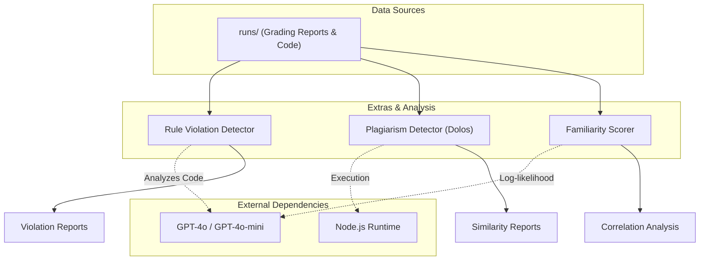
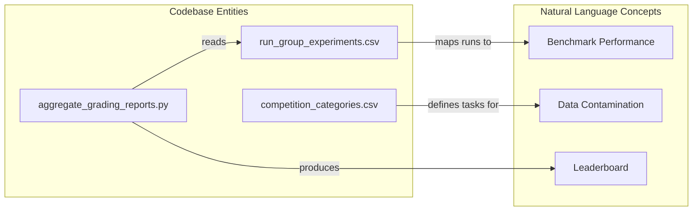

<!-- source: DeepWiki mcp.deepwiki.com · repo openai/mle-bench · page 10 Extras and Experiments · fetched 2026-10-26 -->

# Extras and Experiments

Relevant source files

The following files were used as context for generating this wiki page:

- [README.md](README.md)
- [experiments/competition_categories.csv](experiments/competition_categories.csv)

Beyond the core benchmarking infrastructure, MLE-bench includes supplementary tools for research into agent behavior and benchmark integrity. These components are used to detect potential rule violations, assess plagiarism, and measure how model familiarity with competition data impacts performance.

## Supplementary Research Tools

The repository provides a set of tools located in the `extras/` directory designed to analyze agent submissions for compliance and originality.

### Rule Violation and Plagiarism Detection
To ensure the integrity of the benchmark, MLE-bench includes automated systems for detecting common issues in agent-generated solutions:
*   **Rule Violation Detector**: Uses `gpt-4o-mini` to scan agent code for violations of competition rules (e.g., using prohibited external datasets).
*   **Plagiarism Detector**: Utilizes the [Dolos](https://dolos.ugent.be) source code plagiarism detection tool (requiring Node.js) to compare agent submissions against known solutions or other agent runs.

For details on configuration and usage, see [Rule Violation and Plagiarism Detection](#10.1).

**Sources:** [README.md:1-200](), [mlebench/grading/grading_utils.py:1-50]()

---

## Research Experiments

The `experiments/` directory contains code used for the research findings presented in the MLE-bench paper, specifically focusing on the relationship between model pre-training data and benchmark success.

### Familiarity Experiments
A critical concern for LLM benchmarks is data contamination. The familiarity sub-system measures how "familiar" a model (specifically GPT-4o) is with specific Kaggle competition descriptions. This is achieved by:
1.  Calculating the log-likelihood of competition text under the model.
2.  Correlating these familiarity scores with the agent's performance on those specific tasks.
3.  Analyzing if models perform significantly better on tasks they likely saw during training.

For details on the scoring methodology and correlation analysis, see [Familiarity Experiments](#10.2).

**Sources:** [README.md:1-200](), [experiments/aggregate_grading_reports.py:1-40]()

---

## Architecture of Extras and Experiments

The following diagram illustrates how these supplementary tools interface with the core `runs/` data and external evaluation models.

### Supplementary Tools Workflow

**Sources:** [README.md:53-65](), [mlebench/grading/grading_utils.py:1-100]()

---

## System Entities and Logic

The relationship between the analysis scripts and the data entities they process is detailed below.

### Analysis Logic Mapping
| Tool/Script | Primary Code Entity | Input Data | Output/Purpose |
| :--- | :--- | :--- | :--- |
| **Aggregate Reports** | `aggregate_grading_reports.py` | `runs/` + `run_group_experiments.csv` | Generates leaderboard stats [README.md:53-65]() |
| **Violation Detector** | `extras/rule_violation_detector` | Agent source code | Flags prohibited behaviors |
| **Plagiarism Detector** | `extras/plagiarism_detector` | `submission.csv` and scripts | Detects copied logic |
| **Familiarity Scorer** | `experiments/familiarity` | `competition_categories.csv` | Measures data contamination [experiments/competition_categories.csv:1-4]() |

### Code Entity Interaction Diagram

**Sources:** [README.md:53-68](), [experiments/competition_categories.csv:1-4]()

---

