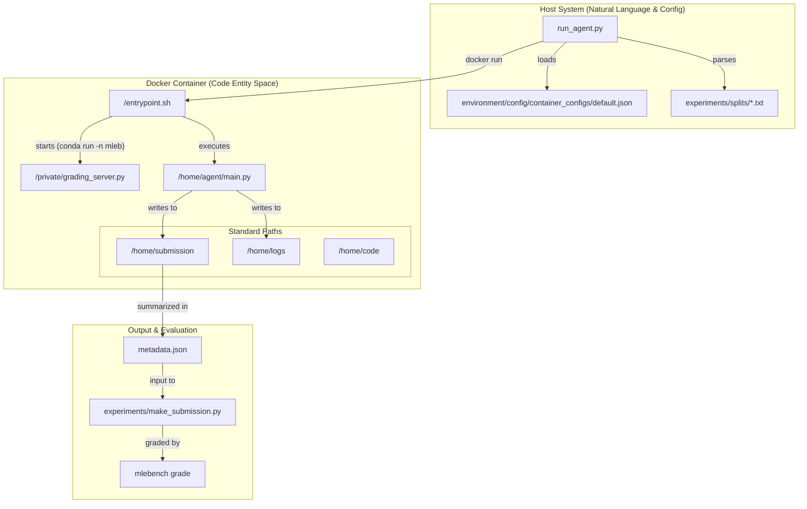
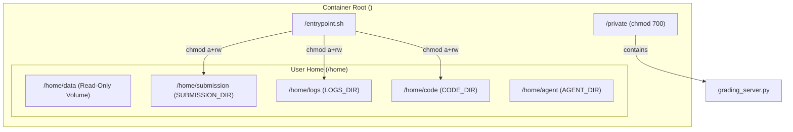

<!-- source: DeepWiki mcp.deepwiki.com · repo openai/mle-bench · page 6 Agent Framework · fetched 2026-10-26 -->

# Agent Framework

Relevant source files

The following files were used as context for generating this wiki page:

- [agents/README.md](agents/README.md)
- [environment/Dockerfile](environment/Dockerfile)
- [environment/entrypoint.sh](environment/entrypoint.sh)

## Purpose and Scope

The Agent Framework provides a standardized evaluation environment for running machine learning agents against MLE-bench competitions. This framework defines the execution pipeline, shared environment configuration, and security model that enables different agent implementations to operate consistently within the benchmarking system.

This document covers the overall framework architecture and shared components. For detailed technical specifications, see the child pages:
- [Agent Architecture Overview](#6.1) — Detailed execution model and build process.
- [Agent Configuration System](#6.2) — Config formats and environment variables.
- [Container Security Models](#6.3) — Sysbox vs. Privileged mode details.

## Framework Architecture

The Agent Framework implements a containerized execution model where each agent runs in an isolated Docker environment with standardized directory mappings and shared configuration.

### Agent Execution Pipeline

The following diagram illustrates how the `run_agent.py` script orchestrates the transition from the host system into the containerized "Code Entity Space," where the agent interacts with the `grading_server.py`.

Sources: [run_agent.py:1-10](), [environment/Dockerfile:77-92](), [environment/entrypoint.sh:11-18](), [agents/README.md:29-47]()

### Supported Agent Types

The framework currently supports four distinct agent implementations, each with different capabilities and requirements:

| Agent ID | Name | Security Model | Special Requirements |
|----------|------|----------------|---------------------|
| `dummy` | Environment Validator | Sysbox runtime | None |
| `aide` | AIDE Agent | Sysbox runtime | LLM API keys |
| `mlagentbench` | MLAgentBench | Sysbox runtime | LLM API keys |
| `opendevin` | OpenHands | Privileged mode | Docker-in-Docker, `I_ACCEPT_RUNNING_PRIVILEGED_CONTAINERS=True` |

Sources: [agents/README.md:5-10](), [agents/README.md:62-64]()

## Shared Environment Configuration

### Directory Structure and Permissions

All agents operate within a standardized directory structure. The `entrypoint.sh` script ensures that permissions are correctly set so that the `nonroot` user can write to the necessary directories while keeping competition data protected.

The environment variables used during the build process are defined in the agent-specific Dockerfiles but follow a standard convention:
- `SUBMISSION_DIR=/home/submission` [agents/README.md:21]()
- `LOGS_DIR=/home/logs` [agents/README.md:22]()
- `CODE_DIR=/home/code` [agents/README.md:23]()
- `AGENT_DIR=/home/agent` [agents/README.md:24]()

Sources: [environment/Dockerfile:72-86](), [environment/entrypoint.sh:8-14](), [agents/README.md:18-27]()

## Agent Execution Workflow

### Running Agents via run_agent.py

The primary interface for agent execution is the `run_agent.py` script. It manages the container lifecycle and maps host directories to the container's standardized paths.

1. **Initialization**: The script creates a "run group" directory in `runs/` [agents/README.md:37]().
2. **Execution**: It launches the container, mounting competition data to `/home/data` and run-specific directories to the standard paths [agents/README.md:26]().
3. **Completion**: A `metadata.json` file is generated to summarize the run results [agents/README.md:37]().

For details on the execution model and build process, see [Agent Architecture Overview](#6.1).

### Post-Execution Evaluation

After execution, results are processed through a two-stage evaluation pipeline:
1. `experiments/make_submission.py`: Converts `metadata.json` into a `submission.jsonl` file [agents/README.md:40]().
2. `mlebench grade`: Grades the generated submission [agents/README.md:46]().

## Security Model

### Container Runtime Security

The framework implements a two-tier security model based on agent requirements. Most agents run using the [Sysbox](https://github.com/nestybox/sysbox) runtime to provide enhanced isolation between the container and the host [agents/README.md:62]().

The `dummy` agent is specifically designed to verify these security constraints by checking:
- Whether the script is running with root access [agents/README.md:54]().
- Access restrictions to the `/private` directory [agents/README.md:57]().
- Read/write permissions in the `/home` directory [agents/README.md:58]().

For details on Sysbox vs. Privileged mode and the security implications of Docker-in-Docker, see [Container Security Models](#6.3).

## Configuration and Parameters

The framework uses a centralized configuration system. Default settings are stored in `environment/config/container_configs/default.json` [agents/README.md:49](). These can be overridden at runtime using arguments to `run_agent.py`.

Key configurable parameters include:
- **GPU Passthrough**: Enabled by setting `"gpus": -1` in the container config [agents/README.md:49]().
- **Conda Environments**: The base image sets up a `mleb` environment for system tasks and an `agent` environment for the agent's code [environment/Dockerfile:48,65]().

For details on the `config.yaml` format and runtime environment variables, see [Agent Configuration System](#6.2).

---

