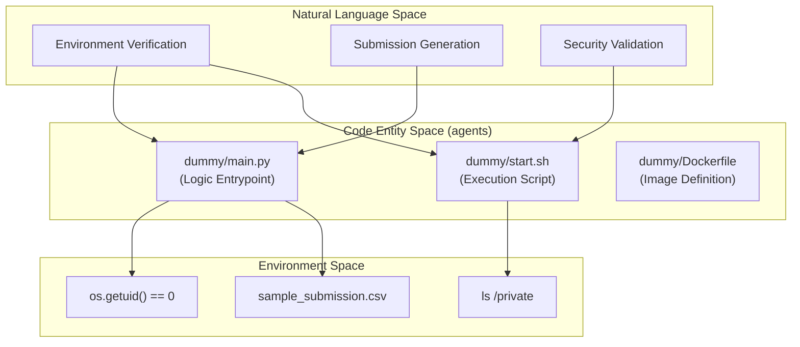
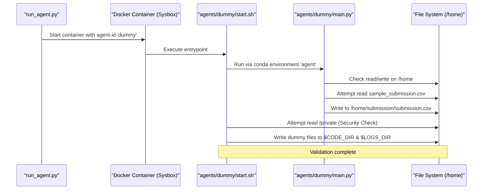

<!-- source: DeepWiki mcp.deepwiki.com · repo openai/mle-bench · page 7.4 dummy Agent · fetched 2026-10-26 -->

# dummy Agent

<details>
<summary>Relevant source files</summary>

The following files were used as context for generating this wiki page:

- [agents/README.md](agents/README.md)

</details>


## Purpose and Scope

The dummy agent is a minimal validation tool used to verify that the MLE-bench environment is configured correctly and that the submission workflow is functioning as intended [agents/README.md:51-52](). It serves as a reference implementation that demonstrates the basic agent interface without performing any machine learning tasks. 

Instead of training models, it performs a series of environment checks—such as verifying root access, checking file permissions, and validating directory read/write capabilities—and attempts to generate a submission by copying a sample file [agents/README.md:54-59](). This makes it the primary tool for debugging infrastructure issues before deploying more complex LLM-powered agents like AIDE or OpenHands.

## Agent Overview

The dummy agent implements the standard MLE-bench agent interface. It is packaged within a Docker container and executed via a start script that initializes a conda environment [agents/README.md:18-27]().

### Environment Validation Checks
The agent performs the following specific checks to ensure environment integrity:
*   **Identity Check**: Prints the current user and whether the script has root access [agents/README.md:54]().
*   **Runtime Check**: Reports the specific Python interpreter being used [agents/README.md:55]().
*   **Security Isolation**: Verifies that it cannot read "private" data, including test set labels [agents/README.md:57]().
*   **Workspace Access**: Confirms read/write access to the `/home` working directory [agents/README.md:58]().
*   **Submission Workflow**: Attempts to use the competition's `sample_submission.csv` as its own submission to test the grading pipeline [agents/README.md:56]().

## Architecture and Components

### Code Entity Map
The following diagram illustrates how the natural language concepts of "Environment Verification" map to specific code entities and file system locations.


Sources: [agents/README.md:51-59](), [agents/dummy/main.py:1-34](), [agents/dummy/start.sh:1-22]()

### Implementation Detail: main.py
The core logic of the dummy agent is contained within `main.py`. It uses standard Python libraries to inspect the environment and manipulate files.

| Component | Code Entity | Functionality |
| :--- | :--- | :--- |
| **User Validation** | `getpass.getuser()` | Identifies the execution user [agents/dummy/main.py:13](). |
| **Root Detection** | `os.getuid()` | Checks for elevated privileges [agents/dummy/main.py:16](). |
| **Path Resolution** | `Path(__file__)` | Locates workspace data relative to agent code [agents/dummy/main.py:24-26](). |
| **File Transfer** | `shutil.copy()` | Moves the sample submission to the required output path [agents/dummy/main.py:33](). |

Sources: [agents/dummy/main.py:12-34]()

## Execution Flow

The dummy agent follows a standard execution sequence triggered by the `run_agent.py` script.

### System Data Flow
This diagram shows the flow of information from the environment setup through the verification steps to the final submission.


Sources: [agents/README.md:31-35](), [agents/README.md:51-60](), [agents/dummy/start.sh:1-22]()

## Configuration and Security

### Security Model
The dummy agent is designed to run using the **Sysbox** runtime [agents/README.md:62](). This provides enhanced isolation between the container and the host system, which is critical for verifying the benchmark's security posture. One of the agent's primary tasks is to confirm that it *cannot* access restricted directories, thereby validating the isolation provided by the infrastructure [agents/README.md:57]().

### Build Configuration
The agent is built using standard build arguments to define directory structures:
*   `SUBMISSION_DIR`: Target for final output [agents/README.md:21]().
*   `LOGS_DIR`: Target for agent execution logs [agents/README.md:22]().
*   `CODE_DIR`: Target for any generated scripts [agents/README.md:23]().
*   `AGENT_DIR`: Location of the agent's own source code [agents/README.md:24]().

### Running the Agent
To execute the dummy agent for environment verification on a specific competition (e.g., Spaceship Titanic), use the following command:

```console
python run_agent.py --agent-id dummy --competition-set experiments/splits/spaceship-titanic.txt
```
Sources: [agents/README.md:31-35]()

---

