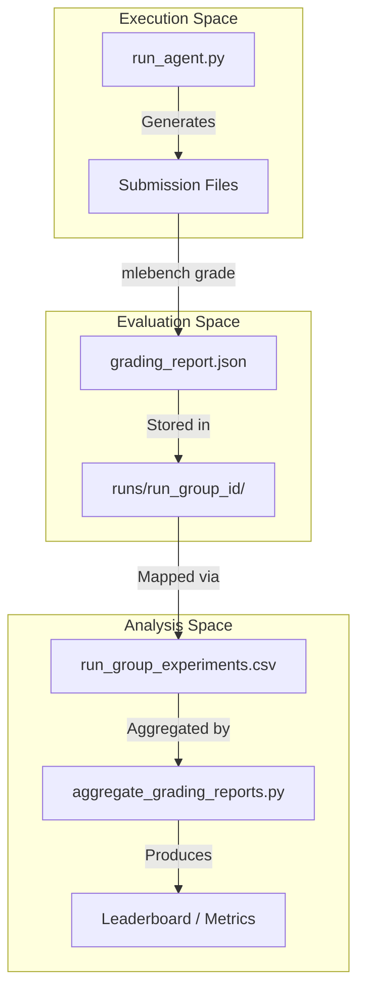
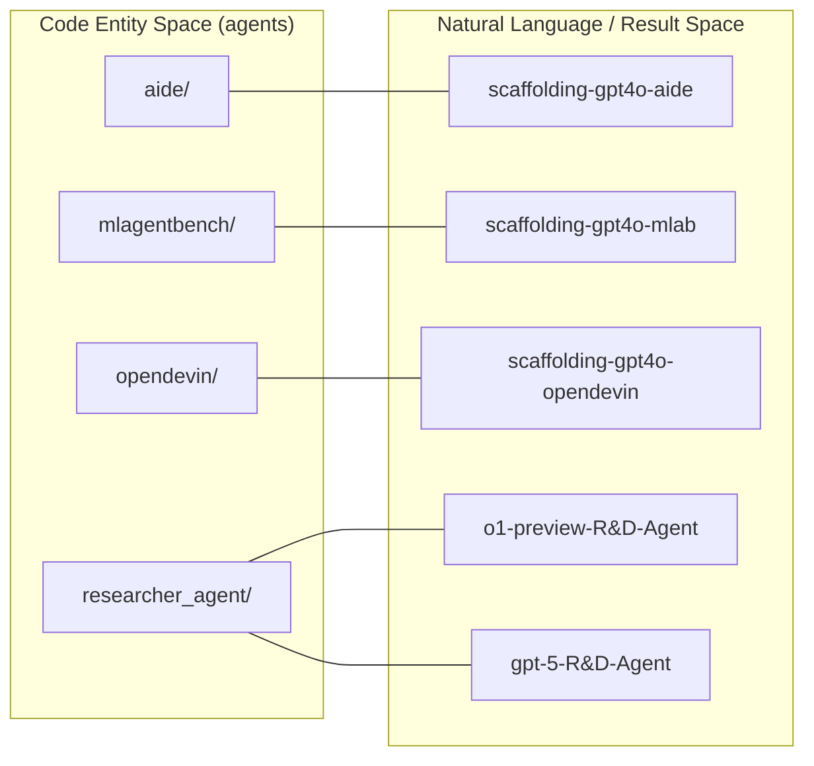

<!-- source: DeepWiki mcp.deepwiki.com · repo openai/mle-bench · page 8 Benchmark Results and Run Data · fetched 2026-10-26 -->

# Benchmark Results and Run Data

Relevant source files

The following files were used as context for generating this wiki page:

- [runs/README.md](runs/README.md)
- [runs/run_group_experiments.csv](runs/run_group_experiments.csv)

This page provides an overview of the MLE-bench evaluation results, the structure of the `runs/` directory, and the various agent experiments conducted. MLE-bench tracks performance across 75 machine learning competitions, utilizing diverse agent architectures and model backends.

## Overview of Results and Run Data

The `runs/` directory serves as the central repository for all benchmark evaluation data. Each subdirectory within `runs/` represents a "run group"—a collection of agent performances across multiple competitions and random seeds [runs/README.md:5-9](). These results are primarily stored as `grading_report.json` files, which contain the structured output of the grading process for every competition task in that group.

The benchmark distinguishes between "Run Groups" and "Experiments":
*   **Run Group**: A specific execution set of competitions and seeds [runs/README.md:5-7]().
*   **Experiment**: A logical grouping of one or more run groups representing a specific agent setup (e.g., GPT-4o with AIDE scaffolding) [runs/README.md:8-12]().

### Experiment Data Flow

The following diagram illustrates how raw agent outputs are processed into the structured results found in the `runs/` directory.

**Data Processing Pipeline**

Sources: [runs/README.md:5-12](), [runs/run_group_experiments.csv:1-4]()

## Run Directory Structure and Grading Reports

The `runs/` directory is organized to support large-scale experiment tracking and reproducibility. Each experiment is mapped to its constituent run groups via a central registry file.

*   **`runs/run_group_experiments.csv`**: A mapping file that associates `experiment_id` with specific run group directories [runs/README.md:24-26]().
*   **`grading_report.json`**: The primary data artifact for each run. It includes scores, submission status, and metadata for every competition task attempted by the agent.
*   **Seed Aggregation**: In cases where hardware failures occurred, the benchmark reports the final $N$ seeds to ensure consistency across the experiment [runs/README.md:18-22]().

For details on the JSON schema and mapping logic, see [Run Directory Structure and Grading Reports](#8.1).

## Evaluated Agents and Experiment Catalog

MLE-bench includes results for a wide variety of agents, ranging from baseline scaffolding to advanced multi-agent ensembles. Experiments are categorized by their `experiment_id`, which encodes the model, scaffolding, and hardware configuration used.

### Experiment Categories

Experiments are typically defined by three primary axes:
1.  **Scaffolding**: The agent framework (e.g., AIDE, MLAB, OpenDevin, R&D-Agent) [runs/README.md:37-39]().
2.  **Model Backend**: The LLM powering the agent (e.g., GPT-4o, Claude 3.5 Sonnet, Llama 3.1, DeepSeek-R1) [runs/README.md:33-35, 41]().
3.  **Resource Allocation**: Specific hardware constraints such as vCPUs, RAM, and GPU types (e.g., A100, H100, V100) [runs/README.md:40-45]().

### Code Entity to Experiment Mapping

The following diagram bridges the agent implementations in the code to their corresponding experiment identifiers used in the results data.

**Agent to Experiment ID Mapping**

Sources: [runs/README.md:37-45]()

For a full catalog of all evaluated agents, including hardware requirements and specific configuration details, see [Evaluated Agents and Experiment Catalog](#8.2).

## Result Interpretation

When interpreting results, users should account for the `experiment_id` notes which detail deviations from standard settings, such as "extratime" (100 hours vs 24 hours) or "obfuscation" (obfuscated competition descriptions) [runs/README.md:32, 36](). Performance is generally aggregated across all seeds within an experiment to produce the final benchmark score.

Sources:
* [runs/README.md:1-63]()
* [runs/run_group_experiments.csv:1-4]()

---

