# Page: Overview

# Overview

<details>
<summary>Relevant source files</summary>

The following files were used as context for generating this wiki page:

- [README.md](README.md)
- [runs/README.md](runs/README.md)

</details>


MLE-bench is a machine learning agent benchmarking system designed to evaluate AI agents on end-to-end machine learning engineering tasks. It utilizes 75 Kaggle competitions to provide a standardized framework for data preparation, agent execution, and submission grading across diverse ML domains such as image classification, tabular data analysis, and natural language processing. [README.md:1-4]()

## Purpose and Architecture

MLE-bench evaluates agents on their ability to perform complex, long-running ML engineering workflows—from initial data exploration and preprocessing to model training and submission generation. The system is composed of the `mlebench` CLI for management, a Docker-based execution environment (`mlebench-env`), and a standardized agent framework. [README.md:149-156]()

### System Overview

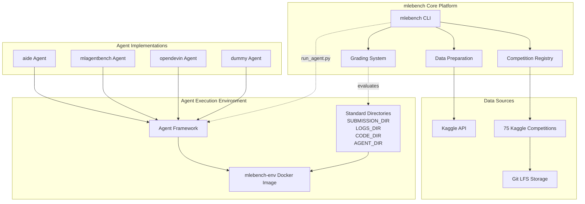

Sources: [README.md:1-25](), [README.md:149-156]()

## Competition Dataset

The benchmark contains 75 Kaggle competitions categorized by complexity and data type. These are split into `low` (Lite), `medium`, and `high` tiers based on the difficulty of the engineering task. [README.md:35-61]()

| Complexity Level | Competition Count | Total Dataset Size | Description |
|------------------|-------------------|-------------------|-------------|
| Low | 22 | 158GB | Lite evaluation subset |
| Medium | 27 | ~1.1TB | Moderate complexity tasks |
| High | 26 | ~2.1TB | Complex ML engineering challenges |
| **All** | **75** | **3.3TB** | Complete benchmark |

### Competition Categories and Examples

| Category | Example Competitions | Data Types |
|----------|---------------------|------------|
| Image Classification | `aerial-cactus-identification` | Images (JPG, PNG) |
| Tabular | `new-york-city-taxi-fare-prediction` | CSV, structured data |
| Text Classification | `jigsaw-toxic-comment-classification` | Text, NLP |
| Audio Classification | `mlsp-2013-birds` | Audio files |

Sources: [README.md:35-61](), [README.md:82-96]()

### CLI and Execution Flow

The `mlebench` CLI manages the lifecycle of a benchmark run, while `run_agent.py` handles the containerized execution of specific agents. [README.md:97-138]()

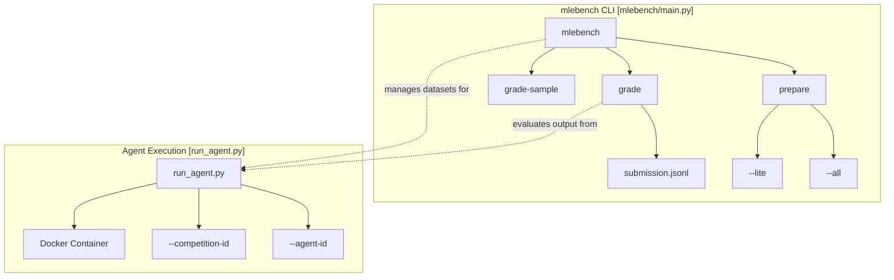

Sources: [README.md:97-120](), [README.md:125-138]()

## Agent Evaluation Framework

MLE-bench evaluates agents through a standardized Docker-based execution environment. It supports various agent architectures and large language models (LLMs). [README.md:140-151]()

### Agent Types and Capabilities

| Agent | LLM Support | Execution Environment |
|-------|-------------|----------------------|
| `aide` | GPT-4o, Claude-3.5, o1-preview | Sysbox runtime + Conda |
| `mlagentbench` | GPT-4o, etc. | MLAgentBench framework |
| `opendevin` | GPT-4o | Privileged Docker-in-Docker |
| `dummy` | None | Minimal environment |

### Standardized Agent Environment

Agents interact with a fixed directory structure inside the container to ensure reproducibility and ease of grading. [README.md:22-27]()

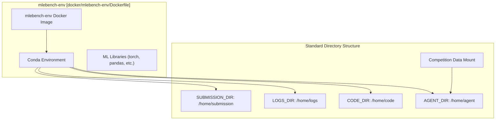

Sources: [README.md:140-151](), [README.md:22-27]()

## Benchmarking Standards

To produce comparable results for the leaderboard, MLE-bench enforces specific resource constraints and reporting requirements: [README.md:5-24](), [README.md:53-70]()

*   **Runtime**: Typically 12-24 hours maximum per competition. [README.md:8-37]()
*   **Compute**: Standard configurations involve 24-64 vCPUs and high-memory instances (e.g., 440GB RAM), often with one or more GPUs (A10, V100, A100, or H100). [runs/README.md:30-63]()
*   **Evaluation methodology**: Agents should be run across multiple seeds (minimum 3) to account for variance. Results are reported as the mean and standard error (SEM) of the `any_medal_percentage`. [README.md:18-22](), [README.md:67-68]()
*   **Aggregation**: Results are aggregated by complexity split (low, medium, high, split75) using the `aggregate_grading_reports.py` script. [README.md:53-65]()

## Key Concepts

### Competition Structure
Each competition includes a unique ID, metadata, and scripts for preparation and grading. The datasets are stored via Git LFS and prepared locally using the CLI. [README.md:82-96]()

### Submission and Grading
Agents must output a `submission.csv` to the `/home/submission` directory. The `mlebench grade` command uses competition-specific logic to compare this file against ground truth labels and determine if the performance reaches "medal" thresholds (Bronze, Silver, or Gold). [README.md:119-134]()

### Lite Evaluation
The "Lite" subset consists of the 22 `low` complexity competitions. It is designed for faster iteration and lower storage requirements (158GB). [README.md:25-56]()

Sources: [README.md:1-171](), [runs/README.md:1-63]()

---

# Page: System Architecture

# System Architecture

<details>
<summary>Relevant source files</summary>

The following files were used as context for generating this wiki page:

- [README.md](README.md)
- [environment/Dockerfile](environment/Dockerfile)
- [environment/entrypoint.sh](environment/entrypoint.sh)
- [mlebench/cli.py](mlebench/cli.py)
- [mlebench/competitions/the-icml-2013-whale-challenge-right-whale-redux/prepare.py](mlebench/competitions/the-icml-2013-whale-challenge-right-whale-redux/prepare.py)
- [mlebench/registry.py](mlebench/registry.py)

</details>


## Purpose and Scope

This document describes the high-level architecture of MLE-bench, detailing its core components and their interactions. It provides a technical overview of how the system is organized to facilitate the evaluation of machine learning engineering capabilities of AI systems using Kaggle competitions as benchmark tasks.

## High-Level Architecture Overview

### MLE-bench Ecosystem Architecture

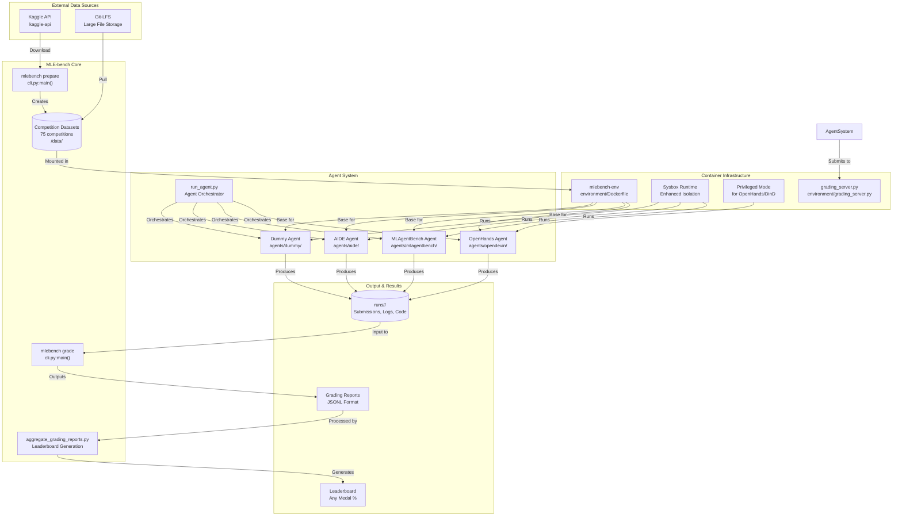

Sources: [mlebench/cli.py:13-221](), [environment/Dockerfile:1-92](), [environment/entrypoint.sh:1-20](), [README.md:1-70]()

MLE-bench consists of three main pipelines: (1) Dataset preparation from external sources via `mlebench prepare`, (2) Agent execution in isolated containers producing submissions via `run_agent.py`, and (3) Evaluation and leaderboard generation via `mlebench grade` and aggregation scripts. The system maintains strict separation between public training data (accessible to agents) and private test data (used only for evaluation). The container infrastructure provides two security models: Sysbox runtime for standard agents and privileged mode for OpenHands due to Docker-in-Docker requirements.

## Core Benchmarking System

### Registry System

The `Registry` is the central source of truth for all competition metadata. It maps competition IDs to `Competition` objects which encapsulate paths and logic.

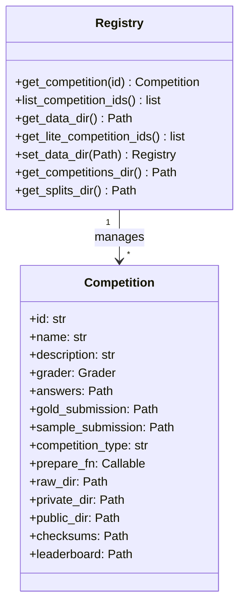

Sources: [mlebench/registry.py:16-156]()

- **Registry**: Loads competition configurations from `mlebench/competitions/<id>/config.yaml` [mlebench/registry.py:81-82](). It handles the resolution of data directories and complexity splits (e.g., `low.txt` for Lite version) [mlebench/registry.py:128-134]().
- **Competition**: A frozen dataclass containing all paths required for preparation and grading. It dynamically imports the `prepare_fn` specified in the competition's config [mlebench/registry.py:90-109]().

### Command-Line Interface

The CLI, implemented in `mlebench/cli.py`, serves as the primary entry point for users and developers.

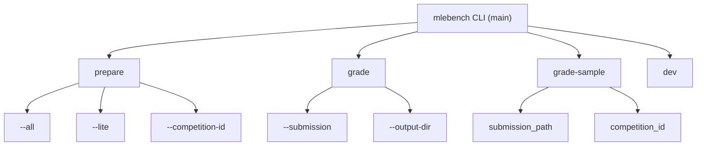

Sources: [mlebench/cli.py:13-156]()

- **prepare**: Triggers `download_and_prepare_dataset` which uses competition-specific logic to transform raw Kaggle data into a structured format [mlebench/cli.py:185-191]().
- **grade**: Evaluates a batch of submissions provided in a JSONL file using `grade_jsonl` [mlebench/cli.py:192-196]().
- **grade-sample**: Grades a single CSV file for a specific competition using `grade_csv` [mlebench/cli.py:197-201]().

## Agent Execution Framework

### Docker Environment & Entrypoint

The benchmarking environment is standardized via a base Docker image defined in `environment/Dockerfile`.

- **Conda Management**: The image creates two primary environments: `agent` (for running the agent's ML code) and `mleb` (for internal tools like the grading server) [environment/Dockerfile:38-67]().
- **Permissions**: The `entrypoint.sh` script runs as root to set broad read/write permissions on `/home` (excluding the read-only `/home/data` volume) so that non-root agents can function [environment/entrypoint.sh:11-15]().
- **Grading Server**: The entrypoint automatically starts `grading_server.py` in the background, which listens for agent submission requests during the run [environment/entrypoint.sh:18]().

### Agent Execution Architecture

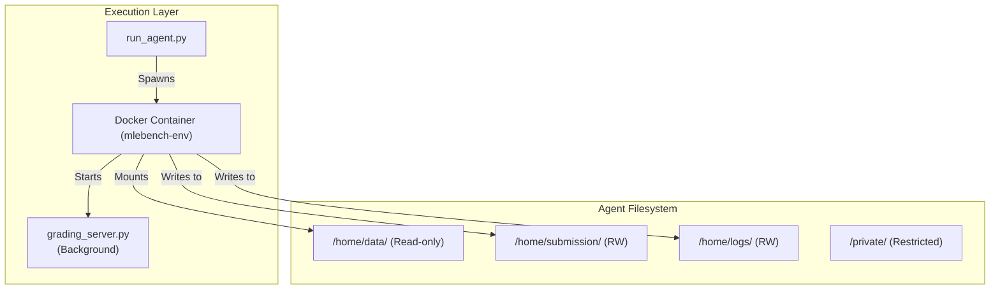

Sources: [environment/Dockerfile:72-92](), [environment/entrypoint.sh:1-20](), [mlebench/registry.py:98-100]()

### Data Flow & Preparation Logic

Each competition has a custom `prepare.py` script. For example, in `the-icml-2013-whale-challenge-right-whale-redux`:
1. **Unpack**: Extracts raw archives [mlebench/competitions/the-icml-2013-whale-challenge-right-whale-redux/prepare.py:14]().
2. **Split**: Distributes data based on timestamps or metadata into `public` (agent-visible) and `private` (grading-only) folders [mlebench/competitions/the-icml-2013-whale-challenge-right-whale-redux/prepare.py:23-35]().
3. **Format**: Generates `test.csv` (answers) and `sampleSubmission.csv` [mlebench/competitions/the-icml-2013-whale-challenge-right-whale-redux/prepare.py:81-88]().

## Evaluation and Results Pipeline

The evaluation pipeline translates agent outputs into leaderboard metrics.

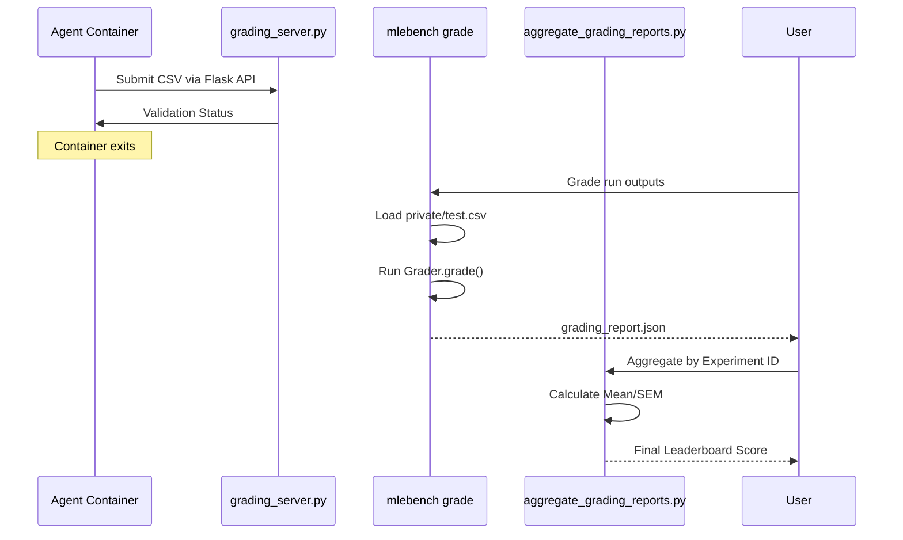

Sources: [environment/grading_server.py:1-18](), [mlebench/cli.py:192-204](), [README.md:53-68]()

- **Grading Reports**: Individual runs generate a `grading_report.json` which includes the competition score and medal status [README.md:119-134]().
- **Aggregation**: The `aggregate_grading_reports.py` script groups these reports by `experiment_id` (defined in `runs/run_group_experiments.csv`) and calculates the "Any Medal Percentage" across the requested split (low, medium, high, or split75) [README.md:53-65]().

## Resource and Security Constraints

The architecture enforces strict limits to ensure reproducibility and security:
- **Resource Limits**: Standard evaluations are capped at 24 hours with specific CPU/RAM/GPU allocations [README.md:8-37]().
- **Isolation**: The `/private` directory inside the container is owned by root and restricted (mode 700) to prevent agents from reading ground truth answers [environment/Dockerfile:74]().
- **Runtime**: Agents typically run under the **Sysbox** runtime for enhanced isolation, except for those requiring Docker-in-Docker (like OpenHands), which use privileged mode [README.md:35]().

Sources: [environment/Dockerfile:74-92](), [README.md:8-37]()

---

# Page: Getting Started

# Getting Started

<details>
<summary>Relevant source files</summary>

The following files were used as context for generating this wiki page:

- [README.md](README.md)
- [pyproject.toml](pyproject.toml)

</details>


This page provides an overview of the initial setup and basic workflows for using MLE-bench. It covers the foundational steps required to prepare your environment, obtain competition datasets, execute agents, and evaluate their submissions. For detailed installation instructions, see [Installation and Setup](#3.1). For a comprehensive walkthrough of your first evaluation, see [Quick Start Guide](#3.2).

The typical MLE-bench workflow consists of three sequential phases: (1) environment setup and dataset preparation, (2) agent execution, and (3) submission grading and leaderboard generation. Each phase produces artifacts that serve as inputs to the next.

## Overview of MLE-bench Workflows

The following diagram illustrates the complete workflow for evaluating agents on MLE-bench, from initial setup through leaderboard generation:

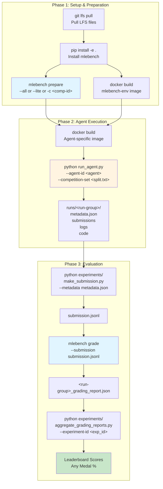

**Sources:** [README.md:93-186](), [agents/README.md:1-65]()

## Prerequisites and System Requirements

Before using MLE-bench, ensure your system meets the requirements defined in `pyproject.toml` and the documentation:

| Component | Requirement | Purpose |
|-----------|-------------|---------|
| Git LFS | Installed and configured | Pull large data files (CSVs, competition solutions) |
| Python | >=3.11 | Run `mlebench` CLI and scripts [pyproject.toml:8-8]() |
| Docker | >=7.1 (Python SDK) | Build and run agent containers [pyproject.toml:12-12]() |
| Sysbox Runtime | Installed (recommended) | Enhanced container-to-host isolation for security |
| NVIDIA Container Toolkit | Optional | GPU support for agent execution |
| Kaggle API | Credentials in `~/.kaggle/kaggle.json` | Download competition data [pyproject.toml:14-14]() |
| Disk Space | 3.3TB (full) or 158GB (lite) | Store prepared competition datasets |

**Sources:** [README.md:93-150](), [agents/README.md:12-16](), [pyproject.toml:8-34]()

## Core Commands and Directory Structure

The following diagram maps MLE-bench commands to the directories and files they interact with:

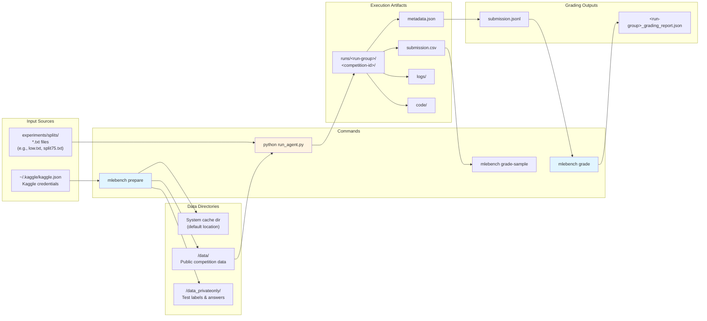

**Sources:** [README.md:93-169](), [agents/README.md:29-47](), [pyproject.toml:40-40]()

## Dataset Preparation Options

MLE-bench provides three dataset preparation options to balance evaluation coverage with resource constraints:

### Preparation Commands

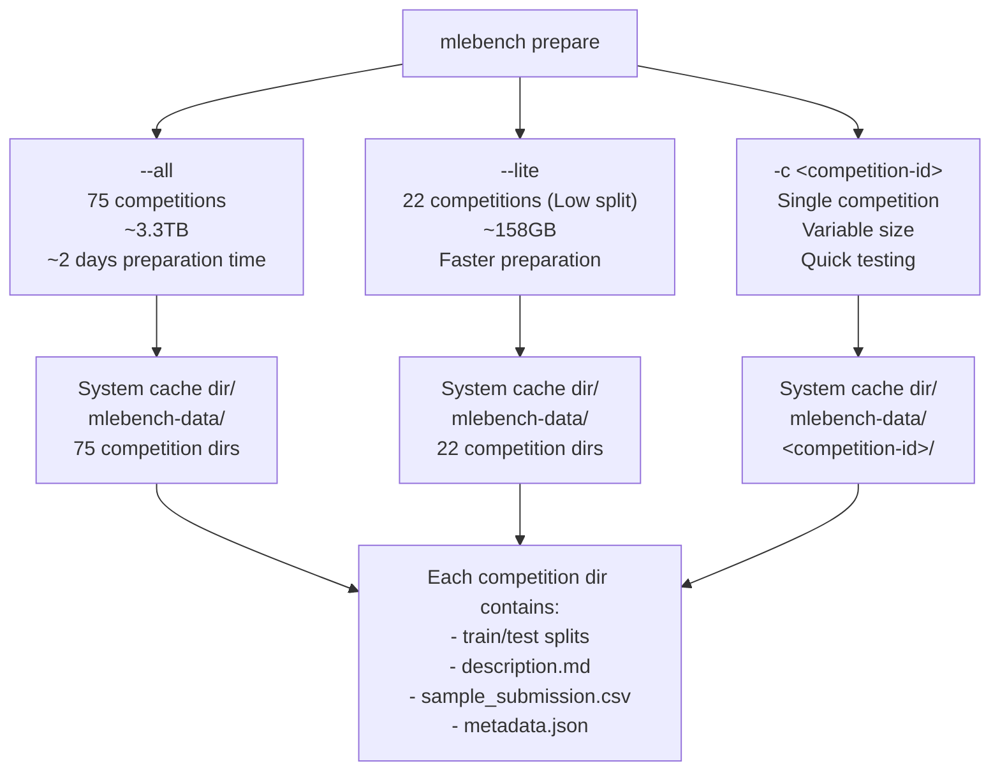

The lite dataset is specifically designed for cost-effective evaluation and corresponds to the Low complexity split. See [Dataset Preparation](#4.1) for detailed information about the preparation process.

**Sources:** [README.md:130-150](), [README.md:60-92]()

## Agent Execution Workflow

The `run_agent.py` script orchestrates agent execution across multiple competitions. The following diagram shows the complete execution flow:

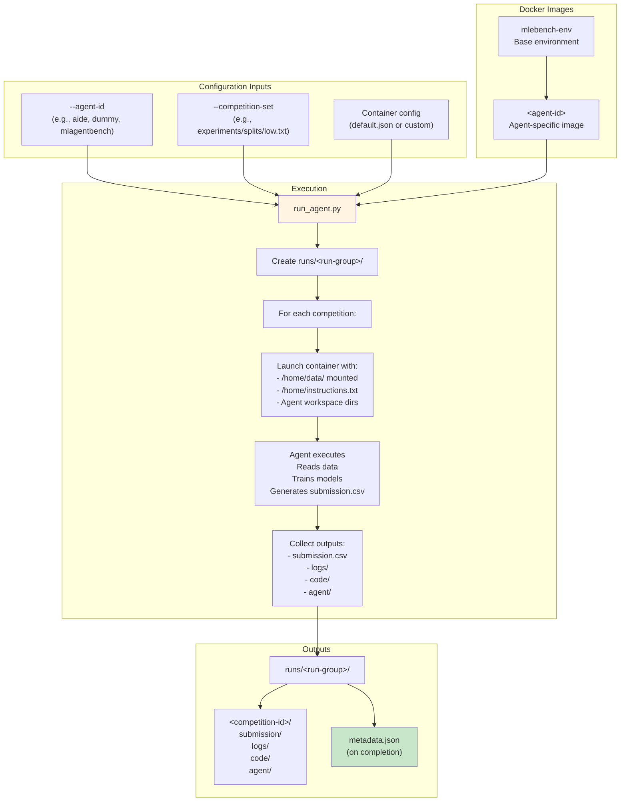

The standard resource allocation for benchmarking is 24 hours runtime with 36 vCPUs, 440GB RAM, and one 24GB A10 GPU. These defaults are typically configured in container JSON files and can be customized per execution.

**Sources:** [agents/README.md:29-49](), [README.md:52-64](), [README.md:173-183]()

## Grading and Leaderboard Generation

After agent execution completes, submissions must be formatted and graded. The following diagram shows the evaluation pipeline:

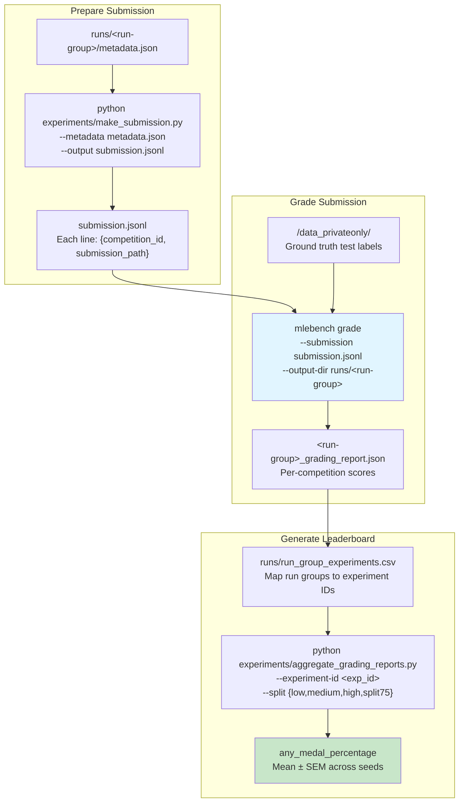

The grading process uses the private test data prepared during `mlebench prepare`, which is isolated from agents during execution. Leaderboard metrics should be computed using `aggregate_grading_reports.py` to capture agent variance [README.md:53-65]().

**Sources:** [README.md:154-169](), [README.md:33-49](), [agents/README.md:37-47](), [README.md:53-65]()

## Common Usage Patterns

The following table summarizes typical usage scenarios and their corresponding commands:

| Scenario | Commands | Expected Output |
|----------|----------|-----------------|
| **Quick environment test** | `python run_agent.py --agent-id dummy --competition-set experiments/splits/spaceship-titanic.txt` | Single run group with validation checks passed |
| **Lite evaluation (22 comps)** | `mlebench prepare --lite`<br/>`python run_agent.py --agent-id aide --competition-set experiments/splits/low.txt` | 158GB dataset, run group with 22 competition submissions |
| **Full benchmark (75 comps)** | `mlebench prepare --all`<br/>`python run_agent.py --agent-id aide --competition-set experiments/splits/split75.txt` | 3.3TB dataset, run group with 75 competition submissions |
| **Single competition dev** | `mlebench prepare -c spaceship-titanic`<br/>`python run_agent.py --agent-id aide --competition-set experiments/splits/spaceship-titanic.txt` | ~50MB dataset, single competition run for testing |
| **Grade single submission** | `mlebench grade-sample <path/to/submission.csv> <comp-id>` | Immediate score output to stdout |
| **Grade multiple submissions** | `python experiments/make_submission.py --metadata runs/<run-group>/metadata.json --output submission.jsonl`<br/>`mlebench grade --submission submission.jsonl --output-dir runs/<run-group>` | Grading report JSON file |
| **Generate leaderboard scores** | `python experiments/aggregate_grading_reports.py --experiment-id <exp_id> --split low` | `any_medal_percentage` with mean ± SEM [README.md:61-65]() |

**Sources:** [README.md:130-150](), [agents/README.md:31-47](), [README.md:154-169](), [README.md:33-49](), [README.md:61-65]()

## Security Considerations

MLE-bench employs a two-tier security model for agent execution:

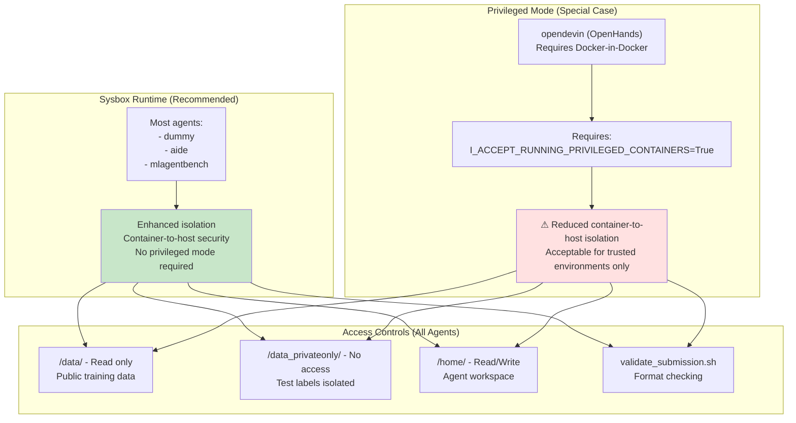

The `dummy` agent performs validation checks to verify the security model is properly configured [agents/README.md:52-58](). See [Container Security Models](#6.3) for complete details on isolation mechanisms.

**Sources:** [agents/README.md:60-64](), [agents/README.md:52-58]()

## Next Steps

After completing the initial setup, proceed to:

- **[Installation and Setup](#3.1)** - Detailed installation instructions, dependency management, and troubleshooting.
- **[Quick Start Guide](#3.2)** - Step-by-step walkthrough of running your first agent evaluation from start to finish.
- **[Dataset Preparation](#4.1)** - In-depth coverage of dataset preparation options, Git LFS configuration, and storage management.
- **[Running Agents](#4.2)** - Comprehensive guide to agent execution, configuration, and output management.
- **[Agent Implementations](#7)** - Detailed documentation for each available agent (aide, mlagentbench, opendevin, dummy).

For developers interested in extending MLE-bench or contributing new agents, see [Development Guide](#9).

**Sources:** [README.md:1-273](), [agents/README.md:1-65]()

---

# Page: Installation and Setup

# Installation and Setup

<details>
<summary>Relevant source files</summary>

The following files were used as context for generating this wiki page:

- [README.md](README.md)
- [pyproject.toml](pyproject.toml)

</details>


This page provides detailed instructions for installing MLE-bench and configuring the benchmarking environment. This includes installing the `mlebench` Python package, building the `mlebench-env` Docker image, and preparing competition datasets using the Kaggle API.

## Prerequisites

Before installing MLE-bench, ensure you have the following requirements:

| Requirement | Description |
|-------------|-------------|
| Git LFS | Required to download competition data and grading reports stored via Large File Storage |
| Python 3.11+ | Required for running MLE-bench (specified in `pyproject.toml`) |
| Docker | Required for building and running the agent execution environment |
| Kaggle API | Required for downloading competition datasets |
| uv (Recommended) | Fast Python package installer used for running scripts in the repository |

Sources: [pyproject.toml:8-8](), [README.md:58-66]()

## Installation Process

The following diagram illustrates the workflow from cloning the repository to a functional environment.

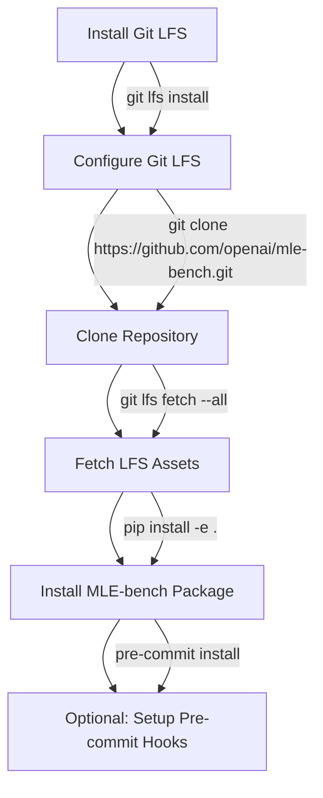

### 1. Git LFS Setup
MLE-bench stores competition metadata and grading reports using Git LFS. Initialize Git LFS before cloning:
```bash
git lfs install
```

### 2. Clone and Pull
Clone the repository and ensure all LFS-tracked files (like competition data indices) are downloaded:
```bash
git clone https://github.com/openai/mle-bench.git
cd mle-bench
git lfs fetch --all
git lfs pull
```
Sources: [README.md:60-66]()

### 3. Install Python Dependencies
The project uses `pyproject.toml` to manage dependencies. You can install the package in editable mode:
```bash
pip install -e .
```
Key dependencies include `docker`, `kaggle`, `pandas`, `openai`, and various ML libraries like `tensorflow` and `scikit-learn` for evaluation logic.
Sources: [pyproject.toml:10-34]()

### 4. Development Setup (Optional)
To contribute or ensure code quality, install development dependencies and pre-commit hooks:
```bash
pip install -e ".[dev,formatters]"
pre-commit install
```
Sources: [pyproject.toml:42-44](), [README.md:74-80]()

## Docker Environment Setup

MLE-bench executes agents inside a isolated Docker container defined by the `mlebench-env` image. This ensures a consistent environment for machine learning tasks.

### Docker Environment Architecture

```mermaid
classDiagram
    class "mlebench-env" {
        <<Docker Image>>
        - Conda Environment
        - Python 3.11
        - Installed ML Packages
        - Grading Server Scripts
    }
    
    class "Dockerfile" {
        <<Build Configuration>>
        + INSTALL_HEAVY_DEPENDENCIES: bool
    }
    
    class "pyproject.toml" {
        <<Dependencies>>
        + mlebench core
    }

    "Dockerfile" ..> "mlebench-env" : builds
    "pyproject.toml" --|> "mlebench-env" : defines core deps
```

### Building the Image
Build the Docker image with the following command:
```bash
docker build --platform=linux/amd64 -t mlebench-env -f environment/Dockerfile .
```

#### Heavy vs. Light Build
By default, the environment installs a large set of ML libraries. To speed up the build for testing purposes:
```bash
docker build --platform=linux/amd64 -t mlebench-env -f environment/Dockerfile . --build-arg INSTALL_HEAVY_DEPENDENCIES=false
```
Sources: [README.md:136-147]()

## Dataset Preparation

The benchmark utilizes the `mlebench` CLI to download and prepare competition data.

### Dataset Preparation Flow

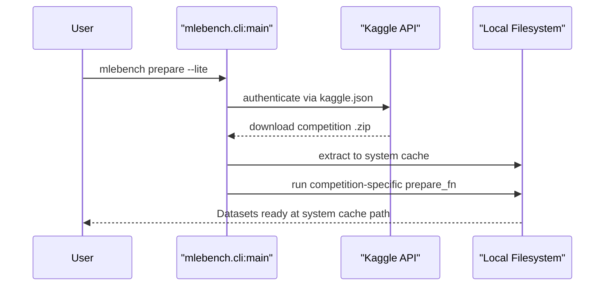

### Kaggle API Configuration
1. Obtain `kaggle.json` from your Kaggle Account settings.
2. Place it in `~/.kaggle/kaggle.json`.
3. Ensure permissions are restricted: `chmod 600 ~/.kaggle/kaggle.json`.

Sources: [README.md:93-96]()

### Preparing Datasets
The CLI entry point is defined in `pyproject.toml` as `mlebench = "mlebench.cli:main"`.

*   **Full Dataset (75 competitions, ~3.3TB):**
    ```bash
    mlebench prepare --all
    ```
*   **Lite Dataset (22 competitions, ~158GB):**
    ```bash
    mlebench prepare --lite
    ```
*   **Single Competition:**
    ```bash
    mlebench prepare -c <competition-id>
    ```
Sources: [pyproject.toml:40-40](), [README.md:97-115]()

## Resource Requirements

Running the full benchmark requires significant resources to accommodate complex ML training tasks.

| Resource | Specification |
|----------|---------------|
| **Compute** | 36 vCPUs, 440GB RAM, 1x 24GB A10 GPU (recommended) |
| **Storage** | 3.3TB for full dataset / 158GB for lite dataset |
| **Time** | ~24 hours for a full agent run |

Sources: [README.md:9-12](), [README.md:27]()

## Verification

To verify the installation, use the `grade-sample` command to test the grading pipeline with a provided sample submission:

```bash
mlebench grade-sample examples/sample_submissions/spaceship-titanic.csv spaceship-titanic
```
This command checks if the grading logic and environment are correctly configured without running a full agent.
Sources: [README.md:127-132]()

---

# Page: Quick Start Guide

# Quick Start Guide

<details>
<summary>Relevant source files</summary>

The following files were used as context for generating this wiki page:

- [README.md](README.md)
- [agents/README.md](agents/README.md)
- [mlebench/cli.py](mlebench/cli.py)
- [mlebench/competitions/the-icml-2013-whale-challenge-right-whale-redux/prepare.py](mlebench/competitions/the-icml-2013-whale-challenge-right-whale-redux/prepare.py)
- [mlebench/registry.py](mlebench/registry.py)

</details>


This guide provides a streamlined walkthrough for running your first agent evaluation on MLE-bench. It covers the essential steps from dataset preparation through grading, using a simple test case. For detailed installation instructions, see [Installation and Setup](#3.1). For comprehensive usage documentation, see the [User Guide](#4).

## Purpose and Scope

This guide walks through evaluating the `dummy` agent on a single competition (`spaceship-titanic`) to verify your MLE-bench installation and understand the basic evaluation workflow. The process takes approximately 10-15 minutes and demonstrates:

1. Dataset preparation using `mlebench prepare`
2. Agent container building with Docker
3. Agent execution using `run_agent.py`
4. Submission grading using `mlebench grade`

## Prerequisites

Before starting, ensure you have completed the setup steps from [Installation and Setup](#3.1):

- Docker installed and running
- Sysbox runtime installed and configured [agents/README.md:15-15]()
- Git LFS configured and data pulled
- MLE-bench installed via `pip install -e .`
- Kaggle API credentials configured in `~/.kaggle/kaggle.json`

Verify your installation by checking Docker and Sysbox:

```bash
docker --version
docker info | grep -i runtime
```

## End-to-End Quick Start Workflow

The following diagram shows the complete quick start flow with actual commands and outputs:

```mermaid
graph TB
    Start["Start: Fresh MLE-bench Installation"]
    
    Prepare["Step 1: Prepare Dataset<br/>Command: mlebench prepare -c spaceship-titanic"]
    PrepareOut["Output: ~/.cache/mle-bench/data/spaceship-titanic/<br/>├── train.csv<br/>├── test.csv<br/>├── description.md<br/>└── sample_submission.csv"]
    
    Build["Step 2: Build Agent Container<br/>Command: docker build agents/dummy/"]
    BuildOut["Output: Docker image 'dummy'<br/>Contains: mlebench-env + dummy agent code"]
    
    Run["Step 3: Run Agent<br/>Command: python run_agent.py<br/>--agent-id dummy<br/>--competition-set experiments/splits/spaceship-titanic.txt"]
    RunOut["Output: runs/&lt;run-group&gt;/<br/>├── spaceship-titanic/<br/>│   ├── submission/<br/>│   ├── logs/<br/>│   └── code/<br/>└── metadata.json"]
    
    MakeSub["Step 4: Create Submission File<br/>Command: python experiments/make_submission.py<br/>--metadata runs/&lt;run-group&gt;/metadata.json"]
    MakeSubOut["Output: runs/&lt;run-group&gt;/submission.jsonl<br/>{&quot;competition_id&quot;: &quot;spaceship-titanic&quot;,<br/>&quot;submission_path&quot;: &quot;...&quot;}"]
    
    Grade["Step 5: Grade Submission<br/>Command: mlebench grade<br/>--submission runs/&lt;run-group&gt;/submission.jsonl"]
    GradeOut["Output: runs/&lt;run-group&gt;/<br/>spaceship-titanic_grading_report.json<br/>{&quot;score&quot;: ..., &quot;medal&quot;: ..., &quot;percentile&quot;: ...}"]
    
    Start --> Prepare
    Prepare --> PrepareOut
    PrepareOut --> Build
    Build --> BuildOut
    BuildOut --> Run
    Run --> RunOut
    RunOut --> MakeSub
    MakeSub --> MakeSubOut
    MakeSubOut --> Grade
    Grade --> GradeOut
```

**Sources:** [agents/README.md:18-47](), [mlebench/cli.py:18-128](), [mlebench/registry.py:13-13]()

## Step-by-Step Instructions

### Step 1: Prepare the Dataset

Prepare the `spaceship-titanic` competition dataset. This downloads the raw data from Kaggle and creates a train/test split:

```bash
mlebench prepare -c spaceship-titanic
```

This command executes the preparation logic defined in the competition's `prepare.py` (e.g., [mlebench/competitions/the-icml-2013-whale-challenge-right-whale-redux/prepare.py:9-9]()) and stores the prepared dataset in your system's cache directory (typically `~/.cache/mle-bench/data/` [mlebench/registry.py:13-13]()).

**Expected Output:**
```
Preparing spaceship-titanic...
Downloading competition data from Kaggle...
Creating train/test split...
Dataset prepared successfully at: ~/.cache/mle-bench/data/spaceship-titanic
```

**Verification:** Check that the dataset directory exists and contains the required files:

```bash
ls ~/.cache/mle-bench/data/spaceship-titanic
# Should show: train.csv, test.csv, description.md, sample_submission.csv
```

**Sources:** [mlebench/cli.py:18-60](), [mlebench/registry.py:13-13](), [mlebench/cli.py:158-191]()

### Step 2: Build the Agent Container

Build the Docker image for the `dummy` agent. First, set the required environment variables used as build arguments [agents/README.md:21-27]():

```bash
export SUBMISSION_DIR=/home/submission
export LOGS_DIR=/home/logs
export CODE_DIR=/home/code
export AGENT_DIR=/home/agent

docker build --platform=linux/amd64 -t dummy \
  agents/dummy/ \
  --build-arg SUBMISSION_DIR=$SUBMISSION_DIR \
  --build-arg LOGS_DIR=$LOGS_DIR \
  --build-arg CODE_DIR=$CODE_DIR \
  --build-arg AGENT_DIR=$AGENT_DIR
```

The build process extends the base `mlebench-env` image and adds the agent's code.

**Expected Output:**
```
[+] Building 45.2s (12/12) FINISHED
 => [internal] load build definition from Dockerfile
 ...
 => exporting to image
 => => naming to docker.io/library/dummy
```

**Sources:** [agents/README.md:18-27]()

### Step 3: Run the Agent

Execute the `dummy` agent on the `spaceship-titanic` competition using `run_agent.py` [agents/README.md:31-35]():

```bash
python run_agent.py \
  --agent-id dummy \
  --competition-set experiments/splits/spaceship-titanic.txt
```

The script orchestrates the container execution, mounting the prepared dataset and creating output directories. The agent runs in an isolated environment with access to standardized paths like `/home/submission` and `/home/logs` [agents/README.md:21-26]().

**Expected Output:**
```
Running agent dummy on competitions: ['spaceship-titanic']
Creating run group: runs/dummy_20240101_120000
Starting container for spaceship-titanic...
Agent execution completed
Results saved to: runs/dummy_20240101_120000/spaceship-titanic
```

**Run Group Structure:**
```
runs/dummy_20240101_120000/
├── spaceship-titanic/
│   ├── submission/
│   │   └── submission.csv
│   ├── logs/
│   │   └── agent.log
│   ├── code/
│   └── agent/
└── metadata.json
```

The `metadata.json` file summarizes the results of the runs [agents/README.md:37-37]().

**Sources:** [agents/README.md:29-37]()

### Step 4: Create Submission JSONL

Convert the run metadata into a submission file format required by `mlebench grade` [agents/README.md:39-41]():

```bash
python experiments/make_submission.py \
  --metadata runs/<run-group>/metadata.json \
  --output runs/<run-group>/submission.jsonl
```

This generates a JSONL file where each line maps a competition ID to its submission path.

**Sources:** [agents/README.md:37-41]()

### Step 5: Grade the Submission

Grade the submission using the MLE-bench grading system [agents/README.md:43-47]():

```bash
mlebench grade \
  --submission runs/<run-group>/submission.jsonl \
  --output-dir runs/<run-group>
```

The grading command processes the JSONL and saves evaluation metrics to the output directory [mlebench/cli.py:84-105]().

**Expected Output:**
```
Grading submissions from runs/<run-group>/submission.jsonl
Processing spaceship-titanic...
Score: 0.7531
Percentile: 0.45
Medal: None
Grading report saved to: runs/<run-group>/spaceship-titanic_grading_report.json
```

**Sources:** [mlebench/cli.py:84-105](), [agents/README.md:43-47]()

## Code Entity Mapping

The following diagram maps the workflow steps to the actual code entities and file paths in the repository:

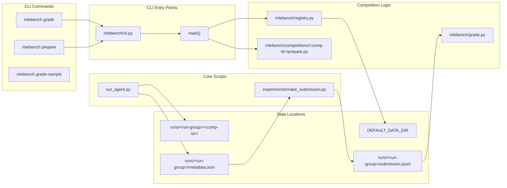

**Sources:** [mlebench/cli.py:13-156](), [mlebench/registry.py:74-155](), [agents/README.md:29-47]()

## Directory Structure After Quick Start

After completing the quick start, your repository will have the following structure:

| Directory | Description | Example Contents |
|-----------|-------------|------------------|
| `~/.cache/mle-bench/data/` | Prepared dataset storage [mlebench/registry.py:13-13]() | `spaceship-titanic/`, `raw/` |
| `runs/<run-group>/` | Run group directory [agents/README.md:37-37]() | `metadata.json`, `submission.jsonl` |
| `runs/<run-group>/<comp-id>/` | Competition-specific outputs | `submission/`, `logs/`, `code/` |

**Sources:** [mlebench/registry.py:13-13](), [agents/README.md:37-47]()

## Verifying the Quick Start

The `dummy` agent performs validation checks to ensure the environment is configured correctly [agents/README.md:51-59]():

1. Checks for root access.
2. Identifies the Python interpreter.
3. Attempts to use the sample submission.
4. Verifies private data isolation (access to test labels should be denied).
5. Checks read/write access to `/home`.

Review the logs to confirm all checks passed:
```bash
cat runs/<run-group>/spaceship-titanic/logs/agent.log
```

**Sources:** [agents/README.md:51-59]()

## Next Steps

1. **Run on multiple competitions:** Use competition sets from `experiments/splits/` [agents/README.md:31-32]().
2. **Evaluate other agents:** Build and run `aide`, `mlagentbench`, or `opendevin` [agents/README.md:5-10]().
3. **Prepare the full dataset:** Use `mlebench prepare --all` or `--lite` [mlebench/cli.py:30-40]().
4. **Generate leaderboard metrics:** Use `experiments/aggregate_grading_reports.py` [README.md:53-65]().

**Sources:** [mlebench/cli.py:30-40](), [README.md:53-65](), [agents/README.md:5-32]()

---

# Page: User Guide

# User Guide

<details>
<summary>Relevant source files</summary>

The following files were used as context for generating this wiki page:

- [README.md](README.md)
- [mlebench/cli.py](mlebench/cli.py)
- [mlebench/competitions/the-icml-2013-whale-challenge-right-whale-redux/prepare.py](mlebench/competitions/the-icml-2013-whale-challenge-right-whale-redux/prepare.py)
- [mlebench/registry.py](mlebench/registry.py)

</details>


This guide covers the core features of MLE-bench for benchmarking machine learning agents. It explains how to prepare datasets, execute agents, evaluate submissions, and generate leaderboard metrics.

For installation instructions, see [Getting Started](#3). For agent implementation details, see [Agent Framework](#6) and [Agent Implementations](#7). For system architecture, see [System Architecture](#2).

## Core Workflow Overview

MLE-bench provides four main commands for benchmarking agents:

| Command | Purpose | Key Options |
|---------|---------|-------------|
| `mlebench prepare` | Download and prepare competition datasets | `--all`, `--lite`, `-c competition-id` |
| `run_agent.py` | Execute agents in Docker containers | `--agent-id`, `--competition`, `--run-group` |
| `mlebench grade` | Evaluate submissions and generate reports | `submission.jsonl` input file |
| `aggregate_grading_reports.py` | Generate leaderboard metrics | `--experiment-id`, `--split` |

### MLE-bench Command Flow

```mermaid
graph LR
    PrepareCmd["mlebench prepare"] --> DataDir["DEFAULT_DATA_DIR"]
    DataDir --> RunAgent["run_agent.py"]
    RunAgent --> RunsDir["runs/&lt;run-group&gt;/"]
    RunsDir --> MakeSubmission["make_submission.py"]
    MakeSubmission --> SubmissionJSONL["submission.jsonl"]
    SubmissionJSONL --> GradeCmd["mlebench grade"]
    GradeCmd --> GradingReports["grading_report.json"]
    GradingReports --> AggregateCmd["aggregate_grading_reports.py"]
    AggregateCmd --> Leaderboard["any_medal_percentage"]
```

Sources: [mlebench/cli.py:18-128](), [README.md:53-65](), [mlebench/registry.py:13-13]()

## Prerequisites

Before using MLE-bench, ensure the following are configured:

**Required Setup:**
1. Git LFS installed and fetched: `git lfs fetch --all && git lfs pull`
2. MLE-bench installed: `pip install -e .`
3. Kaggle credentials in `~/.kaggle/kaggle.json`
4. Docker installed and running

Sources: [README.md:104-123]()

## Dataset Preparation

The `mlebench prepare` command downloads and prepares competition datasets from Kaggle. It uses the Kaggle API to fetch raw data, then runs competition-specific preparation scripts (e.g., `prepare.py` in each competition directory) to create train/test splits. For details, see [Dataset Preparation](#4.1).

### Prepare Command Options

**Full Dataset (75 competitions):**
```bash
mlebench prepare --all
```
Downloads all competitions in the benchmark [mlebench/cli.py:31-34]().

**Lite Dataset (22 competitions):**
```bash
mlebench prepare --lite
```
Downloads only the low complexity split competitions [mlebench/cli.py:36-40]().

**Single Competition:**
```bash
mlebench prepare -c <competition-id>
```
Prepares one specific competition [mlebench/cli.py:22-28]().

### Dataset Storage and Structure

```mermaid
graph TB
    subgraph "Natural Language Space"
        CompDesc["Competition Description"]
    end

    subgraph "Code Entity Space"
        Registry["mlebench.registry.Registry"]
        PrepareFn["mlebench.registry.Competition.prepare_fn"]
        DataDir["mlebench.registry.DEFAULT_DATA_DIR"]
    end

    CompDesc -- "Mapped by ID" --> Registry
    Registry -- "Calls" --> PrepareFn
    PrepareFn -- "Outputs to" --> DataDir
    
    DataDir --> RawDir["raw/&lt;competition-id&gt;/"]
    DataDir --> PublicDir["prepared/public/"]
    DataDir --> PrivateDir["prepared/private/"]
```

**Directory Structure:**
- Raw data: `~/.cache/mle-bench/data/<competition-id>/raw` [mlebench/registry.py:98-98]()
- Prepared Public data: `~/.cache/mle-bench/data/<competition-id>/prepared/public` [mlebench/registry.py:100-100]()
- Prepared Private data: `~/.cache/mle-bench/data/<competition-id>/prepared/private` [mlebench/registry.py:99-99]()

Sources: [mlebench/cli.py:18-82](), [mlebench/registry.py:13-116](), [mlebench/competitions/the-icml-2013-whale-challenge-right-whale-redux/prepare.py:9-12]()

## Running Agents

Agents are executed using `run_agent.py`. This script handles container orchestration, volume mounting for data access, and result collection. For details, see [Running Agents](#4.2).

## Evaluating Submissions

The grading process involves comparing agent-generated predictions against ground truth labels stored in the private data directory. For details, see [Evaluating Submissions](#4.3).

### Submission Format and Grading

```mermaid
sequenceDiagram
    participant CLI as "mlebench.cli.main"
    participant GradeFn as "mlebench.grade.grade_jsonl"
    participant Registry as "mlebench.registry.Registry"
    participant Comp as "mlebench.registry.Competition"
    participant Grader as "mlebench.grade_helpers.Grader"
    
    CLI->>GradeFn: "Passes submission.jsonl"
    GradeFn->>Registry: "get_competition(id)"
    Registry->>Comp: "Initializes Competition object"
    GradeFn->>Grader: "Calls grader.grade_csv(path)"
    Grader-->>GradeFn: "Returns score/medal"
    GradeFn->>GradeFn: "Writes grading_report.json"
```

**Required JSONL Format:**
- `competition_id`: Competition identifier [mlebench/cli.py:118-121]()
- `submission_path`: Path to `.csv` file containing predictions [mlebench/cli.py:113-116]()

**Individual Grading Option:**
- Use `mlebench grade-sample PATH_TO_SUBMISSION competition-id` for single submissions [mlebench/cli.py:108-128]().

Sources: [mlebench/cli.py:84-128](), [mlebench/registry.py:17-47](), [mlebench/grade.py:6-7]()

## Leaderboard Generation

Once grading reports are generated for a set of runs, they are aggregated to produce the final leaderboard metrics using `aggregate_grading_reports.py`. For details, see [Leaderboard Generation](#4.4).

### Aggregation Command
```bash
uv run python experiments/aggregate_grading_reports.py --experiment-id <exp_id> --split <low|medium|high|split75>
```
This script reports the mean and standard error of the mean (SEM) for the `any_medal_percentage` metric.

Sources: [README.md:53-65]()

---

# Page: Dataset Preparation

# Dataset Preparation

<details>
<summary>Relevant source files</summary>

The following files were used as context for generating this wiki page:

- [.gitattributes](.gitattributes)
- [mlebench/cli.py](mlebench/cli.py)
- [mlebench/competitions/the-icml-2013-whale-challenge-right-whale-redux/prepare.py](mlebench/competitions/the-icml-2013-whale-challenge-right-whale-redux/prepare.py)
- [mlebench/data.py](mlebench/data.py)
- [mlebench/registry.py](mlebench/registry.py)

</details>


This page explains how to prepare competition datasets for MLE-bench evaluation. Dataset preparation downloads raw data from Kaggle and transforms it into a standardized format with train/test splits. For information about how prepared data is used during agent execution, see [Data Management and Storage](#5.4). For details about the competition structure itself, see [Competition Framework](#5.3).

## Overview

MLE-bench consists of 75 Kaggle competitions used to evaluate machine learning agents. Since Kaggle does not provide held-out test sets for these competitions, the `mlebench prepare` command downloads the publicly available competition data and creates new train/test splits. The preparation process handles data download, validation, transformation, and organization into a standardized directory structure.

Sources: [mlebench/cli.py:18-21](), [mlebench/data.py:37-47]()

## Prerequisites

### Kaggle API Credentials

The preparation system uses the Kaggle API to download competition data. Before running any preparation commands, you must:

1. Download your Kaggle API credentials file (`kaggle.json`).
2. Place the file in the `~/.kaggle/` directory.

The system uses `authenticate_kaggle_api` to initialize the connection before downloading datasets.

Sources: [mlebench/utils.py:19]() (refers to authentication logic), [mlebench/data.py:60-64]()

### Git LFS Setup

Competition data and outputs are stored using Git Large File Storage (LFS). Before pulling the repository or working with prepared data, install Git LFS and run:

```bash
git lfs fetch --all
git lfs pull
```

The following file types are tracked with Git LFS:

| File Pattern | Purpose |
|--------------|---------|
| `*.csv` | All CSV files including competition data and submissions |
| `mlebench/competitions/*/top_solutions/**` | Reference solutions from top Kaggle submissions |
| `runs/**/*.json` | Grading reports and run metadata |
| `runs/**/*.jsonl` | Batch submission files |

Sources: [.gitattributes:1-4]()

## Preparation Commands

The `mlebench prepare` command is the primary entry point for dataset setup. It is managed by the `main()` function in `mlebench/cli.py`.

### Prepare All Competitions

To download and prepare the complete MLE-bench dataset:

```bash
mlebench prepare --all
```

This iterates through all competition IDs found in the registry and executes the `download_and_prepare_dataset` function for each.

Sources: [mlebench/cli.py:30-34](), [mlebench/cli.py:166-170](), [mlebench/cli.py:184-191]()

### Prepare Lite Dataset

For cost-effective evaluation, use the lite dataset consisting of competitions from the "low" complexity split:

```bash
mlebench prepare --lite
```

The `Registry.get_lite_competition_ids()` method retrieves IDs from `experiments/splits/low.txt`.

Sources: [mlebench/cli.py:35-40](), [mlebench/registry.py:128-134](), [mlebench/registry.py:123-126]()

### Prepare Specific Competition

To prepare an individual competition by its ID:

```bash
mlebench prepare -c <competition-id>
```

Sources: [mlebench/cli.py:22-28](), [mlebench/cli.py:182]()

## Data Preparation Flow

The preparation process involves downloading raw ZIP files from Kaggle, extracting them, and running a custom `prepare_fn` for each competition.

```mermaid
graph TB
    subgraph "CLI Layer"
        CLI["mlebench/cli.py:main()"]
        Registry["mlebench/registry.py:Registry"]
    end
    
    subgraph "Data Logic"
        DPD["mlebench/data.py:download_and_prepare_dataset()"]
        Download["mlebench/data.py:download_dataset()"]
        Extract["mlebench/utils.py:extract()"]
        CompPrep["Competition:prepare_fn"]
    end
    
    subgraph "Filesystem Structure"
        RawDir["[data_dir]/[id]/raw/"]
        PublicDir["[data_dir]/[id]/prepared/public/"]
        PrivateDir["[data_dir]/[id]/prepared/private/"]
    end

    CLI --> Registry
    Registry -->|"get_competition()"| DPD
    DPD --> Download
    Download -->|"Saves ZIP to"| RawDir
    DPD --> Extract
    Extract -->|"Unpacks to"| RawDir
    DPD --> CompPrep
    CompPrep -->|"Reads from"| RawDir
    CompPrep -->|"Writes to"| PublicDir
    CompPrep -->|"Writes to"| PrivateDir
```

**Diagram: Data Preparation Implementation Flow**

Sources: [mlebench/cli.py:184-191](), [mlebench/data.py:37-108](), [mlebench/registry.py:98-100]()

## Implementation Details

### The Registry and Competition Objects

The `Registry` class manages the configuration and paths for all competitions. It constructs `Competition` dataclasses by loading `config.yaml` files from `mlebench/competitions/[id]/`.

Key attributes of the `Competition` class used during preparation:
- `prepare_fn`: A callable (imported via `import_fn`) that performs the data transformation.
- `raw_dir`: Path where Kaggle ZIPs are extracted.
- `public_dir`: Path for data accessible to agents (e.g., training sets, sample submissions).
- `private_dir`: Path for ground truth answers used for grading.

Sources: [mlebench/registry.py:16-31](), [mlebench/registry.py:74-116]()

### The Preparation Function (`prepare_fn`)

Each competition has a unique `prepare.py` script. For example, in `the-icml-2013-whale-challenge-right-whale-redux`, the `prepare` function:
1. Unpacks `train2.zip`.
2. Splits the original training data into a new training set and a new test set based on timestamps in filenames.
3. Copies files to the `public` directory.
4. Generates `test.csv` (answers) in the `private` directory.
5. Creates a `sampleSubmission.csv` in the `public` directory.

Sources: [mlebench/competitions/the-icml-2013-whale-challenge-right-whale-redux/prepare.py:9-96]()

### Checksum Validation

To ensure data integrity, the system generates and verifies SHA-256 checksums for the raw ZIP and the final prepared files.
- `generate_checksums()`: Recursively hashes files in a directory.
- `checksums.yaml`: Stores the expected hashes for `zip`, `public`, and `private` folders.

Developers can use `--overwrite-checksums` to update these values when modifying preparation logic.

Sources: [mlebench/data.py:66-81](), [mlebench/data.py:112-141](), [mlebench/cli.py:62-67]()

## Storage Locations

### Default Data Directory
By default, data is stored in a platform-specific user cache directory:
- `DEFAULT_DATA_DIR`: `(Path(user_cache_dir()) / "mle-bench" / "data")`.

This can be overridden using the `--data-dir` flag in the CLI.

Sources: [mlebench/registry.py:13](), [mlebench/cli.py:55-60]()

### Directory Layout
After preparation, the directory structure for a competition ID `example-comp` looks like:

```text
[data-dir]/
└── example-comp/
    ├── raw/                # (Optional) Original Kaggle files
    └── prepared/
        ├── public/         # Mounted into agent containers
        │   ├── train.csv
        │   ├── description.md
        │   └── sample_submission.csv
        └── private/        # Used only by the grader
            └── test.csv    # Ground truth
```

Sources: [mlebench/registry.py:98-100](), [mlebench/data.py:109-111]()

## Execution Summary

| CLI Flag | Functionality |
|----------|---------------|
| `--keep-raw` | Prevents deletion of the `raw/` directory after preparation. |
| `--overwrite-leaderboard` | Re-downloads the Kaggle leaderboard CSV. |
| `--skip-verification` | Skips checking file checksums against `checksums.yaml`. |

Sources: [mlebench/cli.py:49-81](), [mlebench/data.py:143-145]()

---

# Page: Running Agents

# Running Agents

<details>
<summary>Relevant source files</summary>

The following files were used as context for generating this wiki page:

- [README.md](README.md)
- [agents/README.md](agents/README.md)

</details>


This document covers the practical execution of ML agents within the MLE-bench system using the `run_agent.py` script and Docker containers. It focuses on the mechanics of launching agents, configuring their execution environment, and managing their outputs.

For information about agent implementation details and architecture, see **6. Agent Framework**. For evaluating agent submissions after execution, see **4.3. Evaluating Submissions**. For preparing competition datasets before running agents, see **4.1. Dataset Preparation**.

## Purpose and Execution Overview

The MLE-bench system executes agents in isolated Docker containers with standardized directory structures and environment variables. Each agent receives access to competition data and must produce a submission file within a specified time limit.

## Agent Execution Workflow

The following diagram illustrates the flow from building an agent image to generating the final execution metadata.

**Agent Run Data Flow**
```mermaid
flowchart TD
    Build["docker build agents/[agent_id]/"]
    EnvVars["Export SUBMISSION_DIR, LOGS_DIR, CODE_DIR, AGENT_DIR"]
    RunAgentPy["python run_agent.py --agent-id [agent] --competition-set [split]"]
    RunGroupDir["Create runs/[run_group]/[competition]/"]
    Mount["Mount competition data and output directories"]
    StartSh["Execute start.sh in container"]
    AgentProcess["Agent processes competition data"]
    Outputs["Generate submission.csv, logs, code"]
    Metadata["Create metadata.json with results"]
    
    Build --> EnvVars
    EnvVars --> RunAgentPy
    RunAgentPy --> RunGroupDir
    RunGroupDir --> Mount
    Mount --> StartSh
    StartSh --> AgentProcess
    AgentProcess --> Outputs
    Outputs --> Metadata
```

**Sources:** [agents/README.md:29-47]()

## Prerequisites and Environment Setup

### Required Dependencies

Before running agents, ensure the following are installed:
- **Docker Engine**: For container execution [agents/README.md:14]().
- **Sysbox**: For enhanced container security and isolation [agents/README.md:15]().
- **NVIDIA Container Toolkit**: (Optional) Required to run agents with GPU support [agents/README.md:16]().

**Sources:** [agents/README.md:12-16]()

### Environment Variables

The system requires four standardized directory environment variables that define the container filesystem layout. These must be exported before building Docker images or running agents.

| Variable | Purpose | Default Path |
|----------|---------|--------------|
| `SUBMISSION_DIR` | Agent output location | `/home/submission` |
| `LOGS_DIR` | Agent log storage | `/home/logs` |
| `CODE_DIR` | Agent code storage | `/home/code` |
| `AGENT_DIR` | Agent workspace | `/home/agent` |

**Sources:** [agents/README.md:21-24]()

## Building Agent Images

Each agent requires a Docker image built from its respective directory in `agents/<agent_id>/`. The build process uses the environment variables as build arguments to ensure the agent knows where to read data and write outputs.

```bash
docker build --platform=linux/amd64 -t <agent> agents/<agent>/ \
  --build-arg SUBMISSION_DIR=$SUBMISSION_DIR \
  --build-arg LOGS_DIR=$LOGS_DIR \
  --build-arg CODE_DIR=$CODE_DIR \
  --build-arg AGENT_DIR=$AGENT_DIR
```

**Sources:** [agents/README.md:18-27]()

## Executing Agents with run_agent.py

### Basic Execution

The `run_agent.py` script is the primary entry point for launching agents against competitions.

```bash
python run_agent.py --agent-id <agent_id> --competition-set <split_file>
```

### Competition Sets

Competition sets are text files containing competition IDs, located in `experiments/splits/`:
- `experiments/splits/split75.txt`: Contains all 75 competitions used in the benchmark [agents/README.md:31]().
- `experiments/splits/spaceship-titanic.txt`: Contains only the Spaceship Titanic competition, ideal for quick testing [agents/README.md:31-32]().

**Sources:** [agents/README.md:31-35]()

## Directory Structure and Output Management

The execution results are organized into a hierarchical structure under the `runs/` directory.

**Run Artifact Organization**
```mermaid
graph TD
    RunsDir["runs/"]
    RunGroup["runs/[run_group_id]/"]
    CompDir["runs/[run_group_id]/[competition_id]/"]
    Metadata["runs/[run_group_id]/metadata.json"]
    
    subgraph "Artifacts per Competition"
        SubFile["submission.csv"]
        LogFiles["Agent logs"]
        CodeFiles["Generated code"]
    end
    
    RunsDir --> RunGroup
    RunGroup --> CompDir
    RunGroup --> Metadata
    CompDir --> SubFile
    CompDir --> LogFiles
    CompDir --> CodeFiles
```

### Run Group Creation

Each execution of `run_agent.py` creates a "run group" directory. Upon completion, a `metadata.json` file is generated within this directory, summarizing the execution status across all targeted competitions [agents/README.md:37-38]().

**Sources:** [agents/README.md:37-41]()

## Container Configuration

### Default Configuration

Container behavior, including resource limits and security settings, is controlled by configuration files. The default configuration is located at `environment/config/container_configs/default.json` [agents/README.md:49]().

### GPU Configuration

To enable GPU access (e.g., for agents that train models or use local LLMs), users can modify the container config JSON to set `"gpus": -1` [agents/README.md:49]().

**Sources:** [agents/README.md:49]()

## Security Models

### Sysbox Runtime

The system uses the [Sysbox](https://github.com/nestybox/sysbox) runtime by default for agents like `aide`, `mlagentbench`, and the `dummy` agent [agents/README.md:62](). Sysbox provides enhanced isolation to prevent malicious code from compromising the host system [agents/README.md:62]().

### Privileged Mode (OpenHands/OpenDevin)

The `opendevin` agent requires Docker-in-Docker (DinD) capabilities. Because Sysbox does not yet support GPU-passthrough in DinD scenarios, `opendevin` must be run in "privileged" mode [agents/README.md:64](). 

**Security Requirement**: Users must explicitly acknowledge this risk by setting the environment variable `I_ACCEPT_RUNNING_PRIVILEGED_CONTAINERS=True` when running `opendevin` via `run_agent.py` [agents/README.md:64]().

**Sources:** [agents/README.md:60-64]()

## Agent Validation with Dummy Agent

The `dummy` agent is a diagnostic tool used to verify that the MLE-bench environment is correctly configured [agents/README.md:52](). It performs the following checks:

1. **Root Access**: Checks if `main.py` is running with root privileges [agents/README.md:54]().
2. **Interpreter Check**: Verifies the Python interpreter in use [agents/README.md:55]().
3. **Submission Capability**: Attempts to use the competition's sample submission [agents/README.md:56]().
4. **Data Privacy**: Confirms it cannot read "private" data (test set labels) [agents/README.md:57]().
5. **Write Access**: Validates read/write permissions for the `/home` working directory [agents/README.md:58]().

**Sources:** [agents/README.md:51-58]()

## Post-Execution Workflow

Once `run_agent.py` finishes, the outputs must be processed for grading:

1. **Generate Submission JSONL**:
   Use `experiments/make_submission.py` to aggregate results from the `metadata.json` [agents/README.md:39-40]().
   ```bash
   python experiments/make_submission.py --metadata runs/<run-group>/metadata.json --output runs/<run-group>/submission.jsonl
   ```

2. **Grade the Submission**:
   Use the `mlebench grade` CLI command [agents/README.md:43-46]().
   ```bash
   mlebench grade --submission runs/<run-group>/submission.jsonl --output-dir runs/<run-group>
   ```

**Sources:** [agents/README.md:39-47]()

---

# Page: Evaluating Submissions

# Evaluating Submissions

<details>
<summary>Relevant source files</summary>

The following files were used as context for generating this wiki page:

- [README.md](README.md)
- [mlebench/cli.py](mlebench/cli.py)
- [mlebench/competitions/the-icml-2013-whale-challenge-right-whale-redux/prepare.py](mlebench/competitions/the-icml-2013-whale-challenge-right-whale-redux/prepare.py)
- [mlebench/registry.py](mlebench/registry.py)

</details>


## Purpose and Scope

This page explains how to evaluate agent submissions on MLE-bench competitions using the grading system. It covers submission format requirements, the grading commands (`mlebench grade` and `mlebench grade-sample`), and the underlying implementation of the grading logic. For information about aggregating grading reports into leaderboard metrics, see [Leaderboard Generation](4.4).

## Submission Format Requirements

All competition submissions must be in CSV format. The specific structure varies by competition and is defined in the competition's configuration and sample files.

- **Competition Description**: Each competition's `description.md` file describes the expected submission format.
- **Sample Submission**: Each competition includes a `sample_submission.csv` file showing the required structure [mlebench/registry.py:24]().
- **Answers/Gold Submission**: The ground truth used for grading is typically a `test.csv` or similar file stored in the private data directory [mlebench/registry.py:92-95]().

### Validation Script

MLE-bench provides a validation script that agents can use to check submission format correctness before grading:

```bash
/home/validate_submission.sh <competition_id> <submission.csv>
```

This script verifies that the submission matches the expected format (columns, data types) but does not evaluate prediction accuracy.

**Sources:** [mlebench/registry.py:17-48](), [mlebench/competitions/the-icml-2013-whale-challenge-right-whale-redux/prepare.py:85-95]()

## Grading Workflows

MLE-bench provides two grading workflows: individual submission grading for testing and batch grading for evaluating multiple submissions.

### Workflow Overview

```mermaid
graph TB
    subgraph "Agent Execution"
        Agent["Agent produces outputs"]
        RunDir["runs/<run-group>/<competition>/"]
        Sub["submission.csv"]
        Meta["metadata.json"]
    end
    
    subgraph "Individual Grading"
        GradeSample["mlebench grade-sample"]
        SingleCSV["submission.csv"]
        CompID["competition-id"]
    end
    
    subgraph "Batch Grading"
        MakeSubmission["make_submission.py"]
        SubmissionJSONL["submission.jsonl"]
        Grade["mlebench grade"]
    end
    
    subgraph "Output"
        GradingReport["*_grading_report.json"]
    end
    
    Agent --> RunDir
    RunDir --> Sub
    RunDir --> Meta
    
    Sub --> SingleCSV
    SingleCSV --> GradeSample
    CompID --> GradeSample
    GradeSample --> GradingReport
    
    Meta --> MakeSubmission
    MakeSubmission --> SubmissionJSONL
    SubmissionJSONL --> Grade
    Grade --> GradingReport
```

**Workflow Diagram: Individual vs Batch Grading Paths**

**Sources:** [mlebench/cli.py:83-128](), [README.md:53-65]()

### Individual Submission Grading

Use `mlebench grade-sample` to grade a single submission for one competition. This is useful for testing or debugging submissions.

**Command Structure:**
```bash
mlebench grade-sample <PATH_TO_SUBMISSION> <COMPETITION_ID>
```

**Implementation Details:**
The CLI calls `grade_csv` which loads the competition from the `Registry` [mlebench/cli.py:197-201](). The `Registry` fetches the `Competition` object containing the `Grader` instance [mlebench/registry.py:78-116]().

**Parameters:**
| Parameter | Type | Description |
|-----------|------|-------------|
| `PATH_TO_SUBMISSION` | File path | Path to the submission CSV file |
| `COMPETITION_ID` | String | ID of the competition (e.g., `spaceship-titanic`) |

**Sources:** [mlebench/cli.py:108-128](), [mlebench/registry.py:74-116]()

### Batch Submission Grading

Use `mlebench grade` to grade multiple submissions across different competitions in a single command. This is the standard workflow for evaluating agent runs.

**Command Structure:**
```bash
mlebench grade --submission <SUBMISSION_JSONL> --output-dir <OUTPUT_DIR>
```

**Implementation Details:**
The CLI invokes `grade_jsonl`, which iterates through the entries in the JSONL file, grading each one and saving the resulting metrics to the specified output directory [mlebench/cli.py:192-196]().

**Parameters:**
| Parameter | Type | Description |
|-----------|------|-------------|
| `--submission` | File path | Path to JSONL file containing submission information |
| `--output-dir` | Directory path | Directory where grading reports will be saved |

**Sources:** [mlebench/cli.py:84-106](), [mlebench/registry.py:155]()

## Submission JSONL Format

The `mlebench grade` command requires a JSONL (JSON Lines) file where each line represents one submission.

### Required Fields

| Field | Type | Description |
|-------|------|-------------|
| `competition_id` | String | The ID of the competition in the MLE-bench dataset |
| `submission_path` | String | Path to the `.csv` file containing predictions |

### Creating Submission JSONL

For agent runs organized in run groups, use `experiments/make_submission.py` to generate the submission JSONL from the run's metadata. This script reads the `metadata.json` file produced by `run_agent.py` and extracts submission information for all completed competitions.

### Example JSONL Content

```json
{"competition_id": "spaceship-titanic", "submission_path": "runs/my-run/spaceship-titanic/submission.csv"}
{"competition_id": "dog-breed-identification", "submission_path": "runs/my-run/dog-breed-identification/submission.csv"}
```

**Sources:** [mlebench/cli.py:89-93](), [README.md:55-58]()

## Grading Process

### Grading Logic Implementation

```mermaid
graph LR
    subgraph "Input"
        SubCSV["submission.csv"]
        CompID2["competition_id"]
    end
    
    subgraph "Code Entities"
        Registry["mlebench.registry.Registry"]
        CompObj["mlebench.registry.Competition"]
        Grader["mlebench.grade_helpers.Grader"]
    end
    
    subgraph "Data Files"
        PrivateData["private_dir/test.csv"]
        Leaderboard["leaderboard.csv"]
    end
    
    subgraph "Output"
        Score["score"]
        Medal["medal"]
    end
    
    SubCSV --> Grader
    CompID2 --> Registry
    Registry --> CompObj
    CompObj --> Grader
    PrivateData --> Grader
    Leaderboard --> Grader
    Grader --> Score
    Grader --> Medal
```

**Grading Implementation Flow**

The grading process follows these steps:
1. **Registry Lookup**: The `Registry` class locates the competition configuration and instantiates a `Competition` object [mlebench/registry.py:78-85]().
2. **Grader Initialization**: Each `Competition` contains a `Grader` object [mlebench/registry.py:21]().
3. **Metric Calculation**: The grader compares the `submission.csv` against the `answers` path (ground truth) [mlebench/registry.py:59-61]().
4. **Leaderboard Comparison**: The raw score is compared against the competition's `leaderboard.csv` to determine the percentile rank and medal status [mlebench/registry.py:31, 85]().

### Private Data Isolation

Test labels and ground truth are stored in the `private_dir` (e.g., `/data/mle-bench/data/<comp_id>/prepared/private/`) and are never accessible to agents during execution [mlebench/registry.py:99](). Agents only have access to the `public_dir` [mlebench/registry.py:100]().

**Sources:** [mlebench/registry.py:17-48, 98-116](), [mlebench/cli.py:192-202]()

## Grading Reports

### Report Format and Contents

Grading produces a JSON report for each competition with the filename pattern `<competition-id>_grading_report.json`.

Each grading report contains:
- `competition_id`: ID of the graded competition.
- `submission_path`: Path to the submission that was graded.
- `score`: Raw score on the competition metric.
- `percentile_rank`: Percentile rank on the historical leaderboard (0-100).
- `medal`: Medal achieved ("gold", "silver", "bronze", or null).

### Using Grading Reports

Grading reports are the primary input for generating aggregate leaderboard metrics. Use the `aggregate_grading_reports.py` script to process these files:

```bash
uv run python experiments/aggregate_grading_reports.py --experiment-id <exp_id> --split low
```

This aggregates reports across multiple seeds to compute the mean and standard error of the mean (SEM) for the `any_medal_percentage` metric [README.md:61-68]().

**Sources:** [README.md:53-68](), [mlebench/cli.py:192-196]()

## Command Reference Summary

| Command | Purpose | Implementation |
|---------|---------|----------------|
| `mlebench grade-sample` | Grade single submission | `mlebench.grade.grade_csv` |
| `mlebench grade` | Grade batch of submissions | `mlebench.grade.grade_jsonl` |
| `mlebench prepare` | Setup data for grading | `mlebench.data.download_and_prepare_dataset` |

**Sources:** [mlebench/cli.py:13-196]()

---

# Page: Leaderboard Generation

# Leaderboard Generation

<details>
<summary>Relevant source files</summary>

The following files were used as context for generating this wiki page:

- [experiments/splits/systemcard.txt](experiments/splits/systemcard.txt)
- [runs/README.md](runs/README.md)
- [runs/run_group_experiments.csv](runs/run_group_experiments.csv)

</details>


## Purpose and Overview

This document explains how to aggregate grading reports from multiple agent runs and generate leaderboard metrics for MLE-bench. The leaderboard generation process takes individual grading reports produced by `mlebench grade` and computes aggregate statistics across different competition splits, enabling fair comparison of agent performance.

The leaderboard generation system produces the "Any Medal %" metric, which represents the percentage of competitions where an agent achieved at least a bronze medal (top 40% of the competition leaderboard). This metric is reported with standard error of the mean (SEM) to account for variance across multiple evaluation seeds.

**Leaderboard Generation Pipeline**
```mermaid
flowchart LR
    subgraph "Input: Agent Runs"
        RunGroups["runs/<run-group>/<br/>Agent outputs"]
        GradingReports["*_grading_report.json<br/>Per-competition results"]
    end
    
    subgraph "Configuration"
        ExperimentCSV["runs/run_group_experiments.csv<br/>Experiment ID mapping"]
        SplitsDir["experiments/splits/<br/>low.txt, medium.txt,<br/>high.txt, split75.txt"]
    end
    
    subgraph "Processing"
        AggregateScript["aggregate_grading_reports.py<br/>--experiment-id<br/>--split"]
    end
    
    subgraph "Output: Metrics"
        AnyMedalPct["any_medal_percentage<br/>Mean ± SEM"]
        LeaderboardRow["Leaderboard table entry"]
    end
    
    RunGroups -->|"Contains"| GradingReports
    GradingReports -->|"Input to"| AggregateScript
    ExperimentCSV -->|"Lookup by"| AggregateScript
    SplitsDir -->|"Filter competitions"| AggregateScript
    AggregateScript -->|"Computes"| AnyMedalPct
    AnyMedalPct -->|"Reported as"| LeaderboardRow
```

Sources: [runs/README.md:1-26]()

## Prerequisites

Before generating leaderboard metrics, ensure you have:

1.  **Completed Agent Runs**: Agent executions that produced submission files.
2.  **Grading Reports**: Generated using `mlebench grade` on the agent submissions.
3.  **Proper Directory Structure**: Runs organized in the `runs/` directory with appropriate metadata.

**Required Directory Structure**
```mermaid
graph TB
    subgraph "runs/ Directory"
        RunsDir["runs/"]
        ExperimentCSV["run_group_experiments.csv"]
        RunGroup1["<run-group-1>/"]
        RunGroup2["<run-group-2>/"]
        RunGroup3["<run-group-3>/"]
    end
    
    subgraph "Run Group Contents"
        GradingReport["<competition>_grading_report.json"]
    end
    
    RunsDir -->|"Contains"| ExperimentCSV
    RunsDir -->|"Contains"| RunGroup1
    RunsDir -->|"Contains"| RunGroup2
    RunsDir -->|"Contains"| RunGroup3
    
    RunGroup1 -->|"Contains"| GradingReport
    RunGroup2 -->|"Contains"| GradingReport
    RunGroup3 -->|"Contains"| GradingReport
```

Sources: [runs/README.md:3-9]()

## Competition Splits

MLE-bench evaluates agents across different competition splits, each representing a different subset of the total competitions. One example is the `systemcard` split which includes specific high-impact competitions.

| Split | Description | Number of Competitions | File Location |
|-------|-------------|----------------------|---------------|
| `systemcard` | Competitions used for system card evaluation | 30 | `experiments/splits/systemcard.txt` |

The split files are simple text files containing one competition ID per line. The `aggregate_grading_reports.py` script uses these files to filter which grading reports to include in the aggregation.

**Competition Split Distribution**
```mermaid
graph LR
    subgraph "Split Files"
        SystemCardTxt["experiments/splits/systemcard.txt<br/>30 competitions"]
    end
    
    subgraph "Leaderboard Columns"
        SysCardCol["System Card (%)"]
    end
    
    SystemCardTxt -->|"Aggregates to"| SysCardCol
```

Sources: [experiments/splits/systemcard.txt:1-30]()

## Experiment Configuration

### Run Group Organization

Agent runs must be organized into **run groups** in the `runs/` directory. Each run group represents a collection of run results across multiple competitions and seeds.

- `grading_report.json`: Contains the scores achieved for the run group.

Sources: [runs/README.md:5-9]()

### Linking Run Groups to Experiments

The `runs/run_group_experiments.csv` file maps run groups to experiment IDs. This allows you to aggregate results from multiple run groups (e.g., different seeds or different competitions) into a single experiment.

An experiment typically represents a specific agent setup (e.g., `biggpu-gpt4o-aide` or `models-o1-preview-aide`).

| Experiment ID | Description |
|---------------|-------------|
| `scaffolding-gpt4o-aide` | GPT-4o on AIDE scaffolding |
| `scaffolding-gpt4o-mlab` | GPT-4o on MLAB scaffolding |
| `scaffolding-gpt4o-opendevin` | GPT-4o on OpenDevin scaffolding |
| `deepseek-r1-InternAgent` | Deepseek-R1 on InternAgent scaffolding |

Sources: [runs/README.md:24-63]()

## Running the Aggregation Script

### Basic Usage

The `aggregate_grading_reports.py` script aggregates grading reports for a specific experiment ID and competition split.

**Basic Command Syntax:**
```bash
python aggregate_grading_reports.py --experiment-id <exp_id> --split <split_name>
```

**Execution Flow**
```mermaid
sequenceDiagram
    participant User
    participant Script["aggregate_grading_reports.py"]
    participant CSV["run_group_experiments.csv"]
    participant SplitFile["experiments/splits/<split>.txt"]
    participant GradingReports["runs/<run-group>/grading_report.json"]
    
    User->>Script: "--experiment-id scaffolding-gpt4o-aide --split systemcard"
    Script->>CSV: "Load experiment-to-run-group mapping"
    CSV-->>Script: "List of run groups for exp_id"
    Script->>SplitFile: "Read competition IDs"
    SplitFile-->>Script: "Competition ID list"
    
    loop "For each run group"
        Script->>GradingReports: "Load grading reports"
        GradingReports-->>Script: "Scores"
    end
    
    Script->>Script: "Aggregate across seeds"
    Script-->>User: "Final aggregated metrics"
```

Sources: [runs/README.md:14-22](), [runs/README.md:24-26]()

### Handling Multiple Seeds

In cases where there are more seeds for a competition than reported (often due to hardware failures in earlier seeds), the aggregation logic takes the final *N* seeds for computing the result, where *N* is the number of seeds for the competition with the least number of seeds in the experiment.

Sources: [runs/README.md:18-22]()

---

# Page: Core Components

# Core Components

<details>
<summary>Relevant source files</summary>

The following files were used as context for generating this wiki page:

- [environment/Dockerfile](environment/Dockerfile)
- [environment/entrypoint.sh](environment/entrypoint.sh)
- [mlebench/cli.py](mlebench/cli.py)
- [mlebench/competitions/the-icml-2013-whale-challenge-right-whale-redux/prepare.py](mlebench/competitions/the-icml-2013-whale-challenge-right-whale-redux/prepare.py)
- [mlebench/registry.py](mlebench/registry.py)

</details>


This page documents the fundamental components that comprise the MLE-bench system. These core components provide the infrastructure for dataset preparation, agent execution, evaluation, and result aggregation.

**Scope**: This page covers the four primary subsystems that form the foundation of MLE-bench. For detailed information about specific components, see:
- Command-line interface details: [Command-Line Interface](#5.1)
- Docker environment specifics: [Docker Environment](#5.2)
- Competition organization: [Competition Framework](#5.3)
- Data storage patterns: [Data Management and Storage](#5.4)

For information about agent implementations that use these components, see [Agent Framework](#6).

---

## System Overview

MLE-bench is built on four core components that work together to provide a complete benchmarking pipeline:

| Component | Purpose | Primary Interfaces |
|-----------|---------|-------------------|
| **Command-Line Interface** | Dataset preparation and evaluation | `mlebench prepare`, `mlebench grade`, `mlebench grade-sample` |
| **Docker Environment** | Isolated execution environment | `mlebench-env` base image, container runtime |
| **Competition Framework** | Competition organization and structure | 75 competitions, split definitions, metadata |
| **Data Management** | Storage and version control | `/data/`, `/data_privateonly/`, Git LFS |

**Sources**: [mlebench/cli.py:1-205](), [environment/Dockerfile:1-93]()

---

## Core Component Architecture

The following diagram shows how the core components relate to each other and to the agent execution pipeline. It bridges the logical "Natural Language Space" of benchmark components to the "Code Entity Space" of specific files and classes.

```mermaid
graph TB
    subgraph CLI["CLI (mlebench/cli.py)"]
        PrepareCmd["main() -> prepare"]
        GradeCmd["main() -> grade"]
        GradeSampleCmd["main() -> grade-sample"]
    end
    
    subgraph RegistryLogic["Registry (mlebench/registry.py)"]
        RegistryClass["Registry Class"]
        CompData["Competition Dataclass"]
    end

    subgraph Docker["Docker (environment/Dockerfile)"]
        BaseImage["mlebench-env"]
        CondaEnv["Conda: agent & mleb"]
        Entrypoint["entrypoint.sh"]
        GradeServer["grading_server.py"]
    end
    
    subgraph CompFw["Competition Logic"]
        PrepScript["prepare.py"]
        GradeScript["grade.py"]
        ConfigYAML["config.yaml"]
    end
    
    subgraph DataMgmt["Data Management"]
        PublicDir["public_dir"]
        PrivateDir["private_dir"]
        RawDir["raw_dir"]
    end
    
    PrepareCmd --> RegistryClass
    RegistryClass --> CompData
    CompData -->|"Calls"| PrepScript
    
    PrepScript -->|"Writes"| PublicDir
    PrepScript -->|"Writes"| PrivateDir
    
    GradeCmd --> GradeScript
    GradeScript -->|"Reads"| PrivateDir
    
    BaseImage --> CondaEnv
    BaseImage --> Entrypoint
    Entrypoint -->|"Starts"| GradeServer
    
    style PrepareCmd fill:#f9f9f9
    style GradeCmd fill:#f9f9f9
    style RegistryClass fill:#f9f9f9
```

**Sources**: [mlebench/registry.py:16-156](), [mlebench/cli.py:158-205](), [environment/Dockerfile:63-82]()

---

## CLI Command Flow

The MLE-bench CLI provides three primary commands that orchestrate the workflow. The CLI uses the `Registry` class in `mlebench/registry.py` to resolve competition metadata and paths.

```mermaid
graph LR
    subgraph Input["Input"]
        CompID["Competition ID"]
        SubmJSONL["submission.jsonl"]
    end
    
    subgraph PrepareFlow["mlebench prepare"]
        PrepCLI["cli.py: main()"]
        GetComp["registry.get_competition()"]
        RunPrep["prepare_fn()"]
    end
    
    subgraph GradeFlow["mlebench grade"]
        GradeCLI["cli.py: main()"]
        GradeJSONL["grade_jsonl()"]
    end
    
    subgraph Output["Output"]
        PrepData["Prepared Data"]
        GradeReport["grading_report.json"]
    end
    
    CompID --> PrepCLI
    PrepCLI --> GetComp
    GetComp --> RunPrep
    RunPrep --> PrepData
    
    SubmJSONL --> GradeCLI
    GradeCLI --> GradeJSONL
    GradeJSONL --> GradeReport
```

**CLI Implementation**: The command-line interface is implemented in `mlebench/cli.py` using Python's `argparse` module [mlebench/cli.py:13-156](). It maps user commands to the `Registry` and utility functions like `download_and_prepare_dataset` [mlebench/cli.py:185-191]().

**Sources**: [mlebench/cli.py:158-205](), [mlebench/registry.py:78-116]()

---

## Docker Environment Structure

The `mlebench-env` Docker image provides a standardized execution environment. It features a dual-conda environment setup to isolate agent dependencies from the benchmark grading infrastructure.

| Layer | Component | Path/Command |
|-------|-----------|--------------|
| **Base OS** | Ubuntu 20.04 | `FROM ubuntu:20.04` [environment/Dockerfile:1]() |
| **Agent Env** | Conda `agent` | `conda create -n agent python=3.11` [environment/Dockerfile:48]() |
| **Grading Env** | Conda `mleb` | `conda create -n mleb python=3.11` [environment/Dockerfile:65]() |
| **Grading App** | Flask Server | `pip install flask && pip install -e /mlebench` [environment/Dockerfile:66-67]() |
| **Security** | Private Dir | `mkdir /private && chmod 700 /private` [environment/Dockerfile:74]() |
| **Entrypoint** | Orchestrator | `/entrypoint.sh` [environment/Dockerfile:92]() |

**Heavy Dependencies**: The Dockerfile includes an `INSTALL_HEAVY_DEPENDENCIES` argument [environment/Dockerfile:49]() that, when true, installs large frameworks like TensorFlow and PyTorch into the agent environment [environment/Dockerfile:53-57]().

**Sources**: [environment/Dockerfile:1-93](), [environment/entrypoint.sh:1-20]()

---

## Competition Framework

Competitions are the central unit of evaluation. Each competition is defined by a directory in `mlebench/competitions/` and registered via a `config.yaml`.

**The Competition Registry**:
The `Registry` class [mlebench/registry.py:74]() is responsible for:
1. Loading competition configurations [mlebench/registry.py:81-82]().
2. Resolving paths for raw, public, and private data [mlebench/registry.py:98-100]().
3. Importing the specific `prepare` function for the dataset [mlebench/registry.py:90]().

**Data Splits**:
The framework supports different splits defined in `experiments/splits/` (e.g., `low.txt` for MLE-bench Lite) [mlebench/registry.py:123-134]().

**Sources**: [mlebench/registry.py:16-156](), [mlebench/competitions/the-icml-2013-whale-challenge-right-whale-redux/prepare.py:9-96]()

---

## Data Management and Storage

MLE-bench uses a structured directory hierarchy to manage massive datasets while keeping the repository lightweight via Git LFS.

| Directory | Content Type | Code Reference |
|-----------|--------------|----------------|
| `raw_dir` | Original Kaggle downloads | `Competition.raw_dir` [mlebench/registry.py:27]() |
| `public_dir` | Cleaned features for agents | `Competition.public_dir` [mlebench/registry.py:29]() |
| `private_dir` | Ground truth labels (answers) | `Competition.private_dir` [mlebench/registry.py:28]() |
| `/private/` | Container-internal grading | `environment/Dockerfile:74` |

**Preparation Logic**:
The `prepare.py` script for each competition (e.g., Whale Challenge) unzips raw data, splits it into new train/test sets, and generates `answers.csv` and `sampleSubmission.csv` [mlebench/competitions/the-icml-2013-whale-challenge-right-whale-redux/prepare.py:9-88]().

**Sources**: [mlebench/registry.py:13-31](), [mlebench/competitions/the-icml-2013-whale-challenge-right-whale-redux/prepare.py:41-55]()

---

# Page: Command-Line Interface

# Command-Line Interface

<details>
<summary>Relevant source files</summary>

The following files were used as context for generating this wiki page:

- [README.md](README.md)
- [mlebench/cli.py](mlebench/cli.py)
- [mlebench/competitions/the-icml-2013-whale-challenge-right-whale-redux/prepare.py](mlebench/competitions/the-icml-2013-whale-challenge-right-whale-redux/prepare.py)
- [mlebench/registry.py](mlebench/registry.py)

</details>


## Purpose and Scope

This document describes the `mlebench` command-line interface (CLI), which provides the primary user interface for dataset preparation, submission evaluation, and competition management. The CLI exposes three main commands: `prepare`, `grade`, and `grade-sample`, as well as developer-focused subcommands under `dev`.

The CLI implementation is primarily contained in `mlebench/cli.py` [mlebench/cli.py:1-205]().

## Overview

The `mlebench` CLI is installed as a Python package and provides a command-line entry point for core MLE-bench operations. All commands follow the pattern `mlebench <command> [options]`, where each command corresponds to a distinct phase in the benchmark workflow:

- **prepare**: Downloads and prepares competition datasets from Kaggle.
- **grade**: Evaluates multiple submissions in batch from a JSONL file.
- **grade-sample**: Evaluates a single submission for a specific competition.
- **dev**: Developer tools, such as downloading leaderboards.

Sources: [mlebench/cli.py:13-156]()

## Command Architecture

The CLI uses `argparse` to define sub-parsers for each command. The following diagram illustrates how the CLI entry point in `mlebench/cli.py` dispatches to internal logic and interacts with the `Registry` [mlebench/registry.py:74-154]() and data utilities.

```mermaid
graph TB
    subgraph "CLI Entry Point [mlebench/cli.py]"
        MAIN["main()"]
        PARSER["argparse.ArgumentParser"]
    end
    
    subgraph "Registry [mlebench/registry.py]"
        REG["Registry Instance"]
        GET_COMP["get_competition()"]
    end
    
    subgraph "Logic Layer"
        DPP["download_and_prepare_dataset()"]
        GJ["grade_jsonl()"]
        GC["grade_csv()"]
    end
    
    MAIN --> PARSER
    PARSER -- "prepare" --> DPP
    PARSER -- "grade" --> GJ
    PARSER -- "grade-sample" --> GC
    
    DPP -.-> GET_COMP
    GJ -.-> REG
    GC -.-> GET_COMP
    GET_COMP -.-> REG
```

Sources: [mlebench/cli.py:13-205](), [mlebench/registry.py:74-154]()

## Command Reference

### mlebench prepare

The `prepare` command downloads competition data and processes it into the MLE-bench format. It utilizes `download_and_prepare_dataset` from `mlebench.data` [mlebench/cli.py:5]().

**Basic Usage:**

```bash
# Prepare all competitions
mlebench prepare --all

# Prepare only the low complexity competitions (Lite)
mlebench prepare --lite

# Prepare a specific competition
mlebench prepare -c <competition-id>
```

**Arguments and Options:**

| Option | Type | Description |
|--------|------|-------------|
| `-c`, `--competition-id` | string | ID of the competition to prepare. |
| `--all` | flag | Prepare all competitions in the registry. |
| `--lite` | flag | Prepare competitions defined in `experiments/splits/low.txt`. |
| `-l`, `--list` | path | Prepare a list of IDs from a text file. |
| `--keep-raw` | flag | Keep raw Kaggle files after preparation. |
| `--data-dir` | path | Directory for storage (default: `~/.cache/mle-bench/data`). |
| `--skip-verification`| flag | [Dev] Skip checksum verification. |

Sources: [mlebench/cli.py:18-81](), [mlebench/registry.py:128-134]()

### mlebench grade

The `grade` command evaluates a batch of submissions. It processes a JSONL file where each line identifies a competition and a path to a submission CSV. This command calls `grade_jsonl` [mlebench/cli.py:196]().

**Input JSONL Format:**
Each line must be a JSON object:
`{"competition_id": "titanic", "submission_path": "/path/to/sub.csv"}`

**Key Options:**
- `--submission`: Path to the input JSONL file [mlebench/cli.py:89-93]().
- `--output-dir`: Directory where grading reports are saved [mlebench/cli.py:95-99]().
- `--data-dir`: Path to the prepared datasets [mlebench/cli.py:101-105]().

Sources: [mlebench/cli.py:84-106](), [mlebench/grade.py:1-100]()

### mlebench grade-sample

Evaluates a single CSV submission for a specific competition. It uses `grade_csv` to return a `GradingReport` object [mlebench/cli.py:201]().

**Positional Arguments:**
1. `submission`: Path to the CSV file.
2. `competition_id`: ID of the competition.

Sources: [mlebench/cli.py:108-127]()

## Data Flow and Entity Mapping

The CLI acts as a bridge between the user's local file system and the `Registry` system which manages competition metadata.

```mermaid
graph LR
    subgraph "Natural Language Space"
        COMP_ID["Competition ID<br/>(e.g. 'spaceship-titanic')"]
        SUB_FILE["Submission CSV"]
    end

    subgraph "Code Entity Space"
        REG_OBJ["mlebench.registry.Registry"]
        COMP_OBJ["mlebench.registry.Competition"]
        GRADER_OBJ["mlebench.grade_helpers.Grader"]
        PREP_FN["prepare.py:prepare()"]
    end

    COMP_ID -- "registry.get_competition()" --> COMP_OBJ
    COMP_OBJ -- "contains" --> GRADER_OBJ
    COMP_OBJ -- "references" --> PREP_FN
    SUB_FILE -- "passed to" --> GRADER_OBJ
```

Sources: [mlebench/registry.py:17-116](), [mlebench/cli.py:199-201](), [mlebench/competitions/the-icml-2013-whale-challenge-right-whale-redux/prepare.py:9-12]()

## Internal Implementation Details

### Registry Integration
The CLI heavily relies on the global `registry` instance [mlebench/registry.py:155](). When `--data-dir` is provided in the CLI, it calls `registry.set_data_dir(Path(args.data_dir))` to create a new registry instance pointing to the specified location [mlebench/cli.py:159]().

### Preparation Logic
For each competition identified by the CLI arguments (lite, all, list, or ID), the `prepare` command:
1. Retrieves the `Competition` object from the registry [mlebench/cli.py:163-182]().
2. Invokes `download_and_prepare_dataset` [mlebench/cli.py:185-191]().
3. This in turn executes the competition-specific `prepare_fn` (e.g., [mlebench/competitions/the-icml-2013-whale-challenge-right-whale-redux/prepare.py:9-12]()) to split raw data into `public` and `private` directories.

### Developer Tools (`dev`)
The CLI includes a `dev` sub-parser for maintenance tasks:
- `download-leaderboard`: Downloads the current Kaggle leaderboard for a competition to `leaderboard.csv` in the competition's directory [mlebench/cli.py:134-154](). This is used to establish medal thresholds.

Sources: [mlebench/cli.py:130-154](), [mlebench/registry.py:78-116]()

---

# Page: Docker Environment

# Docker Environment

<details>
<summary>Relevant source files</summary>

The following files were used as context for generating this wiki page:

- [environment/Dockerfile](environment/Dockerfile)
- [environment/entrypoint.sh](environment/entrypoint.sh)

</details>


This document describes the Docker-based execution environment for MLE-bench agents. It covers the `mlebench-env` base image, the build process for agent images, environment variables and directory structure, container configuration options, and security models. For information about specific agent implementations and their customizations, see [Agent Implementations](#7). For the orchestration of agent execution, see [Running Agents](#4.2).

## Base Image Overview

The `mlebench-env` base image provides the foundational execution environment for all agents in MLE-bench. This image is built on Ubuntu 20.04 and contains the core infrastructure required to run machine learning tasks and evaluate agent performance.

### Key Components
- **Conda environment**: A pre-configured Python environment named `agent` (Python 3.11) used to execute agents [environment/Dockerfile:38-48]().
- **Common ML packages**: Optionally installed heavy dependencies like `tensorflow`, `torch`, `torchvision`, and `torchaudio` (controlled by `INSTALL_HEAVY_DEPENDENCIES` build argument) [environment/Dockerfile:49-57]().
- **Grading Infrastructure**: A secondary conda environment named `mleb` that runs a Flask-based grading server to validate agent submissions [environment/Dockerfile:63-67]().
- **Security & Permissions**: A dedicated `nonroot` user and a restricted `/private` directory for sensitive grading logic [environment/Dockerfile:74-84]().

**Sources**: [environment/Dockerfile:1-92]()

### Building the Base Image

The base image is built from the repository root to include the `mlebench` package and environment scripts.

```bash
docker build --platform=linux/amd64 -t mlebench-env -f environment/Dockerfile .
```

To exclude heavy dependencies (reducing image size):

```bash
docker build --platform=linux/amd64 -t mlebench-env -f environment/Dockerfile . \
  --build-arg INSTALL_HEAVY_DEPENDENCIES=false
```

**Sources**: [environment/Dockerfile:49-57]()

## Agent Image Structure

Each agent extends the `mlebench-env` base image. The build process follows a specific sequence to ensure that agent-specific code and dependencies are correctly isolated within the container.

### Docker Entity Mapping

The following diagram bridges the conceptual agent setup with the specific code entities and file paths defined in the Docker environment.

```mermaid
graph TB
    subgraph "Base Image: environment/Dockerfile"
        Base["ubuntu:20.04"]
        Conda["/opt/conda/bin/conda"]
        MlebEnv["Conda Env: mleb (Grading)"]
        AgentEnv["Conda Env: agent (Execution)"]
        GServer["/private/grading_server.py"]
    end
    
    subgraph "Agent Image: agents/<agent_name>/Dockerfile"
        AgentCode["Agent Logic"]
        Reqs["requirements.txt"]
    end
    
    subgraph "Runtime Entrypoint: environment/entrypoint.sh"
        ChmodStep["chmod a+rw /home (excluding /home/data)"]
        RunServer["conda run -n mleb python grading_server.py"]
    end

    Base --> Conda
    Conda --> AgentEnv
    Conda --> MlebEnv
    AgentEnv --> AgentCode
    Reqs --> AgentEnv
    MlebEnv --> GServer
    GServer --> RunServer
    ChmodStep --> AgentCode
```

**Sources**: [environment/Dockerfile:1-92](), [environment/entrypoint.sh:1-20]()

### Standard Directory Structure

All agents use a consistent directory layout defined by environment variables. These are typically passed as build arguments to the agent-specific Dockerfiles.

| Environment Variable | Default Path | Purpose |
|---------------------|--------------|---------|
| `SUBMISSION_DIR` | `/home/submission` | Output location for `submission.csv` [environment/Dockerfile:85]() |
| `LOGS_DIR` | `/home/logs` | Agent execution and entrypoint logs [environment/entrypoint.sh:8-9]() |
| `CODE_DIR` | `/home/code` | Generated code artifacts from the agent |
| `AGENT_DIR` | `/home/agent` | Agent-specific source code and configuration |

**Sources**: [environment/Dockerfile:84-88](), [environment/entrypoint.sh:8-19]()

## Execution Flow and Entrypoint

The container lifecycle is managed by `environment/entrypoint.sh`. This script is executed as `root` at runtime to handle permission setup before starting the background services.

### Entrypoint Logic
1. **Log Initialization**: Creates `/home/logs` to capture startup output [environment/entrypoint.sh:8-9]().
2. **Permission Management**: Recursively updates permissions for `/home` (excluding the read-only `/home/data` volume) to ensure the `nonroot` user can write logs and submissions [environment/entrypoint.sh:14]().
3. **Service Launch**: Starts the `grading_server.py` within the `mleb` conda environment [environment/entrypoint.sh:18](). This server remains active to service agent validation requests during the run.

```mermaid
sequenceDiagram
    participant Host as Docker Host
    participant Entry as environment/entrypoint.sh
    participant GServer as environment/grading_server.py
    participant Agent as Agent Process

    Host->>Entry: docker run (as root)
    Entry->>Entry: chmod a+rw /home (except /home/data)
    Entry->>GServer: conda run -n mleb python grading_server.py
    Note over GServer: Listening for validation requests
    Entry->>Agent: (Started by agent framework)
    Agent->>GServer: HTTP POST /validate
    GServer-->>Agent: Validation Result
    Agent->>Host: Write submission.csv to /home/submission
```

**Sources**: [environment/entrypoint.sh:1-20](), [environment/Dockerfile:90-92]()

## Security Models

MLE-bench implements a tiered security model to balance agent capabilities with host protection.

### Isolation and Access Control
- **Private Data**: The `/private` directory is created with `chmod 700` and owned by root, making it inaccessible to the agent process [environment/Dockerfile:74]().
- **Read-Only Volumes**: Competition data is typically mounted at `/home/data` as a read-only volume, which is explicitly skipped during the entrypoint's `chmod` operation [environment/entrypoint.sh:14]().
- **User Privileges**: While the entrypoint starts as root to configure the environment, agent execution is intended to run under restricted privileges where possible [environment/Dockerfile:90-91]().

### Runtime Environments
1. **Sysbox Runtime**: Recommended for most agents (e.g., `aide`, `mlagentbench`). It provides enhanced isolation and allows for "container-in-container" patterns without full privileged access.
2. **Privileged Mode**: Required specifically for agents like `opendevin` that utilize Docker-in-Docker (DinD) with GPU passthrough, as Sysbox has known limitations in these configurations.

**Sources**: [environment/Dockerfile:74-92](), [environment/entrypoint.sh:11-14]()

## Docker Build Optimization

The `.dockerignore` file is critical for performance, ensuring that the 3.3TB+ dataset and previous run artifacts are not sent to the Docker daemon during image builds.

```text
/data/
/*runs/
/runs*/
```

This ensures that the build context remains small, containing only the source code and configuration files.

**Sources**: [.dockerignore:1-3]()

---

# Page: Competition Framework

# Competition Framework

<details>
<summary>Relevant source files</summary>

The following files were used as context for generating this wiki page:

- [experiments/competition_categories.csv](experiments/competition_categories.csv)
- [experiments/splits/systemcard.txt](experiments/splits/systemcard.txt)
- [mlebench/cli.py](mlebench/cli.py)
- [mlebench/competitions/detecting-insults-in-social-commentary/description.md](mlebench/competitions/detecting-insults-in-social-commentary/description.md)
- [mlebench/competitions/the-icml-2013-whale-challenge-right-whale-redux/prepare.py](mlebench/competitions/the-icml-2013-whale-challenge-right-whale-redux/prepare.py)
- [mlebench/registry.py](mlebench/registry.py)

</details>


This document describes the technical framework that structures, prepares, and evaluates the 75 Kaggle competitions within MLE-bench. This covers the internal competition data organization, preparation pipeline, and grading system architecture.

## Overview

The competition framework is the core of MLE-bench, providing a standardized interface for agents to interact with diverse machine learning tasks. It manages the lifecycle of a competition from raw data ingestion to final score calculation, abstracting away the idiosyncrasies of different Kaggle tasks.

## Competition Structure and Registry

Competitions are managed by a central `Registry` class [mlebench/registry.py:74-74](), which loads competition configurations from YAML files located in `mlebench/competitions/<competition-id>/config.yaml` [mlebench/registry.py:81-82]().

### The Competition Class

Each competition is represented by a `Competition` dataclass [mlebench/registry.py:17-31](). This class encapsulates all necessary paths and functions required for the benchmark:

| Attribute | Description |
|-----------|-------------|
| `id` | Unique identifier (e.g., `house-prices-advanced-regression-techniques`) |
| `grader` | A `Grader` instance containing the metric and logic for scoring [mlebench/registry.py:21-21]() |
| `prepare_fn` | A callable that transforms raw data into public/private splits [mlebench/registry.py:26-26]() |
| `raw_dir` | Path where raw Kaggle downloads are stored [mlebench/registry.py:27-27]() |
| `public_dir` | Path to data visible to the agent (train set, sample submission) [mlebench/registry.py:29-29]() |
| `private_dir` | Path to data hidden from the agent (ground truth answers) [mlebench/registry.py:28-28]() |

Sources: [mlebench/registry.py:16-48](), [mlebench/registry.py:78-116]()

### Registry Logic Flow

The `Registry` bridges the gap between the filesystem and the Python objects used during execution.

```mermaid
flowchart TD
    subgraph "Filesystem (Code Entity Space)"
        ConfigYAML["mlebench/competitions/ID/config.yaml"]
        PrepPy["mlebench/competitions/ID/prepare.py"]
        DescMD["mlebench/competitions/ID/description.md"]
        LeaderboardCSV["mlebench/competitions/ID/leaderboard.csv"]
    end

    subgraph "Registry Logic (mlebench/registry.py)"
        LoadYAML["load_yaml()"]
        ImportFn["import_fn()"]
        ReadText["Path.read_text()"]
        CompObj["Competition Dataclass"]
    end

    ConfigYAML --> LoadYAML
    PrepPy --> ImportFn
    DescMD --> ReadText
    
    LoadYAML --> CompObj
    ImportFn --> CompObj
    ReadText --> CompObj
    LeaderboardCSV --> CompObj
```

Sources: [mlebench/registry.py:78-116]()

## Competition Splits and Complexity

MLE-bench categorizes competitions into different "splits" to allow for varying levels of evaluation intensity. These splits are defined as text files in `experiments/splits/` [mlebench/registry.py:126-126]().

### Complexity Tiers
*   **Low (Lite)**: 22 competitions with lower complexity and smaller dataset sizes, used for rapid iteration [mlebench/registry.py:128-134]().
*   **Medium/High**: Competitions requiring more compute or complex reasoning.
*   **System Card**: A specific subset of 30 competitions used for detailed performance analysis [experiments/splits/systemcard.txt:1-30]().

### Split Retrieval
The `Registry` provides helper methods to access these subsets:
- `get_lite_competition_ids()`: Reads `experiments/splits/low.txt` [mlebench/registry.py:131-134]().
- `list_competition_ids()`: Scans the registry directory for all available `config.yaml` files [mlebench/registry.py:149-152]().

Sources: [mlebench/registry.py:118-152](), [experiments/splits/systemcard.txt:1-30]()

## Data Preparation Pipeline

The preparation pipeline transforms raw Kaggle data into a standardized format. Because Kaggle's private test sets are not available, MLE-bench typically splits the original Kaggle training data into new `public` and `private` sets.

### The prepare.py Interface
Each competition must implement a `prepare(raw, public, private)` function [mlebench/competitions/the-icml-2013-whale-challenge-right-whale-redux/prepare.py:9-9]().

**Example Workflow (Whale Challenge):**
1.  **Unpack**: Extract raw archives like `train2.zip` [mlebench/competitions/the-icml-2013-whale-challenge-right-whale-redux/prepare.py:14-14]().
2.  **Split**: Group files by timestamp/date and partition into new train and test sets [mlebench/competitions/the-icml-2013-whale-challenge-right-whale-redux/prepare.py:23-38]().
3.  **Standardize**: Rename files to follow a standard convention (e.g., `TRAIN{idx}`, `Test{idx}`) [mlebench/competitions/the-icml-2013-whale-challenge-right-whale-redux/prepare.py:44-53]().
4.  **Ground Truth**: Generate `test.csv` in the `private` directory containing the labels [mlebench/competitions/the-icml-2013-whale-challenge-right-whale-redux/prepare.py:81-83]().
5.  **Sample Submission**: Generate `sampleSubmission.csv` in the `public` directory with dummy values [mlebench/competitions/the-icml-2013-whale-challenge-right-whale-redux/prepare.py:86-88]().

Sources: [mlebench/competitions/the-icml-2013-whale-challenge-right-whale-redux/prepare.py:9-96]()

## Grading and Evaluation

The framework provides a unified interface for grading agent submissions via the CLI.

### Grading Logic Flow

The `mlebench grade` command processes a JSONL file containing submissions for multiple competitions, while `mlebench grade-sample` evaluates a single CSV [mlebench/cli.py:84-128]().

```mermaid
flowchart LR
    subgraph "CLI Input (mlebench/cli.py)"
        GradeSample["grade-sample <submission.csv> <comp_id>"]
        GradeBatch["grade <submissions.jsonl>"]
    end

    subgraph "Registry & Grader (mlebench/registry.py)"
        GetComp["registry.get_competition()"]
        GraderObj["Competition.grader"]
    end

    subgraph "Execution (mlebench/grade.py)"
        GradeCSV["grade_csv()"]
        GradeJSONL["grade_jsonl()"]
    end

    GradeSample --> GetComp
    GradeBatch --> GradeJSONL
    GetComp --> GradeCSV
    GradeCSV --> GraderObj
    GradeJSONL --> GradeCSV
```

Sources: [mlebench/cli.py:84-128](), [mlebench/cli.py:192-201](), [mlebench/registry.py:51-51]()

### Submission Format
Agents are expected to produce a CSV file where the columns match the competition's `sample_submission.csv` [mlebench/registry.py:96-96](). The grader then compares this against the `answers` path (which defaults to the private `test.csv`) [mlebench/registry.py:92-93]().

## Competition Metadata

In addition to technical configuration, competitions are associated with metadata for analysis:
- **Descriptions**: Detailed Markdown files explaining the task [mlebench/competitions/detecting-insults-in-social-commentary/description.md:1-40]().
- **Leaderboards**: Historical Kaggle leaderboard data stored in `leaderboard.csv` to allow for "medal" equivalent scoring (e.g., comparing agent performance to human benchmarks) [mlebench/registry.py:85-85]().
- **Categories**: Competitions are categorized by domain (e.g., NLP, CV) in `experiments/competition_categories.csv` [experiments/competition_categories.csv:1-4]().

Sources: [mlebench/registry.py:81-88](), [experiments/competition_categories.csv:1-4]()

---

# Page: Data Management and Storage

# Data Management and Storage

<details>
<summary>Relevant source files</summary>

The following files were used as context for generating this wiki page:

- [.gitattributes](.gitattributes)
- [mlebench/data.py](mlebench/data.py)
- [runs/run_group_experiments.csv](runs/run_group_experiments.csv)

</details>


This document describes MLE-bench's data management and storage architecture, including directory structure, data access controls, version control strategy for large files, and storage optimization patterns. This covers the physical organization of datasets, outputs, and artifacts, but does not cover the dataset preparation process itself (see [Dataset Preparation](#4.1)) or the competition framework structure (see [Competition Framework](#5.3)).

## Overview

MLE-bench manages several categories of data with different storage requirements and access patterns:

| Data Category | Size | Access Pattern | Version Control Strategy |
|---------------|------|----------------|--------------------------|
| Competition datasets (full) | 3.3 TB | Read-only by agents | Git LFS for metadata, excluded from repository |
| Competition datasets (lite) | 158 GB | Read-only by agents | Git LFS for metadata, excluded from repository |
| Private test data | Varies | Isolated from agents | Excluded from repository |
| Agent outputs (runs) | Varies | Write by agents, read by grading | Selective tracking via Git LFS |
| Grading reports | Small | Generated post-run | Tracked via Git LFS |
| Competition metadata | Small | Read-only | Tracked in repository |

The storage architecture maintains strict separation between data accessible to agents (public training data) and data used only for evaluation (private test sets), while optimizing for version control and Docker build performance.

## Directory Structure

MLE-bench organizes data into a standardized directory hierarchy. The `mlebench/data.py` module handles the physical creation of these directories via functions like `create_prepared_dir` [mlebench/data.py:32-35]() and `download_and_prepare_dataset` [mlebench/data.py:37-43]().

```mermaid
graph TB
    Root["Repository Root"]
    
    Data["/data/<br/>(Competition Datasets)"]
    DataPrivate["/data_privateonly/<br/>(Private Test Sets)"]
    Runs["/runs/<br/>(Agent Outputs)"]
    Competitions["mlebench/competitions/<br/>(Metadata & Grading)"]
    Cache["/cache/<br/>(Temporary Files)"]
    Outputs["/outputs/<br/>(Legacy/Temp)"]
    
    Root --> Data
    Root --> DataPrivate
    Root --> Runs
    Root --> Competitions
    Root --> Cache
    Root --> Outputs
    
    Data --> CompDir["competition-id/<br/>train.csv, test.csv, etc."]
    DataPrivate --> PrivateDir["competition-id/<br/>private_test.csv, etc."]
    Runs --> RunGroup["run-group/<br/>run-id/"]
    Competitions --> CompMeta["competition-id/<br/>description.md, grader.py"]
    
    RunGroup --> SubDir["submission/<br/>submission.csv"]
    RunGroup --> LogDir["logs/<br/>*.log"]
    RunGroup --> CodeDir["code/<br/>*.py"]
    RunGroup --> MetaFile["metadata.json"]
    RunGroup --> DolosDir["dolos/<br/>integrity checks"]
    RunGroup --> GradingDir["*_grading_report.json"]
```

**Sources:** [.gitignore:1-18](), [.dockerignore:1-3](), [mlebench/data.py:32-58]()

### Data Directory (`/data/`)

Contains public competition datasets prepared using `mlebench prepare`. The system uses the `Competition.public_dir` property to resolve this path [mlebench/data.py:160]().

This directory is:
- **Excluded from Git** via `.gitignore` ([.gitignore:4]())
- **Excluded from Docker builds** via `.dockerignore` ([.dockerignore:1]())
- **Mounted read-only** to agent containers at `/home/data/`
- **Accessible by agents** for training data

### Private Data Directory (`/data_privateonly/`)

Contains private test sets used only for evaluation. The system uses the `Competition.private_dir` property to manage this location [mlebench/data.py:161]().

This directory is:
- **Excluded from Git** via `.gitignore` ([.gitignore:5]())
- **Not mounted to agent containers** (agents cannot access)
- **Used only by grading system** during evaluation

Access isolation is verified by the dummy agent's validation checks and the `is_dataset_prepared` function [mlebench/data.py:153-186]().

**Sources:** [.gitignore:4-5](), [.dockerignore:1](), [mlebench/data.py:153-186]()

## Git LFS Configuration

MLE-bench uses Git Large File Storage (LFS) to track large files efficiently. The `.gitattributes` file defines LFS tracking rules [/.gitattributes:1-4](). This includes run group experiment tracking files like `runs/run_group_experiments.csv` [/runs/run_group_experiments.csv:1-3]().

```mermaid
graph LR
    subgraph "Git LFS Tracked Files"
        CSV["*.csv<br/>(All CSV files)"]
        TopSol["mlebench/competitions/*/top_solutions/**<br/>(Competition solutions)"]
        RunsJSON["runs/**/*.json<br/>(Run metadata)"]
        RunsJSONL["runs/**/*.jsonl<br/>(Submission batches)"]
    end
    
    subgraph "Git LFS Benefits"
        Lightweight["Lightweight<br/>repository clones"]
        Efficient["Efficient<br/>file versioning"]
        OnDemand["On-demand<br/>file downloads"]
    end
    
    CSV --> Lightweight
    TopSol --> Efficient
    RunsJSON --> OnDemand
    RunsJSONL --> OnDemand
```

**LFS Tracking Rules:**

| Pattern | Purpose | Example Files |
|---------|---------|--------------|
| `*.csv` | All CSV files across repository | `runs/run_group_experiments.csv` |
| `mlebench/competitions/*/top_solutions/**` | Competition solution files | Reference implementations |
| `runs/**/*.json` | Run metadata and grading reports | `metadata.json`, `*_grading_report.json` |
| `runs/**/*.jsonl` | Submission batch files | `submission.jsonl` |

**Sources:** [.gitattributes:1-4](), [runs/run_group_experiments.csv:1-3]()

## Version Control Strategy

The repository employs a selective tracking strategy that balances completeness with practicality.

```mermaid
graph TB
    subgraph "Excluded from Git"
        DataDir["/data/<br/>(3.3 TB datasets)"]
        PrivateDir["/data_privateonly/<br/>(Private test data)"]
        RunContents["runs/*/*/<br/>(Agent workspaces)"]
        CacheDir["/cache/<br/>(Temporary files)"]
        OutputsDir["/outputs/<br/>(Legacy outputs)"]
        Kernels["mlebench/competitions/**/kernels/<br/>(Downloaded kernels)"]
    end
    
    subgraph "Tracked with Git LFS"
        MetaJSON["runs/*/metadata.json<br/>(Run summaries)"]
        Dolos["runs/*/dolos<br/>(Integrity checks)"]
        GradingRep["runs/**/*_grading_report.json<br/>(Evaluation results)"]
    end
    
    subgraph "Purpose"
        KeepLight["Keep repository<br/>lightweight"]
        TrackResults["Track evaluation<br/>history"]
        EnableReview["Enable result<br/>review"]
    end
    
    DataDir --> KeepLight
    RunContents --> KeepLight
    
    MetaJSON --> TrackResults
    Dolos --> TrackResults
    GradingRep --> TrackResults
    
    TrackResults --> EnableReview
```

### Exclusion Pattern Details

The `.gitignore` file implements a hierarchical exclusion strategy:

**Broad Exclusions:**
- Line 4: `/data/` - Competition training datasets
- Line 5: `/data_privateonly/` - Private test datasets
- Line 7: `runs/*/*/` - All agent workspace contents
- Line 17: `cache/` - Temporary cache files (used by `dc.Cache` in [mlebench/data.py:29]())
- Line 2: `mlebench/competitions/**/kernels/` - Downloaded Kaggle kernels
- Line 3: `outputs/` - Legacy output directory

**Selective Re-inclusion:**
- Line 10: `!runs/*/metadata.json` - Run configuration and summary
- Line 13: `!runs/*/dolos` - Integrity check results
- Lines 14-15: `!runs/**/*_grading_report.json`, `!runs/**/grading_report_*.json` - Evaluation reports

**Sources:** [.gitignore:1-18](), [mlebench/data.py:29]()

## Docker Build Optimization

The `.dockerignore` file excludes large directories from Docker build contexts, significantly reducing build times and image sizes.

```mermaid
graph LR
    BuildContext["Docker Build<br/>Context"]
    
    Exclude1["/data/<br/>(excluded)"]
    Exclude2["/*runs/<br/>(excluded)"]
    Exclude3["/runs*/<br/>(excluded)"]
    
    Optimized["Optimized Build:<br/>- Faster builds<br/>- Smaller context<br/>- Reduced transfer"]
    
    BuildContext -.->|excludes| Exclude1
    BuildContext -.->|excludes| Exclude2
    BuildContext -.->|excludes| Exclude3
    BuildContext --> Optimized
```

**Exclusion Rules:**

| Pattern | Purpose | Typical Size Avoided |
|---------|---------|---------------------|
| `/data/` | Exclude competition datasets | Up to 3.3 TB |
| `/*runs/` | Exclude run directories at root | Varies by runs |
| `/runs*/` | Exclude directories starting with "runs" | Varies by runs |

**Sources:** [.dockerignore:1-3]()

## Data Integrity and Checksums

The `mlebench/data.py` module implements strict integrity checks to ensure data consistency across environments.

| Function | Role | Code Entity |
|----------|------|-------------|
| Checksum Generation | Computes SHA256 for files/dirs | `get_checksum` [mlebench/data.py:68](), `generate_checksums` [mlebench/data.py:117]() |
| Verification | Compares actual vs expected | `download_and_prepare_dataset` [mlebench/data.py:129-139]() |
| Status Check | Validates directory structure | `is_dataset_prepared` [mlebench/data.py:153-186]() |

```mermaid
graph TD
    Start["download_and_prepare_dataset"]
    ZipCheck["get_checksum(zipfile)"]
    CompareZip["actual_zip_checksum == expected_zip_checksum"]
    Prepare["competition.prepare_fn(...)"]
    DirCheck["generate_checksums(public/private)"]
    Save["yaml.dump(actual_checksums, competition.checksums)"]
    
    Start --> ZipCheck
    ZipCheck --> CompareZip
    CompareZip -->|Success| Prepare
    Prepare --> DirCheck
    DirCheck --> Save
```

**Sources:** [mlebench/data.py:66-141](), [mlebench/data.py:153-186]()

## Best Practices

### For Dataset Management

1. **Use Git LFS for all CSV files**: Ensure `.gitattributes` is respected [/.gitattributes:1]().
2. **Keep `/data/` separate from repository**: Verified by `.gitignore:4` [/.gitignore:4]().
3. **Use lite dataset for development**: Reduces storage and download time.
4. **Verify private data isolation**: Use `is_dataset_prepared` with `grading_only=True` for evaluation checks [mlebench/data.py:153]().

### For Output Management

1. **Archive complete runs selectively**: Keep only successful runs or interesting failures.
2. **Track grading reports**: Always commit `*_grading_report.json` files to Git [/.gitignore:14-15]().
3. **Preserve metadata.json**: Essential for reproducing evaluation conditions [/.gitignore:10]().

**Sources:** [.gitignore:1-18](), [.gitattributes:1-4](), [mlebench/data.py:153-186]()

---

# Page: Agent Framework

# Agent Framework

<details>
<summary>Relevant source files</summary>

The following files were used as context for generating this wiki page:

- [agents/README.md](agents/README.md)
- [environment/Dockerfile](environment/Dockerfile)
- [environment/entrypoint.sh](environment/entrypoint.sh)

</details>


## Purpose and Scope

The Agent Framework provides a standardized evaluation environment for running machine learning agents against MLE-bench competitions. This framework defines the execution pipeline, shared environment configuration, and security model that enables different agent implementations to operate consistently within the benchmarking system.

This document covers the overall framework architecture and shared components. For detailed technical specifications, see the child pages:
- [Agent Architecture Overview](#6.1) — Detailed execution model and build process.
- [Agent Configuration System](#6.2) — Config formats and environment variables.
- [Container Security Models](#6.3) — Sysbox vs. Privileged mode details.

## Framework Architecture

The Agent Framework implements a containerized execution model where each agent runs in an isolated Docker environment with standardized directory mappings and shared configuration.

### Agent Execution Pipeline

The following diagram illustrates how the `run_agent.py` script orchestrates the transition from the host system into the containerized "Code Entity Space," where the agent interacts with the `grading_server.py`.

```mermaid
graph TB
    subgraph "Host System (Natural Language & Config)"
        RunAgent["run_agent.py"]
        ContainerConfig["environment/config/container_configs/default.json"]
        Splits["experiments/splits/*.txt"]
    end
    
    subgraph "Docker Container (Code Entity Space)"
        Entrypoint["/entrypoint.sh"]
        GradingServer["/private/grading_server.py"]
        AgentCode["/home/agent/main.py"]
        
        subgraph "Standard Paths"
            SubmissionDir["/home/submission"]
            LogsDir["/home/logs"] 
            CodeDir["/home/code"]
        end
    end
    
    subgraph "Output & Evaluation"
        MetadataJson["metadata.json"]
        MakeSubmission["experiments/make_submission.py"]
        GradeCommand["mlebench grade"]
    end
    
    RunAgent -->|"parses"| Splits
    RunAgent -->|"loads"| ContainerConfig
    RunAgent -->|"docker run"| Entrypoint
    Entrypoint -->|"starts (conda run -n mleb)"| GradingServer
    Entrypoint -->|"executes"| AgentCode
    
    AgentCode -->|"writes to"| SubmissionDir
    AgentCode -->|"writes to"| LogsDir
    
    SubmissionDir -->|"summarized in"| MetadataJson
    MetadataJson -->|"input to"| MakeSubmission
    MakeSubmission -->|"graded by"| GradeCommand
```

Sources: [run_agent.py:1-10](), [environment/Dockerfile:77-92](), [environment/entrypoint.sh:11-18](), [agents/README.md:29-47]()

### Supported Agent Types

The framework currently supports four distinct agent implementations, each with different capabilities and requirements:

| Agent ID | Name | Security Model | Special Requirements |
|----------|------|----------------|---------------------|
| `dummy` | Environment Validator | Sysbox runtime | None |
| `aide` | AIDE Agent | Sysbox runtime | LLM API keys |
| `mlagentbench` | MLAgentBench | Sysbox runtime | LLM API keys |
| `opendevin` | OpenHands | Privileged mode | Docker-in-Docker, `I_ACCEPT_RUNNING_PRIVILEGED_CONTAINERS=True` |

Sources: [agents/README.md:5-10](), [agents/README.md:62-64]()

## Shared Environment Configuration

### Directory Structure and Permissions

All agents operate within a standardized directory structure. The `entrypoint.sh` script ensures that permissions are correctly set so that the `nonroot` user can write to the necessary directories while keeping competition data protected.

```mermaid
graph TB
    subgraph "Container Root ()"
        Private["/private (chmod 700)"]
        EntryScript["/entrypoint.sh"]
        
        subgraph "User Home (/home)"
            DataDir["/home/data (Read-Only Volume)"]
            SubmissionPath["/home/submission (SUBMISSION_DIR)"]
            LogsPath["/home/logs (LOGS_DIR)"]
            CodePath["/home/code (CODE_DIR)"]
            AgentPath["/home/agent (AGENT_DIR)"]
        end
    end
    
    Private -->|"contains"| ServerCode["grading_server.py"]
    EntryScript -->|"chmod a+rw"| SubmissionPath
    EntryScript -->|"chmod a+rw"| LogsPath
    EntryScript -->|"chmod a+rw"| CodePath
```

The environment variables used during the build process are defined in the agent-specific Dockerfiles but follow a standard convention:
- `SUBMISSION_DIR=/home/submission` [agents/README.md:21]()
- `LOGS_DIR=/home/logs` [agents/README.md:22]()
- `CODE_DIR=/home/code` [agents/README.md:23]()
- `AGENT_DIR=/home/agent` [agents/README.md:24]()

Sources: [environment/Dockerfile:72-86](), [environment/entrypoint.sh:8-14](), [agents/README.md:18-27]()

## Agent Execution Workflow

### Running Agents via run_agent.py

The primary interface for agent execution is the `run_agent.py` script. It manages the container lifecycle and maps host directories to the container's standardized paths.

1. **Initialization**: The script creates a "run group" directory in `runs/` [agents/README.md:37]().
2. **Execution**: It launches the container, mounting competition data to `/home/data` and run-specific directories to the standard paths [agents/README.md:26]().
3. **Completion**: A `metadata.json` file is generated to summarize the run results [agents/README.md:37]().

For details on the execution model and build process, see [Agent Architecture Overview](#6.1).

### Post-Execution Evaluation

After execution, results are processed through a two-stage evaluation pipeline:
1. `experiments/make_submission.py`: Converts `metadata.json` into a `submission.jsonl` file [agents/README.md:40]().
2. `mlebench grade`: Grades the generated submission [agents/README.md:46]().

## Security Model

### Container Runtime Security

The framework implements a two-tier security model based on agent requirements. Most agents run using the [Sysbox](https://github.com/nestybox/sysbox) runtime to provide enhanced isolation between the container and the host [agents/README.md:62]().

The `dummy` agent is specifically designed to verify these security constraints by checking:
- Whether the script is running with root access [agents/README.md:54]().
- Access restrictions to the `/private` directory [agents/README.md:57]().
- Read/write permissions in the `/home` directory [agents/README.md:58]().

For details on Sysbox vs. Privileged mode and the security implications of Docker-in-Docker, see [Container Security Models](#6.3).

## Configuration and Parameters

The framework uses a centralized configuration system. Default settings are stored in `environment/config/container_configs/default.json` [agents/README.md:49](). These can be overridden at runtime using arguments to `run_agent.py`.

Key configurable parameters include:
- **GPU Passthrough**: Enabled by setting `"gpus": -1` in the container config [agents/README.md:49]().
- **Conda Environments**: The base image sets up a `mleb` environment for system tasks and an `agent` environment for the agent's code [environment/Dockerfile:48,65]().

For details on the `config.yaml` format and runtime environment variables, see [Agent Configuration System](#6.2).

---

# Page: Agent Architecture Overview

# Agent Architecture Overview

<details>
<summary>Relevant source files</summary>

The following files were used as context for generating this wiki page:

- [README.md](README.md)
- [agents/README.md](agents/README.md)

</details>


## Purpose and Scope

This document describes the standardized agent execution model used by MLE-bench to evaluate machine learning agents on Kaggle competitions. It covers the directory structure, build process, container lifecycle, and common patterns that all agents must follow.

For agent-specific configuration details (LLM settings, resource limits), see [Agent Configuration System](6.2). For container security models (Sysbox vs privileged mode), see [Container Security Models](6.3). For implementation details of individual agents, see [Agent Implementations](7).

## Agent Execution Model

MLE-bench uses a containerized execution model where each agent runs in an isolated Docker container with standardized inputs and outputs. The system is agent-agnostic, supporting multiple implementations through a consistent interface.

**Figure 1: Agent Execution Data Flow**
```mermaid
graph TB
    RunAgent["run_agent.py"]
    CompSet["Competition Set<br/>(experiments/splits/*.txt)"]
    AgentImage["Agent Docker Image<br/>(aide, mlagentbench, etc.)"]
    Container["Running Container"]
    RunGroup["Run Group Directory<br/>(runs/&lt;run-group&gt;)"]
    
    CompSet -->|"Input competitions"| RunAgent
    AgentImage -->|"Instantiated by"| RunAgent
    RunAgent -->|"Creates"| Container
    RunAgent -->|"Creates"| RunGroup
    Container -->|"Writes outputs to"| RunGroup
    
    subgraph "Container Inputs"
        DataMount["/data/<br/>(competition data)"]
        Instructions["/home/instructions.txt<br/>(task description)"]
        ValidScript["/home/validate_submission.sh<br/>(format checker)"]
    end
    
    subgraph "Container Outputs"
        Submission["SUBMISSION_DIR<br/>(/home/submission)"]
        Logs["LOGS_DIR<br/>(/home/logs)"]
        Code["CODE_DIR<br/>(/home/code)"]
        Agent["AGENT_DIR<br/>(/home/agent)"]
    end
    
    DataMount -->|"Mounted in"| Container
    Instructions -->|"Mounted in"| Container
    ValidScript -->|"Mounted in"| Container
    
    Container -->|"Produces"| Submission
    Container -->|"Produces"| Logs
    Container -->|"Produces"| Code
    Container -->|"Uses"| Agent
```

**Execution Flow**

The execution lifecycle is orchestrated by `run_agent.py`:

1.  **Initialization**: `run_agent.py` reads a competition set file and creates a run group directory in the `runs/` directory [agents/README.md:31-37]().
2.  **Container Creation**: For each competition, a container is instantiated from the agent's Docker image [agents/README.md:29-35]().
3.  **Data Mounting**: Competition data and instructions are mounted into the container [agents/README.md:57-59]().
4.  **Execution**: The agent's entrypoint script activates the environment and runs the main code.
5.  **Output Collection**: The agent writes submission files, logs, and code to standardized directories [agents/README.md:21-26]().
6.  **Metadata Generation**: After all competitions complete, a `metadata.json` file summarizes the results [agents/README.md:37-37]().

Sources: [agents/README.md:21-47]()

## Standardized Directory Structure

All agents use a consistent directory structure. These directories are passed as build arguments and environment variables to ensure uniform output organization.

### Core Directories

| Directory Variable | Path | Purpose | Access |
| :--- | :--- | :--- | :--- |
| `SUBMISSION_DIR` | `/home/submission` | Final competition submission file | Write |
| `LOGS_DIR` | `/home/logs` | Agent execution logs | Write |
| `CODE_DIR` | `/home/code` | Generated code and notebooks | Write |
| `AGENT_DIR` | `/home/agent` | Agent-specific internal state | Read/Write |

### Input Directories

| Path | Contents | Access |
| :--- | :--- | :--- |
| `/data/` | Competition public data (train, test, etc.) | Read-only |
| `/home/instructions.txt` | Competition description and task requirements | Read-only |
| `/home/validate_submission.sh` | Script to validate submission format | Execute |
| `/data_privateonly/` | Private test labels (evaluation only) | No access |

### Example Directory Layout

```
/home/
├── submission/        # Agent writes submission.csv here
├── logs/              # Agent writes execution logs here
├── code/              # Agent writes generated code here
├── agent/             # Agent internal state (e.g., AIDE's journal)
├── instructions.txt   # Competition task description
└── validate_submission.sh  # Submission format validator

/data/                 # Mounted competition data
├── train.csv
├── test.csv
├── sample_submission.csv
└── ...
```

Sources: [agents/README.md:21-26](), [agents/README.md:52-59]()

## Agent Build Process

Agents are built as Docker images using a standardized build command that passes directory paths as build arguments.

**Figure 2: Agent Build Pipeline**
```mermaid
graph LR
    BuildArgs["Build Arguments<br/>(SUBMISSION_DIR, LOGS_DIR, etc.)"]
    Dockerfile["agents/&lt;agent&gt;/Dockerfile"]
    BaseImage["mlebench-env<br/>(base image)"]
    AgentImage["&lt;agent&gt; image"]
    
    BuildArgs -->|"ARG SUBMISSION_DIR, etc."| Dockerfile
    BaseImage -->|"FROM"| Dockerfile
    Dockerfile -->|"docker build"| AgentImage
```

The build process as specified in [agents/README.md:18-27]():

```bash
export SUBMISSION_DIR=/home/submission
export LOGS_DIR=/home/logs
export CODE_DIR=/home/code
export AGENT_DIR=/home/agent

docker build --platform=linux/amd64 -t <agent> agents/<agent>/ \
  --build-arg SUBMISSION_DIR=$SUBMISSION_DIR \
  --build-arg LOGS_DIR=$LOGS_DIR \
  --build-arg CODE_DIR=$CODE_DIR \
  --build-arg AGENT_DIR=$AGENT_DIR
```

### Build Arguments

Each agent's Dockerfile receives four build arguments that define the standardized directory structure:

*   `SUBMISSION_DIR`: Where the agent writes its final submission.
*   `LOGS_DIR`: Where the agent writes execution logs.
*   `CODE_DIR`: Where the agent writes generated code.
*   `AGENT_DIR`: Where the agent stores internal state.

### Platform Specification

All agents are built for the `linux/amd64` platform to ensure consistent execution across different host architectures [agents/README.md:26-26]().

Sources: [agents/README.md:18-27]()

## Container Lifecycle

**Figure 3: Agent Runtime Lifecycle**
```mermaid
graph TB
    Start["Container Start"]
    EntryPoint["Entrypoint: start.sh"]
    CondaActivate["Activate Conda Environment"]
    MainExec["Execute Main Code<br/>(main.py, etc.)"]
    ReadData["Read /data/<br/>Read instructions.txt"]
    ProcessData["Process Data<br/>Train Models<br/>Generate Predictions"]
    ValidateCheck["Optional: Run<br/>validate_submission.sh"]
    WriteSubmission["Write to SUBMISSION_DIR"]
    WriteLogs["Write to LOGS_DIR"]
    WriteCode["Write to CODE_DIR"]
    Exit["Container Exit"]
    
    Start --> EntryPoint
    EntryPoint --> CondaActivate
    CondaActivate --> MainExec
    MainExec --> ReadData
    ReadData --> ProcessData
    ProcessData --> ValidateCheck
    ValidateCheck --> WriteSubmission
    ProcessData --> WriteLogs
    ProcessData --> WriteCode
    WriteSubmission --> Exit
    WriteLogs --> Exit
    WriteCode --> Exit
```

### Output Collection

After container exit, `run_agent.py` creates a subdirectory for each competition in the run group directory, containing the agent's logs, code, and submission [agents/README.md:36-37]().

```
runs/<run-group>/<competition-id>/
├── submission/
│   └── submission.csv      # From SUBMISSION_DIR
├── logs/
│   └── *.log               # From LOGS_DIR
├── code/
│   └── *.py, *.ipynb       # From CODE_DIR
└── agent/
    └── ...                 # From AGENT_DIR (agent-specific)
```

Sources: [agents/README.md:29-47]()

## Common Patterns

### Docker Image Structure

All agents follow a common Dockerfile pattern:

1.  Extend from `mlebench-env` base image.
2.  Declare build arguments for directory paths.
3.  Set environment variables from build arguments.
4.  Create required directories.
5.  Install agent-specific dependencies.
6.  Copy agent code into the container.
7.  Set an entrypoint script (e.g., `start.sh`).

### Data Access Pattern

All agents follow a consistent data access pattern:

**Figure 4: Security and Access Boundary**
```mermaid
graph LR
    Agent["Agent Code"]
    DataDir["/data/"]
    Instructions["/home/instructions.txt"]
    ValidateScript["/home/validate_submission.sh"]
    Private["/data_privateonly/"]
    
    Agent -->|"Read"| DataDir
    Agent -->|"Read"| Instructions
    Agent -->|"Execute"| ValidateScript
    Agent -.->|"No Access"| Private
```

**Read Access**:
*   Competition data in `/data/` [agents/README.md:57-57]().
*   Task instructions in `/home/instructions.txt`.

**Execute Access**:
*   Submission validator at `/home/validate_submission.sh`.

**No Access**:
*   Private test labels in `/data_privateonly/` [agents/README.md:57-57]().

### Validation Pattern

The `dummy` agent implements standard validation checks that all agents should pass:

1.  **Root Access Check**: Prints whether its script is running with root access [agents/README.md:54-54]().
2.  **Python Interpreter Check**: Prints the Python interpreter being used [agents/README.md:55-55]().
3.  **Sample Submission Check**: Attempts to use the sample submission as its output [agents/README.md:56-56]().
4.  **Private Data Isolation**: Verifies it cannot read labels of the test set [agents/README.md:57-57]().
5.  **Working Directory Access**: Checks read/write access to `/home` [agents/README.md:58-58]().

Sources: [agents/README.md:51-59]()

## Integration with MLE-bench Pipeline

**Figure 5: Full Pipeline Integration**
```mermaid
graph LR
    Prepare["mlebench prepare<br/>(datasets ready)"]
    RunAgent["run_agent.py<br/>(agent execution)"]
    MakeSub["make_submission.py<br/>(JSONL creation)"]
    Grade["mlebench grade<br/>(evaluation)"]
    
    Prepare -->|"Datasets in /data/"| RunAgent
    RunAgent -->|"Produces metadata.json"| MakeSub
    MakeSub -->|"Creates submission.jsonl"| Grade
```

The agent architecture integrates with the broader MLE-bench pipeline:

1.  **Upstream**: Prepared datasets from `mlebench prepare` are mounted into agent containers.
2.  **Agent Execution**: This architecture handles agent execution and output collection.
3.  **Downstream**: Output `metadata.json` files are consumed by `make_submission.py` to create evaluation batches [agents/README.md:37-41]().
4.  **Evaluation**: The `mlebench grade` command evaluates submissions and generates grading reports [agents/README.md:43-47]().

Sources: [agents/README.md:29-47]()

---

# Page: Agent Configuration System

# Agent Configuration System

<details>
<summary>Relevant source files</summary>

The following files were used as context for generating this wiki page:

- [agents/README.md](agents/README.md)
- [environment/Dockerfile](environment/Dockerfile)
- [environment/entrypoint.sh](environment/entrypoint.sh)

</details>


The Agent Configuration System defines how agents are configured for execution in MLE-bench. Each agent is configured through a `config.yaml` file that specifies the agent's runtime parameters, LLM models, resource limits, environment variables, and Docker build settings. This system provides a standardized way to define agent variants and execution profiles while maintaining flexibility for agent-specific requirements.

For information about the agent execution lifecycle and directory structure, see [Agent Architecture Overview](#6.1). For details about container security models, see [Container Security Models](#6.3).

## Configuration File Structure

Each agent's configuration is defined in `agents/<agent-name>/config.yaml`. The configuration file follows a hierarchical YAML structure that supports multiple agent variants, parameter reuse through YAML anchors, and secret injection.

### Core Configuration Elements

```mermaid
graph TB
    ConfigFile["config.yaml"]
    
    subgraph "Top-Level Structure"
        Vars["vars:<br/>Shared Variables<br/>(YAML anchors)"]
        Defaults["defaults:<br/>Common Settings<br/>Across Variants"]
        Variants["Agent Variants:<br/>agent-name,<br/>agent-name/variant"]
    end
    
    subgraph "Variant Configuration"
        Start["start:<br/>Startup Script Path"]
        Dockerfile["dockerfile:<br/>Docker Image Path"]
        KwargsType["kwargs_type:<br/>omegaconf|argparse"]
        Kwargs["kwargs:<br/>Agent Parameters"]
        EnvVars["env_vars:<br/>Environment Variables"]
        Privileged["privileged:<br/>Container Mode"]
    end
    
    ConfigFile --> Vars
    ConfigFile --> Defaults
    ConfigFile --> Variants
    
    Variants --> Start
    Variants --> Dockerfile
    Variants --> KwargsType
    Variants --> Kwargs
    Variants --> EnvVars
    Variants --> Privileged
    
    Vars -.->|"Referenced by *anchor"| Kwargs
    Vars -.->|"Referenced by *anchor"| EnvVars
    Defaults -.->|"Merged via <<: *defaults"| Variants
```

Sources: `agents/aide/config.yaml`, `agents/mlagentbench/config.yaml`, `agents/opendevin/config.yaml`

### Configuration Schema

The following table describes the configuration parameters available for each agent variant:

| Parameter | Type | Required | Description |
|-----------|------|----------|-------------|
| `start` | string | Yes | Path to the startup script (e.g., `aide/start.sh`) |
| `dockerfile` | string | Yes | Path to the Dockerfile (e.g., `aide/Dockerfile`) |
| `kwargs_type` | string | Yes | Parameter format: `omegaconf` or `argparse` |
| `kwargs` | dict/object | Yes | Agent-specific parameters passed at runtime |
| `env_vars` | dict | No | Environment variables set in the container |
| `privileged` | boolean | No | Whether to run container in privileged mode (default: false) |

Sources: [agents/aide/config.yaml:5-12](), [agents/mlagentbench/config.yaml:5-21](), [agents/opendevin/config.yaml:1-13]()

## Configuration Parameter Types

MLE-bench supports two parameter passing formats controlled by the `kwargs_type` field:

### OmegaConf Configuration

Used by agents that support hierarchical configuration with dot notation (e.g., AIDE agent):

```yaml
kwargs_type: omegaconf
kwargs:
  agent.code.model: gpt-4o-2024-08-06
  agent.feedback.model: gpt-4o-2024-08-06
  agent.steps: 500
  agent.search.max_debug_depth: 20
  exec.timeout: 32400
```

OmegaConf parameters are passed as nested configuration objects, allowing for complex hierarchical settings.

Sources: [agents/aide/config.yaml:8,22-26]()

### Argparse Configuration

Used by agents that accept command-line style arguments (e.g., MLAgentBench, OpenDevin):

```yaml
kwargs_type: argparse
kwargs:
  llm-name: gpt-4o-2024-08-06
  max-steps: 2000
  max-time: 86400
```

Argparse parameters are converted to command-line arguments with dashes (e.g., `--llm-name gpt-4o-2024-08-06`).

Sources: [agents/mlagentbench/config.yaml:8-17](), [agents/opendevin/config.yaml:4-10]()

## Environment Variables and Build Arguments

Environment variables are specified in the `env_vars` section and are set in the container at runtime. Additionally, Docker build arguments are used to define directory paths during image creation.

### Docker Build Arguments

When building an agent image, specific environment paths are passed as `--build-arg` to ensure the container filesystem is consistent with the host's expectations.

| Build Arg | Default Value | Description |
|-----------|---------------|-------------|
| `SUBMISSION_DIR` | `/home/submission` | Where the agent must save its final output |
| `LOGS_DIR` | `/home/logs` | Where execution logs are stored |
| `CODE_DIR` | `/home/code` | Where generated code is placed |
| `AGENT_DIR` | `/home/agent` | The agent's working directory |

Sources: [agents/README.md:21-27](), [environment/Dockerfile:83-86]()

### Standard Environment Variables

```mermaid
graph LR
    subgraph "Configuration"
        ConfigEnvVars["config.yaml<br/>env_vars:"]
    end
    
    subgraph "Runtime Variables"
        TimeLimit["TIME_LIMIT_SECS:<br/>Total execution time"]
        StepLimit["STEP_LIMIT:<br/>Maximum steps"]
        APIKeys["API Keys:<br/>OPENAI_API_KEY<br/>ANTHROPIC_API_KEY<br/>etc."]
    end
    
    subgraph "Container Environment"
        ContainerEnv["Docker Container<br/>Environment"]
    end
    
    ConfigEnvVars --> TimeLimit
    ConfigEnvVars --> StepLimit
    ConfigEnvVars --> APIKeys
    
    TimeLimit --> ContainerEnv
    StepLimit --> ContainerEnv
    APIKeys --> ContainerEnv
```

Sources: [agents/aide/config.yaml:9-11,27-29](), [agents/mlagentbench/config.yaml:18-21]()

### Common Environment Variables

| Variable | Purpose | Example Value |
|----------|---------|---------------|
| `TIME_LIMIT_SECS` | Maximum execution time in seconds | `86400` (24 hours) |
| `STEP_LIMIT` | Maximum number of agent steps | `500` or `2000` |
| `OPENAI_API_KEY` | OpenAI API authentication | `${{ secrets.OPENAI_API_KEY }}` |
| `ANTHROPIC_API_KEY` | Anthropic API authentication | `${{ secrets.ANTHROPIC_API_KEY }}` |
| `I_ACCEPT_RUNNING_PRIVILEGED_CONTAINERS` | Security acknowledgment for OpenHands | `True` |

Sources: [agents/aide/config.yaml:27-143](), [agents/mlagentbench/config.yaml:18-21](), [agents/opendevin/config.yaml:11-12](), [agents/README.md:64]()

## Runtime Parameters and Container Config

While `config.yaml` defines the agent's internal parameters, the `run_agent.py` script uses a separate container configuration (e.g., `environment/config/container_configs/default.json`) to manage hardware resources.

| Parameter | Purpose | Example |
|-----------|---------|---------|
| `gpus` | Number of GPUs to allocate | `-1` (all) or `0` |
| `shm_size` | Shared memory size | `"100G"` |
| `memory` | RAM limit | `"32g"` |

Sources: [agents/README.md:49](), [agents/opendevin/config.yaml:13]()

## YAML Anchors and References

Configuration files use YAML anchors (`&anchor`) and references (`*anchor`) to reduce duplication and maintain consistency across agent variants.

### Variable Declaration

Variables are declared at the top of the configuration file:

```yaml
vars:
  step_count: &step_count 500
  time_limit: &time_limit 86400  # 24 hrs
```

These anchors can then be referenced throughout the configuration:

```yaml
kwargs:
  agent.steps: *step_count
  agent.time_limit: *time_limit
env_vars:
  TIME_LIMIT_SECS: *time_limit
  STEP_LIMIT: *step_count
```

Sources: [agents/aide/config.yaml:1-11]()

### Default Inheritance

Default configurations are defined and merged into variants using YAML merge keys (`<<:`):

```yaml
defaults: &defaults
  start: aide/start.sh
  dockerfile: aide/Dockerfile
  kwargs_type: omegaconf
  env_vars: &env_vars
    TIME_LIMIT_SECS: *time_limit

aide:
  <<: *defaults  # Inherits all defaults
  kwargs:
    agent.code.model: gpt-4o-2024-08-06
```

Sources: [agents/aide/config.yaml:5-29]()

## Agent Variants

Configuration files define multiple agent variants, each with different parameters. Variants are specified using path-like identifiers (e.g., `aide/dev`, `aide/gpt-4-turbo`).

### Variant Configuration Example

```mermaid
graph TB
    BaseConfig["Base Configuration<br/>defaults"]
    
    subgraph "Production Variants"
        AIDEDefault["aide:<br/>gpt-4o-2024-08-06<br/>500 steps, 24 hrs"]
        AIDEO1["aide/o1-preview:<br/>o1-preview model<br/>500 steps, 24 hrs"]
        AIDEClaude["aide/claude-3-5-sonnet:<br/>Claude 3.5 Sonnet<br/>500 steps, 24 hrs"]
    end
    
    subgraph "Development Variants"
        AIDEDev["aide/dev:<br/>gpt-4o-2024-08-06<br/>8 steps (quick test)"]
        AIDEGPT4Dev["aide/gpt-4-turbo-dev:<br/>gpt-4-turbo<br/>8 steps (quick test)"]
    end
    
    subgraph "Special Configurations"
        AIDEObf["aide/obfuscated:<br/>gpt-4o-2024-08-06<br/>agent.obfuscate: True"]
    end
    
    BaseConfig --> AIDEDefault
    BaseConfig --> AIDEO1
    BaseConfig --> AIDEClaude
    BaseConfig --> AIDEDev
    BaseConfig --> AIDEGPT4Dev
    BaseConfig --> AIDEObf
```

Sources: [agents/aide/config.yaml:20-143]()

## Secret Management

API keys and sensitive credentials are injected through the `env_vars` section using the `${{ secrets.KEY_NAME }}` syntax:

```yaml
env_vars:
  OPENAI_API_KEY: ${{ secrets.OPENAI_API_KEY }}
  ANTHROPIC_API_KEY: ${{ secrets.ANTHROPIC_API_KEY }}
```

The `run_agent.py` orchestrator resolves these references at runtime by looking up the secret in environment variables or local configuration and injecting the actual value into the container environment.

Sources: [agents/aide/config.yaml:29,108,119,130,142]()

## Configuration to Execution Flow

```mermaid
graph TB
    ConfigFile["config.yaml"]
    
    subgraph "Configuration Parsing"
        LoadYAML["Load YAML<br/>Parse anchors/references"]
        ResolveSecrets["Resolve ${{ secrets.* }}<br/>from environment"]
        SelectVariant["Select agent variant<br/>(e.g., aide/dev)"]
    end
    
    subgraph "Build Phase"
        Dockerfile["Build Docker image<br/>from dockerfile path"]
        BaseImage["FROM ubuntu:20.04<br/>mlebench-env base"]
        InstallDeps["Install agent<br/>dependencies"]
    end
    
    subgraph "Runtime Phase"
        SetEnvVars["Set env_vars in<br/>container environment"]
        Entrypoint["/entrypoint.sh<br/>Sets permissions"]
        ExecuteStart["Execute start script<br/>(start.sh)"]
        PassKwargs["Pass kwargs to agent<br/>(omegaconf or argparse)"]
    end
    
    ConfigFile --> LoadYAML
    LoadYAML --> ResolveSecrets
    ResolveSecrets --> SelectVariant
    
    SelectVariant --> Dockerfile
    Dockerfile --> BaseImage
    BaseImage --> InstallDeps
    
    SelectVariant --> SetEnvVars
    SetEnvVars --> Entrypoint
    Entrypoint --> ExecuteStart
    ExecuteStart --> PassKwargs
```

Sources: [environment/Dockerfile:1-92](), [environment/entrypoint.sh:1-19](), [agents/aide/config.yaml]()

## Special Configuration Cases

### Privileged Mode Configuration

Some agents (e.g., OpenDevin) require privileged container mode for Docker-in-Docker:

```yaml
opendevin:
  start: opendevin/start.sh
  dockerfile: opendevin/Dockerfile
  privileged: true  # Required for Docker-in-Docker
  kwargs:
    shm_size: "100G"  # Large shared memory requirement
```

The `privileged: true` flag requires explicit user acknowledgment through the `I_ACCEPT_RUNNING_PRIVILEGED_CONTAINERS=True` environment variable.

Sources: [agents/opendevin/config.yaml:1-13](), [agents/README.md:64]()

### Agent-Specific Parameters

Different agents have specialized parameters:

**AIDE Agent:**
- `agent.code.model`: LLM for code generation
- `agent.feedback.model`: LLM for feedback analysis
- `agent.search.max_debug_depth`: Maximum debugging iterations
- `exec.timeout`: Per-step timeout limit

Sources: [agents/aide/config.yaml:13-18,22-26]()

**MLAgentBench Agent:**
- `llm-name`: Primary LLM model
- `edit-script-llm-name`: LLM for script editing
- `max-retries`: Number of retry attempts

Sources: [agents/mlagentbench/config.yaml:9-17]()

**OpenDevin Agent:**
- `agent`: Agent type (e.g., `CodeActAgent`)
- `model`: LLM model identifier
- `max_time_in_hours`: Time limit in hours

Sources: [agents/opendevin/config.yaml:5-10]()

---

# Page: Container Security Models

# Container Security Models

<details>
<summary>Relevant source files</summary>

The following files were used as context for generating this wiki page:

- [agents/README.md](agents/README.md)
- [environment/Dockerfile](environment/Dockerfile)
- [environment/entrypoint.sh](environment/entrypoint.sh)

</details>


## Purpose and Scope

This document describes the container security models used in MLE-bench to isolate agent execution environments from the host system. MLE-bench supports two distinct security models: the Sysbox runtime for standard agents and privileged mode for agents requiring Docker-in-Docker capabilities. This page covers the security implications, configuration requirements, and trade-offs of each model.

For information about the broader agent architecture, see [Agent Architecture Overview](#6.1). For agent-specific configurations, see [Agent Configuration System](#6.2). For details about the base Docker environment, see [5.2 Docker Environment]().

## Security Models Overview

MLE-bench employs a defense-in-depth approach with two container security models to balance security with functionality requirements:

**Security Model Decision Flow**
```mermaid
graph TB
    subgraph "Security Model Selection"
        Decision{"Agent requires<br/>Docker-in-Docker?"}
    end
    
    subgraph "Standard Path"
        SysboxRuntime["Sysbox Runtime"]
        DummyAgent["dummy agent"]
        AIDEAgent["aide agent"]
        MLABAgent["mlagentbench agent"]
        EnhancedIsolation["Enhanced container-to-host<br/>isolation"]
    end
    
    subgraph "Special Case Path"
        PrivilegedMode["Privileged Mode"]
        OpenHandsAgent["opendevin agent"]
        UserAck["I_ACCEPT_RUNNING_<br/>PRIVILEGED_CONTAINERS=True"]
        SecurityTradeoff["Reduced isolation<br/>Security trade-off"]
    end
    
    Decision -->|"No"| SysboxRuntime
    Decision -->|"Yes (DinD)"| PrivilegedMode
    
    SysboxRuntime --> DummyAgent
    SysboxRuntime --> AIDEAgent
    SysboxRuntime --> MLABAgent
    SysboxRuntime --> EnhancedIsolation
    
    PrivilegedMode --> OpenHandsAgent
    PrivilegedMode --> UserAck
    PrivilegedMode --> SecurityTradeoff
```

**Sources:** [agents/README.md:60-64]()

| Security Model | Agents | Isolation Level | GPU Support | DinD Support | User Acknowledgment Required |
|----------------|--------|----------------|-------------|--------------|------------------------------|
| Sysbox Runtime | dummy, aide, mlagentbench | Enhanced | Yes | No | No |
| Privileged Mode | opendevin | Reduced | Yes | Yes | Yes |

The security model is determined by agent requirements and is handled by the `run_agent.py` orchestrator based on the agent ID. [agents/README.md:5-10]().

**Sources:** [agents/README.md:1-64]()

## Sysbox Runtime

### Overview

The Sysbox runtime provides enhanced container-to-host isolation beyond standard Docker capabilities. MLE-bench uses Sysbox as the default runtime for most agents to mitigate security risks when running potentially untrusted AI agent code. [agents/README.md:60-62]().

**Sysbox Isolation Model**
```mermaid
graph TB
    subgraph "Host System"
        Docker["Docker Engine"]
        Sysbox["Sysbox Runtime"]
        HostKernel["Host Kernel"]
    end
    
    subgraph "Isolation Layer"
        NamespaceIsolation["User Namespace<br/>Isolation"]
        ResourceControl["Resource<br/>Control"]
        SeccompFilters["Seccomp<br/>Filters"]
    end
    
    subgraph "Standard Agents"
        DummyContainer["dummy agent<br/>container"]
        AIDEContainer["aide agent<br/>container"]
        MLABContainer["mlagentbench agent<br/>container"]
    end
    
    subgraph "Security Benefits"
        ContainerRoot["Container root ≠<br/>Host root"]
        SyscallFiltering["Syscall<br/>Filtering"]
        ReducedAttackSurface["Reduced Attack<br/>Surface"]
    end
    
    Docker --> Sysbox
    Sysbox --> HostKernel
    Sysbox --> IsolationLayer
    
    IsolationLayer --> NamespaceIsolation
    IsolationLayer --> ResourceControl
    IsolationLayer --> SeccompFilters
    
    NamespaceIsolation --> DummyContainer
    NamespaceIsolation --> AIDEContainer
    NamespaceIsolation --> MLABContainer
    
    NamespaceIsolation --> ContainerRoot
    SeccompFilters --> SyscallFiltering
    ResourceControl --> ReducedAttackSurface
```

**Sources:** [agents/README.md:60-62]()

### Installation and Configuration

Sysbox must be installed as a prerequisite before running standard agents. [agents/README.md:12-15](). The runtime is automatically selected when executing agents through `run_agent.py` for all agents except `opendevin`.

### Security Guarantees

Sysbox provides several layers of security:
1. **User Namespace Isolation**: Container root user is mapped to an unprivileged user on the host.
2. **Resource Isolation**: Prevents containers from accessing host resources without explicit permission.
3. **Enhanced Syscall Filtering**: Restricts dangerous system calls that could compromise the host.
4. **Container-to-Host Boundary**: Mitigates risks from malicious container code.

**Sources:** [agents/README.md:60-62]()

### Limitations

Sysbox has known limitations that affect agent functionality:
- **GPU Passthrough in DinD**: Sysbox does not yet support GPU passthrough when using Docker-in-Docker (DinD). [agents/README.md:63-64]().
- This limitation necessitates the privileged mode for agents like OpenHands that require DinD to run ML tasks on GPUs.

**Sources:** [agents/README.md:63-64]()

## Privileged Mode

### Overview and Rationale

Privileged mode is required for the OpenHands (opendevin) agent due to its Docker-in-Docker architecture. This mode grants the container extended capabilities and reduced isolation from the host system. [agents/README.md:63-64]().

**OpenHands Privileged Rationale**
```mermaid
graph TB
    subgraph "OpenHands Requirements"
        AgentExecution["OpenHands Agent<br/>Execution"]
        InternalDocker["Creates Docker<br/>containers internally"]
        DinDNeed["Docker-in-Docker<br/>(DinD) Required"]
    end
    
    subgraph "Sysbox Limitation"
        NoGPUDinD["No GPU passthrough<br/>support in DinD"]
        GithubIssue["nestybox/sysbox#50"]
    end
    
    subgraph "Privileged Mode Solution"
        PrivilegedFlag["docker run<br/>--privileged"]
        ExtendedCaps["Extended<br/>Capabilities"]
        HostAccess["Host Device<br/>Access"]
    end
    
    subgraph "Security Tradeoffs"
        ReducedIsolation["Reduced container-to-host<br/>isolation"]
        HostRisk["Potential host<br/>compromise risk"]
        UserAcknowledgment["Requires explicit<br/>user acknowledgment"]
    end
    
    AgentExecution --> InternalDocker
    InternalDocker --> DinDNeed
    
    DinDNeed --> NoGPUDinD
    NoGPUDinD --> GithubIssue
    
    GithubIssue --> PrivilegedFlag
    PrivilegedFlag --> ExtendedCaps
    PrivilegedFlag --> HostAccess
    
    ExtendedCaps --> ReducedIsolation
    HostAccess --> HostRisk
    ReducedIsolation --> UserAcknowledgment
```

**Sources:** [agents/README.md:63-64]()

### Docker-in-Docker Implementation

The OpenHands agent installs and manages Docker within its own environment to execute sub-containers. This requires elevated privileges to access the host's Docker socket or run an internal daemon with GPU access.

### User Acknowledgment Requirement

To run OpenHands, users must explicitly acknowledge the security risks by setting an environment variable:

```bash
export I_ACCEPT_RUNNING_PRIVILEGED_CONTAINERS=True
```

The `run_agent.py` orchestrator checks for this environment variable before launching the OpenHands agent in privileged mode. [agents/README.md:64]().

**Sources:** [agents/README.md:64]()

## Access Controls and Isolation

### Directory Access Model

MLE-bench enforces a strict directory access model regardless of the security runtime. The base environment [environment/Dockerfile:1-93]() sets up specific permissions.

**File Access and Permissions Flow**
```mermaid
graph LR
    subgraph "Agent Container"
        AgentProcess["Agent Process"]
    end
    
    subgraph "Public Access (Read)"
        DataDir["/home/data/<br/>(Competition data)"]
        InstructionsFile["/home/instructions.txt"]
        ValidationScript["/home/validate_submission.sh"]
    end
    
    subgraph "Workspace Access (Read/Write)"
        HomeDir["/home/<br/>(Working directory)"]
        SubmissionDir["/home/submission<br/>(submission.csv)"]
        LogsDir["/home/logs<br/>(Agent logs)"]
    end
    
    subgraph "Restricted Access (Denied)"
        PrivateDir["/private/<br/>(Grading Server)"]
    end
    
    AgentProcess -->|"Read Only"| DataDir
    AgentProcess -->|"Read"| InstructionsFile
    AgentProcess -->|"Read"| ValidationScript
    
    AgentProcess -->|"Read/Write"| HomeDir
    AgentProcess -->|"Write"| SubmissionDir
    AgentProcess -->|"Write"| LogsDir
    
    AgentProcess -.->|"Blocked (chmod 700)"| PrivateDir
```

**Sources:** [environment/Dockerfile:74-86](), [environment/entrypoint.sh:11-14](), [agents/README.md:52-58]()

### Entrypoint Permission Enforcement

The `entrypoint.sh` script is responsible for enforcing permissions at runtime. It runs as root and adjusts the `/home` directory so that `nonroot` users can work on everything except the read-only `/home/data` volume. [environment/entrypoint.sh:11-14]().

### Private Data Isolation

The `/private` directory is created with `chmod 700` and owned by root to prevent agent processes (running as `nonroot` or restricted users) from accessing the `grading_server.py`. [environment/Dockerfile:74-77]().

**Sources:** [environment/Dockerfile:74-77](), [environment/entrypoint.sh:11-14]()

## Security Validation via Dummy Agent

The dummy agent serves as a security gate, verifying that the environment is properly configured before running production agents. It performs five critical validation checks:

**Dummy Agent Security Verification**
```mermaid
graph TB
    subgraph "Dummy Agent (main.py)"
        Start["Agent Execution Start"]
    end
    
    subgraph "Check 1: Root Access"
        RootCheck["Verify if running<br/>as root user"]
        RootOutput["Print status"]
    end
    
    subgraph "Check 2: Interpreter"
        PythonCheck["Identify Python<br/>interpreter"]
        PythonOutput["Verify conda env"]
    end
    
    subgraph "Check 3: Private Data"
        PrivateCheck["Attempt to read<br/>/private/"]
        PrivateOutput["Verify Access Denied"]
    end
    
    subgraph "Check 4: Workspace"
        WorkspaceCheck["Test read/write<br/>to /home/"]
        WorkspaceOutput["Verify permission"]
    end
    
    Start --> RootCheck
    RootCheck --> PythonCheck
    PythonCheck --> PrivateCheck
    PrivateCheck --> WorkspaceCheck
```

**Sources:** [agents/README.md:51-58]()

### Validation Checks Detail

1. **Root Access Check**: Prints whether its script is running with root access. [agents/README.md:54]().
2. **Python Interpreter Check**: Ensures the agent is using the correct environment. [agents/README.md:55]().
3. **Private Data Isolation Check**: Explicitly checks that it cannot read "private" data, including test set labels. [agents/README.md:57]().
4. **Workspace Access Check**: Verifies read/write access to `/home`. [agents/README.md:58]().

**Sources:** [agents/README.md:51-58]()

---

# Page: Agent Implementations

# Agent Implementations

<details>
<summary>Relevant source files</summary>

The following files were used as context for generating this wiki page:

- [agents/README.md](agents/README.md)

</details>


## Purpose and Scope

This page provides an overview of the agent implementations available in MLE-bench, their common architectural patterns, build process, and execution model. Each agent implementation is designed to solve machine learning competitions from Kaggle using autonomous approaches.

For detailed information about the agent framework architecture and standardized interfaces, see [Agent Framework](#6). For information about container security models, see [Container Security Models](#6.3). For detailed documentation of each individual agent, see their respective pages: [aide Agent](#7.1), [mlagentbench Agent](#7.2), [opendevin Agent](#7.3), and [dummy Agent](#7.4).

---

## Agent Overview

MLE-bench includes four agent implementations, each with a unique identifier used throughout the repository. Three are open-source ML agents evaluated in the benchmark, and one is a verification tool.

| Agent ID | Name | Purpose | Detailed Documentation |
|----------|------|---------|----------------------|
| `dummy` | Dummy Agent | Environment verification and validation checks | [dummy Agent](#7.4) |
| `aide` | AIDE | Iterative ML development with LLM feedback loops | [aide Agent](#7.1) |
| `mlagentbench` | MLAgentBench | Research task automation using the MLAgentBench framework | [mlagentbench Agent](#7.2) |
| `opendevin` | OpenHands | Code action execution using CodeActAgent | [opendevin Agent](#7.3) |

Each agent extends the `mlebench-env` base Docker image ([Docker Environment](#5.2)) and implements a standardized interface for competition solving.

**Sources:** [agents/README.md:1-11]()

---

## Agent Directory Structure

Each agent implementation follows a consistent directory structure within the repository:

```mermaid
graph TB
    subgraph "agents/<agent-id>/"
        Dockerfile["Dockerfile<br/>Agent-specific dependencies"]
        StartSh["start.sh<br/>Initialization script"]
        ConfigYaml["config.yaml<br/>Agent configuration"]
        AgentCode["Agent-specific code<br/>(main.py, train.py, etc.)"]
    end
    
    subgraph "Runtime Environment Variables"
        SUBMISSION_DIR["SUBMISSION_DIR=/home/submission"]
        LOGS_DIR["LOGS_DIR=/home/logs"]
        CODE_DIR["CODE_DIR=/home/code"]
        AGENT_DIR["AGENT_DIR=/home/agent"]
    end
    
    subgraph "Container Mounts"
        DataMount["/home/data/<br/>Competition data (read-only)"]
        InstructionsMount["/home/instructions.txt<br/>Competition description"]
        ValidationMount["/home/validate_submission.sh<br/>Format validation script"]
    end
    
    subgraph "Agent Outputs"
        SubmissionOutput["${SUBMISSION_DIR}/submission.csv<br/>Final submission"]
        LogsOutput["${LOGS_DIR}/*<br/>Execution logs"]
        CodeOutput["${CODE_DIR}/*<br/>Generated code"]
        AgentOutput["${AGENT_DIR}/*<br/>Agent internals"]
    end
    
    Dockerfile -->|"Uses build-arg"| SUBMISSION_DIR
    Dockerfile -->|"Uses build-arg"| LOGS_DIR
    Dockerfile -->|"Uses build-arg"| CODE_DIR
    Dockerfile -->|"Uses build-arg"| AGENT_DIR
    
    StartSh -->|"Reads from"| DataMount
    StartSh -->|"Reads from"| InstructionsMount
    StartSh -->|"May use"| ValidationMount
    
    AgentCode -->|"Executed by"| StartSh
    
    AgentCode -->|"Writes to"| SubmissionOutput
    AgentCode -->|"Writes to"| LogsOutput
    AgentCode -->|"Writes to"| CodeOutput
    AgentCode -->|"Writes to"| AgentOutput
```

**Agent Directory Structure and Build Arguments**

The directory structure ensures each agent is self-contained with its dependencies, initialization logic, and configuration. Build arguments define the standardized output directories used across all agents.

**Sources:** [agents/README.md:18-27]()

---

## Building Agent Images

Agent Docker images are built using a standardized command that passes environment directory paths as build arguments:

```bash
export SUBMISSION_DIR=/home/submission
export LOGS_DIR=/home/logs
export CODE_DIR=/home/code
export AGENT_DIR=/home/agent

docker build --platform=linux/amd64 -t <agent> agents/<agent>/ \
  --build-arg SUBMISSION_DIR=$SUBMISSION_DIR \
  --build-arg LOGS_DIR=$LOGS_DIR \
  --build-arg CODE_DIR=$CODE_DIR \
  --build-arg AGENT_DIR=$AGENT_DIR
```

The build process:
1. Uses the platform specification `linux/amd64` for consistency [agents/README.md:26-26]()
2. Tags the image with the agent ID (`<agent>`) [agents/README.md:26-26]()
3. Uses the agent's directory (`agents/<agent>/`) as build context [agents/README.md:26-26]()
4. Passes standardized directory paths as build arguments [agents/README.md:26-26]()

These build arguments are used within each agent's `Dockerfile` to configure paths and environment variables consistently across all implementations.

**Sources:** [agents/README.md:18-27]()

---

## Agent Execution Flow

The following diagram shows how `run_agent.py` orchestrates agent execution and produces outputs:

```mermaid
graph TB
    subgraph "Input Configuration"
        AgentID["--agent-id <agent><br/>Specifies agent to run"]
        CompSet["--competition-set <file><br/>experiments/splits/*.txt"]
        ContainerConfig["--container-config <json><br/>environment/config/container_configs/default.json"]
    end
    
    subgraph "run_agent.py"
        LoadConfig["Load agent config.yaml"]
        CreateRunGroup["Create run group directory<br/>runs/<timestamp>/"]
        ForEachComp["For each competition:"]
        LaunchContainer["Launch Docker container"]
        MonitorExec["Monitor execution"]
        CollectOutput["Collect outputs"]
        WriteMetadata["Write metadata.json"]
    end
    
    subgraph "Agent Container"
        StartScript["Execute start.sh"]
        AgentLogic["Run agent logic"]
        ProduceSubmission["Produce submission.csv"]
    end
    
    subgraph "Output Structure"
        RunGroupDir["runs/<run-group>/"]
        CompDir["runs/<run-group>/<competition-id>/"]
        SubmissionFile["submission.csv"]
        LogsFiles["logs/*"]
        CodeFiles["code/*"]
        MetadataFile["metadata.json"]
    end
    
    subgraph "Evaluation Pipeline"
        MakeSubmission["experiments/make_submission.py<br/>--metadata metadata.json"]
        SubmissionJSONL["submission.jsonl"]
        MlebenchGrade["mlebench grade<br/>--submission submission.jsonl"]
        GradingReport["*_grading_report.json"]
    end
    
    AgentID --> LoadConfig
    CompSet --> ForEachComp
    ContainerConfig --> LaunchContainer
    
    LoadConfig --> CreateRunGroup
    CreateRunGroup --> ForEachComp
    ForEachComp --> LaunchContainer
    
    LaunchContainer --> StartScript
    StartScript --> AgentLogic
    AgentLogic --> ProduceSubmission
    
    ProduceSubmission --> CollectOutput
    
    CollectOutput --> CompDir
    CompDir --> SubmissionFile
    CompDir --> LogsFiles
    CompDir --> CodeFiles
    
    MonitorExec --> WriteMetadata
    WriteMetadata --> MetadataFile
    MetadataFile --> RunGroupDir
    
    MetadataFile --> MakeSubmission
    MakeSubmission --> SubmissionJSONL
    SubmissionJSONL --> MlebenchGrade
    MlebenchGrade --> GradingReport
```

**Agent Execution and Evaluation Flow**

The execution flow shows how `run_agent.py` manages the complete lifecycle from agent selection through grading. Each competition produces a subdirectory with the agent's outputs, and the run group's `metadata.json` enables batch evaluation [agents/README.md:37-47]().

**Example execution:**
```bash
python run_agent.py --agent-id dummy \
  --competition-set experiments/splits/spaceship-titanic.txt
```

This creates a run group directory structure:
```
runs/<run-group>/
├── metadata.json
├── spaceship-titanic/
│   ├── submission/
│   │   └── submission.csv
│   ├── logs/
│   ├── code/
│   └── agent/
```

**Sources:** [agents/README.md:29-47]()

---

## Container Configuration

Agents are executed within Docker containers with configurable resources. The default container configuration is located at `environment/config/container_configs/default.json`, and custom configurations can be specified using the `--container-config` argument to `run_agent.py` [agents/README.md:49-49]().

Key configuration options:
- **GPU allocation**: Set `"gpus": -1` in the container config JSON file to enable GPU access for the agent [agents/README.md:49-49]().
- **Memory limits**: Configure container memory constraints.
- **CPU allocation**: Control CPU resource allocation.
- **Runtime selection**: Specify Docker runtime (e.g., `sysbox` or privileged mode).

**Sources:** [agents/README.md:49]()

---

## Security Models

MLE-bench supports two container security models, selected based on agent requirements:

```mermaid
graph TB
    subgraph "Sysbox Runtime (Recommended)"
        SysboxDesc["Enhanced container-to-host isolation"]
        SysboxAgents["Used by:<br/>- dummy<br/>- aide<br/>- mlagentbench"]
        SysboxBenefits["Benefits:<br/>- No privileged access<br/>- Strong isolation<br/>- Reduced host risk"]
    end
    
    subgraph "Privileged Mode (Special Case)"
        PrivDesc["Extended container capabilities"]
        PrivAgent["Used by:<br/>- opendevin (OpenHands)"]
        PrivReason["Reason:<br/>Docker-in-Docker (DinD)<br/>requirement"]
        PrivRequirement["Requires:<br/>I_ACCEPT_RUNNING_PRIVILEGED_CONTAINERS=True"]
        PrivRisks["Risks:<br/>- Weakened isolation<br/>- Potential host access<br/>- Security trade-off"]
    end
    
    subgraph "Security Validation"
        DummyChecks["dummy agent checks:<br/>1. Root access status<br/>2. Python interpreter<br/>3. Sample submission<br/>4. Private data isolation<br/>5. /home access"]
    end
    
    SysboxDesc --> SysboxAgents
    SysboxAgents --> SysboxBenefits
    
    PrivDesc --> PrivAgent
    PrivAgent --> PrivReason
    PrivReason --> PrivRequirement
    PrivRequirement --> PrivRisks
    
    DummyChecks -.->|"Validates"| SysboxBenefits
    DummyChecks -.->|"Cannot validate"| PrivRisks
```

**Container Security Models**

### Sysbox Runtime

The [Sysbox](https://github.com/nestybox/sysbox) runtime is the recommended security model for running agents [agents/README.md:62-62](). It provides enhanced isolation between containers and the host system, mitigating risks from malicious containers that might attempt to compromise the host through shared resources.

Agents using Sysbox runtime: `dummy`, `aide`, `mlagentbench` [agents/README.md:62-62]().

### Privileged Mode

OpenHands (`opendevin`) requires privileged mode due to its use of Docker-in-Docker (DinD) during execution [agents/README.md:64-64](). The Sysbox runtime does not yet support GPU passthrough in DinD scenarios ([nestybox/sysbox#50](https://github.com/nestybox/sysbox/issues/50)).

Running OpenHands in privileged mode requires explicit user acknowledgment of security risks by setting the environment variable [agents/README.md:64-64]():
```bash
export I_ACCEPT_RUNNING_PRIVILEGED_CONTAINERS=True
```

This security trade-off was deemed acceptable in internal evaluation infrastructure that does not rely solely on Docker container-to-host isolation for security. Users should carefully evaluate whether privileged mode is appropriate for their environment.

**Sources:** [agents/README.md:60-64]()

---

## Dummy Agent Validation Checks

The `dummy` agent serves as an environment verification tool, performing five validation checks to ensure the execution environment is configured correctly:

| Check | Purpose | Expected Outcome |
|-------|---------|------------------|
| 1. Root access | Verify privilege level | Reports whether `main.py` runs with root access [agents/README.md:54-54]() |
| 2. Python interpreter | Verify Python environment | Prints the Python interpreter path being used [agents/README.md:55-55]() |
| 3. Sample submission | Verify submission process | Attempts to copy sample submission to output directory [agents/README.md:56-56]() |
| 4. Private data isolation | Verify security | Confirms agent cannot read private test labels [agents/README.md:57-57]() |
| 5. `/home` access | Verify workspace | Confirms read/write access to working directory [agents/README.md:58-58]() |

**Note:** Check 3 may sometimes fail legitimately, as some competitions compress the sample submission with other data, making it unavailable in the expected format [agents/README.md:56-56]().

The dummy agent should be run before evaluating production agents to ensure the environment meets all requirements. See [dummy Agent](#7.4) for detailed documentation.

**Sources:** [agents/README.md:51-59]()

---

## Prerequisites and Installation

To run agents locally, the following components must be installed:

1. **Docker**: Required for container execution [agents/README.md:14-14]().
   - Installation: [Docker Engine Installation Guide](https://docs.docker.com/engine/install)

2. **Sysbox**: Required for secure agent execution (except OpenHands) [agents/README.md:15-15]().
   - Installation: [Sysbox Installation Guide](https://github.com/nestybox/sysbox)
   - See [Container Security Models](#6.3) for details

3. **NVIDIA Container Toolkit** (Optional): Required for GPU-enabled agent execution [agents/README.md:16-16]().
   - Installation: [NVIDIA Container Toolkit Guide](https://docs.nvidia.com/datacenter/cloud-native/container-toolkit/install-guide.html)

**Sources:** [agents/README.md:12-16]()

---

## Agent Modifications and Forks

The open-source agents evaluated in MLE-bench have been slightly modified to elicit better capabilities for competition solving [agents/README.md:3-3](). The modified versions are maintained in dedicated forks:

| Agent | Original Source | MLE-bench Fork |
|-------|----------------|----------------|
| AIDE | [Technical Report](https://www.weco.ai/blog/technical-report) | https://github.com/thesofakillers/aideml [agents/README.md:8-8]() |
| MLAgentBench | [OpenReview Paper](https://openreview.net/forum?id=1Fs1LvjYQW) | https://github.com/JunShern/MLAgentBench [agents/README.md:9-9]() |
| OpenHands | [arXiv Paper](https://arxiv.org/abs/2407.16741) | https://github.com/thesofakillers/OpenHands [agents/README.md:10-10]() |

For details on the specific modifications and capabilities of each agent, see their respective documentation pages: [aide Agent](#7.1), [mlagentbench Agent](#7.2), [opendevin Agent](#7.3).

**Sources:** [agents/README.md:3-10]()

---

# Page: aide Agent

# aide Agent

<details>
<summary>Relevant source files</summary>

The following files were used as context for generating this wiki page:

- [README.md](README.md)
- [agents/README.md](agents/README.md)

</details>


The aide agent is a machine learning development agent that uses large language models (LLMs) to iteratively develop solutions for Kaggle-style competitions. It implements a code-feedback loop where one LLM generates code and another provides feedback, enabling the agent to refine solutions over multiple steps. This document covers the aide agent's architecture, configuration system, build process, execution flow, and integration with MLE-bench.

For information about the agent framework architecture and standardized interfaces, see [Agent Architecture Overview](). For details on container security models, see [Container Security Models]().

## Architecture Overview

The aide agent is built on top of the `aideml` package (version 6.3.3), which provides the core agent logic [agents/aide/requirements.txt:1-1](). The MLE-bench integration wraps this package with competition-specific configuration, instruction assembly, and output management.

### System Diagram: aide Agent Architecture

```mermaid
graph TB
    subgraph "Build Layer"
        BaseImage["mlebench-env<br/>Base Docker Image"]
        Dockerfile["agents/aide/Dockerfile"]
        Requirements["requirements.txt<br/>aideml@v6.3.3"]
    end
    
    subgraph "Configuration Layer"
        ConfigYAML["config.yaml<br/>LLM Models & Parameters"]
        EnvVars["Environment Variables<br/>TIME_LIMIT_SECS, STEP_LIMIT,<br/>API Keys"]
        SharedEnv[".shared_env<br/>Directory Paths"]
    end
    
    subgraph "Execution Layer"
        StartScript["start.sh<br/>Initialization & Setup"]
        AideML["aide command<br/>aideml package"]
        CondaEnv["Conda Environment<br/>'agent'"]
    end
    
    subgraph "Input Sources"
        Instructions["/home/instructions.txt<br/>General Instructions"]
        CompDesc["/home/data/description.md<br/>Competition Description"]
        AdditionalNotes["additional_notes.txt<br/>Agent-Specific Notes"]
        CompData["/home/data/<br/>Competition Data"]
    end
    
    subgraph "Workspace Structure"
        AgentDir["AGENT_DIR<br/>Agent Internals"]
        WorkspacesExp["workspaces/exp/<br/>Working Directory"]
        LogsExp["logs/exp/<br/>Execution Logs"]
        FullInstructions["full_instructions.txt<br/>Assembled Instructions"]
    end
    
    subgraph "Output Directories (Symbolic Links)"
        CodeDir["CODE_DIR<br/>→ workspaces/exp/best_solution"]
        LogsDir["LOGS_DIR<br/>→ logs/exp"]
        SubmissionDir["SUBMISSION_DIR<br/>→ workspaces/exp/best_submission"]
    end
    
    BaseImage --> Dockerfile
    Requirements --> Dockerfile
    Dockerfile --> CondaEnv
    
    ConfigYAML --> StartScript
    EnvVars --> StartScript
    SharedEnv --> Dockerfile
    
    StartScript --> CondaEnv
    CondaEnv --> AideML
    
    Instructions --> StartScript
    CompDesc --> StartScript
    AdditionalNotes --> StartScript
    StartScript --> FullInstructions
    
    CompData --> AideML
    FullInstructions --> AideML
    
    AideML --> WorkspacesExp
    AideML --> LogsExp
    
    WorkspacesExp -.->|symlink| CodeDir
    WorkspacesExp -.->|symlink| SubmissionDir
    LogsExp -.->|symlink| LogsDir
```

**Sources:** [agents/aide/Dockerfile:1-33](), [agents/aide/config.yaml:1-144](), [agents/aide/start.sh:1-91]()

## Configuration System

The aide agent uses a hierarchical configuration system defined in `agents/aide/config.yaml`. The configuration is organized around agent variants that specify different LLM models and execution parameters.

### Configuration Structure

| Configuration Section | Purpose | Key Parameters |
|----------------------|---------|----------------|
| `vars` | Global constants | `step_count: 500`, `time_limit: 86400` (24 hours) [agents/aide/config.yaml:1-3]() |
| `defaults` | Shared base settings | `start`, `dockerfile`, `kwargs_type: omegaconf` [agents/aide/config.yaml:5-8]() |
| `env_vars` | Environment variables | `TIME_LIMIT_SECS`, `STEP_LIMIT`, API keys [agents/aide/config.yaml:9-12]() |
| `kwargs_common` | Shared runtime parameters | `agent.search.*`, `agent.time_limit`, `exec.timeout` [agents/aide/config.yaml:13-18]() |
| Agent variants | Model-specific configs | `agent.code.model`, `agent.feedback.model`, `agent.steps` [agents/aide/config.yaml:20-144]() |

### Common Runtime Parameters

The `kwargs_common` section [agents/aide/config.yaml:13-18]() defines parameters shared across all aide variants:

- **`agent.search.max_debug_depth: 20`**: Maximum depth for debugging down a solution branch.
- **`agent.search.debug_prob: 1`**: Probability of debugging when errors occur (always debug).
- **`agent.time_limit: 86400`**: Total time limit in seconds (24 hours).
- **`exec.timeout: 32400`**: Per-step timeout in seconds (9 hours, matching Kaggle's limit).
- **`copy_data: False`**: Use symbolic links instead of copying data.

### Agent Variants

The configuration defines multiple agent variants, each optimized for different LLM models. Major variants include `aide` (GPT-4o), `aide/o1-preview`, and variants for Claude, Llama, and Gemini models [agents/aide/config.yaml:20-144]().

**Sources:** [agents/aide/config.yaml:1-144]()

## Build Process

The aide agent's build process is defined in `agents/aide/Dockerfile` and follows a multi-stage approach to optimize Docker layer caching.

### Build Arguments and Environment Variables

The Dockerfile accepts four build arguments that define output directory locations [agents/aide/Dockerfile:3-14]():

- `SUBMISSION_DIR`: Where `submission.csv` will be placed.
- `LOGS_DIR`: Where execution logs will be written.
- `CODE_DIR`: Where generated code will be saved.
- `AGENT_DIR`: Where agent-specific files are stored.

### Dependency Installation

The build process installs dependencies in two phases:
1. **System Dependencies**: `ffmpeg`, `libsm6`, `libxext6` [agents/aide/Dockerfile:25]().
2. **Python Dependencies**: Installs `aideml@v6.3.3` from GitHub into the `agent` conda environment [agents/aide/Dockerfile:28-29]().

### Build Optimization Diagram

```mermaid
graph TB
    subgraph "Base Image"
        mlebenchenv["mlebench-env<br/>Python, PyTorch, TensorFlow,<br/>scikit-learn, etc."]
    end
    
    subgraph "Build Arguments"
        args["SUBMISSION_DIR, LOGS_DIR,<br/>CODE_DIR, AGENT_DIR"]
    end
    
    subgraph "Directory Creation"
        mkdir["mkdir LOGS_DIR<br/>CODE_DIR AGENT_DIR"]
    end
    
    subgraph "System Packages"
        apt["apt-get install<br/>ffmpeg libsm6 libxext6"]
    end
    
    subgraph "Python Dependencies (Cached Layer)"
        copyreq["COPY requirements.txt"]
        condainstall["conda run -n agent<br/>pip install -r requirements.txt"]
    end
    
    subgraph "Agent Files"
        copyall["COPY . AGENT_DIR"]
    end
    
    mlebenchenv --> args
    args --> mkdir
    mkdir --> apt
    apt --> copyreq
    copyreq --> condainstall
    condainstall --> copyall
```

**Sources:** [agents/aide/Dockerfile:1-33](), [agents/aide/requirements.txt:1-1]()

## Execution Flow

The aide agent's execution is orchestrated by `agents/aide/start.sh`, which handles initialization, instruction assembly, workspace setup, and agent invocation.

### Execution Phases Diagram

```mermaid
graph TB
    subgraph "Phase 1: Environment Initialization"
        condaactivate["conda activate agent<br/>Line 7"]
        hwdetect["Hardware Detection<br/>nvidia-smi query<br/>Lines 10-20"]
        timeformat["Format Time Limit<br/>format_time function<br/>Lines 28-35"]
    end
    
    subgraph "Phase 2: Obfuscation Handling"
        checkobf["Check OBFUSCATE env var<br/>Line 38"]
        swapinstr["mv instructions_obfuscated.txt<br/>→ instructions.txt<br/>Line 43"]
        swapdesc["mv description_obfuscated.md<br/>→ description.md<br/>Line 68"]
    end
    
    subgraph "Phase 3: Instruction Assembly"
        copybase["cp /home/instructions.txt<br/>→ full_instructions.txt<br/>Line 47"]
        sedpaths["sed -i 's|/home/||g'<br/>Make paths relative<br/>Line 52"]
        envsubst["envsubst additional_notes.txt<br/>Substitute env vars<br/>Line 58"]
        appendcomp["cat description.md<br/>Append comp instructions<br/>Line 70"]
    end
    
    subgraph "Phase 4: Workspace Setup"
        mkdirs["mkdir workspaces/exp<br/>mkdir logs<br/>Lines 77-78"]
        symlinks["ln -s LOGS_DIR logs/exp<br/>ln -s CODE_DIR workspaces/exp/best_solution<br/>ln -s SUBMISSION_DIR workspaces/exp/best_submission<br/>Lines 80-82"]
    end
    
    subgraph "Phase 5: Agent Execution"
        timeout["timeout TIME_LIMIT_SECS<br/>Line 85"]
        aide["aide data_dir=/home/data/<br/>desc_file=full_instructions.txt<br/>exp_name=exp<br/>Lines 85-87"]
    end
    
    condaactivate --> hwdetect
    hwdetect --> timeformat
    timeformat --> checkobf
    checkobf -->|if OBFUSCATE=true| swapinstr
    checkobf -->|else| copybase
    swapinstr --> copybase
    copybase --> sedpaths
    sedpaths --> envsubst
    envsubst --> appendcomp
    appendcomp -->|if OBFUSCATE=true| swapdesc
    swapdesc --> mkdirs
    appendcomp -->|else| mkdirs
    mkdirs --> symlinks
    symlinks --> timeout
    timeout --> aide
```

### Hardware Detection
The start script detects available GPU hardware via `nvidia-smi` and makes it available to the agent through the `HARDWARE` environment variable [agents/aide/start.sh:10-25]().

### Instruction Assembly
Instructions are assembled from:
1. **Base Instructions**: From `/home/instructions.txt` [agents/aide/start.sh:47]().
2. **Agent-Specific Notes**: From `additional_notes.txt` with variable substitution [agents/aide/start.sh:56-58]().
3. **Competition Description**: From `/home/data/description.md` [agents/aide/start.sh:70]().

### Workspace Symbolic Linking
The aide agent writes to internal directories, which are symbolically linked to standardized output locations [agents/aide/start.sh:73-82]():
- `workspaces/exp/best_solution` → `CODE_DIR`
- `workspaces/exp/best_submission` → `SUBMISSION_DIR`
- `logs/exp` → `LOGS_DIR`

**Sources:** [agents/aide/start.sh:1-91](), [agents/aide/additional_notes.txt:1-18]()

## Integration with MLE-bench

The aide agent integrates with the benchmark via the `run_agent.py` script [agents/README.md:31-35]().

### Security Model
AIDE is typically run using the **Sysbox** runtime [agents/README.md:62-63](). Sysbox provides enhanced isolation between containers and the host system, which is recommended when running agents that generate and execute arbitrary code [agents/README.md:62-63]().

### Performance on Leaderboard
As of the initial benchmark, the AIDE agent was evaluated using several models:
- **o1-preview**: Achieved 17.12% across all splits [README.md:32-32]().
- **gpt-4o-2024-08-06**: Achieved 8.63% across all splits [README.md:33-33]().
- **claude-3-5-sonnet-20240620**: Achieved 7.56% across all splits [README.md:34-34]().

**Sources:** [README.md:32-36](), [agents/README.md:12-65]()

---

# Page: mlagentbench Agent

# mlagentbench Agent

<details>
<summary>Relevant source files</summary>

The following files were used as context for generating this wiki page:

- [agents/README.md](agents/README.md)

</details>


This document covers the MLAgentBench agent implementation within MLE-bench, which integrates the Stanford MLAgentBench framework for automated machine learning research. The mlagentbench agent enables AI-powered experimentation and iterative model development on Kaggle competitions through a multi-step reasoning framework.

For information about other agents in the MLE-bench ecosystem, see [aide Agent](#7.1), [opendevin Agent](#7.3), and [dummy Agent](#7.4). For the shared agent environment configuration, see [Agent Architecture Overview](#6.1).

## Agent Architecture Overview

The mlagentbench agent integrates the external MLAgentBench framework into MLE-bench's standardized agent interface. It provides a research-oriented approach where the agent can iteratively develop and refine machine learning solutions through a series of structured steps.

```mermaid
graph TB
    subgraph "MLE-bench Environment"
        MLEBench["run_agent.py"]
        SharedEnv["Shared Environment Variables"]
        BaseImage["mlebench-env Base Image"]
    end
    
    subgraph "mlagentbench Container"
        Dockerfile["mlagentbench/Dockerfile"]
        StartScript["start.sh"]
        ConfigYAML["config.yaml"]
        MLABClone["MLAgentBench Git Clone"]
        CondaEnv["agent Conda Environment"]
    end
    
    subgraph "MLAgentBench Framework"
        MLABRunner["MLAgentBench.runner"]
        MLABPrepare["MLAgentBench.prepare_task"]
        ResearchAgent["ResearchAgent"]
        WorkDir["workdir/"]
    end
    
    subgraph "External Services"
        OpenAI["OpenAI API (gpt-4o-2024-08-06)"]
        KaggleData["Competition Data"]
    end
    
    MLEBench -->|"docker build/run"| Dockerfile
    SharedEnv -->|"Environment Variables"| StartScript
    BaseImage -->|"FROM"| Dockerfile
    
    Dockerfile -->|"conda run"| CondaEnv
    Dockerfile -->|"git clone"| MLABClone
    StartScript -->|"python -m"| MLABPrepare
    StartScript -->|"python -m"| MLABRunner
    
    MLABRunner -->|"spawns"| ResearchAgent
    MLABPrepare -->|"initializes"| WorkDir
    ResearchAgent -->|"API calls"| OpenAI
    WorkDir -->|"accesses"| KaggleData
    
    ConfigYAML -->|"parameters"| MLABRunner
```

Sources: [agents/mlagentbench/Dockerfile:1-42](), [agents/mlagentbench/start.sh:1-97](), [agents/mlagentbench/config.yaml:1-22](), [agents/README.md:31-35]()

## Configuration

The agent configuration is defined in `config.yaml` with specific parameters for the MLAgentBench framework integration. It uses the `gpt-4o-2024-08-06` model by default for all tasks.

| Parameter | Value | Purpose |
|-----------|-------|---------|
| `time_limit` | 86400 seconds (24 hours) | Maximum execution time |
| `step_count` | 2000 steps | Maximum number of agent steps |
| `llm-name` | gpt-4o-2024-08-06 | Primary LLM model |
| `edit-script-llm-name` | gpt-4o-2024-08-06 | LLM for code editing |
| `fast-llm-name` | gpt-4o-2024-08-06 | LLM for quick operations |
| `max-retries` | 10 | Retry limit for invalid actions |
| `max-tokens` | 16384 | Output token limit |

The configuration uses YAML anchors to ensure consistency between `max-steps`, `agent-max-steps`, and the step count limit.

Sources: [agents/mlagentbench/config.yaml:1-22]()

## Docker Environment Setup

The mlagentbench agent extends the `mlebench-env` base image and sets up a comprehensive machine learning environment with MLAgentBench framework integration. It is designed to run with the [sysbox](https://github.com/nestybox/sysbox) runtime for enhanced security isolation.

```mermaid
graph TD
    subgraph "Docker Build Process"
        BaseImg["mlebench-env"]
        EnvVars["Build Args<br/>SUBMISSION_DIR, LOGS_DIR<br/>CODE_DIR, AGENT_DIR"]
        Requirements["requirements.txt"]
        GitClone["git clone MLAgentBench"]
        BenchmarkDir["benchmark_dir/"]
        StartSh["start.sh"]
    end
    
    subgraph "Conda Environment"
        CondaAgent["agent environment"]
        MLPackages["torch, transformers<br/>scikit-learn, xgboost<br/>keras, pandas, etc."]
        LLMPackages["openai==0.28<br/>anthropic, langchain"]
        GraphPackages["torch-geometric<br/>ogb, networkx"]
    end
    
    subgraph "System Dependencies"
        OpenCV["ffmpeg, libsm6, libxext6"]
        MLABRepo["MLAgentBench Repository<br/>commit: 328c713c"]
        WorkingDir["WORKDIR: MLAgentBench/"]
    end
    
    BaseImg -->|"FROM"| EnvVars
    EnvVars -->|"mkdir"| Requirements
    Requirements -->|"pip install"| CondaAgent
    CondaAgent --> MLPackages
    CondaAgent --> LLMPackages
    CondaAgent --> GraphPackages
    
    GitClone -->|"checkout"| MLABRepo
    BenchmarkDir -->|"COPY"| MLABRepo
    StartSh -->|"set WORKDIR"| WorkingDir
    OpenCV -->|"apt-get install"| CondaAgent
```

The Dockerfile performs several key operations:
- Creates standard MLE-bench directory structure using build arguments at [agents/mlagentbench/Dockerfile:16-21]()
- Installs OpenCV system dependencies at [agents/mlagentbench/Dockerfile:24]()
- Sets up conda environment with comprehensive ML package requirements at [agents/mlagentbench/Dockerfile:27-28]()
- Clones MLAgentBench repository at specific commit `328c713c` at [agents/mlagentbench/Dockerfile:31-33]()
- Copies custom benchmark directory to integrate with MLAgentBench at [agents/mlagentbench/Dockerfile:34]()

Sources: [agents/mlagentbench/Dockerfile:1-42](), [agents/mlagentbench/requirements.txt:1-77](), [agents/README.md:20-27](), [agents/README.md:62-62]()

## File System Organization

The mlagentbench agent uses a structured file system that bridges MLE-bench's standardized directories with MLAgentBench's workspace requirements.

```mermaid
graph TD
    subgraph "MLE-bench Directories"
        SubmissionDir["/home/submission/<br/>SUBMISSION_DIR"]
        LogsDir["/home/logs/<br/>LOGS_DIR"]
        CodeDir["/home/code/<br/>CODE_DIR"]
        AgentDir["/home/agent/<br/>AGENT_DIR"]
        DataDir["/home/data/<br/>DATA_DIR"]
    end
    
    subgraph "MLAgentBench Structure"
        MLABBench["AGENT_DIR/MLAgentBench/"]
        MLABEnv["MLAgentBench/benchmarks/mlebench/env/"]
        WorkDir["workdir/"]
        LogDir["AGENT_DIR/logs/"]
    end
    
    subgraph "Symlinks and Mappings"
        SubmissionLink["env/submission -> SUBMISSION_DIR"]
        DataLink["env/data -> DATA_DIR"]
        LogLink["logs/agent_log -> LOGS_DIR"]
        ValidationScript["env/validate_submission.sh"]
        Instructions["env/instructions.txt"]
    end
    
    SubmissionDir -.->|"ln -s"| SubmissionLink
    DataDir -.->|"ln -s"| DataLink
    LogsDir -.->|"ln -s"| LogLink
    
    MLABEnv --> SubmissionLink
    MLABEnv --> DataLink
    MLABEnv --> ValidationScript
    MLABEnv --> Instructions
    LogDir --> LogLink
    
    WorkDir -->|"copies from"| MLABEnv
    CodeDir <-.->|"extracts from"| WorkDir
```

The file system integration involves several key components:
- Symbolic links connecting MLE-bench directories to MLAgentBench workspace at [agents/mlagentbench/start.sh:69-73]()
- Research problem instructions copied to MLAgentBench benchmark at [agents/mlagentbench/start.sh:75]()
- Validation script made available to agent workspace at [agents/mlagentbench/start.sh:79]()
- Code extraction from workdir to `CODE_DIR` for analysis at [agents/mlagentbench/start.sh:96-97]()

Sources: [agents/mlagentbench/start.sh:63-80](), [agents/mlagentbench/start.sh:95-97]()

## Execution Workflow

The mlagentbench agent follows a comprehensive startup and execution process that prepares the MLAgentBench environment and launches the research agent.

```mermaid
sequenceDiagram
    participant StartSh as "start.sh"
    participant Conda as "Conda Environment"
    participant MLABPrepare as "MLAgentBench.prepare_task"
    participant MLABRunner as "MLAgentBench.runner"
    participant Agent as "ResearchAgent"
    participant LLM as "OpenAI API"
    participant FileSystem as "File System"
    
    StartSh->>StartSh: "Hardware detection (nvidia-smi)"
    StartSh->>StartSh: "Format TIME_LIMIT for display"
    StartSh->>StartSh: "Environment validation checks"
    StartSh->>Conda: "conda activate agent"
    StartSh->>StartSh: "GPU availability check (PyTorch/TF)"
    
    StartSh->>FileSystem: "Process instructions.txt"
    StartSh->>FileSystem: "Create symlinks (submission, data, logs)"
    StartSh->>FileSystem: "Copy research_problem.txt"
    StartSh->>FileSystem: "Copy validation script"
    
    StartSh->>MLABPrepare: "python -m MLAgentBench.prepare_task mlebench"
    MLABPrepare->>FileSystem: "Initialize workdir with env/ contents"
    
    StartSh->>MLABRunner: "timeout + python -m MLAgentBench.runner"
    MLABRunner->>Agent: "Spawn ResearchAgent with task"
    
    loop "Agent Steps (max 2000)"
        Agent->>LLM: "Generate action (gpt-4o-2024-08-06)"
        LLM->>Agent: "Return action/code"
        Agent->>FileSystem: "Execute action (edit files, run code)"
        Agent->>Agent: "Validate results"
    end
    
    Agent->>FileSystem: "Write final submission.csv"
    MLABRunner->>StartSh: "Complete execution"
    StartSh->>FileSystem: "Extract code files to CODE_DIR"
```

The execution process includes several critical phases:

### Environment Setup
- Hardware detection and GPU verification at [agents/mlagentbench/start.sh:15-26](), [agents/mlagentbench/start.sh:49-50]()
- Time limit formatting for agent display at [agents/mlagentbench/start.sh:29-36]()
- Environment validation checks at [agents/mlagentbench/start.sh:41-45]()

### Workspace Preparation  
- Instructions processing and environment variable substitution at [agents/mlagentbench/start.sh:57-60]()
- Symbolic link creation for data and output directories at [agents/mlagentbench/start.sh:69-73]()
- MLAgentBench task preparation at [agents/mlagentbench/start.sh:84]()

### Agent Execution
- MLAgentBench runner launch with timeout at [agents/mlagentbench/start.sh:87-93]()
- Code extraction for analysis at [agents/mlagentbench/start.sh:96-97]()

Sources: [agents/mlagentbench/start.sh:1-97]()

## MLAgentBench Framework Integration

The mlagentbench agent integrates with the external MLAgentBench framework, which provides a structured environment for AI agents to conduct iterative machine learning research.

### Framework Components

The integration involves several key MLAgentBench components:

- **MLAgentBench.prepare_task**: Initializes the benchmark environment and workspace.
- **MLAgentBench.runner**: Main execution engine that manages agent interactions.
- **ResearchAgent**: The core agent that performs ML research tasks.
- **Benchmark Environment**: Custom `mlebench` benchmark integrated into MLAgentBench.

### Benchmark Directory Structure

The agent includes a custom benchmark directory that provides a template for machine learning tasks:

```mermaid
graph TD
    subgraph "benchmark_dir Structure"
        BenchmarkDir["benchmark_dir/"]
        EnvDir["env/"]
        ScriptsDir["scripts/"]
        TrainPy["env/train.py"]
        PreparePy["scripts/prepare.py"]
        ResearchTxt["scripts/research_problem.txt"]
    end
    
    subgraph "Template Content"
        TrainTemplate["Basic training template<br/>DATA_DIR, SUBMISSION_PATH<br/>pandas DataFrame structure"]
        PrepareEmpty["Empty preparation script<br/># agent start.sh handles all setup"]
        ResearchPlaceholder["Placeholder for instructions<br/># replaced by start.sh"]
    end
    
    BenchmarkDir --> EnvDir
    BenchmarkDir --> ScriptsDir
    EnvDir --> TrainPy
    ScriptsDir --> PreparePy
    ScriptsDir --> ResearchTxt
    
    TrainPy --> TrainTemplate
    PreparePy --> PrepareEmpty
    ResearchTxt --> ResearchPlaceholder
```

The `train.py` template at [agents/mlagentbench/benchmark_dir/env/train.py:1-18]() provides a starting point for ML development with predefined paths and pandas structure. The preparation script at [agents/mlagentbench/benchmark_dir/scripts/prepare.py:1-2]() is intentionally empty since setup is handled by `start.sh`.

### Agent Capabilities and Limitations

The mlagentbench agent provides several capabilities through the MLAgentBench framework:
- **Iterative Development**: Multi-step refinement process with up to 2000 steps.
- **Code Generation and Editing**: LLM-powered code creation and modification.
- **Validation Integration**: Built-in submission validation through provided tools.
- **Time Management**: 24-hour execution window with step and time tracking.

The additional notes template at [agents/mlagentbench/additional_notes.txt:1-8]() emphasizes optimization strategy, encouraging agents to use the full time allocation for iterative improvement rather than submitting the first working solution.

Sources: [agents/mlagentbench/benchmark_dir/env/train.py:1-18](), [agents/mlagentbench/benchmark_dir/scripts/prepare.py:1-2](), [agents/mlagentbench/benchmark_dir/scripts/research_problem.txt:1-3](), [agents/mlagentbench/additional_notes.txt:1-8]()

---

# Page: opendevin Agent

# opendevin Agent

<details>
<summary>Relevant source files</summary>

The following files were used as context for generating this wiki page:

- [agents/README.md](agents/README.md)
- [environment/Dockerfile](environment/Dockerfile)
- [environment/entrypoint.sh](environment/entrypoint.sh)

</details>


## Purpose and Scope

The `opendevin` agent (also known as OpenHands) is a specialized agent implementation in MLE-bench that leverages the OpenHands framework's `CodeActAgent` to execute code actions for solving machine learning competitions. This agent requires privileged Docker mode due to Docker-in-Docker (DinD) requirements, distinguishing it from other agents that use the Sysbox runtime.

For information about the general agent framework architecture, see [Agent Architecture Overview](#6.1). For details on the security trade-offs of privileged mode, see [Container Security Models](#6.3). For other agent implementations, see [aide Agent](#7.1), [mlagentbench Agent](#7.2), and [dummy Agent](#7.4).

## Architecture Overview

The opendevin agent integrates the OpenHands framework into MLE-bench's evaluation infrastructure. It implements a code-action-based approach where the agent can execute shell commands, edit files, and browse the web to solve machine learning tasks.

### Natural Language Space to Code Entity Space: Architecture

```mermaid
graph TB
    subgraph "Base Infrastructure"
        BaseImage["mlebench-env<br/>(environment/Dockerfile)"]
    end
    
    subgraph "opendevin Agent Build"
        Dockerfile["agents/opendevin/Dockerfile"]
        DockerInstall["Docker Engine Installation<br/>(get.docker.com)"]
        ODRepo["OpenHands Repository<br/>(thesofakillers/OpenHands)"]
        NodeJS["nodejs 18.17.1"]
        Poetry["poetry >= 1.8"]
    end
    
    subgraph "Agent Components"
        SetupPy["setup.py"]
        StartPy["start.py"]
        TemplatesPy["templates.py"]
        UtilsPy["utils.py"]
        StartSh["start.sh"]
        BuildSh["build.sh"]
        EntrypointSh["entrypoint.sh"]
    end
    
    subgraph "Runtime Environment"
        CondaEnv["Conda Environment: agent"]
        CodeActAgent["CodeActAgent<br/>(OpenHands)"]
        Playwright["Playwright Browser"]
        DockerDaemon["Docker Daemon<br/>(DinD)"]
    end
    
    BaseImage -->|"FROM"| Dockerfile
    Dockerfile -->|"Installs"| DockerInstall
    Dockerfile -->|"Clones"| ODRepo
    Dockerfile -->|"Installs"| NodeJS
    Dockerfile -->|"Installs"| Poetry
    Dockerfile -->|"COPY"| SetupPy
    Dockerfile -->|"COPY"| StartPy
    Dockerfile -->|"COPY"| TemplatesPy
    Dockerfile -->|"COPY"| UtilsPy
    Dockerfile -->|"COPY"| StartSh
    Dockerfile -->|"COPY"| BuildSh
    Dockerfile -->|"COPY"| EntrypointSh
    
    Poetry -->|"poetry install"| CodeActAgent
    NodeJS -->|"playwright install"| Playwright
    DockerInstall -->|"Provides"| DockerDaemon
    
    StartSh -->|"Activates"| CondaEnv
    CondaEnv -->|"Runs"| CodeActAgent
```

**Sources:** [agents/opendevin/Dockerfile:1-54](), [agents/README.md:10-10]()

### Key Architectural Characteristics

| Characteristic | Value | Reason |
|---------------|-------|---------|
| **Base Image** | `mlebench-env` | Provides common ML packages and conda environment [environment/Dockerfile:1-93]() |
| **Container Runtime** | Privileged Mode | Required for Docker-in-Docker functionality [agents/README.md:62-65]() |
| **Agent Type** | `CodeActAgent` | OpenHands agent that executes code actions |
| **OpenHands Version** | `v2.1.0` | Specific fork from `thesofakillers/OpenHands` [agents/README.md:10-10]() |
| **Python Version** | 3.11 | Set via `PYTHON_VERSION` arg [agents/opendevin/Dockerfile:24-24]() |
| **Default LLM** | `gpt-4o` | Configurable in `config.yaml` |

**Sources:** [agents/opendevin/Dockerfile:22-32](), [agents/README.md:62-65]()

## Build Process

The opendevin agent follows a multi-stage build process that sets up Docker-in-Docker, installs the OpenHands framework, and configures build tools.

### Natural Language Space to Code Entity Space: Build Flow

```mermaid
graph LR
    subgraph "Stage 1: Base Setup"
        S1_CreateDirs["Create Directories<br/>mkdir -p ${LOGS_DIR} ${AGENT_DIR} ${CODE_DIR} ${SUBMISSION_DIR}"]
        S1_Docker["Install Docker<br/>(get-docker.sh)"]
        S1_Usermod["usermod -aG docker nonroot"]
        S1_Clone["Clone OpenHands<br/>branch: v2.1.0"]
    end
    
    subgraph "Stage 2: Dependencies"
        S2_NodeJS["conda install nodejs 18.17.1"]
        S2_Poetry["pip install poetry >= 1.8"]
        S2_PoetryInstall["poetry install"]
        S2_PoetryBuild["poetry add build"]
        S2_Clean["conda clean -afy"]
    end
    
    subgraph "Stage 3: Configuration"
        S3_CopyFiles["COPY setup.py start.py templates.py utils.py start.sh build.sh"]
        S3_CopyEntry["COPY entrypoint.sh<br/>to /agent_entrypoint.sh"]
        S3_Chmod["chmod 711 build.sh"]
        S3_Sudoers["echo ALL ALL=NOPASSWD: build.sh >> /etc/sudoers"]
    end
    
    subgraph "Runtime: Build Execution"
        R_MakeBuild["sudo /build.sh<br/>runs make build"]
        R_Playwright["playwright install"]
    end
    
    S1_CreateDirs --> S1_Docker
    S1_Docker --> S1_Usermod
    S1_Usermod --> S1_Clone
    S1_Clone --> S2_NodeJS
    
    S2_NodeJS --> S2_Poetry
    S2_Poetry --> S2_PoetryInstall
    S2_PoetryInstall --> S2_PoetryBuild
    S2_PoetryBuild --> S2_Clean
    
    S2_Clean --> S3_CopyFiles
    S3_CopyFiles --> S3_CopyEntry
    S3_CopyEntry --> S3_Chmod
    S3_Chmod --> S3_Sudoers
    
    S3_Sudoers -.->|"At Runtime"| R_MakeBuild
    R_MakeBuild --> R_Playwright
```

**Sources:** [agents/opendevin/Dockerfile:27-50](), [agents/opendevin/build.sh:1-6]()

### Build Script Details

The `build.sh` script is executed at runtime (not during Docker build) with sudo privileges to complete the OpenHands build:

```bash
#!/bin/bash

cd /home/agent
/opt/conda/bin/conda run -n agent --no-capture-output make build
sudo -u nonroot /opt/conda/bin/conda run -n agent --no-capture-output playwright install
```

This script:
1. Changes to the agent directory (`/home/agent`) [agents/opendevin/build.sh:3-3]()
2. Runs `make build` using the `agent` conda environment [agents/opendevin/build.sh:4-4]()
3. Installs Playwright browsers as the `nonroot` user [agents/opendevin/build.sh:5-5]()

**Sources:** [agents/opendevin/build.sh:1-6]()

### Docker-in-Docker Setup

The Dockerfile installs Docker inside the container using Docker's official installation script:

```dockerfile
RUN mkdir -p ${LOGS_DIR} ${AGENT_DIR} ${CODE_DIR} ${SUBMISSION_DIR} && \
    curl -fsSL https://get.docker.com -o /tmp/get-docker.sh && \
    chmod 700 /tmp/get-docker.sh && \
    /tmp/get-docker.sh && \
    sudo usermod -aG docker nonroot && \
    git clone --branch ${OD_VERSION} --single-branch https://github.com/thesofakillers/OpenHands.git ${AGENT_DIR}
```

This enables the agent to spawn Docker containers for code execution, which is why privileged mode is required.

**Sources:** [agents/opendevin/Dockerfile:27-32](), [agents/README.md:62-65]()

## Security Model and Privileged Mode

The opendevin agent is unique among MLE-bench agents in requiring **privileged mode** for container execution. This requirement stems from Docker-in-Docker needs.

```mermaid
graph TB
    subgraph "Security Context"
        Warning["I_ACCEPT_RUNNING_<br/>PRIVILEGED_CONTAINERS=True<br/>(Required confirmation)"]
    end
    
    subgraph "Why Privileged Mode?"
        DinD["Docker-in-Docker<br/>Requirement"]
        DockerSocket["Access to Docker Socket"]
        ContainerControl["Create/Manage Containers"]
        SystemAccess["Extended System Access"]
    end
    
    subgraph "Security Implications"
        HostAccess["Container can access<br/>host resources"]
        EscapeRisk["Potential container<br/>escape vectors"]
        ExplicitConsent["Requires explicit<br/>user acknowledgment"]
    end
    
    subgraph "Contrast: Other Agents"
        Sysbox["aide, mlagentbench, dummy<br/>Use Sysbox Runtime<br/>(Enhanced Isolation)"]
    end
    
    DinD --> DockerSocket
    DockerSocket --> ContainerControl
    ContainerControl --> SystemAccess
    
    SystemAccess --> HostAccess
    HostAccess --> EscapeRisk
    EscapeRisk --> ExplicitConsent
    ExplicitConsent --> Warning
    
    Sysbox -.->|"Alternative for<br/>non-DinD agents"| DinD
```

**Sources:** [agents/README.md:61-65]()

### Docker-in-Docker Implementation

The Dockerfile installs Docker inside the container and adds the `nonroot` user to the `docker` group:

```dockerfile
curl -fsSL https://get.docker.com -o /tmp/get-docker.sh && \
chmod 700 /tmp/get-docker.sh && \
/tmp/get-docker.sh && \
sudo usermod -aG docker nonroot
```

This allows OpenHands' CodeActAgent to spawn Docker containers for isolated code execution, a core capability of the framework.

**Sources:** [agents/opendevin/Dockerfile:28-31]()

### Sudo Configuration

The build script (`build.sh`) requires sudo access but is restricted from being read or edited by the agent:

```dockerfile
RUN echo "ALL ALL=NOPASSWD: ${AGENT_DIR}/build.sh" >> /etc/sudoers && \
    chmod 711 ${AGENT_DIR}/build.sh
```

This allows the agent to run `sudo /build.sh` but prevents it from modifying the build script itself.

**Sources:** [agents/opendevin/Dockerfile:49-50]()

## Dependencies and Environment

The opendevin agent has specific dependency requirements that are installed during the build process.

### Conda Environment

The agent uses a pre-existing conda environment named `agent` created in the `mlebench-env` base image:

| Component | Version | Installation Method |
|-----------|---------|-------------------|
| **Conda Environment** | `agent` | Pre-existing from base image [environment/Dockerfile:48-48]() |
| **Python** | 3.11 | Via `PYTHON_VERSION` arg [agents/opendevin/Dockerfile:24-24]() |
| **Node.js** | 18.17.1 | `conda install -c conda-forge` [agents/opendevin/Dockerfile:37-37]() |
| **Poetry** | >= 1.8 | `pip install` via conda run [agents/opendevin/Dockerfile:38-38]() |
| **OpenHands** | v2.1.0 | `poetry install` [agents/opendevin/Dockerfile:39-39]() |
| **Build Package** | latest | `poetry add build` [agents/opendevin/Dockerfile:40-40]() |
| **Playwright** | latest | Via `build.sh` at runtime [agents/opendevin/build.sh:5-5]() |

**Sources:** [agents/opendevin/Dockerfile:22-41](), [agents/opendevin/build.sh:1-6](), [environment/Dockerfile:48-48]()

## Execution Model

The opendevin agent's execution follows a specific startup sequence that prepares the environment and launches the CodeActAgent.

```mermaid
sequenceDiagram
    participant Docker as Docker Runtime
    participant Entry as /agent_entrypoint.sh
    participant Start as start.sh
    participant Conda as Conda Environment
    participant Python as start.py
    participant OD as OpenHands CodeActAgent
    participant Build as build.sh
    
    Docker->>Entry: Container starts
    Entry->>Entry: Run root entrypoint tasks
    Entry->>Start: Execute start.sh
    Start->>Conda: Activate 'agent' environment
    Conda->>Python: Run start.py
    
    alt Build Required
        Python->>Build: sudo /build.sh
        Build->>Build: make build
        Build->>Build: playwright install
        Build-->>Python: Build complete
    end
    
    Python->>OD: Initialize CodeActAgent
    OD->>OD: Load model (e.g. gpt-4o)
    OD->>OD: Execute competition task
    OD->>OD: Write submission.csv
    OD-->>Docker: Exit
```

**Sources:** [agents/opendevin/Dockerfile:52-53](), [agents/opendevin/build.sh:1-6]()

### Entrypoint Hierarchy

The container uses a custom entrypoint that wraps the base image's entrypoint:

```dockerfile
# run the agent's entrypoint script instead (which also runs root entrypoint)
ENTRYPOINT ["/agent_entrypoint.sh"]
```

This indicates that `/agent_entrypoint.sh` is responsible for both running the base image's entrypoint logic (from `environment/entrypoint.sh`) and the agent-specific startup sequence.

**Sources:** [agents/opendevin/Dockerfile:52-53](), [environment/entrypoint.sh:1-20]()

### CodeActAgent Operation

The CodeActAgent from OpenHands operates by:
1. Receiving competition instructions from `/home/instructions.txt` [environment/Dockerfile:78-78]()
2. Accessing competition data from `/home/data/` [environment/entrypoint.sh:14-14]()
3. Executing code actions (bash commands, file edits, etc.)
4. Using Docker containers for isolated execution [agents/README.md:62-65]()
5. Writing results to `${SUBMISSION_DIR}` [agents/opendevin/Dockerfile:6-6]()
6. Logging operations to `${LOGS_DIR}` [agents/opendevin/Dockerfile:7-7]()

**Sources:** [agents/opendevin/Dockerfile:6-7](), [agents/README.md:62-65](), [environment/Dockerfile:78-78](), [environment/entrypoint.sh:14-14]()

---

# Page: dummy Agent

# dummy Agent

<details>
<summary>Relevant source files</summary>

The following files were used as context for generating this wiki page:

- [agents/README.md](agents/README.md)

</details>


## Purpose and Scope

The dummy agent is a minimal validation tool used to verify that the MLE-bench environment is configured correctly and that the submission workflow is functioning as intended [agents/README.md:51-52](). It serves as a reference implementation that demonstrates the basic agent interface without performing any machine learning tasks. 

Instead of training models, it performs a series of environment checks—such as verifying root access, checking file permissions, and validating directory read/write capabilities—and attempts to generate a submission by copying a sample file [agents/README.md:54-59](). This makes it the primary tool for debugging infrastructure issues before deploying more complex LLM-powered agents like AIDE or OpenHands.

## Agent Overview

The dummy agent implements the standard MLE-bench agent interface. It is packaged within a Docker container and executed via a start script that initializes a conda environment [agents/README.md:18-27]().

### Environment Validation Checks
The agent performs the following specific checks to ensure environment integrity:
*   **Identity Check**: Prints the current user and whether the script has root access [agents/README.md:54]().
*   **Runtime Check**: Reports the specific Python interpreter being used [agents/README.md:55]().
*   **Security Isolation**: Verifies that it cannot read "private" data, including test set labels [agents/README.md:57]().
*   **Workspace Access**: Confirms read/write access to the `/home` working directory [agents/README.md:58]().
*   **Submission Workflow**: Attempts to use the competition's `sample_submission.csv` as its own submission to test the grading pipeline [agents/README.md:56]().

## Architecture and Components

### Code Entity Map
The following diagram illustrates how the natural language concepts of "Environment Verification" map to specific code entities and file system locations.

```mermaid
graph TD
    subgraph "Natural Language Space"
        Verify["Environment Verification"]
        Submit["Submission Generation"]
        Security["Security Validation"]
    end

    subgraph "Code Entity Space (agents)"
        main_py["dummy/main.py<br/>(Logic Entrypoint)"]
        start_sh["dummy/start.sh<br/>(Execution Script)"]
        dockerfile["dummy/Dockerfile<br/>(Image Definition)"]
    end

    subgraph "Environment Space"
        root_check["os.getuid() == 0"]
        priv_check["ls /private"]
        sample_sub["sample_submission.csv"]
    end

    Verify --> main_py
    Verify --> start_sh
    Submit --> main_py
    Security --> start_sh

    main_py --> root_check
    start_sh --> priv_check
    main_py --> sample_sub
```
Sources: [agents/README.md:51-59](), [agents/dummy/main.py:1-34](), [agents/dummy/start.sh:1-22]()

### Implementation Detail: main.py
The core logic of the dummy agent is contained within `main.py`. It uses standard Python libraries to inspect the environment and manipulate files.

| Component | Code Entity | Functionality |
| :--- | :--- | :--- |
| **User Validation** | `getpass.getuser()` | Identifies the execution user [agents/dummy/main.py:13](). |
| **Root Detection** | `os.getuid()` | Checks for elevated privileges [agents/dummy/main.py:16](). |
| **Path Resolution** | `Path(__file__)` | Locates workspace data relative to agent code [agents/dummy/main.py:24-26](). |
| **File Transfer** | `shutil.copy()` | Moves the sample submission to the required output path [agents/dummy/main.py:33](). |

Sources: [agents/dummy/main.py:12-34]()

## Execution Flow

The dummy agent follows a standard execution sequence triggered by the `run_agent.py` script.

### System Data Flow
This diagram shows the flow of information from the environment setup through the verification steps to the final submission.

```mermaid
sequenceDiagram
    participant CLI as "run_agent.py"
    participant Docker as "Docker Container (Sysbox)"
    participant Script as "agents/dummy/start.sh"
    participant Logic as "agents/dummy/main.py"
    participant FS as "File System (/home)"

    CLI->>Docker: Start container with agent-id 'dummy'
    Docker->>Script: Execute entrypoint
    Script->>Logic: Run via conda environment 'agent'
    
    Logic->>FS: Check read/write on /home
    Logic->>FS: Attempt read sample_submission.csv
    Logic->>FS: Write to /home/submission/submission.csv
    
    Script->>FS: Attempt read /private (Security Check)
    Script->>FS: Write dummy files to $CODE_DIR & $LOGS_DIR
    
    Note over Script,FS: Validation complete
```
Sources: [agents/README.md:31-35](), [agents/README.md:51-60](), [agents/dummy/start.sh:1-22]()

## Configuration and Security

### Security Model
The dummy agent is designed to run using the **Sysbox** runtime [agents/README.md:62](). This provides enhanced isolation between the container and the host system, which is critical for verifying the benchmark's security posture. One of the agent's primary tasks is to confirm that it *cannot* access restricted directories, thereby validating the isolation provided by the infrastructure [agents/README.md:57]().

### Build Configuration
The agent is built using standard build arguments to define directory structures:
*   `SUBMISSION_DIR`: Target for final output [agents/README.md:21]().
*   `LOGS_DIR`: Target for agent execution logs [agents/README.md:22]().
*   `CODE_DIR`: Target for any generated scripts [agents/README.md:23]().
*   `AGENT_DIR`: Location of the agent's own source code [agents/README.md:24]().

### Running the Agent
To execute the dummy agent for environment verification on a specific competition (e.g., Spaceship Titanic), use the following command:

```console
python run_agent.py --agent-id dummy --competition-set experiments/splits/spaceship-titanic.txt
```
Sources: [agents/README.md:31-35]()

---

# Page: Benchmark Results and Run Data

# Benchmark Results and Run Data

<details>
<summary>Relevant source files</summary>

The following files were used as context for generating this wiki page:

- [runs/README.md](runs/README.md)
- [runs/run_group_experiments.csv](runs/run_group_experiments.csv)

</details>


This page provides an overview of the MLE-bench evaluation results, the structure of the `runs/` directory, and the various agent experiments conducted. MLE-bench tracks performance across 75 machine learning competitions, utilizing diverse agent architectures and model backends.

## Overview of Results and Run Data

The `runs/` directory serves as the central repository for all benchmark evaluation data. Each subdirectory within `runs/` represents a "run group"—a collection of agent performances across multiple competitions and random seeds [runs/README.md:5-9](). These results are primarily stored as `grading_report.json` files, which contain the structured output of the grading process for every competition task in that group.

The benchmark distinguishes between "Run Groups" and "Experiments":
*   **Run Group**: A specific execution set of competitions and seeds [runs/README.md:5-7]().
*   **Experiment**: A logical grouping of one or more run groups representing a specific agent setup (e.g., GPT-4o with AIDE scaffolding) [runs/README.md:8-12]().

### Experiment Data Flow

The following diagram illustrates how raw agent outputs are processed into the structured results found in the `runs/` directory.

**Data Processing Pipeline**
```mermaid
graph TD
    subgraph "Execution Space"
        A["run_agent.py"] -->|"Generates"| B["Submission Files"]
    end

    subgraph "Evaluation Space"
        B -->|"mlebench grade"| C["grading_report.json"]
        C -->|"Stored in"| D["runs/run_group_id/"]
    end

    subgraph "Analysis Space"
        D -->|"Mapped via"| E["run_group_experiments.csv"]
        E -->|"Aggregated by"| F["aggregate_grading_reports.py"]
        F -->|"Produces"| G["Leaderboard / Metrics"]
    end
```
Sources: [runs/README.md:5-12](), [runs/run_group_experiments.csv:1-4]()

## Run Directory Structure and Grading Reports

The `runs/` directory is organized to support large-scale experiment tracking and reproducibility. Each experiment is mapped to its constituent run groups via a central registry file.

*   **`runs/run_group_experiments.csv`**: A mapping file that associates `experiment_id` with specific run group directories [runs/README.md:24-26]().
*   **`grading_report.json`**: The primary data artifact for each run. It includes scores, submission status, and metadata for every competition task attempted by the agent.
*   **Seed Aggregation**: In cases where hardware failures occurred, the benchmark reports the final $N$ seeds to ensure consistency across the experiment [runs/README.md:18-22]().

For details on the JSON schema and mapping logic, see [Run Directory Structure and Grading Reports](#8.1).

## Evaluated Agents and Experiment Catalog

MLE-bench includes results for a wide variety of agents, ranging from baseline scaffolding to advanced multi-agent ensembles. Experiments are categorized by their `experiment_id`, which encodes the model, scaffolding, and hardware configuration used.

### Experiment Categories

Experiments are typically defined by three primary axes:
1.  **Scaffolding**: The agent framework (e.g., AIDE, MLAB, OpenDevin, R&D-Agent) [runs/README.md:37-39]().
2.  **Model Backend**: The LLM powering the agent (e.g., GPT-4o, Claude 3.5 Sonnet, Llama 3.1, DeepSeek-R1) [runs/README.md:33-35, 41]().
3.  **Resource Allocation**: Specific hardware constraints such as vCPUs, RAM, and GPU types (e.g., A100, H100, V100) [runs/README.md:40-45]().

### Code Entity to Experiment Mapping

The following diagram bridges the agent implementations in the code to their corresponding experiment identifiers used in the results data.

**Agent to Experiment ID Mapping**
```mermaid
graph LR
    subgraph "Code Entity Space (agents)"
        A["aide/"]
        B["mlagentbench/"]
        C["opendevin/"]
        D["researcher_agent/"]
    end

    subgraph "Natural Language / Result Space"
        A --- E["scaffolding-gpt4o-aide"]
        B --- F["scaffolding-gpt4o-mlab"]
        C --- G["scaffolding-gpt4o-opendevin"]
        D --- H["o1-preview-R&D-Agent"]
        D --- I["gpt-5-R&D-Agent"]
    end
```
Sources: [runs/README.md:37-45]()

For a full catalog of all evaluated agents, including hardware requirements and specific configuration details, see [Evaluated Agents and Experiment Catalog](#8.2).

## Result Interpretation

When interpreting results, users should account for the `experiment_id` notes which detail deviations from standard settings, such as "extratime" (100 hours vs 24 hours) or "obfuscation" (obfuscated competition descriptions) [runs/README.md:32, 36](). Performance is generally aggregated across all seeds within an experiment to produce the final benchmark score.

Sources:
* [runs/README.md:1-63]()
* [runs/run_group_experiments.csv:1-4]()

---

# Page: Run Directory Structure and Grading Reports

# Run Directory Structure and Grading Reports

<details>
<summary>Relevant source files</summary>

The following files were used as context for generating this wiki page:

- [runs/README.md](runs/README.md)
- [runs/aba_group1/grading_report_group_1.json](runs/aba_group1/grading_report_group_1.json)
- [runs/aba_group2/grading_report_group_2.json](runs/aba_group2/grading_report_group_2.json)
- [runs/aba_group3/grading_report_group_3.json](runs/aba_group3/grading_report_group_3.json)
- [runs/mars_group3/grading_report_group_3.json](runs/mars_group3/grading_report_group_3.json)
- [runs/mars_plus_group1/grading_report_group_1.json](runs/mars_plus_group1/grading_report_group_1.json)
- [runs/mars_plus_group2/grading_report_group_2.json](runs/mars_plus_group2/grading_report_group_2.json)
- [runs/mars_plus_group3/grading_report_group_3.json](runs/mars_plus_group3/grading_report_group_3.json)
- [runs/run_group_experiments.csv](runs/run_group_experiments.csv)

</details>


The `runs/` directory serves as the central repository for all experimental results generated within MLE-bench. It organizes benchmark data into a hierarchy that maps specific execution instances (runs) to broader experimental configurations (experiments). This structure allows for the systematic tracking of agent performance across various scaffolding types, model versions, and hardware configurations.

## The runs/ Directory Hierarchy

The storage architecture is designed to handle a large volume of JSON-based grading reports. To maintain repository performance, large data files and the mapping CSV are managed via **Git LFS (Large File Storage)** [runs/run_group_experiments.csv:1-3]().

### Run Groups
A **Run Group** is a collection of run results spanning multiple competitions and seeds [runs/README.md:5-6](). Each run group is stored in its own subdirectory (e.g., `runs/mars_group3/`) and contains a `grading_report.json` file [runs/README.md:7-8]().

### Mapping Experiments to Runs
The relationship between high-level experiments and specific run groups is defined in `runs/run_group_experiments.csv` [runs/README.md:24-25]().

*   **Experiment ID**: A unique identifier for a specific agent setup (e.g., `scaffolding-gpt4o-aide`) [runs/README.md:11-12]().
*   **Run Group**: The specific directory containing the raw data for a set of seeds.

### Data Flow: From Run to Experiment
The following diagram illustrates how raw grading data is associated with technical experiment definitions.

**Entity Mapping: Run Groups to Experiments**
```mermaid
graph TD
    subgraph "Natural Language Space"
        A["Experiment: GPT-4o with AIDE Scaffolding"]
        B["Experiment: Claude 3.5 Sonnet on AIDE"]
    end

    subgraph "Code Entity Space (runs/ directory)"
        direction LR
        CSV["run_group_experiments.csv"]
        
        subgraph "Run Group Folders"
            RG1["runs/aide_group1/"]
            RG2["runs/aide_group2/"]
            RG3["runs/claude_group1/"]
        end

        JSON1["grading_report_group_1.json"]
        JSON2["grading_report_group_2.json"]
    end

    A -->|"experiment_id: scaffolding-gpt4o-aide"| CSV
    B -->|"experiment_id: models-claude35sonnet-aide"| CSV
    
    CSV -->|"maps to"| RG1
    CSV -->|"maps to"| RG2
    CSV -->|"maps to"| RG3
    
    RG1 --> JSON1
    RG2 --> JSON2
```
**Sources:** [runs/README.md:5-16](), [runs/run_group_experiments.csv:1-4]()

---

## Grading Report Schema

The `grading_report.json` file is the primary artifact of an evaluation. While the files themselves are stored in Git LFS, they follow a standardized schema that aggregates scores across competitions.

### Structure of a Grading Report
A typical report includes:
1.  **Competition Metadata**: The name of the competition and the split (e.g., low, medium, high).
2.  **Seed Information**: The specific seed used for the stochastic components of the agent.
3.  **Scores**: The numerical result achieved by the agent on the specific competition task.

In instances where more seeds exist than are reported, the system defaults to the final *N* seeds to ensure consistency across the experiment [runs/README.md:18-22]().

### Examples of Grading Report Storage
| File Path | Storage Method | Description |
| :--- | :--- | :--- |
| `runs/mars_group3/grading_report_group_3.json` | Git LFS | Scores for MARS agent group 3 [runs/mars_group3/grading_report_group_3.json:1-4]() |
| `runs/aba_group1/grading_report_group_1.json` | Git LFS | Scores for AIBuildAI agent group 1 [runs/aba_group1/grading_report_group_1.json:1-4]() |

**Sources:** [runs/README.md:5-8](), [runs/mars_group3/grading_report_group_3.json:1-4]()

---

## Experiment Catalog and Hardware Mapping

The `runs/README.md` file serves as the registry for `experiment_id` definitions. This mapping is critical for interpreting the results, as it details the hardware constraints and scaffolding used.

### Core Experiment Definitions
| experiment_id | Scaffolding | Model | Hardware / Constraints |
| :--- | :--- | :--- | :--- |
| `scaffolding-gpt4o-aide` | AIDE | GPT-4o | Standard MLE-bench env [runs/README.md:37]() |
| `scaffolding-gpt4o-mlab` | MLAB | GPT-4o | Standard MLE-bench env [runs/README.md:38]() |
| `deepseek-r1-ML-Master` | ML-Master | Deepseek-R1 | 12h, 36 vCPUs, 512GB RAM, 1 A100 [runs/README.md:41]() |
| `models-o1-preview-aide` | AIDE | o1-preview | Standard MLE-bench env [runs/README.md:35]() |

**System Logic: Run Aggregation**
```mermaid
flowchart TD
    subgraph "Evaluation Logic"
        R1["Run: Competition A (Seed 1)"]
        R2["Run: Competition A (Seed 2)"]
        R3["Run: Competition B (Seed 1)"]
    end

    subgraph "Aggregation (aggregate_grading_reports.py)"
        GR["grading_report.json"]
        EXP["Experiment Result"]
    end

    R1 & R2 & R3 --> GR
    GR -->|"Lookup experiment_id in"| CSV["run_group_experiments.csv"]
    CSV --> EXP
```
**Sources:** [runs/README.md:28-63](), [runs/run_group_experiments.csv:1-4]()

## Data Management via Git LFS

Because the `runs/` directory contains hundreds of JSON files and tracking data, MLE-bench utilizes Git LFS to prevent repository bloat.

*   **Pointer Files**: The local repository contains small pointer files (approx. 300 bytes) instead of the full JSON data [runs/run_group_experiments.csv:3]().
*   **OIDs**: Each file is identified by a SHA256 hash (Object ID) [runs/mars_plus_group1/grading_report_group_1.json:2]().
*   **Retrieval**: Users must run `git lfs pull` to fetch the actual grading reports before running aggregation scripts.

**Sources:** [runs/run_group_experiments.csv:1-3](), [runs/mars_plus_group1/grading_report_group_1.json:1-4]()

---

# Page: Evaluated Agents and Experiment Catalog

# Evaluated Agents and Experiment Catalog

<details>
<summary>Relevant source files</summary>

The following files were used as context for generating this wiki page:

- [runs/Leeroo_group1/grading_report_group_1.json](runs/Leeroo_group1/grading_report_group_1.json)
- [runs/Leeroo_group2/grading_report_group_2.json](runs/Leeroo_group2/grading_report_group_2.json)
- [runs/Leeroo_group3/grading_report_group_3.json](runs/Leeroo_group3/grading_report_group_3.json)
- [runs/README.md](runs/README.md)
- [runs/aira-dojo_group1/grading_report_1.json](runs/aira-dojo_group1/grading_report_1.json)
- [runs/disarray_group_1/2026-02-03T08-54-09-GMT_grading_report.json](runs/disarray_group_1/2026-02-03T08-54-09-GMT_grading_report.json)
- [runs/disarray_group_2/2026-02-03T08-58-32-GMT_grading_report.json](runs/disarray_group_2/2026-02-03T08-58-32-GMT_grading_report.json)
- [runs/disarray_group_3/2026-02-03T09-01-47-GMT_grading_report.json](runs/disarray_group_3/2026-02-03T09-01-47-GMT_grading_report.json)
- [runs/famou-agent_group1/grading_report_group_1.json](runs/famou-agent_group1/grading_report_group_1.json)
- [runs/famou-agent_group2/grading_report_group_2.json](runs/famou-agent_group2/grading_report_group_2.json)
- [runs/famou-agent_group3/grading_report_group_3.json](runs/famou-agent_group3/grading_report_group_3.json)
- [runs/famou-agent_group4/grading_report_group_4.json](runs/famou-agent_group4/grading_report_group_4.json)
- [runs/famou-agent_group5/grading_report_group_5.json](runs/famou-agent_group5/grading_report_group_5.json)
- [runs/famou-agent_group6/grading_report_group_6.json](runs/famou-agent_group6/grading_report_group_6.json)
- [runs/internagent_group1/grading_report_group_1.json](runs/internagent_group1/grading_report_group_1.json)
- [runs/internagent_group2/grading_report_group_2.json](runs/internagent_group2/grading_report_group_2.json)
- [runs/internagent_group3/grading_report_group_3.json](runs/internagent_group3/grading_report_group_3.json)
- [runs/loongflow_group1/2026-02-09T07-43-11-GMT_grading_report.json](runs/loongflow_group1/2026-02-09T07-43-11-GMT_grading_report.json)
- [runs/loongflow_group2/2026-02-09T07-46-10-GMT_grading_report.json](runs/loongflow_group2/2026-02-09T07-46-10-GMT_grading_report.json)
- [runs/loongflow_group3/2026-02-09T07-50-35-GMT_grading_report.json](runs/loongflow_group3/2026-02-09T07-50-35-GMT_grading_report.json)
- [runs/mars_group3/grading_report_group_3.json](runs/mars_group3/grading_report_group_3.json)
- [runs/mars_plus_group1/grading_report_group_1.json](runs/mars_plus_group1/grading_report_group_1.json)
- [runs/mars_plus_group2/grading_report_group_2.json](runs/mars_plus_group2/grading_report_group_2.json)
- [runs/mars_plus_group3/grading_report_group_3.json](runs/mars_plus_group3/grading_report_group_3.json)
- [runs/mle_star_pro_group4/grading_report_group_4.json](runs/mle_star_pro_group4/grading_report_group_4.json)
- [runs/mle_star_pro_group5/grading_report_group_5.json](runs/mle_star_pro_group5/grading_report_group_5.json)
- [runs/mle_star_pro_group6/grading_report_group_6.json](runs/mle_star_pro_group6/grading_report_group_6.json)
- [runs/mlevolve_group1/grading_report_group_1.json](runs/mlevolve_group1/grading_report_group_1.json)
- [runs/mlevolve_group2/grading_report_group_2.json](runs/mlevolve_group2/grading_report_group_2.json)
- [runs/mlevolve_group3/grading_report_group_3.json](runs/mlevolve_group3/grading_report_group_3.json)
- [runs/mlmaster_group4/grading_report_group_4.json](runs/mlmaster_group4/grading_report_group_4.json)
- [runs/mlmaster_group5/grading_report_group_5.json](runs/mlmaster_group5/grading_report_group_5.json)
- [runs/mlmaster_group6/grading_report_group_6.json](runs/mlmaster_group6/grading_report_group_6.json)
- [runs/neo_group1/grading_report_group_1.json](runs/neo_group1/grading_report_group_1.json)
- [runs/neo_group2/grading_report_group_2.json](runs/neo_group2/grading_report_group_2.json)
- [runs/neo_group3/grading_report_group_3.json](runs/neo_group3/grading_report_group_3.json)
- [runs/operand_group1/README.md](runs/operand_group1/README.md)
- [runs/operand_group1/grading_report_group_1.json](runs/operand_group1/grading_report_group_1.json)
- [runs/operand_group2/README.md](runs/operand_group2/README.md)
- [runs/operand_group2/grading_report_group_2.json](runs/operand_group2/grading_report_group_2.json)
- [runs/operand_group3/README.md](runs/operand_group3/README.md)
- [runs/operand_group3/grading_report_group_3.json](runs/operand_group3/grading_report_group_3.json)
- [runs/pievolve_group1/grading_report_group_1.json](runs/pievolve_group1/grading_report_group_1.json)
- [runs/pievolve_group2/grading_report_group_2.json](runs/pievolve_group2/grading_report_group_2.json)
- [runs/pievolve_group3/grading_report_group_3.json](runs/pievolve_group3/grading_report_group_3.json)
- [runs/pievolve_group4/grading_report_group_4.json](runs/pievolve_group4/grading_report_group_4.json)
- [runs/pievolve_group5/grading_report_group_5.json](runs/pievolve_group5/grading_report_group_5.json)
- [runs/pievolve_group6/grading_report_group_6.json](runs/pievolve_group6/grading_report_group_6.json)
- [runs/rdagent_group1/grading_report_group_1.json](runs/rdagent_group1/grading_report_group_1.json)
- [runs/rdagent_group2/grading_report_group_2.json](runs/rdagent_group2/grading_report_group_2.json)
- [runs/rdagent_group3/grading_report_group_3.json](runs/rdagent_group3/grading_report_group_3.json)
- [runs/rdagent_group4/grading_report_group_4.json](runs/rdagent_group4/grading_report_group_4.json)
- [runs/rdagent_group5/grading_report_group_5.json](runs/rdagent_group5/grading_report_group_5.json)

</details>


This page provides a comprehensive catalog of the agents and experiment configurations evaluated within the MLE-bench framework. It details the specific hardware requirements, model backbones, and scaffolding architectures used to generate the benchmark results stored in the `runs/` directory.

## Experiment and Run Group Structure

MLE-bench organizes evaluation data into a hierarchy of experiments and run groups. An experiment represents a specific configuration of an agent (scaffolding + model + hardware).

- **Experiment ID**: A unique identifier for a specific agent setup (e.g., `scaffolding-gpt4o-aide`) [runs/README.md:11-12]().
- **Run Group**: A collection of run results across multiple competitions and seeds. Each run group contains a `grading_report.json` file [runs/README.md:5-8]().
- **Mapping**: The file `runs/run_group_experiments.csv` maps experiment IDs to their constituent run groups [runs/README.md:24-25]().

### Data Flow: From Run to Result

The following diagram illustrates how raw agent outputs are processed into the aggregated experiment results documented in this catalog.

**Agent Evaluation Data Flow**
```mermaid
graph TD
    subgraph "Execution Space"
        A["run_agent.py"] --> B["Agent Container"]
        B --> C["Submission Files (submission.csv)"]
    end

    subgraph "Evaluation Space"
        C --> D["mlebench grade"]
        D --> E["grading_report.json"]
    end

    subgraph "Aggregation Space"
        E --> F["run_group_experiments.csv"]
        F --> G["aggregate_grading_reports.py"]
        G --> H["Leaderboard / Results"]
    end
```
Sources: [runs/README.md:5-12](), [runs/README.md:24-26]()

---

## Catalog of Evaluated Agents

The table below summarizes the agents evaluated in MLE-bench, including their hardware specifications and primary model backbones.

| Experiment ID | Model Backbone | Scaffolding | Hardware Requirements | Time Limit |
| :--- | :--- | :--- | :--- | :--- |
| `scaffolding-gpt4o-aide` | GPT-4o | AIDE | 1 GPU | 24 Hours |
| `scaffolding-gpt4o-mlab` | GPT-4o | MLAB | 1 GPU | 24 Hours |
| `scaffolding-gpt4o-opendevin` | GPT-4o | OpenDevin | 1 GPU | 24 Hours |
| `o1-preview-R&D-Agent` | o1-preview | R&D-Agent | 12 vCPUs, 220GB RAM, 1 V100 | - |
| `deepseek-r1-ML-Master` | Deepseek-R1 | ML-Master | 36 vCPUs, 512GB RAM, 1 A100 | 12 Hours |
| `multi-agent-Neo` | GPT-4.1 / Claude 3.5 | NEO | 24 vCPUs, 144GB RAM, 1 A100 | 36 Hours |
| `deepseek-r1-InternAgent` | Deepseek-R1 | InternAgent | 32 vCPUs, 230GB RAM, 1 A800 | 12 Hours |
| `MLE-STAR-Pro-1.5` | CAIR MLE-STAR | MLE-STAR-Pro | 24 vCPUs, 220GB RAM, 2 x A100-40GB | 24 Hours |
| `AIRA-dojo` | o3 | AIRA-DOJO | 24 vCPUs, 120GB RAM, 1 H200 | 24 Hours |
| `Leeroo` | Ensemble (Gemini/GPT) | Leeroo | 24 vCPUs, 150GB RAM, 1 H100 | 24 Hours |
| `PiEvolve_24hrs` | Gemini-3-Pro-preview | PiEvolve | 40 vCPUs, 240GB RAM, 1 H100 | 24 Hours |
| `MLEvolve` | Gemini-3-Pro-preview | MLEvolve | 21 vCPUs, 234GB RAM, 1 H200 | 12 Hours |
| `MARS+` | CAIR MARS+ | MARS+ | 48 vCPUs, 220GB RAM, 2 x H100 | 24 Hours |
| `Disarray` | Multi-Model Ensemble | Disarray | 24 vCPUs, 220GB RAM, 1 A100 | 24 Hours |

Sources: [runs/README.md:28-63]()

---

## Detailed Agent Configurations

### Baseline Scaffolding Agents
These experiments focus on standard agent frameworks using GPT-4o as the core reasoning engine.

*   **AIDE**: Used as the primary baseline for various model comparisons (Claude 3.5, Llama 3.1, o1-preview) [runs/README.md:33-35]().
*   **MLAB**: Integration with the MLAgentBench framework [runs/README.md:38]().
*   **OpenDevin**: Evaluation of the OpenHands (formerly OpenDevin) CodeActAgent [runs/README.md:39]().

### Advanced Research Agents
These agents often utilize specialized architectures or massive hardware resources.

*   **R&D-Agent**: Evaluated with `o1-preview`, `o3`, and `gpt-5` (placeholder for future models). It typically requires high memory (220GB RAM) and V100 GPUs [runs/README.md:40-45]().
*   **InternAgent**: Utilizes Deepseek-R1 with significant compute (A800 GPU) [runs/README.md:44]().
*   **Neo**: A multi-agent ensemble approach combining GPT and Claude models [runs/README.md:42]().
*   **MARS / MARS+**: Developed by CAIR, the MARS+ configuration represents one of the most resource-intensive evaluations using dual H100 GPUs [runs/README.md:61-62]().

### Specialized Ensembles
*   **Disarray**: Combines Claude-Opus-4.5, Claude-Sonnet-4.5, GPT-5.2-Codex, and Gemini-3-Pro-Preview [runs/README.md:59]().
*   **Leeroo**: An ensemble featuring Gemini-3-Pro-Preview and GPT-5 series models [runs/README.md:52]().

---

## Result Locations and Data Management

The benchmark results are stored as JSON grading reports. Due to their size and the volume of experiments, these files are managed via Git LFS.

**Code Entity to Result Mapping**
```mermaid
classDiagram
    class RunGroup {
        +String group_id
        +Path grading_report_path
        +List seeds
    }
    class Experiment {
        +String experiment_id
        +String model
        +String scaffolding
        +HardwareSpec hardware
    }
    class GradingReport {
        +String version
        +String oid_sha256
        +int size
    }

    Experiment "1" -- "*" RunGroup : contains
    RunGroup "1" -- "1" GradingReport : produces
    
    note for GradingReport "Stored in runs/{group_id}/"
    note for Experiment "Defined in runs/README.md"
```
Sources: [runs/README.md:5-9](), [runs/README.md:24-27](), [runs/mars_group3/grading_report_group_3.json:1-3]()

### Grading Report Examples
The following paths contain the raw grading data for specific agent groups:
*   **MARS+**: `runs/mars_plus_group1/grading_report_group_1.json` [runs/mars_plus_group1/grading_report_group_1.json:1-4]()
*   **MLEvolve**: `runs/mlevolve_group1/grading_report_group_1.json` [runs/mlevolve_group1/grading_report_group_1.json:1-4]()
*   **Disarray**: `runs/disarray_group_1/2026-02-03T08-54-09-GMT_grading_report.json` [runs/disarray_group_1/2026-02-03T08-54-09-GMT_grading_report.json:1-4]()
*   **LoongFlow**: `runs/loongflow_group1/2026-02-09T07-43-11-GMT_grading_report.json` [runs/loongflow_group1/2026-02-09T07-43-11-GMT_grading_report.json:1-4]()

### Handling Hardware Failures
In instances where hardware issues caused early seeds to fail, the benchmark adopts a policy of taking the final *N* successful seeds for aggregation, where *N* is the minimum number of seeds completed across all competitions in that experiment [runs/README.md:18-22]().

Sources: [runs/README.md:1-63](), [runs/run_group_experiments.csv](), [runs/mars_group3/grading_report_group_3.json:1-4]()

---

# Page: Development Guide

# Development Guide

<details>
<summary>Relevant source files</summary>

The following files were used as context for generating this wiki page:

- [.gitattributes](.gitattributes)
- [pyproject.toml](pyproject.toml)

</details>


This guide provides resources for developers contributing to or extending MLE-bench. It covers development environment setup, best practices for extending the system, and references to detailed configuration documentation.

For detailed information on specific development topics, see:
- **Repository Configuration** ([Repository Configuration](#9.1)) — Explain .gitignore, .dockerignore, and .gitattributes configurations and their purposes
- **Code Quality and Pre-commit Hooks** ([Code Quality and Pre-commit Hooks](#9.2)) — Document the pre-commit hook configuration, black and isort settings, and development workflow
- **Testing Infrastructure** ([Testing Infrastructure](#9.3)) — Document the test suite structure, integration tests for competition grading, unit tests for data utilities, pytest configuration, and how to run tests locally
- **Security and License** ([Security and License](#9.4)) — Provide security policy information, vulnerability disclosure process, and licensing details

For information about agent-specific development environments and Docker configurations, see [Docker Environment](#5.2) and [Agent Framework](#6).

## Development Environment Setup

### Prerequisites

Developers working on MLE-bench should have the following installed:
- Python 3.11 or higher [pyproject.toml:8-8]()
- Docker with Sysbox runtime (for agent execution)
- Git with Git LFS enabled
- Pre-commit framework [pyproject.toml:44-44]()

### Initial Setup

1. **Clone the repository with Git LFS:**
   ```bash
   git clone https://github.com/openai/mle-bench
   cd mle-bench
   git lfs install
   git lfs pull
   ```

2. **Install development dependencies:**
   The project uses `setuptools` with optional dependency groups defined in `pyproject.toml`.
   ```bash
   pip install -e ".[dev,formatters]"
   ```
   This installs core dependencies like `docker`, `kaggle`, and `pandas`, along with development tools like `pytest`, `black`, and `isort` [pyproject.toml:10-34,42-44]().

3. **Set up pre-commit hooks:**
   ```bash
   pre-commit install
   ```

**Sources:** [pyproject.toml:8-44](), [.gitattributes:1-4]()

## Extending MLE-bench

MLE-bench is designed to be extensible in several key areas:

```mermaid
graph TB
    subgraph "Extension_Points"
        NewAgent["Adding New Agents"]
        NewComp["Adding New Competitions"]
        NewGrader["Adding New Graders"]
        CoreMods["Modifying Core Components"]
    end
    
    subgraph "Agent_Extension"
        AgentDir["agents/&lt;agent-name&gt;/"]
        AgentConfig["config.yaml"]
        AgentDockerfile["Dockerfile"]
        AgentStart["start.sh"]
    end
    
    subgraph "Competition_Extension"
        CompDir["mlebench/competitions/&lt;comp-id&gt;/"]
        PrepareYAML["prepare.yaml"]
        GradeYAML["grade.yaml"]
        DescriptionMD["description.md"]
    end
    
    subgraph "Core_Extension"
        CLI_Entry["mlebench.cli:main"]
        PrepareCmd["mlebench prepare"]
        GradeCmd["mlebench grade"]
    end
    
    NewAgent --> AgentDir
    AgentDir --> AgentConfig
    AgentDir --> AgentDockerfile
    AgentDir --> AgentStart
    
    NewComp --> CompDir
    CompDir --> PrepareYAML
    CompDir --> GradeYAML
    CompDir --> DescriptionMD
    
    CoreMods --> CLI_Entry
    CLI_Entry --> PrepareCmd
    CLI_Entry --> GradeCmd
```
**Title:** MLE-bench Extension Points
**Sources:** [pyproject.toml:39-40](), [pyproject.toml:46-47]()

### Adding New Agents
To add a new agent, create a directory under `agents/`. Agents must follow standard directory structures to be compatible with the execution environment. See [Agent Architecture Overview](#6.1) for detailed specifications.

### Adding New Competitions
New competitions are added to `mlebench/competitions/`. The `pyproject.toml` ensures these are included as package data [pyproject.toml:46-47](). Each competition must implement the preparation and grading interfaces. See [Competition Framework](#5.3) for details.

### Modifying Core Components
Core components are organized in the `mlebench/` package [pyproject.toml:36-37](). The primary entry point is `mlebench.cli:main`, which is exposed as the `mlebench` command [pyproject.toml:39-40]().

```mermaid
graph LR
    subgraph "mlebench_Package"
        CLI["cli.py<br/>main()"]
        Competitions["competitions/<br/>Data & Configs"]
    end
    
    subgraph "External_Dependencies"
        DockerSDK["docker-py"]
        KaggleAPI["kaggle"]
        ML_Stack["scikit-learn / tensorflow"]
    end
    
    CLI --> Competitions
    CLI --> DockerSDK
    CLI --> KaggleAPI
    Competitions --> ML_Stack
```
**Title:** Core Package and Dependency Mapping
**Sources:** [pyproject.toml:10-34](), [pyproject.toml:36-40](), [pyproject.toml:46-47]()

## Development Workflow

### Standard Contribution Workflow
The project enforces code quality through `black` (line length 100) and `isort` [pyproject.toml:49-50]().

```mermaid
sequenceDiagram
    participant Dev as "Developer"
    participant Local as "Local Repository"
    participant PreCommit as "pre-commit"
    participant Tests as "pytest"
    
    Dev->>Local: "git commit"
    Local->>PreCommit: "Run black & isort"
    alt "Formatting Errors"
        PreCommit-->>Dev: "Fail: Reformat code"
    else "Formatting Pass"
        PreCommit->>Local: "Commit successful"
    end
    
    Dev->>Tests: "Run pytest"
    Tests-->>Dev: "Verify against tests/"
```
**Title:** Development Contribution Workflow
**Sources:** [pyproject.toml:42-44](), [pyproject.toml:49-50](), [pyproject.toml:52-57]()

### Testing Changes
The test suite is located in the `tests/` directory. Pytest is configured to look specifically in this path to avoid slow collection times when many Kaggle datasets are present [pyproject.toml:52-57]().
```bash
pytest
```
For details, see [Testing Infrastructure](#9.3).

### Working with Large Files
The repository uses Git LFS to manage large datasets and run artifacts. The following patterns are tracked in `.gitattributes`:
- All `.csv` files [ .gitattributes:1-1]()
- Solution archives in `top_solutions` [ .gitattributes:2-2]()
- Evaluation results in `runs/**/*.json` and `runs/**/*.jsonl` [ .gitattributes:3-4]()

See [Repository Configuration](#9.1) for complete LFS and ignore patterns.

**Sources:** [pyproject.toml:52-57](), [.gitattributes:1-4]()

---

# Page: Repository Configuration

# Repository Configuration

<details>
<summary>Relevant source files</summary>

The following files were used as context for generating this wiki page:

- [.gitattributes](.gitattributes)
- [.gitignore](.gitignore)
- [runs/thesis_group1/grading_report_group_1.json](runs/thesis_group1/grading_report_group_1.json)
- [runs/thesis_group2/grading_report_group_2.json](runs/thesis_group2/grading_report_group_2.json)
- [runs/thesis_group3/grading_report_group_3.json](runs/thesis_group3/grading_report_group_3.json)

</details>


This document covers the repository-level configuration files that control version control behavior, large file management, and environment exclusion patterns in MLE-bench. These configurations ensure that large datasets, temporary execution artifacts, and sensitive data are handled correctly across Git and Docker workflows.

## Git Configuration

The repository uses `.gitignore` and `.gitattributes` to manage which files are tracked, which are ignored, and how specific file types are handled by Git Large File Storage (LFS).

### Git Ignore Patterns

The `.gitignore` file separates persistent source code from ephemeral execution data. It specifically protects the repository from being bloated by competition datasets, agent outputs, and detailed execution logs.

**Natural Language to Code Entity Mapping: Git Exclusions**

```mermaid
graph TD
    subgraph "Local Workspace"
        A["Competition Kernels"] --> B["mlebench/competitions/**/kernels/"]
        C["Agent Output Files"] --> D["outputs/"]
        E["Raw Datasets"] --> F["/data/ & /data_privateonly/"]
        G["Execution Logs"] --> H["runs/*/*/"]
        I["Download Cache"] --> J["cache/"]
    end

    subgraph "Git Repository (.gitignore)"
        B -.-> |"Excluded"| K["Untracked Files"]
        D -.-> |"Excluded"| K
        F -.-> |"Excluded"| K
        H -.-> |"Excluded"| K
        J -.-> |"Excluded"| K
        
        L["!runs/**/*_grading_report.json"] --> |"Force Include"| M["Tracked Metadata"]
        N["!runs/*/dolos"] --> |"Force Include"| M
    end
```

The exclusion strategy is defined as follows:

| Category | Patterns | Purpose |
| :--- | :--- | :--- |
| **Data Storage** | `/data/`, `/data_privateonly/`, `cache/` | Prevents large competition datasets and downloaded Kaggle files from entering the repo [[.gitignore:4-5,17]](). |
| **Execution Artifacts** | `outputs/`, `mlebench/competitions/**/kernels/` | Excludes temporary code generated by agents and competition-specific kernels [[.gitignore:2-3]](). |
| **Run Logs** | `runs/*/*/` | Excludes deep subdirectories in `runs/` which contain verbose agent logs and intermediate files [[.gitignore:7]](). |
| **Selective Inclusion** | `!runs/**/*_grading_report.json`, `!runs/*/dolos` | Uses the `!` negation to ensure evaluation results and Dolos plagiarism reports are tracked even if their parent directories are ignored [[.gitignore:13-15]](). |

**Sources:** [.gitignore:1-18]()

### Git LFS Configuration

MLE-bench relies on Git LFS to track structured data files that are essential for evaluation but too large for standard Git delta compression. These include competition metadata, solution files, and grading reports.

**Data Flow: LFS Tracking via .gitattributes**

```mermaid
flowchart LR
    subgraph "File System"
        CSV["*.csv"]
        SOL["top_solutions/**"]
        GR["grading_report.json"]
    end

    subgraph "Git LFS Filter (.gitattributes)"
        ATTR["filter=lfs diff=lfs merge=lfs -text"]
    end

    subgraph "Remote Storage"
        LFS_OBJ["LFS Object Store (OIDs)"]
    end

    CSV --> ATTR
    SOL --> ATTR
    GR --> ATTR
    ATTR --> LFS_OBJ
```

The `.gitattributes` file specifies that these files should be treated as binary blobs managed by the LFS filter rather than standard text files [[.gitattributes:1-4]]().

| Pattern | Targeted Content |
| :--- | :--- |
| `*.csv` | Competition datasets and submission templates [[.gitattributes:1]](). |
| `mlebench/competitions/*/top_solutions/**` | Reference solutions used for grading agent performance [[.gitattributes:2]](). |
| `runs/**/*.json` | Grading reports and run metadata (e.g., `grading_report_group_1.json`) [[.gitattributes:3]](). |
| `runs/**/*.jsonl` | Line-delimited JSON logs from agent executions [[.gitattributes:4]](). |

**Sources:** [.gitattributes:1-4](), [runs/thesis_group1/grading_report_group_1.json:1-2]()

## Docker Build Configuration

The `.dockerignore` file optimizes the Docker build process by preventing large or unnecessary files from being sent to the Docker daemon as part of the build context. This is critical for the `mlebench-env` base image and individual agent images.

| Pattern | Reason for Exclusion |
| :--- | :--- |
| `/data/` | Datasets are mounted as volumes at runtime; including them in the image would cause massive image sizes. |
| `/*runs/` | Prevents existing evaluation logs from being baked into new agent images. |
| `/runs*/` | Broad pattern to exclude any directory starting with "runs". |

This configuration ensures that the `docker build` command remains fast and that images contain only the necessary library code and configuration files.

## Python and Environment Defaults

The repository follows standard Python conventions for ignoring environment-specific files and build artifacts:

*   **Bytecode**: `__pycache__/`, `*.py[cod]` [[.gitignore:24-25]]().
*   **Virtual Envs**: `.venv`, `env/`, `venv/` [[.gitignore:128-130]]().
*   **Distribution**: `dist/`, `build/`, `*.egg-info/` [[.gitignore:33,35,47]]().
*   **Testing**: `.pytest_cache/`, `.coverage`, `htmlcov/` [[.gitignore:63,66,74]]().
*   **IDE/OS**: `.DS_Store`, `.vscode/`, `.idea/` [[.gitignore:21]]().

**Sources:** [.gitignore:20-152]()

---

# Page: Code Quality and Pre-commit Hooks

# Code Quality and Pre-commit Hooks

<details>
<summary>Relevant source files</summary>

The following files were used as context for generating this wiki page:

- [.github/PULL_REQUEST_TEMPLATE.md](.github/PULL_REQUEST_TEMPLATE.md)
- [pyproject.toml](pyproject.toml)

</details>


This document covers the automated code formatting and quality enforcement tools used in the MLE-bench repository. It documents the pre-commit hook configuration, code formatters, and import sorting tools that maintain consistent code style across the codebase.

For information about repository configuration and Git setup, see [9.1 Repository Configuration](). For details about project governance and security policies, see [9.4 Security and License]().

## Overview

MLE-bench uses a standardized code quality system built around pre-commit hooks to automatically format Python code and organize imports. This system ensures consistent code style across all contributions and reduces manual code review overhead for formatting issues. The project dependencies and tool configurations are managed via `pyproject.toml`.

### Code Quality Tools Architecture

```mermaid
graph TB
    subgraph "Dependency Management"
        PyProject["pyproject.toml<br/>Project metadata & deps"]
        OptionalDeps["optional-dependencies<br/>'formatters' & 'dev'"]
    end

    subgraph "Pre-commit Framework"
        PreCommitConfig[".pre-commit-config.yaml<br/>Configuration file"]
        PreCommitHooks["Pre-commit hooks<br/>Git integration"]
    end
    
    subgraph "Code Formatters"
        Black["black<br/>Code formatter"]
        Isort["isort<br/>Import sorter"]
        MyPy["mypy<br/>Static type checker"]
    end
    
    subgraph "Configuration Parameters"
        BlackArgs["--line-length=100<br/>tool.black"]
        IsortArgs["--line-length=100<br/>--profile=black"]
    end
    
    PyProject --> OptionalDeps
    OptionalDeps --> Black
    OptionalDeps --> Isort
    OptionalDeps --> MyPy
    
    PreCommitConfig --> PreCommitHooks
    PreCommitHooks --> Black
    PreCommitHooks --> Isort
    
    Black --> BlackArgs
    Isort --> IsortArgs
    
    Black --> PythonFiles["*.py files"]
    Isort --> PythonFiles
```

Sources: [pyproject.toml:42-51](), [.pre-commit-config.yaml:1-15]()

## Dependency Specification

The development environment is defined in `pyproject.toml`. Formatting and quality tools are categorized into optional dependency groups to allow for lean installations in production (e.g., inside Docker containers) while providing full toolsets for developers.

| Group | Dependencies | Purpose |
|-------|--------------|---------|
| `formatters` | `black>=23.3`, `isort>=5.13` | Basic code styling tools |
| `dev` | `pytest>=8.2`, `mypy>=1.10`, `pre-commit>=3.7` | Full development and testing suite |

Sources: [pyproject.toml:42-44]()

## Pre-commit Configuration

The pre-commit hook system is configured through the `.pre-commit-config.yaml` file, which defines the primary repositories for code quality enforcement.

### Black Code Formatter

The Black formatter is configured to enforce consistent Python code formatting. The project standardizes on a 100-character line length, which is synchronized between the pre-commit configuration and the project metadata.

| Parameter | Value | Source |
|-----------|-------|--------|
| Repository | `https://github.com/psf/black` | [.pre-commit-config.yaml:2]() |
| Version | `22.8.0` | [.pre-commit-config.yaml:3]() |
| Line Length | `100` | [pyproject.toml:50](), [.pre-commit-config.yaml:5]() |

The `[tool.black]` section in `pyproject.toml` ensures that manual execution of `black .` matches the behavior of the pre-commit hook [pyproject.toml:49-50]().

### isort Import Sorter

The `isort` tool organizes Python imports consistently. It is configured to be compatible with Black's formatting style.

| Parameter | Value | Purpose |
|-----------|-------|---------|
| Repository | `https://github.com/pycqa/isort` | Official isort repository |
| Version | `5.12.0` | Pinned version for reproducibility |
| Profile | `black` | Ensures compatibility with Black formatter |

The isort configuration is defined in [.pre-commit-config.yaml:10-14](), using custom arguments to match the 100-character line limit.

### Selective isort Control

The configuration allows developers to bypass sorting for specific blocks where manual ordering is required for functional reasons (e.g., specific initialization orders):
- `# isort: off` - Disable isort for subsequent lines
- `# isort: on` - Re-enable isort for subsequent lines

Sources: [.pre-commit-config.yaml:8-9]()

## Development Workflow Integration

The following diagram illustrates how the code quality tools interact with the developer's Git workflow.

```mermaid
sequenceDiagram
    participant Dev as "Developer"
    participant Git as "Git Hook"
    participant Black as "black"
    participant Isort as "isort"
    participant FS as "File System"
    
    Dev->>Git: git commit
    activate Git
    Git->>Black: check/format files
    Black->>FS: Apply line-length=100
    Git->>Isort: sort imports
    Isort->>FS: Apply profile=black
    
    alt Changes detected
        Git-->>Dev: Commit Failed (Files Modified)
        Dev->>FS: Review changes
        Dev->>Git: git add . && git commit
    else No changes
        Git-->>Dev: Commit Successful
    end
    deactivate Git
```

Sources: [.pre-commit-config.yaml:1-15](), [pyproject.toml:49-51]()

## Pull Request Requirements

Beyond automated formatting, the repository enforces quality and integrity via the `PULL_REQUEST_TEMPLATE.md`. Specifically for leaderboard submissions, contributors must verify that their agent scaffold does not leak signals from the held-out test set.

- **Leaderboard Submission Disclosure**: PRs updating the leaderboard must confirm that the harness does not expose signals derived from held-out test sets during rollouts [.github/PULL_REQUEST_TEMPLATE.md:1-5]().

## Tool Coordination

Both Black and isort are configured with identical line length settings (`100` characters) to ensure consistent formatting. The isort profile is explicitly set to `black` to prevent conflicts between the two tools' formatting decisions.

The tools run in sequence during pre-commit execution, with Black handling general code formatting and isort specifically managing import organization.

### Version Pinning

Both tools use pinned versions in `.pre-commit-config.yaml` (`22.8.0` for Black, `5.12.0` for isort) and minimum versions in `pyproject.toml` (`black>=23.3`, `isort>=5.13`), ensuring reproducible formatting behavior across different development environments and over time [.pre-commit-config.yaml:3-11](), [pyproject.toml:43]().

Sources: [.pre-commit-config.yaml:1-15](), [pyproject.toml:42-51]()

---

# Page: Testing Infrastructure

# Testing Infrastructure

<details>
<summary>Relevant source files</summary>

The following files were used as context for generating this wiki page:

- [mlebench/cli.py](mlebench/cli.py)
- [mlebench/competitions/the-icml-2013-whale-challenge-right-whale-redux/prepare.py](mlebench/competitions/the-icml-2013-whale-challenge-right-whale-redux/prepare.py)
- [mlebench/registry.py](mlebench/registry.py)
- [pyproject.toml](pyproject.toml)

</details>


The MLE-bench testing infrastructure ensures the reliability of the benchmarking pipeline, covering everything from competition data preparation to the accuracy of the grading logic. The suite is built on `pytest` and is designed to validate the core components of the system before running expensive agent evaluations.

## Overview of Test Suite

The test suite is located in the `tests/` directory and is configured via `pyproject.toml`. Because MLE-bench can download large amounts of competition data, the test configuration is optimized to prevent slow test collection by explicitly defining the test paths.

| Component | Test Responsibility |
| :--- | :--- |
| **Data Utilities** | Validates checksum verification, dataset unzipping, and directory structures. |
| **Registry** | Ensures competition configurations (`config.yaml`) are correctly parsed into `Competition` objects. |
| **Grading Logic** | Tests `mlebench grade` and `mlebench grade-sample` against known gold submissions. |
| **Preparation Functions** | Validates custom `prepare.py` scripts for individual competitions. |

**Sources:**
- [pyproject.toml:52-57]()
- [mlebench/registry.py:16-48]()

## Test Configuration and Execution

MLE-bench uses `pytest` as its primary testing framework. Developers should install the development dependencies to run the full suite.

### Local Execution
To run the tests locally, use the following commands:
```bash
# Install dev dependencies
pip install -e ".[dev]"

# Run all tests
pytest

# Run a specific test file
pytest tests/test_registry.py
```

### Pytest Settings
The `pyproject.toml` file includes specific configurations to handle the scale of the repository. Specifically, it limits test discovery to the `tests/` directory to avoid recursing into large data directories created by Kaggle downloads.

**Sources:**
- [pyproject.toml:44-44]()
- [pyproject.toml:52-57]()

## Integration Tests: Competition Grading

Integration tests verify the end-to-end flow of the grading system. This involves taking a `gold_submission` (the ground truth provided in the competition config) and passing it through the `Grader` class to ensure it achieves a perfect or expected score.

### Grading Data Flow
The diagram below illustrates how the testing infrastructure validates the grading pipeline using the `Registry` and `Grader` entities.

**Grading Validation Logic**
```mermaid
graph TD
    subgraph "Natural Language Space"
        User["Developer/Tester"]
        CompID["Competition ID (e.g., titanic)"]
    end

    subgraph "Code Entity Space"
        CLI["mlebench.cli:main"]
        Reg["mlebench.registry:Registry"]
        CompObj["mlebench.registry:Competition"]
        GradeFn["mlebench.grade:grade_csv"]
        GraderObj["mlebench.grade_helpers:Grader"]
    end

    User -->| "mlebench grade-sample" | CLI
    CLI -->| "get_competition(id)" | Reg
    Reg -->| "loads config.yaml" | CompObj
    CompObj -->| "contains" | GraderObj
    CLI -->| "calls" | GradeFn
    GradeFn -->| "uses" | GraderObj
    GradeFn -->| "returns" | Report["Grading Report"]
end
```

**Sources:**
- [mlebench/registry.py:74-116]()
- [mlebench/cli.py:108-128]()
- [mlebench/cli.py:197-201]()

## Unit Tests: Data Preparation

Every competition in MLE-bench has a `prepare_fn` that handles splitting raw Kaggle data into public and private sets. The testing infrastructure validates these functions by ensuring they produce the correct file structures and mandatory files (e.g., `test.csv` and `sampleSubmission.csv`).

### Implementation Example: Whale Challenge
The preparation logic for `the-icml-2013-whale-challenge-right-whale-redux` is a typical target for unit testing. It must correctly handle ZIP extraction, filename regex substitution, and CSV generation.

**Preparation Logic Diagram**
```mermaid
graph LR
    subgraph "Input"
        RawDir["raw_dir (train2.zip)"]
    end

    subgraph "mlebench.competitions...prepare:prepare"
        Unzip["shutil.unpack_archive"]
        Regex["re.sub (TRAIN to Test)"]
        Split["Date-based Split"]
    end

    subgraph "Output Verification"
        PubDir["public_dir"]
        PrivDir["private_dir"]
        Answers["private_dir/test.csv"]
        Sample["public_dir/sampleSubmission.csv"]
    end

    RawDir --> Unzip
    Unzip --> Split
    Split --> Regex
    Regex --> PubDir
    Regex --> PrivDir
    Split --> Answers
    Answers --> Sample
```

**Sources:**
- [mlebench/competitions/the-icml-2013-whale-challenge-right-whale-redux/prepare.py:9-12]()
- [mlebench/competitions/the-icml-2013-whale-challenge-right-whale-redux/prepare.py:44-59]()
- [mlebench/competitions/the-icml-2013-whale-challenge-right-whale-redux/prepare.py:81-88]()

## Registry and Configuration Validation

The `Registry` class is tested to ensure it correctly maps competition IDs to their respective files on disk. Key assertions in the `Competition` dataclass `__post_init__` method act as runtime tests to prevent malformed competition metadata from entering the system.

| Field Validated | Type | Assertion Check |
| :--- | :--- | :--- |
| `id` | `str` | Non-empty string |
| `grader` | `Grader` | Instance of `Grader` class |
| `answers` | `Path` | Valid filesystem path |
| `prepare_fn` | `Callable` | Importable function |

**Sources:**
- [mlebench/registry.py:33-47]()
- [mlebench/registry.py:81-90]()

---

# Page: Security and License

# Security and License

<details>
<summary>Relevant source files</summary>

The following files were used as context for generating this wiki page:

- [.github/PULL_REQUEST_TEMPLATE.md](.github/PULL_REQUEST_TEMPLATE.md)
- [README.md](README.md)

</details>


This document covers the security policies, vulnerability disclosure procedures, and licensing terms that govern the MLE-bench system. It provides essential information for developers, contributors, and users regarding legal compliance and security reporting.

## Security Policy

MLE-bench follows OpenAI's established security practices and vulnerability disclosure procedures. The project maintains a formal security policy that governs how security issues should be reported and handled.

### Vulnerability Disclosure Process

The project follows OpenAI's Coordinated Vulnerability Disclosure Policy for handling security vulnerabilities. This policy outlines the procedures for security researchers and users to report potential security issues responsibly.

**Vulnerability Disclosure Framework**
```mermaid
graph TD
    subgraph "Vulnerability Disclosure Framework"
        Researcher["Security Researcher"]
        CVDPolicy["OpenAI Coordinated<br/>Vulnerability Disclosure"]
        PGPKey["OpenAI PGP Key<br/>security.txt"]
        SecurityMD["SECURITY.md"]
    end
    
    subgraph "MLE-bench Security Context"
        DockerRuntime["Docker Container<br/>Execution"]
        AgentSecurity["Agent Isolation<br/>& Sandboxing"]
        LLMAPIs["External LLM<br/>API Integrations"]
    end
    
    Researcher -->|"Reports vulnerability"| CVDPolicy
    CVDPolicy -->|"Encrypted communication"| PGPKey
    SecurityMD -->|"References policy"| CVDPolicy
    SecurityMD -->|"Links to"| PGPKey
    
    CVDPolicy -.->|"Protects"| DockerRuntime
    CVDPolicy -.->|"Protects"| AgentSecurity
    CVDPolicy -.->|"Protects"| LLMAPIs
```

Sources: [SECURITY.md:1-5]()

### Security Contact Information

Security issues should be reported through OpenAI's official channels:

- **Policy Details**: OpenAI's Coordinated Vulnerability Disclosure Policy provides comprehensive guidance on the disclosure process [SECURITY.md:2-2]().
- **PGP Encryption**: OpenAI maintains a PGP key for secure communication of security issues [SECURITY.md:4-4]().
- **Contact Method**: The security contact information and PGP key are maintained at OpenAI's `security.txt` endpoint [SECURITY.md:3-3]().

Sources: [SECURITY.md:1-5]()

## License Information

MLE-bench is distributed under the MIT License, providing broad permissions for use, modification, and distribution while maintaining appropriate copyright attribution requirements.

### MIT License Terms

The project uses the standard MIT License with copyright held by OpenAI (2024). This license grants the following permissions:

| Permission | Description |
|------------|-------------|
| **Use** | Use the software for any purpose |
| **Modify** | Modify the source code |
| **Distribute** | Distribute copies of the software |
| **Sublicense** | Include in projects under different licenses |
| **Sell** | Use in commercial applications |

The license requires:
- **Copyright Notice**: Include the original copyright notice in all copies [LICENSE:13-14]().
- **License Notice**: Include the MIT license text in substantial portions [LICENSE:13-14]().

Sources: [LICENSE:1-21]()

### Scope and Limitations

The MIT License applies specifically to the MLE-bench codebase but has important limitations regarding external dependencies and data.

**License Boundary Mapping**
```mermaid
graph TB
    subgraph "MIT License Coverage (Code Entity Space)"
        MLEBenchCode["MLE-bench Source Code<br/>mlebench/ scripts/"]
        DockerFiles["Dockerfile configurations<br/>mlebench-env/Dockerfile"]
        AgentCode["Agent implementations<br/>agents/aide/ agents/mlagentbench/"]
        ConfigFiles["Configuration files<br/>config.yaml requirements.txt"]
    end
    
    subgraph "External Dependencies (Natural Language Space)"
        KaggleData["Kaggle Competition<br/>Datasets"]
        LLMModels["LLM Model APIs<br/>OpenAI, Anthropic, Gemini"]
        PythonPackages["Python Dependencies<br/>Third-party libraries"]
        DockerImages["Base Docker Images<br/>Ubuntu, Miniconda"]
    end
    
    subgraph "License Boundaries"
        MITLicense["MIT License<br/>OpenAI 2024"]
        ExternalLicenses["Various External<br/>Licenses"]
    end
    
    MLEBenchCode --> MITLicense
    DockerFiles --> MITLicense
    AgentCode --> MITLicense
    ConfigFiles --> MITLicense
    
    KaggleData --> ExternalLicenses
    LLMModels --> ExternalLicenses
    PythonPackages --> ExternalLicenses
    DockerImages --> ExternalLicenses
    
    MITLicense -.->|"Does not apply to"| ExternalLicenses
```

**Important Note**: The license explicitly states that it applies to the code in the repository but not to external datasets and files that may be downloaded while using the package [LICENSE:23-24]().

Sources: [LICENSE:1-24]()

## Leaderboard Submission Security

When submitting results to the leaderboard, users must adhere to strict integrity requirements to ensure evaluations are fair and comparable.

### Disclosure Requirements
As part of the submission process, contributors must verify that their agent scaffold or harness does not expose signals derived from the held-out test set during rollouts [.github/PULL_REQUEST_TEMPLATE.md:4-4](). This is critical for maintaining the security and validity of the benchmark results.

### Leaderboard Integrity
OpenAI monitors submissions to ensure they are fair. As of April 2026, the leaderboard process is being improved to ensure submissions remain comparable and secure [README.md:6-6]().

Sources: [README.md:6-6](), [.github/PULL_REQUEST_TEMPLATE.md:1-5]()

## Security Considerations in System Architecture

The MLE-bench system includes several security-relevant components that users and developers should be aware of.

### Container Security Model
The system uses Docker containers to isolate agent execution. While the core codebase is MIT licensed, the security of the execution environment depends on the underlying Docker configuration and the specific agent's requirements (e.g., some agents like OpenHands may require privileged mode for Docker-in-Docker functionality).

### Agent Execution Security
Each agent operates within defined security boundaries:

| Security Aspect | Implementation |
|-----------------|----------------|
| **File System Access** | Limited to directories like `SUBMISSION_DIR` and `LOGS_DIR`. |
| **Network Access** | Required for external LLM APIs (e.g., Gemini, GPT-4o, Claude) [README.md:10-37](). |
| **Process Isolation** | Provided by Docker containerization. |
| **Resource Limits** | Managed via Docker-imposed constraints during `run_agent.py` execution. |

Sources: [README.md:1-68](), [SECURITY.md:1-5](), [LICENSE:1-24]()

---

# Page: Extras and Experiments

# Extras and Experiments

<details>
<summary>Relevant source files</summary>

The following files were used as context for generating this wiki page:

- [README.md](README.md)
- [experiments/competition_categories.csv](experiments/competition_categories.csv)

</details>


Beyond the core benchmarking infrastructure, MLE-bench includes supplementary tools for research into agent behavior and benchmark integrity. These components are used to detect potential rule violations, assess plagiarism, and measure how model familiarity with competition data impacts performance.

## Supplementary Research Tools

The repository provides a set of tools located in the `extras/` directory designed to analyze agent submissions for compliance and originality.

### Rule Violation and Plagiarism Detection
To ensure the integrity of the benchmark, MLE-bench includes automated systems for detecting common issues in agent-generated solutions:
*   **Rule Violation Detector**: Uses `gpt-4o-mini` to scan agent code for violations of competition rules (e.g., using prohibited external datasets).
*   **Plagiarism Detector**: Utilizes the [Dolos](https://dolos.ugent.be) source code plagiarism detection tool (requiring Node.js) to compare agent submissions against known solutions or other agent runs.

For details on configuration and usage, see [Rule Violation and Plagiarism Detection](#10.1).

**Sources:** [README.md:1-200](), [mlebench/grading/grading_utils.py:1-50]()

---

## Research Experiments

The `experiments/` directory contains code used for the research findings presented in the MLE-bench paper, specifically focusing on the relationship between model pre-training data and benchmark success.

### Familiarity Experiments
A critical concern for LLM benchmarks is data contamination. The familiarity sub-system measures how "familiar" a model (specifically GPT-4o) is with specific Kaggle competition descriptions. This is achieved by:
1.  Calculating the log-likelihood of competition text under the model.
2.  Correlating these familiarity scores with the agent's performance on those specific tasks.
3.  Analyzing if models perform significantly better on tasks they likely saw during training.

For details on the scoring methodology and correlation analysis, see [Familiarity Experiments](#10.2).

**Sources:** [README.md:1-200](), [experiments/aggregate_grading_reports.py:1-40]()

---

## Architecture of Extras and Experiments

The following diagram illustrates how these supplementary tools interface with the core `runs/` data and external evaluation models.

### Supplementary Tools Workflow
```mermaid
graph TD
    subgraph "Data Sources"
        RUNS["runs/ (Grading Reports & Code)"]
    end

    subgraph "Extras & Analysis"
        RVD["Rule Violation Detector"]
        PLD["Plagiarism Detector (Dolos)"]
        FAM["Familiarity Scorer"]
    end

    subgraph "External Dependencies"
        GPT4["GPT-4o / GPT-4o-mini"]
        NODE["Node.js Runtime"]
    end

    RUNS --> RVD
    RUNS --> PLD
    RUNS --> FAM

    RVD -.->|"Analyzes Code"| GPT4
    FAM -.->|"Log-likelihood"| GPT4
    PLD -.->|"Execution"| NODE

    RVD --> RPT1["Violation Reports"]
    PLD --> RPT2["Similarity Reports"]
    FAM --> RPT3["Correlation Analysis"]
```
**Sources:** [README.md:53-65](), [mlebench/grading/grading_utils.py:1-100]()

---

## System Entities and Logic

The relationship between the analysis scripts and the data entities they process is detailed below.

### Analysis Logic Mapping
| Tool/Script | Primary Code Entity | Input Data | Output/Purpose |
| :--- | :--- | :--- | :--- |
| **Aggregate Reports** | `aggregate_grading_reports.py` | `runs/` + `run_group_experiments.csv` | Generates leaderboard stats [README.md:53-65]() |
| **Violation Detector** | `extras/rule_violation_detector` | Agent source code | Flags prohibited behaviors |
| **Plagiarism Detector** | `extras/plagiarism_detector` | `submission.csv` and scripts | Detects copied logic |
| **Familiarity Scorer** | `experiments/familiarity` | `competition_categories.csv` | Measures data contamination [experiments/competition_categories.csv:1-4]() |

### Code Entity Interaction Diagram
```mermaid
graph LR
    subgraph "Codebase Entities"
        AGG["aggregate_grading_reports.py"]
        CAT["competition_categories.csv"]
        RGE["run_group_experiments.csv"]
    end

    subgraph "Natural Language Concepts"
        PERF["Benchmark Performance"]
        CONTAM["Data Contamination"]
        LEAD["Leaderboard"]
    end

    AGG -->|"reads"| RGE
    AGG -->|"produces"| LEAD
    CAT -->|"defines tasks for"| CONTAM
    RGE -->|"maps runs to"| PERF
```
**Sources:** [README.md:53-68](), [experiments/competition_categories.csv:1-4]()

---

# Page: Rule Violation and Plagiarism Detection

# Rule Violation and Plagiarism Detection

<details>
<summary>Relevant source files</summary>

The following files were used as context for generating this wiki page:

- [README.md](README.md)
- [experiments/competition_categories.csv](experiments/competition_categories.csv)

</details>


This page documents the auxiliary tools provided in the MLE-bench repository for maintaining benchmark integrity. These tools are designed to detect instances where agents might have violated competition constraints or engaged in code plagiarism, ensuring that leaderboard submissions are fair and comparable.

## Overview

The `extras/` directory contains two primary detection systems:
1.  **Rule Violation Detector**: Uses LLM-based analysis to identify if an agent has bypassed environment restrictions or violated specific competition rules.
2.  **Plagiarism Detector**: Utilizes the [Dolos](https://dolos.ugent.be) source code plagiarism detection framework to compare agent submissions against known solutions or other submissions.

---

## Rule Violation Detector

The Rule Violation Detector is an automated system that analyzes agent interaction logs and final submissions to determine if the agent performed prohibited actions.

### Implementation and Data Flow

The detector operates by processing the execution artifacts of an agent run. It specifically looks for patterns that indicate the agent attempted to access the internet (if restricted), manipulate the grading scripts, or hardcode known answers.

#### Key Logic
- **Log Analysis**: The tool parses the standard output and error logs generated during the agent's execution [README.md:55-58]().
- **LLM Verification**: It leverages `gpt-4o-mini` to perform high-reasoning checks on the extracted actions. The LLM is prompted to look for specific "red flags" defined in the competition metadata.

### System Architecture: Rule Violation Detection

The following diagram illustrates how the `rule_violation_detector` interacts with the benchmark artifacts.

**Diagram: Rule Violation Analysis Pipeline**
```mermaid
graph TD
    subgraph "Artifact Space"
        A["runs/{run_id}/logs/"] -- "contains" --> B["agent_output.log"]
        C["runs/{run_id}/submission/"] -- "contains" --> D["final_code.py"]
    end

    subgraph "Logic Space (extras/rule_violation_detector)"
        E["rule_violation_detector.py"]
        F["gpt-4o-mini"]
    end

    B --> E
    D --> E
    E --> F
    F -- "Reasoning/Verdict" --> E
    E --> G["violation_report.json"]

    style F stroke-dasharray: 5 5
```
**Sources:** [README.md:55-65](), [extras/rule_violation_detector/]() (directory reference)

---

## Plagiarism Detector

The Plagiarism Detector identifies code similarities between agent submissions. This is critical for detecting "data leakage" or cases where an agent might have memorized a specific solution from its training data.

### Prerequisites
- **Node.js**: Required to run the Dolos CLI.
- **Dolos**: The core engine used for tokenization and structural comparison of source code.

### Usage and Workflow
The tool aggregates submissions from the `runs/` directory and compares them against a reference set (e.g., ground truth solutions or other agents).

1.  **Extraction**: The detector extracts all source code files from the `submission/` subdirectory of each run [README.md:55-58]().
2.  **Tokenization**: Dolos tokenizes the code, making it resistant to simple variable renaming or whitespace changes.
3.  **Reporting**: It generates an HTML-based report showing similarity matrices and side-by-side code comparisons.

### System Architecture: Code Entity Mapping

This diagram shows how the detector maps filesystem entities to the Dolos analysis engine.

**Diagram: Plagiarism Detection Entity Mapping**
```mermaid
graph LR
    subgraph "Code Entity Space"
        R["runs/"]
        S1["run_group_A/submission/"]
        S2["run_group_B/submission/"]
    end

    subgraph "Dolos Analysis Space"
        D["Dolos CLI"]
        T["Tokenized Fragments"]
        M["Similarity Matrix"]
    end

    R --> S1
    R --> S2
    S1 -- "File Extraction" --> D
    S2 -- "File Extraction" --> D
    D --> T
    T --> M
    M --> H["report.html"]
```
**Sources:** [README.md:55-65](), [extras/plagiarism_detector/]() (directory reference)

---

## Interpreting Output Reports

### Rule Violation Reports
The output is typically a JSON file (`violation_report.json`) containing:
- **Violation Flag**: A boolean indicating if a rule was likely broken.
- **Evidence**: Snippets from the logs or code that triggered the flag.
- **Reasoning**: The LLM's justification for the verdict.

### Plagiarism Reports
The Dolos report provides several metrics:
- **Similarity Score**: A percentage representing how much of the code is shared between two submissions.
- **Fragment Matching**: Highlights specific blocks of code that are identical or near-identical.
- **Cluster Analysis**: Visualizes groups of agents that produced suspiciously similar code.

| Metric | Threshold | Action |
| :--- | :--- | :--- |
| **Similarity > 80%** | High | Manual review required; potential plagiarism. |
| **Similarity 50-80%** | Medium | Check for common boilerplate or library usage. |
| **Similarity < 50%** | Low | Likely independent implementation. |

**Sources:** [README.md:8-37](), [extras/plagiarism_detector/]() (logic inference)

---

## Integration with Leaderboard

The MLE-bench maintainers use these tools to vet submissions before they are added to the official leaderboard [README.md:5-6](). Submissions that fail these checks are either excluded or marked with a disclaimer regarding their integrity.

**Sources:** [README.md:5-15](), [README.md:55-65]()

---

# Page: Familiarity Experiments

# Familiarity Experiments

<details>
<summary>Relevant source files</summary>

The following files were used as context for generating this wiki page:

- [experiments/competition_categories.csv](experiments/competition_categories.csv)
- [experiments/splits/systemcard.txt](experiments/splits/systemcard.txt)

</details>


The Familiarity Experiments sub-system is designed to quantify the extent to which a Large Language Model (LLM), specifically GPT-4o, has encountered the competition datasets and descriptions during its pre-training. By measuring the log-likelihood of competition-specific text, the system establishes a "familiarity score" that can be correlated with agent performance to detect potential data contamination or training set leakage.

## Overview and Purpose

The core hypothesis of these experiments is that if an LLM is highly familiar with a competition's description and requirements, it may achieve higher benchmark scores not through general reasoning, but through memorization of the problem space. The sub-system uses log-likelihood scoring of competition metadata to categorize benchmarks into different "familiarity splits."

### Key Objectives
*   **Quantify Pre-training Exposure:** Measure how "surprised" the model is by competition descriptions.
*   **Performance Correlation:** Analyze if higher familiarity scores lead to disproportionately better performance on the MLE-bench tasks.
*   **Split Generation:** Categorize competitions into "Low", "Medium", and "High" familiarity groups for robust evaluation.

## Data Flow and Scoring Logic

The familiarity scoring process involves feeding competition descriptions into a model and calculating the average log-probability of the tokens. 

### Familiarity Scoring Pipeline

The diagram below illustrates the relationship between the competition metadata and the scoring mechanism.

**Familiarity Scoring Data Flow**
```mermaid
graph TD
    subgraph "Natural Language Space"
        A["Competition Description (README.md)"]
        B["Competition Rules/Categories"]
    end

    subgraph "Code Entity Space"
        C["experiments/competition_categories.csv"]
        D["experiments/splits/systemcard.txt"]
        E["GPT-4o Log-Likelihood Scoring"]
        F["Familiarity Splits (Low/Med/High)"]
    end

    A --> E
    B --> C
    C --> E
    D --> E
    E --> F
```
**Sources:** `[experiments/competition_categories.csv:1-4]()`, `[experiments/splits/systemcard.txt:1-30]()`

## Implementation Details

The system relies on a set of curated files to define the scope of the experiments and categorize the competitions.

### Competition Categories
The file `experiments/competition_categories.csv` contains the ground truth categorization for all competitions in the benchmark, including metadata that the scoring system uses to evaluate domain-specific familiarity [experiments/competition_categories.csv:1-4]().

### System Card Splits
The `experiments/splits/systemcard.txt` file identifies a specific subset of 30 competitions used for detailed system card analysis and familiarity reporting [experiments/splits/systemcard.txt:1-30](). These competitions span various domains:
*   **Computer Vision:** `aptos2019-blindness-detection`, `cassava-leaf-disease-classification`, `hubmap-kidney-segmentation` [experiments/splits/systemcard.txt:1-10]().
*   **Natural Language Processing:** `jigsaw-unintended-bias-in-toxicity-classification`, `tweet-sentiment-extraction` [experiments/splits/systemcard.txt:12-26]().
*   **Time Series/Tabular:** `new-york-city-taxi-fare-prediction`, `ventilator-pressure-prediction` [experiments/splits/systemcard.txt:16-29]().

### Scoring Methodology
The familiarity score ($S$) for a competition ($C$) is calculated as:
$$S_C = \frac{1}{N} \sum_{i=1}^{N} \log P(token_i | token_{<i})$$
Where $N$ is the number of tokens in the competition description. A higher value (closer to zero) indicates higher familiarity.

## Correlation with Benchmark Performance

The familiarity sub-system maps these scores against the results stored in the `runs/` directory to produce correlation reports.

**Code Entity Relationship: Familiarity vs. Performance**
```mermaid
erDiagram
    COMPETITION ||--o{ LOG_LIKELIHOOD_SCORE : "evaluated_by"
    COMPETITION ||--o{ RUN_RESULT : "produces"
    LOG_LIKELIHOOD_SCORE {
        float score "Average Log-Prob"
        string split "Low/Medium/High"
    }
    RUN_RESULT {
        float grade "Performance Metric"
        string agent_id "e.g., aide, opendevin"
    }
    FAMILIARITY_REPORT ||--|{ LOG_LIKELIHOOD_SCORE : "aggregates"
    FAMILIARITY_REPORT ||--|{ RUN_RESULT : "correlates"
```
**Sources:** `[experiments/competition_categories.csv:1-4]()`, `[experiments/splits/systemcard.txt:1-30]()`

## Key Files and Data Structures

| File Path | Description |
| :--- | :--- |
| `experiments/competition_categories.csv` | Master list of competition domains and metadata used for categorization [experiments/competition_categories.csv:1-4](). |
| `experiments/splits/systemcard.txt` | Defines the subset of 30 competitions used for the GPT-4o system card familiarity analysis [experiments/splits/systemcard.txt:1-30](). |

## Usage in MLE-bench
The familiarity splits are used during the evaluation phase to ensure that an agent's performance is consistent across both well-known and obscure competitions. If an agent performs significantly better on "High Familiarity" tasks compared to "Low Familiarity" tasks, it may indicate that the agent's underlying LLM is relying on training data leakage rather than general machine learning proficiency.

**Sources:**
*   `experiments/competition_categories.csv`
*   `experiments/splits/systemcard.txt`

---

# Page: Known Issues and Troubleshooting

# Known Issues and Troubleshooting

<details>
<summary>Relevant source files</summary>

The following files were used as context for generating this wiki page:

- [README.md](README.md)
- [mlebench/cli.py](mlebench/cli.py)
- [mlebench/competitions/the-icml-2013-whale-challenge-right-whale-redux/prepare.py](mlebench/competitions/the-icml-2013-whale-challenge-right-whale-redux/prepare.py)
- [mlebench/registry.py](mlebench/registry.py)

</details>


This document catalogs known issues in MLE-bench v1, common troubleshooting scenarios, and guidance for resolving errors during dataset preparation, agent execution, and grading. For information about the overall evaluation system, see [System Architecture](#2). For details on specific agent configurations, see [Agent Implementations](#7).

## Purpose and Scope

MLE-bench v1 has several documented issues that affect specific competitions. These issues are being deferred to v2 to maintain consistency with existing leaderboard submissions. This page documents:

- Competition-specific data preparation issues
- Container runtime and security troubleshooting
- Common execution errors and their resolutions
- Planned improvements in v2

Users submitting to the v1 leaderboard should **include all competitions with known issues** in their overall scores to ensure fair comparison with existing submissions [README.md:220-222]().

## Competition-Specific Known Issues

### Data Leakage Issues

Several competitions have data leakage problems where test set information is inadvertently exposed to agents, making the competition too easy or trivial to solve.

```mermaid
graph TB
    subgraph "Critical Data Leakage"
        RandomPizza["random-acts-of-pizza<br/>Issue #108"]
        RandomPizzaDesc["Field 'giver_username_if_known'<br/>leaks outcome<br/>Enables trivial perfect prediction<br/>SHOULD BE DROPPED"]
        
        Smartphone["smartphone-decimeter-2022<br/>Issue #93"]
        SmartphoneDesc["Public test span_log.nmea<br/>files leak information<br/>Perfect score trivial"]
        
        HubMap["hubmap-kidney-segmentation"]
        HubMapDesc["Public test {image_id}.json<br/>files leak information<br/>Close-to-perfect score trivial<br/>Files should be removed"]
        
        MultiModal["multi-modal-gesture-recognition<br/>Issue #77"]
        MultiModalDesc["Public test .mat files<br/>leak test labels"]
    end
    
    subgraph "Moderate Issues"
        TensorflowSpeech["tensorflow-speech-recognition-challenge<br/>Issue #63"]
        TFDesc["1. Incorrect test label range<br/>2. Non-disjoint speaker IDs<br/>in train/val/test"]
        
        Champs["champs-scalar-coupling<br/>PR #70"]
        ChampsDesc["Test molecules missing<br/>in structures.csv"]
    end
    
    RandomPizza --> RandomPizzaDesc
    Smartphone --> SmartphoneDesc
    HubMap --> HubMapDesc
    MultiModal --> MultiModalDesc
    TensorflowSpeech --> TFDesc
    Champs --> ChampsDesc
```

**Sources:** [README.md:224-253]()

#### Critical Leakage (Should Consider Exclusion)

| Competition ID | Issue | Impact | GitHub Reference |
|----------------|-------|--------|------------------|
| `random-acts-of-pizza` | Field `giver_username_if_known` leaks the outcome | Trivial perfect prediction possible | [#108](https://github.com/openai/mle-bench/issues/108) |
| `smartphone-decimeter-2022` | Public test `span_log.nmea` files leak information | Perfect score trivial | [#93](https://github.com/openai/mle-bench/issues/93) |
| `hubmap-kidney-segmentation` | Public test `{image_id}.json` files leak information | Close-to-perfect score trivial | Not linked in README |
| `multi-modal-gesture-recognition` | Public test `.mat` files leak test labels | Compromised evaluation | [#77](https://github.com/openai/mle-bench/issues/77) |

**Sources:** [README.md:243-253]()

### Data Preparation Issues

These issues affect the quality of the prepared datasets but do not necessarily make competitions trivial.

```mermaid
graph LR
    subgraph "Preparation Pipeline Issues"
        PrepareScript["mlebench prepare<br/>--competition-id"]
        
        Issue1["tensorflow-speech-recognition-challenge"]
        Issue1a["prepare.py: Incorrect<br/>test label range"]
        Issue1b["prepare.py: Speaker IDs<br/>not disjoint"]
        
        Issue2["ranzcr-clip-catheter-line-classification<br/>Issue #30"]
        Issue2Desc["prepare.py: Missing columns<br/>in sample submission"]
        
        Issue3["icecube-neutrinos-in-deep-ice<br/>Issue #58"]
        Issue3Desc["Checksum mismatch"]
        
        Issue4["champs-scalar-coupling<br/>PR #70"]
        Issue4Desc["structures.csv missing<br/>test molecules"]
    end
    
    PrepareScript --> Issue1
    Issue1 --> Issue1a
    Issue1 --> Issue1b
    PrepareScript --> Issue2
    Issue2 --> Issue2Desc
    PrepareScript --> Issue3
    Issue3 --> Issue3Desc
    PrepareScript --> Issue4
    Issue4 --> Issue4Desc
```

**Sources:** [README.md:224-242]()

| Competition ID | Component | Issue Description | Reference |
|----------------|-----------|-------------------|-----------|
| `tensorflow-speech-recognition-challenge` | `prepare.py` | Test set has much larger range of labels than intended | [#63](https://github.com/openai/mle-bench/issues/63) |
| `tensorflow-speech-recognition-challenge` | `prepare.py` | Speaker IDs not properly disjoint between train/val/test | [#63](https://github.com/openai/mle-bench/issues/63) |
| `ranzcr-clip-catheter-line-classification` | `prepare.py` | Missing columns in sample submission | [#30](https://github.com/openai/mle-bench/issues/30) |
| `icecube-neutrinos-in-deep-ice` | Checksums | Checksum mismatch during validation | [#58](https://github.com/openai/mle-bench/issues/58) |
| `champs-scalar-coupling` | `structures.csv` | Test molecules missing from structures file | [#70](https://github.com/openai/mle-bench/pull/70) |

**Sources:** [README.md:224-242]()

### Crowded Leaderboard Issues

Three competitions have leaderboards where there is minimal difference between top and median scores, reducing their effectiveness as benchmarks.

| Competition ID | Issue |
|----------------|-------|
| `tabular-playground-series-dec-2021` | Very little difference between top and median scores |
| `tabular-playground-series-may-2022` | Very little difference between top and median scores |
| `jigsaw-toxic-comment-classification-challenge` | Very little difference between top and median scores |

These competitions remain in the benchmark but have reduced discriminative power for agent evaluation.

**Sources:** [README.md:235-240]()

## Container Runtime and Security Issues

### Sysbox Runtime Limitations

The default container runtime uses Sysbox for enhanced isolation, but this creates limitations for certain agent configurations.

```mermaid
graph TB
    subgraph "Container Runtime Decision Tree"
        AgentType["Agent Selection"]
        
        StandardAgents["Standard Agents:<br/>aide, mlagentbench, dummy"]
        SysboxRuntime["Sysbox Runtime"]
        SysboxFeatures["Enhanced isolation<br/>Container-to-host security<br/>GPU passthrough supported"]
        
        OpenHandsAgent["opendevin Agent"]
        DinDCheck["Requires Docker-in-Docker<br/>for container execution"]
        SysboxLimit["Sysbox limitation:<br/>No GPU passthrough in DinD<br/>GitHub issue #50"]
        PrivilegedMode["Privileged Mode Required"]
        SecurityAck["I_ACCEPT_RUNNING_<br/>PRIVILEGED_CONTAINERS=True"]
        
        AgentType --> StandardAgents
        AgentType --> OpenHandsAgent
        
        StandardAgents --> SysboxRuntime
        SysboxRuntime --> SysboxFeatures
        
        OpenHandsAgent --> DinDCheck
        DinDCheck --> SysboxLimit
        SysboxLimit --> PrivilegedMode
        PrivilegedMode --> SecurityAck
    end
```

**Sources:** [agents/README.md:60-64]()

#### OpenHands Privileged Mode Requirement

OpenHands uses Docker-in-Docker (DinD) for its container execution model, which conflicts with Sysbox's GPU passthrough capabilities. The workaround requires running in privileged mode:

**Issue:** Sysbox runtime does not support GPU passthrough in Docker-in-Docker configurations ([nestybox/sysbox#50](https://github.com/nestybox/sysbox/issues/50))

**Solution:** Run OpenHands in privileged mode with explicit acknowledgment:

```bash
export I_ACCEPT_RUNNING_PRIVILEGED_CONTAINERS=True
python run_agent.py --agent-id opendevin --competition-set experiments/splits/spaceship-titanic.txt
```

**Security Implications:** Privileged mode reduces container-to-host isolation. This configuration is acceptable when the virtual machine boundary provides an adequate security layer.

**Sources:** [agents/README.md:64](), [README.md:172-182]()

### Installation Requirements

```mermaid
graph TB
    subgraph "Prerequisites for Local Agent Execution"
        Docker["Docker Installation<br/>Container runtime"]
        Sysbox["Sysbox Installation<br/>Enhanced isolation runtime"]
        NvidiaToolkit["NVIDIA Container Toolkit<br/>(Optional for GPU)"]
        
        StandardAgentPrereq["Standard Agents<br/>aide, mlagentbench, dummy"]
        OpenHandsPrereq["opendevin Agent"]
        
        Docker --> StandardAgentPrereq
        Docker --> OpenHandsPrereq
        
        Sysbox --> StandardAgentPrereq
        
        NvidiaToolkit -.->|Optional| StandardAgentPrereq
        NvidiaToolkit -.->|Not compatible<br/>with DinD| OpenHandsPrereq
    end
```

**Sources:** [agents/README.md:12-16]()

## Common Troubleshooting Scenarios

### Dataset Preparation Errors

#### Kaggle API Credentials Missing

**Symptom:** `mlebench prepare` fails with authentication error.

**Solution:** Ensure `kaggle.json` is in `~/.kaggle/` directory [README.md:128-131]().

```bash
# Verify credentials file exists
ls -la ~/.kaggle/kaggle.json

# Check permissions (should be 600)
chmod 600 ~/.kaggle/kaggle.json
```

#### Git LFS Files Not Downloaded

**Symptom:** Competition data files are missing or corrupted.

**Solution:** Pull Git LFS files before running prepare [README.md:95-101]():

```bash
git lfs fetch --all
git lfs pull
```

#### Checksum Validation Failures

**Symptom:** Specific competitions fail checksum validation during preparation.

**Known Affected Competitions:**
- `icecube-neutrinos-in-deep-ice` ([#58](https://github.com/openai/mle-bench/issues/58))

**Current Status:** Known issue in v1. Use `--skip-verification` with `mlebench prepare` if necessary [mlebench/cli.py:76-81]().

### Agent Execution Errors

#### Dummy Agent Validation Failures

The dummy agent performs critical environment checks. Failures indicate misconfiguration:

```mermaid
graph TB
    subgraph "Dummy Agent Validation Flow"
        DummyStart["dummy agent main.py"]
        
        Check1["1. Root Access Check<br/>Print root status"]
        Check2["2. Python Interpreter<br/>Verify correct Python"]
        Check3["3. Sample Submission<br/>Copy to SUBMISSION_DIR"]
        Check4["4. Private Data Isolation<br/>Verify no access to<br/>/data_privateonly/"]
        Check5["5. Home Directory Access<br/>Verify read/write to /home"]
        
        Check3Fail["May fail if sample<br/>submission compressed"]
        
        DummyStart --> Check1
        Check1 --> Check2
        Check2 --> Check3
        Check3 --> Check3Fail
        Check3 --> Check4
        Check4 --> Check5
    end
```

**Sources:** [agents/README.md:51-58]()

### Build and Configuration Errors

#### Missing Build Arguments

**Symptom:** Docker build fails with undefined variables.

**Solution:** Export all required environment variables before building [agents/README.md:21-27]():

```bash
export SUBMISSION_DIR=/home/submission
export LOGS_DIR=/home/logs
export CODE_DIR=/home/code
export AGENT_DIR=/home/agent

docker build --platform=linux/amd64 -t <agent> agents/<agent>/ \
  --build-arg SUBMISSION_DIR=$SUBMISSION_DIR \
  --build-arg LOGS_DIR=$LOGS_DIR \
  --build-arg CODE_DIR=$CODE_DIR \
  --build-arg AGENT_DIR=$AGENT_DIR
```

### Grading and Submission Errors

#### Submission Format Validation Failures

```mermaid
graph LR
    subgraph "Grading Pipeline Error Points"
        AgentSubmission["Agent produces<br/>submission.csv"]
        ValidationScript["validate_submission.sh"]
        FormatCheck["Check CSV format<br/>against sample_submission.csv"]
        
        MakeSubmission["experiments/make_submission.py<br/>--metadata runs/<group>/metadata.json"]
        SubmissionJSONL["submission.jsonl"]
        
        GradeCommand["mlebench grade<br/>--submission submission.jsonl"]
        
        Error1["Missing columns in CSV"]
        Error2["Incorrect file path in JSONL"]
        Error3["competition_id mismatch"]
        
        AgentSubmission --> ValidationScript
        ValidationScript --> FormatCheck
        FormatCheck -.->|Fail| Error1
        
        AgentSubmission --> MakeSubmission
        MakeSubmission --> SubmissionJSONL
        SubmissionJSONL --> GradeCommand
        
        SubmissionJSONL -.->|Fail| Error2
        SubmissionJSONL -.->|Fail| Error3
    end
```

**Sources:** [README.md:154-169]()

**Common Format Errors:**

1. **Missing columns:** Competition requires specific columns not present in submission.
2. **Incorrect JSONL format:** `submission.jsonl` missing required fields like `competition_id` or `submission_path` [mlebench/cli.py:89-93]().
3. **File path errors:** Submission CSV not found at specified path.

## Leaderboard Submission Guidelines

### Including Known Issues in Scores

Per the v1 leaderboard policy, **all competitions with known issues must be included** in overall scores to maintain consistency with existing submissions [README.md:220-222]().

### Aggregate Grading Reports Process

To produce the scores for the leaderboard, organize your grading reports in the `runs/` folder and identify them in `runs/run_group_experiments.csv` [README.md:55-58]().

```bash
# Generate scores for each split
uv run python experiments/aggregate_grading_reports.py --experiment-id <exp_id> --split low
uv run python experiments/aggregate_grading_reports.py --experiment-id <exp_id> --split medium
uv run python experiments/aggregate_grading_reports.py --experiment-id <exp_id> --split high
uv run python experiments/aggregate_grading_reports.py --experiment-id <exp_id> --split split75
```

Report `any_medal_percentage` metric as mean ± standard error of the mean (SEM) [README.md:67-68]().

## Planned v2 Improvements

The MLE-bench team is planning a v2 release on the [openai/frontier-evals](https://github.com/openai/frontier-evals) repository that will address known issues in a batched update [README.md:215-222]().

**Planned Fixes:**
1. Data leakage issues in competitions like `random-acts-of-pizza` and `smartphone-decimeter-2022`.
2. Data preparation script corrections for `tensorflow-speech-recognition-challenge` and `ranzcr-clip-catheter-line-classification`.
3. Checksum validation for `icecube-neutrinos-in-deep-ice`.

**Sources:** [README.md:215-222]()

---

# Page: Glossary

# Glossary

<details>
<summary>Relevant source files</summary>

The following files were used as context for generating this wiki page:

- [README.md](README.md)
- [agents/README.md](agents/README.md)
- [environment/Dockerfile](environment/Dockerfile)
- [environment/entrypoint.sh](environment/entrypoint.sh)
- [mlebench/cli.py](mlebench/cli.py)
- [mlebench/competitions/the-icml-2013-whale-challenge-right-whale-redux/prepare.py](mlebench/competitions/the-icml-2013-whale-challenge-right-whale-redux/prepare.py)
- [mlebench/registry.py](mlebench/registry.py)
- [runs/README.md](runs/README.md)

</details>


This glossary defines codebase-specific terms, abbreviations, and domain concepts used throughout the MLE-bench repository. It provides technical context and code pointers for onboarding engineers to understand the evaluation lifecycle and system components.

## Core System Entities

### Competition
The fundamental unit of evaluation in MLE-bench. A `Competition` represents a machine learning task (typically sourced from Kaggle) that has been standardized for agent consumption [mlebench/registry.py:17-31]().

*   **Implementation**: Defined as a frozen dataclass in `mlebench/registry.py`.
*   **Attributes**: Includes `id`, `name`, `grader`, `answers` (path to ground truth), and `prepare_fn` (logic to split raw data) [mlebench/registry.py:17-31]().

### Registry
A central management class used to fetch competition configurations and manage data directory paths [mlebench/registry.py:74-76]().

*   **Functionality**: It resolves competition metadata from `config.yaml` files located in `mlebench/competitions/<competition_id>/` [mlebench/registry.py:81-82]().
*   **Global Instance**: A singleton instance is initialized at the module level for use across the CLI and evaluation scripts [mlebench/registry.py:155]().

### Run Group
A collection of execution results across multiple competitions and seeds for a specific agent configuration [runs/README.md:5-9]().

*   **Structure**: Each run group directory contains subdirectories for every competition evaluated, housing logs, code, and agent-generated submissions [agents/README.md:37-41]().
*   **Metadata**: A `metadata.json` file is created upon completion to summarize the group's results [agents/README.md:37-41]().

### Experiment ID
A unique identifier used to map one or more **Run Groups** to a specific research hypothesis or agent setup (e.g., `models-o1-preview-aide`) [runs/README.md:24-28](). These mappings are maintained in `runs/run_group_experiments.csv` [runs/README.md:24-25]().

---

## Technical Infrastructure

### Grading Server
A Flask-based service that runs inside the agent's Docker container to provide a standardized interface for agents to submit predictions [environment/Dockerfile:63-67]().

*   **Location**: The server logic resides in `/private/grading_server.py` within the container [environment/Dockerfile:77]().
*   **Lifecycle**: It is launched by the `entrypoint.sh` script and remains active throughout the container's lifetime [environment/entrypoint.sh:17-18]().

### Sysbox
A container runtime used to provide enhanced isolation, allowing agents to run with near-host capabilities (like Docker-in-Docker) while maintaining a security boundary [agents/README.md:62-63]().

*   **Usage**: Required for most agents to ensure they cannot compromise the host system while still being able to manage their own environments [agents/README.md:15-16]().

### MLE-bench Lite
A subset of the benchmark consisting of "low complexity" competitions, used for faster iteration and debugging [mlebench/registry.py:128-134]().

*   **Implementation**: Defined by the IDs listed in `experiments/splits/low.txt` [mlebench/registry.py:131-134]().

---

## Data & Logic Flow Diagrams

### From Competition Definition to Execution
This diagram bridges the natural language concept of a "Machine Learning Competition" to the code entities that manage its lifecycle.

```mermaid
graph TD
    subgraph "Natural Language Space"
        A["Competition Description"]
        B["Kaggle Raw Data"]
    end

    subgraph "Code Entity Space"
        C["mlebench/registry.py: Competition Class"]
        D["mlebench/competitions/ID/config.yaml"]
        E["mlebench/competitions/ID/prepare.py: prepare()"]
        F["mlebench/data.py: download_and_prepare_dataset()"]
    end

    A -->|Text Source| D
    B -->|Input to| E
    D -->|Configuration| C
    E -->|Logic Reference| C
    F -->|Invokes| E
    C -->|Used by| F
```
**Sources**: [mlebench/registry.py:17-116](), [mlebench/competitions/the-icml-2013-whale-challenge-right-whale-redux/prepare.py:9-12](), [mlebench/data.py:5-8]()

### Execution and Grading Lifecycle
This diagram maps the process of running an agent to the specific code routes and files involved in scoring.

```mermaid
graph LR
    subgraph "Execution"
        G["run_agent.py"]
        H["environment/entrypoint.sh"]
        I["environment/grading_server.py"]
    end

    subgraph "Data Storage"
        J["runs/RUN_GROUP/metadata.json"]
        K["runs/RUN_GROUP/submission.jsonl"]
    end

    subgraph "Grading"
        L["mlebench/cli.py: main()"]
        M["mlebench/grade.py: grade_jsonl()"]
        N["experiments/aggregate_grading_reports.py"]
    end

    G -->|Starts Container| H
    H -->|Launches| I
    G -->|Writes| J
    J -->|Input to| K
    K -->|Input to| L
    L -->|Calls| M
    M -->|Generates| N
```
**Sources**: [agents/README.md:31-47](), [environment/entrypoint.sh:17-18](), [mlebench/cli.py:192-196](), [README.md:61-64]()

---

## Key Terms Table

| Term | Definition | Code Pointer |
| :--- | :--- | :--- |
| **Any Medal** | A metric indicating if the agent achieved a score equivalent to Bronze, Silver, or Gold on the original leaderboard. | [README.md:67-68]() |
| **Private Dir** | Directory containing test set labels, inaccessible to the agent during the run. | [mlebench/registry.py:28]() |
| **Public Dir** | Directory containing training data and test features provided to the agent. | [mlebench/registry.py:29]() |
| **Gold Submission** | A reference submission (often the ground truth) used to verify grader consistency. | [mlebench/registry.py:23]() |
| **Split75** | The primary evaluation split containing 75 representative competitions. | [agents/README.md:31-32]() |
| **Nonroot User** | The security-restricted user account (`nonroot`) that executes the agent's code. | [environment/Dockerfile:84-86]() |

**Sources**: [mlebench/registry.py:17-116](), [environment/Dockerfile:84-86](), [README.md:67-68](), [agents/README.md:31-32]()