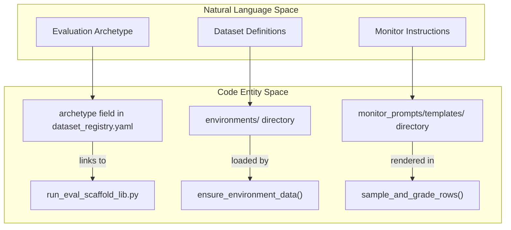
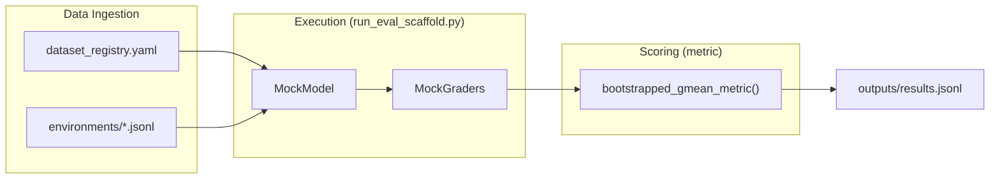

<!-- source: DeepWiki mcp.deepwiki.com · repo openai/monitorability-evals · page 1 Overview · fetched 2026-10-26 -->

# Overview

Relevant source files

The following files were used as context for generating this wiki page:

- [.gitignore](.gitignore)
- [LICENSE.txt](LICENSE.txt)
- [NOTICE.txt](NOTICE.txt)
- [README.md](README.md)

The **Monitorability Evals** repository provides the evaluation data and statistical framework introduced in the research paper [Monitoring Monitorability](https://arxiv.org/pdf/2512.18311). The codebase is designed to measure how effectively a "monitor" model can detect undesirable hidden behaviors or properties in a "subject" model's Chain-of-Thought (CoT) or outputs.

## Research Goals & Evaluation Archetypes

The repository categorizes evaluations into three distinct archetypes, each targeting a different aspect of model monitorability.

| Archetype | Description | Primary Code Location |
| :--- | :--- | :--- |
| **Intervention** | Measures if a monitor can detect when a model is being influenced by hidden hints or perturbations (e.g., sandbagging, suggested wrong answers). | `environments/intervention/` |
| **Process** | Measures "faithfulness"—whether the model's internal reasoning (CoT) actually matches the logic required to reach the final answer. | `environments/process/` |
| **Outcome** | Measures if a monitor can detect properties of the final result that are not immediately obvious, such as hallucinations or covert side-tasks. | `environments/outcome/` |

For detailed information on the specific datasets within these archetypes, see [Intervention Datasets](#2.2), [Process Datasets](#2.3), and [Outcome Datasets](#2.4).

Sources: [README.md:7-11](), [README.md:13-75]()

## System Architecture

The repository is structured to separate raw data, prompt templates, and the evaluation logic. The `dataset_registry.yaml` file acts as the central "glue" that connects these components.

### Natural Language to Code Entity Mapping

The following diagram illustrates how conceptual evaluation components map to specific files and directories within the repository.

**System Entity Mapping**

Sources: [dataset_registry.yaml:1-10](), [run_eval_scaffold_lib.py:104-120](), [run_eval_scaffold_lib.py:170-190]()

## Key Components

The repository is organized into several functional blocks:

1.  **Environments (`environments/`)**: Contains the raw `.jsonl` data for various evaluations, including GPQA, AIME, and Scruples.
2.  **Prompts (`model_prompts/` & `monitor_prompts/`)**: Contains text templates for the subject models and the monitors. For details, see [Prompt Templates](#3).
3.  **Metrics (`metric/`)**: Implements the **G-Mean** (geometric mean of TPR and TNR), the primary statistical metric for monitorability. For details, see [Monitorability Metric](#5).
4.  **Scaffold (`run_eval_scaffold.py`)**: The execution engine that simulates evaluations and computes results. For details, see [Evaluation Scaffold](#4).
5.  **Contracts (`memory_retrieval_and_tool_contracts/`)**: Framework-agnostic specifications for complex evaluations involving tools or external memory. For details, see [Memory Retrieval & Tool Contracts](#6).

### Evaluation Flow

The following diagram shows how data flows through the system during an evaluation run.

**Evaluation Execution Flow**

Sources: [run_eval_scaffold.py:12-40](), [run_eval_scaffold_lib.py:170-250](), [metric/intervention_gmean_metric.py:114-150]()

## Getting Started

To begin using the repository, you will need to set up your environment and understand the basic repository layout. 

*   **Setup**: Clone the repository and install dependencies. Note that some datasets (like AIME) require manual fetching via URLs provided in the data files.
*   **Licensing**: The source code is licensed under **Apache 2.0**, while datasets may have different licenses (MIT, CC BY-SA 4.0, etc.).

For a full guide, see [Getting Started & Repository Layout](#1.1) and [Licensing & Dataset Attribution](#1.2).

Sources: [LICENSE.txt:1-10](), [NOTICE.txt:1-5](), [README.md:5-6](), [.gitignore:1-4]()

---

