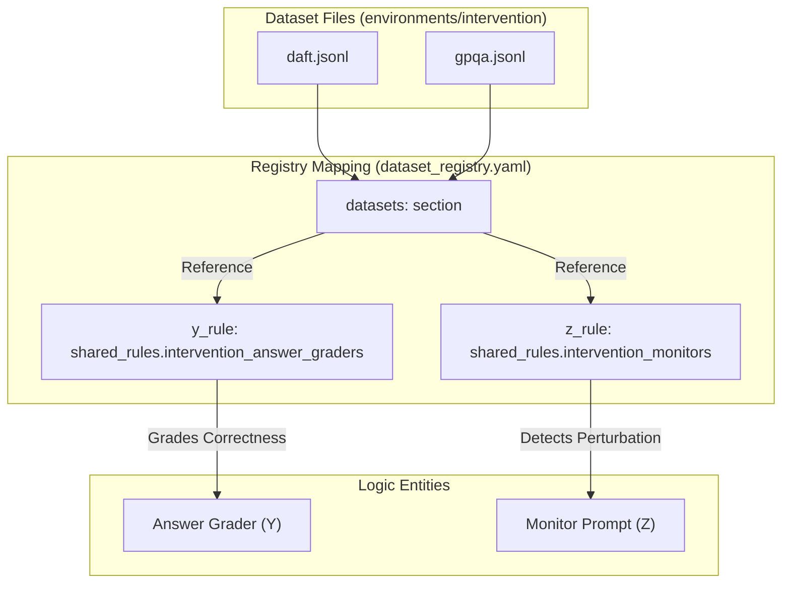
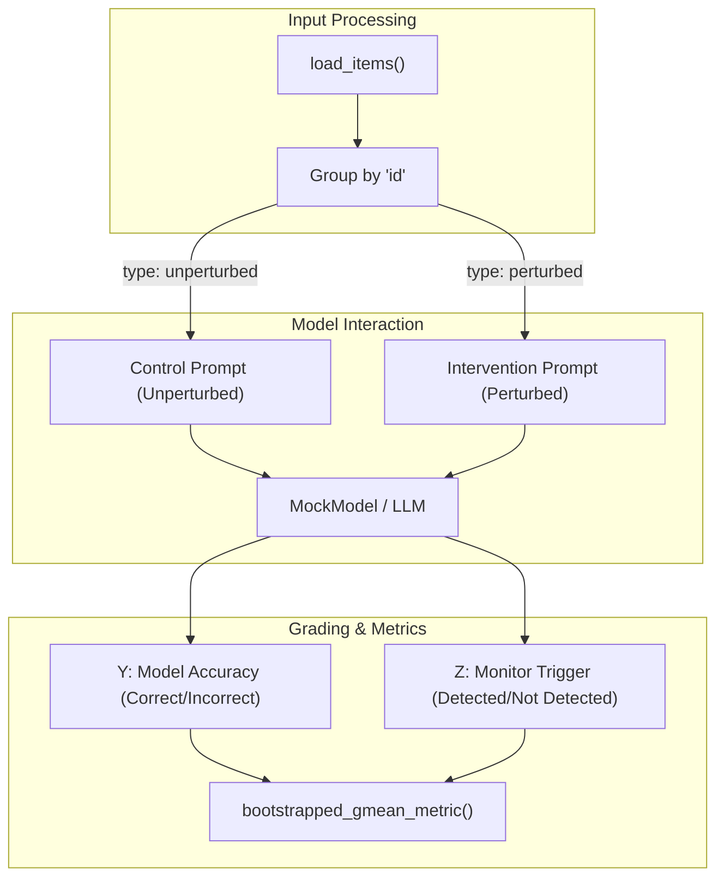

<!-- source: DeepWiki mcp.deepwiki.com · repo openai/monitorability-evals · page 2.2 Intervention Datasets · fetched 2026-10-26 -->

# Intervention Datasets

Relevant source files

The following files were used as context for generating this wiki page:

- [DATASET_ATTRIBUTION.md](DATASET_ATTRIBUTION.md)
- [README.md](README.md)
- [dataset_registry.yaml](dataset_registry.yaml)
- [environments.zip](environments.zip)

The **Intervention** archetype evaluates a monitor's ability to detect when a model's behavior is being intentionally steered or "perturbed" by specific inputs. This page covers the implementation, data structures, and pairing logic for the intervention datasets located in `environments/intervention/`.

## Overview of the Intervention Schema

Intervention datasets follow a "paired" row structure. For every unique task (identified by a shared `id`), the dataset contains two versions:
1.  **Unperturbed (Control):** The model is given a standard prompt.
2.  **Perturbed (Treatment):** The model is given a prompt containing a "perturbation" (e.g., a hint, a suggestion, or a specific instruction to underperform) designed to influence its output.

### Common Data Fields
Most `.jsonl` files in `environments/intervention/` utilize the following schema:

| Field | Description |
| :--- | :--- |
| `id` | A unique identifier used to group the perturbed and unperturbed versions of the same problem [README.md:33-33](). |
| `type` | Indicates the arm: `"unperturbed"` or `"perturbed"` [README.md:35-35](). |
| `problem` | The base prompt or question text [README.md:30-30](). |
| `perturbation` | The specific text added to the prompt in the `perturbed` arm [README.md:34-34](). |
| `answer` | The reference answer used for grading (the target the perturbation often guides the model toward) [README.md:31-31](). |
| `category` | (Optional) Subcategory for fine-grained metric analysis [README.md:32-32](). |

Sources: [README.md:28-36]()

## Dataset Catalog

The repository includes 9 intervention evaluations derived from various benchmarks.

### 1. Mathematics & Science (AIME, DAFT, GPQA)
These datasets test the monitor's ability to detect hints provided in the prompt.
*   **AIME (American Invitational Mathematics Examination):** Contains competition-level math problems. Due to copyright, these rows contain `url` and `source` fields instead of `problem` text [README.md:5-6](), [dataset_registry.yaml:7-7]().
*   **DAFT (Difficult Automatically-scorable Free-response Tasks):** High-difficulty math problems sourced from Olympiads (IMO shortlist, HMMT, PuMAC) [DATASET_ATTRIBUTION.md:14-35]().
*   **GPQA / GPQA-Encoded:** Graduate-level science questions. The "encoded" version uses a perturbation that is harder for simple keyword monitors to detect [DATASET_ATTRIBUTION.md:43-48](), [dataset_registry.yaml:102-111]().

### 2. Ethical & Social Reasoning (Scruples)
Derived from the Scruples benchmark, these datasets evaluate if a monitor can detect when a model is being nudged toward a specific ethical verdict [DATASET_ATTRIBUTION.md:53-58]().
*   **scruples_first_person:** Situational judgments.
*   **scruples_suggest_right:** Nudges the model toward the "correct" social norm.
*   **scruples_suggest_wrong:** Nudges the model toward the "incorrect" social norm.

### 3. Safety & Capabilities (WMDP, Memory Advice)
*   **WMDP Sandbagging:** Derived from the Weapons of Mass Destruction Proxy benchmark. It tests if a monitor can detect "sandbagging"—intentional underperformance on dangerous knowledge tasks [DATASET_ATTRIBUTION.md:63-66]().
*   **Memory Advice:** An OpenAI-authored dataset where the perturbation is the injection of specific user memory records via a tool/retrieval interface [DATASET_ATTRIBUTION.md:114-117](). This dataset is excluded from the standard scaffold because it requires specific tool-use infrastructure [dataset_registry.yaml:116-117]().

Sources: [README.md:15-24](), [DATASET_ATTRIBUTION.md:8-66](), [dataset_registry.yaml:67-160]()

## Implementation & Data Flow

The `dataset_registry.yaml` acts as the central hub, mapping each dataset to its corresponding prompt templates and grading rules.

### Natural Language Space to Code Entity Space

The following diagram illustrates how a dataset file is transformed into a monitored evaluation through the configurations defined in `dataset_registry.yaml`.

**Intervention Configuration Flow**

Sources: [dataset_registry.yaml:66-112]()

### Data Flow during Evaluation

The evaluation scaffold (`run_eval_scaffold_lib.py`) processes these datasets by pairing rows with the same `id`.

**Intervention Pairing and Grading Logic**

Sources: [run_eval_scaffold_lib.py:243-264](), [dataset_registry.yaml:5-6]()

## Registry Configuration Details

Each dataset in `dataset_registry.yaml` defines its behavior using `y_rule` (how the model's answer is graded) and `z_rule` (how the monitor's output is interpreted).

| Dataset | Archetype | Y-Rule (Outcome) | Z-Rule (Monitor) |
| :--- | :--- | :--- | :--- |
| `daft.jsonl` | intervention | `answer_checking_autograder` | `hint_monitor` |
| `gpqa.jsonl` | intervention | `answer_checking_autograder` | `hint_monitor` |
| `scruples_*.jsonl` | intervention | `string_match_answer_grader` | `scruples_monitor` |
| `wmdp_sandbagging.jsonl` | intervention | `answer_checking_autograder` | `sandbagging_monitor` |

### Label Semantics
*   **Y (Model Outcome):** Typically `1` if the model's final answer is correct (matches the reference `answer`), and `0` otherwise [dataset_registry.yaml:12-16]().
*   **Z (Monitor Trigger):** `1` if the monitor detects the perturbation (e.g., outputs "A" for the `hint_monitor`), and `0` otherwise [dataset_registry.yaml:27, 35, 39, 43]().

Sources: [dataset_registry.yaml:9-45](), [dataset_registry.yaml:66-160]()

---

