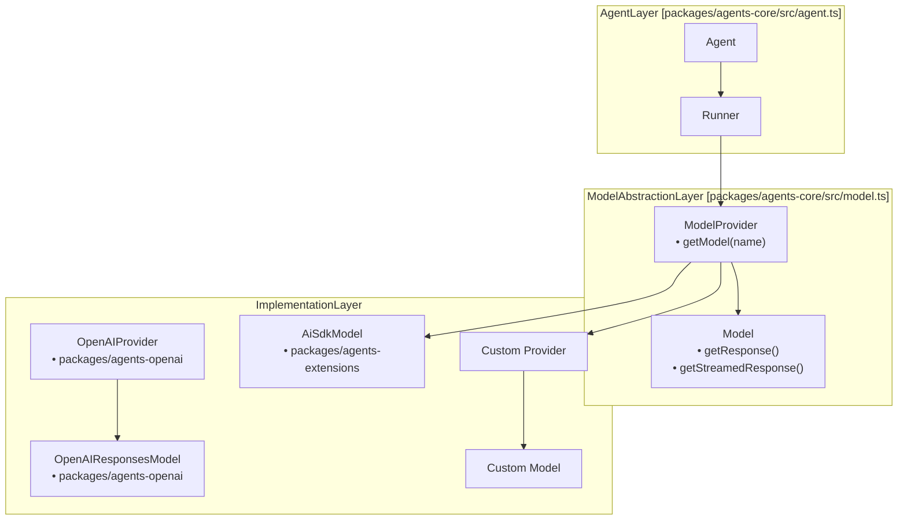
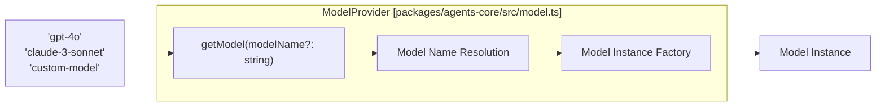
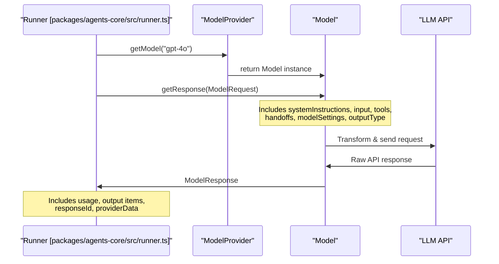
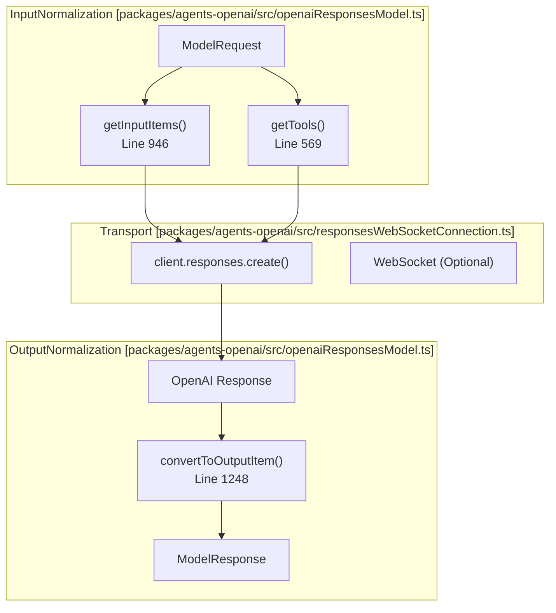
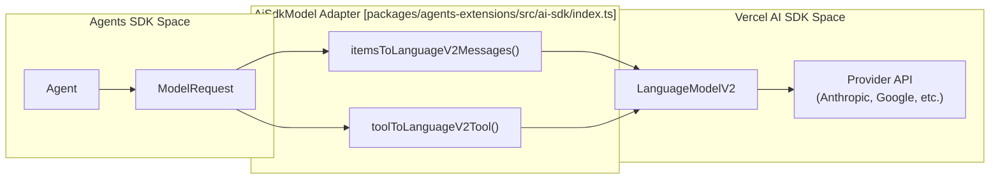

<!-- source: DeepWiki mcp.deepwiki.com · repo openai/openai-agents-js · page 5.2 Custom Model Providers · fetched 2026-10-26 -->

# Custom Model Providers

<details>
<summary>Relevant source files</summary>

The following files were used as context for generating this wiki page:

- [docs/src/content/docs/extensions/ai-sdk.mdx](docs/src/content/docs/extensions/ai-sdk.mdx)
- [docs/src/content/docs/guides/agents.mdx](docs/src/content/docs/guides/agents.mdx)
- [docs/src/content/docs/guides/mcp.mdx](docs/src/content/docs/guides/mcp.mdx)
- [docs/src/content/docs/guides/models.mdx](docs/src/content/docs/guides/models.mdx)
- [docs/src/content/docs/guides/running-agents.mdx](docs/src/content/docs/guides/running-agents.mdx)
- [docs/src/content/docs/guides/sessions.mdx](docs/src/content/docs/guides/sessions.mdx)
- [docs/src/content/docs/guides/tools.mdx](docs/src/content/docs/guides/tools.mdx)
- [docs/src/content/docs/guides/voice-agents/build.mdx](docs/src/content/docs/guides/voice-agents/build.mdx)
- [examples/docs/models/agentWithModel.ts](examples/docs/models/agentWithModel.ts)
- [examples/docs/models/gpt5DefaultModelSettings.ts](examples/docs/models/gpt5DefaultModelSettings.ts)
- [examples/docs/sessions/responsesCompactionManualSession.ts](examples/docs/sessions/responsesCompactionManualSession.ts)
- [examples/model-providers/custom-example-agent.ts](examples/model-providers/custom-example-agent.ts)
- [examples/research-bot/agents.ts](examples/research-bot/agents.ts)
- [packages/agents-core/src/model.ts](packages/agents-core/src/model.ts)
- [packages/agents-core/src/runner/toolSearch.ts](packages/agents-core/src/runner/toolSearch.ts)
- [packages/agents-core/src/tool.ts](packages/agents-core/src/tool.ts)
- [packages/agents-core/src/types/protocol.ts](packages/agents-core/src/types/protocol.ts)
- [packages/agents-core/src/utils/serialize.ts](packages/agents-core/src/utils/serialize.ts)
- [packages/agents-core/test/tool.test.ts](packages/agents-core/test/tool.test.ts)
- [packages/agents-core/test/utils/serialize.test.ts](packages/agents-core/test/utils/serialize.test.ts)
- [packages/agents-extensions/src/ai-sdk/index.ts](packages/agents-extensions/src/ai-sdk/index.ts)
- [packages/agents-extensions/test/ai-sdk/GoogleFormat.test.ts](packages/agents-extensions/test/ai-sdk/GoogleFormat.test.ts)
- [packages/agents-extensions/test/ai-sdk/index.test.ts](packages/agents-extensions/test/ai-sdk/index.test.ts)
- [packages/agents-openai/src/openaiChatCompletionsConverter.ts](packages/agents-openai/src/openaiChatCompletionsConverter.ts)
- [packages/agents-openai/src/openaiChatCompletionsModel.ts](packages/agents-openai/src/openaiChatCompletionsModel.ts)
- [packages/agents-openai/src/openaiResponsesModel.ts](packages/agents-openai/src/openaiResponsesModel.ts)
- [packages/agents-openai/test/openaiChatCompletionsConverter.test.ts](packages/agents-openai/test/openaiChatCompletionsConverter.test.ts)
- [packages/agents-openai/test/openaiChatCompletionsModel.test.ts](packages/agents-openai/test/openaiChatCompletionsModel.test.ts)
- [packages/agents-openai/test/openaiResponsesModel.test.ts](packages/agents-openai/test/openaiResponsesModel.test.ts)

</details>


This document explains how to integrate custom language models and providers with the OpenAI Agents SDK. It covers the core abstractions, existing implementations, and patterns for creating new model providers.

For general model configuration and usage patterns, see [Core Concepts](/openai-agents-js/overview/core-concepts). For AI SDK integration specifics, see the extensions documentation in [AI SDK Integration](/openai-agents-js/extensions/ai-sdk).

## Architecture Overview

The SDK abstracts model access through two lightweight interfaces that separate model resolution from model execution:



**Sources:** [packages/agents-core/src/model.ts:18-21](), [packages/agents-openai/src/openaiResponsesModel.ts:843-859](), [packages/agents-extensions/src/ai-sdk/index.ts:591-600]()

## Core Interfaces

### ModelProvider Interface

The `ModelProvider` interface resolves human-readable model names to `Model` instances. This abstraction allows the SDK to remain agnostic of the underlying provider until runtime.



**Sources:** [packages/agents-core/src/model.ts:18-21]()

### Model Interface

The `Model` interface handles actual LLM communication with three primary methods:

- **`getResponse(request: ModelRequest): Promise<ModelResponse>`**: Performs a synchronous, non-streaming request to the model [packages/agents-core/src/model.ts:273-273]().
- **`getStreamedResponse(request: ModelRequest): AsyncIterable<ResponseStreamEvent>`**: Returns an async iterable that yields streaming events [packages/agents-core/src/model.ts:275-277]().
- **`getRetryAdvice(args: ModelRetryAdviceRequest): ModelRetryAdvice | undefined`**: Provides provider-specific logic to decide if a failed request should be retried based on error codes or messages [packages/agents-core/src/model.ts:271-271]().

**Sources:** [packages/agents-core/src/model.ts:249-277]()

## Request/Response Flow

The interaction between the `Runner` and the `Model` involves a standard data transformation pipeline where internal protocol items are mapped to provider-specific payloads and back.



**Sources:** [packages/agents-core/src/model.ts:164-245](), [packages/agents-core/src/model.ts:249-277]()

## OpenAI Provider Implementations

The `@openai/agents-openai` package contains two distinct implementations of the `Model` interface.

### OpenAIResponsesModel vs OpenAIChatCompletionsModel

| Feature | OpenAIResponsesModel | OpenAIChatCompletionsModel |
|---------|---------------------|---------------------------|
| **Target API** | Responses API (`/responses`) | Chat Completions API (`/chat/completions`) |
| **Hosted Tools** | ✓ Supported (web_search, file_search, etc.) | ✗ Not supported |
| **Deferred Loading** | ✓ Supported (`deferLoading: true`) | ✗ Not supported |
| **Streaming** | Native streaming-first architecture | Converted from SSE chunks |
| **Implementation** | [openaiResponsesModel.ts]() | [openaiChatCompletionsModel.ts]() |

**Sources:** [packages/agents-openai/src/openaiResponsesModel.ts:843-859](), [packages/agents-openai/src/openaiChatCompletionsModel.ts:87-103]()

### OpenAIResponsesModel Architecture

`OpenAIResponsesModel` is the default for GPT-5.x models. It handles complex transformations, including the `tool_search` mechanism and hosted tools.



**Key Functions:**
- **`getInputItems()`**: Maps protocol `ModelItem[]` to the Responses API `ResponseInputItem[]` format [packages/agents-openai/src/openaiResponsesModel.ts:946-1246]().
- **`convertToOutputItem()`**: Converts Responses API output items (including specialized tool outputs like `shell_call_output`) back to internal protocol items [packages/agents-openai/src/openaiResponsesModel.ts:1248-1491]().

**Sources:** [packages/agents-openai/src/openaiResponsesModel.ts:569-1491]()

### OpenAIChatCompletionsModel Architecture

`OpenAIChatCompletionsModel` is used for legacy OpenAI models or compatible third-party providers. It includes a `strictFeatureValidation` flag to reject features that Chat Completions cannot honor [packages/agents-openai/src/openaiChatCompletionsModel.ts:102-102]().

**Key Functions:**
- **`itemsToMessages()`**: Maps protocol items to standard `ChatCompletionMessageParam[]` [packages/agents-openai/src/openaiChatCompletionsConverter.ts:35-36]().
- **`hasReasoningContent()`**: Checks for a `reasoning` property on messages, which is returned by some compatible providers [packages/agents-openai/src/openaiChatCompletionsModel.ts:65-73]().

**Sources:** [packages/agents-openai/src/openaiChatCompletionsModel.ts:87-216]()

## AI SDK Integration

### AiSdkModel Adapter

The `AiSdkModel` in `@openai/agents-extensions` acts as a bridge to [Vercel's AI SDK](https://sdk.vercel.ai). It adapts a `LanguageModelV2` (or V3/V4 compatible) model to the SDK's `Model` interface [packages/agents-extensions/src/ai-sdk/index.ts:591-600]().



### Data Transformation Pipeline

- **`itemsToLanguageV2Messages()`**: Handles the conversion of `ModelItem` arrays to `LanguageModelV2Message[]`. It specifically manages reasoning content by representing it as a `reasoning` part in AI SDK v3/v4 [packages/agents-extensions/src/ai-sdk/index.ts:254-323]().
- **`transformOutputText`**: An optional configuration for the adapter that allows normalizing output text (e.g., removing JSON code fences) before the agent processes it [packages/agents-extensions/src/ai-sdk/index.ts:610-610]().

**Sources:** [packages/agents-extensions/src/ai-sdk/index.ts:254-809]()

## Implementing a Custom Model

To implement a custom model, create a class that satisfies the `Model` interface.

### Implementation Requirements

1.  **Observability**: Wrap the execution in `withGenerationSpan` or `withResponseSpan` to ensure the call is tracked in traces [packages/agents-core/src/model.ts:5-8]().
2.  **Usage Tracking**: Ensure the `ModelResponse` returns a `Usage` object containing token counts and request counts [packages/agents-core/src/model.ts:164-184]().
3.  **Error Handling**: Implement `getRetryAdvice` to map provider errors to `ModelRetryAdvice` [packages/agents-core/src/model.ts:135-162]().

### Example Pattern

```typescript
import { Model, ModelRequest, ModelResponse, withGenerationSpan } from '@openai/agents-core';

class MyCustomModel implements Model {
  async getResponse(request: ModelRequest): Promise<ModelResponse> {
    return withGenerationSpan(async (span) => {
      // 1. Map request.input and request.tools to provider format
      // 2. Call provider API
      // 3. Map result to protocol.OutputModelItem[]
      // 4. Populate span.spanData.model and span.spanData.output
      return {
        output: transformedItems,
        usage: new Usage({ inputTokens, outputTokens }),
        responseId: apiResponse.id
      };
    });
  }
}
```

**Sources:** [packages/agents-core/src/model.ts:249-277](), [packages/agents-openai/src/openaiResponsesModel.ts:843-1041]()

---

