# Page: Overview

# Overview

<details>
<summary>Relevant source files</summary>

The following files were used as context for generating this wiki page:

- [README.md](README.md)
- [docs/astro.config.mjs](docs/astro.config.mjs)
- [docs/src/components/Hero.astro](docs/src/components/Hero.astro)
- [docs/src/content/docs/extensions/twilio.mdx](docs/src/content/docs/extensions/twilio.mdx)
- [docs/src/content/docs/guides/guardrails.mdx](docs/src/content/docs/guides/guardrails.mdx)
- [docs/src/content/docs/guides/human-in-the-loop.mdx](docs/src/content/docs/guides/human-in-the-loop.mdx)
- [docs/src/content/docs/guides/quickstart.mdx](docs/src/content/docs/guides/quickstart.mdx)
- [docs/src/content/docs/guides/tracing.mdx](docs/src/content/docs/guides/tracing.mdx)
- [docs/src/content/docs/guides/voice-agents.mdx](docs/src/content/docs/guides/voice-agents.mdx)
- [docs/src/content/docs/guides/voice-agents/quickstart.mdx](docs/src/content/docs/guides/voice-agents/quickstart.mdx)
- [docs/src/content/docs/index.mdx](docs/src/content/docs/index.mdx)
- [docs/src/styles/global.css](docs/src/styles/global.css)
- [packages/agents-core/CHANGELOG.md](packages/agents-core/CHANGELOG.md)
- [packages/agents-core/package.json](packages/agents-core/package.json)
- [packages/agents-core/src/metadata.ts](packages/agents-core/src/metadata.ts)
- [packages/agents-extensions/CHANGELOG.md](packages/agents-extensions/CHANGELOG.md)
- [packages/agents-extensions/package.json](packages/agents-extensions/package.json)
- [packages/agents-extensions/src/metadata.ts](packages/agents-extensions/src/metadata.ts)
- [packages/agents-openai/CHANGELOG.md](packages/agents-openai/CHANGELOG.md)
- [packages/agents-openai/package.json](packages/agents-openai/package.json)
- [packages/agents-openai/src/metadata.ts](packages/agents-openai/src/metadata.ts)
- [packages/agents-realtime/CHANGELOG.md](packages/agents-realtime/CHANGELOG.md)
- [packages/agents-realtime/package.json](packages/agents-realtime/package.json)
- [packages/agents-realtime/src/metadata.ts](packages/agents-realtime/src/metadata.ts)
- [packages/agents/CHANGELOG.md](packages/agents/CHANGELOG.md)
- [packages/agents/README.md](packages/agents/README.md)
- [packages/agents/package.json](packages/agents/package.json)
- [packages/agents/src/metadata.ts](packages/agents/src/metadata.ts)

</details>


This document provides a comprehensive overview of the OpenAI Agents SDK for JavaScript/TypeScript, explaining its architecture, core concepts, and key capabilities. The SDK is a lightweight yet powerful framework for building multi-agent workflows that can orchestrate between multiple AI agents, execute tools, and manage complex conversational flows.

For detailed information about specific packages, see [Package Architecture](#1.1). For fundamental terminology and relationships, see [Core Concepts](#1.2).

## What is the OpenAI Agents SDK

The OpenAI Agents SDK for JavaScript/TypeScript is a lightweight yet powerful framework for building multi-agent workflows [packages/agents-core/package.json:6-6](). It provides a production-ready upgrade from OpenAI's experimental Swarm framework and is designed for building agentic applications that scale.

The SDK is organized as a monorepo containing several core packages (`@openai/agents-core`, `@openai/agents-openai`, `@openai/agents-realtime`, `@openai/agents-extensions`) and a main aggregator package (`@openai/agents`) that exports a unified API. All packages are version-synchronized at v0.14.2 [packages/agents/package.json:5-5]().

**Core Primitives:**

The framework provides fundamental primitives for agentic workflows:

| Primitive | Description | Key Classes/Functions |
|-----------|-------------|----------------------|
| **Agents** | LLM instances configured with instructions, tools, and handoffs | `Agent`, `RealtimeAgent` |
| **Tools** | Functions the agent can call (local, MCP, hosted, sandbox) | `tool()`, `MCPServer`, `HostedTool` |
| **Handoffs** | Mechanisms to transfer control between agents | `handoffs` configuration |
| **Guardrails** | Input/output validation for safety and reliability | `InputGuardrail`, `OutputGuardrail` |

**Execution Models:**

The SDK supports three distinct execution models:

1. **Text Agents**: Turn-based orchestration managed by the `Runner` class, supporting OpenAI models via Chat Completions or the Responses API [packages/agents-core/CHANGELOG.md:23-26]().
2. **Realtime Voice Agents**: Continuous audio streaming via `RealtimeSession`, using WebSocket or WebRTC to the Realtime API [packages/agents-realtime/package.json:6-6]().
3. **Sandbox Agents**: Agents operating in isolated environments with filesystem and shell access, managed via the `sandbox` sub-exports [packages/agents/package.json:16-25]().

**Sources:** [packages/agents-core/package.json:6-6](), [packages/agents/package.json:1-56](), [packages/agents/CHANGELOG.md:3-15](), [packages/agents-core/CHANGELOG.md:25-36]()

## Package Architecture

The SDK uses a monorepo structure with specialized packages plus a main aggregator. For a deep dive into the internal structure, see [Package Architecture](#1.1).

**Monorepo Package Structure:**

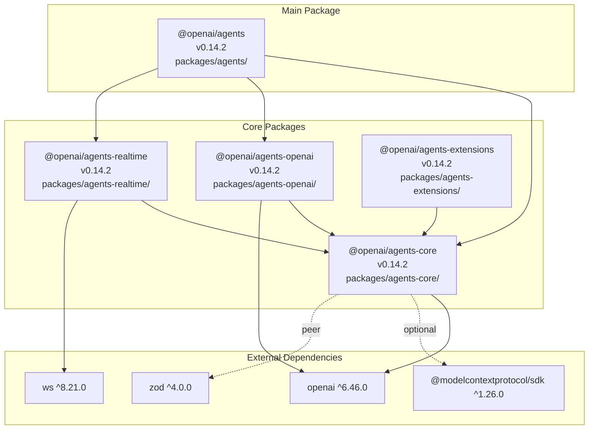

**Package Responsibilities:**

| Package | Purpose | Key Exports |
|---------|---------|-------------|
| `@openai/agents` | Main entry point, re-exports common utilities and sub-packages | `Agent`, `run()`, `tool()`, `realtime`, `sandbox` |
| `@openai/agents-core` | Foundation: `Agent`, `Runner`, `Model` interfaces, and Tracing | `Agent`, `Runner`, `MCPServer`, `TraceProvider` |
| `@openai/agents-openai` | OpenAI-specific model and hosted tool implementations | `OpenAIResponsesModel`, `OpenAIChatCompletionsModel` |
| `@openai/agents-realtime` | Real-time voice agents and session management | `RealtimeAgent`, `RealtimeSession`, `_shims` |
| `@openai/agents-extensions` | Third-party integrations and sandbox providers | `AiSdkModel`, `sandbox/` (E2B, Vercel, etc.) |

**Sources:** [packages/agents/package.json:43-49](), [packages/agents-core/package.json:115-121](), [packages/agents-openai/package.json:22-26](), [packages/agents-realtime/package.json:57-62](), [packages/agents-extensions/package.json:16-20](), [packages/agents-extensions/package.json:37-71]()

## Core Execution System

The SDK bridges natural language instructions with code entities through two primary execution architectures.

**Text Agent Execution Architecture:**

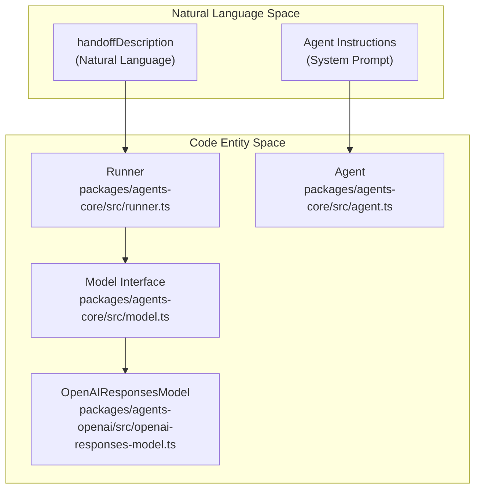

**Realtime Voice Agent Execution Architecture:**

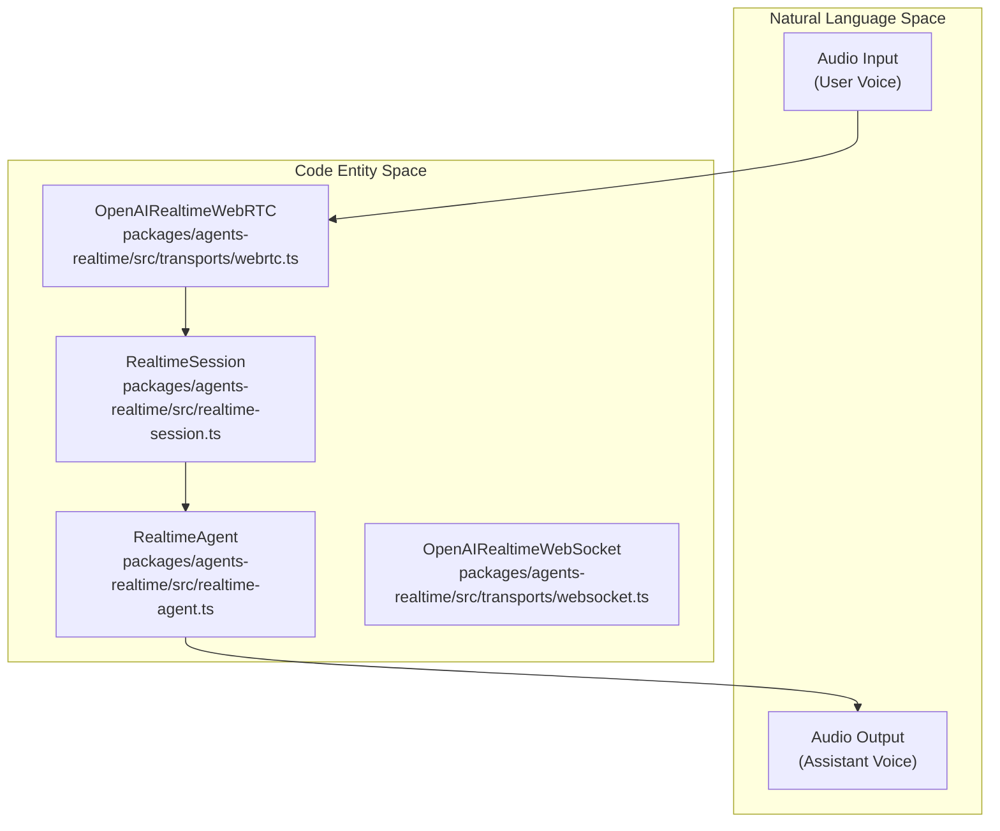

For details on the specific terminology used in these systems, see [Core Concepts](#1.2).

**Sources:** [packages/agents-core/package.json:22-26](), [packages/agents-openai/package.json:8-9](), [packages/agents-realtime/package.json:8-9](), [packages/agents-realtime/CHANGELOG.md:80-84]()

## Key Features and Capabilities

### Multi-Agent Orchestration
Agents can transfer control via a handoff mechanism. The `Runner` handles the turn-based logic, supporting complex patterns like triage agents or manager-worker hierarchies [packages/agents-core/CHANGELOG.md:88-89]().

### Tool Integration System
The SDK supports a wide variety of tools:
- **Function Tools**: Local JS/TS functions defined via `tool()` with Zod schema validation.
- **MCP Tools**: Seamless integration with the Model Context Protocol [packages/agents-core/package.json:115-117]().
- **Hosted Tools**: OpenAI-managed tools like `web_search`, `file_search`, and `code_interpreter` [packages/agents-openai/CHANGELOG.md:84-85]().
- **Sandbox Tools**: Execution of shell commands and filesystem operations in isolated environments [packages/agents-core/CHANGELOG.md:25-41]().

### Real-time Voice
The `@openai/agents-realtime` package enables low-latency voice interactions using the Realtime API, supporting VAD (Voice Activity Detection) and audio interruption handling [packages/agents-realtime/package.json:6-6](), [packages/agents-realtime/CHANGELOG.md:127-129]().

### Tracing and Observability
Built-in tracing captures agent turns, tool executions, and model generations. The `TraceProvider` allows for exporting these spans to external observability platforms or the OpenAI Dashboard [packages/agents-core/CHANGELOG.md:25-26](), [packages/agents-core/CHANGELOG.md:128-138]().

**Sources:** [packages/agents-core/CHANGELOG.md:25-41](), [packages/agents-openai/CHANGELOG.md:31-33](), [packages/agents-realtime/CHANGELOG.md:33-35](), [packages/agents-core/CHANGELOG.md:108-110]()

---

# Page: Package Architecture

# Package Architecture

<details>
<summary>Relevant source files</summary>

The following files were used as context for generating this wiki page:

- [docs/package.json](docs/package.json)
- [examples/ai-sdk-ui/package.json](examples/ai-sdk-ui/package.json)
- [examples/ai-sdk-v1/package.json](examples/ai-sdk-v1/package.json)
- [examples/ai-sdk/package.json](examples/ai-sdk/package.json)
- [examples/nextjs/package.json](examples/nextjs/package.json)
- [examples/realtime-demo/package.json](examples/realtime-demo/package.json)
- [examples/realtime-next/package.json](examples/realtime-next/package.json)
- [examples/realtime-twilio-sip/package.json](examples/realtime-twilio-sip/package.json)
- [examples/realtime-twilio/package.json](examples/realtime-twilio/package.json)
- [packages/agents-core/CHANGELOG.md](packages/agents-core/CHANGELOG.md)
- [packages/agents-core/package.json](packages/agents-core/package.json)
- [packages/agents-core/src/metadata.ts](packages/agents-core/src/metadata.ts)
- [packages/agents-extensions/CHANGELOG.md](packages/agents-extensions/CHANGELOG.md)
- [packages/agents-extensions/package.json](packages/agents-extensions/package.json)
- [packages/agents-extensions/src/metadata.ts](packages/agents-extensions/src/metadata.ts)
- [packages/agents-openai/CHANGELOG.md](packages/agents-openai/CHANGELOG.md)
- [packages/agents-openai/package.json](packages/agents-openai/package.json)
- [packages/agents-openai/src/metadata.ts](packages/agents-openai/src/metadata.ts)
- [packages/agents-realtime/CHANGELOG.md](packages/agents-realtime/CHANGELOG.md)
- [packages/agents-realtime/package.json](packages/agents-realtime/package.json)
- [packages/agents-realtime/src/metadata.ts](packages/agents-realtime/src/metadata.ts)
- [packages/agents/CHANGELOG.md](packages/agents/CHANGELOG.md)
- [packages/agents/package.json](packages/agents/package.json)
- [packages/agents/src/metadata.ts](packages/agents/src/metadata.ts)
- [pnpm-lock.yaml](pnpm-lock.yaml)

</details>


The OpenAI Agents SDK is organized as a pnpm-based monorepo containing five published npm packages plus supporting infrastructure. This page explains the layered package architecture, workspace dependency protocol, build system, and how packages are organized to enable both modular usage and full-featured integration.

## Monorepo Structure

The repository is managed using pnpm workspaces [pnpm-lock.yaml:1-10](). The architecture follows a layered approach: a foundation layer (`agents-core`), specialized implementation layers (`agents-openai`, `agents-realtime`, `agents-extensions`), and an aggregator layer (`agents`).

### Directory Layout

The monorepo contains:
- **`packages/`**: Published npm packages.
- **`examples/`**: Working examples demonstrating SDK capabilities, including agent patterns [pnpm-lock.yaml:127](), AI SDK integrations [pnpm-lock.yaml:145](), and Next.js implementations [pnpm-lock.yaml:190]().
- **`docs/`**: Astro + Starlight documentation site [pnpm-lock.yaml:78-85]() with TypeDoc API reference generation [pnpm-lock.yaml:104-112]().
- **`scripts/`**: Build and development utilities, such as `embedMeta.ts` [packages/agents-core/package.json:11]().

### Package Architecture Diagram

This diagram maps the high-level system components to their corresponding code packages and directory structures.

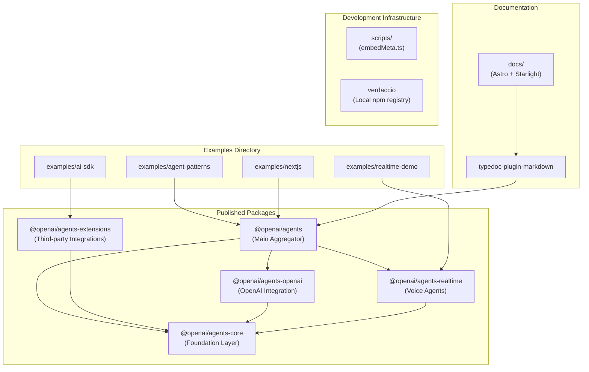

**Sources:** [packages/agents/package.json:43-49](), [packages/agents-core/package.json:1-9](), [packages/agents-openai/package.json:22-26](), [packages/agents-realtime/package.json:57-62](), [packages/agents-extensions/package.json:16-20](), [pnpm-lock.yaml:1-126]()

## Layered Package Architecture

The SDK follows a strict layered architecture where each layer builds upon the previous one. All packages are versioned synchronously, currently at `0.14.2` [packages/agents/src/metadata.ts:4-14]().

### Layer 1: Foundation (`@openai/agents-core`)

The `agents-core` package provides the foundational abstractions and orchestration logic:
- **`Agent`** class: Configuration object for defining agent behavior.
- **`Runner`** class: Execution engine that orchestrates turn-based loops. Now supports optional `modelProvider` [packages/agents-core/CHANGELOG.md:131]().
- **`Model`** interface: Provider-agnostic model abstraction [packages/agents-core/package.json:22-26]().
- **Sandbox**: Local and internal sandbox runtimes [packages/agents-core/package.json:42-56]().
- **Tracing**: Built-in observability system with lifecycle dispatch helpers [packages/agents-core/CHANGELOG.md:122]().

**Dependencies:**
- `openai` ^6.46.0 [packages/agents-core/package.json:120]().
- `@modelcontextprotocol/sdk` ^1.26.0 (optional) [packages/agents-core/package.json:116]().
- `zod` ^4.0.0 (peer) [packages/agents-core/package.json:123]().

**Sources:** [packages/agents-core/package.json:1-174](), [packages/agents-core/CHANGELOG.md:3-20]()

### Layer 2: Specialized Implementations

#### `@openai/agents-openai`

OpenAI-specific model implementations and hosted tools:
- **`OpenAIResponsesModel`**: Implements Responses API integration.
- **`OpenAIChatCompletionsModel`**: Implements Chat Completions API integration.
- **Hosted tools**: Support for `web_search`, `file_search`, `code_interpreter`, and experimental hosted multi-agent support [packages/agents-openai/package.json:16-20](), [packages/agents-openai/CHANGELOG.md:83-85]().

**Sources:** [packages/agents-openai/package.json:1-58](), [packages/agents-openai/CHANGELOG.md:3-12]()

#### `@openai/agents-realtime`

Real-time voice agent capabilities:
- **`RealtimeAgent`**: Agent definition for voice interactions.
- **`RealtimeSession`**: Session management and lifecycle.
- **Transport layers**: WebSocket and WebRTC support [packages/agents-realtime/CHANGELOG.md:80-83]().

**Sources:** [packages/agents-realtime/package.json:1-81](), [packages/agents-realtime/CHANGELOG.md:3-13]()

#### `@openai/agents-extensions`

Third-party provider integrations and sandbox extensions:
- **`AiSdkModel`**: Adapter for Vercel AI SDK [packages/agents-extensions/package.json:27-31]().
- **Sandbox Providers**: Blaxel, Cloudflare, Daytona, E2B, Modal, Runloop, and Vercel [packages/agents-extensions/package.json:37-71]().

**Sources:** [packages/agents-extensions/package.json:1-186]()

### Layer 3: Aggregator (`@openai/agents`)

The main package re-exports functionality from specialized packages to provide a unified entry point:
- Re-exports core functionality.
- Provides specialized sub-paths for `/sandbox`, `/realtime`, and `/utils` [packages/agents/package.json:16-35]().

**Sources:** [packages/agents/package.json:1-84](), [packages/agents/src/metadata.ts:1-17]()

### Dependency Graph with Workspace Protocol

This diagram illustrates how internal packages depend on each other using the `workspace:*` protocol to ensure local development versions are used.

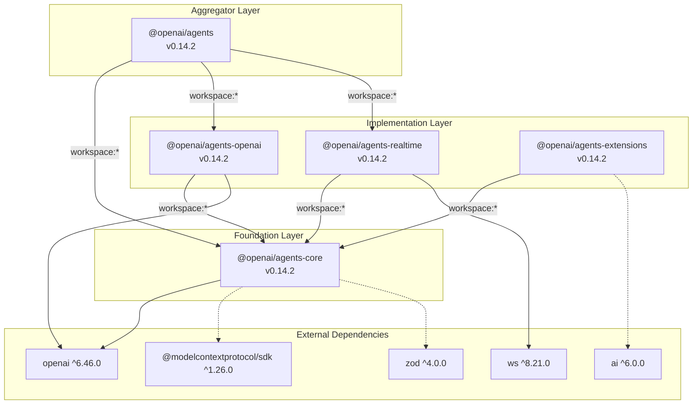

**Workspace Protocol:** Internal dependencies use `workspace:*`, ensuring they resolve to the local version within the monorepo during development [packages/agents/package.json:44-46](), [packages/agents-openai/package.json:23](), [packages/agents-realtime/package.json:58]().

**Sources:** [packages/agents/package.json:43-49](), [packages/agents-core/package.json:115-121](), [packages/agents-openai/package.json:22-26](), [packages/agents-realtime/package.json:57-62](), [packages/agents-extensions/package.json:16-20]()

## Package Export Structure

Packages use the `exports` field in `package.json` to define public APIs and provide platform-specific shims for Node.js, browsers, and Cloudflare Workers (workerd).

### Export Paths by Package

| Package | Export Path | Purpose |
|---------|------------|---------|
| `@openai/agents-core` | `.` | Core Agent, Runner, and Models [packages/agents-core/package.json:17-21]() |
| `@openai/agents-core` | `/sandbox` | Sandbox runtimes (local/internal) [packages/agents-core/package.json:42-56]() |
| `@openai/agents-core` | `/_shims` | Platform-specific shims [packages/agents-core/package.json:67-86]() |
| `@openai/agents-openai` | `.` | OpenAI model implementations [packages/agents-openai/package.json:11-15]() |
| `@openai/agents-realtime` | `.` | Voice agent logic [packages/agents-realtime/package.json:12-21]() |
| `@openai/agents-extensions` | `/ai-sdk` | Vercel AI SDK adapter [packages/agents-extensions/package.json:27-31]() |
| `@openai/agents-extensions` | `/sandbox/*` | Third-party sandbox providers [packages/agents-extensions/package.json:37-71]() |

### Platform Shims Architecture

The SDK handles environment differences (e.g., `WebSocket` availability, `AsyncLocalStorage`) via a shim system exposed through the `/_shims` path.

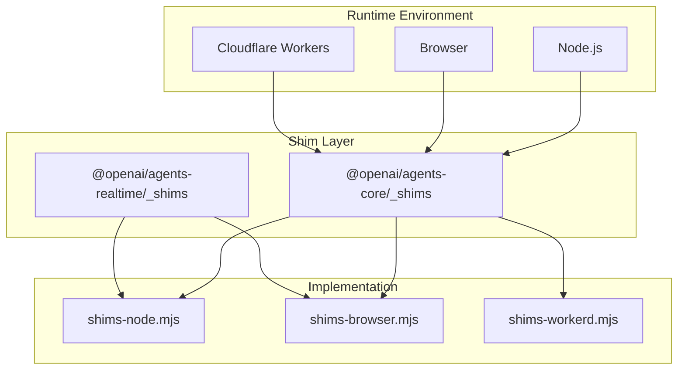

**Sources:** [packages/agents-core/package.json:67-86](), [packages/agents-realtime/package.json:22-41]()

## Build System and Development Infrastructure

The monorepo uses `tsc` for compilation and a custom script `embedMeta.ts` to inject package metadata.

### Build Pipeline

1. **`prebuild`**: Runs `tsx ../../scripts/embedMeta.ts` to generate `metadata.ts` with versioning info [packages/agents-core/package.json:11]().
2. **`build`**: Executes `tsc` to generate `dist/` artifacts [packages/agents-core/package.json:12]().
3. **`bundle`**: (Realtime only) Uses `vite build` to create a UMD bundle for browser usage [packages/agents-realtime/package.json:55]().
4. **`dist:check`**: Verifies the distribution build [packages/agents-core/package.json:14]().

### Versioning and Releases

Releases are managed via **Changesets**. Patch and minor changes are recorded in `CHANGELOG.md` files across packages [packages/agents/CHANGELOG.md:3-15](). Metadata is synchronized across the monorepo, ensuring all internal packages refer to the correct `0.14.2` version [packages/agents/src/metadata.ts:4-14]().

**Sources:** [packages/agents-core/package.json:10-15](), [packages/agents-realtime/package.json:50-56](), [packages/agents/src/metadata.ts:1-16](), [packages/agents/CHANGELOG.md:1-15]()

---

# Page: Core Concepts

# Core Concepts

<details>
<summary>Relevant source files</summary>

The following files were used as context for generating this wiki page:

- [docs/src/content/docs/extensions/ai-sdk.mdx](docs/src/content/docs/extensions/ai-sdk.mdx)
- [docs/src/content/docs/guides/agents.mdx](docs/src/content/docs/guides/agents.mdx)
- [docs/src/content/docs/guides/mcp.mdx](docs/src/content/docs/guides/mcp.mdx)
- [docs/src/content/docs/guides/models.mdx](docs/src/content/docs/guides/models.mdx)
- [docs/src/content/docs/guides/running-agents.mdx](docs/src/content/docs/guides/running-agents.mdx)
- [docs/src/content/docs/guides/sessions.mdx](docs/src/content/docs/guides/sessions.mdx)
- [docs/src/content/docs/guides/tools.mdx](docs/src/content/docs/guides/tools.mdx)
- [docs/src/content/docs/guides/voice-agents/build.mdx](docs/src/content/docs/guides/voice-agents/build.mdx)
- [examples/docs/sessions/responsesCompactionManualSession.ts](examples/docs/sessions/responsesCompactionManualSession.ts)
- [packages/agents-core/src/agent.ts](packages/agents-core/src/agent.ts)
- [packages/agents-core/src/index.ts](packages/agents-core/src/index.ts)
- [packages/agents-core/src/run.ts](packages/agents-core/src/run.ts)
- [packages/agents-core/src/runContext.ts](packages/agents-core/src/runContext.ts)
- [packages/agents-core/src/runState.ts](packages/agents-core/src/runState.ts)
- [packages/agents-core/src/runner/approvalRejection.ts](packages/agents-core/src/runner/approvalRejection.ts)
- [packages/agents-core/src/runner/mcpApprovals.ts](packages/agents-core/src/runner/mcpApprovals.ts)
- [packages/agents-core/src/runner/runLoop.ts](packages/agents-core/src/runner/runLoop.ts)
- [packages/agents-core/src/runner/toolExecution.ts](packages/agents-core/src/runner/toolExecution.ts)
- [packages/agents-core/src/runner/turnResolution.ts](packages/agents-core/src/runner/turnResolution.ts)
- [packages/agents-core/test/agent.test.ts](packages/agents-core/test/agent.test.ts)
- [packages/agents-core/test/agentScenarios.test.ts](packages/agents-core/test/agentScenarios.test.ts)
- [packages/agents-core/test/run.stream.test.ts](packages/agents-core/test/run.stream.test.ts)
- [packages/agents-core/test/run.test.ts](packages/agents-core/test/run.test.ts)
- [packages/agents-core/test/runContext.test.ts](packages/agents-core/test/runContext.test.ts)
- [packages/agents-core/test/runState.test.ts](packages/agents-core/test/runState.test.ts)
- [packages/agents-core/test/runner/toolExecution.test.ts](packages/agents-core/test/runner/toolExecution.test.ts)

</details>


This page defines the fundamental abstractions in the OpenAI Agents SDK and explains how they relate to each other. These concepts apply to both text-based agents (using `Agent` and `Runner`) and real-time voice agents (using `RealtimeAgent` and `RealtimeSession`).

## Conceptual Overview

The SDK is built around several core concepts that work together to create intelligent, tool-enabled workflows:

**Terminology Overview**

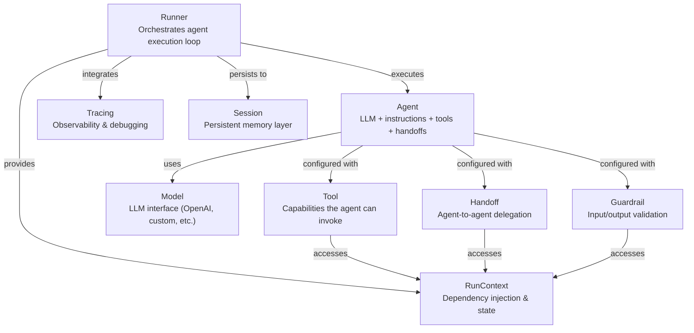

**Sources:** [packages/agents-core/src/agent.ts:6-15](), [packages/agents-core/src/run.ts:223-246](), [docs/src/content/docs/guides/running-agents.mdx:30-41]()

## Agent

An `Agent` is a Large Language Model configured with specific instructions, tools, and delegation rules. The `Agent` class is defined in [packages/agents-core/src/agent.ts:336-449]() and is generic over context type (`TContext`) and output type (`TOutput`).

**Agent Class Structure**

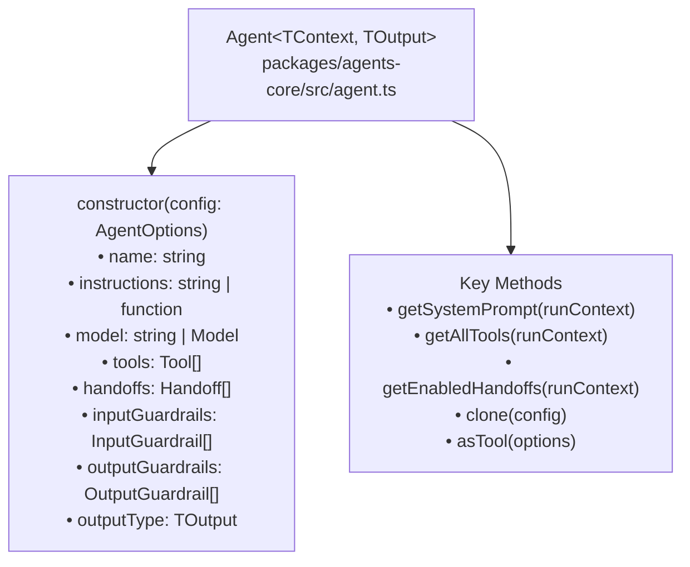

**Key Configuration Properties**

| Property | Type | Description |
|----------|------|-------------|
| `name` | `string` | Required identifier used in handoffs and tracing. [packages/agents-core/src/agent.ts:118-118]() |
| `instructions` | `string \| PromptFunction` | System prompt. Can be static or dynamically generated via `RunContext`. [packages/agents-core/src/agent.ts:8-8]() |
| `model` | `string \| Model` | Model name (e.g., `'gpt-5.6-sol'`) or custom `Model` instance. [packages/agents-core/src/agent.ts:8-8]() |
| `tools` | `Tool[]` | Array of function tools, hosted tools, or MCP tools. [packages/agents-core/src/agent.ts:19-19]() |
| `handoffs` | `(Agent \| Handoff)[]` | Agents this agent can delegate to. [packages/agents-core/src/agent.ts:34-34]() |
| `outputType` | `ZodSchema \| JsonSchema` | For structured responses using OpenAI Structured Outputs. [packages/agents-core/src/agent.ts:10-10]() |

**Sources:** [packages/agents-core/src/agent.ts:5-61](), [packages/agents-core/test/agent.test.ts:24-43](), [docs/src/content/docs/guides/agents.mdx:49-70]()

## Tool

A `Tool` represents a capability that an agent can invoke. The SDK supports multiple tool categories, including local functions, hosted OpenAI tools, and Model Context Protocol (MCP) tools.

**Tool Type Hierarchy**

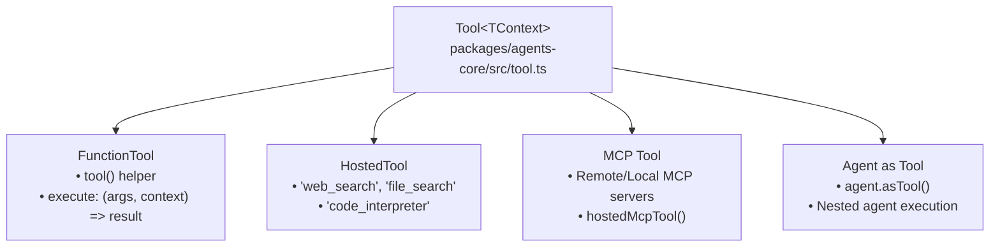

**Tool Execution Flow**
The `Runner` identifies tool calls in the model response and delegates to `executeFunctionToolCalls` or category-specific executors.

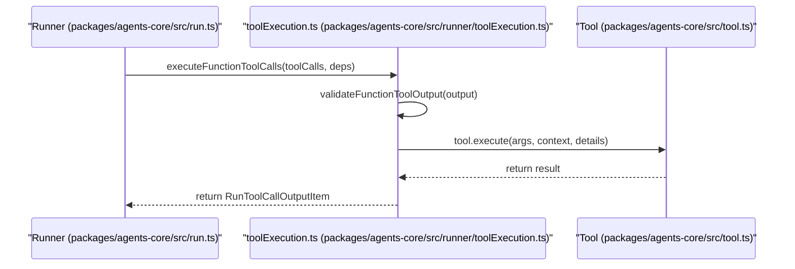

**Sources:** [packages/agents-core/src/tool.ts:223-260](), [packages/agents-core/src/runner/toolExecution.ts:33-37](), [docs/src/content/docs/guides/tools.mdx:19-30]()

## Model

A `Model` abstracts LLM interactions. The SDK uses a provider pattern to resolve model names to concrete implementations.

**Model Interface Architecture**

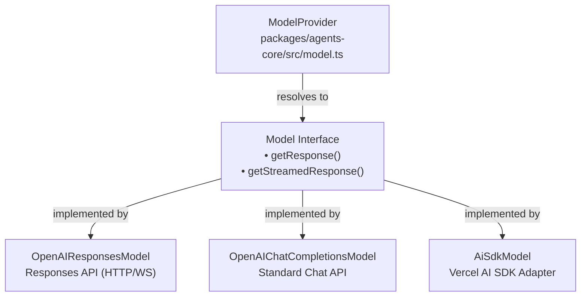

**Key Implementation Detail**
The SDK defaults to the Responses API [docs/src/content/docs/guides/models.mdx:83-83](). If you use GPT-5.x models, the SDK automatically applies optimized reasoning and verbosity settings [packages/agents-core/src/defaultModel.ts:163-167]().

**Sources:** [docs/src/content/docs/guides/models.mdx:20-23](), [packages/agents-core/src/defaultModel.ts:161-167](), [packages/agents-core/src/model.ts:158-176]()

## Runner

The `Runner` class [packages/agents-core/src/run.ts:192-221]() orchestrates the agent execution loop. It manages turns, tool calls, and handoffs.

**Runner Responsibilities:**
1.  **Turn Orchestration**: Manages the loop between model generation and tool execution [packages/agents-core/src/runner/runLoop.ts:81-85]().
2.  **State Management**: Tracks `RunState` [packages/agents-core/src/runState.ts:69-93]() and `RunContext` [packages/agents-core/src/runContext.ts:1-20]().
3.  **Safety**: Enforces `maxTurns` (default 10) to prevent infinite loops [packages/agents-core/src/runner/constants.ts:38-38]().
4.  **Persistence**: Interacts with `Session` to store and retrieve history [packages/agents-core/src/runner/sessionPersistence.ts:69-74]().

**Sources:** [docs/src/content/docs/guides/running-agents.mdx:14-41](), [packages/agents-core/src/run.ts:192-221](), [packages/agents-core/src/runState.ts:69-93]()

## Handoff

A `Handoff` enables agent-to-agent delegation. It is represented as a tool to the model but handled by the `Runner` to transition execution to a different agent.

**Handoff Properties:**
*   **Target Agent**: The agent receiving the delegation [packages/agents-core/src/handoff.ts:82-82]().
*   **Input Filter**: Mutates history items during the transfer to manage context window [packages/agents-core/src/handoff.ts:16-16]().
*   **Description**: Prompting guidance for when the model should delegate [packages/agents-core/src/handoff.ts:82-82]().

**Sources:** [packages/agents-core/src/handoff.ts:16-87](), [docs/src/content/docs/guides/running-agents.mdx:39-40]()

## Guardrail

Guardrails provide safety checks on inputs and outputs.
*   **Input Guardrails**: Run on the initial user input before the model is called [packages/agents-core/src/run.ts:5-7]().
*   **Output Guardrails**: Run on the final output before returning to the user [packages/agents-core/src/run.ts:8-9]().
*   **Tripwires**: If a guardrail triggers a tripwire, it throws a specific error to halt execution such as `InputGuardrailTripwireTriggered` [packages/agents-core/src/errors.ts:34-34]().

**Sources:** [packages/agents-core/src/guardrail.ts:1-60](), [packages/agents-core/src/run.ts:5-15](), [packages/agents-core/src/errors.ts:32-46]()

## Tracing

Tracing provides observability into agent runs. It records spans for agent invocations, model generations, tool calls, and handoffs.
*   **TraceProvider**: Manages the creation and collection of traces [packages/agents-core/src/tracing/provider.ts:70-70]().
*   **Sensitive Data**: Can be configured to exclude LLM inputs/outputs while still emitting spans via `traceIncludeSensitiveData` [packages/agents-core/src/run.ts:233-233]().

**Sources:** [docs/src/content/docs/guides/running-agents.mdx:95-96](), [packages/agents-core/src/tracing/context.ts:25-33](), [packages/agents-core/src/run.ts:230-240]()

---

# Page: Getting Started

# Getting Started

<details>
<summary>Relevant source files</summary>

The following files were used as context for generating this wiki page:

- [README.md](README.md)
- [docs/astro.config.mjs](docs/astro.config.mjs)
- [docs/src/components/Hero.astro](docs/src/components/Hero.astro)
- [docs/src/content/docs/extensions/twilio.mdx](docs/src/content/docs/extensions/twilio.mdx)
- [docs/src/content/docs/guides/guardrails.mdx](docs/src/content/docs/guides/guardrails.mdx)
- [docs/src/content/docs/guides/human-in-the-loop.mdx](docs/src/content/docs/guides/human-in-the-loop.mdx)
- [docs/src/content/docs/guides/quickstart.mdx](docs/src/content/docs/guides/quickstart.mdx)
- [docs/src/content/docs/guides/tracing.mdx](docs/src/content/docs/guides/tracing.mdx)
- [docs/src/content/docs/guides/voice-agents.mdx](docs/src/content/docs/guides/voice-agents.mdx)
- [docs/src/content/docs/guides/voice-agents/quickstart.mdx](docs/src/content/docs/guides/voice-agents/quickstart.mdx)
- [docs/src/content/docs/index.mdx](docs/src/content/docs/index.mdx)
- [docs/src/content/docs/ja/guides/quickstart.mdx](docs/src/content/docs/ja/guides/quickstart.mdx)
- [docs/src/content/docs/ja/guides/voice-agents/quickstart.mdx](docs/src/content/docs/ja/guides/voice-agents/quickstart.mdx)
- [docs/src/content/docs/ja/index.mdx](docs/src/content/docs/ja/index.mdx)
- [docs/src/content/docs/ko/guides/voice-agents/quickstart.mdx](docs/src/content/docs/ko/guides/voice-agents/quickstart.mdx)
- [docs/src/content/docs/ko/index.mdx](docs/src/content/docs/ko/index.mdx)
- [docs/src/content/docs/zh/guides/voice-agents/quickstart.mdx](docs/src/content/docs/zh/guides/voice-agents/quickstart.mdx)
- [docs/src/content/docs/zh/index.mdx](docs/src/content/docs/zh/index.mdx)
- [docs/src/styles/global.css](docs/src/styles/global.css)
- [examples/basic/package.json](examples/basic/package.json)
- [examples/docs/package.json](examples/docs/package.json)
- [examples/model-providers/package.json](examples/model-providers/package.json)
- [examples/tools/package.json](examples/tools/package.json)
- [packages/agents/README.md](packages/agents/README.md)

</details>


This page provides a practical introduction to the OpenAI Agents SDK for new users. It covers installation, environment setup, creating your first agent, and understanding the basic execution model. For detailed information about package architecture and design principles, see [Overview](#1). For advanced configuration options, see [Agent Fundamentals](#2.3).

## Prerequisites

The SDK supports the following JavaScript runtime environments:

| Runtime | Minimum Version | Status |
|---------|----------------|--------|
| Node.js | 22.0.0 | Fully supported [README.md:27-27]() |
| Deno | Latest | Fully supported [README.md:28-28]() |
| Bun | Latest | Fully supported [README.md:29-29]() |
| Cloudflare Workers | Latest with `nodejs_compat` | Experimental [README.md:31-33]() |

**Required dependencies:**
- `zod` (v4 recommended) - used for schema validation and structured outputs. [docs/src/content/docs/index.mdx:58-60]()

Sources: [README.md:25-35](), [docs/src/content/docs/index.mdx:54-60]()

## Package Selection

The SDK provides multiple packages for different use cases. Most users should start with the main `@openai/agents` aggregator.

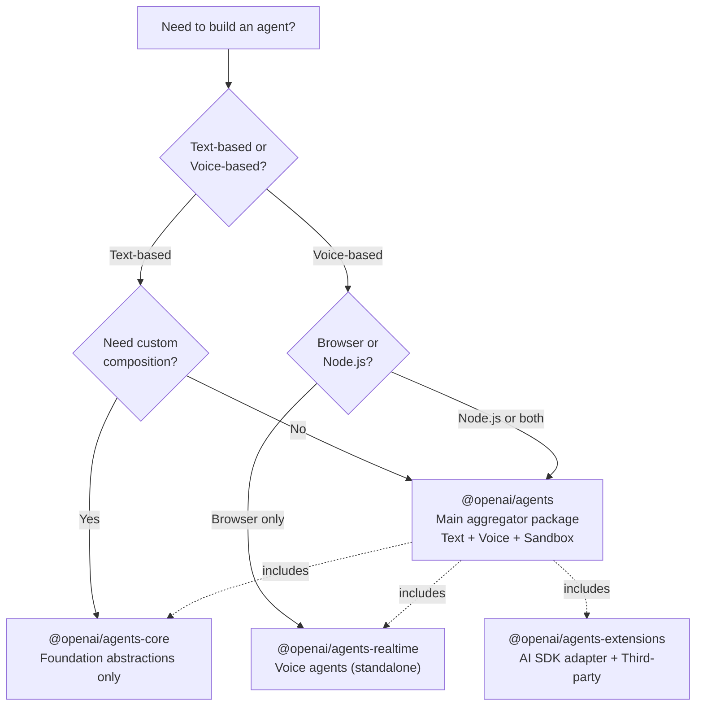

**Installation commands:**

| Use Case | Command |
|----------|---------|
| Recommended Default (text + voice + sandbox) | `npm install @openai/agents zod` [docs/src/content/docs/index.mdx:56-58]() |
| Standalone Voice agents (browser-optimized) | `npm install @openai/agents-realtime zod` [docs/src/content/docs/index.mdx:69-69]() |
| Custom composition or non-OpenAI providers | `npm install @openai/agents-core @openai/agents-openai zod` [docs/src/content/docs/index.mdx:70-70]() |

Sources: [docs/src/content/docs/index.mdx:63-70](), [packages/agents/README.md:39-43]()

## Installation Process

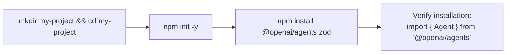

**Step-by-step:**

1. **Initialize project**:
   ```bash
   mkdir my_project
   cd my_project
   npm init -y
   ```

2. **Install the SDK:**
   ```bash
   npm install @openai/agents zod
   ```

Sources: [docs/src/content/docs/ja/guides/quickstart.mdx:23-35](), [README.md:39-41]()

## Environment Configuration

The SDK requires an OpenAI API key for authentication.

### Method 1: Environment Variable (Recommended)

```bash
export OPENAI_API_KEY=sk-proj-...your-key-here
```

The SDK automatically reads from `process.env.OPENAI_API_KEY` when making API calls. [docs/src/content/docs/ja/guides/quickstart.mdx:37-41]()

### Method 2: Programmatic Configuration

The SDK provides global configuration helpers for setting keys and clients at the process level.

```typescript
import { setDefaultOpenAIKey, setTracingExportApiKey } from '@openai/agents';

// Set API key for agent execution
setDefaultOpenAIKey('sk-proj-...');

// Set separate key for tracing export (optional)
setTracingExportApiKey('sk-proj-...');
```

Sources: [README.md:106-106](), [docs/src/content/docs/ja/guides/quickstart.mdx:37-43]()

## First Agent: Hello World

The following diagram bridges code entities to the runtime execution space:

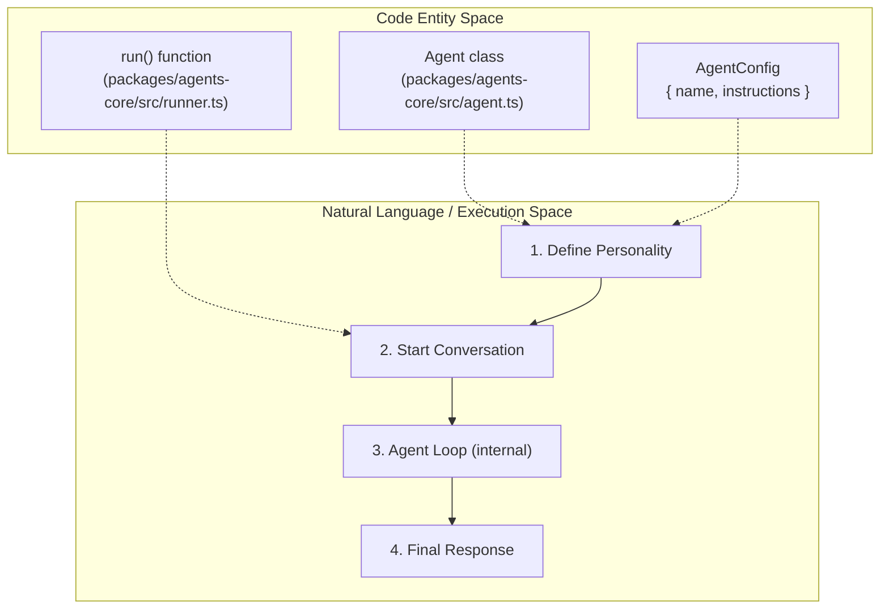

**Minimal working example:**

```typescript
import { Agent, run } from '@openai/agents';

const agent = new Agent({
  name: 'Assistant',
  instructions: 'You are a helpful assistant.',
});

const result = await run(
  agent,
  'Write a haiku about recursion in programming.',
);

console.log(result.finalOutput);
```

Sources: [README.md:47-59](), [packages/agents/README.md:45-61]()

## Sandbox Agents (Beta)

For tasks requiring a filesystem or shell access, use `SandboxAgent`. This pairs an agent with an isolated workspace.

```typescript
import { run } from '@openai/agents';
import { gitRepo, SandboxAgent } from '@openai/agents/sandbox';
import { UnixLocalSandboxClient } from '@openai/agents/sandbox/local';

const agent = new SandboxAgent({
  name: 'Workspace Assistant',
  instructions: 'Inspect the repo before changing files.',
  defaultManifest: {
    entries: { repo: gitRepo({ repo: 'openai/openai-agents-js' }) },
  },
});

const result = await run(
  agent,
  'Inspect the repo README and summarize what this project does.',
  { sandbox: { client: new UnixLocalSandboxClient() } },
);
```

Sources: [README.md:61-89](), [packages/agents/README.md:63-90]()

## Basic Usage Patterns

The SDK supports several core patterns that can be combined:

1. **Tools**: Give agents the ability to call functions. Defined via the `tool()` helper and `zod` schemas. [docs/src/content/docs/index.mdx:48-48]()
2. **Handoffs**: Transfer conversation control between specialized agents. Defined via the `handoffs` array in the `Agent` constructor. [docs/src/content/docs/index.mdx:28-28]()
3. **Guardrails**: Run validation checks in parallel with agent execution. [docs/src/content/docs/index.mdx:47-47]()
4. **Sessions**: Maintain persistent memory and history across multiple runs. [docs/src/content/docs/index.mdx:50-50]()

For details, see [Basic Usage Examples](#2.2).

## Real-time Voice Agents

Voice agents run inside a `RealtimeSession` and support low-latency bidirectional audio.

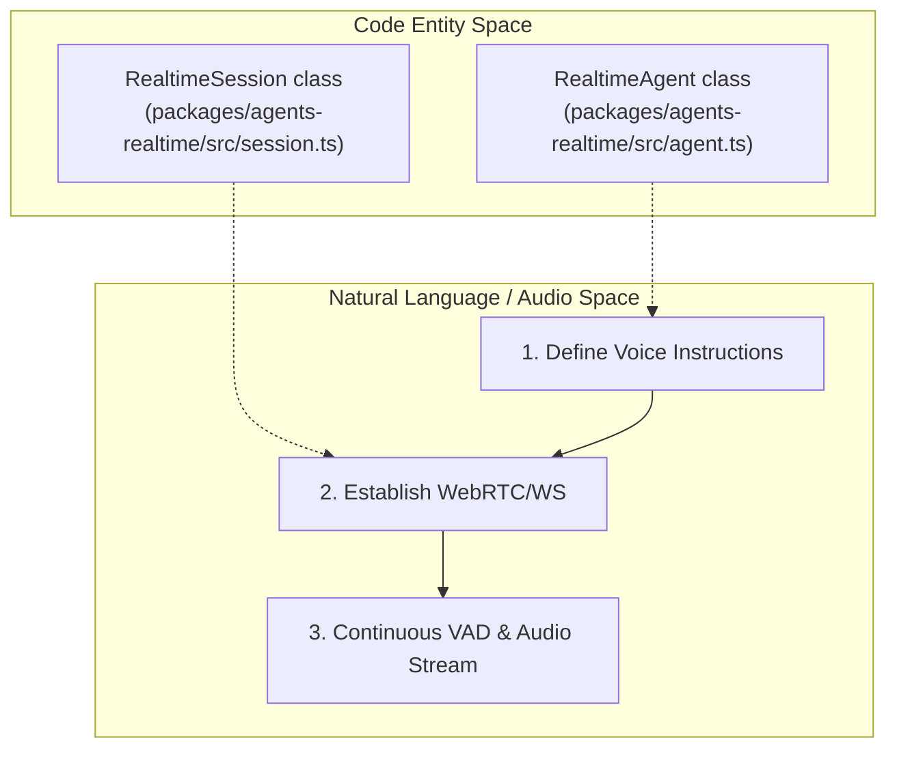

**Minimal Realtime example:**

```typescript
import { RealtimeAgent, RealtimeSession } from '@openai/agents/realtime';

const agent = new RealtimeAgent({
  name: 'Assistant',
  instructions: 'You are a helpful assistant.',
});

// Automatically connects microphone/audio in browser via WebRTC
const session = new RealtimeSession(agent);
await session.connect({ apiKey: '<client-ephemeral-token>' });
```

Sources: [README.md:90-105](), [docs/src/content/docs/guides/voice-agents/quickstart.mdx:62-101]()

## Next Steps

- **[Installation and Setup](#2.1)** — Detailed environment and dependency configuration.
- **[Basic Usage Examples](#2.2)** — Walkthroughs of tools, handoffs, and common patterns.
- **[Agent Fundamentals](#2.3)** — Deep dive into the `Agent` class and lifecycle hooks.
- **[Tracing and Observability](#4.6)** — Debug your agent flows at [platform.openai.com/traces](https://platform.openai.com/traces). [docs/src/content/docs/guides/tracing.mdx:10-10]()

Sources: [docs/src/content/docs/index.mdx:99-135]()

---

# Page: Installation and Setup

# Installation and Setup

<details>
<summary>Relevant source files</summary>

The following files were used as context for generating this wiki page:

- [.github/dependabot.yml](.github/dependabot.yml)
- [.github/workflows/changeset.yml](.github/workflows/changeset.yml)
- [.github/workflows/docs.yml](.github/workflows/docs.yml)
- [.github/workflows/issues.yml](.github/workflows/issues.yml)
- [.github/workflows/release-tag.yml](.github/workflows/release-tag.yml)
- [.github/workflows/release.yml](.github/workflows/release.yml)
- [.github/workflows/test.yml](.github/workflows/test.yml)
- [README.md](README.md)
- [docs/astro.config.mjs](docs/astro.config.mjs)
- [docs/package.json](docs/package.json)
- [docs/src/components/Hero.astro](docs/src/components/Hero.astro)
- [docs/src/content/docs/extensions/twilio.mdx](docs/src/content/docs/extensions/twilio.mdx)
- [docs/src/content/docs/guides/guardrails.mdx](docs/src/content/docs/guides/guardrails.mdx)
- [docs/src/content/docs/guides/human-in-the-loop.mdx](docs/src/content/docs/guides/human-in-the-loop.mdx)
- [docs/src/content/docs/guides/quickstart.mdx](docs/src/content/docs/guides/quickstart.mdx)
- [docs/src/content/docs/guides/tracing.mdx](docs/src/content/docs/guides/tracing.mdx)
- [docs/src/content/docs/guides/voice-agents.mdx](docs/src/content/docs/guides/voice-agents.mdx)
- [docs/src/content/docs/guides/voice-agents/quickstart.mdx](docs/src/content/docs/guides/voice-agents/quickstart.mdx)
- [docs/src/content/docs/index.mdx](docs/src/content/docs/index.mdx)
- [docs/src/styles/global.css](docs/src/styles/global.css)
- [examples/ai-sdk-ui/package.json](examples/ai-sdk-ui/package.json)
- [examples/ai-sdk-v1/package.json](examples/ai-sdk-v1/package.json)
- [examples/ai-sdk/package.json](examples/ai-sdk/package.json)
- [examples/nextjs/package.json](examples/nextjs/package.json)
- [examples/realtime-demo/package.json](examples/realtime-demo/package.json)
- [examples/realtime-next/package.json](examples/realtime-next/package.json)
- [examples/realtime-twilio-sip/package.json](examples/realtime-twilio-sip/package.json)
- [examples/realtime-twilio/package.json](examples/realtime-twilio/package.json)
- [package.json](package.json)
- [packages/agents/README.md](packages/agents/README.md)
- [pnpm-lock.yaml](pnpm-lock.yaml)

</details>


This page details the technical requirements and procedures for installing the OpenAI Agents SDK in production environments, as well as the setup for developing within the monorepo.

---

## Production Installation

### System Requirements

The SDK is designed to run in modern JavaScript environments and leverages modern Node.js features for performance and compatibility.

| Requirement | Specification |
| :--- | :--- |
| **Node.js Runtime** | Node.js 22 or later (Recommended) [README.md:27](), [packages/agents/README.md:29]() |
| **Alternative Runtimes** | Deno, Bun [README.md:28-29]() |
| **Experimental Support** | Cloudflare Workers (requires `nodejs_compat` flag) [README.md:33-35]() |
| **Package Manager** | `npm`, `pnpm`, or `yarn` |

### Installation Commands

The primary package is `@openai/agents`, which serves as an aggregator for the core, OpenAI-specific, and realtime modules.

**Using npm:**
```bash
npm install @openai/agents zod
```
[README.md:40-41](), [packages/agents/README.md:42]()

**Using pnpm:**
```bash
pnpm add @openai/agents zod
```

### Required Dependencies

The SDK relies on **Zod** for schema validation and the official **OpenAI** client for model communication.

| Dependency | Version | Purpose |
| :--- | :--- | :--- |
| `zod` | `^4.0.0` | Required for tool schema validation and runtime type safety [examples/agent-patterns/package.json:141-143]() |
| `openai` | `^6.46.0` | Underlying client for OpenAI API interactions [examples/agent-patterns/package.json:138-140]() |

**Sources:** [README.md:40-41](), [examples/agent-patterns/package.json:138-143]()

---

## Environment Configuration

### OpenAI API Key

Most operations require an authenticated OpenAI client. The SDK automatically looks for the `OPENAI_API_KEY` environment variable when using the `run()` function or initializing models.

**Unix/macOS:**
```bash
export OPENAI_API_KEY="sk-..."
```
[README.md:106](), [docs/src/content/docs/guides/voice-agents/quickstart.mdx:39]()

**Windows (PowerShell):**
```powershell
$env:OPENAI_API_KEY="sk-..."
```

### Realtime API Credentials
For **Realtime Voice Agents**, client-side applications (like browsers) should use **ephemeral tokens** instead of permanent API keys to prevent credential leakage.

1. Your backend requests a token from `POST /v1/realtime/client_secrets` [docs/src/content/docs/guides/voice-agents/quickstart.mdx:40]().
2. The response contains a value starting with `ek_` [docs/src/content/docs/guides/voice-agents/quickstart.mdx:51]().
3. The frontend uses this token to call `session.connect({ apiKey: 'ek_...' })` [docs/src/content/docs/guides/voice-agents/quickstart.mdx:98]().

**Sources:** [docs/src/content/docs/guides/voice-agents/quickstart.mdx:34-60](), [README.md:106-108]()

---

## Package Selection

The SDK is modular. Depending on your use case, you may choose different entry points. The monorepo uses `workspace:*` protocols to ensure internal consistency.

| Entry Point | Use Case |
| :--- | :--- |
| `@openai/agents` | **Recommended Default.** Aggregator package containing text agents, sandbox agents (`/sandbox`), and voice agents (`/realtime`) [docs/astro.config.mjs:35-52]() |
| `@openai/agents-openai` | OpenAI-specific implementations like `OpenAIChatCompletionsModel` [docs/astro.config.mjs:59-64]() |
| `@openai/agents-realtime` | Standalone voice package for browser-only apps or minimal bundles [docs/astro.config.mjs:65-70]() |
| `@openai/agents-core` | Foundational primitives (Agent, Runner, Model interfaces) [docs/astro.config.mjs:53-58]() |
| `@openai/agents-extensions` | Integrations like **Vercel AI SDK**, **Twilio**, and **Cloudflare** [docs/astro.config.mjs:71-76]() |

**Sources:** [docs/astro.config.mjs:34-76](), [examples/ai-sdk/package.json:156-161]()

---

## Data Flow and Architecture

The following diagrams illustrate how the installation of specific packages maps to the code entities used in a typical workflow.

### Natural Language to Code Entity Space: Text & Sandbox
Title: "Text and Sandbox Agent Initialization Flow"
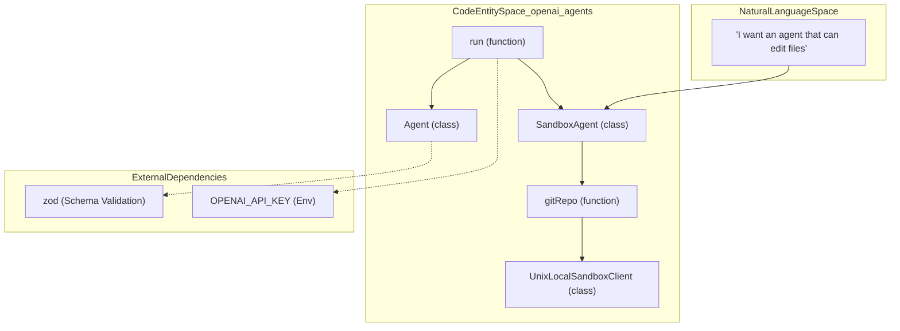
**Sources:** [README.md:47-87](), [packages/agents/README.md:45-89]()

### Natural Language to Code Entity Space: Realtime Voice
Title: "Realtime Voice Agent Connection Flow"
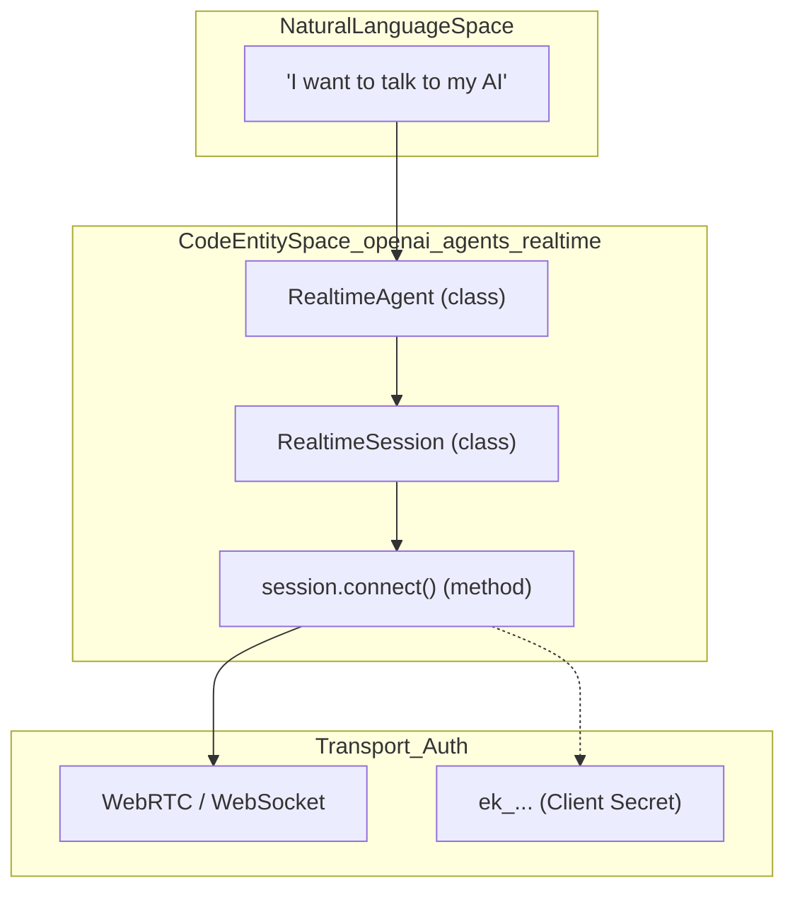
**Sources:** [README.md:95-103](), [docs/src/content/docs/guides/voice-agents/quickstart.mdx:71-99]()

---

## Development Environment Setup

If you are contributing to the `openai-agents-js` repository, follow these steps to set up the monorepo environment.

### Prerequisites
- **Node.js**: Version 22.x or 24.x is used in CI [ .github/workflows/test.yml:98]().
- **pnpm**: The repository uses pnpm workspaces for managing the monorepo [package.json:107]().

### Repository Setup
1. **Install Dependencies**:
   ```bash
   pnpm install
   ```
   [package.json:121]()
2. **Build All Packages**:
   The monorepo uses `tsc-multi` for compilation [package.json:8]().
   ```bash
   pnpm build
   ```

### Local Development Tools
The monorepo includes several scripts and tools for quality assurance:
- **tsc-multi**: Used for parallel builds and watching package changes [package.json:60, 11]().
- **Verdaccio**: Local npm registry for testing the full release cycle [package.json:81-82]().
- **Changesets**: Used for versioning and automated releases [package.json:77, 85]().
- **Vitest**: The primary testing framework for unit and integration tests [package.json:16, 105]().

**Sources:** [package.json:5-108](), [.github/workflows/test.yml:89-140]()

---

# Page: Basic Usage Examples

# Basic Usage Examples

<details>
<summary>Relevant source files</summary>

The following files were used as context for generating this wiki page:

- [.agents/skills/examples-auto-run/SKILL.md](.agents/skills/examples-auto-run/SKILL.md)
- [examples/agent-patterns/routing.ts](examples/agent-patterns/routing.ts)
- [examples/ai-sdk-v1/ai-sdk-v1.ts](examples/ai-sdk-v1/ai-sdk-v1.ts)
- [examples/ai-sdk/README.md](examples/ai-sdk/README.md)
- [examples/ai-sdk/gpt-5.ts](examples/ai-sdk/gpt-5.ts)
- [examples/ai-sdk/image-tool-output.ts](examples/ai-sdk/image-tool-output.ts)
- [examples/ai-sdk/stream.ts](examples/ai-sdk/stream.ts)
- [examples/ai-sdk/tsconfig.json](examples/ai-sdk/tsconfig.json)
- [examples/basic/file-tool-output.ts](examples/basic/file-tool-output.ts)
- [examples/basic/hello-world-gpt-5.ts](examples/basic/hello-world-gpt-5.ts)
- [examples/basic/image-tool-output.ts](examples/basic/image-tool-output.ts)
- [examples/basic/index.ts](examples/basic/index.ts)
- [examples/basic/local-file.ts](examples/basic/local-file.ts)
- [examples/basic/local-image.ts](examples/basic/local-image.ts)
- [examples/basic/media/partial_o3-and-o4-mini-system-card.pdf](examples/basic/media/partial_o3-and-o4-mini-system-card.pdf)
- [examples/basic/package.json](examples/basic/package.json)
- [examples/basic/reasoning.ts](examples/basic/reasoning.ts)
- [examples/basic/remote-image.ts](examples/basic/remote-image.ts)
- [examples/basic/remote-pdf.ts](examples/basic/remote-pdf.ts)
- [examples/customer-service/index.ts](examples/customer-service/index.ts)
- [examples/docs/README.md](examples/docs/README.md)
- [examples/docs/guardrails/guardrails-input.ts](examples/docs/guardrails/guardrails-input.ts)
- [examples/docs/models/customProviders.ts](examples/docs/models/customProviders.ts)
- [examples/docs/package.json](examples/docs/package.json)
- [examples/docs/streaming/streamedHITL.ts](examples/docs/streaming/streamedHITL.ts)
- [examples/docs/tools/codexRunContextThread.ts](examples/docs/tools/codexRunContextThread.ts)
- [examples/docs/tools/codexTool.ts](examples/docs/tools/codexTool.ts)
- [examples/mcp/sse-example.ts](examples/mcp/sse-example.ts)
- [examples/memory/start-prisma.ts](examples/memory/start-prisma.ts)
- [examples/model-providers/package.json](examples/model-providers/package.json)
- [examples/research-bot/main.ts](examples/research-bot/main.ts)
- [examples/tools/README.md](examples/tools/README.md)
- [examples/tools/codex-same-thread.ts](examples/tools/codex-same-thread.ts)
- [examples/tools/codex.ts](examples/tools/codex.ts)
- [examples/tools/package.json](examples/tools/package.json)
- [examples/tools/web-search-filters.ts](examples/tools/web-search-filters.ts)
- [packages/agents-extensions/src/experimental/codex/index.ts](packages/agents-extensions/src/experimental/codex/index.ts)
- [packages/agents-extensions/test/experimental/codex/index.test.ts](packages/agents-extensions/test/experimental/codex/index.test.ts)
- [scripts/run-example-starts.mjs](scripts/run-example-starts.mjs)

</details>


This page demonstrates the fundamental usage patterns of the OpenAI Agents SDK through core examples: creating a basic agent, adding tools, and orchestrating multiple agents through handoffs. These examples illustrate the primary abstractions and execution patterns used when building agent workflows.

For installation and environment setup, see [Installation and Setup](2.1). For detailed agent configuration options, see [Agent Fundamentals](2.3).

---

## Hello World: Basic Agent Creation and Execution

The simplest agent workflow involves creating an `Agent` instance with instructions and executing it with the `run()` utility. While the `Agent` class defines the agent's behavior, the `Runner` class (invoked internally by `run()`) orchestrates the execution loop.

### Basic Agent Execution Flow

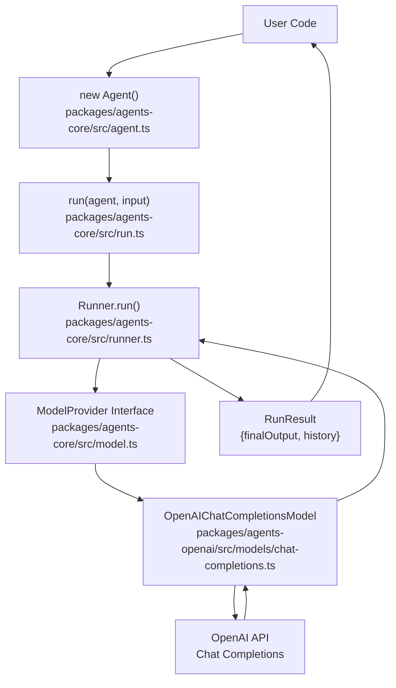
**Sources:** [examples/basic/hello-world-gpt-5.ts:1-31](), [examples/basic/index.ts:26-34]()

### Code Example: Hello World

The minimal agent requires a name and instructions. You can also specify a model and model-specific settings like reasoning effort or verbosity. The `outputType` property can be used with Zod to enforce structured output.

```typescript
import { Agent, run } from '@openai/agents';
import { z } from 'zod';

const outputSchema = z.object({
  title: z.string(),
  description: z.string(),
});

const agent = new Agent({
  name: 'GPT-5.4 Assistant',
  model: 'gpt-5.4',
  instructions: "You're a helpful assistant.",
  modelSettings: {
    reasoning: { effort: 'none' },
    text: { verbosity: 'low' },
  },
  outputType: outputSchema,
});

const result = await run(agent, 'Tell me about recursion in programming.');
console.log(result.finalOutput);
```
**Sources:** [examples/basic/hello-world-gpt-5.ts:10-32](), [examples/basic/reasoning.ts:8-17]()

---

## Agent with Tools: Extending Capabilities

Tools allow an agent to take actions like fetching data or calling external APIs. The SDK uses `zod` for parameter validation and the `tool()` helper to define executable logic.

### Tool Execution Flow in Agent Loop

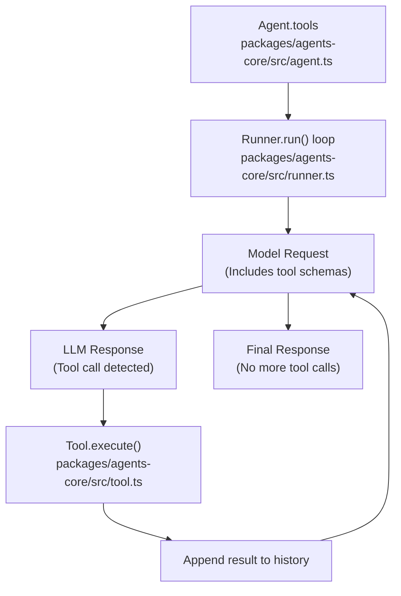
**Sources:** [examples/basic/index.ts:4-11](), [examples/ai-sdk/image-tool-output.ts:5-18]()

### Code Example: Agent with Function Tools

This example demonstrates defining a custom tool with `zod` schema validation and attaching it to an agent.

```typescript
import { Agent, run, tool } from '@openai/agents';
import { z } from 'zod';

const getWeatherTool = tool({
  name: 'get_weather',
  description: 'Get the weather for a given city',
  parameters: z.object({ city: z.string() }),
  execute: async (input) => {
    return `The weather in ${input.city} is sunny`;
  },
});

const agent = new Agent({
  name: 'Weather Agent',
  instructions: 'Use the weather tool to answer questions.',
  tools: [getWeatherTool],
});

const result = await run(agent, 'What is the weather in San Francisco?');
```
**Sources:** [examples/basic/index.ts:4-34](), [examples/ai-sdk/image-tool-output.ts:21-26]()

---

## Multi-Agent Handoffs: Orchestration

Handoffs allow an agent to delegate a conversation to a specialist. This is implemented by providing an array of agents to the `handoffs` property. The SDK handles the context switching and history preservation.

### Multi-Agent Handoff Flow

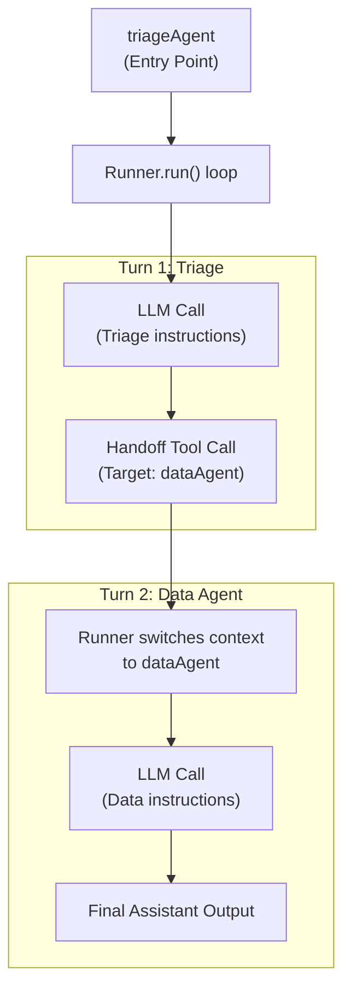
**Sources:** [examples/agent-patterns/routing.ts:43-48]()

### Code Example: Handoff Pattern

In this pattern, a `triageAgent` acts as a router. When it decides to hand off, the `run()` function continues execution with the new agent.

```typescript
import { Agent, run } from '@openai/agents';

const frenchAgent = new Agent({
  name: 'french_agent',
  instructions: 'You only speak French',
});

const triageAgent = new Agent({
  name: 'triage_agent',
  instructions: 'Handoff to the appropriate agent based on the language.',
  handoffs: [frenchAgent],
});

const result = await run(triageAgent, 'Bonjour!');
// result.currentAgent will be frenchAgent
```
**Sources:** [examples/agent-patterns/routing.ts:28-48]()

---

## Advanced Basic Patterns

### Reasoning Summaries
When using reasoning models (like GPT-5.4/o1 series), you can inspect the thinking process by iterating over `reasoning_item` entries in the run result.

```typescript
const result = await run(agent, 'Compute T(25) for T(n) = T(n-1) + n.');

for (const item of result.newItems) {
  if (item.type === 'reasoning_item') {
    for (const entry of item.rawItem.content) {
      if (entry.type === 'input_text') {
        console.log(`Thought: ${entry.text}`);
      }
    }
  }
}
```
**Sources:** [examples/basic/reasoning.ts:22-35]()

### Input Guardrails
Guardrails can be used to block or modify execution based on safety or business logic.

```typescript
import { Agent, run, InputGuardrailTripwireTriggered } from '@openai/agents';

const mathGuardrail = {
  name: 'Math Homework Guardrail',
  runInParallel: false,
  execute: async ({ input }) => {
    const isHomework = input.includes('solve for x');
    return { tripwireTriggered: isHomework };
  },
};

const agent = new Agent({
  name: 'Support',
  inputGuardrails: [mathGuardrail],
});

try {
  await run(agent, 'solve for x: 2x = 10');
} catch (e) {
  if (e instanceof InputGuardrailTripwireTriggered) {
    console.log('Guardrail tripped!');
  }
}
```
**Sources:** [examples/docs/guardrails/guardrails-input.ts:18-46]()

---

## Example Code Locations

The following files in the repository contain runnable examples of these patterns:

| Pattern | File Path |
| :--- | :--- |
| **Hello World (GPT-5.4)** | [examples/basic/hello-world-gpt-5.ts:1-71]() |
| **Reasoning & Thinking** | [examples/basic/reasoning.ts:1-38]() |
| **Agent with Tools** | [examples/basic/index.ts:4-34]() |
| **Input Guardrails** | [examples/docs/guardrails/guardrails-input.ts:1-50]() |
| **Handoffs (Routing)** | [examples/agent-patterns/routing.ts:1-58]() |
| **Hosted Tools (Codex)** | [examples/tools/codex-same-thread.ts:75-131]() |

**Sources:** [examples/basic/package.json:1-36](), [examples/tools/package.json:1-33]()

---

# Page: Agent Fundamentals

# Agent Fundamentals

<details>
<summary>Relevant source files</summary>

The following files were used as context for generating this wiki page:

- [docs/src/content/docs/extensions/ai-sdk.mdx](docs/src/content/docs/extensions/ai-sdk.mdx)
- [docs/src/content/docs/guides/agents.mdx](docs/src/content/docs/guides/agents.mdx)
- [docs/src/content/docs/guides/mcp.mdx](docs/src/content/docs/guides/mcp.mdx)
- [docs/src/content/docs/guides/models.mdx](docs/src/content/docs/guides/models.mdx)
- [docs/src/content/docs/guides/running-agents.mdx](docs/src/content/docs/guides/running-agents.mdx)
- [docs/src/content/docs/guides/sessions.mdx](docs/src/content/docs/guides/sessions.mdx)
- [docs/src/content/docs/guides/tools.mdx](docs/src/content/docs/guides/tools.mdx)
- [docs/src/content/docs/guides/voice-agents/build.mdx](docs/src/content/docs/guides/voice-agents/build.mdx)
- [docs/src/content/docs/ja/guides/agents.mdx](docs/src/content/docs/ja/guides/agents.mdx)
- [docs/src/content/docs/ko/guides/agents.mdx](docs/src/content/docs/ko/guides/agents.mdx)
- [docs/src/content/docs/zh/guides/agents.mdx](docs/src/content/docs/zh/guides/agents.mdx)
- [examples/docs/sessions/responsesCompactionManualSession.ts](examples/docs/sessions/responsesCompactionManualSession.ts)
- [packages/agents-core/src/agent.ts](packages/agents-core/src/agent.ts)
- [packages/agents-core/src/runContext.ts](packages/agents-core/src/runContext.ts)
- [packages/agents-core/src/runner/approvalRejection.ts](packages/agents-core/src/runner/approvalRejection.ts)
- [packages/agents-core/src/runner/mcpApprovals.ts](packages/agents-core/src/runner/mcpApprovals.ts)
- [packages/agents-core/test/agent.test.ts](packages/agents-core/test/agent.test.ts)
- [packages/agents-core/test/agentScenarios.test.ts](packages/agents-core/test/agentScenarios.test.ts)
- [packages/agents-core/test/runContext.test.ts](packages/agents-core/test/runContext.test.ts)

</details>


This page explains the `Agent` class constructor, its configuration options, dynamic instructions, and lifecycle hooks. An `Agent` represents a configured Large Language Model (LLM) with instructions, tools, guardrails, and handoff capabilities.

---

## Agent Class Overview

The `Agent` class is the primary abstraction in the SDK. It wraps an LLM with configuration that defines how it should behave, what capabilities it has, and how it interacts with other agents. It is generic over its context type `TContext` and its output type `TOutput`.

Title: Agent Configuration and Runtime Behavior
```mermaid
graph TB
    subgraph "Agent_Configuration_Options"
        Name["name: string"]
        Instructions["instructions: string | function"]
        Model["model: string | Model"]
        Tools["tools: Tool[]"]
        Handoffs["handoffs: (Agent | Handoff)[]"]
        InputGuardrails["inputGuardrails: InputGuardrail[]"]
        OutputGuardrails["outputGuardrails: OutputGuardrail[]"]
        OutputType["outputType: AgentOutputType"]
        ModelSettings["modelSettings: ModelSettings"]
        MCPServers["mcpServers: MCPServer[]"]
        ToolUseBehavior["toolUseBehavior: ToolUseBehaviorFlags"]
    end
    
    subgraph "Code_Entity_Space"
        AgentClass["Agent<TContext, TOutput>"]
    end
    
    subgraph "Runtime_Methods"
        SystemPrompt["getSystemPrompt()"]
        AllTools["getAllTools()"]
        EnabledHandoffs["getEnabledHandoffs()"]
        AsTool["asTool()"]
    end
    
    Name --> AgentClass
    Instructions --> AgentClass
    Model --> AgentClass
    Tools --> AgentClass
    Handoffs --> AgentClass
    InputGuardrails --> AgentClass
    OutputGuardrails --> AgentClass
    OutputType --> AgentClass
    ModelSettings --> AgentClass
    MCPServers --> AgentClass
    ToolUseBehavior --> AgentClass
    
    AgentClass --> SystemPrompt
    AgentClass --> AllTools
    AgentClass --> EnabledHandoffs
    AgentClass --> AsTool
```
**Sources:** [packages/agents-core/src/agent.ts:336-741](), [packages/agents-core/src/agent.ts:155-278]()

---

## Creating an Agent

The `Agent` constructor accepts a single configuration object. While `name` and `instructions` are the primary required fields, the constructor initializes a robust set of features including tool management and output validation.

Title: Agent Initialization Flow
```mermaid
graph LR
    Config["AgentOptions<TContext, TOutput>"]
    Constructor["new Agent(config)"]
    Instance["Agent<TContext, TOutput>"]
    
    Config --> Constructor
    Constructor --> Instance
    
    subgraph "Required_Properties"
        MinName["name: string"]
        MinInstr["instructions: Prompt"]
    end
    
    subgraph "Optional_Properties"
        OptModel["model"]
        OptTools["tools"]
        OptHandoffs["handoffs"]
        OptOutputType["outputType"]
        OptHooks["hooks"]
    end
    
    MinName --> Config
    MinInstr --> Config
    OptModel --> Config
    OptTools --> Config
    OptHandoffs --> Config
    OptOutputType --> Config
    OptHooks --> Config
```
**Sources:** [packages/agents-core/src/agent.ts:388-449](), [docs/src/content/docs/guides/agents.mdx:47-72]()

---

## Core Configuration Options

### name
A short human-readable identifier. It is used for logging, tracing, and identifying the agent when it is used as a tool by other agents.
**Sources:** [packages/agents-core/src/agent.ts:390-393](), [docs/src/content/docs/guides/agents.mdx:55]()

### instructions
The system prompt that tells the model who it is and how it should respond. This can be a static string or a dynamic function (see [Dynamic Instructions](#dynamic-instructions)).
**Sources:** [packages/agents-core/src/agent.ts:394](), [docs/src/content/docs/guides/agents.mdx:56]()

### model and modelSettings
`model` can be a string name (e.g., `'gpt-5.4-mini'`) or a concrete `Model` instance. `modelSettings` provides tuning parameters like `temperature` or `reasoning.effort`. If using GPT-5.x models, the SDK applies optimized default settings for reasoning and verbosity.
**Sources:** [packages/agents-core/src/agent.ts:398-399](), [docs/src/content/docs/guides/models.mdx:33-64]()

### tools
An array of capabilities the agent can invoke. The SDK supports multiple categories, including local function tools, hosted OpenAI tools (web search, code interpreter), and Model Context Protocol (MCP) tools.
**Sources:** [packages/agents-core/src/agent.ts:400-401](), [docs/src/content/docs/guides/tools.mdx:19-29]()

### handoffs
Defines a list of specialist agents this agent can delegate to. When a handoff occurs, the conversation history is preserved while the active agent changes.
**Sources:** [packages/agents-core/src/agent.ts:397](), [docs/src/content/docs/guides/agents.mdx:59]()

### outputType
By default, agents return plain text. By specifying an `outputType` (via Zod or JSON Schema), the SDK utilizes OpenAI's Structured Outputs to ensure the LLM returns a validated object.
**Sources:** [packages/agents-core/src/agent.ts:405-407](), [docs/src/content/docs/guides/agents.mdx:84-98]()

---

## Dynamic Instructions

Dynamic instructions allow the system prompt to be calculated at runtime. This is critical for agents that need to adapt based on user data, session state, or environment variables provided via `RunContext`.

Title: Dynamic Instruction Resolution
```mermaid
graph TB
    subgraph "Natural_Language_Space"
        UserPrompt["'Help me with my order'"]
        Instructions["'You are helping user {userId}'"]
    end

    subgraph "Code_Entity_Space"
        RC["RunContext<TContext>"]
        InstrFn["instructions: (runContext) => string | Promise<string>"]
        AgentCall["agent.getSystemPrompt(runContext)"]
    end

    RC -- "provides context data" --> InstrFn
    InstrFn -- "resolves to" --> Instructions
    AgentCall -- "invokes" --> InstrFn
    Instructions -- "sent to" --> Model["LLM (Generation)"]
```
**Sources:** [packages/agents-core/src/agent.ts:608-616](), [docs/src/content/docs/guides/agents.mdx:142-153]()

---

## Lifecycle Hooks

The `Agent` class allows developers to register hooks to observe and react to execution events. These hooks can be passed in the `hooks` property of the `Agent` constructor.

| Hook Name | Description | Arguments |
| :--- | :--- | :--- |
| `agent_start` | Triggered when the agent begins its turn. | `(context, agent, turnInput?)` |
| `agent_end` | Triggered when the agent finishes its turn. | `(context, output)` |
| `agent_handoff` | Triggered when the agent delegates to another agent. | `(context, nextAgent)` |
| `agent_tool_call` | Triggered when the agent invokes a tool. | `(context, toolCall)` |

**Sources:** [packages/agents-core/src/agent.ts:336-341](), [packages/agents-core/src/lifecycle.ts:7-25](), [docs/src/content/docs/guides/agents.mdx:170-185]()

---

## Advanced Behaviors

### Forcing Tool Use
Developers can control how an agent interacts with tools using `toolUseBehavior`.
- `run_llm_again` (default): After a tool executes, the result is sent back to the LLM to generate a final response.
- `stop_on_first_tool`: The run terminates immediately after the tool call is generated, allowing for external handling or human-in-the-loop flows.

**Sources:** [packages/agents-core/src/agent.ts:199-212](), [docs/src/content/docs/guides/agents.mdx:68]()

### Agents as Tools
An entire `Agent` can be exposed as a tool using `agent.asTool()`. This creates a `FunctionTool` that, when called, initializes a nested `Runner` to execute the child agent. This is the foundation of the "Manager" pattern.

**Sources:** [packages/agents-core/src/agent.ts:497-600](), [docs/src/content/docs/guides/tools.mdx:27]()

---

# Page: Core Packages

# Core Packages

<details>
<summary>Relevant source files</summary>

The following files were used as context for generating this wiki page:

- [packages/agents-core/CHANGELOG.md](packages/agents-core/CHANGELOG.md)
- [packages/agents-core/package.json](packages/agents-core/package.json)
- [packages/agents-core/src/metadata.ts](packages/agents-core/src/metadata.ts)
- [packages/agents-extensions/CHANGELOG.md](packages/agents-extensions/CHANGELOG.md)
- [packages/agents-extensions/package.json](packages/agents-extensions/package.json)
- [packages/agents-extensions/src/metadata.ts](packages/agents-extensions/src/metadata.ts)
- [packages/agents-openai/CHANGELOG.md](packages/agents-openai/CHANGELOG.md)
- [packages/agents-openai/package.json](packages/agents-openai/package.json)
- [packages/agents-openai/src/metadata.ts](packages/agents-openai/src/metadata.ts)
- [packages/agents-realtime/CHANGELOG.md](packages/agents-realtime/CHANGELOG.md)
- [packages/agents-realtime/package.json](packages/agents-realtime/package.json)
- [packages/agents-realtime/src/metadata.ts](packages/agents-realtime/src/metadata.ts)
- [packages/agents/CHANGELOG.md](packages/agents/CHANGELOG.md)
- [packages/agents/package.json](packages/agents/package.json)
- [packages/agents/src/metadata.ts](packages/agents/src/metadata.ts)

</details>


The OpenAI Agents SDK is organized as a monorepo containing four core packages that provide different layers of functionality. This document covers the architecture, responsibilities, and relationships between these packages. For information about specific features and capabilities provided by these packages, see [Key Features](#4).

## Package Architecture Overview

The SDK follows a layered architecture where each package has specific responsibilities and clear dependency relationships. The versioning is synchronized across the core workspace (currently v0.14.2).

```mermaid
graph TD
    subgraph "Main SDK Package"
        Agents["@openai/agents<br/>v0.14.2<br/>Umbrella Package"]
    end
    
    subgraph "Core Foundation"
        Core["@openai/agents-core<br/>v0.14.2<br/>Foundation Layer"]
    end
    
    subgraph "Integration Packages"  
        OpenAI["@openai/agents-openai<br/>v0.14.2<br/>OpenAI Models"]
        Realtime["@openai/agents-realtime<br/>v0.14.2<br/>Voice Agents"]
        Extensions["@openai/agents-extensions<br/>v0.14.2<br/>Third-party Bridge"]
    end
    
    subgraph "External Dependencies"
        OpenAIAPI["openai ^6.46.0"]
        MCP["@modelcontextprotocol/sdk ^1.26.0"]
        AISDK["@ai-sdk/provider ^4.0.0"]
        WS["ws ^8.21.0"]
    end
    
    Agents --> Core
    Agents --> OpenAI
    Agents --> Realtime
    
    Core --> OpenAIAPI
    Core -.-> MCP
    OpenAI --> Core
    OpenAI --> OpenAIAPI
    Realtime --> Core
    Realtime --> WS
    Extensions --> Core
    Extensions -.-> Agents
```

Sources: [packages/agents/package.json:44-48](), [packages/agents-core/package.json:116-121](), [packages/agents-openai/package.json:23-26](), [packages/agents-realtime/package.json:58-62](), [packages/agents-extensions/package.json:17-20](), [packages/agents/src/metadata.ts:4-14]()

## Package Responsibilities

| Package | Purpose | Key Components | Version |
|---------|---------|----------------|---------|
| `@openai/agents` | Main entry point and convenience exports | Re-exports from other packages, unified interface | 0.14.2 |
| `@openai/agents-core` | Foundation abstractions and utilities | `Agent`, `Runner`, `Tool` interfaces, MCP support, Sandbox core | 0.14.2 |
| `@openai/agents-openai` | OpenAI API integrations | `OpenAIResponsesModel`, `OpenAIChatCompletionsModel`, hosted tools | 0.14.2 |
| `@openai/agents-realtime` | Real-time voice capabilities | `RealtimeAgent`, `RealtimeSession`, WebRTC/WebSocket transports | 0.14.2 |
| `@openai/agents-extensions` | Third-party integrations | AI SDK adapter, Sandbox providers (E2B, Vercel, etc.) | 0.14.2 |

Sources: [packages/agents/package.json:5-6](), [packages/agents-core/package.json:5-6](), [packages/agents-openai/package.json:5-6](), [packages/agents-realtime/package.json:5-6](), [packages/agents-extensions/package.json:5-6]()

## @openai/agents

The umbrella package that provides a unified interface to the entire SDK. Most users will install and import from this package exclusively.

### Key Exports

The package exports are organized into logical groups, providing access to sandbox features and realtime voice capabilities from a single point.

```mermaid
graph LR
    subgraph "Main Export"
        MainIndex["index<br/>Main entry point"]
    end
    
    subgraph "Specialized Exports"
        RealtimeExport["realtime/index<br/>Voice agents"]
        SandboxExport["sandbox/index<br/>Sandbox & Local"]
        UtilsExport["utils/index<br/>Utilities"]
    end
    
    subgraph "Underlying Packages"
        Core["@openai/agents-core"]
        OpenAI["@openai/agents-openai"] 
        Realtime["@openai/agents-realtime"]
    end
    
    MainIndex --> Core
    MainIndex --> OpenAI
    RealtimeExport --> Realtime
    SandboxExport --> Core
    UtilsExport --> Core
```

### Dependencies

- **Direct dependencies**: `@openai/agents-core`, `@openai/agents-openai`, `@openai/agents-realtime`, `debug`, `openai`
- **Peer dependencies**: `zod` (required for schema validation)

Sources: [packages/agents/package.json:10-36](), [packages/agents/package.json:43-49](), [packages/agents/package.json:61-63]()

## @openai/agents-core

The foundation package providing core abstractions, interfaces, and cross-platform utilities. For details, see [@openai/agents-core](#3.1).

### Core Components

```mermaid
graph TD
    subgraph "Agent System"
        Agent["Agent<br/>Core interface"]
        Runner["Runner<br/>Execution engine"]
        RunState["RunState<br/>State management"]
        RunContext["RunContext<br/>Execution context"]
    end
    
    subgraph "Tool System" 
        Tool["Tool<br/>Base interface"]
        FunctionTool["FunctionTool"]
        MCPTool["MCPTool"]
        HostedTool["HostedTool"]
    end
    
    subgraph "Sandbox System"
        SandboxAgent["SandboxAgent<br/>Isolated execution"]
        LocalSandbox["local<br/>Local runtime"]
    end
    
    subgraph "Model Integration"
        ModelProvider["ModelProvider<br/>Abstract interface"]
        Usage["Usage<br/>Token tracking"]
    end
    
    Agent --> Runner
    Runner --> RunState
    Runner --> RunContext
    Runner --> ModelProvider
    Agent --> Tool
    Tool --> FunctionTool
    Tool --> MCPTool
    SandboxAgent --> LocalSandbox
```

### Export Structure

The package provides granular exports for different concerns:

| Export Path | Purpose | Key Components |
|-------------|---------|----------------|
| `.` | Main entry point | `Agent`, `Runner`, core interfaces |
| `./model` | Model abstractions | `ModelProvider`, `Usage` |
| `./sandbox` | Sandbox core | `SandboxAgent`, manifest handling |
| `./sandbox/local` | Local sandbox | Local runtime implementation |
| `./utils` | Utility functions | Helper functions, validation |
| `./_shims` | Platform shims | Node/Browser/Cloudflare Workers support |

Sources: [packages/agents-core/package.json:16-106](), [packages/agents-core/CHANGELOG.md:32-40]()

## @openai/agents-openai

Provides OpenAI-specific implementations of the core abstractions, including model integrations and built-in tools. For details, see [@openai/agents-openai](#3.2).

### Key Components

- **Model Implementations**: `OpenAIResponsesModel` (Responses API) and `OpenAIChatCompletionsModel` (Chat Completions API).
- **Hosted Tools**: Built-in support for `web_search`, `file_search`, `code_interpreter`, and `image_generation`.
- **Context Management**: Support for model settings, reasoning effort, and tool search.
- **Experimental Support**: Support for hosted multi-agent Responses.

Sources: [packages/agents-openai/package.json:16-21](), [packages/agents-openai/CHANGELOG.md:32-34](), [packages/agents-openai/CHANGELOG.md:84-85](), [packages/agents-openai/CHANGELOG.md:96-96]()

## @openai/agents-realtime

Specialized package for building real-time voice agents using OpenAI's Realtime API. For details, see [@openai/agents-realtime](#3.3).

### Architecture Components

- **Session Management**: `RealtimeSession` for connection orchestration and `RealtimeAgent` for voice-specific configuration.
- **Transport Layer**: Abstracted transport supporting WebRTC (browser), WebSocket (server), and SIP/Twilio integrations.
- **Audio Handling**: Built-in VAD (Voice Activity Detection) and interruption handling.
- **Tool Handling**: Programmatic Tool Calling with caller-aware replay and runtime-validated Zod outputs.

Sources: [packages/agents-realtime/package.json:6-10](), [packages/agents-realtime/CHANGELOG.md:33-35](), [packages/agents-realtime/CHANGELOG.md:80-82](), [packages/agents-realtime/CHANGELOG.md:101-101]()

## @openai/agents-extensions

Bridge package for integrating with third-party AI providers and sandbox environments. For details, see [@openai/agents-extensions](#3.4).

### Integration Architecture

- **AI SDK Adapter**: `AiSdkModel` provider bridge for the Vercel AI SDK ecosystem.
- **Sandbox Providers**: Implementations for `E2B`, `Vercel`, `Daytona`, `Blaxel`, `Modal`, `Runloop`, and `Cloudflare`.
- **Experimental**: Support for `Codex` integration.

Sources: [packages/agents-extensions/package.json:21-77](), [packages/agents-extensions/package.json:78-92]()

## Cross-Platform Compatibility

All packages include environment shims to ensure compatibility across different JavaScript runtime environments:

| Environment | Shim Path | Purpose |
|-------------|-----------|---------|
| Node.js | `./_shims/shims-node` | Full Node.js APIs and filesystem access |
| Browser | `./_shims/shims-browser` | Web APIs and limited functionality |
| Cloudflare Workers | `./_shims/shims-workerd` | Workers runtime compatibility |

The shim system automatically detects the runtime environment and provides appropriate implementations for platform-specific APIs.

Sources: [packages/agents-core/package.json:67-106](), [packages/agents-realtime/package.json:22-41]()

---

# Page: @openai/agents-core

# @openai/agents-core

<details>
<summary>Relevant source files</summary>

The following files were used as context for generating this wiki page:

- [.changeset/quiet-expected-test-logs.md](.changeset/quiet-expected-test-logs.md)
- [eslint.config.mjs](eslint.config.mjs)
- [packages/agents-core/src/agent.ts](packages/agents-core/src/agent.ts)
- [packages/agents-core/src/errors.ts](packages/agents-core/src/errors.ts)
- [packages/agents-core/src/guardrail.ts](packages/agents-core/src/guardrail.ts)
- [packages/agents-core/src/index.ts](packages/agents-core/src/index.ts)
- [packages/agents-core/src/mcp.ts](packages/agents-core/src/mcp.ts)
- [packages/agents-core/src/mcpLogging.ts](packages/agents-core/src/mcpLogging.ts)
- [packages/agents-core/src/mcpServers.ts](packages/agents-core/src/mcpServers.ts)
- [packages/agents-core/src/mcpUtil.ts](packages/agents-core/src/mcpUtil.ts)
- [packages/agents-core/src/run.ts](packages/agents-core/src/run.ts)
- [packages/agents-core/src/runContext.ts](packages/agents-core/src/runContext.ts)
- [packages/agents-core/src/runState.ts](packages/agents-core/src/runState.ts)
- [packages/agents-core/src/runner/approvalRejection.ts](packages/agents-core/src/runner/approvalRejection.ts)
- [packages/agents-core/src/runner/mcpApprovals.ts](packages/agents-core/src/runner/mcpApprovals.ts)
- [packages/agents-core/src/runner/runLoop.ts](packages/agents-core/src/runner/runLoop.ts)
- [packages/agents-core/src/runner/toolExecution.ts](packages/agents-core/src/runner/toolExecution.ts)
- [packages/agents-core/src/runner/toolSearch.ts](packages/agents-core/src/runner/toolSearch.ts)
- [packages/agents-core/src/runner/turnResolution.ts](packages/agents-core/src/runner/turnResolution.ts)
- [packages/agents-core/src/shims/mcp-server/browser.ts](packages/agents-core/src/shims/mcp-server/browser.ts)
- [packages/agents-core/src/shims/mcp-server/node.ts](packages/agents-core/src/shims/mcp-server/node.ts)
- [packages/agents-core/src/tool.ts](packages/agents-core/src/tool.ts)
- [packages/agents-core/src/utils/serialize.ts](packages/agents-core/src/utils/serialize.ts)
- [packages/agents-core/test/agent.test.ts](packages/agents-core/test/agent.test.ts)
- [packages/agents-core/test/agentScenarios.test.ts](packages/agents-core/test/agentScenarios.test.ts)
- [packages/agents-core/test/errors.test.ts](packages/agents-core/test/errors.test.ts)
- [packages/agents-core/test/guardrail.test.ts](packages/agents-core/test/guardrail.test.ts)
- [packages/agents-core/test/mcpCache.test.ts](packages/agents-core/test/mcpCache.test.ts)
- [packages/agents-core/test/mcpLogging.test.ts](packages/agents-core/test/mcpLogging.test.ts)
- [packages/agents-core/test/mcpServers.test.ts](packages/agents-core/test/mcpServers.test.ts)
- [packages/agents-core/test/mcpToFunctionTool.test.ts](packages/agents-core/test/mcpToFunctionTool.test.ts)
- [packages/agents-core/test/mcpToolFilter.integration.test.ts](packages/agents-core/test/mcpToolFilter.integration.test.ts)
- [packages/agents-core/test/run.stream.test.ts](packages/agents-core/test/run.stream.test.ts)
- [packages/agents-core/test/run.test.ts](packages/agents-core/test/run.test.ts)
- [packages/agents-core/test/runContext.test.ts](packages/agents-core/test/runContext.test.ts)
- [packages/agents-core/test/runState.test.ts](packages/agents-core/test/runState.test.ts)
- [packages/agents-core/test/runner/toolExecution.test.ts](packages/agents-core/test/runner/toolExecution.test.ts)
- [packages/agents-core/test/shims/mcp-server/browser.test.ts](packages/agents-core/test/shims/mcp-server/browser.test.ts)
- [packages/agents-core/test/shims/mcp-server/node.test.ts](packages/agents-core/test/shims/mcp-server/node.test.ts)
- [packages/agents-core/test/taskTurnTracing.test.ts](packages/agents-core/test/taskTurnTracing.test.ts)
- [packages/agents-core/test/tool.test.ts](packages/agents-core/test/tool.test.ts)
- [packages/agents-core/test/toolCustomData.test.ts](packages/agents-core/test/toolCustomData.test.ts)
- [packages/agents-core/test/utils/serialize.test.ts](packages/agents-core/test/utils/serialize.test.ts)
- [packages/agents-extensions/src/ai-sdk/index.ts](packages/agents-extensions/src/ai-sdk/index.ts)
- [packages/agents-extensions/test/ai-sdk/GoogleFormat.test.ts](packages/agents-extensions/test/ai-sdk/GoogleFormat.test.ts)
- [packages/agents-extensions/test/ai-sdk/index.test.ts](packages/agents-extensions/test/ai-sdk/index.test.ts)

</details>


## Purpose and Scope

`@openai/agents-core` is the foundational package of the OpenAI Agents SDK. It provides the core abstractions and execution engine for building multi-agent workflows, including:

- **Agent execution orchestration** via `Runner` and `Agent` classes [packages/agents-core/src/run.ts:223-575]() [packages/agents-core/src/agent.ts:279-673]()
- **Provider-agnostic model interface** (`Model`) for LLM interactions [packages/agents-core/src/model.ts:14-118]()
- **Tool system** with function tools, hosted tools, and Model Context Protocol (MCP) integration [packages/agents-core/src/tool.ts:1-550]() [packages/agents-core/src/mcp.ts:1-288]()
- **Guardrails** for input/output validation [packages/agents-core/src/guardrail.ts:1-125]()
- **Built-in tracing** for observability [packages/agents-core/src/tracing/context.ts:1-110]()
- **State management** for resumable agent runs [packages/agents-core/src/runState.ts:1-380]()

**Sources:** [packages/agents-core/src/index.ts:1-270](), [packages/agents-core/src/run.ts:1-143](), [packages/agents-core/src/agent.ts:1-70]()

---

## Package Architecture

### Entry Points and Exports

The package exposes multiple entry points via conditional exports:

| Export Path | Purpose | Entry File |
|------------|---------|-----------|
| `.` | Main API (Agent, Runner, tools, tracing) | `src/index.ts` |
| `./model` | Model interface and types | `src/model.ts` |
| `./utils` | Utility functions | `src/utils/index.ts` |
| `./_shims` | Environment-specific shims | `src/shims/index.ts` |

The main entry point [packages/agents-core/src/index.ts:1-270]() exports all core abstractions including `Agent`, `Runner`, `run`, `tool`, `handoff`, MCP utilities, and tracing.

**Sources:** [packages/agents-core/src/index.ts:1-270]()

### Dependencies

```mermaid
graph TB
    ["@openai/agents-core"] --> ["openai ^4.73.0"]
    ["@openai/agents-core"] --> ["zod ^3.23.8"]
    ["@openai/agents-core"] -. "optional" .-> ["@modelcontextprotocol/sdk ^1.0.1"]
    
    subgraph "Role"
        ["openai ^4.73.0"] --- Note1["OpenAI SDK provides base HTTP client and types"]
        ["zod ^3.23.8"] --- Note2["Zod used for schema validation in tool definitions"]
        ["@modelcontextprotocol/sdk ^1.0.1"] --- Note3["MCP SDK enables external tool server integration"]
    end
```

**MCP integration:** The `@modelcontextprotocol/sdk` is an optional dependency, dynamically imported through environment-specific shims when MCP features are used [packages/agents-core/src/mcp.ts:1-7]().

**Sources:** [packages/agents-core/src/mcp.ts:1-10](), [packages/agents-core/src/index.ts:116-156]()

---

## Core Abstractions

### Agent Class

The `Agent` class [packages/agents-core/src/agent.ts:279-673]() encapsulates agent configuration:

```mermaid
graph TB
    subgraph "AgentConfiguration"
        ["name: string"]
        ["instructions: string | function"]
        ["model: string | Model"]
        ["modelSettings: ModelSettings"]
        ["tools: Tool[]"]
        ["mcpServers: MCPServer[]"]
        ["handoffs: (Agent | Handoff)[]"]
        ["outputType: AgentOutputType"]
        ["toolUseBehavior: ToolUseBehavior"]
    end
    
    ["Agent<TContext, TOutput>"] --> "AgentConfiguration"
    
    ["instructions: string | function"] -. "can be" .-> ["Dynamic Instructions: async fn(context, agent) => string"]
```

**Key properties:**
- `instructions`: System prompt, can be static string or async function [packages/agents-core/src/agent.ts:214-222]().
- `toolUseBehavior`: Controls whether LLM processes tool results (`run_llm_again` or `stop_on_first_tool`) [packages/agents-core/src/agent.ts:199-200]().
- `modelSettings`: Supports model-specific defaults like reasoning effort [packages/agents-core/src/agent.ts:223-228]().

**Sources:** [packages/agents-core/src/agent.ts:157-278](), [packages/agents-core/src/defaultModel.ts:1-50]()

### Runner Class

The `Runner` class [packages/agents-core/src/run.ts:248-594]() orchestrates agent execution through a turn-based loop. It handles the lifecycle of a run, including streaming events and result aggregation [packages/agents-core/src/run.ts:248-260]().

**Configuration precedence:**
1. Per-run options (passed to `run()`) [packages/agents-core/src/run.ts:188-194]()
2. Runner-level defaults (passed to constructor) [packages/agents-core/src/run.ts:248-280]()
3. Agent-level settings

**Sources:** [packages/agents-core/src/run.ts:144-242](), [packages/agents-core/src/run.ts:248-594]()

### RunState and RunContext

`RunState` [packages/agents-core/src/runState.ts:1-380]() manages mutable execution state and supports serialization via `toJSON()` [packages/agents-core/src/runState.ts:244-253]().

**Schema Versioning:** `RunState` uses a versioned schema (currently `1.16`) to ensure compatibility during serialization/resumption [packages/agents-core/src/runState.ts:127-148]().

**Sources:** [packages/agents-core/src/runState.ts:1-148](), [packages/agents-core/src/runContext.ts:1-37]()

---

## Agent Execution System

### Turn-Based Loop

The `Runner` executes agents through a loop managed by `run` and `Runner.run` [packages/agents-core/src/run.ts:190-212]().

```mermaid
stateDiagram-v2
    [*] --> InitializeState
    InitializeState --> PrepareTurn
    state PrepareTurn {
        direction LR
        ["prepareTurn()"]
    }
    PrepareTurn --> CallModel
    state CallModel {
        direction LR
        ["getResponseWithRetry()"]
    }
    CallModel --> ResolveTurn
    state ResolveTurn {
        direction LR
        ["resolveTurnAfterModelResponse()"]
    }
    ResolveTurn --> ExecuteTools : "Tool calls detected"
    ExecuteTools --> PrepareTurn : "Next turn"
    ResolveTurn --> RunOutputGuardrails : "Final output"
    RunOutputGuardrails --> [*]
```

**Safety Limits:** Execution is limited by `DEFAULT_MAX_TURNS` (25) to prevent infinite loops [packages/agents-core/src/runner/constants.ts:1-5]().

**Sources:** [packages/agents-core/src/run.ts:78-85](), [packages/agents-core/src/runner/turnResolution.ts:1-50](), [packages/agents-core/src/runner/turnPreparation.ts:1-50]()

---

## Tool System

### Tool Types

The SDK supports four tool categories [packages/agents-core/src/tool.ts:218-243]():
1. **FunctionTool**: Local JS functions wrapped with `tool()` [packages/agents-core/src/tool.ts:228]().
2. **HostedTool**: OpenAI-managed tools like `web_search` or `computer` [packages/agents-core/src/tool.ts:218]().
3. **MCPTool**: Tools dynamically loaded from Model Context Protocol servers [packages/agents-core/src/mcp.ts:1-10]().
4. **Agent-as-Tool**: Nested agents exposed as tools via `Agent.asTool()` [packages/agents-core/src/agent.ts:110-160]().

**Sources:** [packages/agents-core/src/tool.ts:218-243](), [packages/agents-core/src/agent.ts:110-173]()

---

## Model Context Protocol (MCP)

### MCPServer Interface

`MCPServer` [packages/agents-core/src/mcp.ts:87-122]() provides a unified interface for external tool servers:

```mermaid
graph TB
    subgraph "MCPServer Interface"
        ["connect()"]
        ["listTools()"]
        ["callTool(name, args)"]
    end
    
    subgraph "Implementations"
        ["MCPServerStdio (Node-only)"]
        ["MCPServerSSE (Browser/Node)"]
        ["MCPServerStreamableHttp"]
    end
    
    "MCPServer Interface" -. "implemented by" .-> "Implementations"
```

**Caching:** Servers can cache tool lists to avoid repeated discovery overhead [packages/agents-core/src/mcp.ts:88]().

**Sources:** [packages/agents-core/src/mcp.ts:87-288](), [packages/agents-core/src/shims/mcp-server/node.ts:35-50]()

---

## Guardrails and Safety

### Guardrail Types

1. **Input Guardrails**: Run on initial user input [packages/agents-core/src/guardrail.ts:5-7]().
2. **Output Guardrails**: Run on the agent's final response [packages/agents-core/src/guardrail.ts:8-15]().
3. **Tool Guardrails**: Run specifically on tool inputs/outputs [packages/agents-core/src/toolGuardrail.ts:69-86]().

**Tripwires:** If a guardrail returns `tripwireTriggered: true`, the run throws a `GuardrailTripwireTriggered` error [packages/agents-core/src/errors.ts:34-41]().

**Sources:** [packages/agents-core/src/guardrail.ts:1-125](), [packages/agents-core/src/errors.ts:32-46]()

---

## Tracing and Observability

The SDK provides built-in tracing via a `TraceProvider` and context management [packages/agents-core/src/tracing/context.ts:25-33]().

```mermaid
graph TB
    ["Trace (Workflow)"] --> ["Span: Agent Run"]
    ["Span: Agent Run"] --> ["Span: Generation (LLM)"]
    ["Span: Agent Run"] --> ["Span: Function (Tool)"]
    ["Span: Agent Run"] --> ["Span: Guardrail"]
```

**Processors:** Traces are processed by `TracingProcessor` implementations, such as the `BatchTraceProcessor` for export to monitoring backends [packages/agents-core/src/index.ts:1-3]().

**Sources:** [packages/agents-core/src/tracing/context.ts:1-110](), [packages/agents-core/src/index.ts:1-4]()

---

# Page: @openai/agents-openai

# @openai/agents-openai

<details>
<summary>Relevant source files</summary>

The following files were used as context for generating this wiki page:

- [examples/memory/oai-compact.ts](examples/memory/oai-compact.ts)
- [packages/agents-core/src/model.ts](packages/agents-core/src/model.ts)
- [packages/agents-core/src/types/protocol.ts](packages/agents-core/src/types/protocol.ts)
- [packages/agents-core/test/sandboxToolRehydration.test.ts](packages/agents-core/test/sandboxToolRehydration.test.ts)
- [packages/agents-core/test/sandboxTools.test.ts](packages/agents-core/test/sandboxTools.test.ts)
- [packages/agents-extensions/src/ai-sdk-ui/uiMessageStream.ts](packages/agents-extensions/src/ai-sdk-ui/uiMessageStream.ts)
- [packages/agents-extensions/test/ai-sdk-ui/textStream.test.ts](packages/agents-extensions/test/ai-sdk-ui/textStream.test.ts)
- [packages/agents-extensions/test/ai-sdk-ui/uiMessageStream.test.ts](packages/agents-extensions/test/ai-sdk-ui/uiMessageStream.test.ts)
- [packages/agents-openai/src/index.ts](packages/agents-openai/src/index.ts)
- [packages/agents-openai/src/memory/openaiResponsesCompactionSession.ts](packages/agents-openai/src/memory/openaiResponsesCompactionSession.ts)
- [packages/agents-openai/src/openaiChatCompletionsConverter.ts](packages/agents-openai/src/openaiChatCompletionsConverter.ts)
- [packages/agents-openai/src/openaiChatCompletionsModel.ts](packages/agents-openai/src/openaiChatCompletionsModel.ts)
- [packages/agents-openai/src/openaiChatCompletionsStreaming.ts](packages/agents-openai/src/openaiChatCompletionsStreaming.ts)
- [packages/agents-openai/src/openaiProvider.ts](packages/agents-openai/src/openaiProvider.ts)
- [packages/agents-openai/src/openaiResponsesModel.ts](packages/agents-openai/src/openaiResponsesModel.ts)
- [packages/agents-openai/src/tools.ts](packages/agents-openai/src/tools.ts)
- [packages/agents-openai/src/types/providerData.ts](packages/agents-openai/src/types/providerData.ts)
- [packages/agents-openai/test/openaiChatCompletionsConverter.test.ts](packages/agents-openai/test/openaiChatCompletionsConverter.test.ts)
- [packages/agents-openai/test/openaiChatCompletionsModel.scenario.test.ts](packages/agents-openai/test/openaiChatCompletionsModel.scenario.test.ts)
- [packages/agents-openai/test/openaiChatCompletionsModel.test.ts](packages/agents-openai/test/openaiChatCompletionsModel.test.ts)
- [packages/agents-openai/test/openaiChatCompletionsStreaming.test.ts](packages/agents-openai/test/openaiChatCompletionsStreaming.test.ts)
- [packages/agents-openai/test/openaiResponsesCompactionSession.test.ts](packages/agents-openai/test/openaiResponsesCompactionSession.test.ts)
- [packages/agents-openai/test/openaiResponsesModel.helpers.test.ts](packages/agents-openai/test/openaiResponsesModel.helpers.test.ts)
- [packages/agents-openai/test/openaiResponsesModel.test.ts](packages/agents-openai/test/openaiResponsesModel.test.ts)
- [packages/agents-openai/test/tools.test.ts](packages/agents-openai/test/tools.test.ts)

</details>


The `@openai/agents-openai` package provides OpenAI-specific implementations of the core interfaces defined in `@openai/agents-core`. It translates the SDK's internal protocol into the formats required by OpenAI's APIs, specifically the **Responses API** and the **Chat Completions API**.

This package handles the complexity of hosted tools (Web Search, File Search, Code Interpreter), computer use, and stateful conversation management while providing a unified `Model` interface for the `Runner`.

Sources: [packages/agents-openai/src/index.ts:1-40](), [packages/agents-openai/src/openaiResponsesModel.ts:1-23]()

## OpenAIResponsesModel

The `OpenAIResponsesModel` is the primary implementation for the OpenAI Responses API. It supports advanced features like server-side context management, hosted tools, and the Model Context Protocol (MCP).

### Architecture and Data Flow

The model acts as a bridge between the `ModelRequest` (SDK protocol) and the `OpenAI.Responses.ResponseCreateParams` (API protocol).

Title: OpenAI Responses Model Data Flow
```mermaid
graph TD
    subgraph "Natural Language Space (SDK)"
        Agent["Agent/Runner"]
        Request["ModelRequest"]
    end

    subgraph "Code Entity Space (@openai/agents-openai)"
        Model["OpenAIResponsesModel"]
        GetInput["getInputItems()"]
        GetTools["getTools()"]
        ConvertTool["convertTool()"]
        Fetch["#fetchResponse()"]
        WSConn["ResponsesWebSocketConnection"]
    end

    subgraph "OpenAI API Space"
        API["OpenAI Responses API"]
        WS["WebSocket (Realtime)"]
    end

    Agent -->|calls| Model
    Model -->|transforms| Request
    Request --> GetInput
    Request --> GetTools
    GetTools --> ConvertTool
    
    Model --> Fetch
    Fetch -->|HTTP POST| API
    Model -.->|Optional| WSConn
    WSConn -.->|WebSocket| WS
    
    API -->|Response| Model
    Model -->|Normalizes| ModelResponse["ModelResponse"]
```

Sources: [packages/agents-openai/src/openaiResponsesModel.ts:915-941](), [packages/agents-openai/src/openaiResponsesModel.ts:1145-1215](), [packages/agents-openai/src/openaiResponsesModel.ts:133-171]()

### Key Functions and Classes

- **`OpenAIResponsesModel`**: Implements the `Model` interface. It manages request execution, usage tracking via the `Usage` class, and integrates with the SDK's tracing system using `withResponseSpan`. [packages/agents-openai/src/openaiResponsesModel.ts:825-831]()
- **`convertTool()`**: Converts SDK `SerializedTool` types into OpenAI API tool definitions. It handles specific mappings for `computer`, `shell`, `web_search`, and `file_search`, including snake_case conversion for API compatibility. [packages/agents-openai/test/openaiResponsesModel.helpers.test.ts:87-145]()
- **`getInputItems()`**: Translates SDK `AgentInputItem` types (text, images, files) into the `ResponseInputItem` array required by the Responses API. [packages/agents-openai/src/openaiResponsesModel.ts:430-584]()
- **`convertToOutputItem()`**: Recursively transforms API output items back into the SDK's `protocol.OutputModelItem` format, ensuring provider-specific data is preserved in `providerData`. [packages/agents-openai/src/openaiResponsesModel.ts:676-817]()

## Hosted Tools Integration

The package provides helper functions to configure OpenAI-hosted tools. These tools are executed on OpenAI's infrastructure.

| Tool | Helper Function | Key Options |
| :--- | :--- | :--- |
| **Web Search** | `webSearchTool()` | Configures the `web_search` tool for browsing the live web. [packages/agents-openai/src/tools.ts:127-148]() |
| **File Search** | `fileSearchTool()` | Enables vector-store based retrieval from uploaded documents. [packages/agents-openai/src/tools.ts:176-190]() |
| **Code Interpreter** | `codeInterpreterTool()` | Provides a sandboxed Python environment for computation and data analysis. [packages/agents-openai/src/tools.ts:71-91]() |
| **Tool Search** | `toolSearchTool()` | Allows the model to search a large tool library; supports client or server execution. [packages/agents-openai/src/tools.ts:204-233]() |

### Tool Search (Deferred Loading)
The `toolSearchTool` allows models to search for and dynamically load tools from large libraries (like MCP servers). If `execution` is set to `'client'`, the search results are replayed through the SDK's `Runner`. The implementation uses `toOpenAIToolSearchOutputToolPayload` to normalize the wire format.

Sources: [packages/agents-openai/src/openaiResponsesModel.ts:133-171](), [packages/agents-openai/src/tools.ts:192-202]()

## OpenAIChatCompletionsModel

The `OpenAIChatCompletionsModel` provides a `Model` implementation for the `/chat/completions` endpoint, supporting standard OpenAI models and compatible third-party providers.

### Protocol Translation Logic

The translation between the SDK protocol and Chat Completions messages is handled by `itemsToMessages`.

Title: Chat Completions Protocol Conversion
```mermaid
graph LR
    subgraph "SDK Internal Entity"
        SDK_User["protocol.UserMessageItem"]
        SDK_Asst["protocol.AssistantMessageItem"]
        SDK_Tool["protocol.FunctionCallItem"]
    end

    subgraph "Converter Logic (openaiChatCompletionsConverter.ts)"
        M2M["itemsToMessages()"]
        EUC["extractAllUserContent()"]
        EAC["extractAllAssistantContent()"]
        TTO["toolToOpenAI()"]
    end

    subgraph "OpenAI Chat API Params"
        Param_Msg["ChatCompletionMessageParam"]
        Param_Tool["ChatCompletionTool"]
    end

    SDK_User --> EUC
    SDK_Asst --> EAC
    EUC --> M2M
    EAC --> M2M
    M2M --> Param_Msg
    SDK_Tool --> TTO
    TTO --> Param_Tool
```

Sources: [packages/agents-openai/src/openaiChatCompletionsConverter.ts:84-116](), [packages/agents-openai/src/openaiChatCompletionsConverter.ts:118-216](), [packages/agents-openai/src/openaiChatCompletionsModel.ts:137-204]()

### Reasoning and Streaming
The model handles reasoning models (e.g., o1) by detecting `reasoning` fields. During streaming, `convertChatCompletionsStreamToResponses` aggregates chunks into a unified protocol event stream, capturing both content deltas and tool call fragments.

Sources: [packages/agents-openai/src/openaiChatCompletionsModel.ts:65-73](), [packages/agents-openai/src/openaiChatCompletionsStreaming.ts:21-38](), [packages/agents-openai/src/openaiChatCompletionsStreaming.ts:179-185]()

## API Integrations and Utilities

### Retries and Advice
OpenAI-specific retry logic is encapsulated in `getOpenAIRetryAdvice`. It inspects error objects to determine if a failure is transient (e.g., rate limits, server errors) and suggests `ModelRetryAdvice` to the `Runner`.

Sources: [packages/agents-openai/src/openaiResponsesModel.ts:26-26](), [packages/agents-openai/src/openaiChatCompletionsModel.ts:40-40]()

### WebSocket Transport
For the Responses API, `ResponsesWebSocketConnection` manages stateful WebSocket connections. This allows for low-latency interactions and supports features like `ResponsesWebSocketKeepAliveOptions` to maintain long-lived sessions.

Sources: [packages/agents-openai/src/responsesWebSocketConnection.ts:35-50](), [packages/agents-openai/src/openaiResponsesModel.ts:35-45]()

### Feature Validation
Both models support a `strictFeatureValidation` flag. When enabled, the models will throw a `UserError` if the request includes features not supported by the specific endpoint (e.g., server-managed conversation state in Chat Completions).

Sources: [packages/agents-openai/src/openaiChatCompletionsModel.ts:78-85](), [packages/agents-openai/src/openaiChatCompletionsModel.ts:211-230]()

### Context Compaction
The `OpenAIResponsesCompactionSession` provides a specialized session wrapper that triggers server-side compaction when history grows too large. It uses the `responses.compact` endpoint to compress conversation history while preserving essential context.

Sources: [packages/agents-openai/src/memory/openaiResponsesCompactionSession.ts:9-30](), [packages/agents-openai/test/openaiResponsesCompactionSession.test.ts:201-225]()

---

# Page: @openai/agents-realtime

# @openai/agents-realtime

<details>
<summary>Relevant source files</summary>

The following files were used as context for generating this wiki page:

- [.changeset/realtime-text-output-guardrails.md](.changeset/realtime-text-output-guardrails.md)
- [docs/src/content/docs/guides/voice-agents/transport.mdx](docs/src/content/docs/guides/voice-agents/transport.mdx)
- [examples/realtime-twilio-sip/README.md](examples/realtime-twilio-sip/README.md)
- [examples/realtime-twilio-sip/agents.ts](examples/realtime-twilio-sip/agents.ts)
- [examples/realtime-twilio-sip/tsconfig.json](examples/realtime-twilio-sip/tsconfig.json)
- [examples/realtime-twilio-sip/types.d.ts](examples/realtime-twilio-sip/types.d.ts)
- [packages/agents-realtime/src/clientMessages.ts](packages/agents-realtime/src/clientMessages.ts)
- [packages/agents-realtime/src/index.ts](packages/agents-realtime/src/index.ts)
- [packages/agents-realtime/src/openaiRealtimeBase.ts](packages/agents-realtime/src/openaiRealtimeBase.ts)
- [packages/agents-realtime/src/openaiRealtimeEvents.ts](packages/agents-realtime/src/openaiRealtimeEvents.ts)
- [packages/agents-realtime/src/openaiRealtimeSip.ts](packages/agents-realtime/src/openaiRealtimeSip.ts)
- [packages/agents-realtime/src/openaiRealtimeWebRtc.ts](packages/agents-realtime/src/openaiRealtimeWebRtc.ts)
- [packages/agents-realtime/src/openaiRealtimeWebsocket.ts](packages/agents-realtime/src/openaiRealtimeWebsocket.ts)
- [packages/agents-realtime/src/realtimeSession.ts](packages/agents-realtime/src/realtimeSession.ts)
- [packages/agents-realtime/src/transportLayer.ts](packages/agents-realtime/src/transportLayer.ts)
- [packages/agents-realtime/src/transportLayerEvents.ts](packages/agents-realtime/src/transportLayerEvents.ts)
- [packages/agents-realtime/src/utils.ts](packages/agents-realtime/src/utils.ts)
- [packages/agents-realtime/test/openaiRealtimeBase.test.ts](packages/agents-realtime/test/openaiRealtimeBase.test.ts)
- [packages/agents-realtime/test/openaiRealtimeEvents.test.ts](packages/agents-realtime/test/openaiRealtimeEvents.test.ts)
- [packages/agents-realtime/test/openaiRealtimeSip.test.ts](packages/agents-realtime/test/openaiRealtimeSip.test.ts)
- [packages/agents-realtime/test/openaiRealtimeWebRtc.test.ts](packages/agents-realtime/test/openaiRealtimeWebRtc.test.ts)
- [packages/agents-realtime/test/openaiRealtimeWebsocket.test.ts](packages/agents-realtime/test/openaiRealtimeWebsocket.test.ts)
- [packages/agents-realtime/test/realtimeSession.test.ts](packages/agents-realtime/test/realtimeSession.test.ts)
- [packages/agents-realtime/test/realtimeVoiceConfigRegression.test.ts](packages/agents-realtime/test/realtimeVoiceConfigRegression.test.ts)
- [packages/agents-realtime/test/stubs.ts](packages/agents-realtime/test/stubs.ts)
- [packages/agents-realtime/test/utils.test.ts](packages/agents-realtime/test/utils.test.ts)

</details>


The `@openai/agents-realtime` package provides the infrastructure for building low-latency voice and multimodal agents. It facilitates persistent connections with OpenAI's Realtime API, abstracting complex tasks like audio streaming, Voice Activity Detection (VAD) management, session state synchronization, and tool execution during live conversations.

## Architecture Overview

The package follows a layered architecture that decouples the agent's logic from the specific transport mechanism (WebRTC, WebSocket, or SIP).

```mermaid
graph TB
    subgraph "Application Layer"
        App["Application Code"]
        RealtimeAgent["RealtimeAgent<br/>realtimeAgent.ts"]
    end
    
    subgraph "Session Orchestration"
        RealtimeSession["RealtimeSession<br/>realtimeSession.ts"]
        RunContext["RunContext<br/>@openai/agents-core"]
    end
    
    subgraph "Transport Abstraction"
        Base["OpenAIRealtimeBase<br/>openaiRealtimeBase.ts"]
        WebRTC["OpenAIRealtimeWebRTC<br/>openaiRealtimeWebRtc.ts"]
        WS["OpenAIRealtimeWebSocket<br/>openaiRealtimeWebsocket.ts"]
        Sequencer["ResponseCreateSequencer<br/>responseCreateSequencer.ts"]
    end
    
    App --> RealtimeSession
    RealtimeSession --> RealtimeAgent
    RealtimeSession --> Base
    Base --> WebRTC
    Base --> WS
    WebRTC --> Sequencer
    WS --> Sequencer
```

### Natural Language to Code Entity Mapping
This diagram bridges the conceptual "Voice Agent" space to the specific classes and files in the codebase.

```mermaid
graph LR
    subgraph "Natural Language Concepts"
        Voice["Voice Assistant"]
        Connection["Live Connection"]
        History["Conversation Memory"]
        Tool["Agent Capability"]
    end

    subgraph "Code Entities (Implementation)"
        RA["RealtimeAgent<br/>realtimeAgent.ts"]
        RS["RealtimeSession<br/>realtimeSession.ts"]
        TL["RealtimeTransportLayer<br/>transportLayer.ts"]
        RI["RealtimeItem<br/>items.ts"]
    end

    Voice --- RA
    Connection --- RS
    Connection --- TL
    History --- RI
    Tool --- RA
```

Sources: [packages/agents-realtime/src/realtimeSession.ts:220-234](), [packages/agents-realtime/src/openaiRealtimeBase.ts:150-153](), [packages/agents-realtime/src/realtimeAgent.ts:12-15](), [packages/agents-realtime/src/transportLayer.ts:53-53]()

---

## Core Components

### RealtimeSession
The `RealtimeSession` is the primary entry point for voice applications. It manages the lifecycle of the connection and orchestrates the interaction between the `RealtimeAgent` and the `RealtimeTransportLayer`.

**Key Responsibilities:**
- **Connection Management:** Handles `connect()`, `close()`, and automatic status tracking [packages/agents-realtime/src/realtimeSession.ts:266-319]().
- **History Management:** Maintains a local copy of the conversation history in `RealtimeItem` format and synchronizes it with the server [packages/agents-realtime/src/realtimeSession.ts:602-649]().
- **Tool Execution:** Listens for `function_call` events from the transport, executes the corresponding tool in the agent, and sends the output back [packages/agents-realtime/src/realtimeSession.ts:421-516]().
- **Guardrails:** Runs output guardrails on streaming transcripts as they arrive via `runToolOutputGuardrails` [packages/agents-realtime/src/realtimeSession.ts:74-76]().

### RealtimeAgent
`RealtimeAgent` extends the core `Agent` class. It adds voice-specific configuration such as the `voice` property (e.g., "alloy", "shimmer") and provides a mechanism to filter tools specifically for the realtime environment [packages/agents-realtime/src/realtimeAgent.ts:12-50]().

### Transport Layers
The SDK provides several implementations of the `RealtimeTransportLayer` interface:

| Transport Class | Environment | Mechanism | Use Case |
| :--- | :--- | :--- | :--- |
| `OpenAIRealtimeWebRTC` | Browser | WebRTC Data/Media Channels | Low-latency browser apps with native mic access [packages/agents-realtime/src/openaiRealtimeWebRtc.ts:88-91](). |
| `OpenAIRealtimeWebSocket` | Node.js / Server | WebSockets | Server-side agents or environments without WebRTC [packages/agents-realtime/src/openaiRealtimeWebsocket.ts:83-85](). |
| `OpenAIRealtimeSIP` | Server | SIP/WebSocket | Integration with VoIP and telephony providers [packages/agents-realtime/src/openaiRealtimeSip.ts:18-21](). |

Sources: [packages/agents-realtime/src/transportLayer.ts:34-36](), [docs/src/content/docs/guides/voice-agents/transport.mdx:16-23]()

---

## Data Flow and Event System

The realtime system relies on a complex event-driven architecture to handle the asynchronous nature of voice.

### Audio and Transcript Flow
As the user speaks, audio is buffered and sent to the API. As the model responds, audio and text deltas flow back.

```mermaid
sequenceDiagram
    participant U as User/Mic
    participant RS as RealtimeSession
    participant TL as TransportLayer
    participant API as OpenAI Realtime API

    U->>RS: Audio Buffer
    RS->>TL: sendAudio(buffer)
    TL->>API: input_audio_buffer.append
    API-->>TL: response.output_audio.delta
    TL-->>RS: audio event
    RS-->>U: Play Audio
    API-->>TL: response.output_audio_transcript.delta
    TL-->>RS: audio_transcript_delta event
    RS->>RS: Run Output Guardrails
```

Sources: [packages/agents-realtime/src/openaiRealtimeBase.ts:276-291](), [packages/agents-realtime/src/realtimeSession.ts:651-684](), [packages/agents-realtime/src/transportLayerEvents.ts:35-39]()

### Event Normalization
`OpenAIRealtimeBase` acts as a translation layer, converting raw API events into normalized SDK events:
- `response.created` → `turn_started` [packages/agents-realtime/src/openaiRealtimeBase.ts:240-248]()
- `response.done` → `turn_done` (includes `Usage` calculations) [packages/agents-realtime/src/openaiRealtimeBase.ts:254-269]()
- `session.updated` → Internal state update of `#rawSessionConfig` [packages/agents-realtime/src/openaiRealtimeBase.ts:250-252]()

---

## Implementation Details

### Session Configuration
The SDK supports the latest OpenAI Realtime API configuration schema, including granular audio settings and reasoning effort.

```typescript
// Default configuration used if not provided
export const DEFAULT_OPENAI_REALTIME_SESSION_CONFIG: Partial<RealtimeSessionConfigDefinition> = {
  outputModalities: ['audio'],
  audio: {
    input: {
      format: { type: 'audio/pcm', rate: 24000 },
      transcription: { model: 'gpt-4o-mini-transcribe' },
      turnDetection: { type: 'semantic_vad' },
      noiseReduction: null,
    },
    output: {
      format: { type: 'audio/pcm', rate: 24000 },
      speed: 1,
    },
  },
};
```
Sources: [packages/agents-realtime/src/openaiRealtimeBase.ts:75-90](), [packages/agents-realtime/src/clientMessages.ts:125-134]()

### Interruption Handling
Interruptions are critical for voice agents. When the model detects user speech (`speech_started`) or a guardrail trips, `interrupt()` is called.
1. **Transport Level:** Sends `response.cancel` and `output_audio_buffer.clear` to the API [packages/agents-realtime/src/openaiRealtimeWebRtc.ts:400-410]().
2. **Session Level:** Truncates the conversation history via `conversation.item.truncate` to ensure the model's context matches what the user actually heard [packages/agents-realtime/src/openaiRealtimeWebsocket.ts:327-342]().

### Response Sequencing
The `ResponseCreateSequencer` ensures that `response.create` requests are not sent while a previous response is still being cancelled or processed, preventing race conditions in the model's state. It manages a queue of pending response requests and triggers them only when the transport reaches a stable state [packages/agents-realtime/src/openaiRealtimeWebRtc.ts:105-108](), [packages/agents-realtime/src/openaiRealtimeWebsocket.ts:108-111]().

---

## Tooling and MCP Integration

Realtime sessions support standard `FunctionTool` objects and **Model Context Protocol (MCP)** tools.

- **MCP Discovery:** The session can list tools from remote MCP servers using the `mcp_tools_listed` event [packages/agents-realtime/src/transportLayerEvents.ts:174-179]().
- **Approvals:** If a tool (Function or MCP) requires approval, the session emits an `mcp_approval_request`. The user can then call `session.approve()` to resume execution [packages/agents-realtime/src/realtimeSession.ts:377-404]().
- **Background Execution:** Tools can be marked for background execution using `backgroundResult`, allowing the agent to continue speaking while the tool processes [packages/agents-realtime/src/tool.ts:32-32]().

Sources: [packages/agents-realtime/src/realtimeSession.ts:421-516](), [packages/agents-realtime/src/transportLayerEvents.ts:168-173](), [packages/agents-realtime/src/openaiRealtimeBase.ts:223-238]()

---

# Page: @openai/agents-extensions

# @openai/agents-extensions

<details>
<summary>Relevant source files</summary>

The following files were used as context for generating this wiki page:

- [docs/src/content/docs/ja/extensions/ai-sdk.mdx](docs/src/content/docs/ja/extensions/ai-sdk.mdx)
- [docs/src/content/docs/ko/extensions/ai-sdk.mdx](docs/src/content/docs/ko/extensions/ai-sdk.mdx)
- [docs/src/content/docs/zh/extensions/ai-sdk.mdx](docs/src/content/docs/zh/extensions/ai-sdk.mdx)
- [examples/docs/extensions/twilio-basic.ts](examples/docs/extensions/twilio-basic.ts)
- [packages/agents-core/src/runner/toolSearch.ts](packages/agents-core/src/runner/toolSearch.ts)
- [packages/agents-core/src/tool.ts](packages/agents-core/src/tool.ts)
- [packages/agents-core/src/utils/serialize.ts](packages/agents-core/src/utils/serialize.ts)
- [packages/agents-core/test/tool.test.ts](packages/agents-core/test/tool.test.ts)
- [packages/agents-core/test/utils/serialize.test.ts](packages/agents-core/test/utils/serialize.test.ts)
- [packages/agents-extensions/src/TwilioRealtimeTransport.ts](packages/agents-extensions/src/TwilioRealtimeTransport.ts)
- [packages/agents-extensions/src/ai-sdk-ui/uiMessageStream.ts](packages/agents-extensions/src/ai-sdk-ui/uiMessageStream.ts)
- [packages/agents-extensions/src/ai-sdk/index.ts](packages/agents-extensions/src/ai-sdk/index.ts)
- [packages/agents-extensions/test/TwilioRealtimeTransport.test.ts](packages/agents-extensions/test/TwilioRealtimeTransport.test.ts)
- [packages/agents-extensions/test/ai-sdk-ui/textStream.test.ts](packages/agents-extensions/test/ai-sdk-ui/textStream.test.ts)
- [packages/agents-extensions/test/ai-sdk-ui/uiMessageStream.test.ts](packages/agents-extensions/test/ai-sdk-ui/uiMessageStream.test.ts)
- [packages/agents-extensions/test/ai-sdk/GoogleFormat.test.ts](packages/agents-extensions/test/ai-sdk/GoogleFormat.test.ts)
- [packages/agents-extensions/test/ai-sdk/index.test.ts](packages/agents-extensions/test/ai-sdk/index.test.ts)
- [packages/agents-extensions/test/index.test.ts](packages/agents-extensions/test/index.test.ts)
- [packages/agents-openai/src/openaiChatCompletionsStreaming.ts](packages/agents-openai/src/openaiChatCompletionsStreaming.ts)
- [packages/agents-openai/test/openaiChatCompletionsModel.scenario.test.ts](packages/agents-openai/test/openaiChatCompletionsModel.scenario.test.ts)
- [packages/agents-openai/test/openaiChatCompletionsStreaming.test.ts](packages/agents-openai/test/openaiChatCompletionsStreaming.test.ts)
- [packages/agents-realtime/src/shims/shims-browser.ts](packages/agents-realtime/src/shims/shims-browser.ts)
- [packages/agents-realtime/src/shims/shims-node.ts](packages/agents-realtime/src/shims/shims-node.ts)
- [packages/agents-realtime/src/shims/shims-workerd.ts](packages/agents-realtime/src/shims/shims-workerd.ts)

</details>


The `@openai/agents-extensions` package provides integrations between the OpenAI Agents SDK and third-party ecosystems, including voice platforms, alternative AI model providers, and UI streaming utilities. It serves as an adapter layer that translates between external protocols and the SDK's internal `Model`, `TransportLayer`, and `protocol.StreamEvent` interfaces.

## Package Overview

The package is organized into several key functional areas:
1.  **AI SDK Adapter**: A bridge to the [Vercel AI SDK](https://sdk.vercel.ai), allowing any compatible model (Anthropic, Google, etc.) to power an OpenAI Agent.
2.  **AI SDK UI Streaming**: Helpers to convert Agents SDK streams into formats compatible with the Vercel AI SDK UI components.
3.  **Twilio Integration**: A specialized transport layer for connecting Twilio Media Streams to Realtime Voice Agents.

### Extension Architecture

```mermaid
graph TB
    subgraph "OpenAI Agents SDK Core"
        Agent["Agent"]
        Runner["Runner"]
        RealtimeSession["RealtimeSession"]
        StreamedRunResult["StreamedRunResult"]
    end
    
    subgraph "agents-extensions Adapters"
        AiSdkModel["AiSdkModel (Model)"]
        TwilioTransport["TwilioRealtimeTransportLayer"]
        UiStreamHelpers["createAiSdkUiMessageStream"]
    end
    
    subgraph "External Ecosystems"
        AiSdk["Vercel AI SDK Providers (v2/v3/v4)"]
        Twilio["Twilio Media Streams"]
        VercelUi["Vercel AI SDK UI / useChat"]
    end
    
    Agent --> Runner
    Runner --> AiSdkModel
    AiSdkModel --> AiSdk
    
    RealtimeSession --> TwilioTransport
    TwilioTransport --> Twilio
    
    StreamedRunResult --> UiStreamHelpers
    UiStreamHelpers --> VercelUi
```

Sources: [packages/agents-extensions/src/ai-sdk/index.ts:14-34](), [packages/agents-extensions/src/TwilioRealtimeTransport.ts:1-14](), [packages/agents-extensions/src/ai-sdk-ui/uiMessageStream.ts:1-15]()

---

## AI SDK Model Adapter

The `AiSdkModel` class implements the `Model` interface, delegating inference to an AI SDK `LanguageModelV2` or compatible instance (v3/v4).

### Protocol Translation
The adapter performs deep translation between the SDK's `ModelItem` protocol and the AI SDK's `LanguageModelV2Message` format.

| Component | Function | Description |
| :--- | :--- | :--- |
| **Messages** | `itemsToLanguageV2Messages` | Converts `user`, `assistant`, and `system` items. Handles multi-modal content like `input_image` by parsing Base64 data URLs. [packages/agents-extensions/src/ai-sdk/index.ts:193-243]() |
| **Tools** | `toolToLanguageV2Tool` | Maps SDK `function` tools to `LanguageModelV2FunctionTool` and `hosted_tool` to `provider-defined` tools. [packages/agents-extensions/src/ai-sdk/index.ts:1143-1185]() |
| **Output** | `getResponseFormat` | Translates SDK `SerializedOutputType` (text or JSON schema) to AI SDK `LanguageModelV2ResponseFormat`. [packages/agents-extensions/src/ai-sdk/index.ts:1210-1233]() |

### Tool Search and Hosted Tools
The extension provides `aiSdkToolSearchTool` to adapt AI SDK provider-defined tool search (server-side execution) for use within an Agent. It requires a provider tool definition with a valid `id`. [packages/agents-extensions/src/ai-sdk/index.ts:106-141]()

### Implementation Details
The `AiSdkModel` supports both `getResponse` and `getStreamedResponse`. In streaming mode, it processes `text-delta`, `tool-call`, and `response-metadata` events from the AI SDK stream, reconstructing them into the SDK's `ResponseStreamEvent` protocol. [packages/agents-extensions/src/ai-sdk/index.ts:931-1123]()

Sources: [packages/agents-extensions/src/ai-sdk/index.ts:46-105](), [packages/agents-extensions/src/ai-sdk/index.ts:156-183](), [packages/agents-extensions/src/ai-sdk/index.ts:1143-1185]()

---

## AI SDK UI Integration

The `@openai/agents-extensions/ai-sdk-ui` module provides utilities to bridge the Agents SDK's internal streaming protocol to the Vercel AI SDK UI layer.

### Key Streaming Helpers
- **`createAiSdkUiMessageStream(source)`**: Converts a `StreamedRunResult` into a `ReadableStream<UIMessageChunk>`. This handles the mapping of `output_text_delta` and `tool_call` events into UI-compatible chunks. [packages/agents-extensions/src/ai-sdk-ui/uiMessageStream.ts:100-110]()
- **`createAiSdkUiMessageStreamResponse(source, options)`**: A high-level helper that returns a standard Web `Response` object with the correct headers for streaming to a frontend `useChat` hook. [packages/agents-extensions/src/ai-sdk-ui/uiMessageStream.ts:160-180]()
- **`createAiSdkTextStreamResponse(source, options)`**: Specifically for plain text streaming, bypassing structured UI message chunks. [packages/agents-extensions/src/ai-sdk-ui/uiMessageStream.ts:185-205]()

### Data Flow: SDK to UI

```mermaid
sequenceDiagram
    participant R as Runner
    participant S as StreamedRunResult
    participant H as createAiSdkUiMessageStream
    participant UI as Vercel AI SDK (useChat)
    
    R->>S: Yields ResponseStreamEvent
    S->>H: pipeThrough
    H->>H: Map event to UIMessageChunk
    H->>UI: HTTP Response (text/event-stream)
    UI->>UI: Update Chat UI state
```

Sources: [packages/agents-extensions/src/ai-sdk-ui/uiMessageStream.ts:15-50](), [docs/src/content/docs/ja/extensions/ai-sdk.mdx:117-130]()

---

## Twilio Realtime Integration

The `TwilioRealtimeTransportLayer` extends `OpenAIRealtimeWebSocket` to provide a turn-key solution for voice agents over telephony.

### Key Features
- **Audio Transcoding**: Automatically defaults to `g711_ulaw` (8kHz) for both input and output to match Twilio's telephony standards. [packages/agents-extensions/src/TwilioRealtimeTransport.ts:69-78]()
- **Interruption Handling**: Uses Twilio's `mark` events to track exactly how much audio the user heard before an interruption occurred. This is used to truncate the conversation item in the Realtime API. [packages/agents-extensions/src/TwilioRealtimeTransport.ts:133-151]()
- **Stream Synchronization**: Sends Twilio `clear` events to the `streamSid` to flush the telephony buffer when the model detects a user barge-in. [packages/agents-extensions/src/TwilioRealtimeTransport.ts:206-218]()

### Twilio Data Flow

```mermaid
graph LR
    subgraph "Twilio Cloud"
        Telephony["Phone Call"]
        MediaStream["Media Stream (WebSocket)"]
    end
    
    subgraph "TwilioRealtimeTransportLayer"
        TwilioWS["twilioWebSocket.on('message')"]
        AudioBuffer["Audio Buffer & Marks"]
        InterruptHandler["_interrupt()"]
    end
    
    subgraph "OpenAI Realtime API"
        OpenAIWS["OpenAIRealtimeWebSocket"]
    end
    
    Telephony --> MediaStream
    MediaStream -->|"event: 'media'"| TwilioWS
    TwilioWS -->|"sendAudio()"| OpenAIWS
    OpenAIWS -->|"audio_done"| TwilioWS
    TwilioWS -->|"event: 'mark'"| MediaStream
    InterruptHandler -->|"event: 'clear'"| MediaStream
```

Sources: [packages/agents-extensions/src/TwilioRealtimeTransport.ts:56-67](), [packages/agents-extensions/src/TwilioRealtimeTransport.ts:127-157](), [packages/agents-extensions/test/TwilioRealtimeTransport.test.ts:122-168]()

---

# Page: Key Features

# Key Features

<details>
<summary>Relevant source files</summary>

The following files were used as context for generating this wiki page:

- [packages/agents-core/CHANGELOG.md](packages/agents-core/CHANGELOG.md)
- [packages/agents-core/package.json](packages/agents-core/package.json)
- [packages/agents-extensions/CHANGELOG.md](packages/agents-extensions/CHANGELOG.md)
- [packages/agents-extensions/package.json](packages/agents-extensions/package.json)
- [packages/agents-extensions/src/metadata.ts](packages/agents-extensions/src/metadata.ts)
- [packages/agents-openai/CHANGELOG.md](packages/agents-openai/CHANGELOG.md)
- [packages/agents-openai/package.json](packages/agents-openai/package.json)
- [packages/agents-realtime/CHANGELOG.md](packages/agents-realtime/CHANGELOG.md)
- [packages/agents-realtime/package.json](packages/agents-realtime/package.json)
- [packages/agents/CHANGELOG.md](packages/agents/CHANGELOG.md)
- [packages/agents/package.json](packages/agents/package.json)

</details>


This page provides an overview of the major capabilities that differentiate the OpenAI Agents SDK. Each feature is implemented as a distinct subsystem with specific code entities and integration points. For detailed implementation guides, see the subsections: [Tools System](#4.1), [Model Context Protocol (MCP)](#4.2), [Real-time Voice Agents](#4.3), [Multi-Agent Workflows](#4.4), [Guardrails and Safety](#4.5), [Tracing and Observability](#4.6), and [Sandbox Agents](#4.7).

The SDK is designed around a small set of primitives that compose to enable complex agentic workflows without requiring a steep learning curve. This page maps each feature to its core code entities and demonstrates how they integrate with the `Agent` and `Runner` classes.

**Sources:** [packages/agents-core/package.json:6-6](), [packages/agents/package.json:6-6]()

## Feature Architecture Overview

The SDK organizes its key features into seven major capability areas, each implemented through specific packages and code entities:

```mermaid
graph TB
    subgraph "Core Agent System"
        Agent["Agent class<br/>@openai/agents-core"]
        Runner["Runner class<br/>@openai/agents-core"]
        run["run() function<br/>@openai/agents"]
    end
    
    subgraph "Tools System (#4.1)"
        tool["tool() helper"]
        SerializedTool["SerializedTool interface"]
        HostedTools["Hosted tools<br/>web_search, file_search, etc."]
        MCPServerInterface["MCPServer interface"]
        agentAsTool["Agent.asTool() method"]
    end
    
    subgraph "Real-time Voice (#4.3)"
        RealtimeAgent["RealtimeAgent class<br/>@openai/agents-realtime"]
        RealtimeSession["RealtimeSession class"]
        TransportLayer["RealtimeTransportLayer"]
        WebRTCTransport["WebRTCRealtimeTransportLayer"]
        WebSocketTransport["WebSocketRealtimeTransportLayer"]
    end
    
    subgraph "Multi-Agent Workflows (#4.4)"
        handoffs["handoffs: Agent[]"]
        handoffDescription["handoffDescription: string"]
        AgentCreate["Agent.create() static method"]
        HandoffCallItem["RunHandoffCallItem"]
    end
    
    subgraph "Guardrails (#4.5)"
        InputGuardrail["InputGuardrail interface"]
        OutputGuardrail["OutputGuardrail interface"]
        runInParallel["runInParallel: boolean"]
        tripwireTriggered["tripwireTriggered: boolean"]
        GuardrailTripwire["GuardrailTripwireTriggered error"]
    end
    
    subgraph "Tracing (#4.6)"
        TraceProvider["TraceProvider class"]
        withTrace["withTrace() function"]
        Span["Span types:<br/>AgentSpan, GenerationSpan,<br/>FunctionSpan, etc."]
        OpenAITracingExporter["OpenAITracingExporter"]
    end

    subgraph "Sandbox Agents (#4.7)"
        SandboxAgent["SandboxAgent class"]
        SandboxClient["SandboxClient interface"]
        Manifest["Workspace Manifest"]
        Capabilities["Filesystem, Shell, Skills"]
    end
    
    Agent --> tool
    Agent --> HostedTools
    Agent --> MCPServerInterface
    Agent --> handoffs
    Agent --> InputGuardrail
    Agent --> OutputGuardrail
    
    Runner --> Agent
    run --> Runner
    
    Runner --> TraceProvider
    Runner --> GuardrailTripwire
    Runner --> HandoffCallItem
    
    RealtimeSession --> RealtimeAgent
    RealtimeSession --> TransportLayer
    
    TraceProvider --> Span
    TraceProvider --> OpenAITracingExporter

    SandboxAgent --> SandboxClient
    SandboxAgent --> Manifest
```

**Sources:** [packages/agents/package.json:44-48](), [packages/agents-core/CHANGELOG.md:21-26](), [packages/agents-realtime/package.json:6-6]()

## Feature Integration Matrix

The following table maps each key feature to its primary code entities and package locations:

| Feature | Primary Classes | Package Location | Integration Point |
|---------|----------------|------------------|-------------------|
| **Tools System** | `tool()`, `MCPServer` | `@openai/agents-core` | `Agent.tools: Tool[]` |
| **Real-time Voice** | `RealtimeAgent`, `RealtimeSession` | `@openai/agents-realtime` | `RealtimeSessionConfig` |
| **Multi-Agent Workflows** | `Agent`, `Runner` | `@openai/agents-core` | `Agent.handoffs: Agent[]` |
| **Guardrails** | `InputGuardrail`, `OutputGuardrail` | `@openai/agents-core` | `Agent.inputGuardrails` |
| **Tracing** | `TraceProvider`, `withTrace()` | `@openai/agents-core` | `RunConfig.tracingDisabled` |
| **Sandbox Agents** | `SandboxAgent`, `SandboxClient` | `@openai/agents-core/sandbox` | `Agent.create()` |
| **MCP Integration** | `MCPServer`, `getAllMcpTools()` | `@openai/agents-core` | `tools: [mcpServer.asTool()]` |

**Sources:** [packages/agents-core/package.json:37-51](), [packages/agents-realtime/package.json:2-6](), [packages/agents-extensions/package.json:37-71]()

## Tools System Architecture

The Tools System provides four distinct integration patterns, all unified under the `Tool` type interface. The `tool()` helper function facilitates the creation of function tools with automatic JSON schema generation from Zod schemas. Recent updates include **Programmatic Tool Calling** with runtime-validated Zod outputs and caller-aware replay. [packages/agents-core/CHANGELOG.md:32-32]()

- **Function Tools**: Local JavaScript functions validated with Zod.
- **Hosted Tools**: OpenAI server-side tools like `web_search`, `file_search`, and `code_interpreter`. [packages/agents-openai/package.json:16-20]()
- **MCP Tools**: Tools exposed by external servers via the Model Context Protocol (stdio, HTTP, SSE). [packages/agents-core/package.json:116-117]()
- **Agents-as-Tools**: Sub-agents wrapped as tools using `agent.asTool()`.

For details, see [Tools System](#4.1).

**Sources:** [packages/agents-core/CHANGELOG.md:32-32](), [packages/agents-openai/package.json:16-20](), [packages/agents-core/package.json:116-117]()

## Real-time Voice Agent System

Real-time voice agents use a fundamentally different execution model from standard text agents, operating through continuous audio streams rather than discrete turn-based loops. This is managed via `RealtimeSession` and `RealtimeAgent`. The system now defaults to `gpt-realtime-2.1`. [packages/agents-realtime/CHANGELOG.md:101-101]()

```mermaid
graph TB
    subgraph "Real-time Voice Agent Flow"
        RealtimeAgent["RealtimeAgent<br/>@openai/agents-realtime"]
        RealtimeSession["RealtimeSession<br/>@openai/agents-realtime"]
        connect["session.connect()"]
        ContinuousStream["Continuous audio stream:<br/>- Bidirectional audio<br/>- Event-driven"]
        
        RealtimeAgent --> RealtimeSession
        RealtimeSession --> connect
        connect --> ContinuousStream
    end
    
    subgraph "Transport Layer Abstraction"
        RealtimeTransportLayer["RealtimeTransportLayer interface"]
        WebRTC["WebRTCRealtimeTransportLayer"]
        WebSocket["WebSocketRealtimeTransportLayer"]
        TwilioTransport["TwilioRealtimeTransportLayer<br/>@openai/agents-extensions"]
        
        RealtimeTransportLayer --> WebRTC
        RealtimeTransportLayer --> WebSocket
        RealtimeTransportLayer --> TwilioTransport
    end
    
    RealtimeSession --> RealtimeTransportLayer
```

For details, see [Real-time Voice Agents](#4.3).

**Sources:** [packages/agents-realtime/package.json:6-10](), [packages/agents-realtime/CHANGELOG.md:80-82](), [packages/agents-extensions/package.json:18-18]()

## Multi-Agent Workflow Patterns

Multi-agent workflows are implemented through two complementary mechanisms: handoffs for delegation and agents-as-tools for hierarchical composition. The `Runner` handles switching between agents and maintaining conversation context during handoffs. The SDK provides `Agent.create()` for type-safe agent instantiation. [packages/agents-core/CHANGELOG.md:19-19]()

- **Triage Pattern**: A central agent directs the user to specialized sub-agents.
- **Manager Pattern**: An agent uses other agents as tools to accomplish complex tasks.

For details, see [Multi-Agent Workflows](#4.4).

**Sources:** [packages/agents-core/CHANGELOG.md:19-19](), [packages/agents-core/CHANGELOG.md:59-59](), [packages/agents-core/CHANGELOG.md:129-129]()

## Guardrails and Safety System

Guardrails provide validation and safety checks that run in parallel with or before agent execution. If a guardrail triggers its "tripwire", execution is halted with a `GuardrailTripwireTriggered` error. The system supports opt-in pre-approval tool input guardrails. [packages/agents-core/CHANGELOG.md:108-108]()

- **Input Guardrails**: Validate user prompts before they reach the model.
- **Output Guardrails**: Validate model responses before they are returned to the user.
- **Parallel Execution**: Minimize latency by running checks alongside the LLM call.

For details, see [Guardrails and Safety](#4.5).

**Sources:** [packages/agents-core/CHANGELOG.md:108-108](), [packages/agents-core/CHANGELOG.md:158-158](), [packages/agents-core/CHANGELOG.md:211-213]()

## Tracing and Observability System

Built-in tracing captures comprehensive execution data, including LLM generations, tool calls, and handoffs. The SDK includes an `OpenAITracingExporter` to send traces to the OpenAI Dashboard. Tracing is now enabled by default for tasks and turns with a per-run opt-out. [packages/agents-core/CHANGELOG.md:25-25]()

- **TraceProvider**: Manages the lifecycle of spans and traces. [packages/agents-core/CHANGELOG.md:128-128]()
- **Automatic Instrumentation**: The `Runner` automatically instruments all internal steps.
- **Sensitive Data Redaction**: Sensitive model and tool data logging is disabled by default with a programmatic opt-in. [packages/agents-core/CHANGELOG.md:26-26]()

For details, see [Tracing and Observability](#4.6).

**Sources:** [packages/agents-core/CHANGELOG.md:25-26](), [packages/agents-core/CHANGELOG.md:128-128](), [packages/agents-openai/CHANGELOG.md:31-31]()

## Sandbox Agents (Beta)

Sandbox Agents allow agents to operate within secure, isolated environments with persistent filesystems and shell access. This feature supports multiple providers (Docker, E2B, Modal, Blaxel, etc.) via the `@openai/agents-extensions` package. [packages/agents-extensions/package.json:37-71]()

```mermaid
graph TB
    subgraph "Sandbox Execution Space"
        SBA["SandboxAgent"]
        SBC["SandboxClient"]
        Provider["Provider:<br/>Docker, Local, E2B, Modal, etc."]
        
        SBA --> SBC
        SBC --> Provider
    end
    
    subgraph "Code Entities"
        local["@openai/agents-core/sandbox/local"]
        ext["@openai/agents-extensions/sandbox/*"]
    end
    
    Provider --> local
    Provider --> ext
```

For details, see [Sandbox Agents](#4.7).

**Sources:** [packages/agents-core/CHANGELOG.md:16-18](), [packages/agents-extensions/package.json:37-71](), [packages/agents/package.json:16-25]()

## Package Distribution

The SDK features are distributed across specialized packages:

| Package | Purpose |
|---------|---------|
| `@openai/agents-core` | Foundational abstractions and core logic. |
| `@openai/agents-openai` | OpenAI-specific model implementations and hosted tools. |
| `@openai/agents-realtime` | Real-time voice and streaming capabilities. |
| `@openai/agents-extensions` | Third-party adapters and sandbox providers. |
| `@openai/agents` | Aggregator package for most common use cases. |

**Sources:** [packages/agents/package.json:44-48](), [packages/agents-extensions/package.json:5-6](), [packages/agents-realtime/package.json:5-6]()

---

# Page: Tools System

# Tools System

<details>
<summary>Relevant source files</summary>

The following files were used as context for generating this wiki page:

- [.changeset/strict-typeless-objects.md](.changeset/strict-typeless-objects.md)
- [packages/agents-core/src/runner/toolSearch.ts](packages/agents-core/src/runner/toolSearch.ts)
- [packages/agents-core/src/tool.ts](packages/agents-core/src/tool.ts)
- [packages/agents-core/src/types/helpers.ts](packages/agents-core/src/types/helpers.ts)
- [packages/agents-core/src/utils/serialize.ts](packages/agents-core/src/utils/serialize.ts)
- [packages/agents-core/src/utils/strictToolSchema.ts](packages/agents-core/src/utils/strictToolSchema.ts)
- [packages/agents-core/src/utils/tools.ts](packages/agents-core/src/utils/tools.ts)
- [packages/agents-core/src/utils/typeGuards.ts](packages/agents-core/src/utils/typeGuards.ts)
- [packages/agents-core/src/utils/zodJsonSchemaCompat.ts](packages/agents-core/src/utils/zodJsonSchemaCompat.ts)
- [packages/agents-core/test/runner/toolOutputNormalization.test.ts](packages/agents-core/test/runner/toolOutputNormalization.test.ts)
- [packages/agents-core/test/tool.test.ts](packages/agents-core/test/tool.test.ts)
- [packages/agents-core/test/utils/serialize.test.ts](packages/agents-core/test/utils/serialize.test.ts)
- [packages/agents-core/test/utils/strictToolSchema.test.ts](packages/agents-core/test/utils/strictToolSchema.test.ts)
- [packages/agents-core/test/utils/tools.test.ts](packages/agents-core/test/utils/tools.test.ts)
- [packages/agents-core/test/utils/zodJsonSchemaCompat.test.ts](packages/agents-core/test/utils/zodJsonSchemaCompat.test.ts)
- [packages/agents-extensions/src/ai-sdk/index.ts](packages/agents-extensions/src/ai-sdk/index.ts)
- [packages/agents-extensions/test/ai-sdk/GoogleFormat.test.ts](packages/agents-extensions/test/ai-sdk/GoogleFormat.test.ts)
- [packages/agents-extensions/test/ai-sdk/index.test.ts](packages/agents-extensions/test/ai-sdk/index.test.ts)
- [packages/agents-openai/src/tools.ts](packages/agents-openai/src/tools.ts)
- [packages/agents-openai/src/types/providerData.ts](packages/agents-openai/src/types/providerData.ts)
- [packages/agents-openai/test/openaiResponsesModel.helpers.test.ts](packages/agents-openai/test/openaiResponsesModel.helpers.test.ts)
- [packages/agents-openai/test/tools.test.ts](packages/agents-openai/test/tools.test.ts)

</details>


## Purpose and Scope

The Tools System provides agents with executable capabilities beyond text generation. It supports multiple tool categories including local function tools, hosted OpenAI tools, Model Context Protocol (MCP) tools, and hierarchical "agents-as-tools". The system handles schema validation via Zod, execution lifecycle management, and human-in-the-loop approval workflows.

---

## Tool Categories and Type Hierarchy

The SDK defines a unified `Tool<TContext>` type. Each category has distinct characteristics for definition, execution location, and serialization.

### Tool Category Architecture

```mermaid
graph TB
    Tool["Tool&lt;TContext&gt;<br/>(Union Type)"]
    
    Tool --> FunctionTool["FunctionTool&lt;TContext, Schema&gt;<br/>type: 'function'"]
    Tool --> HostedTool["HostedTool<br/>type: 'hosted_tool'"]
    Tool --> ComputerTool["ComputerTool<br/>type: 'computer'"]
    Tool --> ShellTool["ShellTool<br/>type: 'shell'"]
    
    FunctionTool --> LocalFunction["Local execution<br/>execute(args, context)"]
    FunctionTool --> ZodSchema["Zod or JSON schema<br/>parameters field"]
    
    HostedTool --> ServerExecution["OpenAI server execution<br/>Responses API"]
    HostedTool --> HostedTypes["web_search<br/>file_search<br/>code_interpreter<br/>tool_search"]
    
    HostedTool --> HostedMCPTool["HostedMCPTool<br/>providerData.type: 'mcp'"]
    
    AgentAsTool["Agent.asTool()<br/>returns FunctionTool"]
    AgentAsTool --> NestedRun["Runner.run() internally"]
```

**Sources:** [packages/agents-core/src/tool.ts:222-300](), [packages/agents-core/src/model.ts:23-40]()

---

## Function Tools: `tool()` Helper

Function tools wrap JavaScript/TypeScript functions with schema validation. The `tool()` helper constructs a `FunctionTool` object which is then serialized for the model.

### Tool Definition Mapping

```mermaid
graph LR
    UserFunction["User execute function"]
    ToolHelper["tool() helper<br/>packages/agents-core/src/tool.ts"]
    
    UserFunction --> ToolHelper
    
    Schema["ZodObject or JSON schema"]
    Schema --> ToolHelper
    
    ToolHelper --> FunctionTool["FunctionTool object<br/>type: 'function'"]
    
    FunctionTool --> Validation["Zod.parse() or<br/>strict JSON validation"]
    FunctionTool --> Execution["execute(args, context)"]
```

**Key properties:**
- **`parameters`**: Supports Zod objects or raw `JsonObjectSchema`. Zod schemas are automatically converted to JSON Schema [packages/agents-core/src/tool.ts:239-242]().
- **`strict`**: Defaults to `true` when using Zod. Controls whether the model must adhere strictly to the schema [packages/agents-core/src/tool.ts:243-243]().
- **`needsApproval`**: Can be a `boolean` or a `ToolApprovalFunction` for dynamic runtime checks [packages/agents-core/src/tool.ts:76-80](), [packages/agents-core/src/tool.ts:258-262]().
- **`allowedCallers`**: Restricts tool usage to specific execution contexts like `programmatic` [packages/agents-core/src/tool.ts:289-289]().

**Sources:** [packages/agents-core/src/tool.ts:222-300](), [packages/agents-core/src/utils/tools.ts:13-18]()

### Zod Schema Validation and Compatibility

The SDK uses `zodJsonSchemaCompat` to transform Zod definitions into JSON Schema. This includes handling optional properties, unions, and intersections to ensure the LLM receives valid OpenAPI-style tool definitions.

| Zod Feature | JSON Schema Mapping | File Reference |
| :--- | :--- | :--- |
| `z.string().optional()` | Omitted from `required` array | [packages/agents-core/src/utils/zodJsonSchemaCompat.ts:210-212]() |
| `z.union([...])` | `anyOf` | [packages/agents-core/src/utils/zodJsonSchemaCompat.ts:314-316]() |
| `z.enum([...])` | `type: 'string', enum: [...]` | [packages/agents-core/src/utils/zodJsonSchemaCompat.ts:344-347]() |

**Sources:** [packages/agents-core/src/utils/zodJsonSchemaCompat.ts:72-96](), [packages/agents-core/src/utils/zodJsonSchemaCompat.ts:185-226]()

---

## Tool Execution Flow

The execution flow bridges the gap between the model's generated tool calls and the local JavaScript environment.

### Natural Language to Code Entity Space

```mermaid
sequenceDiagram
    participant M as Model (LLM)
    participant R as Runner
    participant TC as toolExecution.ts
    participant T as Tool.execute()

    M->>R: Returns tool_call (JSON arguments)
    R->>TC: invokeFunctionTool(tool, input)
    TC->>TC: parseToolArguments(input)
    Note over TC: Validates via Zod/JSON Schema
    TC->>TC: handleFunctionApproval()
    alt is approved
        TC->>T: execute(parsedArgs, runContext)
        T-->>TC: Return result (string/object)
        TC-->>R: FunctionCallResultItem
    else requires approval
        TC-->>R: ToolApprovalItem (Interrupt)
    end
```

**Sources:** [packages/agents-core/src/runner/toolExecution.ts:188-240](), [packages/agents-core/src/tool.ts:6-12]()

---

## Hosted Tools: OpenAI Server-Side Execution

Hosted tools execute on OpenAI's infrastructure. These are configured using helper functions that return `HostedTool` definitions with `providerData`.

| Helper | Type | Provider Data Details |
| :--- | :--- | :--- |
| `webSearchTool()` | `hosted_tool` | `user_location`, `search_context_size` |
| `fileSearchTool()` | `hosted_tool` | `vector_store_ids`, `max_num_results` |
| `codeInterpreterTool()` | `hosted_tool` | `container` (auto/reference), `include_outputs` |
| `toolSearchTool()` | `hosted_tool` | `execution` (server/client) |

**Sources:** [packages/agents-openai/src/tools.ts:73-93](), [packages/agents-openai/src/tools.ts:129-150](), [packages/agents-openai/src/tools.ts:187-206]()

### Tool Search (Deferred Loading)
`tool_search` allows agents to search for and load tools dynamically. If `execution: 'client'` is specified, the SDK handles the search locally against deferred tools (tools with `deferLoading: true`) [packages/agents-openai/src/tools.ts:222-237]().

**Sources:** [packages/agents-core/src/runner/toolSearch.ts:38-40](), [packages/agents-core/src/runner/toolSearch.ts:245-251]()

---

## Agents as Tools: Hierarchical Composition

The `Agent.asTool()` method allows one agent to be used as a tool by another.

1. **Serialization**: The sub-agent's name and instructions are used to create a tool description.
2. **Parameters**: A standard schema is created, usually accepting a single `input` string.
3. **Execution**: When called, the parent `Runner` initiates a nested `run()` for the child agent.
4. **Result**: The `finalOutput` of the child agent is returned as the tool result string.

**Sources:** [packages/agents-core/src/agent.ts:496-600](), [packages/agents-core/src/runner/toolExecution.ts:10-10]()

---

## Human-in-the-Loop: Approval Flow

The `needsApproval` flag triggers an interruption in the `Runner`.

- **`ToolApprovalFunction`**: An async function that determines if approval is needed based on `RunContext` and `input` [packages/agents-core/src/tool.ts:76-80]().
- **Interruption**: If approval is required, the `Runner` returns a `RunResult` containing `ToolApprovalItem` [packages/agents-core/src/runner/toolExecution.ts:196-210]().
- **Resumption**: The user must approve or reject the call. Approved calls are stored in the `RunState` and executed on the next turn [packages/agents-core/src/runner/toolExecution.ts:245-255]().

**Sources:** [packages/agents-core/src/tool.ts:76-80](), [packages/agents-core/src/runner/toolExecution.ts:196-210]()

---

# Page: Model Context Protocol (MCP)

# Model Context Protocol (MCP)

<details>
<summary>Relevant source files</summary>

The following files were used as context for generating this wiki page:

- [.changeset/calm-tools-list-all-pages.md](.changeset/calm-tools-list-all-pages.md)
- [.changeset/quiet-expected-test-logs.md](.changeset/quiet-expected-test-logs.md)
- [examples/basic/chat.ts](examples/basic/chat.ts)
- [examples/docs/mcp/stdio.ts](examples/docs/mcp/stdio.ts)
- [examples/docs/tools/mcpLocalServer.ts](examples/docs/tools/mcpLocalServer.ts)
- [examples/mcp/README.md](examples/mcp/README.md)
- [examples/mcp/filesystem-example.ts](examples/mcp/filesystem-example.ts)
- [examples/mcp/get-all-mcp-tools-example.ts](examples/mcp/get-all-mcp-tools-example.ts)
- [examples/mcp/hosted-mcp-simple.ts](examples/mcp/hosted-mcp-simple.ts)
- [examples/mcp/mcp-servers-example.ts](examples/mcp/mcp-servers-example.ts)
- [examples/mcp/package.json](examples/mcp/package.json)
- [examples/mcp/tool-filter-example.ts](examples/mcp/tool-filter-example.ts)
- [examples/mcp/tsconfig.json](examples/mcp/tsconfig.json)
- [examples/sandbox/handoffs.ts](examples/sandbox/handoffs.ts)
- [packages/agents-core/src/mcp.ts](packages/agents-core/src/mcp.ts)
- [packages/agents-core/src/mcpLogging.ts](packages/agents-core/src/mcpLogging.ts)
- [packages/agents-core/src/mcpServers.ts](packages/agents-core/src/mcpServers.ts)
- [packages/agents-core/src/mcpUtil.ts](packages/agents-core/src/mcpUtil.ts)
- [packages/agents-core/src/shims/mcp-server/browser.ts](packages/agents-core/src/shims/mcp-server/browser.ts)
- [packages/agents-core/src/shims/mcp-server/node.ts](packages/agents-core/src/shims/mcp-server/node.ts)
- [packages/agents-core/test/mcpCache.test.ts](packages/agents-core/test/mcpCache.test.ts)
- [packages/agents-core/test/mcpLogging.test.ts](packages/agents-core/test/mcpLogging.test.ts)
- [packages/agents-core/test/mcpServers.test.ts](packages/agents-core/test/mcpServers.test.ts)
- [packages/agents-core/test/mcpToFunctionTool.test.ts](packages/agents-core/test/mcpToFunctionTool.test.ts)
- [packages/agents-core/test/mcpToolFilter.integration.test.ts](packages/agents-core/test/mcpToolFilter.integration.test.ts)
- [packages/agents-core/test/mcpToolFilter.test.ts](packages/agents-core/test/mcpToolFilter.test.ts)
- [packages/agents-core/test/shims/mcp-server/browser.test.ts](packages/agents-core/test/shims/mcp-server/browser.test.ts)
- [packages/agents-core/test/shims/mcp-server/node.test.ts](packages/agents-core/test/shims/mcp-server/node.test.ts)
- [packages/agents-core/test/shims/mcp-server/streamableHttpRetry.test.ts](packages/agents-core/test/shims/mcp-server/streamableHttpRetry.test.ts)
- [packages/agents-core/test/taskTurnTracing.test.ts](packages/agents-core/test/taskTurnTracing.test.ts)
- [packages/agents-core/test/toolCustomData.test.ts](packages/agents-core/test/toolCustomData.test.ts)

</details>


This document covers the Model Context Protocol (MCP) integration within the OpenAI Agents JS framework. MCP enables agents to dynamically discover and use tools from external servers using standardized protocols. For information about the broader tools system, see [Tools System](#4.1). For details about agent configuration and execution, see [Agent Fundamentals](#2.3).

## Architecture Overview

The MCP integration provides a bridge between agents and external tool servers through multiple transport protocols. The system converts MCP tool definitions into `FunctionTool` instances that agents can use seamlessly. The integration is built on top of the `@modelcontextprotocol/sdk` package (optional peer dependency).

**MCP Integration Architecture**

```mermaid
graph TB
    subgraph "Agent Layer"
        Agent["Agent"]
        Runner["Runner"]
    end
    
    subgraph "MCP Integration Layer (agents-core/src/mcp.ts)"
        getAllMcpTools["getAllMcpTools()"]
        mcpToFunctionTool["mcpToFunctionTool()"]
        MCPServer["MCPServer interface"]
        CacheLayer["_cachedTools cache"]
    end
    
    subgraph "Server Implementations"
        MCPServerStdio["MCPServerStdio"]
        MCPServerStreamableHttp["MCPServerStreamableHttp"] 
        MCPServerSSE["MCPServerSSE"]
        BaseMCPServerStdio["BaseMCPServerStdio"]
        BaseMCPServerStreamableHttp["BaseMCPServerStreamableHttp"]
    end
    
    subgraph "Transport Layer (@modelcontextprotocol/sdk)"
        Client["Client"]
        StdioTransport["StdioClientTransport"]
        HttpTransport["StreamableHTTPClientTransport"]
        SSETransport["SSEClientTransport"]
    end
    
    subgraph "External MCP Servers"
        StdioMCP["Stdio MCP Server Process"]
        HttpMCP["HTTP MCP Endpoint"]
        SSEMCP["SSE MCP Endpoint"]
    end
    
    Agent --> getAllMcpTools
    getAllMcpTools --> CacheLayer
    getAllMcpTools --> MCPServer
    getAllMcpTools --> mcpToFunctionTool
    
    MCPServer <|.. BaseMCPServerStdio
    MCPServer <|.. BaseMCPServerStreamableHttp
    
    BaseMCPServerStdio <|-- MCPServerStdio
    BaseMCPServerStreamableHttp <|-- MCPServerStreamableHttp
    
    MCPServerStdio --> Client
    MCPServerStreamableHttp --> Client
    MCPServerSSE --> Client
    
    Client --> StdioTransport
    Client --> HttpTransport
    Client --> SSETransport
    
    StdioTransport --> StdioMCP
    HttpTransport --> HttpMCP
    SSETransport --> SSEMCP
```

The integration uses platform-specific shims to provide Node.js implementations while stub implementations exist for browser environments where MCP servers are not supported.

**Sources:** [packages/agents-core/src/mcp.ts:87-122](), [packages/agents-core/src/shims/mcp-server/node.ts:1-22](), [packages/agents-core/src/shims/mcp-server/browser.ts:19-65]()

## Server Types and Implementations

The framework supports three types of MCP servers, each with different communication protocols and use cases.

### MCPServer Interface

All MCP server implementations conform to the `MCPServer` interface, which defines the core operations:

**MCPServer Interface and Class Hierarchy**

```mermaid
classDiagram
    class MCPServer {
        <<interface>>
        +cacheToolsList: boolean
        +toolFilter?: MCPToolFilterCallable | MCPToolFilterStatic
        +name: string
        +connect(): Promise~void~
        +close(): Promise~void~
        +listTools(): Promise~MCPTool[]~
        +callTool(toolName, args): Promise~CallToolResultContent~
        +invalidateToolsCache(): Promise~void~
    }
    
    class BaseMCPServerStdio {
        #_cachedTools: any[]
        #logger: Logger
        +cacheToolsList: boolean
        +toolFilter?: MCPToolFilterCallable | MCPToolFilterStatic
    }
    
    class BaseMCPServerStreamableHttp {
        #_cachedTools: any[]
        #logger: Logger
        +cacheToolsList: boolean
        +toolFilter?: MCPToolFilterCallable | MCPToolFilterStatic
    }
    
    class NodeMCPServerStdio {
        #underlying: UnderlyingMCPServerStdio
        +params: MCPServerStdioOptions
    }
    
    class NodeMCPServerStreamableHttp {
        #underlying: UnderlyingMCPServerStreamableHttp
        +params: MCPServerStreamableHttpOptions
    }
    
    MCPServer <|.. BaseMCPServerStdio
    MCPServer <|.. BaseMCPServerStreamableHttp
    
    BaseMCPServerStdio <|-- NodeMCPServerStdio
    BaseMCPServerStreamableHttp <|-- NodeMCPServerStreamableHttp
```

The base classes handle common functionality including caching and tool filtering, while concrete implementations handle protocol-specific transport logic via shims.

**Sources:** [packages/agents-core/src/mcp.ts:87-122](), [packages/agents-core/src/mcp.ts:225-233](), [packages/agents-core/src/mcp.ts:388-425](), [packages/agents-core/src/shims/mcp-server/node.ts:411-443]()

### Stdio Servers

`MCPServerStdio` communicates with external processes through standard input/output streams using `StdioClientTransport`.

| Configuration Option | Type | Description |
|---------------------|------|-------------|
| `command` | `string` | Executable command to run [packages/agents-core/src/shims/mcp-server/node.ts:424-424]() |
| `args` | `string[]` | Command line arguments [packages/agents-core/src/shims/mcp-server/node.ts:425-425]() |
| `fullCommand` | `string` | Alternative: full command string [packages/agents-core/src/shims/mcp-server/node.ts:413-414]() |
| `clientSessionTimeoutSeconds` | `number` | MCP client session timeout (default 5s) [packages/agents-core/src/shims/mcp-server/node.ts:411-411]() |

The Node.js implementation spawns a child process and uses the MCP SDK's `Client` class.

**Sources:** [packages/agents-core/src/shims/mcp-server/node.ts:411-443](), [packages/agents-core/src/mcp.ts:225-233]()

### Streamable HTTP Servers

`MCPServerStreamableHttp` connects to MCP servers over HTTP using the Streamable HTTP transport protocol. This is the recommended option for remote servers.

| Configuration Option | Type | Description |
|---------------------|------|-------------|
| `url` | `string` | Server HTTP endpoint URL [packages/agents-core/src/mcp.ts:394-394]() |
| `reconnectionOptions` | `object` | Reconnection behavior settings [packages/agents-core/src/mcp.ts:402-402]() |
| `sessionId` | `string` | Explicit session ID for connection [packages/agents-core/src/mcp.ts:403-403]() |

**Sources:** [packages/agents-core/src/mcp.ts:388-425](), [packages/agents-core/test/shims/mcp-server/streamableHttpRetry.test.ts:50-104]()

### Server-Sent Events Servers

`MCPServerSSE` uses Server-Sent Events for communication. Note that SSE is considered legacy in favor of Streamable HTTP.

**Sources:** [packages/agents-core/src/mcp.ts:431-462]()

## Tool Discovery and Conversion

The `getAllMcpTools` function is the primary entry point for discovering tools across multiple MCP servers.

### Tool Discovery Flow

**getAllMcpTools() Execution Sequence**

```mermaid
sequenceDiagram
    participant A as "Agent/Runner"
    participant G as "getAllMcpTools()"
    participant C as "mcpToolCache"
    participant S as "MCPServer"
    participant F as "toolFilter"
    participant M as "mcpToFunctionTool()"
    
    A->>G: Request tools from servers
    G->>C: Check cache
    
    alt Cache miss
        G->>S: listTools()
        S-->>G: MCPTool[]
        
        loop For each tool
            G->>F: Apply filter(context, tool)
            F-->>G: boolean
        end
        G->>C: Store filtered tools
    end
    
    loop For each MCPTool
        G->>M: Convert to FunctionTool
        M-->>G: FunctionTool instance
    end
    
    G-->>A: Tool[]
```

**Sources:** [packages/agents-core/src/mcp.ts:778-831](), [packages/agents-core/test/mcpCache.test.ts:61-73]()

### Tool Conversion Process

The `mcpToFunctionTool()` function converts MCP tool definitions into `FunctionTool` instances.

**mcpToFunctionTool() Conversion Logic**

```mermaid
graph TB
    MCPTool["MCPTool from server"] --> Converter["mcpToFunctionTool()"]
    Server["MCPServer instance"] --> Converter
    
    Converter --> InvokeFunc["async invoke(input, context)"]
    InvokeFunc --> CallTool["server.callTool()"]
    CallTool --> ReturnContent["Return content"]
    
    Converter --> SchemaCheck{"Strict Schema?"}
    SchemaCheck -->|Yes| StrictTool["tool() with strict: true"]
    SchemaCheck -->|No| NonStrictTool["tool() with strict: false"]
```

**Sources:** [packages/agents-core/src/mcp.ts:833-887](), [packages/agents-core/test/mcpToFunctionTool.test.ts:11-58]()

## Caching and Performance

### Tool List Caching

MCP servers can cache tool lists to avoid repeated `listTools()` calls. The caching logic supports agent-specific filters.

| Logic | Description |
|-------|-------------|
| **Cache Key** | Generated based on server name and optionally agent name if a callable filter is used [packages/agents-core/src/mcp.ts:588-596](). |
| **Invalidation** | `invalidateToolsCache()` clears the internal `_cachedTools` [packages/agents-core/src/mcp.ts:121-121](). |
| **Global Reset** | `invalidateServerToolsCache()` can be used to clear all caches for a specific server [packages/agents-core/src/mcp.ts:578-586](). |

**Sources:** [packages/agents-core/src/mcp.ts:588-596](), [packages/agents-core/test/mcpCache.test.ts:24-30](), [packages/agents-core/src/shims/mcp-server/node.ts:13-13]()

## Tool Filtering

The system supports both static and callable filters to control which tools are exposed to the model.

### Filter Types

1.  **Static Filter**: A simple object containing `allowedToolNames` or `blockedToolNames` [packages/agents-core/src/mcpUtil.ts:31-40]().
2.  **Callable Filter**: A function `(context, tool) => boolean` that allows for dynamic decisions based on the `Agent` or `RunContext` [packages/agents-core/src/mcpUtil.ts:42-50]().

**Sources:** [packages/agents-core/src/mcp.ts:29-30](), [packages/agents-core/src/mcpUtil.ts:31-50](), [packages/agents-core/test/mcpCache.test.ts:41-73]()

## Integration Patterns

### Lifecycle Management
The `MCPServers` class manages the lifecycle of multiple MCP connections, handling timeouts and parallel connection logic. It supports an `open` static method to initialize a set of servers [packages/agents-core/src/mcpServers.ts:211-221]().

### Redacted Logging
To protect sensitive credentials, `getMcpServerExternalName` sanitizes server names by removing credentials, query strings, and fragments from URL-derived names [packages/agents-core/src/mcpLogging.ts:117-137]().

### Error Handling
Custom error functions can be provided to `MCPServer` to convert MCP failures into model-visible messages, allowing for graceful degradation when a tool fails [packages/agents-core/src/mcp.ts:98-101]().

**Sources:** [packages/agents-core/src/mcpServers.ts:162-221](), [packages/agents-core/src/mcpLogging.ts:117-137](), [packages/agents-core/src/mcp.ts:98-101]()

---

# Page: Real-time Voice Agents

# Real-time Voice Agents

<details>
<summary>Relevant source files</summary>

The following files were used as context for generating this wiki page:

- [.changeset/realtime-text-output-guardrails.md](.changeset/realtime-text-output-guardrails.md)
- [docs/src/content/docs/ja/guides/guardrails.mdx](docs/src/content/docs/ja/guides/guardrails.mdx)
- [docs/src/content/docs/ja/guides/human-in-the-loop.mdx](docs/src/content/docs/ja/guides/human-in-the-loop.mdx)
- [docs/src/content/docs/ja/guides/tracing.mdx](docs/src/content/docs/ja/guides/tracing.mdx)
- [docs/src/content/docs/ja/guides/voice-agents/build.mdx](docs/src/content/docs/ja/guides/voice-agents/build.mdx)
- [docs/src/content/docs/ko/guides/guardrails.mdx](docs/src/content/docs/ko/guides/guardrails.mdx)
- [docs/src/content/docs/ko/guides/human-in-the-loop.mdx](docs/src/content/docs/ko/guides/human-in-the-loop.mdx)
- [docs/src/content/docs/ko/guides/tracing.mdx](docs/src/content/docs/ko/guides/tracing.mdx)
- [docs/src/content/docs/ko/guides/voice-agents/build.mdx](docs/src/content/docs/ko/guides/voice-agents/build.mdx)
- [docs/src/content/docs/zh/guides/human-in-the-loop.mdx](docs/src/content/docs/zh/guides/human-in-the-loop.mdx)
- [docs/src/content/docs/zh/guides/tracing.mdx](docs/src/content/docs/zh/guides/tracing.mdx)
- [docs/src/content/docs/zh/guides/voice-agents/build.mdx](docs/src/content/docs/zh/guides/voice-agents/build.mdx)
- [examples/docs/voice-agents/addImage.ts](examples/docs/voice-agents/addImage.ts)
- [examples/docs/voice-agents/agent.ts](examples/docs/voice-agents/agent.ts)
- [examples/docs/voice-agents/configureSession.ts](examples/docs/voice-agents/configureSession.ts)
- [examples/docs/voice-agents/createSession.ts](examples/docs/voice-agents/createSession.ts)
- [examples/docs/voice-agents/helloWorld.ts](examples/docs/voice-agents/helloWorld.ts)
- [examples/docs/voice-agents/sendMessage.ts](examples/docs/voice-agents/sendMessage.ts)
- [examples/docs/voice-agents/sipTransport.ts](examples/docs/voice-agents/sipTransport.ts)
- [examples/docs/voice-agents/thinClient.ts](examples/docs/voice-agents/thinClient.ts)
- [examples/docs/voice-agents/transportEvents.ts](examples/docs/voice-agents/transportEvents.ts)
- [examples/docs/voice-agents/turnDetection.ts](examples/docs/voice-agents/turnDetection.ts)
- [examples/docs/voice-agents/updateHistory.ts](examples/docs/voice-agents/updateHistory.ts)
- [examples/docs/voice-agents/websocketSession.ts](examples/docs/voice-agents/websocketSession.ts)
- [examples/realtime-demo/token.ts](examples/realtime-demo/token.ts)
- [examples/realtime-next/src/app/page.tsx](examples/realtime-next/src/app/page.tsx)
- [examples/realtime-next/src/app/raw-client/page.tsx](examples/realtime-next/src/app/raw-client/page.tsx)
- [examples/realtime-next/src/app/server/token.action.tsx](examples/realtime-next/src/app/server/token.action.tsx)
- [examples/realtime-next/src/app/websocket/page.tsx](examples/realtime-next/src/app/websocket/page.tsx)
- [examples/realtime-next/tsconfig.json](examples/realtime-next/tsconfig.json)
- [examples/realtime-twilio-sip/server.ts](examples/realtime-twilio-sip/server.ts)
- [examples/realtime-twilio/README.md](examples/realtime-twilio/README.md)
- [examples/realtime-twilio/index.ts](examples/realtime-twilio/index.ts)
- [packages/agents-realtime/src/clientMessages.ts](packages/agents-realtime/src/clientMessages.ts)
- [packages/agents-realtime/src/index.ts](packages/agents-realtime/src/index.ts)
- [packages/agents-realtime/src/openaiRealtimeBase.ts](packages/agents-realtime/src/openaiRealtimeBase.ts)
- [packages/agents-realtime/src/openaiRealtimeEvents.ts](packages/agents-realtime/src/openaiRealtimeEvents.ts)
- [packages/agents-realtime/src/openaiRealtimeWebRtc.ts](packages/agents-realtime/src/openaiRealtimeWebRtc.ts)
- [packages/agents-realtime/src/openaiRealtimeWebsocket.ts](packages/agents-realtime/src/openaiRealtimeWebsocket.ts)
- [packages/agents-realtime/src/realtimeSession.ts](packages/agents-realtime/src/realtimeSession.ts)
- [packages/agents-realtime/src/transportLayer.ts](packages/agents-realtime/src/transportLayer.ts)
- [packages/agents-realtime/src/transportLayerEvents.ts](packages/agents-realtime/src/transportLayerEvents.ts)
- [packages/agents-realtime/src/utils.ts](packages/agents-realtime/src/utils.ts)
- [packages/agents-realtime/test/openaiRealtimeBase.test.ts](packages/agents-realtime/test/openaiRealtimeBase.test.ts)
- [packages/agents-realtime/test/openaiRealtimeEvents.test.ts](packages/agents-realtime/test/openaiRealtimeEvents.test.ts)
- [packages/agents-realtime/test/openaiRealtimeWebRtc.test.ts](packages/agents-realtime/test/openaiRealtimeWebRtc.test.ts)
- [packages/agents-realtime/test/openaiRealtimeWebsocket.test.ts](packages/agents-realtime/test/openaiRealtimeWebsocket.test.ts)
- [packages/agents-realtime/test/realtimeSession.test.ts](packages/agents-realtime/test/realtimeSession.test.ts)
- [packages/agents-realtime/test/realtimeVoiceConfigRegression.test.ts](packages/agents-realtime/test/realtimeVoiceConfigRegression.test.ts)
- [packages/agents-realtime/test/stubs.ts](packages/agents-realtime/test/stubs.ts)
- [packages/agents-realtime/test/utils.test.ts](packages/agents-realtime/test/utils.test.ts)

</details>


Real-time voice agents enable continuous, interactive conversations between users and AI agents through audio streams. This system handles voice input/output, session management, tool execution, and agent handoffs in real-time using WebRTC or WebSocket connections to the OpenAI Realtime API.

## Architecture Overview

The real-time voice agent system is built around three core components: the `RealtimeSession` for orchestration, transport layers for connectivity, and the `RealtimeAgent` for voice-specific agent behavior.

### Core Component Relationships

```mermaid
graph TB
    subgraph "Application Layer"
        App["Application Code"]
        RA["RealtimeAgent"]
    end
    
    subgraph "Session Management"
        RS["RealtimeSession"]
        RSC["RealtimeSessionConfig"]
        History["RealtimeItem[]"]
    end
    
    subgraph "Transport Layer"
        Base["OpenAIRealtimeBase"]
        WebRTC["OpenAIRealtimeWebRTC"]
        WebSocket["OpenAIRealtimeWebSocket"]
    end
    
    subgraph "OpenAI Services"
        API["OpenAI Realtime API"]
    end
    
    subgraph "Core Integration"
        Tools["Tool System"]
        Context["RunContext"]
        Guardrails["Guardrails"]
    end
    
    App --> RS
    RA --> RS
    RS --> RSC
    RS --> History
    RS --> Base
    Base --> WebRTC
    Base --> WebSocket
    WebRTC --> API
    WebSocket --> API
    RS --> Tools
    RS --> Context
    RS --> Guardrails
```

**Sources:** [packages/agents-realtime/src/realtimeSession.ts:220-225](), [packages/agents-realtime/src/openaiRealtimeBase.ts:150-153](), [packages/agents-realtime/src/openaiRealtimeWebRtc.ts:88-91](), [packages/agents-realtime/src/openaiRealtimeWebsocket.ts:83-86]()

### Session Lifecycle Management

The `RealtimeSession` class orchestrates the entire voice interaction lifecycle, managing connections, history, and agent state transitions.

```mermaid
graph TD
    subgraph "Session Initialization"
        Constructor["new RealtimeSession(agent, options)"]
        Transport["Transport Selection"]
        Context["RunContext Creation"]
    end
    
    subgraph "Connection Phase"
        Connect["session.connect()"]
        SetListeners["#setEventListeners()"]
        GetConfig["#getSessionConfig()"]
        TransportConnect["transport.connect()"]
    end
    
    subgraph "Active Session"
        MessageFlow["Message Processing"]
        ToolExecution["Tool Execution"]
        AudioProcessing["Audio Stream Processing"]
        HistoryUpdate["History Management"]
        GuardrailCheck["Guardrail Evaluation"]
    end
    
    subgraph "Agent Management"
        AgentHandoff["Agent Handoffs"]
        UpdateAgent["updateAgent()"]
        UpdateSession["updateSessionConfig()"]
    end
    
    Constructor --> Transport
    Constructor --> Context
    Connect --> SetListeners
    Connect --> GetConfig
    Connect --> TransportConnect
    TransportConnect --> MessageFlow
    MessageFlow --> ToolExecution
    MessageFlow --> AudioProcessing
    MessageFlow --> HistoryUpdate
    MessageFlow --> GuardrailCheck
    GuardrailCheck --> AgentHandoff
    AgentHandoff --> UpdateAgent
    UpdateAgent --> UpdateSession
```

**Sources:** [packages/agents-realtime/src/realtimeSession.ts:241-380](), [packages/agents-realtime/src/realtimeSession.ts:834-851](), [packages/agents-realtime/src/realtimeSession.ts:393-401]()

## Transport Layer Architecture

The transport layer abstracts the underlying connection mechanism. The base class `OpenAIRealtimeBase` provides shared logic for event parsing and session configuration merging.

### Transport Implementation Hierarchy

```mermaid
graph TB
    subgraph "Abstract Layer"
        RTL["RealtimeTransportLayer Interface"]
        OARB["OpenAIRealtimeBase"]
    end
    
    subgraph "Concrete Implementations"
        WebRTC["OpenAIRealtimeWebRTC"]
        WebSocket["OpenAIRealtimeWebSocket"]
    end
    
    subgraph "Core Methods"
        Connect["connect()"]
        SendEvent["sendEvent()"]
        Mute["mute()"]
        Interrupt["interrupt()"]
        Close["close()"]
    end
    
    RTL --> OARB
    OARB --> WebRTC
    OARB --> WebSocket
    
    OARB --> Connect
    OARB --> SendEvent
    OARB --> Mute
    OARB --> Interrupt
    OARB --> Close
```

**Sources:** [packages/agents-realtime/src/openaiRealtimeBase.ts:150-200](), [packages/agents-realtime/src/openaiRealtimeWebRtc.ts:88-91](), [packages/agents-realtime/src/openaiRealtimeWebsocket.ts:83-86]()

### Transport Comparison

| Transport | Environment | Audio Handling | Best For |
|-----------|-------------|----------------|----------|
| `WebRTC` | Browser | Managed by SDK (Mic/Speakers) | Low-friction browser apps |
| `WebSocket` | Server / Node.js | Manual PCM16 bytes | Custom audio pipelines |

**Sources:** [docs/src/content/docs/ja/guides/voice-agents/build.mdx:25-34](), [packages/agents-realtime/src/realtimeSession.ts:103-103]()

## Audio Interruption Handling

Handling interruptions is critical for a natural voice experience. The SDK uses a combination of VAD (Voice Activity Detection) and client-side triggers.

### Interruption Flow

1.  **Detection**: The model or transport detects user speech (e.g., via `input_audio_buffer.speech_started` [packages/agents-realtime/src/openaiRealtimeWebsocket.ts:112-117]()).
2.  **Cancellation**: `transport.interrupt()` is called, sending `response.cancel` to the OpenAI API to stop model generation [packages/agents-realtime/src/openaiRealtimeWebRtc.ts:400-405]().
3.  **Clearing**: An `output_audio_buffer.clear` event is sent to clear pending audio in the transport's playback queue [packages/agents-realtime/src/openaiRealtimeWebRtc.ts:406-408]().
4.  **Truncation**: The SDK sends `conversation.item.truncate` to ensure the history reflects exactly what the user heard before the interruption [packages/agents-realtime/src/openaiRealtimeWebsocket.ts:112-117]().

**Sources:** [packages/agents-realtime/src/openaiRealtimeWebRtc.ts:393-410](), [packages/agents-realtime/src/openaiRealtimeWebsocket.ts:112-117](), [docs/src/content/docs/ja/guides/voice-agents/build.mdx:120-131]()

## MCP Tool Management

Real-time sessions provide integrated support for the Model Context Protocol (MCP).

*   **Discovery**: `RealtimeSession` tracks available MCP tools and converts them to `RealtimeToolDefinition` [packages/agents-realtime/src/realtimeSession.ts:314-316]().
*   **Execution**: When a model triggers an MCP tool, the session handles the `mcp_tool_call_completed` event and updates the conversation history [packages/agents-realtime/src/realtimeSession.ts:534-541]().
*   **Approvals**: MCP tools often require explicit user approval. The session emits `tool_approval_requested` and manages `RealtimeMcpCallApprovalRequestItem` in the history [packages/agents-realtime/src/openaiRealtimeBase.ts:21-26]().
*   **Auto-Trigger**: The `automaticallyTriggerResponseForMcpToolCalls` option allows the session to immediately request a model response after an MCP tool finishes [packages/agents-realtime/src/realtimeSession.ts:164-166]().

**Sources:** [packages/agents-realtime/src/realtimeSession.ts:164-166](), [packages/agents-realtime/src/realtimeSession.ts:534-541](), [packages/agents-realtime/src/openaiRealtimeBase.ts:21-26]()

## Twilio Integration

Twilio integration is typically handled via a custom WebSocket transport that bridges Twilio Media Streams to the Realtime API.

*   **Audio Format**: Twilio typically requires specific formats like `g711_ulaw` or `audio/pcm` at 8000Hz, which must be configured in the `RealtimeSessionConfig` [packages/agents-realtime/src/openaiRealtimeBase.ts:75-90]().
*   **Event Bridging**: The transport layer must map Twilio's `media` events to the SDK's `sendAudio` calls [packages/agents-realtime/src/openaiRealtimeWebsocket.ts:133-138]().
*   **Interruption**: When Twilio detects an interruption or a "mark" is received, the SDK's `interrupt()` method should be called to synchronize the model's state [packages/agents-realtime/src/openaiRealtimeWebRtc.ts:393-410]().

**Sources:** [packages/agents-realtime/src/openaiRealtimeBase.ts:75-90](), [packages/agents-realtime/src/openaiRealtimeWebsocket.ts:133-138](), [docs/src/content/docs/ja/guides/voice-agents/build.mdx:44-44]()

## Event Processing and Message Flow

### Event Processing Pipeline

The `RealtimeSession` processes various event types from the transport layer and coordinates appropriate responses:

```mermaid
graph TD
    subgraph "Transport Events"
        AudioEvents["'audio', 'audio_done', 'audio_interrupted'"]
        TurnEvents["'turn_started', 'turn_done'"]
        ItemEvents["'item_update', 'item_deleted'"]
        ToolEvents["'function_call', 'mcp_tool_call_completed'"]
        TranscriptEvents["'audio_transcript_delta'"]
        UsageEvents["'usage_update'"]
    end
    
    subgraph "Session Event Handlers"
        AudioHandler["Audio State Management"]
        TurnHandler["Agent Start/End Events"]
        ItemHandler["History Updates"]
        ToolHandler["Tool Execution"]
        GuardrailHandler["Output Guardrail Processing"]
        UsageHandler["Usage Tracking"]
    end
    
    subgraph "Session Events"
        AudioStart["'audio_start'"]
        AgentEvents["'agent_start', 'agent_end'"]
        HistoryEvents["'history_updated', 'history_added'"]
        GuardrailEvents["'guardrail_tripped'"]
        ApprovalEvents["'tool_approval_requested'"]
    end
    
    AudioEvents --> AudioHandler
    TurnEvents --> TurnHandler
    ItemEvents --> ItemHandler
    ToolEvents --> ToolHandler
    TranscriptEvents --> GuardrailHandler
    UsageEvents --> UsageHandler
    
    AudioHandler --> AudioStart
    TurnHandler --> AgentEvents
    ItemHandler --> HistoryEvents
    GuardrailHandler --> GuardrailEvents
    ToolHandler --> ApprovalEvents
```

**Sources:** [packages/agents-realtime/src/realtimeSession.ts:588-780]()

## Configuration and Usage Patterns

### Session Configuration Options

| Option | Type | Purpose |
|--------|------|---------|
| `apiKey` | `ApiKey` | Authentication for OpenAI API [packages/agents-realtime/src/realtimeSession.ts:98]() |
| `transport` | `'webrtc' \| 'websocket' \| RealtimeTransportLayer` | Connection method [packages/agents-realtime/src/realtimeSession.ts:103]() |
| `model` | `OpenAIRealtimeModels` | AI model selection [packages/agents-realtime/src/realtimeSession.ts:108]() |
| `context` | `TContext` | Additional context data [packages/agents-realtime/src/realtimeSession.ts:113]() |
| `outputGuardrails` | `RealtimeOutputGuardrail[]` | Safety mechanisms [packages/agents-realtime/src/realtimeSession.ts:118]() |
| `config` | `Partial<RealtimeSessionConfig>` | Audio and model settings [packages/agents-realtime/src/realtimeSession.ts:128]() |
| `historyStoreAudio` | `boolean` | Audio data retention [packages/agents-realtime/src/realtimeSession.ts:140]() |
| `automaticallyTriggerResponseForMcpToolCalls` | `boolean` | Automatic response after MCP tool execution [packages/agents-realtime/src/realtimeSession.ts:164-166]() |

**Sources:** [packages/agents-realtime/src/realtimeSession.ts:94-173]()

---

# Page: Multi-Agent Workflows

# Multi-Agent Workflows

<details>
<summary>Relevant source files</summary>

The following files were used as context for generating this wiki page:

- [docs/src/content/docs/guides/context.mdx](docs/src/content/docs/guides/context.mdx)
- [docs/src/content/docs/guides/handoffs.mdx](docs/src/content/docs/guides/handoffs.mdx)
- [docs/src/content/docs/guides/multi-agent.md](docs/src/content/docs/guides/multi-agent.md)
- [examples/agent-patterns/README.md](examples/agent-patterns/README.md)
- [examples/agent-patterns/agents-as-tools-streaming.ts](examples/agent-patterns/agents-as-tools-streaming.ts)
- [examples/agent-patterns/agents-as-tools-structured.ts](examples/agent-patterns/agents-as-tools-structured.ts)
- [examples/agent-patterns/input-guardrails.ts](examples/agent-patterns/input-guardrails.ts)
- [examples/agent-patterns/output-guardrails.ts](examples/agent-patterns/output-guardrails.ts)
- [examples/agent-patterns/package.json](examples/agent-patterns/package.json)
- [examples/agent-patterns/streaming-guardrails.ts](examples/agent-patterns/streaming-guardrails.ts)
- [examples/customer-service/package.json](examples/customer-service/package.json)
- [examples/docs/human-in-the-loop/index.ts](examples/docs/human-in-the-loop/index.ts)
- [examples/docs/models/openaiProvider.ts](examples/docs/models/openaiProvider.ts)
- [examples/docs/tracing/cloudflareWorkers.ts](examples/docs/tracing/cloudflareWorkers.ts)
- [examples/docs/voice-agents/serverAgent.ts](examples/docs/voice-agents/serverAgent.ts)
- [examples/financial-research-agent/package.json](examples/financial-research-agent/package.json)
- [examples/handoffs/index.ts](examples/handoffs/index.ts)
- [examples/handoffs/package.json](examples/handoffs/package.json)
- [examples/research-bot/package.json](examples/research-bot/package.json)
- [examples/tools/code-interpreter.ts](examples/tools/code-interpreter.ts)
- [examples/tools/file-search.ts](examples/tools/file-search.ts)
- [packages/agents-core/src/agentToolInput.ts](packages/agents-core/src/agentToolInput.ts)
- [packages/agents-core/src/agentToolRunResults.ts](packages/agents-core/src/agentToolRunResults.ts)
- [packages/agents-core/src/defaultModel.ts](packages/agents-core/src/defaultModel.ts)
- [packages/agents-core/src/extensions/handoffFilters.ts](packages/agents-core/src/extensions/handoffFilters.ts)
- [packages/agents-core/src/handoff.ts](packages/agents-core/src/handoff.ts)
- [packages/agents-core/test/createSpans.test.ts](packages/agents-core/test/createSpans.test.ts)
- [packages/agents-core/test/defaultModel.test.ts](packages/agents-core/test/defaultModel.test.ts)
- [packages/agents-core/test/extensions/handoffFilters.test.ts](packages/agents-core/test/extensions/handoffFilters.test.ts)
- [packages/agents-core/test/handoff.test.ts](packages/agents-core/test/handoff.test.ts)
- [packages/agents-core/test/handoffs.test.ts](packages/agents-core/test/handoffs.test.ts)
- [packages/agents-core/test/lifecycle.test.ts](packages/agents-core/test/lifecycle.test.ts)

</details>


Multi-agent workflows allow you to decompose complex tasks by coordinating multiple specialized agents. The SDK provides two primary mechanisms for agent composition: **handoffs** (where one agent transfers control to another) and **agents-as-tools** (where one agent invokes another as a subroutine). This document explains both patterns, their execution semantics, and type-safe configuration strategies.

---

## Handoff Mechanism

A **handoff** is a specialized transfer of control from one agent to another. Unlike standard tool calls, handoffs pass conversation history to the receiving agent, allowing it to continue the workflow seamlessly. In the model's perspective, a handoff is represented as a tool, typically named `transfer_to_<agent_name>` [packages/agents-core/src/handoff.ts:59-68]().

### How Handoffs Work

Title: Handoff Execution Flow
```mermaid
graph TB
    Start["User Input"] --> AgentA["Agent A<br/>(Triage Agent)"]
    AgentA -->|"LLM returns<br/>handoff tool call"| CheckHandoff{"Handoff<br/>detected?"}
    CheckHandoff -->|Yes| ProcessHandoff["Process handoff:<br/>1. Extract target agent<br/>2. Apply inputFilter<br/>3. Switch agent"]
    ProcessHandoff --> AgentB["Agent B<br/>(Specialist Agent)"]
    AgentB --> NextTurn["Continue execution loop<br/>with Agent B"]
    NextTurn -->|"More handoffs"| AgentC["Agent C"]
    NextTurn -->|"Final output"| End["Return result"]
    CheckHandoff -->|No| ToolOrFinal{"Tool calls<br/>or final?"}
    ToolOrFinal -->|"Tool calls"| ExecuteTools["Execute tools"]
    ExecuteTools --> AgentA
    ToolOrFinal -->|"Final output"| End
```

Sources: [packages/agents-core/src/handoff.ts:86-107](), [docs/src/content/docs/guides/handoffs.mdx:13-17]()

### Configuring Handoffs

Handoffs are configured on the delegating agent using the `handoffs` array. This array can contain `Agent` instances or `Handoff` objects created via the `handoff()` helper [packages/agents-core/src/handoff.ts:224-225]().

**Key Configuration Properties**

| Property | Type | Purpose |
|----------|------|---------|
| `handoffDescription` | `string` | Appended to the default tool description to clarify when the model should pick this handoff [packages/agents-core/src/handoff.ts:80-82](). |
| `toolNameOverride` | `string` | Overrides the default `transfer_to_<agent_name>` tool name [packages/agents-core/src/handoff.ts:133-133](). |
| `inputType` | `ZodSchema` | Schema for structured payload metadata (e.g., `reason`, `priority`) the model provides during handoff [docs/src/content/docs/guides/handoffs.mdx:49-56](). |
| `onInvokeHandoff` | `Function` | Internal function that handles the transition; it returns the next agent to execute [packages/agents-core/src/handoff.ts:198-201](). |
| `isEnabled` | `Predicate` | Boolean or function that determines if the handoff is available for the current turn [packages/agents-core/src/handoff.ts:158-158](). |

Sources: [packages/agents-core/src/handoff.ts:108-201](), [docs/src/content/docs/guides/handoffs.mdx:29-41]()

### Handoff Input Filtering

By default, a handoff receives the entire conversation history. The `inputFilter` allows you to modify the data passed to the receiving agent [docs/src/content/docs/guides/handoffs.mdx:72-76](). It receives a `HandoffInputData` object containing `inputHistory`, `preHandoffItems`, and `newItems` [packages/agents-core/src/handoff.ts:21-42]().

A common use case is removing tool-related history to keep the context window clean for the next specialist:

```typescript
import { removeAllTools } from '@openai/agents-core/extensions';

const specialistHandoff = handoff(targetAgent, {
  inputFilter: removeAllTools // Filters out tool calls, results, and reasoning items
});
```

Sources: [packages/agents-core/src/extensions/handoffFilters.ts:36-55](), [packages/agents-core/test/extensions/handoffFilters.test.ts:136-167]()

---

## Agents as Tools

The **agents-as-tools** pattern allows one agent to invoke another agent as a tool call, without transferring conversation control. The sub-agent executes independently and returns its result to the parent.

Title: Agents-as-Tools Architecture
```mermaid
graph TB
    ParentAgent["Agent"] -->|"Calls Agent.asTool()"| ToolWrapper["tool() wrapper"]
    ToolWrapper --> CreateRunner["Runner.run()"]
    CreateRunner --> RunSubAgent["Sub-Agent Turn"]
    RunSubAgent --> ExtractOutput["RunResult.finalOutput"]
    ExtractOutput --> ReturnResult["Tool Output"]
    ReturnResult --> ParentContinues["Parent Agent loop"]
    
    subgraph "packages/agents-core/src/agent.ts"
        ParentAgent
    end

    subgraph "packages/agents-core/src/runner.ts"
        CreateRunner
        RunSubAgent
    end
```

Sources: [examples/agent-patterns/package.json:11-14](), [docs/src/content/docs/guides/handoffs.mdx:105-108](), [examples/agent-patterns/agents-as-tools-streaming.ts:32-44]()

### Key Differences from Handoffs

| Aspect | Handoffs | Agents-as-Tools |
|--------|----------|-----------------|
| **Control Transfer** | New agent takes over conversation | Parent agent remains in control |
| **Context Passed** | Full conversation history (filtered) | Generated tool input only |
| **Return Behavior** | New agent produces final output | Sub-agent output becomes tool result |
| **Use Case** | Delegation, domain specialization | Encapsulated subtasks, subroutines |

Sources: [docs/src/content/docs/guides/handoffs.mdx:13-18](), [packages/agents-core/src/handoff.ts:86-107]()

---

## Multi-Agent Design Patterns

### Triage vs. Manager Patterns

The SDK supports two primary architectural patterns for coordinating multiple agents.

| Pattern | Composition Mechanism | Best For... |
|---------|----------------------|-------------|
| **Triage** | **Handoffs** | Routing users to the right specialist (e.g., Billing vs. Technical Support) [docs/src/content/docs/guides/handoffs.mdx:13-15](). |
| **Manager** | **Agents-as-Tools** | Coordinating a team of specialists to solve a complex problem where results must be aggregated. |

**Triage Example**:
```typescript
import { RECOMMENDED_PROMPT_PREFIX } from '@openai/agents';

const triageAgent = new Agent({
  name: 'Triage',
  handoffs: [billingAgent, technicalAgent],
  instructions: `Determine if the user needs billing or technical help. 
                 Use ${RECOMMENDED_PROMPT_PREFIX} for handoffs.`
});
```
Sources: [docs/src/content/docs/guides/handoffs.mdx:91-102](), [packages/agents-core/test/handoffs.test.ts:176-233]()

---

## Type Safety with Agent.create()

When agents in a handoff graph have different `outputType` schemas, standard TypeScript instantiation may fail to track the union of all possible final outputs. `Agent.create()` is a static factory method (available via the `Agent` class) that preserves these types during composition.

### Type Inference across Handoffs

```typescript
const agentA = new Agent({
  name: 'Agent A',
  outputType: z.object({ a: z.string() }),
});

const agentB = Agent.create({
  name: 'Agent B',
  outputType: z.object({ b: z.number() }),
  handoffs: [agentA],
});

const result = await run(agentB, "...");
// finalOutput is correctly inferred as { a: string } | { b: number } | string | undefined
const output = result.finalOutput;
```

Sources: [packages/agents-core/test/handoffs.test.ts:19-64]()

---

## Real-time Multi-Agent Workflows

Multi-agent workflows are also supported in voice interactions via `RealtimeAgent`. Realtime handoffs allow a voice session to switch models or instructions mid-conversation while maintaining audio continuity.

Title: Real-time Handoff Flow
```mermaid
sequenceDiagram
    participant User
    participant Session as "RealtimeSession"
    participant Triage as "RealtimeAgent (Triage)"
    participant Billing as "RealtimeAgent (Billing)"

    User->>Session: "I have a billing question"
    Session->>Triage: handleEvent()
    Triage->>Session: transfer_to_billing tool_call
    Session->>Billing: updateAgent()
    Billing->>Session: response.create
    Session->>User: "I can help with your bill..."
```

Sources: [docs/src/content/docs/guides/handoffs.mdx:12-14](), [packages/agents-core/src/handoff.ts:52-56](), [examples/docs/voice-agents/serverAgent.ts:8-35]()

---

# Page: Guardrails and Safety

# Guardrails and Safety

<details>
<summary>Relevant source files</summary>

The following files were used as context for generating this wiki page:

- [README.md](README.md)
- [docs/astro.config.mjs](docs/astro.config.mjs)
- [docs/src/components/Hero.astro](docs/src/components/Hero.astro)
- [docs/src/content/docs/extensions/twilio.mdx](docs/src/content/docs/extensions/twilio.mdx)
- [docs/src/content/docs/guides/guardrails.mdx](docs/src/content/docs/guides/guardrails.mdx)
- [docs/src/content/docs/guides/human-in-the-loop.mdx](docs/src/content/docs/guides/human-in-the-loop.mdx)
- [docs/src/content/docs/guides/quickstart.mdx](docs/src/content/docs/guides/quickstart.mdx)
- [docs/src/content/docs/guides/tracing.mdx](docs/src/content/docs/guides/tracing.mdx)
- [docs/src/content/docs/guides/voice-agents.mdx](docs/src/content/docs/guides/voice-agents.mdx)
- [docs/src/content/docs/guides/voice-agents/quickstart.mdx](docs/src/content/docs/guides/voice-agents/quickstart.mdx)
- [docs/src/content/docs/index.mdx](docs/src/content/docs/index.mdx)
- [docs/src/styles/global.css](docs/src/styles/global.css)
- [eslint.config.mjs](eslint.config.mjs)
- [packages/agents-core/src/errors.ts](packages/agents-core/src/errors.ts)
- [packages/agents-core/src/guardrail.ts](packages/agents-core/src/guardrail.ts)
- [packages/agents-core/src/runner/guardrails.ts](packages/agents-core/src/runner/guardrails.ts)
- [packages/agents-core/src/runner/turnPreparation.ts](packages/agents-core/src/runner/turnPreparation.ts)
- [packages/agents-core/test/errors.test.ts](packages/agents-core/test/errors.test.ts)
- [packages/agents-core/test/guardrail.test.ts](packages/agents-core/test/guardrail.test.ts)
- [packages/agents-core/test/runner/guardrails.test.ts](packages/agents-core/test/runner/guardrails.test.ts)
- [packages/agents/README.md](packages/agents/README.md)

</details>


Guardrails are validation mechanisms that execute alongside agent workflows to enforce safety constraints, validate inputs, and verify outputs. They provide a structured way to implement content moderation, policy enforcement, and quality checks without modifying agent instructions.

For information about runtime errors and exception handling, see [Agent Execution and State Management](#5.1). For human approval workflows that pause execution, see [Human-in-the-Loop Workflows](#5.5).

---

## Overview

The SDK supports three types of guardrails:

- **Input Guardrails** – Execute before the first agent processes user input, validating or rejecting requests based on policy or safety criteria. [docs/src/content/docs/guides/guardrails.mdx:15-15]()
- **Output Guardrails** – Execute after the final agent produces output, validating responses before returning them to the user. [docs/src/content/docs/guides/guardrails.mdx:16-16]()
- **Tool Guardrails** – Wrap function tools to validate or block tool calls specifically before and after execution. [docs/src/content/docs/guides/guardrails.mdx:24-24]()

Both agent-level types follow the same contract: receive context and data, perform checks, and return a `GuardrailFunctionOutput` indicating whether a "tripwire" was triggered. When triggered, execution halts immediately with a typed error. [packages/agents-core/src/guardrail.ts:24-34]()

Sources: [packages/agents-core/src/guardrail.ts:15-34](), [docs/src/content/docs/guides/guardrails.mdx:11-26]()

---

## Guardrail Execution Model

The `Runner` manages the lifecycle of guardrails, using a `GuardrailTracker` to monitor pending executions and failures. [packages/agents-core/src/runner/guardrails.ts:21-30]()

### Runner Guardrail Flow
```mermaid
graph TB
    subgraph "Input Guardrail Flow"
        UserInput["User Input"]
        InputPhase{"First Agent<br/>in Workflow?"}
        SplitGuardrails["splitInputGuardrails():<br/>blocking vs parallel"]
        BlockingGuardrails["Blocking Guardrails<br/>(runInParallel: false)"]
        ParallelStart["Parallel Guardrails<br/>(runInParallel: true)"]
        CheckBlocking{"Tripwire<br/>Triggered?"}
        ModelCall["Call Model<br/>(getResponse)"]
        ParallelCheck{"Tripwire<br/>Triggered?"}
        InputError["InputGuardrailTripwireTriggered"]
        Continue["Continue Execution"]
    end

    subgraph "Output Guardrail Flow"
        FinalOutput["Agent Produces<br/>Final Output"]
        OutputPhase{"Last Agent<br/>in Workflow?"}
        RunOutputGuardrails["runOutputGuardrails()<br/>(sequential)"]
        CheckOutput{"Tripwire<br/>Triggered?"}
        OutputError["OutputGuardrailTripwireTriggered"]
        ReturnResult["Return RunResult"]
    end

    UserInput --> InputPhase
    InputPhase -->|Yes| SplitGuardrails
    InputPhase -->|No| ModelCall
    SplitGuardrails --> BlockingGuardrails
    SplitGuardrails --> ParallelStart
    BlockingGuardrails --> CheckBlocking
    CheckBlocking -->|Yes| InputError
    CheckBlocking -->|No| ModelCall
    ParallelStart -->|"Starts async"| ModelCall
    ModelCall --> ParallelCheck
    ParallelCheck -->|Yes| InputError
    ParallelCheck -->|No| Continue

    Continue --> FinalOutput
    FinalOutput --> OutputPhase
    OutputPhase -->|Yes| RunOutputGuardrails
    OutputPhase -->|No| ReturnResult
    RunOutputGuardrails --> CheckOutput
    CheckOutput -->|Yes| OutputError
    CheckOutput -->|No| ReturnResult
```

**Key Execution Rules:**

1. **Input guardrails** execute only for the first agent in a chain. [docs/src/content/docs/guides/guardrails.mdx:22-22]()
2. **Output guardrails** execute only for the agent that produces the final output. [docs/src/content/docs/guides/guardrails.mdx:23-23]()
3. **Tool guardrails** run on every function-tool invocation (input before, output after). [docs/src/content/docs/guides/guardrails.mdx:24-24]()
4. **Blocking input guardrails** (`runInParallel: false`) complete before the model is called to prevent token spend. [docs/src/content/docs/guides/guardrails.mdx:41-41]()
5. **Sibling Synchronization**: The runner awaits all sibling guardrails before surfacing a tripwire to ensure clean state transitions. [packages/agents-core/src/runner/guardrails.ts:126-128]()

Sources: [docs/src/content/docs/guides/guardrails.mdx:18-51](), [packages/agents-core/src/runner/guardrails.ts:101-161](), [packages/agents-core/src/guardrail.ts:75-79]()

---

## Input Guardrails

Input guardrails validate or reject user input before executing expensive model calls or tool invocations. They receive `InputGuardrailFunctionArgs` which include the original input, current agent, and `RunContext`. [packages/agents-core/src/guardrail.ts:43-58]()

### Execution Modes

The `runInParallel` flag controls execution timing:

- **`true` (default)**: Guardrail starts alongside model call via `runInputGuardrails`, minimizing latency but allowing token consumption before validation completes. [docs/src/content/docs/guides/guardrails.mdx:40-40](), [packages/agents-core/src/guardrail.ts:138-138]()
- **`false`**: Guardrail blocks model call until completion, preventing token/tool usage if validation fails. [docs/src/content/docs/guides/guardrails.mdx:41-41]()

Sources: [packages/agents-core/src/guardrail.ts:63-104](), [docs/src/content/docs/guides/guardrails.mdx:28-41]()

---

## Output Guardrails

Output guardrails validate agent responses before returning them to the user. They receive `OutputGuardrailFunctionArgs` containing the agent's output and optional `details`. [packages/agents-core/src/guardrail.ts:161-177]()

### Details Object
Output guardrail functions receive a `details` object that enables inspection of:
- `modelResponse`: The underlying `ModelResponse` from the provider. [packages/agents-core/src/guardrail.ts:173-173]()
- `output`: All `AgentOutputItem` instances generated during the turn. [packages/agents-core/src/guardrail.ts:175-175]()

This allows guardrails to trip based on metadata (like finish reasons) or internal thought processes even if the final text looks safe. [docs/src/content/docs/guides/guardrails.mdx:53-53]()

Sources: [packages/agents-core/src/guardrail.ts:158-204](), [docs/src/content/docs/guides/guardrails.mdx:43-53]()

---

## Tool Guardrails

Tool guardrails provide granular protection for individual function tools. They are configured within the `tool()` helper via `inputGuardrails` and `outputGuardrails` properties. [docs/src/content/docs/guides/guardrails.mdx:55-57]()

### Behavior Options
Tool guardrails return a `behavior` that dictates the runner's next action:
- `allow`: Proceed to execution or next guardrail. [docs/src/content/docs/guides/guardrails.mdx:66-66]()
- `rejectContent`: Short-circuit with a message; the tool call is skipped or output is replaced. [docs/src/content/docs/guides/guardrails.mdx:67-67]()
- `throwException`: Immediately throw a tripwire error. [docs/src/content/docs/guides/guardrails.mdx:68-68]()

**Pre-Approval Guardrails:**
If a tool requires human approval, input guardrails normally run after approval. To run them before the approval request, set `toolExecution: { preApprovalInputGuardrails: true }` on `run()`. [docs/src/content/docs/guides/guardrails.mdx:64-64]()

Sources: [docs/src/content/docs/guides/guardrails.mdx:55-70](), [packages/agents-core/src/errors.ts:8-10]()

---

## Tripwire Mechanism

A "Tripwire" is a signal that a guardrail has failed validation. When `tripwireTriggered` is `true` in the `GuardrailFunctionOutput`, the runner halts execution and throws a specific error. [docs/src/content/docs/guides/guardrails.mdx:72-74](), [packages/agents-core/src/guardrail.ts:24-28]()

### Error Types

| Error Class | Thrown By | Description |
|-------------|-----------|-------------|
| `InputGuardrailTripwireTriggered` | `runInputGuardrails` | Triggered during initial user input validation. [packages/agents-core/src/errors.ts:192-202]() |
| `OutputGuardrailTripwireTriggered` | `runOutputGuardrails` | Triggered after final response generation. [packages/agents-core/src/errors.ts:207-220]() |
| `ToolInputGuardrailTripwireTriggered` | Tool execution | Triggered by tool input guardrails. [packages/agents-core/src/errors.ts:225-235]() |
| `ToolOutputGuardrailTripwireTriggered` | Tool execution | Triggered by tool output guardrails. [packages/agents-core/src/errors.ts:240-250]() |
| `GuardrailExecutionError` | Runner | Thrown if the guardrail function itself fails (e.g., code crash). [packages/agents-core/src/errors.ts:141-151]() |

Sources: [docs/src/content/docs/guides/guardrails.mdx:34-49](), [packages/agents-core/src/errors.ts:139-250]()

---

## Code Mapping

The following diagram maps the Natural Language concepts of Guardrails to their specific Code Entities.

```mermaid
graph LR
    subgraph "Natural Language Space"
        InputG["Input Guardrail"]
        OutputG["Output Guardrail"]
        Trigger["Tripwire Triggered"]
        ParallelExec["Parallel Execution"]
    end

    subgraph "Code Entity Space (agents-core)"
        InputGuardrail["InputGuardrail (Interface)"]
        OutputGuardrail["OutputGuardrail (Interface)"]
        DefineInput["defineInputGuardrail()"]
        DefineOutput["defineOutputGuardrail()"]
        Result["GuardrailFunctionOutput"]
        InputError["InputGuardrailTripwireTriggered (Error)"]
        OutputError["OutputGuardrailTripwireTriggered (Error)"]
        Tracker["GuardrailTracker (Class)"]
    end

    InputG --> InputGuardrail
    InputG --> DefineInput
    OutputG --> OutputGuardrail
    OutputG --> DefineOutput
    Trigger --> Result
    Trigger --> InputError
    Trigger --> OutputError
    ParallelExec --> Tracker
```

Sources: [packages/agents-core/src/guardrail.ts:63-289](), [packages/agents-core/src/runner/guardrails.ts:21-94](), [docs/src/content/docs/guides/guardrails.mdx:28-49]()

---

## Validation Patterns

### Blocking for Cost Control
To prevent spending tokens on malicious or out-of-scope requests, use `runInParallel: false`. This is common when using a smaller "evaluator" model to check inputs for a larger, more expensive model. [docs/src/content/docs/guides/guardrails.mdx:11-11]()

### Multi-Agent Boundaries
In complex workflows with handoffs:
- **Input guardrails** only run on the entry-point agent. [docs/src/content/docs/guides/guardrails.mdx:22-22]()
- **Output guardrails** only run on the agent that finally responds to the user. [docs/src/content/docs/guides/guardrails.mdx:23-23]()
- Use **Tool Guardrails** for checks that must happen regardless of which agent in the hierarchy is calling the tool. [docs/src/content/docs/guides/guardrails.mdx:26-26]()

Sources: [docs/src/content/docs/guides/guardrails.mdx:18-27](), [packages/agents-core/src/guardrail.ts:43-58]()

---

# Page: Tracing and Observability

# Tracing and Observability

<details>
<summary>Relevant source files</summary>

The following files were used as context for generating this wiki page:

- [README.md](README.md)
- [docs/astro.config.mjs](docs/astro.config.mjs)
- [docs/src/components/Hero.astro](docs/src/components/Hero.astro)
- [docs/src/content/docs/extensions/twilio.mdx](docs/src/content/docs/extensions/twilio.mdx)
- [docs/src/content/docs/guides/guardrails.mdx](docs/src/content/docs/guides/guardrails.mdx)
- [docs/src/content/docs/guides/human-in-the-loop.mdx](docs/src/content/docs/guides/human-in-the-loop.mdx)
- [docs/src/content/docs/guides/quickstart.mdx](docs/src/content/docs/guides/quickstart.mdx)
- [docs/src/content/docs/guides/tracing.mdx](docs/src/content/docs/guides/tracing.mdx)
- [docs/src/content/docs/guides/voice-agents.mdx](docs/src/content/docs/guides/voice-agents.mdx)
- [docs/src/content/docs/guides/voice-agents/quickstart.mdx](docs/src/content/docs/guides/voice-agents/quickstart.mdx)
- [docs/src/content/docs/index.mdx](docs/src/content/docs/index.mdx)
- [docs/src/styles/global.css](docs/src/styles/global.css)
- [examples/docs/tracing/run-with-tracing-api-key.ts](examples/docs/tracing/run-with-tracing-api-key.ts)
- [packages/agents-core/src/tracing/config.ts](packages/agents-core/src/tracing/config.ts)
- [packages/agents-core/src/tracing/context.ts](packages/agents-core/src/tracing/context.ts)
- [packages/agents-core/src/tracing/createSpans.ts](packages/agents-core/src/tracing/createSpans.ts)
- [packages/agents-core/src/tracing/index.ts](packages/agents-core/src/tracing/index.ts)
- [packages/agents-core/src/tracing/processor.ts](packages/agents-core/src/tracing/processor.ts)
- [packages/agents-core/src/tracing/provider.ts](packages/agents-core/src/tracing/provider.ts)
- [packages/agents-core/src/tracing/spans.ts](packages/agents-core/src/tracing/spans.ts)
- [packages/agents-core/src/tracing/traces.ts](packages/agents-core/src/tracing/traces.ts)
- [packages/agents-core/src/tracing/utils.ts](packages/agents-core/src/tracing/utils.ts)
- [packages/agents-core/test/tracing.test.ts](packages/agents-core/test/tracing.test.ts)
- [packages/agents-openai/src/openaiTracingExporter.ts](packages/agents-openai/src/openaiTracingExporter.ts)
- [packages/agents-openai/test/openaiTracingExporter.test.ts](packages/agents-openai/test/openaiTracingExporter.test.ts)
- [packages/agents/README.md](packages/agents/README.md)

</details>


The OpenAI Agents SDK includes a built-in tracing system designed to collect a comprehensive record of events during an agent run. This system tracks LLM generations, tool calls, handoffs, guardrails, and custom events. By default, traces are exported to the [OpenAI Traces Dashboard](https://platform.openai.com/traces) for debugging, visualization, and monitoring in development and production [docs/src/content/docs/guides/tracing.mdx:10-10]().

## Core Concepts

The tracing system is built around two fundamental entities: **Traces** and **Spans**.

### Traces
A `Trace` represents a single end-to-end operation of a "workflow" [docs/src/content/docs/guides/tracing.mdx:41-41](). It serves as the root container for all related operations.
- `workflow_name`: The logical name of the application (e.g., "Code generation") [docs/src/content/docs/guides/tracing.mdx:42-42]().
- `trace_id`: A unique identifier formatted as `trace_<32_alphanumeric>` [docs/src/content/docs/guides/tracing.mdx:43-43]().
- `group_id`: An optional ID to link multiple traces from the same conversation (e.g., a thread ID) [docs/src/content/docs/guides/tracing.mdx:44-44]().

### Spans
A `Span` represents an operation with a specific start and end time [docs/src/content/docs/guides/tracing.mdx:47-47](). Spans are hierarchical, pointing to a `parent_id` to form a tree [docs/src/content/docs/guides/tracing.mdx:50-50]().
- **Span Types**: The SDK includes specialized data structures for different operations, such as `AgentSpanData`, `GenerationSpanData`, `FunctionSpanData`, `HandoffSpanData`, and `GuardrailSpanData` [packages/agents-core/src/tracing/index.ts:29-49]().

```mermaid
graph TD
    subgraph "Logical Trace Structure"
        T["Trace (Workflow: 'Customer Support')"]
        S1["AgentSpan (Agent: 'TriageAgent')"]
        S2["GenerationSpan (Model: 'gpt-4o')"]
        S3["FunctionSpan (Tool: 'get_user_account')"]
        S4["HandoffSpan (To: 'BillingAgent')"]
        
        T --> S1
        S1 --> S2
        S2 --> S3
        S1 --> S4
    end
```
Sources: [docs/src/content/docs/guides/tracing.mdx:41-51](), [packages/agents-core/src/tracing/index.ts:29-49]()

## Tracing Architecture

The architecture relies on a `TraceProvider` to manage the lifecycle of traces and spans, using `AsyncLocalStorage` (or polyfills) to maintain execution context across asynchronous calls.

```mermaid
graph TB
    subgraph "Context Management"
        ALS["AsyncLocalStorage / context.ts"]
    end

    subgraph "Core Entities"
        TP["TraceProvider (provider.ts)"]
        T_Class["Trace (traces.ts)"]
        S_Class["Span (spans.ts)"]
    end

    subgraph "Processing Pipeline"
        MP["MultiTracingProcessor (processor.ts)"]
        BP["BatchTraceProcessor (processor.ts)"]
        OTE["OpenAITracingExporter (openaiTracingExporter.ts)"]
    end

    TP -- "manages" --> ALS
    TP -- "creates" --> T_Class
    TP -- "creates" --> S_Class
    T_Class -- "reports to" --> MP
    S_Class -- "reports to" --> MP
    MP -- "distributes to" --> BP
    BP -- "batches & exports" --> OTE
```
Sources: [packages/agents-core/src/tracing/provider.ts:34-47](), [packages/agents-core/src/tracing/context.ts:1-18](), [packages/agents-core/src/tracing/processor.ts:25-62]()

### TraceProvider
The `TraceProvider` is the central factory for creating traces and spans. It holds a `MultiTracingProcessor` which routes events to registered processors [packages/agents-core/src/tracing/provider.ts:35-43]().
- `createTrace()`: Initializes a new `Trace` or returns a `NoopTrace` if tracing is disabled [packages/agents-core/src/tracing/provider.ts:199-222]().
- `createSpan()`: Creates a new `Span`. It automatically detects the current parent span from the active context if no parent is explicitly provided [packages/agents-core/src/tracing/provider.ts:224-227]().

### Context Tracking
The SDK uses `AsyncLocalStorage` to ensure that spans are correctly nested even in concurrent environments [docs/src/content/docs/guides/tracing.mdx:91-92]().
- `withTrace()`: Wraps a function execution in a specific trace context [packages/agents-core/src/tracing/context.ts:17-17]().
- `getCurrentSpan()` / `getCurrentTrace()`: Retrieves the active entities from the current asynchronous execution stack [packages/agents-core/src/tracing/context.ts:10-11]().

## Default Tracing Instrumentation

The SDK automatically instruments the following operations [docs/src/content/docs/guides/tracing.mdx:55-65]():

| Operation | Implementation Entity | Span Type |
| :--- | :--- | :--- |
| **Runner Loop** | `run()` or `Runner.run()` | `Trace` |
| **Runner Invocation** | Top-level call | `TaskSpan` |
| **Agent Execution** | `Agent` run | `AgentSpan` |
| **Agent Loop Iteration**| Turn-based loop | `TurnSpan` |
| **LLM Call** | Model generation | `GenerationSpan` |
| **Tool Execution** | Function tool calls | `FunctionSpan` |
| **Guardrail Check** | Guardrail execution | `GuardrailSpan` |
| **Agent Switch** | Handoff processing | `HandoffSpan` |

Sources: [docs/src/content/docs/guides/tracing.mdx:53-65](), [packages/agents-core/src/tracing/createSpans.ts:1-60]()

## Data Flow and Exporting

### OpenAITracingExporter
The `OpenAITracingExporter` (in `@openai/agents-openai`) handles the transmission of collected data to the OpenAI backend [packages/agents-openai/src/openaiTracingExporter.ts:15-23]().
- **Sanitization**: It removes private fields (starting with `_`) and truncates large payloads to meet API limits [packages/agents-openai/src/openaiTracingExporter.ts:157-246]().
- **Usage Mapping**: It maps generation usage (tokens) into the specific schema required by the OpenAI Traces ingest API [packages/agents-openai/src/openaiTracingExporter.ts:25-53]().

### Custom Processors
Developers can intercept or redirect traces by implementing the `TracingProcessor` interface [packages/agents-core/src/tracing/processor.ts:25-62]().
- `addTraceProcessor(processor)`: Adds a processor to the existing pipeline [packages/agents-core/src/tracing/index.ts:66-68]().
- `setTraceProcessors(processors)`: Replaces all default processors (e.g., to disable OpenAI export and use a custom backend) [packages/agents-core/src/tracing/index.ts:75-77]().

```mermaid
sequenceDiagram
    participant App as Application Code
    participant TP as TraceProvider
    participant BP as BatchTraceProcessor
    participant EX as TracingExporter

    App->>TP: withTrace(workflow, callback)
    TP->>BP: onTraceStart(trace)
    App->>TP: createSpan(data)
    TP->>BP: onSpanStart(span)
    App->>App: execute logic
    App->>TP: span.end()
    TP->>BP: onSpanEnd(span)
    BP->>BP: buffer span
    Note over BP: scheduleDelay (5s)
    BP->>EX: export([trace, span])
```
Sources: [packages/agents-core/src/tracing/processor.ts:124-160](), [packages/agents-core/test/tracing.test.ts:87-111]()

## Environment-Specific Behavior

### Server Runtimes (Node.js, Deno, Bun)
Tracing is **enabled by default** in server runtimes [docs/src/content/docs/guides/tracing.mdx:14-14](). The `BatchTraceProcessor` automatically starts an export loop if supported by the environment [packages/agents-core/src/tracing/processor.ts:153-155]().

### Constrained Runtimes (Cloudflare Workers)
Automatic export loops are unavailable because the runtime may be torn down immediately [docs/src/content/docs/guides/tracing.mdx:27-27](). In these cases, manual flushing is required:
```typescript
try {
  const result = await runner.run(...);
} finally {
  await getGlobalTraceProvider().forceFlush();
}
```
Sources: [docs/src/content/docs/guides/tracing.mdx:27-32](), [packages/agents-core/src/tracing/processor.ts:61-61]()

### Browsers and Tests
Tracing is **disabled by default** in browsers and when `NODE_ENV=test` [docs/src/content/docs/guides/tracing.mdx:14-14](). It can be manually enabled using `setTracingDisabled(false)` [packages/agents-core/src/tracing/index.ts:85-86]().

## Sensitive Data Handling
By default, `GenerationSpan` and `FunctionSpan` capture inputs and outputs. To exclude potentially sensitive data from being sent to the tracing backend, set `traceIncludeSensitiveData: false` in the `RunConfig` [docs/src/content/docs/guides/tracing.mdx:104-105]().

Sources: [docs/src/content/docs/guides/tracing.mdx:100-105](), [packages/agents-core/src/tracing/spans.ts:37-54]()

---

# Page: Sandbox Agents

# Sandbox Agents

<details>
<summary>Relevant source files</summary>

The following files were used as context for generating this wiki page:

- [.agents/references/sandbox-runtime-and-provider-boundaries.md](.agents/references/sandbox-runtime-and-provider-boundaries.md)
- [docs/src/assets/images/harness_with_compute.png](docs/src/assets/images/harness_with_compute.png)
- [docs/src/content/docs/guides/sandbox-agents.mdx](docs/src/content/docs/guides/sandbox-agents.mdx)
- [docs/src/content/docs/guides/sandbox-agents/clients.mdx](docs/src/content/docs/guides/sandbox-agents/clients.mdx)
- [docs/src/content/docs/guides/sandbox-agents/concepts.mdx](docs/src/content/docs/guides/sandbox-agents/concepts.mdx)
- [docs/src/content/docs/guides/sandbox-agents/memory.mdx](docs/src/content/docs/guides/sandbox-agents/memory.mdx)
- [docs/src/content/docs/ja/guides/sandbox-agents.mdx](docs/src/content/docs/ja/guides/sandbox-agents.mdx)
- [docs/src/content/docs/ko/guides/sandbox-agents.mdx](docs/src/content/docs/ko/guides/sandbox-agents.mdx)
- [docs/src/content/docs/zh/guides/sandbox-agents.mdx](docs/src/content/docs/zh/guides/sandbox-agents.mdx)
- [packages/agents-core/src/sandbox/client.ts](packages/agents-core/src/sandbox/client.ts)
- [packages/agents-core/src/sandbox/internal/sessionStateTrust.ts](packages/agents-core/src/sandbox/internal/sessionStateTrust.ts)
- [packages/agents-core/src/sandbox/manifest.ts](packages/agents-core/src/sandbox/manifest.ts)
- [packages/agents-core/src/sandbox/permissions.ts](packages/agents-core/src/sandbox/permissions.ts)
- [packages/agents-core/src/sandbox/runtime/livePreservedSessions.ts](packages/agents-core/src/sandbox/runtime/livePreservedSessions.ts)
- [packages/agents-core/src/sandbox/runtime/manager.ts](packages/agents-core/src/sandbox/runtime/manager.ts)
- [packages/agents-core/src/sandbox/runtime/sessionSerialization.ts](packages/agents-core/src/sandbox/runtime/sessionSerialization.ts)
- [packages/agents-core/src/sandbox/runtime/sessionState.ts](packages/agents-core/src/sandbox/runtime/sessionState.ts)
- [packages/agents-core/src/sandbox/sandboxes/docker.ts](packages/agents-core/src/sandbox/sandboxes/docker.ts)
- [packages/agents-core/src/sandbox/sandboxes/shared/manifestPersistence.ts](packages/agents-core/src/sandbox/sandboxes/shared/manifestPersistence.ts)
- [packages/agents-core/src/sandbox/sandboxes/unixLocal.ts](packages/agents-core/src/sandbox/sandboxes/unixLocal.ts)
- [packages/agents-core/test/sandboxManifest.test.ts](packages/agents-core/test/sandboxManifest.test.ts)
- [packages/agents-core/test/sandboxes/docker.test.ts](packages/agents-core/test/sandboxes/docker.test.ts)
- [packages/agents-core/test/sandboxes/dockerUnit.test.ts](packages/agents-core/test/sandboxes/dockerUnit.test.ts)
- [packages/agents-core/test/sandboxes/unixLocal.test.ts](packages/agents-core/test/sandboxes/unixLocal.test.ts)
- [packages/agents-extensions/src/sandbox/blaxel/sandbox.ts](packages/agents-extensions/src/sandbox/blaxel/sandbox.ts)
- [packages/agents-extensions/src/sandbox/cloudflare/sandbox.ts](packages/agents-extensions/src/sandbox/cloudflare/sandbox.ts)
- [packages/agents-extensions/src/sandbox/daytona/sandbox.ts](packages/agents-extensions/src/sandbox/daytona/sandbox.ts)
- [packages/agents-extensions/src/sandbox/e2b/sandbox.ts](packages/agents-extensions/src/sandbox/e2b/sandbox.ts)
- [packages/agents-extensions/src/sandbox/modal/sandbox.ts](packages/agents-extensions/src/sandbox/modal/sandbox.ts)
- [packages/agents-extensions/src/sandbox/runloop/sandbox.ts](packages/agents-extensions/src/sandbox/runloop/sandbox.ts)
- [packages/agents-extensions/src/sandbox/shared/archive.ts](packages/agents-extensions/src/sandbox/shared/archive.ts)
- [packages/agents-extensions/src/sandbox/shared/inContainerMounts.ts](packages/agents-extensions/src/sandbox/shared/inContainerMounts.ts)
- [packages/agents-extensions/src/sandbox/vercel/index.ts](packages/agents-extensions/src/sandbox/vercel/index.ts)
- [packages/agents-extensions/src/sandbox/vercel/mounts.ts](packages/agents-extensions/src/sandbox/vercel/mounts.ts)
- [packages/agents-extensions/src/sandbox/vercel/sandbox.ts](packages/agents-extensions/src/sandbox/vercel/sandbox.ts)
- [packages/agents-extensions/test/sandbox/cloudflare.test.ts](packages/agents-extensions/test/sandbox/cloudflare.test.ts)
- [packages/agents-extensions/test/sandbox/e2b.test.ts](packages/agents-extensions/test/sandbox/e2b.test.ts)
- [packages/agents-extensions/test/sandbox/modal.test.ts](packages/agents-extensions/test/sandbox/modal.test.ts)
- [packages/agents-extensions/test/sandbox/runloop.test.ts](packages/agents-extensions/test/sandbox/runloop.test.ts)
- [packages/agents-extensions/test/sandbox/shared.test.ts](packages/agents-extensions/test/sandbox/shared.test.ts)
- [packages/agents-extensions/test/sandbox/tarFixture.ts](packages/agents-extensions/test/sandbox/tarFixture.ts)
- [packages/agents-extensions/test/sandbox/vercel.test.ts](packages/agents-extensions/test/sandbox/vercel.test.ts)
- [scripts/update-rclone-pin.mjs](scripts/update-rclone-pin.mjs)
- [scripts/update-rclone-pin.test.mjs](scripts/update-rclone-pin.test.mjs)

</details>


The `SandboxAgent` feature (currently in beta) provides agents with a persistent, isolated workspace for interacting with filesystems, executing shell commands, and managing long-running tasks across multiple turns. While a standard `Agent` operates in a stateless conversational context, a `SandboxAgent` is paired with a live execution environment where it can search document sets, edit code, and generate artifacts [docs/src/content/docs/guides/sandbox-agents/concepts.mdx:14-20]().

## Architecture and Data Flow

The Sandbox system separates the **Agent Definition** (what the agent can do) from the **Sandbox Execution** (where the work happens). The `Runner` orchestrates this by binding the agent's capabilities to a live `SandboxSession` provided by a `SandboxClient` [docs/src/content/docs/guides/sandbox-agents/concepts.mdx:42-69]().

### Sandbox Execution Flow
The following diagram illustrates how a `SandboxAgent` definition is transformed into a live execution by the `Runner`.

**Sandbox Preparation and Execution**
```mermaid
graph TD
    subgraph "Natural Language Space"
        A["User Input / Task"]
        B["Instructions & Role"]
    end

    subgraph "Code Entity Space"
        SA["SandboxAgent"]
        M["Manifest"]
        C["Capability"]
        R["Runner"]
        SC["SandboxClient"]
        SS["SandboxSession"]
        RS["RunState"]
    end

    A --> R
    SA -->|"defines"| B
    SA -->|"contains"| M
    SA -->|"contains"| C
    R -->|"resolves session via"| SC
    SC -->|"creates/resumes"| SS
    C -->|"binds tools to"| SS
    R -->|"executes loop"| SS
    SS -->|"persists state to"| RS
```
Sources: [docs/src/content/docs/guides/sandbox-agents/concepts.mdx:42-69](), [packages/agents-core/src/sandbox/sandboxes/docker.ts:156-169](), [packages/agents-core/src/sandbox/runtime/manager.ts:1-20]()

## Workspace Definition: Manifests

A `Manifest` declares the initial content and layout of the sandbox workspace. It acts as a contract for what files, repositories, and mounts should exist when a fresh session starts [docs/src/content/docs/guides/sandbox-agents/concepts.mdx:30-36]().

| Entry Type | Function |
| :--- | :--- |
| `file(path, content)` | Creates a file with inline text or binary content [packages/agents-core/test/sandboxManifest.test.ts:76-79](). |
| `localFile(src)` | Copies a specific file from the host machine to the sandbox [packages/agents-extensions/test/sandbox/shared.test.ts:104](). |
| `localDir(src)` | Recursively copies a directory from the host [packages/agents-extensions/test/sandbox/shared.test.ts:103](). |
| `gitRepo(repo, ref)` | Clones a Git repository into the workspace [packages/agents-core/test/sandboxManifest.test.ts:93-96](). |
| `mount(path, source)` | Attaches remote storage (S3, GCS, Azure, R2, Box) to a path [packages/agents-core/test/sandboxManifest.test.ts:97-102](). |

Sources: [packages/agents-core/test/sandboxManifest.test.ts:73-111](), [packages/agents-extensions/test/sandbox/shared.test.ts:90-112](), [packages/agents-core/src/sandbox/sandboxes/docker.ts:49-53]()

## Sandbox Clients and Sessions

`SandboxClient` implementations manage the lifecycle of the execution environment. The SDK supports local, containerized, and hosted providers.

### Client Types
1.  **UnixLocalSandboxClient**: Executes commands directly on the host OS. Best for fast local iteration [docs/src/content/docs/guides/sandbox-agents/concepts.mdx:93-95]().
2.  **DockerSandboxClient**: Provides container isolation using local Docker images. It manages volume mounts and container lifecycles [packages/agents-core/src/sandbox/sandboxes/docker.ts:131-154]().
3.  **Hosted Providers** (via `@openai/agents-extensions`):
    *   **CloudflareSandboxClient**: Executes within Cloudflare's sandbox infrastructure [packages/agents-extensions/src/sandbox/cloudflare/sandbox.ts:117-127]().
    *   **VercelSandboxClient**: Integration with Vercel's sandbox environment, supporting S3-backed mounts [packages/agents-extensions/src/sandbox/vercel/sandbox.ts:204-234]().
    *   **E2BSandboxClient**: Integration with E2B for code interpretation and managed sandboxing [packages/agents-extensions/src/sandbox/e2b/sandbox.ts:160-179]().
    *   **DaytonaSandboxClient**: Hosted development environment provider [packages/agents-extensions/src/sandbox/daytona/sandbox.ts:1-20]().

### Session Lifecycle
Sessions can be **SDK-managed** (closed automatically by the Runner) or **Developer-managed** (kept open for manual inspection or multi-run coordination) [docs/src/content/docs/guides/sandbox-agents/concepts.mdx:73-79]().

**Session Lifecycle States**
```mermaid
stateDiagram-v2
    [*] --> ManifestPreparation: Runner.run()
    ManifestPreparation --> SessionCreation: SandboxClient.create()
    SessionCreation --> Materialization: writeFiles / git clone
    Materialization --> ActiveExecution: Agent Tool Loop
    ActiveExecution --> PTY_Interaction: writeStdin / onData
    ActiveExecution --> Snapshotting: createSnapshot()
    ActiveExecution --> Termination: kill() / stop()
    Termination --> [*]
```
Sources: [docs/src/content/docs/guides/sandbox-agents/concepts.mdx:42-69](), [packages/agents-extensions/src/sandbox/cloudflare/sandbox.ts:220-226](), [packages/agents-extensions/src/sandbox/e2b/sandbox.ts:231-240]()

## Capabilities and Native Tools

Capabilities are sandbox-native behaviors attached to a `SandboxAgent`. They inject specific instructions and bind tools directly to the `SandboxSession` [docs/src/content/docs/guides/sandbox-agents/concepts.mdx:103-106]().

*   **`shell()`**: Adds `exec_command` and `write_stdin`. Allows the model to run arbitrary bash/sh commands. If PTY is supported, it provides interactive terminal access [packages/agents-extensions/src/sandbox/cloudflare/sandbox.ts:220-226]().
*   **`filesystem()`**: Adds tools for reading, writing, and listing files. Includes `apply_patch` for precise file editing [packages/agents-core/src/sandbox/sandboxes/docker.ts:180-186]().
*   **`skills()`**: Enables "skill discovery" by scanning the workspace for `.agents/skills` or `SKILL.md` files [packages/agents-core/test/sandboxes/dockerUnit.test.ts:60]().
*   **`memory()`**: Allows the agent to persist long-term lessons in a dedicated file within the sandbox [docs/src/content/docs/guides/sandbox-agents/memory.mdx:1-10]().
*   **`compaction()`**: Manages context window pressure by summarizing or archiving old workspace state during long sessions [docs/src/content/docs/guides/sandbox-agents/concepts.mdx:30]().

Sources: [docs/src/content/docs/guides/sandbox-agents/concepts.mdx:103-106](), [packages/agents-extensions/src/sandbox/cloudflare/sandbox.ts:220-226](), [packages/agents-core/src/sandbox/sandboxes/docker.ts:180-186]()

## Implementation Details

### Materialization
The process of turning a `Manifest` into a physical directory structure is called **materialization**. For remote sandboxes, this involves uploading files via `writeFiles` or executing `git clone` commands within the environment [packages/agents-extensions/src/sandbox/cloudflare/sandbox.ts:39-47](), [packages/agents-extensions/src/sandbox/vercel/sandbox.ts:35-36]().

### RunAs and Permissions
`SandboxAgent` supports a `runAs` option, which determines the user identity for shell commands and file operations. This is critical for hosted environments where the agent must act as a specific system user [packages/agents-extensions/src/sandbox/shared/shared.test.ts:58](), [packages/agents-extensions/src/sandbox/cloudflare/sandbox.ts:87-92]().

### Snapshots and Persistence
Sandbox state can be persisted in two ways:
1.  **`sessionState`**: A serialized object used to reconnect to the *exact same* running backend session [packages/agents-core/src/sandbox/sandboxes/shared/manifestPersistence.ts:36-46](), [packages/agents-extensions/src/sandbox/cloudflare/sandbox.ts:93-97]().
2.  **`snapshot`**: A saved archive of the workspace filesystem used to seed *new* sessions with previous results [packages/agents-core/src/sandbox/sandboxes/docker.ts:135](), [packages/agents-extensions/src/sandbox/vercel/sandbox.ts:167]().

Sources: [packages/agents-core/src/sandbox/sandboxes/shared/manifestPersistence.ts:32-46](), [packages/agents-extensions/src/sandbox/cloudflare/sandbox.ts:135-145](), [packages/agents-core/src/sandbox/sandboxes/docker.ts:87-93]()

---

# Page: Advanced Topics

# Advanced Topics

<details>
<summary>Relevant source files</summary>

The following files were used as context for generating this wiki page:

- [packages/agents-core/src/index.ts](packages/agents-core/src/index.ts)
- [packages/agents-core/src/run.ts](packages/agents-core/src/run.ts)
- [packages/agents-core/src/runState.ts](packages/agents-core/src/runState.ts)
- [packages/agents-core/src/runner/runLoop.ts](packages/agents-core/src/runner/runLoop.ts)
- [packages/agents-core/src/runner/toolExecution.ts](packages/agents-core/src/runner/toolExecution.ts)
- [packages/agents-core/src/runner/turnResolution.ts](packages/agents-core/src/runner/turnResolution.ts)
- [packages/agents-core/test/run.stream.test.ts](packages/agents-core/test/run.stream.test.ts)
- [packages/agents-core/test/run.test.ts](packages/agents-core/test/run.test.ts)
- [packages/agents-core/test/runState.test.ts](packages/agents-core/test/runState.test.ts)
- [packages/agents-core/test/runner/toolExecution.test.ts](packages/agents-core/test/runner/toolExecution.test.ts)

</details>


This section covers advanced implementation details, customization patterns, and deep technical concepts for working with the OpenAI Agents SDK. These topics assume familiarity with basic agent usage and focus on internal mechanics, extension points, and sophisticated execution patterns.

For fundamental concepts, see [Core Concepts](#1.2) and [Getting Started](#2). For package-specific details, see [Core Packages](#3).

## Overview of Advanced Topics

The SDK's advanced capabilities span several interconnected areas:

| Topic | Key Components | Covered in Section |
|-------|----------------|-------------------|
| Execution internals | `Runner`, `RunState`, `RunContext`, turn-based loop | [Agent Execution and State Management](#5.1) |
| Model abstraction | `Model` interface, `ModelProvider`, provider implementations | [Custom Model Providers](#5.2) |
| Platform compatibility | Environment shims, conditional exports, polyfills | [Environment Shims and Cross-Platform Support](#5.3) |
| Real-time execution | Streaming APIs, event types, backpressure handling | [Streaming and Events](#5.4) |
| Approval workflows | `needsApproval`, `RunToolApprovalItem`, state interruption | [Human-in-the-Loop Workflows](#5.5) |
| Session and Memory | `Session`, `MemorySession`, `OpenAIConversationsSession`, history management | [Sessions and Memory](#5.6) |

Each subsection provides detailed technical documentation for its respective area.

## Agent Execution and State Management

The SDK uses a turn-based execution model orchestrated by the `Runner` class [packages/agents-core/src/run.ts:227](). Each turn represents a complete cycle of model invocation, response processing, tool execution, and state updates.

**Core Execution Components**
```mermaid
graph TB
    subgraph "Orchestration Layer"
        Runner["Runner class"]
        run_method["run() method"]
        runIndividualNonStream["#runIndividualNonStream()"]
        runIndividualStream["#runIndividualStream()"]
    end
    
    subgraph "State Management"
        RunState_class["RunState class"]
        _currentTurn["_currentTurn: number"]
        _currentAgent["_currentAgent: Agent"]
        _generatedItems["_generatedItems: RunItem[]"]
        _modelResponses["_modelResponses: ModelResponse[]"]
        _currentStep["_currentStep: NextStep"]
    end
    
    subgraph "Execution Context"
        RunContext_class["RunContext class"]
        _context_data["custom context: TContext"]
        usage_tracker["usage: Usage"]
    end
    
    subgraph "Processing Pipeline"
        prepareAgentArtifacts["prepareAgentArtifacts()"]
        prepareTurn["prepareTurn()"]
        processModelResponseAsync["processModelResponseAsync()"]
        resolveTurnAfterModelResponse["resolveTurnAfterModelResponse()"]
    end
    
    Runner --> run_method
    run_method --> runIndividualNonStream
    run_method --> runIndividualStream
    
    runIndividualNonStream --> RunState_class
    RunState_class --> _currentTurn
    RunState_class --> _currentAgent
    RunState_class --> _generatedItems
    RunState_class --> _modelResponses
    RunState_class --> _currentStep
    
    RunState_class --> RunContext_class
    RunContext_class --> _context_data
    RunContext_class --> usage_tracker
    
    runIndividualNonStream --> prepareAgentArtifacts
    runIndividualNonStream --> prepareTurn
    prepareTurn --> processModelResponseAsync
    processModelResponseAsync --> resolveTurnAfterModelResponse
```

**Turn-Based Execution Loop**

The `Runner.run()` method implements a loop that continues until a final output is produced, a handoff occurs, or the maximum turn limit is reached. Each iteration:

1.  **Increments turn counter**: `state._currentTurn++` tracks execution progress [packages/agents-core/src/runner/turnPreparation.ts:229]().
2.  **Prepares turn**: Gathers tools, instructions, and input via `prepareTurn()` [packages/agents-core/src/runner/turnPreparation.ts:55-132]().
3.  **Invokes model**: Calls `model.getResponse()` or `model.getStreamedResponse()` via `getResponseWithRetry()` or `getStreamedResponseWithRetry()` [packages/agents-core/src/run.ts:60-61]().
4.  **Processes response**: Parses output into tool calls, handoffs, or final output via `processModelResponseAsync()` [packages/agents-core/src/runner/modelOutputs.ts:63]().
5.  **Executes tools**: Runs function tools and updates state via `resolveTurnAfterModelResponse()` [packages/agents-core/src/runner/turnResolution.ts:75]().
6.  **Updates step**: Sets `_currentStep` to determine the next action (continue, handoff, or complete) using `NextStep` [packages/agents-core/src/runState.ts:28]().

The `maxTurns` parameter (default defined in `DEFAULT_MAX_TURNS` [packages/agents-core/src/runner/constants.ts:38]()) prevents infinite loops by throwing `MaxTurnsExceededError` [packages/agents-core/src/errors.ts:36]() when exceeded [packages/agents-core/src/runner/turnPreparation.ts:81-84]().

For details, see [Agent Execution and State Management](#5.1).

Sources: [packages/agents-core/src/run.ts:227](), [packages/agents-core/src/runState.ts:1-127](), [packages/agents-core/src/runner/turnPreparation.ts:55-229](), [packages/agents-core/src/runner/turnResolution.ts:75]()

## State Persistence and Serialization

The `RunState` class [packages/agents-core/src/runState.ts:215]() provides comprehensive serialization capabilities enabling execution to pause and resume across different processes or sessions.

**State Serialization Flow**
```mermaid
graph TB
    subgraph "Runtime State Objects"
        RunState_instance["RunState instance"]
        _originalInput["_originalInput"]
        _generatedItems_array["_generatedItems"]
        _modelResponses_array["_modelResponses"]
        _toolUseTracker_obj["_toolUseTracker"]
        _lastProcessedResponse["_lastProcessedResponse"]
        _sandbox_state["_sandbox"]
    end
    
    subgraph "Serialization Methods"
        toJSON_method["toJSON()"]
        toString_method["toString()"]
        SerializedRunState["SerializedRunState interface"]
    end
    
    subgraph "Deserialization Methods"
        fromString_static["RunState.fromString()"]
        fromStringWithContext_static["RunState.fromStringWithContext()"]
        buildAgentIdentityMap_helper["buildAgentIdentityMap()"]
        deserializeModelResponse["deserializeModelResponse()"]
        deserializeItem["deserializeItem()"]
    end
    
    subgraph "Restored State"
        restored_RunState["Restored RunState"]
        restored_agent_references["Agent references"]
        restored_tool_tracking["Tool use tracking"]
        restored_sandbox_state["Sandbox state"]
    end
    
    RunState_instance --> toJSON_method
    _originalInput --> toJSON_method
    _generatedItems_array --> toJSON_method
    _modelResponses_array --> toJSON_method
    _toolUseTracker_obj --> toJSON_method
    _lastProcessedResponse --> toJSON_method
    _sandbox_state --> toJSON_method
    
    toJSON_method --> SerializedRunState
    SerializedRunState --> toString_method
    
    toString_method --> fromString_static
    toString_method --> fromStringWithContext_static
    fromString_static --> buildAgentIdentityMap_helper
    fromStringWithContext_static --> buildAgentIdentityMap_helper
    buildAgentIdentityMap_helper --> deserializeModelResponse
    buildAgentIdentityMap_helper --> deserializeItem
    
    deserializeModelResponse --> restored_RunState
    deserializeItem --> restored_RunState
    restored_RunState --> restored_agent_references
    restored_RunState --> restored_tool_tracking
    restored_RunState --> restored_sandbox_state
```

Key serialization features:

-   **Schema versioning**: `CURRENT_SCHEMA_VERSION` [packages/agents-core/src/runState.ts:127]() ensures compatibility across SDK versions.
-   **Agent graph reconstruction**: `buildAgentIdentityMap()` [packages/agents-core/src/runState.ts:5]() rebuilds agent network from serialized names and handoff definitions.
-   **Tool tracking**: Per-agent tool usage history preserved via `AgentToolUseTracker` [packages/agents-core/src/runner/toolUseTracker.ts:27]().
-   **Approval state**: Human-in-the-loop decisions maintain consistency across resume via the `RunContext` [packages/agents-core/src/runContext.ts:213]().
-   **Sandbox state**: `_sandbox` property [packages/agents-core/src/runState.ts:113]() allows sandbox agent sessions to be persisted and resumed using `SANDBOX_SESSION_STATE_VERSION`.
-   **Context override**: `RunState.fromStringWithContext()` [packages/agents-core/src/runState.ts:152]() allows injecting a fresh `RunContext` with `merge` or `replace` strategies.

The serialization system is particularly important for:
-   Long-running workflows that span multiple requests
-   Serverless environments with execution time limits
-   Human-in-the-loop approval flows that require state persistence
-   Debugging and audit trails

For detailed state management information, see [Agent Execution and State Management](#5.1).

Sources: [packages/agents-core/src/runState.ts:127-152](), [packages/agents-core/src/runState.ts:215](), [packages/agents-core/src/runContext.ts:213](), [packages/agents-core/src/runner/toolUseTracker.ts:27]()

## Custom Model Providers

The SDK separates model selection from execution through the `ModelProvider` [packages/agents-core/src/model.ts:159]() and `Model` [packages/agents-core/src/model.ts:158]() interfaces. This abstraction enables integration with different AI providers while maintaining a consistent interface.

**Model Interface Hierarchy**
```mermaid
graph TB
    subgraph "Core Interfaces"
        ModelProvider["ModelProvider interface"]
        getModel_method["getModel(modelName?)"]
        Model_interface["Model interface"]
        getResponse_method["getResponse(request)"]
        getStreamedResponse_method["getStreamedResponse(request)"]
    end
    
    subgraph "OpenAI Implementations"
        OpenAIResponsesModel["OpenAIResponsesModel"]
        OpenAIChatCompletionsModel["OpenAIChatCompletionsModel"]
        OpenAIModelProvider["OpenAIModelProvider"]
    end
    
    subgraph "Extension Package"
        AiSdkModel["AiSdkModel"]
        LanguageModelV2["LanguageModelV2 adapter"]
    end
    
    subgraph "Request/Response Protocol"
        ModelRequest["ModelRequest type"]
        ModelResponse["ModelResponse type"]
        SerializedTool["SerializedTool"]
        SerializedHandoff["SerializedHandoff"]
        AgentInputItem["AgentInputItem[]"]
        AgentOutputItem["AgentOutputItem[]"]
    end
    
    ModelProvider --> getModel_method
    getModel_method --> Model_interface
    Model_interface --> getResponse_method
    Model_interface --> getStreamedResponse_method
    
    OpenAIModelProvider --> ModelProvider
    OpenAIModelProvider --> OpenAIResponsesModel
    OpenAIModelProvider --> OpenAIChatCompletionsModel
    
    AiSdkModel --> Model_interface
    AiSdkModel --> LanguageModelV2
    
    getResponse_method --> ModelRequest
    getResponse_method --> ModelResponse
    ModelRequest --> SerializedTool
    ModelRequest --> SerializedHandoff
    ModelRequest --> AgentInputItem
    ModelResponse --> AgentOutputItem
```

**Data Transformation Pipeline**

Model implementations handle bidirectional transformation between SDK protocol types and provider-specific formats:

1.  **Request transformation**: `ModelRequest` [packages/agents-core/src/model.ts:165]() → Provider format
    *   `SerializedTool` [packages/agents-core/src/model.ts:174]() → Provider tool schema
    *   `AgentInputItem[]` [packages/agents-core/src/types.ts:38]() → Provider message format
    *   `ModelSettings` [packages/agents-core/src/model.ts:167]() → Provider-specific parameters

2.  **Response transformation**: Provider response → `ModelResponse` [packages/agents-core/src/model.ts:166]()
    *   Provider output → `AgentOutputItem[]` [packages/agents-core/src/types.ts:38]()
    *   Provider usage data → `Usage` object [packages/agents-core/src/usage.ts:33]()
    *   Provider-specific metadata → `providerData` field

For detailed model provider implementation guidance, see [Custom Model Providers](#5.2).

Sources: [packages/agents-core/src/model.ts:158-176](), [packages/agents-core/src/usage.ts:33](), [packages/agents-core/src/runState.ts:38]()

## Environment Shims and Cross-Platform Support

The SDK is designed for cross-platform compatibility, supporting Node.js, browser environments, and Cloudflare Workers. This is achieved through a shim architecture that provides environment-specific implementations for core functionalities like `RuntimeEventEmitter` [packages/agents-core/src/index.ts:4]() and `AsyncLocalStorage`.

For details, see [Environment Shims and Cross-Platform Support](#5.3).

## Streaming and Event Processing

The SDK provides streaming execution through `StreamedRunResult` [packages/agents-core/src/result.ts:186](), which enables real-time observation of agent execution while maintaining state consistency.

**Streaming Event Flow**
```mermaid
graph TB
    subgraph "Stream Initialization"
        run_with_stream["run(agent, input, {stream: true})"]
        runIndividualStream["Runner.#runIndividualStream()"]
        StreamedRunResult_create["new StreamedRunResult()"]
    end
    
    subgraph "Event Generation"
        runStreamLoop["#runStreamLoop()"]
        model_getStreamedResponse["model.getStreamedResponse()"]
        ResponseStreamEvent["ResponseStreamEvent"]
        streamStepItemsToRunResult["streamStepItemsToRunResult()"]
    end
    
    subgraph "Event Types"
        response_created["'response.created'"]
        output_text_delta["'response.output_item.delta' (text)"]
        function_call_arguments_delta["'response.output_item.delta' (function_call)"]
        response_done["'response.done'"]
        run_item_stream_event["RunItemStreamEvent"]
        agent_updated["RunAgentUpdatedStreamEvent"]
    end
    
    subgraph "Consumption"
        toStream_method["streamResult.toStream()"]
        AsyncGenerator["AsyncGenerator<RunStreamEvent>"]
        completed_promise["streamResult.completed"]
    end
    
    run_with_stream --> runIndividualStream
    runIndividualStream --> StreamedRunResult_create
    StreamedRunResult_create --> runStreamLoop
    
    runStreamLoop --> model_getStreamedResponse
    model_getStreamedResponse --> ResponseStreamEvent
    ResponseStreamEvent --> streamStepItemsToRunResult
    
    streamStepItemsToRunResult --> response_created
    streamStepItemsToRunResult --> output_text_delta
    streamStepItemsToRunResult --> function_call_arguments_delta
    streamStepItemsToRunResult --> response_done
    streamStepItemsToRunResult --> run_item_stream_event
    runStreamLoop --> agent_updated
    
    StreamedRunResult_create --> toStream_method
    toStream_method --> AsyncGenerator
    StreamedRunResult_create --> completed_promise
```

**Event Types and Timing**

| Event Type | Description | Timing |
|------------|-------------|--------|
| `RunRawModelStreamEvent` | Low-level model event [packages/agents-core/src/events.ts:50]() | During generation |
| `RunItemStreamEvent` | New `RunItem` added to state [packages/agents-core/src/events.ts:51]() | After processing complete chunk |
| `RunAgentUpdatedStreamEvent` | Agent handoff occurred [packages/agents-core/src/events.ts:49]() | After handoff processing |

Key streaming characteristics:

-   **State consistency**: `StreamedRunResult.state` remains consistent with non-streaming execution [packages/agents-core/src/result.ts:186]().
-   **Error propagation**: Errors during streaming are captured in the stream loop [packages/agents-core/test/run.stream.test.ts:269]().
-   **Parallel consumption**: Multiple consumers can call `toStream()` independently.

For detailed streaming patterns and event handling, see [Streaming and Events](#5.4).

Sources: [packages/agents-core/src/result.ts:186](), [packages/agents-core/src/events.ts:49-53](), [packages/agents-core/test/run.stream.test.ts:269]()

## Human-in-the-Loop Workflows

The SDK provides built-in support for approval workflows through the `needsApproval` mechanism [packages/agents-core/src/tool.ts:243](), enabling human oversight of tool execution.

**Approval Workflow Architecture**
```mermaid
graph TB
    subgraph "Tool Definition"
        tool_helper["tool() helper"]
        needsApproval_flag["needsApproval: boolean | function"]
    end
    
    subgraph "Execution Flow"
        processModelResponseAsync_call["processModelResponseAsync()"]
        checkNeedsApproval["Check needsApproval"]
        createToolApprovalItem["new RunToolApprovalItem()"]
        NextStepInterruption["NextStep: 'interruption'"]
    end
    
    subgraph "State Interruption"
        RunState_currentStep["state._currentStep"]
        interruptions_array["interruptions: RunToolApprovalItem[]"]
        RunResult_return["Return RunResult"]
    end
    
    subgraph "Resume Path"
        approve_method["runState.approve(item)"]
        reject_method["runState.reject(item)"]
        run_with_state["run(agent, runState)"]
        resumeInterruptedTurn["resumeInterruptedTurn()"]
    end
    
    tool_helper --> needsApproval_flag
    
    processModelResponseAsync_call --> checkNeedsApproval
    checkNeedsApproval --> createToolApprovalItem
    createToolApprovalItem --> NextStepInterruption
    
    NextStepInterruption --> RunState_currentStep
    RunState_currentStep --> interruptions_array
    interruptions_array --> RunResult_return
    
    RunResult_return --> approve_method
    RunResult_return --> reject_method
    approve_method --> run_with_state
    reject_method --> run_with_state
    run_with_state --> resumeInterruptedTurn
```

**Approval Lifecycle**

1.  **Tool invocation**: Model calls a tool with `needsApproval` configured.
2.  **Interruption**: Execution pauses, creating `RunToolApprovalItem` [packages/agents-core/src/items.ts:105]() in state.
3.  **State serialization**: `RunState.toJSON()` [packages/agents-core/src/runState.ts:215]() preserves interruption point.
4.  **Human decision**: External process reviews and approves/rejects via `RunContext`.
5.  **State restoration**: `RunState.fromString()` [packages/agents-core/src/runState.ts:215]() rebuilds interrupted state.
6.  **Approval application**: `approve()` or `reject()` updates the `RunContext`.
7.  **Execution resume**: `run(agent, runState)` continues via `resumeInterruptedTurn()` [packages/agents-core/src/runner/runLoop.ts:61]().

For comprehensive approval workflow patterns, see [Human-in-the-Loop Workflows](#5.5).

Sources: [packages/agents-core/src/items.ts:105](), [packages/agents-core/src/runState.ts:215](), [packages/agents-core/src/runner/runLoop.ts:61](), [packages/agents-core/src/runner/turnResolution.ts:130-152]()

## Sessions and Memory

The SDK provides mechanisms for managing conversation history and agent memory through the `Session` [packages/agents-core/src/run.ts:40]() interface and its implementations.

For details, see [Sessions and Memory](#5.6).

---

# Page: Agent Execution and State Management

# Agent Execution and State Management

<details>
<summary>Relevant source files</summary>

The following files were used as context for generating this wiki page:

- [.changeset/fair-items-keep-order.md](.changeset/fair-items-keep-order.md)
- [packages/agents-core/src/agentToolRunConfig.ts](packages/agents-core/src/agentToolRunConfig.ts)
- [packages/agents-core/src/index.ts](packages/agents-core/src/index.ts)
- [packages/agents-core/src/items.ts](packages/agents-core/src/items.ts)
- [packages/agents-core/src/run.ts](packages/agents-core/src/run.ts)
- [packages/agents-core/src/runState.ts](packages/agents-core/src/runState.ts)
- [packages/agents-core/src/runner/conversation.ts](packages/agents-core/src/runner/conversation.ts)
- [packages/agents-core/src/runner/items.ts](packages/agents-core/src/runner/items.ts)
- [packages/agents-core/src/runner/modelOutputs.ts](packages/agents-core/src/runner/modelOutputs.ts)
- [packages/agents-core/src/runner/modelPreparation.ts](packages/agents-core/src/runner/modelPreparation.ts)
- [packages/agents-core/src/runner/modelSettings.ts](packages/agents-core/src/runner/modelSettings.ts)
- [packages/agents-core/src/runner/modelSettingsMerge.ts](packages/agents-core/src/runner/modelSettingsMerge.ts)
- [packages/agents-core/src/runner/runLoop.ts](packages/agents-core/src/runner/runLoop.ts)
- [packages/agents-core/src/runner/sessionPersistence.ts](packages/agents-core/src/runner/sessionPersistence.ts)
- [packages/agents-core/src/runner/toolExecution.ts](packages/agents-core/src/runner/toolExecution.ts)
- [packages/agents-core/src/runner/turnResolution.ts](packages/agents-core/src/runner/turnResolution.ts)
- [packages/agents-core/src/runner/types.ts](packages/agents-core/src/runner/types.ts)
- [packages/agents-core/test/index.test.ts](packages/agents-core/test/index.test.ts)
- [packages/agents-core/test/items.test.ts](packages/agents-core/test/items.test.ts)
- [packages/agents-core/test/run.stream.test.ts](packages/agents-core/test/run.stream.test.ts)
- [packages/agents-core/test/run.test.ts](packages/agents-core/test/run.test.ts)
- [packages/agents-core/test/run.utils.test.ts](packages/agents-core/test/run.utils.test.ts)
- [packages/agents-core/test/runState.test.ts](packages/agents-core/test/runState.test.ts)
- [packages/agents-core/test/runner/conversation.test.ts](packages/agents-core/test/runner/conversation.test.ts)
- [packages/agents-core/test/runner/items.helpers.test.ts](packages/agents-core/test/runner/items.helpers.test.ts)
- [packages/agents-core/test/runner/modelOutputs.test.ts](packages/agents-core/test/runner/modelOutputs.test.ts)
- [packages/agents-core/test/runner/modelSettings.test.ts](packages/agents-core/test/runner/modelSettings.test.ts)
- [packages/agents-core/test/runner/sessionPersistence.extended.test.ts](packages/agents-core/test/runner/sessionPersistence.extended.test.ts)
- [packages/agents-core/test/runner/sessionPersistence.test.ts](packages/agents-core/test/runner/sessionPersistence.test.ts)
- [packages/agents-core/test/runner/toolExecution.test.ts](packages/agents-core/test/runner/toolExecution.test.ts)
- [packages/agents-core/test/runner/turnResolution.test.ts](packages/agents-core/test/runner/turnResolution.test.ts)
- [packages/agents-core/test/sandboxRunner.test.ts](packages/agents-core/test/sandboxRunner.test.ts)
- [packages/agents/test/index.test.ts](packages/agents/test/index.test.ts)

</details>


This document provides a deep dive into the core execution engine of the OpenAI Agents SDK, focusing on the `Runner` class, `RunState` management, execution loops, and state serialization. It covers how agents are orchestrated, how conversation state is maintained across turns, and how execution can be paused and resumed for human-in-the-loop workflows.

For information about creating and configuring agents themselves, see [Agent Fundamentals](#2.3). For streaming and event handling patterns, see [Streaming and Events](#5.4).

## Runner Architecture

The `Runner` class serves as the main orchestrator for agent execution. It manages the execution lifecycle, applies global configurations, and handles the coordination between agents, tools, and models.

### Runner Configuration

```mermaid
graph TB
    subgraph "Runner Configuration"
        RC["RunConfig"]
        RC --> MP["modelProvider: ModelProvider"]
        RC --> M["model?: string | Model"]
        RC --> MS["modelSettings?: ModelSettings"]
        RC --> HIF["handoffInputFilter?: HandoffInputFilter"]
        RC --> IG["inputGuardrails: InputGuardrail[]"]
        RC --> OG["outputGuardrails: OutputGuardrail[]"]
        RC --> TD["tracingDisabled: boolean"]
        RC --> TE["toolExecution: ToolExecutionConfig"]
    end
    
    subgraph "Runner Instance"
        R["Runner"]
        R --> Config["config: RunConfig"]
        R --> IGDefs["inputGuardrailDefs: InputGuardrailDefinition[]"]
        R --> OGDefs["outputGuardrailDefs: OutputGuardrailDefinition[]"]
    end
    
    RC --> R
```

**Sources**: [packages/agents-core/src/run.ts:223-333](), [packages/agents-core/src/run.ts:143-147](), [packages/agents-core/test/run.test.ts:130-136]()

The `Runner` can be configured with global settings that override agent-specific configurations. The most commonly used configuration options include:

| Configuration | Purpose |
|---------------|---------|
| `modelProvider` | Resolves string model names to `Model` instances [packages/agents-core/src/run.ts:227-228]() |
| `model` | Forces all agents to use a specific model [packages/agents-core/src/run.ts:225-226]() |
| `modelSettings` | Global model tuning parameters that override agent settings [packages/agents-core/src/run.ts:233-234]() |
| `inputGuardrails` | Global input validation applied to initial user input [packages/agents-core/src/run.ts:248-249]() |
| `outputGuardrails` | Global output validation applied to final outputs [packages/agents-core/src/run.ts:253-254]() |
| `toolExecution` | SDK-side execution settings like concurrency and pre-approval guardrails [packages/agents-core/src/run.ts:326-327]() |

## Execution Loop

The core execution logic follows a turn-based loop that continues until a final output is produced or an error occurs. The loop is protected by a safety limit defined by `DEFAULT_MAX_TURNS` (defaulting to 30).

**Sources**: [packages/agents-core/src/run.ts:38-38](), [packages/agents-core/src/run.ts:400-600]()

### Main Execution Flow

```mermaid
graph TD
    Start["Runner.run(agent, input, options)"] --> Setup["Setup RunState or use existing"]
    Setup --> Loop{"Main Execution Loop"}
    
    Loop --> CheckStep["Check RunState._currentStep type"]
    CheckStep --> Interruption["next_step_interruption"]
    CheckStep --> RunAgain["next_step_run_again"]
    CheckStep --> FinalOutput["next_step_final_output"]
    CheckStep --> Handoff["next_step_handoff"]
    
    Interruption --> ResumeTurn["resumeInterruptedTurn()"]
    ResumeTurn --> UpdateState1["applyTurnResult()"]
    UpdateState1 --> Loop
    
    RunAgain --> PrepareTurn["prepareTurn()"]
    PrepareTurn --> MaxTurnsCheck{"Turn > _maxTurns?"}
    MaxTurnsCheck -->|Yes| ThrowMaxTurns["Throw MaxTurnsExceededError"]
    MaxTurnsCheck -->|No| GetModel["selectModel()"]
    GetModel --> CallModel["getResponseWithRetry()"]
    CallModel --> ResolveTurn["resolveTurnAfterModelResponse()"]
    ResolveTurn --> ExecuteTools["executeFunctionToolCalls()"]
    ExecuteTools --> UpdateState2["applyTurnResult()"]
    UpdateState2 --> Loop
    
    FinalOutput --> RunOutputGuardrails["runOutputGuardrails()"]
    RunOutputGuardrails --> ReturnResult["Return RunResult"]
    
    Handoff --> UpdateAgent["Set _currentAgent = newAgent"]
    UpdateAgent --> ResetStep["Set _currentStep = next_step_run_again"]
    ResetStep --> Loop
```

**Sources**: [packages/agents-core/src/run.ts:430-550](), [packages/agents-core/src/runner/runLoop.ts:61-85](), [packages/agents-core/src/runner/turnResolution.ts:1-21]()

### Turn Resolution

The `resolveTurnAfterModelResponse` function analyzes the model's output to determine if it requested tool calls, a handoff, or provided a final response. If tools are requested, they are executed via `executeFunctionToolCalls` or specialized handlers for computer/shell actions.

**Sources**: [packages/agents-core/src/runner/turnResolution.ts:22-62](), [packages/agents-core/src/runner/toolExecution.ts:1-43]()

## State Management (RunState)

The `RunState` class maintains the complete state of an agent execution. It is designed to be versioned and serializable to support long-running workflows and nested agent tool calls.

### RunState Structure

```mermaid
graph TB
    subgraph "RunState Core Properties"
        RS["RunState<TContext, TAgent>"]
        RS --> CT["_currentTurn: number"]
        RS --> CA["_currentAgent: TAgent"]
        RS --> OI["_originalInput: string | AgentInputItem[]"]
        RS --> MR["_modelResponses: ModelResponse[]"]
        RS --> GI["_generatedItems: RunItem[]"]
        RS --> CS["_currentStep?: NextStep"]
    end
    
    subgraph "Context and Tracking"
        RS --> RC["_context: RunContext<TContext>"]
        RS --> TUT["_toolUseTracker: AgentToolUseTracker"]
        RS --> SA["_sandboxRuntimeManager?: SandboxRuntimeManager"]
    end
```

**Sources**: [packages/agents-core/src/runState.ts:21-59](), [packages/agents-core/src/runState.ts:157-200]()

### Serialization and Persistence

The SDK uses `CURRENT_SCHEMA_VERSION` (currently `1.16`) to track compatibility. Serialized states include usage metrics, reasoning policies, and sandbox session data.

| Feature | Implementation |
|----------|---------|
| **Serialization** | `RunState.toJSON()` converts the state into a validated Zod object [packages/agents-core/src/runState.ts:157-190]() |
| **Resumption** | `RunState.fromJSON()` reconstructs the state and agent graph [packages/agents-core/src/runState.ts:127-147]() |
| **Schema History** | Tracks changes from `1.0` to `1.16`, including nested agent tool runs and sandbox envelopes [packages/agents-core/src/runState.ts:95-146]() |

**Sources**: [packages/agents-core/src/runState.ts:127-146](), [packages/agents-core/src/runState.ts:157-190]()

## Human-in-the-Loop and Tool Execution

The tool execution flow in `executeFunctionToolCalls` handles the `needsApproval` logic. If a tool requires approval and hasn't been granted it yet, the runner creates a `RunToolApprovalItem` and pauses the loop with a `next_step_interruption`.

### Tool Approval Flow

```mermaid
graph TD
    ModelCall["Model requests Tool Call"] --> Resolve["resolveFunctionToolCall()"]
    Resolve --> CheckApproval["resolveApprovalState()"]
    
    CheckApproval -->|Approved| RunTool["invokeFunctionTool()"]
    CheckApproval -->|Rejected| FormatError["resolveApprovalRejectionMessage()"]
    CheckApproval -->|Pending| Pause["Set NextStep = next_step_interruption"]
    
    Pause --> UserAction["User calls state.approve() or state.reject()"]
    UserAction --> Resume["resumeInterruptedTurn()"]
```

**Sources**: [packages/agents-core/src/runner/toolExecution.ts:37-78](), [packages/agents-core/src/runner/turnResolution.ts:154-216](), [packages/agents-core/src/runner/runLoop.ts:61-85]()

### Approval Persistence
Decisions can be tracked via `RunContext.isToolApproved`. The SDK supports dynamic approval policies and provides a standard rejection message if a user denies a tool call.

**Sources**: [packages/agents-core/src/runner/turnResolution.ts:199-216](), [packages/agents-core/src/runner/toolExecution.ts:75-78]()

## Session Persistence

The SDK supports session-based memory through the `Session` interface. The `SessionPersistenceTracker` coordinates between the active run and the session store to manage conversation history and compaction.

**Sources**: [packages/agents-core/src/runner/sessionPersistence.ts:71-88](), [packages/agents-core/src/run.ts:70-77]()

### Session Lifecycle in Runner
1. **Input Preparation**: `prepareInputItemsWithSession` merges session history with new turn inputs, applying reasoning policies [packages/agents-core/src/runner/sessionPersistence.ts:22-26]().
2. **Turn Tracking**: `recordTurnItems` updates the persistence tracker with new generated items [packages/agents-core/src/runner/sessionPersistence.ts:172-175]().
3. **Commit**: `saveToSession` or `saveStreamResultToSession` writes the final state back to the storage provider [packages/agents-core/src/runner/sessionPersistence.ts:24-25]().

**Sources**: [packages/agents-core/src/runner/sessionPersistence.ts:90-209](), [packages/agents-core/src/run.ts:70-77]()

---

# Page: Custom Model Providers

# Custom Model Providers

<details>
<summary>Relevant source files</summary>

The following files were used as context for generating this wiki page:

- [docs/src/content/docs/extensions/ai-sdk.mdx](docs/src/content/docs/extensions/ai-sdk.mdx)
- [docs/src/content/docs/guides/agents.mdx](docs/src/content/docs/guides/agents.mdx)
- [docs/src/content/docs/guides/mcp.mdx](docs/src/content/docs/guides/mcp.mdx)
- [docs/src/content/docs/guides/models.mdx](docs/src/content/docs/guides/models.mdx)
- [docs/src/content/docs/guides/running-agents.mdx](docs/src/content/docs/guides/running-agents.mdx)
- [docs/src/content/docs/guides/sessions.mdx](docs/src/content/docs/guides/sessions.mdx)
- [docs/src/content/docs/guides/tools.mdx](docs/src/content/docs/guides/tools.mdx)
- [docs/src/content/docs/guides/voice-agents/build.mdx](docs/src/content/docs/guides/voice-agents/build.mdx)
- [examples/docs/models/agentWithModel.ts](examples/docs/models/agentWithModel.ts)
- [examples/docs/models/gpt5DefaultModelSettings.ts](examples/docs/models/gpt5DefaultModelSettings.ts)
- [examples/docs/sessions/responsesCompactionManualSession.ts](examples/docs/sessions/responsesCompactionManualSession.ts)
- [examples/model-providers/custom-example-agent.ts](examples/model-providers/custom-example-agent.ts)
- [examples/research-bot/agents.ts](examples/research-bot/agents.ts)
- [packages/agents-core/src/model.ts](packages/agents-core/src/model.ts)
- [packages/agents-core/src/runner/toolSearch.ts](packages/agents-core/src/runner/toolSearch.ts)
- [packages/agents-core/src/tool.ts](packages/agents-core/src/tool.ts)
- [packages/agents-core/src/types/protocol.ts](packages/agents-core/src/types/protocol.ts)
- [packages/agents-core/src/utils/serialize.ts](packages/agents-core/src/utils/serialize.ts)
- [packages/agents-core/test/tool.test.ts](packages/agents-core/test/tool.test.ts)
- [packages/agents-core/test/utils/serialize.test.ts](packages/agents-core/test/utils/serialize.test.ts)
- [packages/agents-extensions/src/ai-sdk/index.ts](packages/agents-extensions/src/ai-sdk/index.ts)
- [packages/agents-extensions/test/ai-sdk/GoogleFormat.test.ts](packages/agents-extensions/test/ai-sdk/GoogleFormat.test.ts)
- [packages/agents-extensions/test/ai-sdk/index.test.ts](packages/agents-extensions/test/ai-sdk/index.test.ts)
- [packages/agents-openai/src/openaiChatCompletionsConverter.ts](packages/agents-openai/src/openaiChatCompletionsConverter.ts)
- [packages/agents-openai/src/openaiChatCompletionsModel.ts](packages/agents-openai/src/openaiChatCompletionsModel.ts)
- [packages/agents-openai/src/openaiResponsesModel.ts](packages/agents-openai/src/openaiResponsesModel.ts)
- [packages/agents-openai/test/openaiChatCompletionsConverter.test.ts](packages/agents-openai/test/openaiChatCompletionsConverter.test.ts)
- [packages/agents-openai/test/openaiChatCompletionsModel.test.ts](packages/agents-openai/test/openaiChatCompletionsModel.test.ts)
- [packages/agents-openai/test/openaiResponsesModel.test.ts](packages/agents-openai/test/openaiResponsesModel.test.ts)

</details>


This document explains how to integrate custom language models and providers with the OpenAI Agents SDK. It covers the core abstractions, existing implementations, and patterns for creating new model providers.

For general model configuration and usage patterns, see [Core Concepts](/openai-agents-js/overview/core-concepts). For AI SDK integration specifics, see the extensions documentation in [AI SDK Integration](/openai-agents-js/extensions/ai-sdk).

## Architecture Overview

The SDK abstracts model access through two lightweight interfaces that separate model resolution from model execution:

```mermaid
graph TB
    subgraph "AgentLayer [packages/agents-core/src/agent.ts]"
        Agent["Agent"]
        Runner["Runner"]
    end
    
    subgraph "ModelAbstractionLayer [packages/agents-core/src/model.ts]"
        ModelProvider["ModelProvider<br/>• getModel(name)"]
        Model["Model<br/>• getResponse()<br/>• getStreamedResponse()"]
    end
    
    subgraph "ImplementationLayer"
        OpenAIProvider["OpenAIProvider<br/>• packages/agents-openai"]
        OpenAIResponsesModel["OpenAIResponsesModel<br/>• packages/agents-openai"]
        AiSdkModel["AiSdkModel<br/>• packages/agents-extensions"]
        CustomProvider["Custom Provider"]
        CustomModel["Custom Model"]
    end
    
    Agent --> Runner
    Runner --> ModelProvider
    ModelProvider --> Model
    
    OpenAIProvider --> OpenAIResponsesModel
    ModelProvider --> AiSdkModel
    ModelProvider --> CustomProvider
    CustomProvider --> CustomModel
```

**Sources:** [packages/agents-core/src/model.ts:18-21](), [packages/agents-openai/src/openaiResponsesModel.ts:843-859](), [packages/agents-extensions/src/ai-sdk/index.ts:591-600]()

## Core Interfaces

### ModelProvider Interface

The `ModelProvider` interface resolves human-readable model names to `Model` instances. This abstraction allows the SDK to remain agnostic of the underlying provider until runtime.

```mermaid
graph LR
    subgraph "ModelProvider [packages/agents-core/src/model.ts]"
        getModel["getModel(modelName?: string)"]
        Resolution["Model Name Resolution"]
        ModelFactory["Model Instance Factory"]
    end
    
    ModelName["'gpt-4o'<br/>'claude-3-sonnet'<br/>'custom-model'"] --> getModel
    getModel --> Resolution
    Resolution --> ModelFactory
    ModelFactory --> ModelInstance["Model Instance"]
```

**Sources:** [packages/agents-core/src/model.ts:18-21]()

### Model Interface

The `Model` interface handles actual LLM communication with three primary methods:

- **`getResponse(request: ModelRequest): Promise<ModelResponse>`**: Performs a synchronous, non-streaming request to the model [packages/agents-core/src/model.ts:273-273]().
- **`getStreamedResponse(request: ModelRequest): AsyncIterable<ResponseStreamEvent>`**: Returns an async iterable that yields streaming events [packages/agents-core/src/model.ts:275-277]().
- **`getRetryAdvice(args: ModelRetryAdviceRequest): ModelRetryAdvice | undefined`**: Provides provider-specific logic to decide if a failed request should be retried based on error codes or messages [packages/agents-core/src/model.ts:271-271]().

**Sources:** [packages/agents-core/src/model.ts:249-277]()

## Request/Response Flow

The interaction between the `Runner` and the `Model` involves a standard data transformation pipeline where internal protocol items are mapped to provider-specific payloads and back.

```mermaid
sequenceDiagram
    participant Runner as "Runner [packages/agents-core/src/runner.ts]"
    participant ModelProvider as "ModelProvider"
    participant Model as "Model"
    participant LLM_API as "LLM API"
    
    Runner->>ModelProvider: getModel("gpt-4o")
    ModelProvider->>Model: return Model instance
    
    Runner->>Model: getResponse(ModelRequest)
    Note over Model: Includes systemInstructions, input, tools,<br/>handoffs, modelSettings, outputType
    
    Model->>LLM_API: Transform & send request
    LLM_API->>Model: Raw API response
    Model->>Runner: ModelResponse
    Note over Runner: Includes usage, output items,<br/>responseId, providerData
```

**Sources:** [packages/agents-core/src/model.ts:164-245](), [packages/agents-core/src/model.ts:249-277]()

## OpenAI Provider Implementations

The `@openai/agents-openai` package contains two distinct implementations of the `Model` interface.

### OpenAIResponsesModel vs OpenAIChatCompletionsModel

| Feature | OpenAIResponsesModel | OpenAIChatCompletionsModel |
|---------|---------------------|---------------------------|
| **Target API** | Responses API (`/responses`) | Chat Completions API (`/chat/completions`) |
| **Hosted Tools** | ✓ Supported (web_search, file_search, etc.) | ✗ Not supported |
| **Deferred Loading** | ✓ Supported (`deferLoading: true`) | ✗ Not supported |
| **Streaming** | Native streaming-first architecture | Converted from SSE chunks |
| **Implementation** | [openaiResponsesModel.ts]() | [openaiChatCompletionsModel.ts]() |

**Sources:** [packages/agents-openai/src/openaiResponsesModel.ts:843-859](), [packages/agents-openai/src/openaiChatCompletionsModel.ts:87-103]()

### OpenAIResponsesModel Architecture

`OpenAIResponsesModel` is the default for GPT-5.x models. It handles complex transformations, including the `tool_search` mechanism and hosted tools.

```mermaid
graph TB
    subgraph "InputNormalization [packages/agents-openai/src/openaiResponsesModel.ts]"
        ModelRequest["ModelRequest"]
        getInputItems["getInputItems()<br/>Line 946"]
        getTools["getTools()<br/>Line 569"]
    end
    
    subgraph "Transport [packages/agents-openai/src/responsesWebSocketConnection.ts]"
        ResponsesCreate["client.responses.create()"]
        WebSocket["WebSocket (Optional)"]
    end
    
    subgraph "OutputNormalization [packages/agents-openai/src/openaiResponsesModel.ts]"
        APIResponse["OpenAI Response"]
        convertToOutputItem["convertToOutputItem()<br/>Line 1248"]
        ModelResponse["ModelResponse"]
    end
    
    ModelRequest --> getInputItems & getTools
    getInputItems & getTools --> ResponsesCreate
    ResponsesCreate --> APIResponse
    APIResponse --> convertToOutputItem
    convertToOutputItem --> ModelResponse
```

**Key Functions:**
- **`getInputItems()`**: Maps protocol `ModelItem[]` to the Responses API `ResponseInputItem[]` format [packages/agents-openai/src/openaiResponsesModel.ts:946-1246]().
- **`convertToOutputItem()`**: Converts Responses API output items (including specialized tool outputs like `shell_call_output`) back to internal protocol items [packages/agents-openai/src/openaiResponsesModel.ts:1248-1491]().

**Sources:** [packages/agents-openai/src/openaiResponsesModel.ts:569-1491]()

### OpenAIChatCompletionsModel Architecture

`OpenAIChatCompletionsModel` is used for legacy OpenAI models or compatible third-party providers. It includes a `strictFeatureValidation` flag to reject features that Chat Completions cannot honor [packages/agents-openai/src/openaiChatCompletionsModel.ts:102-102]().

**Key Functions:**
- **`itemsToMessages()`**: Maps protocol items to standard `ChatCompletionMessageParam[]` [packages/agents-openai/src/openaiChatCompletionsConverter.ts:35-36]().
- **`hasReasoningContent()`**: Checks for a `reasoning` property on messages, which is returned by some compatible providers [packages/agents-openai/src/openaiChatCompletionsModel.ts:65-73]().

**Sources:** [packages/agents-openai/src/openaiChatCompletionsModel.ts:87-216]()

## AI SDK Integration

### AiSdkModel Adapter

The `AiSdkModel` in `@openai/agents-extensions` acts as a bridge to [Vercel's AI SDK](https://sdk.vercel.ai). It adapts a `LanguageModelV2` (or V3/V4 compatible) model to the SDK's `Model` interface [packages/agents-extensions/src/ai-sdk/index.ts:591-600]().

```mermaid
graph LR
    subgraph "Agents SDK Space"
        Agent["Agent"]
        ModelRequest["ModelRequest"]
    end
    
    subgraph "AiSdkModel Adapter [packages/agents-extensions/src/ai-sdk/index.ts]"
        itemsToLanguageV2Messages["itemsToLanguageV2Messages()"]
        toolToLanguageV2Tool["toolToLanguageV2Tool()"]
    end
    
    subgraph "Vercel AI SDK Space"
        LanguageModelV2["LanguageModelV2"]
        ProviderAPI["Provider API<br/>(Anthropic, Google, etc.)"]
    end
    
    Agent --> ModelRequest
    ModelRequest --> itemsToLanguageV2Messages & toolToLanguageV2Tool
    itemsToLanguageV2Messages --> LanguageModelV2
    toolToLanguageV2Tool --> LanguageModelV2
    LanguageModelV2 --> ProviderAPI
```

### Data Transformation Pipeline

- **`itemsToLanguageV2Messages()`**: Handles the conversion of `ModelItem` arrays to `LanguageModelV2Message[]`. It specifically manages reasoning content by representing it as a `reasoning` part in AI SDK v3/v4 [packages/agents-extensions/src/ai-sdk/index.ts:254-323]().
- **`transformOutputText`**: An optional configuration for the adapter that allows normalizing output text (e.g., removing JSON code fences) before the agent processes it [packages/agents-extensions/src/ai-sdk/index.ts:610-610]().

**Sources:** [packages/agents-extensions/src/ai-sdk/index.ts:254-809]()

## Implementing a Custom Model

To implement a custom model, create a class that satisfies the `Model` interface.

### Implementation Requirements

1.  **Observability**: Wrap the execution in `withGenerationSpan` or `withResponseSpan` to ensure the call is tracked in traces [packages/agents-core/src/model.ts:5-8]().
2.  **Usage Tracking**: Ensure the `ModelResponse` returns a `Usage` object containing token counts and request counts [packages/agents-core/src/model.ts:164-184]().
3.  **Error Handling**: Implement `getRetryAdvice` to map provider errors to `ModelRetryAdvice` [packages/agents-core/src/model.ts:135-162]().

### Example Pattern

```typescript
import { Model, ModelRequest, ModelResponse, withGenerationSpan } from '@openai/agents-core';

class MyCustomModel implements Model {
  async getResponse(request: ModelRequest): Promise<ModelResponse> {
    return withGenerationSpan(async (span) => {
      // 1. Map request.input and request.tools to provider format
      // 2. Call provider API
      // 3. Map result to protocol.OutputModelItem[]
      // 4. Populate span.spanData.model and span.spanData.output
      return {
        output: transformedItems,
        usage: new Usage({ inputTokens, outputTokens }),
        responseId: apiResponse.id
      };
    });
  }
}
```

**Sources:** [packages/agents-core/src/model.ts:249-277](), [packages/agents-openai/src/openaiResponsesModel.ts:843-1041]()

---

# Page: Environment Shims and Cross-Platform Support

# Environment Shims and Cross-Platform Support

<details>
<summary>Relevant source files</summary>

The following files were used as context for generating this wiki page:

- [.changeset/quiet-expected-test-logs.md](.changeset/quiet-expected-test-logs.md)
- [integration-tests/bun.test.ts](integration-tests/bun.test.ts)
- [integration-tests/bun/package.json](integration-tests/bun/package.json)
- [integration-tests/cloudflare-workers/worker/package.json](integration-tests/cloudflare-workers/worker/package.json)
- [integration-tests/cloudflare-workers/worker/src/index.ts](integration-tests/cloudflare-workers/worker/src/index.ts)
- [integration-tests/deno.test.ts](integration-tests/deno.test.ts)
- [integration-tests/deno/aisdk.ts](integration-tests/deno/aisdk.ts)
- [integration-tests/deno/package.json](integration-tests/deno/package.json)
- [integration-tests/node/aisdk.cjs](integration-tests/node/aisdk.cjs)
- [packages/agents-core/src/mcp.ts](packages/agents-core/src/mcp.ts)
- [packages/agents-core/src/mcpLogging.ts](packages/agents-core/src/mcpLogging.ts)
- [packages/agents-core/src/mcpServers.ts](packages/agents-core/src/mcpServers.ts)
- [packages/agents-core/src/mcpUtil.ts](packages/agents-core/src/mcpUtil.ts)
- [packages/agents-core/src/shims/mcp-server/browser.ts](packages/agents-core/src/shims/mcp-server/browser.ts)
- [packages/agents-core/src/shims/mcp-server/node.ts](packages/agents-core/src/shims/mcp-server/node.ts)
- [packages/agents-core/src/shims/shims-browser.ts](packages/agents-core/src/shims/shims-browser.ts)
- [packages/agents-core/src/shims/shims-node.ts](packages/agents-core/src/shims/shims-node.ts)
- [packages/agents-core/src/shims/shims-workerd.ts](packages/agents-core/src/shims/shims-workerd.ts)
- [packages/agents-core/test/mcpCache.test.ts](packages/agents-core/test/mcpCache.test.ts)
- [packages/agents-core/test/mcpLogging.test.ts](packages/agents-core/test/mcpLogging.test.ts)
- [packages/agents-core/test/mcpServers.test.ts](packages/agents-core/test/mcpServers.test.ts)
- [packages/agents-core/test/mcpToFunctionTool.test.ts](packages/agents-core/test/mcpToFunctionTool.test.ts)
- [packages/agents-core/test/mcpToolFilter.integration.test.ts](packages/agents-core/test/mcpToolFilter.integration.test.ts)
- [packages/agents-core/test/shims/browser-shims.test.ts](packages/agents-core/test/shims/browser-shims.test.ts)
- [packages/agents-core/test/shims/mcp-server/browser.test.ts](packages/agents-core/test/shims/mcp-server/browser.test.ts)
- [packages/agents-core/test/shims/mcp-server/node.test.ts](packages/agents-core/test/shims/mcp-server/node.test.ts)
- [packages/agents-core/test/taskTurnTracing.test.ts](packages/agents-core/test/taskTurnTracing.test.ts)
- [packages/agents-core/test/toolCustomData.test.ts](packages/agents-core/test/toolCustomData.test.ts)

</details>


The OpenAI Agents SDK is designed to run across various JavaScript environments, including Node.js, web browsers, and Cloudflare Workers. Achieving this cross-platform compatibility requires a robust shim architecture that abstracts away environment-specific APIs and provides polyfills where native implementations are unavailable. This page details the shim architecture, conditional exports, `AsyncLocalStorage` polyfills, and `crypto.randomUUID` binding.

## Conditional Exports and Environment Detection

The SDK uses conditional exports in its `package.json` files to load environment-specific shim implementations. This allows the build system to select the correct set of APIs based on the target environment. The core shims are located in `packages/agents-core/src/shims/`.

The primary shim files are:
*   `shims-node.ts`: For Node.js environments.
*   `shims-browser.ts`: For browser environments [packages/agents-core/src/shims/shims-browser.ts:1-244]().
*   `shims-workerd.ts`: For Cloudflare Workers (which uses the Workerd runtime) [packages/agents-core/src/shims/shims-workerd.ts:1-55]().

Each shim file exports a common set of interfaces and functions, but their underlying implementations differ.

### Environment Detection Logic

The `isBrowserEnvironment()` function is used to determine the current runtime. This function returns `true` in browser environments [packages/agents-core/src/shims/shims-browser.ts:5-5]() and `false` in server-side runtimes like Workerd [packages/agents-core/src/shims/shims-workerd.ts:6-6](). Similarly, `isTracingLoopRunningByDefault()` indicates whether tracing loops should run by default, which is `false` in environments like Cloudflare Workers due to their request-scoped execution model [packages/agents-core/src/shims/shims-workerd.ts:23-27]() and browsers [packages/agents-core/src/shims/shims-browser.ts:210-212]().

### Diagram: Shim Selection Flow

```mermaid
graph TD
    A["Application Code"] --> B{"Import @openai/agents-core/_shims"}
    B --> C{"Target Environment?"}
    C -- "Node.js" --> D["shims-node.ts"]
    C -- "Browser" --> E["shims-browser.ts"]
    C -- "Cloudflare Workers" --> F["shims-workerd.ts"]
    D --> G["Node.js APIs"]
    E --> H["Browser APIs"]
    F --> I["Workerd APIs"]
    G & H & I --> J["Common Shimmed Interface"]
```

Sources: [packages/agents-core/src/shims/shims-browser.ts:1-244](), [packages/agents-core/src/shims/shims-workerd.ts:1-55]()

## AsyncLocalStorage Polyfills

`AsyncLocalStorage` is a Node.js API used for managing asynchronous context. Since it's not natively available in all environments, the SDK provides polyfills.

### Browser Implementation

For browser environments, a robust `AsyncLocalStorage` class is provided [packages/agents-core/src/shims/shims-browser.ts:146-208](). This polyfill maintains a context stack and implements `run()`, `getStore()`, and `enterWith()` methods. Crucially, it handles asynchronous restoration by checking for deferred promises via `getDeferredRestorePromise` [packages/agents-core/src/shims/shims-browser.ts:126-144]().

```typescript
export class AsyncLocalStorage<T = any> {
  context: T | undefined = undefined;
  #stack: Array<{ context: T }> = [];

  run<TResult>(context: T, fn: () => TResult): TResult {
    // Implementation handles context stacking and promise restoration
  }
  
  getStore() {
    return this.context;
  }
}
```
[packages/agents-core/src/shims/shims-browser.ts:146-208]()

### Cloudflare Workers Implementation

Cloudflare Workers (Workerd runtime) provides a `node:async_hooks` module [packages/agents-core/src/shims/shims-workerd.ts:1-1](). However, the shim for Workerd extends the built-in `AsyncLocalStorage` and overrides `enterWith()` to use `run()` instead, as `enterWith()` behavior is limited in that environment [packages/agents-core/src/shims/shims-workerd.ts:16-21]().

Sources: [packages/agents-core/src/shims/shims-browser.ts:146-208](), [packages/agents-core/src/shims/shims-workerd.ts:16-21]()

## crypto.randomUUID Binding

The `randomUUID()` function is essential for generating unique identifiers. Its availability and implementation vary across environments.

### Browser Implementation

In browser environments, the shim checks for the native `crypto.randomUUID` availability. If present, it uses the native implementation. Otherwise, it falls back to a polyfill that generates a UUID v4 string using `Math.random()` [packages/agents-core/src/shims/shims-browser.ts:79-92]().

```typescript
export const randomUUID: () => `${string}-${string}-${string}-${string}-${string}` =
  () => {
    if (typeof crypto !== 'undefined' && crypto.randomUUID) {
      return crypto.randomUUID();
    }
    // Fallback logic...
  };
```
[packages/agents-core/src/shims/shims-browser.ts:79-92]()

### Cloudflare Workers Implementation

Cloudflare Workers provides `randomUUID` from the `node:crypto` compatibility layer [packages/agents-core/src/shims/shims-workerd.ts:8-8]().

### Diagram: randomUUID Implementation Strategy

```mermaid
graph TD
    A["Call randomUUID()"] --> B{"Is native crypto.randomUUID available?"}
    B -- "Yes" --> C["Use native crypto.randomUUID"]
    B -- "No (Browser fallback)" --> D["Polyfill: Generate UUID v4 with Math.random()"]
    C --> E["Return UUID string"]
    D --> E
```

Sources: [packages/agents-core/src/shims/shims-browser.ts:79-92](), [packages/agents-core/src/shims/shims-workerd.ts:8-8]()

## MCP Server Environment Shims

The Model Context Protocol (MCP) requires transport-specific logic that varies significantly between Node.js and the Browser.

*   **Node.js/Workerd**: Uses `NodeMCPServerStdio`, `NodeMCPServerSSE`, and `NodeMCPServerStreamableHttp` which leverage the `@modelcontextprotocol/sdk` and Node's networking capabilities [packages/agents-core/src/shims/mcp-server/node.ts:7-27]().
*   **Browser**: Provides `MCPServerStdio`, `MCPServerStreamableHttp`, and `MCPServerSSE` stubs that throw errors for unsupported transports (like Stdio) in the browser environment [packages/agents-core/src/shims/mcp-server/browser.ts:19-167]().

### Diagram: MCP Server Class Hierarchy

```mermaid
classDiagram
    class "BaseMCPServerStdio" ["BaseMCPServerStdio"]
    class "NodeMCPServerStdio" ["NodeMCPServerStdio"]
    class "MCPServerStdio (Browser)" ["MCPServerStdio"]

    "BaseMCPServerStdio" <|-- "NodeMCPServerStdio"
    "BaseMCPServerStdio" <|-- "MCPServerStdio (Browser)"

    "NodeMCPServerStdio" : +connect()
    "MCPServerStdio (Browser)" : +connect() "throws Error"
```

Sources: [packages/agents-core/src/shims/mcp-server/node.ts:7-27](), [packages/agents-core/src/shims/mcp-server/browser.ts:19-65](), [packages/agents-core/src/mcp.ts:225-233]()

## Other Shimmed APIs

*   **EventEmitter**: Browsers use `BrowserEventEmitter` [packages/agents-core/src/shims/shims-browser.ts:9-75]() which wraps `EventTarget`, while Workerd uses `node:events` [packages/agents-core/src/shims/shims-workerd.ts:2-2]().
*   **Streams**: `ReadableStream` and `TransformStream` are mapped to `globalThis` across environments [packages/agents-core/src/shims/shims-browser.ts:112-115](), [packages/agents-core/src/shims/shims-workerd.ts:11-14]().
*   **Timer**: A `Timer` interface is implemented by `BrowserTimer` [packages/agents-core/src/shims/shims-browser.ts:224-242]() and `NodeTimer` [packages/agents-core/src/shims/shims-workerd.ts:44-54]() to provide a consistent `setTimeout` and `clearTimeout` API.

Sources: [packages/agents-core/src/shims/shims-browser.ts](), [packages/agents-core/src/shims/shims-workerd.ts]()

---

# Page: Streaming and Events

# Streaming and Events

<details>
<summary>Relevant source files</summary>

The following files were used as context for generating this wiki page:

- [docs/src/content/docs/guides/results.mdx](docs/src/content/docs/guides/results.mdx)
- [docs/src/content/docs/guides/streaming.mdx](docs/src/content/docs/guides/streaming.mdx)
- [examples/docs/mcp/hostedStream.ts](examples/docs/mcp/hostedStream.ts)
- [examples/docs/streaming/openaiResponsesRawModelStreamEvent.ts](examples/docs/streaming/openaiResponsesRawModelStreamEvent.ts)
- [examples/docs/streaming/runAgentUpdatedStreamEvent.ts](examples/docs/streaming/runAgentUpdatedStreamEvent.ts)
- [examples/docs/streaming/runItemStreamEvent.ts](examples/docs/streaming/runItemStreamEvent.ts)
- [examples/docs/streaming/runRawModelStreamEvent.ts](examples/docs/streaming/runRawModelStreamEvent.ts)
- [examples/docs/tools/agentToolRunContext.ts](examples/docs/tools/agentToolRunContext.ts)
- [packages/agents-core/src/result.ts](packages/agents-core/src/result.ts)
- [packages/agents-core/src/runner/streamReconciliation.ts](packages/agents-core/src/runner/streamReconciliation.ts)
- [packages/agents-core/src/runner/streaming.ts](packages/agents-core/src/runner/streaming.ts)
- [packages/agents-core/test/manual/gcRuntime.ts](packages/agents-core/test/manual/gcRuntime.ts)
- [packages/agents-core/test/manual/streamedRunResultLeakCheck.ts](packages/agents-core/test/manual/streamedRunResultLeakCheck.ts)
- [packages/agents-core/test/manual/streamedRunResultLeakStress.ts](packages/agents-core/test/manual/streamedRunResultLeakStress.ts)
- [packages/agents-core/test/result.test.ts](packages/agents-core/test/result.test.ts)
- [packages/agents-extensions/src/ai-sdk-ui/uiMessageStream.ts](packages/agents-extensions/src/ai-sdk-ui/uiMessageStream.ts)
- [packages/agents-extensions/test/ai-sdk-ui/textStream.test.ts](packages/agents-extensions/test/ai-sdk-ui/textStream.test.ts)
- [packages/agents-extensions/test/ai-sdk-ui/uiMessageStream.test.ts](packages/agents-extensions/test/ai-sdk-ui/uiMessageStream.test.ts)
- [packages/agents-openai/src/openaiChatCompletionsStreaming.ts](packages/agents-openai/src/openaiChatCompletionsStreaming.ts)
- [packages/agents-openai/test/openaiChatCompletionsModel.scenario.test.ts](packages/agents-openai/test/openaiChatCompletionsModel.scenario.test.ts)
- [packages/agents-openai/test/openaiChatCompletionsStreaming.test.ts](packages/agents-openai/test/openaiChatCompletionsStreaming.test.ts)

</details>


The Agents SDK can deliver output from the model and other execution steps incrementally. Streaming keeps your UI responsive and avoids waiting for the entire final result before updating the user. This page covers the streaming and event emission systems, including the internal conversion of model chunks into protocol events and integration with external frameworks like the Vercel AI SDK.

---

## Enabling Streaming for Text Agents

Pass a `{ stream: true }` option to `Runner.run()` to obtain a `StreamedRunResult` rather than a full `RunResult`. When streaming is enabled, the returned object implements the `AsyncIterable` interface [docs/src/content/docs/guides/streaming.mdx:18-28]().

### Text Output vs. Full Event Stream

Most applications only need the model's text, but the SDK yields distinct event types to describe different parts of the agent's execution.

*   **`toTextStream()`**: Returns a stream of emitted text. If `compatibleWithNodeStreams` is `true`, it returns a Node.js `Readable` stream. This only emits assistant text; tool calls and handoffs must be captured from the full stream [docs/src/content/docs/guides/streaming.mdx:30-43](). Internally, this is powered by a `TransformStream` that filters for text deltas [packages/agents-core/src/result.ts:14-18]().
*   **`toStream()`**: Returns the full `AsyncIterable<RunStreamEvent>`. This is useful for monitoring low-level model events, agent switches, and tool execution progress [docs/src/content/docs/guides/streaming.mdx:45-55]().

### Completion and State
The `stream.completed` promise resolves once the run and all pending callbacks (like session persistence or history compaction) are finished [docs/src/content/docs/guides/streaming.mdx:41-43](). If a stream is cancelled, `stream.cancelled` becomes `true` and `finalOutput` remains `undefined` because the turn never finished [docs/src/content/docs/guides/results.mdx:141-142]().

```mermaid
graph TD
    subgraph "Text Agent Streaming Flow"
        Runner["Runner.run(agent, input, { stream: true })"]
        SRR["StreamedRunResult"]
        TTS["toTextStream()"]
        TS["toStream()"]
        ConsumerText["Text Consumer (UI)"]
        ConsumerEvents["Event Consumer (Logs/Tools)"]
        
        Runner --> SRR
        SRR --> TTS
        SRR --> TS
        TTS --> ConsumerText
        TS --> ConsumerEvents
    end

    subgraph "Code Entity Mapping"
        RunnerClass["Runner (packages/agents-core/src/runner.ts)"]
        SRRClass["StreamedRunResult (packages/agents-core/src/result.ts)"]
        RunEvent["RunStreamEvent (packages/agents-core/src/events.ts)"]
    end

    Runner -.-> RunnerClass
    SRR -.-> SRRClass
    TS -.-> RunEvent
```

**Sources:** [docs/src/content/docs/guides/streaming.mdx:18-43](), [packages/agents-core/src/result.ts:139-160](), [docs/src/content/docs/guides/results.mdx:141-142]()

---

## Event Types

The stream yields three different event types, each representing a different layer of the execution:

### 1. `raw_model_stream_event`
Contains raw data from the model provider. This is used for transport-agnostic streaming or when provider-specific deltas are required.
*   **OpenAI Responses**: Use `isOpenAIResponsesRawModelStreamEvent(event)` to narrow payloads for reasoning summary deltas or MCP argument deltas [docs/src/content/docs/guides/streaming.mdx:107-116]().
*   **Chat Completions**: Use `isOpenAIChatCompletionsRawModelStreamEvent(event)` for standard chat chunks [docs/src/content/docs/guides/streaming.mdx:110-112]().

### 2. `run_item_stream_event`
Emitted when a semantic `RunItem` is produced. The `name` property identifies the event type:

| `name` | Meaning |
| --- | --- |
| `message_output_created` | A message output item was created [docs/src/content/docs/guides/streaming.mdx:130](). |
| `handoff_requested` | The model requested a handoff [docs/src/content/docs/guides/streaming.mdx:131](). |
| `handoff_occurred` | The runtime completed a handoff to another agent [docs/src/content/docs/guides/streaming.mdx:132](). |
| `tool_called` | A tool call item was emitted [docs/src/content/docs/guides/streaming.mdx:135](). |
| `tool_output` | A tool result item was emitted [docs/src/content/docs/guides/streaming.mdx:136](). |
| `tool_approval_requested` | A tool call paused for human approval [docs/src/content/docs/guides/streaming.mdx:138](). |
| `reasoning_item_created` | A reasoning block was emitted [packages/agents-core/src/runner/streaming.ts:46-48](). |

### 3. `agent_updated_stream_event`
Emitted when the active agent changes, typically following a handoff. The `agent` property contains the new agent's metadata [docs/src/content/docs/guides/streaming.mdx:157-174]().

---

## Implementation: Chat Completion Streaming

The function `convertChatCompletionsStreamToResponses` transforms a raw `Stream<ChatCompletionChunk>` into protocol-level `StreamEvent`s. It maintains a `StreamingState` to accumulate text, reasoning, and tool call arguments across chunks [packages/agents-openai/src/openaiChatCompletionsStreaming.ts:9-37]().

### Reconciliation Logic
The converter handles several edge cases:
*   **Multiple Choices**: Only choice index 0 is supported; others trigger warnings or errors [packages/agents-openai/src/openaiChatCompletionsStreaming.ts:74-90]().
*   **Usage Tracking**: Usage is preserved even if it arrives on a non-final chunk, preventing zero-token reports from providers that omit usage on the terminal chunk [packages/agents-openai/src/openaiChatCompletionsStreaming.ts:64-70]().
*   **Tool Call Buffering**: Function names and arguments are concatenated into the `state.function_calls` map until the stream finishes [packages/agents-openai/src/openaiChatCompletionsStreaming.ts:139-171]().

```mermaid
graph LR
    subgraph "Stream Conversion (openaiChatCompletionsStreaming.ts)"
        Chunk["ChatCompletionChunk"]
        State["StreamingState"]
        Logic["convertChatCompletionsStreamToResponses"]
        Output["protocol.StreamEvent"]

        Chunk --> Logic
        Logic --> State
        State --> Output
    end

    subgraph "Data Flow"
        Logic -- "yields" --> Start["response_started"]
        Logic -- "yields" --> Delta["output_text_delta"]
        Logic -- "yields" --> Model["model (raw)"]
        Logic -- "yields" --> Done["response_done"]
    end
```

**Sources:** [packages/agents-openai/src/openaiChatCompletionsStreaming.ts:21-53](), [packages/agents-openai/src/openaiChatCompletionsStreaming.ts:64-70](), [packages/agents-openai/src/openaiChatCompletionsStreaming.ts:139-171]()

---

## AI SDK UI Integration

The `@openai/agents-extensions` package provides utilities to bridge the Agents SDK event stream to the Vercel AI SDK `UIMessageChunk` format.

### `createAiSdkUiMessageStream`
This function maps `RunStreamEvent` types to UI-specific chunks like `text-delta`, `tool-input-available`, and `reasoning-delta` [packages/agents-extensions/src/ai-sdk-ui/uiMessageStream.ts:217-243]().

*   **Tool Correlation**: It uses a FIFO queue (`pendingToolSearchCallIds`) to correlate tool search outputs with their corresponding calls when explicit IDs are missing [packages/agents-extensions/src/ai-sdk-ui/uiMessageStream.ts:231-233]().
*   **Step Lifecycle**: It manages `start-step` and `finish-step` events to represent multi-turn agent logic within a single UI message [packages/agents-extensions/src/ai-sdk-ui/uiMessageStream.ts:246-255]().

**Sources:** [packages/agents-extensions/src/ai-sdk-ui/uiMessageStream.ts:12-21](), [packages/agents-extensions/src/ai-sdk-ui/uiMessageStream.ts:217-260]()

---

## Stopping and Backpressure

### Abort Reconciliation
When a stream is aborted, the SDK must reconcile pending tool calls to prevent the model from getting stuck in an inconsistent state. `recordStreamEventForAbortReconciliation` tracks active function, shell, and program calls [packages/agents-core/src/runner/streamReconciliation.ts:108-120]().
If the run is cancelled, `buildAbortReconciliationInput` generates "incomplete" or "aborted" result items to satisfy the model's history requirements [packages/agents-core/src/runner/streamReconciliation.ts:220-250]().

### Backpressure Handling
*   **Text Agents**: Built on `AsyncIterable` (Pull-based). The model producer waits for the consumer to request the next chunk, providing natural backpressure [docs/src/content/docs/guides/streaming.mdx:28]().
*   **Realtime Agents**: Built on `EventEmitter` (Push-based). Audio data and transcripts are pushed to listeners immediately. There is no built-in backpressure; handlers must process audio buffers synchronously to avoid artifacts [docs/src/content/docs/guides/streaming.mdx:28-32]().

**Sources:** [packages/agents-core/src/runner/streamReconciliation.ts:39-67](), [packages/agents-core/src/runner/streamReconciliation.ts:108-120](), [docs/src/content/docs/guides/streaming.mdx:16-32]()

---

# Page: Human-in-the-Loop Workflows

# Human-in-the-Loop Workflows

<details>
<summary>Relevant source files</summary>

The following files were used as context for generating this wiki page:

- [.changeset/steady-tools-survive-guardrails.md](.changeset/steady-tools-survive-guardrails.md)
- [README.md](README.md)
- [docs/astro.config.mjs](docs/astro.config.mjs)
- [docs/src/components/Hero.astro](docs/src/components/Hero.astro)
- [docs/src/content/docs/extensions/twilio.mdx](docs/src/content/docs/extensions/twilio.mdx)
- [docs/src/content/docs/guides/guardrails.mdx](docs/src/content/docs/guides/guardrails.mdx)
- [docs/src/content/docs/guides/human-in-the-loop.mdx](docs/src/content/docs/guides/human-in-the-loop.mdx)
- [docs/src/content/docs/guides/quickstart.mdx](docs/src/content/docs/guides/quickstart.mdx)
- [docs/src/content/docs/guides/tracing.mdx](docs/src/content/docs/guides/tracing.mdx)
- [docs/src/content/docs/guides/voice-agents.mdx](docs/src/content/docs/guides/voice-agents.mdx)
- [docs/src/content/docs/guides/voice-agents/quickstart.mdx](docs/src/content/docs/guides/voice-agents/quickstart.mdx)
- [docs/src/content/docs/index.mdx](docs/src/content/docs/index.mdx)
- [docs/src/styles/global.css](docs/src/styles/global.css)
- [examples/docs/mcp/hosted.ts](examples/docs/mcp/hosted.ts)
- [examples/docs/mcp/hostedAgent.ts](examples/docs/mcp/hostedAgent.ts)
- [examples/docs/mcp/hostedHITL.ts](examples/docs/mcp/hostedHITL.ts)
- [examples/docs/mcp/streamableHttp.ts](examples/docs/mcp/streamableHttp.ts)
- [examples/mcp/hosted-mcp-human-in-the-loop.ts](examples/mcp/hosted-mcp-human-in-the-loop.ts)
- [examples/mcp/hosted-mcp-on-approval.ts](examples/mcp/hosted-mcp-on-approval.ts)
- [examples/memory/.gitignore](examples/memory/.gitignore)
- [examples/memory/hitl-session-scenario.ts](examples/memory/hitl-session-scenario.ts)
- [examples/memory/package.json](examples/memory/package.json)
- [packages/agents-core/src/index.ts](packages/agents-core/src/index.ts)
- [packages/agents-core/src/run.ts](packages/agents-core/src/run.ts)
- [packages/agents-core/src/runState.ts](packages/agents-core/src/runState.ts)
- [packages/agents-core/src/runner/runLoop.ts](packages/agents-core/src/runner/runLoop.ts)
- [packages/agents-core/src/runner/toolExecution.ts](packages/agents-core/src/runner/toolExecution.ts)
- [packages/agents-core/src/runner/turnResolution.ts](packages/agents-core/src/runner/turnResolution.ts)
- [packages/agents-core/test/hitlMemorySessionScenario.test.ts](packages/agents-core/test/hitlMemorySessionScenario.test.ts)
- [packages/agents-core/test/run.approvalGuardrailSession.test.ts](packages/agents-core/test/run.approvalGuardrailSession.test.ts)
- [packages/agents-core/test/run.stream.test.ts](packages/agents-core/test/run.stream.test.ts)
- [packages/agents-core/test/run.test.ts](packages/agents-core/test/run.test.ts)
- [packages/agents-core/test/runState.test.ts](packages/agents-core/test/runState.test.ts)
- [packages/agents-core/test/runner/toolExecution.test.ts](packages/agents-core/test/runner/toolExecution.test.ts)
- [packages/agents-openai/test/hitlOpenAIConversationsSession.test.ts](packages/agents-openai/test/hitlOpenAIConversationsSession.test.ts)
- [packages/agents/README.md](packages/agents/README.md)

</details>


This document describes the human-in-the-loop (HITL) approval system built into the Agents SDK, which allows agent execution to pause for human approval of sensitive operations before continuing. The primary use case is requiring approval before executing specific tools, but the system can support other interruption scenarios.

For information about input/output validation that doesn't require human intervention, see [Guardrails and Safety](/4.5). For general agent execution concepts, see [Agent Execution and State Management](/5.1).

---

## Overview

The HITL system enables agents to request approval before executing sensitive operations, typically tool calls. When an approval is required, the agent execution pauses and returns a `RunResult` [packages/agents-core/src/result.ts:5-10]() containing pending `interruptions` [packages/agents-core/src/runner/runLoop.ts:83-85](). The caller can then approve or reject each interruption and resume execution by passing the modified state back to `run()`.

The system supports both short-lived approvals (handled in the same process) and long-running approvals (where state is serialized to persistent storage and resumed later, potentially in a different process or after server restart) [packages/agents-core/src/runState.ts:96-126]().

**Key Components:**

- `needsApproval` configuration on tools (boolean or function) [packages/agents-core/src/tool.ts:188-190]()
- `RunToolApprovalItem` representing pending approvals [packages/agents-core/src/items.ts:105-105]()
- `state.approve()` and `state.reject()` methods for resolving interruptions [packages/agents-core/src/runState.ts:165-168]() (Legacy/Internal access via `RunState`)
- `RunContext` management of approval records and rejection messages [packages/agents-core/src/runContext.ts:104-123]()

Sources: [packages/agents-core/src/runState.ts:96-168](), [packages/agents-core/src/runner/toolExecution.ts:1-100](), [packages/agents-core/src/items.ts:100-110]()

---

## Tool Approval Configuration

### Basic Configuration

Tools can be marked as requiring approval by setting the `needsApproval` property when defining a tool. This flag is supported on `FunctionTool`, `HostedTool`, and `MCPServer` integrations [packages/agents-core/src/tool.ts:188-212]().

```typescript
const sensitiveTool = tool({
  name: 'delete_user',
  description: 'Delete a user account',
  parameters: z.object({ userId: z.string() }),
  needsApproval: true,  // Static approval requirement
  execute: async ({ userId }) => {
    return `User ${userId} deleted`;
  }
});
```

### Dynamic Approval Logic

For more complex scenarios, `needsApproval` can be an async function that receives the tool arguments and returns a boolean [packages/agents-core/src/tool.ts:188-190]().

```typescript
const dynamicApprovalTool = tool({
  name: 'transfer_funds',
  parameters: z.object({ amount: z.number() }),
  needsApproval: async ({ amount }) => {
    return amount > 10000; // Only require approval for large transfers
  },
  execute: async ({ amount }) => `Transferred $${amount}`
});
```

### Agents as Tools

When an agent is used as a tool via `agent.asTool()`, it can also require approval. Approvals can happen at two layers: the agent tool itself requiring approval to start, or a tool inside the nested agent requiring approval during its run [packages/agents-core/src/agent.ts:1-20]().

Sources: [packages/agents-core/src/tool.ts:188-212](), [packages/agents-core/src/agent.ts:10-15]()

---

## Execution Flow with Approvals

### Flow Diagram: Code Entity Space

This diagram shows how `Runner` [packages/agents-core/src/run.ts:130-134]() interacts with `RunState` [packages/agents-core/src/runState.ts:215-215]() and `Tool` [packages/agents-core/src/tool.ts:232-232]() definitions during an interrupted turn.

```mermaid
sequenceDiagram
    participant R as "Runner"
    participant S as "RunState"
    participant T as "Tool"
    participant M as "Model"

    R->>M: "getResponse()"
    M-->>R: "ToolCallItem"
    R->>T: "Evaluate needsApproval(args)"
    T-->>R: "true"
    Note over R: "No decision in RunContext yet"
    R->>S: "Push RunToolApprovalItem"
    R->>S: "Set next_step_interruption"
    R-->>R: "End turn loop"
    Note over R: "Return RunResult.interruptions"
    
    Note over S: "User calls state.approve(item)"
    S->>S: "Record in RunContext.#approvals"
    
    R->>S: "run(agent, state)"
    S->>R: "Resume from last step"
    R->>S: "isToolApproved(callId)"
    S-->>R: "true"
    R->>T: "executeFunctionToolCalls()"
    T-->>R: "Tool Output"
```

Sources: [packages/agents-core/src/runner/toolExecution.ts:33-37](), [packages/agents-core/src/runContext.ts:213-240](), [packages/agents-core/src/runState.ts:165-168]()

### Step-by-Step Process

1. **Approval evaluation**: Before executing a tool, the SDK evaluates `needsApproval` [packages/agents-core/src/runner/toolExecution.ts:38-43]().
2. **Interruption creation**: If approval is needed and no decision exists, the tool call is not executed. Instead, the run records a `RunToolApprovalItem` [packages/agents-core/src/items.ts:105-105]().
3. **Execution pause**: The run returns a `RunResult` where `interruptions` is populated with all pending items from that turn [packages/agents-core/src/runner/runLoop.ts:83-85]().
4. **Human decision**: The user interacts with the `RunState` object to approve or reject [packages/agents-core/src/runState.ts:165-168]().
5. **Resume**: The updated state is passed back to `run()`. The SDK continues from the point of interruption [packages/agents-core/src/run.ts:179-180]().

Sources: [packages/agents-core/src/runner/toolExecution.ts:1-50](), [packages/agents-core/src/run.ts:175-185]()

---

## Handling Interruptions

### RunToolApprovalItem Structure

The `RunToolApprovalItem` class represents a tool call waiting for a decision. It contains the `rawItem` (the underlying protocol tool call) and the `agent` that initiated it [packages/agents-core/src/items.ts:105-105]().

```mermaid
classDiagram
    class RunToolApprovalItem {
        +type: "tool_approval_item"
        +rawItem: ToolCallItem
        +agent: SerializedAgent
    }
    class RunState {
        +approve(item, options)
        +reject(item, options)
        +toJSON()
        +toString()
    }
    class RunContext {
        -approvals: Map
        +isToolApproved(approval)
        +getRejectionMessage(toolName, callId)
    }
    RunState "1" --> "1" RunContext : contains
    RunState "1" --> "*" RunToolApprovalItem : manages
```

### Approval/Rejection Methods

`RunState` provides methods to resolve interruptions. Decisions can be "sticky" using the `alwaysApprove` or `alwaysReject` flags [packages/agents-core/src/runState.ts:165-168]().

- **`state.approve(interruption, { alwaysApprove: true })`**: Allows the tool call to proceed [packages/agents-core/src/runState.ts:165-168]().
- **`state.reject(interruption, { message: '...', alwaysReject: true })`**: Blocks the tool call. The `message` controls what text is sent back to the model as the rejection notice [packages/agents-core/src/runner/approvalRejection.ts:77-78](). If no message is provided, the SDK falls back to the `toolErrorFormatter` or a default rejection message [packages/agents-core/src/run.ts:181-213]().

Sources: [packages/agents-core/src/runState.ts:165-168](), [packages/agents-core/src/runner/approvalRejection.ts:75-80](), [packages/agents-core/src/run.ts:179-213]()

---

## State Serialization and Resumption

### Long-Running Approvals

The `RunState` can be serialized to a string for storage in a database, allowing for approvals that take hours or days [packages/agents-core/src/runState.ts:127-146]().

```typescript
// Serialize
const serialized = result.state.toString();

// Deserialize and Resume
const state = await RunState.fromString(agent, serialized);
const resumedResult = await run(agent, state);
```

### Serialization Mechanics

When a `RunState` is serialized, the SDK records stable agent identifiers for handoffs and `agent.asTool()` graphs [packages/agents-core/src/runState.ts:116-126](). During deserialization, the SDK traverses the root agent's references to resolve all serialized agent references against the reconstructed graph [packages/agents-core/src/runState.ts:127-146]().

### contextStrategy

When resuming with `RunState.fromStringWithContext()`, two strategies control how the new context interacts with the serialized one:
- **`merge` (default)**: Preserves the provided `RunContext`, merges serialized approval records, and restores `toolInput` if not already defined [packages/agents-core/src/runState.ts:150-155]().
- **`replace`**: Rebuilds the run using the provided `RunContext` as-is.

Sources: [packages/agents-core/src/runState.ts:127-155](), [packages/agents-core/src/runContext.ts:1-50]()

---

## Automatic vs. Manual Approvals

While `interruptions` are the manual pattern, some tools support programmatic callbacks that prevent the execution from pausing [packages/agents-core/src/tool.ts:248-250]().

| Tool Type | Approval Mechanism | Callback |
| :--- | :--- | :--- |
| **Function Tool** | Manual Interruption | N/A |
| **Shell Tool** | Programmatic | `onApproval` |
| **Apply Patch** | Programmatic | `onApproval` |
| **Computer Tool** | Programmatic | `onSafetyCheck` [packages/agents-core/src/tool.ts:248-250]() |

If these callbacks return a decision immediately, the run continues without pausing for human input [packages/agents-core/src/runner/toolExecution.ts:38-43]().

Sources: [packages/agents-core/src/tool.ts:244-260](), [packages/agents-core/src/runner/toolExecution.ts:33-45]()

---

# Page: Sessions and Memory

# Sessions and Memory

<details>
<summary>Relevant source files</summary>

The following files were used as context for generating this wiki page:

- [.changeset/quiet-conversations-share-lifecycle.md](.changeset/quiet-conversations-share-lifecycle.md)
- [docs/src/content/docs/extensions/ai-sdk.mdx](docs/src/content/docs/extensions/ai-sdk.mdx)
- [docs/src/content/docs/guides/agents.mdx](docs/src/content/docs/guides/agents.mdx)
- [docs/src/content/docs/guides/mcp.mdx](docs/src/content/docs/guides/mcp.mdx)
- [docs/src/content/docs/guides/models.mdx](docs/src/content/docs/guides/models.mdx)
- [docs/src/content/docs/guides/running-agents.mdx](docs/src/content/docs/guides/running-agents.mdx)
- [docs/src/content/docs/guides/sessions.mdx](docs/src/content/docs/guides/sessions.mdx)
- [docs/src/content/docs/guides/tools.mdx](docs/src/content/docs/guides/tools.mdx)
- [docs/src/content/docs/guides/voice-agents/build.mdx](docs/src/content/docs/guides/voice-agents/build.mdx)
- [examples/docs/sessions/responsesCompactionManualSession.ts](examples/docs/sessions/responsesCompactionManualSession.ts)
- [examples/memory/.gitignore](examples/memory/.gitignore)
- [examples/memory/hitl-session-scenario.ts](examples/memory/hitl-session-scenario.ts)
- [examples/memory/oai-compact.ts](examples/memory/oai-compact.ts)
- [examples/memory/package.json](examples/memory/package.json)
- [packages/agents-core/src/memory/session.ts](packages/agents-core/src/memory/session.ts)
- [packages/agents-core/test/hitlMemorySessionScenario.test.ts](packages/agents-core/test/hitlMemorySessionScenario.test.ts)
- [packages/agents-core/test/sandboxToolRehydration.test.ts](packages/agents-core/test/sandboxToolRehydration.test.ts)
- [packages/agents-core/test/sandboxTools.test.ts](packages/agents-core/test/sandboxTools.test.ts)
- [packages/agents-openai/src/index.ts](packages/agents-openai/src/index.ts)
- [packages/agents-openai/src/memory/openaiConversationsSession.ts](packages/agents-openai/src/memory/openaiConversationsSession.ts)
- [packages/agents-openai/src/memory/openaiResponsesCompactionSession.ts](packages/agents-openai/src/memory/openaiResponsesCompactionSession.ts)
- [packages/agents-openai/src/openaiProvider.ts](packages/agents-openai/src/openaiProvider.ts)
- [packages/agents-openai/test/hitlOpenAIConversationsSession.test.ts](packages/agents-openai/test/hitlOpenAIConversationsSession.test.ts)
- [packages/agents-openai/test/openaiConversationsSession.test.ts](packages/agents-openai/test/openaiConversationsSession.test.ts)
- [packages/agents-openai/test/openaiResponsesCompactionSession.test.ts](packages/agents-openai/test/openaiResponsesCompactionSession.test.ts)

</details>


Sessions provide a **persistent memory layer** for the OpenAI Agents SDK, allowing agents to maintain context across multiple turns and independent execution runs. By implementing the `Session` interface, developers can decouple conversation state from the active `Runner` instance, enabling features like chat persistence, "undo" functionality, and context window management.

## The Session Interface

The `Session` interface defines the contract for any storage backend used to persist conversation history. It operates on `AgentInputItem` objects, which are the fundamental units of conversation (messages, tool calls, tool results, etc.) used by the SDK.

[packages/agents-core/src/memory/session.ts:27-74]()

| Method | Description |
| :--- | :--- |
| `getSessionId()` | Returns a unique identifier for the session, creating one if necessary [packages/agents-openai/src/memory/openaiConversationsSession.ts:51-53](). |
| `getItems(limit?)` | Retrieves stored `AgentInputItem` objects in chronological order [packages/agents-openai/src/memory/openaiConversationsSession.ts:55-59](). |
| `addItems(items)` | Appends new items to the persistent history [packages/agents-openai/src/memory/openaiConversationsSession.ts:210-222](). |
| `popItem()` | Removes and returns the most recent item (useful for "undo") [packages/agents-openai/src/memory/openaiConversationsSession.ts:232-248](). |
| `clearSession()` | Resets the session by removing all items [packages/agents-openai/src/memory/openaiConversationsSession.ts:250-254](). |

### Data Flow: Session Persistence
The `Runner` interacts with a `Session` during two critical phases of an agent turn: **Preparation** and **Persistence**. Coordination is managed by the `SessionPersistenceTracker`.

1.  **Preparation**: Before calling the model, the `Runner` retrieves history via `session.getItems()`. The `SessionPersistenceTracker` takes a snapshot of these items to track what was already in memory [packages/agents-core/src/runner/sessionPersistence.ts:74-85]().
2.  **Persistence**: After the model responds, the `Runner` saves the turn items. For streaming runs, user inputs are saved immediately, while assistant outputs are appended once the stream resolves [packages/agents-core/src/runner/sessionPersistence.ts:222-245]().

**Sources:** [packages/agents-core/src/memory/session.ts:27-74](), [packages/agents-core/src/runner/sessionPersistence.ts:43-146](), [packages/agents-core/src/runner/sessionPersistence.ts:222-245]()

---

## Implementation Classes

### MemorySession
`MemorySession` is a standard in-memory implementation used for local development, testing, and short-lived state. It stores items in a local array and does not persist data across process restarts [docs/src/content/docs/guides/sessions.mdx:46-53](). It serves as the base for many test scenarios [packages/agents-openai/test/openaiResponsesCompactionSession.test.ts:12-30]().

**Sources:** [docs/src/content/docs/guides/sessions.mdx:46-53](), [packages/agents-openai/test/openaiResponsesCompactionSession.test.ts:12-30]()

### OpenAIConversationsSession
`OpenAIConversationsSession` synchronizes conversation history with the **OpenAI Conversations API**. It allows the SDK to leverage server-side state management while providing the standard `Session` interface.

*   **Lazy Creation**: If no `conversationId` is provided, it can be created using `startOpenAIConversationsSession` which calls the `conversations.create` endpoint [packages/agents-openai/src/memory/openaiConversationsSession.ts:23-29]().
*   **Item Mapping**: It translates between the SDK's `AgentInputItem` and the API's `ConversationItem`. System messages are normalized to text content [packages/agents-openai/src/memory/openaiConversationsSession.ts:66-77](), while user messages handle `input_text`, `input_image` (including `file_id`), and `input_file` [packages/agents-openai/src/memory/openaiConversationsSession.ts:79-133]().
*   **Replay Metadata**: It implements `prepareHistoryItemForModelInput` to strip assistant replay metadata from stored items before they are re-sent to the model [packages/agents-openai/src/memory/openaiConversationsSession.ts:194-196]().

**Sources:** [packages/agents-openai/src/memory/openaiConversationsSession.ts:30-224](), [packages/agents-openai/test/openaiConversationsSession.test.ts:41-97]()

---

## History Management Strategies

The SDK supports several strategies for managing how much context is sent to the model and how it is stored.

### 1. Client-Managed Sessions
The client provides a `Session` object to `Runner.run()`. The SDK handles fetching history and appending new turns automatically [docs/src/content/docs/guides/running-agents.mdx:66]().

### 2. Server-Managed (Response Chaining)
When using the OpenAI Responses API, the server can manage history via `previousResponseId` or `conversationId` [docs/src/content/docs/guides/running-agents.mdx:76-77](). This uses the server-side state instead of sending the full history array in the request body.

### 3. Context Compaction
`OpenAIResponsesCompactionSession` is a decorator that wraps an `underlyingSession` and uses the `responses.compact` API to summarize or truncate history when it exceeds a threshold [docs/src/content/docs/guides/sessions.mdx:22]().

*   **Triggering**: It uses a threshold of candidate items. Users can provide a custom `shouldTriggerCompaction` hook to decide when to invoke the API [packages/agents-openai/src/memory/openaiResponsesCompactionSession.ts:96-98]().
*   **Compaction Modes**:
    *   `input`: Sends the locally stored session items as the input for compaction [packages/agents-openai/src/memory/openaiResponsesCompactionSession.ts:84]().
    *   `previous_response_id`: Uses the server-managed response chain for the compaction request [packages/agents-openai/src/memory/openaiResponsesCompactionSession.ts:83]().
    *   `auto`: Defaults to `input` if no response ID is available [packages/agents-openai/src/memory/openaiResponsesCompactionSession.ts:82]().

**Sources:** [docs/src/content/docs/guides/running-agents.mdx:66-77](), [packages/agents-openai/src/memory/openaiResponsesCompactionSession.ts:80-148](), [packages/agents-openai/test/openaiResponsesCompactionSession.test.ts:201-225]()

---

## Technical Architecture Diagrams

### Session Persistence Lifecycle
This diagram shows how the `Runner` and `SessionPersistenceTracker` coordinate with a `Session` implementation during a turn.

```mermaid
sequenceDiagram
    participant R as Runner
    participant T as SessionPersistenceTracker
    participant S as Session (e.g. OpenAIConversationsSession)
    participant M as Model (OpenAI API)

    R->>S: getItems()
    S-->>R: historyItems[]
    R->>T: setPreparedItems(historyItems)
    R->>M: Generate Response (with history)
    M-->>R: modelResponse
    R->>T: recordTurnItems(userInputs, assistantOutputs)
    R->>T: buildPersistInputOnce()
    T->>S: addItems(persistableItems)
    alt Compaction Enabled
        R->>S: runCompaction(responseId)
        S->>M: responses.compact()
        S->>S: clearSession() & addItems(compactedItems)
    end
```
**Sources:** [packages/agents-core/src/runner/sessionPersistence.ts:43-146](), [packages/agents-openai/src/memory/openaiResponsesCompactionSession.ts:150-187]()

### Entity Mapping: Memory Space to Code
This diagram bridges the conceptual "Memory Space" to specific classes and interfaces in the codebase.

```mermaid
graph TD
    subgraph "Memory Concepts"
        C1["'Remember our last chat'"]
        C2["'Summarize long history'"]
        C3["'Forget the last message'"]
    end

    subgraph "Code Entity Space"
        I1["Session (Interface)"]
        class I1 "packages/agents-core/src/memory/session.ts"
        
        A1["OpenAIConversationsSession"]
        class A1 "packages/agents-openai/src/memory/openaiConversationsSession.ts"
        
        A2["MemorySession"]
        class A2 "packages/agents-core/src/memory/session.ts"
        
        D1["OpenAIResponsesCompactionSession"]
        class D1 "packages/agents-openai/src/memory/openaiResponsesCompactionSession.ts"
        
        P1["SessionPersistenceTracker"]
        class P1 "packages/agents-core/src/runner/sessionPersistence.ts"
        
        CT["ServerConversationTracker"]
        class CT "packages/agents-core/src/runner/conversation.ts"
    end

    C1 --> I1
    C2 --> D1
    C3 --> I1
    
    I1 -- implements --- A1
    I1 -- implements --- A2
    D1 -- decorates --- I1
    P1 -- uses --- I1
    CT -- manages --- I1
```
**Sources:** [packages/agents-core/src/memory/session.ts:27-128](), [packages/agents-core/src/runner/sessionPersistence.ts:43-52](), [packages/agents-openai/src/memory/openaiConversationsSession.ts:31-35]()

---

## Advanced Usage: `sessionInputCallback`

When passing an array of `AgentInputItem` to `Runner.run`, developers can provide a `sessionInputCallback`. This function is executed **after** history is fetched but **before** the model is called, allowing for programmatic manipulation of the final context [docs/src/content/docs/guides/sessions.mdx:122-130]().

[packages/agents-core/src/memory/session.ts:7-10]()

Common use cases include:
*   **Truncation**: Removing items that exceed a specific count or token limit [docs/src/content/docs/guides/sessions.mdx:124-125]().
*   **Filtering**: Redacting sensitive information via a `callModelInputFilter` [docs/src/content/docs/guides/running-agents.mdx:68]().
*   **Custom Merging**: Deterministically combining new input with stored history [docs/src/content/docs/guides/sessions.mdx:124]().

**Sources:** [packages/agents-core/src/memory/session.ts:7-10](), [docs/src/content/docs/guides/sessions.mdx:122-130](), [docs/src/content/docs/guides/running-agents.mdx:67-68]()

---

# Page: Development Guide

# Development Guide

<details>
<summary>Relevant source files</summary>

The following files were used as context for generating this wiki page:

- [.agents/skills/code-change-verification/SKILL.md](.agents/skills/code-change-verification/SKILL.md)
- [.agents/skills/code-change-verification/scripts/run.mjs](.agents/skills/code-change-verification/scripts/run.mjs)
- [.agents/skills/implementation-strategy/SKILL.md](.agents/skills/implementation-strategy/SKILL.md)
- [.agents/skills/pr-draft-summary/SKILL.md](.agents/skills/pr-draft-summary/SKILL.md)
- [.github/dependabot.yml](.github/dependabot.yml)
- [.github/workflows/changeset.yml](.github/workflows/changeset.yml)
- [.github/workflows/docs.yml](.github/workflows/docs.yml)
- [.github/workflows/issues.yml](.github/workflows/issues.yml)
- [.github/workflows/release-tag.yml](.github/workflows/release-tag.yml)
- [.github/workflows/release.yml](.github/workflows/release.yml)
- [.github/workflows/test.yml](.github/workflows/test.yml)
- [AGENTS.md](AGENTS.md)
- [package.json](package.json)
- [scripts/prettier-changed.mjs](scripts/prettier-changed.mjs)

</details>


This guide is for contributors and developers working on the OpenAI Agents SDK itself—modifying packages, adding features, fixing bugs, or improving documentation. It covers the development workflow, build system, testing infrastructure, and release process.

For information about building applications with the SDK, see [Getting Started](#2). For detailed package internals, see [Core Packages](#3).

## Purpose and Scope

This page provides an overview of the SDK development process, including:
- Local development environment setup
- Build and test workflows
- CI/CD pipeline architecture
- Release and versioning procedures

For detailed information, see the following sub-pages:
- [Monorepo Structure](#6.1) — Explain pnpm workspaces, package interdependencies (`workspace:*`), directory organization (`packages/`, `examples/`, `docs/`), and the role of each package.
- [Development Environment Setup](#6.2) — Cover local setup: pnpm installation, Node.js version requirements, environment variables, local npm registry (Verdaccio), and running examples.
- [Building and Testing](#6.3) — Document build scripts (`tsc-multi`, `prebuild`, `bundle`), test infrastructure (Vitest, Playwright), CI workflows (`test.yml`), linting (ESLint), code coverage, and integration tests across runtimes.
- [Release and Versioning](#6.4) — Explain Changesets workflow, version synchronization across packages (0.14.2), `metadata.ts` generation, changelog updates, and npm publishing process.

---

## Development Workflow Overview

The SDK uses a modern monorepo development workflow with pnpm workspaces, parallel TypeScript compilation, and automated testing. Below is the complete development cycle:

**Development Workflow and Key Commands**

```mermaid
graph TB
    subgraph "Local Development"
        Clone["git clone<br/>openai-agents-js"]
        Install["pnpm install<br/>(pnpm@11.18.0)"]
        EnvSetup["Set OPENAI_API_KEY<br/>for tests"]
        DevMode["pnpm packages:dev<br/>(tsc-multi --watch)"]
        RunExample["pnpm examples:basic<br/>or other examples"]
    end
    
    subgraph "Build Process"
        Prebuild["pnpm prebuild<br/>(generate metadata.ts)"]
        Build["pnpm build<br/>(tsc-multi)"]
        Postbuild["pnpm postbuild<br/>(bundle packages)"]
        Clean["pnpm clean<br/>(tsc-multi --clean)"]
    end
    
    subgraph "Quality Checks"
        Lint["pnpm lint<br/>(eslint)"]
        LintFix["pnpm lint:fix<br/>(eslint --fix)"]
        TypeCheck["pnpm docs:scripts:check<br/>(tsc docs scripts)"]
        Test["pnpm test<br/>(vitest)"]
        TestCoverage["pnpm test:coverage<br/>(vitest with coverage)"]
        TestExamples["pnpm test:examples<br/>(build-check all examples)"]
    end
    
    subgraph "Documentation"
        DocsDev["pnpm docs:dev<br/>(Astro dev server)"]
        DocsTranslate["pnpm docs:translate<br/>(LLM translation)"]
        DocsBuild["pnpm docs:build<br/>(static site)"]
    end
    
    subgraph "Release Process"
        BumpVersion["pnpm bump-version<br/>(changeset version)"]
        Publish["pnpm ci:publish<br/>(publish to npm)"]
        LocalNpm["pnpm local-npm:start<br/>(Verdaccio registry)"]
        LocalPublish["pnpm local-npm:publish<br/>(test locally)"]
    end
    
    Clone --> Install
    Install --> EnvSetup
    EnvSetup --> DevMode
    DevMode --> RunExample
    
    Build --> Prebuild
    Prebuild --> Build
    Build --> Postbuild
    
    Lint --> Test
    LintFix --> Lint
    TypeCheck --> Test
    Test --> TestCoverage
    TestExamples --> Test
    
    DocsDev --> DocsTranslate
    DocsTranslate --> DocsBuild
    
    BumpVersion --> Publish
    LocalNpm --> LocalPublish
```

Sources: [package.json:1-108](), [AGENTS.md:1-70]()

---

## Key Development Commands

The monorepo provides a comprehensive set of npm scripts for all development tasks. These are defined in the root `package.json` and use pnpm's filtering capabilities to target specific packages or run commands across all workspaces.

### Build Commands

| Command | Description | Implementation |
|---------|-------------|----------------|
| `pnpm clean` | Remove all compiled output | `node scripts/clean-package-dists.mjs && tsc-multi --clean` [package.json:6]() |
| `pnpm prebuild` | Generate metadata files (version, exports) | `pnpm -F @openai/* -r prebuild` [package.json:7]() |
| `pnpm build` | Compile all packages in parallel | `pnpm clean && tsc-multi` [package.json:8]() |
| `pnpm postbuild` | Bundle packages for distribution | `pnpm -r -F @openai/* bundle` [package.json:10]() |
| `pnpm packages:dev` | Watch mode for development | `tsc-multi --watch` [package.json:11]() |

### Test Commands

| Command | Description | Configuration |
|---------|-------------|---------------|
| `pnpm test` | Run unit tests | Vitest with CI=1 [package.json:16]() |
| `pnpm test:coverage` | Generate coverage report | Vitest with v8 provider [package.json:17]() |
| `pnpm test:examples` | Verify example builds | `pnpm -r build-check` [package.json:18]() |
| `pnpm test:integration` | Run integration tests | `vitest.integration.config.ts` [package.json:19]() |
| `pnpm test:watch` | Interactive test mode | `vitest --watch` [package.json:23]() |

### Documentation Commands

| Command | Description | Implementation |
|---------|-------------|----------------|
| `pnpm docs:dev` | Start Astro dev server | `pnpm -F docs dev` [package.json:12]() |
| `pnpm docs:translate` | Translate documentation using LLM | `pnpm -F docs translate` [package.json:13]() |
| `pnpm docs:build` | Build static site | `pnpm -F docs build` [package.json:14]() |
| `pnpm docs:scripts:check` | Type-check doc scripts | `pnpm exec tsc --project docs/tsconfig.scripts.json` [package.json:15]() |

Sources: [package.json:5-82]()

---

## CI/CD Pipeline Architecture

The SDK uses GitHub Actions for continuous integration, documentation deployment, and release management.

**CI/CD Workflows and Triggers**

```mermaid
graph TB
    subgraph "Triggers"
        PushMain["Push to main<br/>branch"]
        PullRequest["Pull Request<br/>created/updated"]
        DocsChange["docs/**<br/>modified"]
    end
    
    subgraph "test.yml (CI)"
        CheckoutCI["actions/checkout"]
        PnpmSetup["pnpm/action-setup"]
        NodeMatrix["Node.js Matrix<br/>versions: 22, 24.3.x"]
        InstallDeps["pnpm install"]
        BuildAll["pnpm build:ci"]
        RunLint["pnpm lint"]
        RunTests["pnpm test"]
    end
    
    subgraph "docs.yml (Deploy Docs)"
        CheckoutDocs["actions/checkout"]
        BuildDocs["pnpm docs:build"]
        DeployPages["actions/deploy-pages"]
    end
    
    subgraph "release.yml (CD)"
        Changesets["changesets/action"]
        Bump["pnpm bump-version"]
        Publish["pnpm ci:publish"]
    end
    
    PushMain --> CheckoutCI
    PullRequest --> CheckoutCI
    DocsChange --> CheckoutDocs
    
    CheckoutCI --> PnpmSetup
    PnpmSetup --> NodeMatrix
    NodeMatrix --> InstallDeps
    InstallDeps --> BuildAll
    BuildAll --> RunLint
    RunLint --> RunTests
    
    CheckoutDocs --> BuildDocs
    BuildDocs --> DeployPages
    
    PushMain --> Changesets
    Changesets --> Bump
    Bump --> Publish
```

### Test Workflow (`test.yml`)

The test workflow runs on every push to `main` and on all pull requests. It performs comprehensive validation across multiple Node.js versions:

**Matrix Strategy:**
- Node.js versions: `22`, `24.3.x` [.github/workflows/test.yml:98]()
- Memory allocation: `--max_old_space_size=6144` [.github/workflows/test.yml:93]()

**Execution Steps:**
1. **Checkout**: Clone repository [.github/workflows/test.yml:105]()
2. **Setup**: Install pnpm and configure Node.js matrix [.github/workflows/test.yml:110-117]()
3. **Build**: Compile all packages with `pnpm build:ci` [.github/workflows/test.yml:124]()
4. **Dist Check**: Validate generated declarations [.github/workflows/test.yml:127]()
5. **Lint**: Run ESLint across codebase [.github/workflows/test.yml:130]()
6. **Examples**: Compile all examples to verify compatibility [.github/workflows/test.yml:136]()
7. **Test**: Execute Vitest test suite [.github/workflows/test.yml:139]()

Sources: [.github/workflows/test.yml:1-140]()

---

## Development Environment Requirements

### Node.js and pnpm Version Support

The SDK officially supports and tests against:

- **Node.js**: 22, 24.3.x [.github/workflows/test.yml:98]()
- **pnpm**: 11.18.0 (specified in `packageManager`) [package.json:107]()

### Core Development Dependencies

Key development tools installed at the root level:

| Tool | Version | Purpose |
|------|---------|---------|
| `typescript` | ^5.9.3 | TypeScript compiler [package.json:102]() |
| `tsc-multi` | ^1.1.0 | Parallel TypeScript compilation [package.json:100]() |
| `vitest` | ^3.2.6 | Testing framework [package.json:105]() |
| `eslint` | ^9.39.4 | JavaScript/TypeScript linting [package.json:92]() |
| `prettier` | ^3.9.4 | Code formatting [package.json:98]() |
| `husky` | ^9.1.7 | Git hooks management [package.json:96]() |
| `@changesets/cli` | ^2.31.0 | Version management and changelogs [package.json:85]() |
| `verdaccio` | ^6.7.4 | Local npm registry for testing [package.json:104]() |

Sources: [package.json:84-108]()

---

## Local npm Registry

The SDK includes Verdaccio configuration for local testing of package publishing.

### Starting the Local Registry

```bash
# Start Verdaccio server (runs on http://localhost:4873)
pnpm local-npm:start [package.json:81]()

# Reset storage (clear all published packages)
pnpm local-npm:reset [package.json:80]()
```

### Publishing to Local Registry

```bash
# Publish all workspace packages to local registry
pnpm local-npm:publish [package.json:82]()
```

This is useful for verifying the publishing process and package interdependencies without affecting the production npm registry.

Sources: [package.json:80-82]()

---

## Release Process

The SDK uses `changesets` for versioning and release management.

**Release Pipeline:**
1. **Versioning**: `pnpm bump-version` runs `changeset version` and updates metadata [.github/workflows/release.yml:58](), [package.json:77]()
2. **Publishing**: `pnpm ci:publish` publishes all packages to npm [.github/workflows/release.yml:59](), [package.json:76]()
3. **Validation**: CI ensures `dist:check` passes before any release [.github/workflows/test.yml:127]()

Sources: [.github/workflows/release.yml:1-64](), [package.json:76-77]()

---

## Next Steps

For detailed information about specific development workflows, consult the following pages:

- **[Monorepo Structure](#6.1)**: Package organization, workspace dependencies, directory layout.
- **[Development Environment Setup](#6.2)**: Complete local setup guide, environment variables, tooling installation.
- **[Building and Testing](#6.3)**: Build system internals, test infrastructure, CI workflows.
- **[Release and Versioning](#6.4)**: Changesets workflow, versioning strategy, npm publishing.

For documentation system details, see [Documentation System](#7).

---

# Page: Monorepo Structure

# Monorepo Structure

<details>
<summary>Relevant source files</summary>

The following files were used as context for generating this wiki page:

- [.github/dependabot.yml](.github/dependabot.yml)
- [.github/workflows/changeset.yml](.github/workflows/changeset.yml)
- [.github/workflows/docs.yml](.github/workflows/docs.yml)
- [.github/workflows/issues.yml](.github/workflows/issues.yml)
- [.github/workflows/release-tag.yml](.github/workflows/release-tag.yml)
- [.github/workflows/release.yml](.github/workflows/release.yml)
- [.github/workflows/test.yml](.github/workflows/test.yml)
- [docs/package.json](docs/package.json)
- [examples/ai-sdk-ui/package.json](examples/ai-sdk-ui/package.json)
- [examples/ai-sdk-v1/package.json](examples/ai-sdk-v1/package.json)
- [examples/ai-sdk/package.json](examples/ai-sdk/package.json)
- [examples/nextjs/package.json](examples/nextjs/package.json)
- [examples/realtime-demo/package.json](examples/realtime-demo/package.json)
- [examples/realtime-next/package.json](examples/realtime-next/package.json)
- [examples/realtime-twilio-sip/package.json](examples/realtime-twilio-sip/package.json)
- [examples/realtime-twilio/package.json](examples/realtime-twilio/package.json)
- [package.json](package.json)
- [packages/agents-core/src/metadata.ts](packages/agents-core/src/metadata.ts)
- [packages/agents-openai/src/metadata.ts](packages/agents-openai/src/metadata.ts)
- [packages/agents-realtime/src/metadata.ts](packages/agents-realtime/src/metadata.ts)
- [packages/agents/src/metadata.ts](packages/agents/src/metadata.ts)
- [pnpm-lock.yaml](pnpm-lock.yaml)

</details>


This document describes the physical organization of the OpenAI Agents SDK monorepo, including package layout, dependency relationships, build tooling, and development workflows. For conceptual package architecture and how the layers interact, see **1.1 Package Architecture**. For development environment setup procedures, see **6.2 Development Environment Setup**.

## Directory Layout

The repository uses a pnpm workspace monorepo structure with clearly separated concerns:

```
openai-agents-js/
├── packages/              # Publishable npm packages
│   ├── agents-core/      # Foundation layer
│   ├── agents-openai/    # OpenAI integration
│   ├── agents-realtime/  # Voice agents
│   ├── agents-extensions/# Third-party integrations
│   └── agents/           # Main aggregator package
├── examples/             # Demonstration applications
├── docs/                 # Documentation site (Astro)
├── scripts/              # Build and automation scripts
├── .github/              # CI/CD workflows
└── .agents/              # SDK-specific automation skills
```

The root `package.json` defines the workspace with `"private": true` at [package.json:2](), preventing accidental publication of the monorepo itself. Each subdirectory under `packages/` contains an independently publishable npm package.

**Sources:** [package.json:1-108]()

## Package Organization

The monorepo contains five core packages that share a synchronized version number (`0.14.2` as of latest):

Title: Package Metadata and Versions
```mermaid
graph TB
    subgraph "Core Packages"
        AgentsCore["@openai/agents-core<br/>Foundation package<br/>version: 0.14.2"]
        AgentsOpenAI["@openai/agents-openai<br/>OpenAI implementations<br/>version: 0.14.2"]
        AgentsRealtime["@openai/agents-realtime<br/>Voice agents<br/>version: 0.14.2"]
        AgentsExtensions["@openai/agents-extensions<br/>Third-party integrations<br/>version: 0.14.2"]
        AgentsMain["@openai/agents<br/>Main aggregator<br/>version: 0.14.2"]
    end
    
    subgraph "Package Files"
        CorePkg["packages/agents-core/src/metadata.ts"]
        OpenAIPkg["packages/agents-openai/src/metadata.ts"]
        RealtimePkg["packages/agents-realtime/src/metadata.ts"]
        MainPkg["packages/agents/src/metadata.ts"]
    end
    
    AgentsCore --> CorePkg
    AgentsOpenAI --> OpenAIPkg
    AgentsRealtime --> RealtimePkg
    AgentsMain --> MainPkg
    
    AgentsMain -.depends on.-> AgentsCore
    AgentsMain -.depends on.-> AgentsOpenAI
    AgentsMain -.depends on.-> AgentsRealtime
    
    AgentsOpenAI -.depends on.-> AgentsCore
    AgentsRealtime -.depends on.-> AgentsCore
```

Each package follows a consistent structure with an automatically generated `metadata.ts` file that exports package versioning and internal workspace dependencies.

| Package | Purpose | Metadata Reference |
|---------|---------|--------------------|
| `@openai/agents-core` | Foundation layer: Agent/Runner/Model/MCP | [packages/agents-core/src/metadata.ts:4-11]() |
| `@openai/agents-openai` | OpenAI specific models and hosted tools | [packages/agents-openai/src/metadata.ts:4-12]() |
| `@openai/agents-realtime` | Realtime voice agent implementations | [packages/agents-realtime/src/metadata.ts:4-11]() |
| `@openai/agents` | Main aggregator and convenience exports | [packages/agents/src/metadata.ts:4-14]() |

**Sources:** [packages/agents/src/metadata.ts:1-17](), [packages/agents-openai/src/metadata.ts:1-15](), [packages/agents-core/src/metadata.ts:1-14](), [packages/agents-realtime/src/metadata.ts:1-14]()

## Dependency Graph

Packages use the `workspace:*` protocol for internal dependencies, ensuring local development always uses the latest source. This protocol is visible in the generated metadata files.

Title: Workspace Dependencies (workspace:*)
```mermaid
graph LR
    subgraph "External Dependencies"
        OpenAISDK["openai<br/>^6.46.0"]
    end
    
    subgraph "Package Dependencies"
        AgentsCore["@openai/agents-core"]
        AgentsOpenAI["@openai/agents-openai"]
        AgentsRealtime["@openai/agents-realtime"]
        AgentsMain["@openai/agents"]
    end
    
    AgentsCore --> OpenAISDK
    
    AgentsOpenAI -- "workspace:*" --> AgentsCore
    AgentsOpenAI --> OpenAISDK
    
    AgentsRealtime -- "workspace:*" --> AgentsCore
    
    AgentsMain -- "workspace:*" --> AgentsCore
    AgentsMain -- "workspace:*" --> AgentsOpenAI
    AgentsMain -- "workspace:*" --> AgentsRealtime
    AgentsMain --> OpenAISDK
```

The `workspace:*` notation at [packages/agents/src/metadata.ts:9-11]() ensures that the aggregator package and sub-packages resolve to the current monorepo versions during development. All core packages share a dependency on the primary `openai` SDK at version `^6.46.0`.

**Sources:** [packages/agents/src/metadata.ts:4-14](), [packages/agents-openai/src/metadata.ts:4-12](), [packages/agents-core/src/metadata.ts:4-11](), [packages/agents-realtime/src/metadata.ts:4-11]()

## Build System

The monorepo uses `tsc-multi` for parallel TypeScript compilation across packages and custom scripts for cleanup and metadata generation.

Title: Build Pipeline Implementation
```mermaid
graph TB
    subgraph "Build Pipeline"
        Clean["pnpm clean<br/>scripts/clean-package-dists.mjs"]
        Prebuild["pnpm prebuild<br/>pnpm -F @openai/* -r prebuild"]
        Build["pnpm build<br/>tsc-multi"]
        Postbuild["pnpm postbuild<br/>pnpm -r -F @openai/* bundle"]
    end
    
    Clean --> Prebuild
    Prebuild --> Build
    Build --> Postbuild
```

The build process executes in stages defined in the root `package.json`:

1. **clean**: Runs `scripts/clean-package-dists.mjs` and `tsc-multi --clean` at [package.json:6]().
2. **prebuild**: Triggers the `prebuild` script for all `@openai/*` packages at [package.json:7](). This typically involves generating the `metadata.ts` files seen in the source.
3. **build**: Executes `tsc-multi` at [package.json:8]() to compile all TypeScript packages.
4. **postbuild**: Runs the `bundle` script for all packages at [package.json:10]().

**Sources:** [package.json:5-10]()

## Version Management and Changesets

The monorepo uses Changesets for version synchronization and automated changelog generation.

Title: Versioning and Publishing Flow
```mermaid
graph LR
    subgraph "Version Management"
        Changeset["pnpm bump-version<br/>changeset version"]
        Prebuild["pnpm prebuild<br/>Regenerate metadata.ts"]
        Publish["pnpm ci:publish<br/>pnpm publish -r"]
    end
    
    Changeset --> Prebuild
    Prebuild --> Publish
```

The versioning workflow is defined by:
- **`bump-version`**: Runs `changeset version` followed by a prebuild of all packages to update the `metadata.ts` files at [package.json:77]().
- **`ci:publish`**: Publishes all packages in the monorepo to the public npm registry at [package.json:76]().
- **Metadata Synchronization**: Files like [packages/agents/src/metadata.ts:6-12]() are "automatically generated" to reflect the new versions.

**Sources:** [package.json:76-77](), [packages/agents/src/metadata.ts:2-14]()

## Examples Directory

The `examples/` directory contains various implementation patterns and integrations. The root `package.json` provides direct scripts to run these examples:

| Category | Example Command | Script Reference |
|----------|-----------------|------------------|
| **Patterns** | `pnpm examples:agents-as-tools` | [package.json:32]() |
| | `pnpm examples:human-in-the-loop` | [package.json:37]() |
| | `pnpm examples:input-guardrails` | [package.json:38]() |
| **Tools** | `pnpm examples:tools-web-search` | [package.json:54]() |
| | `pnpm examples:tools-shell` | [package.json:55]() |
| **Realtime** | `pnpm examples:realtime-demo` | [package.json:44]() |
| **Sandbox** | `pnpm examples:sandbox-basic` | [package.json:59]() |
| | `pnpm examples:sandbox-coding-task` | [package.json:66]() |

The CI environment verifies these examples via `pnpm -r build-check` at [.github/workflows/test.yml:136]().

**Sources:** [package.json:31-70](), [.github/workflows/test.yml:135-136]()

## Documentation System

The documentation is built using Astro and Starlight, located in the `docs/` directory.

Title: Documentation Build and Translation
```mermaid
graph TB
    subgraph "Docs Workspace"
        DocsPkg["docs/package.json"]
        Translate["pnpm docs:translate<br/>tsx src/scripts/translate.ts"]
        BuildDocs["pnpm docs:build<br/>astro build"]
    end
    
    DocsPkg --> Translate
    DocsPkg --> BuildDocs
```

Key documentation features include:
- **Automated Translation**: Uses an LLM-based translation script at `docs/src/scripts/translate.ts` triggered by `pnpm docs:translate` at [docs/package.json:11]().
- **API Reference**: Integrated via `starlight-typedoc` at [docs/package.json:22]().
- **Typedoc Plugins**: Enhances documentation with `typedoc-plugin-markdown` [docs/package.json:24]() and `typedoc-plugin-zod` [docs/package.json:30]().

**Sources:** [docs/package.json:1-33]()

## CI/CD Workflows

The monorepo uses several GitHub Actions workflows for quality assurance and release:

### Test Workflow (`test.yml`)
Runs on push and pull requests. It performs:
1. **Matrix Testing**: Tests against Node.js versions 22 and 24.3.x at [.github/workflows/test.yml:98]().
2. **Package Building**: Runs `pnpm build:ci` at [.github/workflows/test.yml:124]().
3. **Linting**: Runs `pnpm lint` at [.github/workflows/test.yml:130]().
4. **Example Verification**: Compiles examples at [.github/workflows/test.yml:136]().
5. **Unit Testing**: Runs `pnpm test` at [.github/workflows/test.yml:139]().

### Release Workflow (`release.yml`)
Triggers after successful CI on the `main` branch.
1. **Versioning**: Uses `pnpm bump-version` to apply changesets at [.github/workflows/release.yml:58]().
2. **Publishing**: Uses `pnpm ci:publish` to release packages to npm at [.github/workflows/release.yml:59]().

### Changeset Validation (`changeset.yml`)
Performs automated checks on Pull Requests to ensure versioning metadata is correct.
1. **Lightweight Check**: Runs `pnpm changeset:validate-lite` at [.github/workflows/changeset.yml:65]().
2. **Label Syncing**: Automatically applies package labels (e.g., `package:agents-core`) based on changed files at [.github/workflows/changeset.yml:178-183]().

**Sources:** [.github/workflows/test.yml:1-140](), [.github/workflows/release.yml:1-64](), [.github/workflows/changeset.yml:1-183]()

## Local Development Tools

The monorepo includes infrastructure for local package testing:
- **Verdaccio**: A local npm registry configured for testing the publishing process.
  - `local-npm:start`: Starts the registry at [package.json:81]().
  - `local-npm:publish`: Publishes packages to the local registry at [package.json:82]().
- **Husky**: Pre-commit hooks for linting and formatting at [package.json:78]().

**Sources:** [package.json:78-82]()

---

# Page: Development Environment Setup

# Development Environment Setup

<details>
<summary>Relevant source files</summary>

The following files were used as context for generating this wiki page:

- [.agents/skills/code-change-verification/SKILL.md](.agents/skills/code-change-verification/SKILL.md)
- [.agents/skills/code-change-verification/scripts/run.mjs](.agents/skills/code-change-verification/scripts/run.mjs)
- [.agents/skills/implementation-strategy/SKILL.md](.agents/skills/implementation-strategy/SKILL.md)
- [.agents/skills/pr-draft-summary/SKILL.md](.agents/skills/pr-draft-summary/SKILL.md)
- [AGENTS.md](AGENTS.md)
- [CONTRIBUTING.md](CONTRIBUTING.md)
- [integration-tests/README.md](integration-tests/README.md)
- [integration-tests/node-sdk-behavior.test.ts](integration-tests/node-sdk-behavior.test.ts)
- [integration-tests/node-sdk-behavior/.npmrc](integration-tests/node-sdk-behavior/.npmrc)
- [integration-tests/node-sdk-behavior/package.json](integration-tests/node-sdk-behavior/package.json)
- [integration-tests/node-sdk-behavior/test/capabilities/execution-controls.test.mjs](integration-tests/node-sdk-behavior/test/capabilities/execution-controls.test.mjs)
- [integration-tests/node-sdk-behavior/test/capabilities/guardrails.test.mjs](integration-tests/node-sdk-behavior/test/capabilities/guardrails.test.mjs)
- [integration-tests/node-sdk-behavior/test/capabilities/hosted-multi-agent.test.mjs](integration-tests/node-sdk-behavior/test/capabilities/hosted-multi-agent.test.mjs)
- [integration-tests/node-sdk-behavior/test/capabilities/hosted-tools.test.mjs](integration-tests/node-sdk-behavior/test/capabilities/hosted-tools.test.mjs)
- [integration-tests/node-sdk-behavior/test/capabilities/programmatic-tool-calling.test.mjs](integration-tests/node-sdk-behavior/test/capabilities/programmatic-tool-calling.test.mjs)
- [integration-tests/node-sdk-behavior/test/capabilities/provider-parity.test.mjs](integration-tests/node-sdk-behavior/test/capabilities/provider-parity.test.mjs)
- [integration-tests/node-sdk-behavior/test/capabilities/tool-search.test.mjs](integration-tests/node-sdk-behavior/test/capabilities/tool-search.test.mjs)
- [scripts/prettier-changed.mjs](scripts/prettier-changed.mjs)

</details>


This page provides instructions for setting up a local development environment to contribute to the OpenAI Agents SDK. It covers prerequisites, installation steps, environment configuration, and local package testing workflows for developers working on the SDK itself.

For information about monorepo package organization and interdependencies, see [Monorepo Structure](#6.1). For build processes and testing procedures, see [Building and Testing](#6.3).

## Prerequisites

### Node.js Version Requirements

The SDK requires Node.js 22 or later for development [CONTRIBUTING.md:26](). The CI environment specifically tests against multiple versions to ensure cross-runtime compatibility.

| Node Version | Status | Notes |
|--------------|--------|-------|
| 22.x | Required | Minimum supported version [CONTRIBUTING.md:26]() |
| 22.x (LTS) | Recommended | Current LTS and recommended for local development [CONTRIBUTING.md:26]() |

**Sources:** [CONTRIBUTING.md:26]()

### Package Manager

The repository is a monorepo managed by **pnpm 10 or later** [CONTRIBUTING.md:27](). Do not use npm or yarn for installation as they will not correctly resolve the `workspace:*` protocols.

Install pnpm globally:

```bash
npm install -g pnpm@latest
```

**Sources:** [CONTRIBUTING.md:27]()

## Initial Setup

### Repository Clone and Installation

Title: Repository Setup Workflow
```mermaid
flowchart TD
    Clone["git clone<br/>openai/openai-agents-js"]
    Install["pnpm install"]
    EnvSetup["Set OPENAI_API_KEY"]
    Build["pnpm build"]
    Verify["pnpm test"]
    
    Clone --> Install
    Install --> EnvSetup
    EnvSetup --> Build
    Build --> Verify
    
    Install -.installs.-> Deps["All workspace dependencies<br/>packages/*, examples/*, helpers/*"]
    Build -.compiles.-> Packages["@openai/agents-core<br/>@openai/agents-openai<br/>@openai/agents-realtime<br/>@openai/agents-extensions<br/>@openai/agents"]
```

**Sources:** [CONTRIBUTING.md:31-46]()

### Step-by-Step Installation

1. **Clone the repository:**
   ```bash
   git clone https://github.com/openai/openai-agents-js.git
   cd openai-agents-js
   ```

2. **Install all dependencies:**
   ```bash
   pnpm install
   ```
   
   This installs dependencies for the root workspace and all packages. The install intentionally runs without forcing CI or prompt-confirmation settings locally to allow for configuration diagnosis if `node_modules` mismatches occur [.agents/skills/code-change-verification/SKILL.md:27]().

3. **Set environment variables:**
   ```bash
   export OPENAI_API_KEY=your_api_key_here
   ```
   
   This is required for running examples and integration tests [integration-tests/README.md:12]().

4. **Build all packages:**
   ```bash
   pnpm build
   ```
   
   This compiles TypeScript into `dist/` directories for each package [CONTRIBUTING.md:60-63]().

**Sources:** [CONTRIBUTING.md:31-46](), [CONTRIBUTING.md:55-63](), [.agents/skills/code-change-verification/SKILL.md:21-27]()

## Development Tools and Architecture

Title: Development Toolchain Mapping
```mermaid
graph TB
    subgraph "Development Environment"
        Root["Root Workspace<br/>package.json"]
        PNPM["pnpm Workspaces<br/>pnpm-workspace.yaml"]
    end
    
    subgraph "Build & Verification"
        TSCMulti["tsc-multi<br/>Parallel TS compilation"]
        Lint["pnpm lint<br/>ESLint"]
        VerifyScript["run.sh / run.ps1<br/>Verification Stack"]
    end
    
    subgraph "Test Infrastructure"
        Vitest["Vitest<br/>Unit tests"]
        Playwright["Playwright<br/>Integration tests"]
    end
    
    subgraph "Package Testing"
        Verdaccio["Verdaccio<br/>Local npm registry<br/>Port 4873"]
    end
    
    Root --> PNPM
    PNPM --> TSCMulti
    PNPM --> Vitest
    PNPM --> Playwright
    PNPM --> Lint
    PNPM --> Verdaccio
    
    VerifyScript -.executes.-> TSCMulti
    VerifyScript -.executes.-> Vitest
    VerifyScript -.executes.-> Lint
```

**Sources:** [CONTRIBUTING.md:5-21](), [.agents/skills/code-change-verification/SKILL.md:23-35](), [integration-tests/README.md:20-24]()

### Verification Stack

The repository includes a mandatory verification stack that should be run before marking any work as complete [.agents/skills/code-change-verification/SKILL.md:10-12]().

The stack performs the following in sequence:
1. `pnpm i --frozen-lockfile`: Ensures dependencies are in sync [.agents/skills/code-change-verification/scripts/run.mjs:83-86]().
2. `pnpm build`: Compiles all packages [.agents/skills/code-change-verification/scripts/run.mjs:91]().
3. `concurrently`: Runs the following in parallel [.agents/skills/code-change-verification/scripts/run.mjs:96-105]():
   - `pnpm -r build-check`: Type checking including generated declarations.
   - `pnpm -r -F "@openai/*" dist:check`: Distribution artifact validation.
   - `pnpm lint`: Code style and unused import check.
   - `pnpm test`: Full test suite execution.
   - `pnpm format:check:changed`: Prettier formatting check on changed files.

**Sources:** [.agents/skills/code-change-verification/SKILL.md:23](), [.agents/skills/code-change-verification/scripts/run.mjs:11-24]()

## Running Examples

The repository includes example projects demonstrating basic and advanced usage [CONTRIBUTING.md:18]().

### Running Individual Examples

Use the scripts defined in the root or package `package.json`:

```bash
# Start the basic example
pnpm examples:basic
```

**Sources:** [CONTRIBUTING.md:50]()

## Local Package Testing with Verdaccio

For integration testing, the SDK uses **Verdaccio**, a local npm registry. This allows testing the published package behavior (e.g., ESM/CJS entry points, export maps) without publishing to the public registry [integration-tests/README.md:5]().

Title: Integration Registry Workflow
```mermaid
flowchart LR
    subgraph "Monorepo"
        Build["pnpm build"]
        Publish["pnpm local-npm:publish"]
    end
    
    subgraph "Local Registry"
        Verdaccio["Verdaccio Server<br/>localhost:4873"]
    end
    
    subgraph "Integration Tests"
        NodeTest["node-sdk-behavior"]
        ViteTest["vite-react"]
        WorkerTest["cloudflare-workers"]
    end
    
    Build --> Publish
    Publish --> Verdaccio
    Verdaccio --> NodeTest
    Verdaccio --> ViteTest
    Verdaccio --> WorkerTest
```

**Sources:** [integration-tests/README.md:1-30](), [integration-tests/node-sdk-behavior/.npmrc:1]()

### Verdaccio Workflow

1. **Start Registry**: Run `pnpm run local-npm:start` in a dedicated terminal and keep it running [integration-tests/README.md:24]().
2. **First Time Setup**: Run `npm adduser --registry http://localhost:4873/` (accepts any fake data) [integration-tests/README.md:26]().
3. **Publish Packages**: Build the packages (`pnpm build`) and then run `pnpm local-npm:publish` to push them to the local registry [integration-tests/README.md:30]().
4. **Run Tests**: Execute `pnpm test:integration` to run tests across Node.js, Bun, Deno, and Cloudflare Workers [integration-tests/README.md:36-37]().

**Sources:** [integration-tests/README.md:20-37]()

## Development Environment Variables

| Variable | Required | Purpose |
|----------|----------|---------|
| `OPENAI_API_KEY` | Yes | Primary API key for model access and examples [integration-tests/README.md:12](). |
| `OPENAI_AGENTS_INTEGRATION_MODEL` | No | Model used for Node.js published SDK behavior tests (defaults to `gpt-5.6`) [integration-tests/README.md:16](). |
| `OPENAI_AGENTS_INTEGRATION_MCP_SERVER_URL` | No | URL for hosted MCP integration tests [integration-tests/README.md:17](). |
| `OPENAI_AGENTS_RUN_STORAGE_MOUNT_INTEGRATION` | No | Set to `1` to enable Docker-based storage mount tests [integration-tests/README.md:18](). |

**Sources:** [integration-tests/README.md:9-19]()

## Mandatory Contribution Rules

Contributors must adhere to the following automated gates:

### Changesets and Versioning
This repository uses **Changesets** for version management. If you change anything under `packages/`, you must create a changeset [CONTRIBUTING.md:83-86]().
```bash
pnpm changeset
```
Follow the interactive prompts to describe the change as a `fix` or `feat` [CONTRIBUTING.md:86-89]().

### PR Summaries
Before completing a task, you must generate a PR-ready summary block using the `$pr-draft-summary` skill if the diff includes runtime code, tests, or build configuration [.agents/skills/pr-draft-summary/SKILL.md:14-16]().

**Sources:** [CONTRIBUTING.md:81-89](), [AGENTS.md:31-33](), [.agents/skills/pr-draft-summary/SKILL.md:1-17]()

---

# Page: Building and Testing

# Building and Testing

<details>
<summary>Relevant source files</summary>

The following files were used as context for generating this wiki page:

- [.agents/skills/code-change-verification/SKILL.md](.agents/skills/code-change-verification/SKILL.md)
- [.agents/skills/code-change-verification/scripts/run.mjs](.agents/skills/code-change-verification/scripts/run.mjs)
- [.agents/skills/examples-auto-run/scripts/run.sh](.agents/skills/examples-auto-run/scripts/run.sh)
- [.agents/skills/implementation-strategy/SKILL.md](.agents/skills/implementation-strategy/SKILL.md)
- [.agents/skills/pr-draft-summary/SKILL.md](.agents/skills/pr-draft-summary/SKILL.md)
- [.github/dependabot.yml](.github/dependabot.yml)
- [.github/workflows/changeset.yml](.github/workflows/changeset.yml)
- [.github/workflows/docs.yml](.github/workflows/docs.yml)
- [.github/workflows/issues.yml](.github/workflows/issues.yml)
- [.github/workflows/release-tag.yml](.github/workflows/release-tag.yml)
- [.github/workflows/release.yml](.github/workflows/release.yml)
- [.github/workflows/test.yml](.github/workflows/test.yml)
- [.gitignore](.gitignore)
- [AGENTS.md](AGENTS.md)
- [examples/agent-patterns/forcing-tool-use.ts](examples/agent-patterns/forcing-tool-use.ts)
- [integration-tests/README.md](integration-tests/README.md)
- [integration-tests/_helpers/prereqs.ts](integration-tests/_helpers/prereqs.ts)
- [integration-tests/bun.test.ts](integration-tests/bun.test.ts)
- [integration-tests/bun/aisdk.ts](integration-tests/bun/aisdk.ts)
- [integration-tests/bun/package.json](integration-tests/bun/package.json)
- [integration-tests/cloudflare-workers/worker/package.json](integration-tests/cloudflare-workers/worker/package.json)
- [integration-tests/cloudflare-workers/worker/src/index.ts](integration-tests/cloudflare-workers/worker/src/index.ts)
- [integration-tests/cloudflare.test.ts](integration-tests/cloudflare.test.ts)
- [integration-tests/deno.test.ts](integration-tests/deno.test.ts)
- [integration-tests/deno/aisdk.ts](integration-tests/deno/aisdk.ts)
- [integration-tests/deno/package.json](integration-tests/deno/package.json)
- [integration-tests/node-ai-sdk-v4-ts.test.ts](integration-tests/node-ai-sdk-v4-ts.test.ts)
- [integration-tests/node-ai-sdk-v4-ts/.npmrc](integration-tests/node-ai-sdk-v4-ts/.npmrc)
- [integration-tests/node-ai-sdk-v4-ts/package.json](integration-tests/node-ai-sdk-v4-ts/package.json)
- [integration-tests/node-ai-sdk-v4-ts/src/index.ts](integration-tests/node-ai-sdk-v4-ts/src/index.ts)
- [integration-tests/node-ai-sdk-v4-ts/tsconfig.json](integration-tests/node-ai-sdk-v4-ts/tsconfig.json)
- [integration-tests/node-sdk-behavior.test.ts](integration-tests/node-sdk-behavior.test.ts)
- [integration-tests/node-sdk-behavior/.npmrc](integration-tests/node-sdk-behavior/.npmrc)
- [integration-tests/node-sdk-behavior/package.json](integration-tests/node-sdk-behavior/package.json)
- [integration-tests/node-sdk-behavior/test/capabilities/execution-controls.test.mjs](integration-tests/node-sdk-behavior/test/capabilities/execution-controls.test.mjs)
- [integration-tests/node-sdk-behavior/test/capabilities/guardrails.test.mjs](integration-tests/node-sdk-behavior/test/capabilities/guardrails.test.mjs)
- [integration-tests/node-sdk-behavior/test/capabilities/hosted-multi-agent.test.mjs](integration-tests/node-sdk-behavior/test/capabilities/hosted-multi-agent.test.mjs)
- [integration-tests/node-sdk-behavior/test/capabilities/hosted-tools.test.mjs](integration-tests/node-sdk-behavior/test/capabilities/hosted-tools.test.mjs)
- [integration-tests/node-sdk-behavior/test/capabilities/programmatic-tool-calling.test.mjs](integration-tests/node-sdk-behavior/test/capabilities/programmatic-tool-calling.test.mjs)
- [integration-tests/node-sdk-behavior/test/capabilities/provider-parity.test.mjs](integration-tests/node-sdk-behavior/test/capabilities/provider-parity.test.mjs)
- [integration-tests/node-sdk-behavior/test/capabilities/tool-search.test.mjs](integration-tests/node-sdk-behavior/test/capabilities/tool-search.test.mjs)
- [integration-tests/node.test.ts](integration-tests/node.test.ts)
- [integration-tests/node/aisdk.cjs](integration-tests/node/aisdk.cjs)
- [integration-tests/node/codex.mjs](integration-tests/node/codex.mjs)
- [integration-tests/node/package.json](integration-tests/node/package.json)
- [integration-tests/vite-react.test.ts](integration-tests/vite-react.test.ts)
- [package.json](package.json)
- [scripts/prettier-changed.mjs](scripts/prettier-changed.mjs)

</details>


This document describes the build system, test infrastructure, linting setup, and continuous integration pipeline for the OpenAI Agents SDK monorepo. It covers the compilation process using `tsc-multi`, test execution with Vitest and Playwright, code quality enforcement, and integration tests across multiple runtimes (Node, Bun, Deno, Cloudflare Workers) using a local Verdaccio registry.

---

## Build System Architecture

The monorepo uses a multi-stage build pipeline that compiles TypeScript packages in parallel, generates metadata, and bundles distribution artifacts.

### Build Pipeline Overview

```mermaid
graph TB
    subgraph "Build Commands"
        Clean["pnpm clean<br/>(scripts/clean-package-dists.mjs)"]
        Prebuild["pnpm prebuild<br/>(pnpm -F @openai/* -r prebuild)"]
        Build["pnpm build<br/>(tsc-multi)"]
        Postbuild["pnpm postbuild<br/>(pnpm -r -F @openai/* bundle)"]
    end
    
    subgraph "Package-Level Scripts"
        PkgPrebuild["prebuild script<br/>Generate metadata.ts"]
        TscMulti["tsc-multi<br/>Parallel TypeScript compilation"]
        Bundle["bundle script<br/>Generate dist artifacts"]
    end
    
    subgraph "Outputs"
        Metadata["packages/*/src/metadata.ts<br/>Version info"]
        CompiledJS["packages/*/dist/**/*.js<br/>Compiled JavaScript"]
        TypeDefs["packages/*/dist/**/*.d.ts<br/>Type definitions"]
    end
    
    Clean --> Prebuild
    Prebuild --> PkgPrebuild
    PkgPrebuild --> Metadata
    
    Prebuild --> Build
    Build --> TscMulti
    TscMulti --> CompiledJS
    TscMulti --> TypeDefs
    
    Build --> Postbuild
    Postbuild --> Bundle
```

**Sources:** [package.json:6-10](), [package.json:99]()

### TypeScript Compilation with tsc-multi

The build system uses `tsc-multi` to compile all packages in parallel. The `build:ci` script optimizes this by limiting workers to 1 to prevent memory issues in CI environments.

| Build Command | Purpose | Implementation |
|---------------|---------|----------------|
| `pnpm clean` | Remove compiled outputs | `node scripts/clean-package-dists.mjs && tsc-multi --clean` [package.json:6]() |
| `pnpm build` | Compile all packages | `pnpm clean && tsc-multi` [package.json:8]() |
| `pnpm build:ci` | CI optimized build | `pnpm prebuild && pnpm clean && tsc-multi --maxWorkers 1 && pnpm postbuild` [package.json:9]() |
| `pnpm packages:dev` | Watch mode | `tsc-multi --watch` [package.json:11]() |

**Sources:** [package.json:6-11]()

---

## Test Infrastructure

The test infrastructure uses Vitest as the primary test runner with coverage reporting via `@vitest/coverage-v8`.

### Vitest Workspace Configuration

The monorepo uses Vitest to run tests across multiple packages with shared configuration.

```mermaid
graph TB
    subgraph "Test Configuration Space"
        VitestConfig["vitest.config.ts"]
        TestAliases["testAliases<br/>@openai/agents-core/sandbox/*"]
        BaseConfig["baseTestConfig<br/>console-guard.ts<br/>setup.ts"]
    end
    
    subgraph "Code Entity Space"
        PackageProjects["packageProjects<br/>packages/*"]
        AgentsCore["@openai/agents-core"]
        AgentsExtensions["@openai/agents-extensions"]
    end
    
    VitestConfig --> TestAliases
    VitestConfig --> BaseConfig
    BaseConfig --> PackageProjects
    PackageProjects --> AgentsCore
    PackageProjects --> AgentsExtensions
```

**Sources:** [package.json:105](), [package.json:16-23]()

### Test Commands

The `package.json` defines several test suites for different scopes:

| Command | Implementation | Purpose |
|---------|----------------|---------|
| `pnpm test` | `CI=1 NODE_ENV=test vitest && pnpm test:rclone-pin` | Standard CI test run [package.json:16]() |
| `pnpm test:coverage` | `NODE_ENV=test vitest run --coverage` | Generate coverage report [package.json:17]() |
| `pnpm test:integration` | `NODE_ENV=test vitest run --config=vitest.integration.config.ts` | Run runtime integration tests [package.json:19]() |
| `pnpm test:watch` | `NODE_ENV=test vitest --watch` | Local development watch mode [package.json:23]() |

**Sources:** [package.json:16-23]()

---

## Integration Testing and Local Registry

The SDK is tested against multiple runtimes (Node.js, Bun, Deno, Cloudflare Workers) and environments (Vite/React). To ensure compatibility with published packages, the CI uses a local **Verdaccio** registry.

### Local Registry Workflow

The integration test pipeline utilizes a local registry to simulate a real `npm publish` and `npm install` cycle. This prevents local workspace links from masking dependency issues.

```mermaid
graph LR
    subgraph "Registry Space"
        Verdaccio["Verdaccio Registry<br/>localhost:4873"]
        Storage[".cache/verdaccio/storage"]
    end
    
    subgraph "Workflow Commands"
        Reset["local-npm:reset"]
        Start["local-npm:start"]
        Publish["local-npm:publish"]
    end
    
    Reset --> Storage
    Start --> Verdaccio
    Publish --> Verdaccio
```

**Sources:** [package.json:80-82](), [package.json:104]()

### Cross-Runtime Integration Tests

Integration tests are located in the `integration-tests/` directory and use `execa` to run commands in isolated environments.

| Runtime / Test | File | Implementation Detail |
|----------------|------|-----------------------|
| **Node.js** | `integration-tests/node.test.ts` | Tests ESM/CJS compatibility and behavior profiles |
| **Deno** | `integration-tests/deno.test.ts` | Validates SDK usage in Deno runtime |
| **Bun** | `integration-tests/bun.test.ts` | Validates SDK usage in Bun runtime using `bun install` [integration-tests/bun.test.ts:29-33]() |
| **Cloudflare** | `integration-tests/cloudflare.test.ts` | Tests deployment to Cloudflare Workers |
| **Vite/React** | `integration-tests/vite-react.test.ts` | Validates browser-side compatibility via Playwright |

**Sources:** [integration-tests/bun.test.ts:9-35](), [package.json:97](), [package.json:95]()

---

## CI/CD Pipeline

The continuous integration pipeline runs on every push to `main` and on pull requests. It includes complex filtering to skip CI for documentation-only changes.

### CI Workflow Filtering Logic

The `changes` job determines if the full suite needs to run based on modified paths.

```mermaid
graph TB
    subgraph "CI Trigger Space"
        Push["on: push"]
        PR["on: pull_request"]
    end
    
    subgraph "Filtering Entity (github-script)"
        IgnoredPrefixes["IGNORED_PREFIXES<br/>docs/, .agents/, .github/"]
        IsIgnoredPath["isIgnoredPath(path)"]
        RelevantFiles["relevantFiles filter"]
    end
    
    Push --> IsIgnoredPath
    PR --> IsIgnoredPath
    IsIgnoredPath --> RelevantFiles
    RelevantFiles -->|true| RunCI["Set output: run_ci = true"]
    RelevantFiles -->|false| SkipCI["Set output: run_ci = false"]
```

**Sources:** [.github/workflows/test.yml:23-42](), [.github/workflows/test.yml:82-87]()

### CI Jobs and Matrix

The `test` job runs on a matrix of Node.js versions: `['22', '24.3.x']`.

| Step | Command | Purpose |
|------|---------|---------|
| Build | `pnpm build:ci` | Compile all packages [package.json:9]() |
| Dist Check | `pnpm -r -F "@openai/*" dist:check` | Validate generated `.d.ts` files [.github/workflows/test.yml:127]() |
| Lint | `pnpm lint` | Run ESLint across monorepo [.github/workflows/test.yml:130]() |
| Examples | `pnpm -r build-check` | Type-check all examples [.github/workflows/test.yml:136]() |
| Tests | `pnpm test` | Run unit and package tests [.github/workflows/test.yml:139]() |

**Sources:** [.github/workflows/test.yml:94-98](), [.github/workflows/test.yml:124-139]()

---

## Code Quality and Linting

The project enforces strict linting and formatting rules.

- **ESLint:** Configured in `eslint.config.mjs` (referenced via `pnpm lint` [package.json:29]()).
- **Prettier:** Formats all packages, examples, and integration tests [package.json:25]().
- **Husky:** Manages git hooks to ensure linting passes before commit [package.json:78](), [package.json:96]().

### Changeset Validation

The CI includes an automated changeset validation workflow that verifies that pull requests include appropriate changesets and syncs package labels based on modified files.

**Sources:** [.github/workflows/changeset.yml:63-68](), [.github/workflows/changeset.yml:178-183](), [package.json:73]()

---

## Release and Versioning

The project uses **Changesets** to manage versioning and publishing.

- **Version Bump:** `pnpm bump-version` runs `changeset version` and updates metadata [package.json:77]().
- **Publishing:** The `ci:publish` command handles monorepo-wide publication [package.json:76]().
- **Tags:** The `Create Release Tag` workflow automatically creates git tags (e.g., `v0.0.1`) when a version bump commit is detected on `main` [.github/workflows/release-tag.yml:31-43]().

**Sources:** [.github/workflows/release.yml:52-64](), [.github/workflows/release-tag.yml:1-53]()

---

# Page: Release and Versioning

# Release and Versioning

<details>
<summary>Relevant source files</summary>

The following files were used as context for generating this wiki page:

- [.agents/skills/changeset-validation/SKILL.md](.agents/skills/changeset-validation/SKILL.md)
- [.agents/skills/changeset-validation/references/validation-prompt.md](.agents/skills/changeset-validation/references/validation-prompt.md)
- [.agents/skills/changeset-validation/scripts/changeset-assign-milestone.mjs](.agents/skills/changeset-validation/scripts/changeset-assign-milestone.mjs)
- [.agents/skills/changeset-validation/scripts/changeset-prompt.mjs](.agents/skills/changeset-validation/scripts/changeset-prompt.mjs)
- [.agents/skills/changeset-validation/scripts/changeset-validation-result.mjs](.agents/skills/changeset-validation/scripts/changeset-validation-result.mjs)
- [.agents/skills/changeset-validation/scripts/run-fixtures.sh](.agents/skills/changeset-validation/scripts/run-fixtures.sh)
- [.agents/skills/code-change-verification/scripts/run.ps1](.agents/skills/code-change-verification/scripts/run.ps1)
- [.agents/skills/code-change-verification/scripts/run.sh](.agents/skills/code-change-verification/scripts/run.sh)
- [.agents/skills/docs-sync/SKILL.md](.agents/skills/docs-sync/SKILL.md)
- [.agents/skills/docs-sync/references/doc-coverage-checklist.md](.agents/skills/docs-sync/references/doc-coverage-checklist.md)
- [.agents/skills/final-release-review/SKILL.md](.agents/skills/final-release-review/SKILL.md)
- [.agents/skills/final-release-review/references/review-checklist.md](.agents/skills/final-release-review/references/review-checklist.md)
- [.github/dependabot.yml](.github/dependabot.yml)
- [.github/workflows/changeset.yml](.github/workflows/changeset.yml)
- [.github/workflows/docs.yml](.github/workflows/docs.yml)
- [.github/workflows/issues.yml](.github/workflows/issues.yml)
- [.github/workflows/release-tag.yml](.github/workflows/release-tag.yml)
- [.github/workflows/release.yml](.github/workflows/release.yml)
- [.github/workflows/test.yml](.github/workflows/test.yml)
- [package.json](package.json)
- [scripts/changeset-validation-lite.mjs](scripts/changeset-validation-lite.mjs)

</details>


This document explains the release management process for the OpenAI Agents JS SDK, including the Changesets workflow, version synchronization across packages, automated metadata generation, changelog management, and npm publishing procedures.

The SDK uses a monorepo structure where multiple packages are released in lockstep to ensure compatibility. The release process is managed via `@changesets/cli` and GitHub Actions.

## Versioning Strategy

The SDK follows a "fixed" versioning strategy where all core packages share the same version number. The monorepo identifies five primary packages for release management.

| Package Name | Description |
|--------------|-------------|
| `@openai/agents` | The main aggregator package |
| `@openai/agents-core` | Foundation classes and interfaces |
| `@openai/agents-openai` | OpenAI-specific implementations |
| `@openai/agents-realtime` | Real-time voice and session handling |
| `@openai/agents-extensions` | Third-party adapters and integrations |

Sources: [package.json:3-4](), [package.json:12-17](), [.agents/skills/changeset-validation/scripts/changeset-prompt.mjs:12-18]()

## Release Workflow

The release process follows a structured path from local development to automated publishing, triggered by the completion of CI checks on the `main` branch.

### 1. Creating Changesets
Developers must include a changeset file with any PR that modifies code in the `packages/` directory. 
- A changeset is a small Markdown file in the `.changeset/` directory.
- It specifies which packages are affected and whether the change is a `patch`, `minor`, or `major` bump.
- The `required_bump` is judged against the latest release tag [ .agents/skills/changeset-validation/references/validation-prompt.md:23-23 ]().

### 2. Changeset Validation
Every Pull Request is validated by an automated workflow [ .github/workflows/changeset.yml:1-9 ](). This workflow uses a specialized skill (`$changeset-validation`) to ensure:
- Every changed package is covered by at least one changeset [ .agents/skills/changeset-validation/references/validation-prompt.md:18-18 ]().
- Changeset summaries are descriptive (1-2 lines) [ .agents/skills/changeset-validation/references/validation-prompt.md:21-21 ]().
- The semver bump level matches the actual code changes [ .agents/skills/changeset-validation/references/validation-prompt.md:23-23 ]().
- A lightweight check is performed via `pnpm changeset:validate-lite` [ package.json:73-73 ](), which identifies relevant package directories by excluding release-managed files like `CHANGELOG.md` or `metadata.ts` [ scripts/changeset-validation-lite.mjs:105-111 ]().

### 3. Version Bumping and Metadata Generation
When changes are merged into `main`, the release workflow handles the version updates. The command `pnpm bump-version` [ package.json:77-77 ]() triggers:
1. `changeset version`: Consumes the changeset files and updates `package.json` versions and `CHANGELOG.md` files.
2. `prebuild`: Executes the `prebuild` script for all packages [ package.json:7-7 ](), which generates a `src/metadata.ts` file containing the new version string.

### 4. Publishing to npm
Publishing is handled by the `Changesets Release` GitHub Action [ .github/workflows/release.yml:1-64 ](). This job is triggered only after the `CI` workflow completes successfully [ .github/workflows/release.yml:4-7 ]().

Title: Release Pipeline Data Flow
```mermaid
graph TD
    subgraph "CI_Verification"
        CI_PASS["CI Workflow Success"]
    end

    subgraph "Release_Process"
        V_JOB["version_job"]
        CHECKOUT["actions/checkout"]
        BUILD["pnpm build:ci"]
        CS_ACTION["changesets/action"]
        BUMP["pnpm bump-version"]
        PUB["pnpm ci:publish"]
    end

    subgraph "npm_Registry"
        NPM["@openai/agents-*"]
    end

    CI_PASS --> V_JOB
    V_JOB --> CHECKOUT
    CHECKOUT --> BUILD
    BUILD --> CS_ACTION
    CS_ACTION --> BUMP
    BUMP --> PUB
    PUB --> NPM
```

Sources: [ .github/workflows/release.yml:1-64 ](), [ package.json:76-77 ](), [ .github/workflows/test.yml:1-140 ]()

## Automated Metadata Generation

To ensure that the SDK can report its own version (e.g., for User-Agent headers or telemetry), each package generates a `metadata.ts` file during the build process.

- **Trigger**: The `prebuild` script defined in the root `package.json` [ package.json:7-7 ]().
- **Data Flow**: The script reads the version from the local `package.json` and writes it to `src/metadata.ts`.
- **Validation**: The changeset validator ensures that `metadata.ts` changes are treated as "release-managed" and do not require additional changesets themselves [ .agents/skills/changeset-validation/scripts/changeset-prompt.mjs:187-187 ](), [ scripts/changeset-validation-lite.mjs:109-109 ]().

## Release Tagging

Once a version bump commit is pushed to `main` by the `github-actions[bot]`, a separate workflow creates the corresponding Git tag. The workflow identifies a version bump by checking if the commit message starts with `chore: update versions` and the author is the GitHub Actions bot [ .github/workflows/release-tag.yml:31-31 ]().

Title: Git Tag Creation Logic
```mermaid
flowchart TD
    PUSH["Push to main"]
    IS_BUMP{"Is 'chore: update versions'?"}
    GET_VER["Read version from packages/agents/package.json"]
    CREATE_TAG["Create Git Tag (vX.Y.Z)"]
    PUSH_TAG["Push Tag to Origin"]

    PUSH --> IS_BUMP
    IS_BUMP -->|Yes| GET_VER
    GET_VER --> CREATE_TAG
    CREATE_TAG --> PUSH_TAG
```

Sources: [ .github/workflows/release-tag.yml:1-53 ]()

## Local Publishing for Testing

For local integration testing across runtimes (Node, Bun, Deno), the repository uses **Verdaccio**, a local npm registry. This allows testing the full `npm install` and execution flow without publishing to the public registry.

- **Start Registry**: `pnpm local-npm:start` [ package.json:81-81 ]().
- **Publish Locally**: `pnpm local-npm:publish` [ package.json:82-82 ](). This pushes the packages to `http://localhost:4873` using the `--registry` flag and `--force` to allow overwriting versions during development.
- **Reset Storage**: `pnpm local-npm:reset` [ package.json:80-80 ]().

Sources: [ package.json:80-82 ]()

## Documentation Release

Documentation is released independently of the npm packages but is often triggered by the same push to `main`.

- **Build and Deploy**: The `Deploy Docs to GitHub Pages` workflow [ .github/workflows/docs.yml:1-57 ]() runs `pnpm build:ci` followed by `pnpm docs:build` [ .github/workflows/docs.yml:34-36 ]().
- **Translation**: Documentation can be translated using the `docs:translate` script [ package.json:13-13 ]().
- **Verification**: Documentation scripts are type-checked using a dedicated `tsconfig.scripts.json` via the `docs:scripts:check` command [ package.json:15-15 ]().

Sources: [ .github/workflows/docs.yml:1-57 ](), [ package.json:12-15 ]()

---

# Page: Documentation System

# Documentation System

<details>
<summary>Relevant source files</summary>

The following files were used as context for generating this wiki page:

- [README.md](README.md)
- [docs/astro.config.mjs](docs/astro.config.mjs)
- [docs/package.json](docs/package.json)
- [docs/src/components/Hero.astro](docs/src/components/Hero.astro)
- [docs/src/content/docs/extensions/twilio.mdx](docs/src/content/docs/extensions/twilio.mdx)
- [docs/src/content/docs/guides/guardrails.mdx](docs/src/content/docs/guides/guardrails.mdx)
- [docs/src/content/docs/guides/human-in-the-loop.mdx](docs/src/content/docs/guides/human-in-the-loop.mdx)
- [docs/src/content/docs/guides/quickstart.mdx](docs/src/content/docs/guides/quickstart.mdx)
- [docs/src/content/docs/guides/tracing.mdx](docs/src/content/docs/guides/tracing.mdx)
- [docs/src/content/docs/guides/voice-agents.mdx](docs/src/content/docs/guides/voice-agents.mdx)
- [docs/src/content/docs/guides/voice-agents/quickstart.mdx](docs/src/content/docs/guides/voice-agents/quickstart.mdx)
- [docs/src/content/docs/index.mdx](docs/src/content/docs/index.mdx)
- [docs/src/styles/global.css](docs/src/styles/global.css)
- [examples/ai-sdk-ui/package.json](examples/ai-sdk-ui/package.json)
- [examples/ai-sdk-v1/package.json](examples/ai-sdk-v1/package.json)
- [examples/ai-sdk/package.json](examples/ai-sdk/package.json)
- [examples/nextjs/package.json](examples/nextjs/package.json)
- [examples/realtime-demo/package.json](examples/realtime-demo/package.json)
- [examples/realtime-next/package.json](examples/realtime-next/package.json)
- [examples/realtime-twilio-sip/package.json](examples/realtime-twilio-sip/package.json)
- [examples/realtime-twilio/package.json](examples/realtime-twilio/package.json)
- [packages/agents/README.md](packages/agents/README.md)
- [pnpm-lock.yaml](pnpm-lock.yaml)

</details>


The OpenAI Agents SDK documentation system is a self-hosting example of the SDK's capabilities. The system uses **Astro** with **Starlight** for static site generation, **TypeDoc** for API reference extraction, and the **Agents SDK itself** to power automated translations through an LLM-based translation agent. This creates a documentation pipeline that is both comprehensive and maintainable.

The documentation system consists of two major subsystems:
1.  **Documentation Architecture** ([Documentation Architecture](#7.1)): The Astro + Starlight setup, content organization, LLM-powered translation pipeline, and deployment workflows.
2.  **API Reference Generation** ([API Reference Generation](#7.2)): TypeDoc configuration, custom plugins, and automated API documentation extraction.

For information about the monorepo structure and development workflows, see [Development Guide](#6).

## System Overview

The documentation system architecture integrates several key technologies to provide a complete documentation solution:

```mermaid
graph TB
    subgraph "Source Content"
        EnglishMDX["docs/src/content/docs/*.md<br/>English guide pages"]
        TSSource["packages/*/src/**/*.ts<br/>TypeScript source code"]
    end
    
    subgraph "Build Pipeline"
        AstroConfig["docs/astro.config.mjs<br/>defineConfig"]
        TypeDocPlugin["starlight-typedoc<br/>API reference plugin"]
        CustomPlugins["docs/src/plugins/<br/>typedoc-frontmatter.js"]
    end
    
    subgraph "Translation System"
        TranslateScript["docs/src/scripts/translate.ts<br/>LLM-powered translation"]
        AgentSDK["@openai/agents<br/>Agent / Runner"]
        OpenAIAPI["OpenAI API<br/>gpt-5.5 / gpt-4o"]
    end
    
    subgraph "Generated Content"
        TranslatedDocs["docs/src/content/docs/ja/<br/>docs/src/content/docs/ko/<br/>docs/src/content/docs/zh/"]
        APIRefs["API reference pages<br/>/openai/agents/*"]
    end
    
    subgraph "Deployment"
        StaticSite["dist/<br/>Static HTML/CSS/JS"]
        GitHubPages["GitHub Pages<br/>openai.github.io/openai-agents-js"]
    end
    
    EnglishMDX --> AstroConfig
    TSSource --> TypeDocPlugin
    TypeDocPlugin --> CustomPlugins
    CustomPlugins --> AstroConfig
    
    EnglishMDX --> TranslateScript
    TranslateScript --> AgentSDK
    AgentSDK --> OpenAIAPI
    OpenAIAPI --> TranslatedDocs
    TranslatedDocs --> AstroConfig
    
    AstroConfig --> StaticSite
    StaticSite --> GitHubPages
    
    TypeDocPlugin --> APIRefs
    APIRefs --> AstroConfig
```

**High-Level Documentation System Architecture**

Sources: [docs/astro.config.mjs:1-93](), [docs/package.json:11-11](), [docs/package.json:14-24]()

### Technology Stack

The documentation system combines several specialized tools to manage a multi-package monorepo:

| Component | Technology | Purpose |
|-----------|-----------|---------|
| Static Site Generator | `astro` | Modern build system with content collections [docs/package.json:19-19]() |
| Documentation Theme | `@astrojs/starlight` | Purpose-built docs theme with i18n support [docs/package.json:15-15]() |
| API Documentation | `typedoc` | Extract API docs from TypeScript [docs/package.json:23-23]() |
| TypeDoc Integration | `starlight-typedoc` | Bridge TypeDoc output to Starlight [docs/package.json:22-22]() |
| Markdown Processing | `typedoc-plugin-markdown` | Convert TypeDoc to Markdown [docs/package.json:24-24]() |
| Translation Engine | `@openai/agents` | SDK-powered LLM translation script [docs/package.json:17-17]() |
| LLM Context Support | `starlight-llms-txt` | Generates `.txt` files for LLM ingestion [docs/astro.config.mjs:77-92]() |

Sources: [docs/astro.config.mjs:2-7](), [docs/package.json:13-31]()

## Multi-Package API Documentation

The SDK consists of multiple packages, each with separate API documentation generated from TypeScript source code. The system creates independent TypeDoc instances for each package to maintain clear boundaries within the `docs/astro.config.mjs` file:

| Package | Entry Point | Output Path |
|---------|-------------|-------------|
| `@openai/agents` (Main) | `../packages/agents/src/index.ts` | `openai/agents` |
| `@openai/agents/realtime` | `../packages/agents/src/realtime/index.ts` | `openai/agents/realtime` |
| `@openai/agents-core` | `../packages/agents-core/src/index.ts` | `openai/agents-core` |
| `@openai/agents-openai` | `../packages/agents-openai/src/index.ts` | `openai/agents-openai` |
| `@openai/agents-realtime` | `../packages/agents-realtime/src/index.ts` | `openai/agents-realtime` |
| `@openai/agents-extensions` | `../packages/agents-extensions/src/index.ts` | `openai/agents-extensions` |

Sources: [docs/astro.config.mjs:34-76]()

## LLM-Powered Translation System

The documentation system includes a translation pipeline that uses the Agents SDK itself to translate documentation. This meta-application demonstrates the SDK's capabilities while maintaining documentation consistency.

```mermaid
sequenceDiagram
    participant GH as "GitHub Actions / CLI"
    participant Script as "docs/src/scripts/translate.ts"
    participant Agent as "Agent + Runner"
    participant OpenAI as "OpenAI API"
    
    GH->>Script: "npm run translate"
    Script->>Script: "extractSidebarTranslations"
    Script->>Agent: "new Agent({ name: 'translator' })"
    loop Each MDX File
        Script->>Agent: "run(agent, content)"
        Agent->>OpenAI: "Translate chunk"
        OpenAI->>Agent: "Translated text"
        Agent->>Script: "result.finalOutput"
        Script->>Script: "fs.writeFile(targetPath)"
    end
    Script->>GH: "Complete"
```

**Translation Agent Workflow**

Sources: [docs/package.json:11-11](), [docs/astro.config.mjs:95-264]()

The translation script uses an `Agent` instance with specific instructions and language mappings to ensure technical accuracy. It targets `gpt-5.5` or `gpt-4o` models to process the `sidebar` configuration and markdown files.

### Supported Languages

The system currently supports three target languages defined in the `sidebar` configuration:

*   **Japanese (ja)**: `translations: { ja: '概要' }` [docs/astro.config.mjs:100-100]()
*   **Chinese (zh)**: `translations: { zh: '概述' }` [docs/astro.config.mjs:101-101]()
*   **Korean (ko)**: `translations: { ko: '개요' }` [docs/astro.config.mjs:102-102]()

Sources: [docs/astro.config.mjs:99-103]()

## Automated CI/CD Workflows

The documentation system is maintained through specialized workflows:

*   **Translation Script**: A standalone Node script executed via `tsx` that uses the SDK's `Agent` and `run` primitives to process markdown files [docs/package.json:11-11]().
*   **Sidebar Integration**: The `sidebar` array in `astro.config.mjs` contains explicit translation keys for navigation labels [docs/astro.config.mjs:95-104]().
*   **Content Generation**: TypeDoc plugins like `typedoc-plugin-zod` and `typedoc-plugin-frontmatter` are used to ensure that generated API docs contain the necessary metadata for Starlight [docs/astro.config.mjs:28-30]().

## LLM-Friendly Content (llms.txt)

The documentation system includes `starlight-llms-txt` to generate optimized content for LLMs and AI coding assistants. It defines custom sets for "Guides" and "API Reference" while excluding translated directories to keep the context window focused on the primary English documentation.

```javascript
starlightLlmsTxt({
  projectName: 'OpenAI Agents SDK (TypeScript)',
  customSets: [
    { label: 'Guides', paths: ['guides/**'] },
    { label: 'API Reference', paths: ['api/**'] },
  ],
  exclude: ['ja/**', 'zh/**', 'ko/**'],
})
```

Sources: [docs/astro.config.mjs:77-92]()

---

# Page: Documentation Architecture

# Documentation Architecture

<details>
<summary>Relevant source files</summary>

The following files were used as context for generating this wiki page:

- [README.md](README.md)
- [docs/astro.config.mjs](docs/astro.config.mjs)
- [docs/src/components/Hero.astro](docs/src/components/Hero.astro)
- [docs/src/content/docs/extensions/twilio.mdx](docs/src/content/docs/extensions/twilio.mdx)
- [docs/src/content/docs/guides/guardrails.mdx](docs/src/content/docs/guides/guardrails.mdx)
- [docs/src/content/docs/guides/human-in-the-loop.mdx](docs/src/content/docs/guides/human-in-the-loop.mdx)
- [docs/src/content/docs/guides/quickstart.mdx](docs/src/content/docs/guides/quickstart.mdx)
- [docs/src/content/docs/guides/tracing.mdx](docs/src/content/docs/guides/tracing.mdx)
- [docs/src/content/docs/guides/voice-agents.mdx](docs/src/content/docs/guides/voice-agents.mdx)
- [docs/src/content/docs/guides/voice-agents/quickstart.mdx](docs/src/content/docs/guides/voice-agents/quickstart.mdx)
- [docs/src/content/docs/index.mdx](docs/src/content/docs/index.mdx)
- [docs/src/content/docs/ja/guides/guardrails.mdx](docs/src/content/docs/ja/guides/guardrails.mdx)
- [docs/src/content/docs/ja/guides/human-in-the-loop.mdx](docs/src/content/docs/ja/guides/human-in-the-loop.mdx)
- [docs/src/content/docs/ja/guides/mcp.mdx](docs/src/content/docs/ja/guides/mcp.mdx)
- [docs/src/content/docs/ja/guides/models.mdx](docs/src/content/docs/ja/guides/models.mdx)
- [docs/src/content/docs/ja/guides/tracing.mdx](docs/src/content/docs/ja/guides/tracing.mdx)
- [docs/src/content/docs/ja/guides/voice-agents/build.mdx](docs/src/content/docs/ja/guides/voice-agents/build.mdx)
- [docs/src/content/docs/ja/guides/voice-agents/transport.mdx](docs/src/content/docs/ja/guides/voice-agents/transport.mdx)
- [docs/src/content/docs/ko/guides/guardrails.mdx](docs/src/content/docs/ko/guides/guardrails.mdx)
- [docs/src/content/docs/ko/guides/human-in-the-loop.mdx](docs/src/content/docs/ko/guides/human-in-the-loop.mdx)
- [docs/src/content/docs/ko/guides/mcp.mdx](docs/src/content/docs/ko/guides/mcp.mdx)
- [docs/src/content/docs/ko/guides/models.mdx](docs/src/content/docs/ko/guides/models.mdx)
- [docs/src/content/docs/ko/guides/tracing.mdx](docs/src/content/docs/ko/guides/tracing.mdx)
- [docs/src/content/docs/ko/guides/voice-agents/build.mdx](docs/src/content/docs/ko/guides/voice-agents/build.mdx)
- [docs/src/content/docs/ko/guides/voice-agents/transport.mdx](docs/src/content/docs/ko/guides/voice-agents/transport.mdx)
- [docs/src/content/docs/zh/guides/human-in-the-loop.mdx](docs/src/content/docs/zh/guides/human-in-the-loop.mdx)
- [docs/src/content/docs/zh/guides/mcp.mdx](docs/src/content/docs/zh/guides/mcp.mdx)
- [docs/src/content/docs/zh/guides/models.mdx](docs/src/content/docs/zh/guides/models.mdx)
- [docs/src/content/docs/zh/guides/tracing.mdx](docs/src/content/docs/zh/guides/tracing.mdx)
- [docs/src/content/docs/zh/guides/voice-agents/build.mdx](docs/src/content/docs/zh/guides/voice-agents/build.mdx)
- [docs/src/content/docs/zh/guides/voice-agents/transport.mdx](docs/src/content/docs/zh/guides/voice-agents/transport.mdx)
- [docs/src/scripts/translate.ts](docs/src/scripts/translate.ts)
- [docs/src/styles/global.css](docs/src/styles/global.css)
- [packages/agents/README.md](packages/agents/README.md)

</details>


This document describes the technical architecture of the OpenAI Agents SDK documentation system, including the static site framework, content organization, automated translation pipeline, and deployment process.

## Documentation Stack Overview

The documentation site uses **Astro** with the **Starlight** theme as its foundation, combining static site generation with content authoring in Markdown. The system supports multiple languages through an LLM-powered translation pipeline that uses the Agents SDK itself to translate documentation.

```mermaid
graph TB
    subgraph "Documentation Source"
        EnglishMD["docs/src/content/docs/*.md<br/>English source files"]
        AstroConfig["docs/astro.config.mjs<br/>Site configuration"]
        Scripts["docs/src/scripts/<br/>Utility scripts"]
    end
    
    subgraph "Framework Layer"
        Astro["Astro 5.x<br/>Static site generator"]
        Starlight["@astrojs/starlight<br/>Documentation theme"]
    end
    
    subgraph "Content Processing"
        ContentCollections["Astro Content Collections<br/>docs/src/content/docs/"]
        TypedocMD["Typedoc Markdown<br/>API reference generation"]
        StarlightTypedoc["starlight-typedoc<br/>Integration plugin"]
    end
    
    subgraph "Translation System"
        TranslateScript["translate.ts<br/>LLM translation agent"]
        JaDocs["docs/src/content/docs/ja/"]
        KoDocs["docs/src/content/docs/ko/"]
        ZhDocs["docs/src/content/docs/zh/"]
    end
    
    subgraph "Build Output"
        StaticSite["dist/<br/>Static HTML/CSS/JS"]
        Deployment["GitHub Pages<br/>Deployment Target"]
    end
    
    EnglishMD --> ContentCollections
    AstroConfig --> Astro
    Scripts --> TranslateScript
    
    Astro --> Starlight
    
    ContentCollections --> Astro
    TypedocMD --> StarlightTypedoc
    StarlightTypedoc --> ContentCollections
    
    EnglishMD --> TranslateScript
    TranslateScript --> JaDocs
    TranslateScript --> KoDocs
    TranslateScript --> ZhDocs
    
    JaDocs --> ContentCollections
    KoDocs --> ContentCollections
    ZhDocs --> ContentCollections
    
    Astro --> StaticSite
    StaticSite --> Deployment
```

**Sources:** [docs/astro.config.mjs:1-92](), [README.md:113-114]()

## Package Dependencies and Scripts

The documentation package is managed within the monorepo. Key scripts are exposed to facilitate documentation workflows, specifically for translation and building.

### Available Scripts

| Script | Command | Purpose |
|------------|---------|---------|
| `docs:dev` | `pnpm -F docs dev` | Start Astro development server |
| `docs:translate` | `pnpm -F docs translate` | Run the LLM translation pipeline |
| `docs:build` | `pnpm -F docs build` | Build the static production site |

**Sources:** [docs/src/scripts/translate.ts:11-13](), [docs/astro.config.mjs:2-6]()

## Content Organization Structure

Documentation follows Astro's content collections pattern. The root of the content directory contains the English source, while localized versions reside in language-coded subdirectories.

```mermaid
graph TB
    subgraph "Content Root [docs/src/content/docs/]"
        EnIndex["index.mdx<br/>English Home"]
        EnGuides["guides/"]
        EnAPI["api/"]
    end
    
    subgraph "Japanese [ja/]"
        JaIndex["index.mdx"]
        JaGuides["guides/"]
        JaVoice["guides/voice-agents/"]
    end
    
    subgraph "Chinese [zh/]"
        ZhIndex["index.mdx"]
        ZhGuides["guides/"]
    end
    
    subgraph "Korean [ko/]"
        KoIndex["index.mdx"]
        KoGuides["guides/"]
    end
    
    EnIndex -.-> JaIndex
    EnIndex -.-> ZhIndex
    EnIndex -.-> KoIndex
```

**Sources:** [docs/src/scripts/translate.ts:132-137](), [docs/astro.config.mjs:94-121](), [docs/src/content/docs/ja/guides/voice-agents/quickstart.mdx:1-15]()

## LLM-Powered Translation Pipeline

The documentation system uses the OpenAI Agents SDK to translate English content into Japanese, Korean, and Chinese. The `translate.ts` script uses an `Agent` and `Runner` to perform the translation task.

### Translation Script Implementation

The script initializes a translation agent using the SDK's core classes. It uses `setDefaultOpenAIKey` to configure the global client used by the translator agent. The default model for translation is `gpt-5.6-sol`.

```typescript
import { Agent, Runner, setDefaultOpenAIKey } from '@openai/agents';

const OPENAI_MODEL = process.env.OPENAI_MODEL || 'gpt-5.6-sol';
setDefaultOpenAIKey(process.env.OPENAI_API_KEY || '');

// Logic inside translate.ts involves creating a Runner and Agent
```

**Sources:** [docs/src/scripts/translate.ts:19-22](), [docs/src/scripts/translate.ts:138-139]()

### Code Block Preservation Strategy

To prevent the LLM from corrupting code samples or imports, the script implements a placeholder system. This is crucial for maintaining the integrity of examples like those found in `guides/voice-agents/quickstart.mdx`.

1.  **Exclusion**: Code snippets and imports are protected via `ENABLE_CODE_SNIPPET_EXCLUSION`.
2.  **Replacement**: Sensitive technical blocks are swapped with placeholders during the translation phase.
3.  **Restoration**: After the `Agent` returns the translated text, placeholders are replaced with the original code.

**Sources:** [docs/src/scripts/translate.ts:140](), [docs/src/content/docs/guides/voice-agents/quickstart.mdx:6-7]()

### Sidebar Synchronization

The function `extractSidebarTranslations` parses `docs/astro.config.mjs` to extract labels and existing translations. This ensures that internal links in translated documents use the correct localized labels defined in the site configuration.

**Sources:** [docs/src/scripts/translate.ts:27-128]()

## Sidebar Configuration

The sidebar is defined in `docs/astro.config.mjs` as a hierarchical array. Each item supports a `translations` object for localized labels.

| Key | Purpose |
|-----|---------|
| `label` | Default English label |
| `link` | Relative path to the document |
| `translations` | Map of `ja`, `zh`, `ko` labels |
| `items` | Nested items for categories |

**Sources:** [docs/astro.config.mjs:94-270]()

## API Reference Generation

The SDK uses `starlight-typedoc` to generate API documentation directly from TypeScript source files across the monorepo packages.

### TypeDoc Plugin Configuration

The configuration uses several plugins to enhance the output:
- `typedoc-plugin-zod`: Handles Zod schema documentation.
- `typedoc-plugin-frontmatter`: Manages Markdown frontmatter for Starlight compatibility.
- `./src/plugins/typedoc-frontmatter.js`: A custom local plugin for specialized frontmatter handling.

```mermaid
graph LR
    subgraph "Source Packages"
        Core["@openai/agents-core"]
        OpenAI["@openai/agents-openai"]
        Realtime["@openai/agents-realtime"]
        Ext["@openai/agents-extensions"]
    end

    subgraph "Typedoc Processing"
        Config["typeDocConfig"]
        Plugin["starlight-typedoc"]
    end

    subgraph "Documentation Output"
        APIDocs["docs/src/content/docs/openai/*"]
    end

    Core --> Plugin
    OpenAI --> Plugin
    Realtime --> Plugin
    Ext --> Plugin
    Config --> Plugin
    Plugin --> APIDocs
```

**Sources:** [docs/astro.config.mjs:8-31](), [docs/astro.config.mjs:52-75]()

## LLMS.txt Support

The documentation includes support for `llms.txt` via `starlight-llms-txt`. This generates a machine-readable summary of the documentation specifically for LLM consumption, excluding translated versions to keep the context concise.

**Sources:** [docs/astro.config.mjs:76-91]()

---

# Page: API Reference Generation

# API Reference Generation

<details>
<summary>Relevant source files</summary>

The following files were used as context for generating this wiki page:

- [README.md](README.md)
- [docs/astro.config.mjs](docs/astro.config.mjs)
- [docs/package.json](docs/package.json)
- [docs/src/components/Hero.astro](docs/src/components/Hero.astro)
- [docs/src/content/docs/extensions/twilio.mdx](docs/src/content/docs/extensions/twilio.mdx)
- [docs/src/content/docs/guides/guardrails.mdx](docs/src/content/docs/guides/guardrails.mdx)
- [docs/src/content/docs/guides/human-in-the-loop.mdx](docs/src/content/docs/guides/human-in-the-loop.mdx)
- [docs/src/content/docs/guides/quickstart.mdx](docs/src/content/docs/guides/quickstart.mdx)
- [docs/src/content/docs/guides/tracing.mdx](docs/src/content/docs/guides/tracing.mdx)
- [docs/src/content/docs/guides/voice-agents.mdx](docs/src/content/docs/guides/voice-agents.mdx)
- [docs/src/content/docs/guides/voice-agents/quickstart.mdx](docs/src/content/docs/guides/voice-agents/quickstart.mdx)
- [docs/src/content/docs/index.mdx](docs/src/content/docs/index.mdx)
- [docs/src/styles/global.css](docs/src/styles/global.css)
- [examples/ai-sdk-ui/package.json](examples/ai-sdk-ui/package.json)
- [examples/ai-sdk-v1/package.json](examples/ai-sdk-v1/package.json)
- [examples/ai-sdk/package.json](examples/ai-sdk/package.json)
- [examples/nextjs/package.json](examples/nextjs/package.json)
- [examples/realtime-demo/package.json](examples/realtime-demo/package.json)
- [examples/realtime-next/package.json](examples/realtime-next/package.json)
- [examples/realtime-twilio-sip/package.json](examples/realtime-twilio-sip/package.json)
- [examples/realtime-twilio/package.json](examples/realtime-twilio/package.json)
- [packages/agents/README.md](packages/agents/README.md)
- [pnpm-lock.yaml](pnpm-lock.yaml)

</details>


This document describes the automated API reference generation system used in the OpenAI Agents SDK documentation. The system transforms TypeScript source code from the packages into browsable, searchable API documentation pages using TypeDoc and integrates them into the Starlight documentation site.

## Overview

The API reference generation pipeline processes TypeScript source files from all published packages and generates Markdown documentation pages that are integrated into the Starlight documentation site. The system uses TypeDoc as the core documentation generator, enhanced with several plugins for Markdown output, frontmatter handling, and Zod schema documentation.

**Key Components:**

| Component | Version | Purpose |
|-----------|---------|---------|
| `typedoc` | ^0.28.19 | Core TypeScript documentation generator |
| `typedoc-plugin-markdown` | ^4.12.0 | Converts TypeDoc output to Markdown |
| `starlight-typedoc` | ^0.21.5 | Integrates TypeDoc with Astro/Starlight |
| `typedoc-plugin-frontmatter` | ^1.3.1 | Adds YAML frontmatter to generated pages |
| `typedoc-plugin-zod` | ^1.4.3 | Documents Zod schemas |

Sources: [docs/package.json:23-30](), [pnpm-lock.yaml:104-125]()

## TypeDoc to Starlight Pipeline

The following diagram illustrates how source code entities from the monorepo packages are transformed into the final documentation site.

### Natural Language Space to Code Entity Space: Documentation Flow

```mermaid
graph TB
    subgraph "Code Entity Space (Packages)"
        AgentsCore["@openai/agents-core<br/>packages/agents-core/src/index.ts"]
        AgentsOpenAI["@openai/agents-openai<br/>packages/agents-openai/src/index.ts"]
        AgentsRealtime["@openai/agents-realtime<br/>packages/agents-realtime/src/index.ts"]
        AgentsExtensions["@openai/agents-extensions<br/>packages/agents-extensions/src/index.ts"]
        MainAgents["@openai/agents<br/>packages/agents/src/index.ts"]
    end
    
    subgraph "TypeDoc Core Engine"
        TypeDocApp["TypeDoc Application"]
        TSParser["TypeScript Parser"]
        ReflectionModel["Reflection Model<br/>Classes, Interfaces,<br/>Functions, Types"]
    end
    
    subgraph "Plugin Pipeline"
        ZodPlugin["typedoc-plugin-zod<br/>Schema extraction"]
        MarkdownPlugin["typedoc-plugin-markdown<br/>MD conversion"]
        FrontmatterPlugin["typedoc-plugin-frontmatter<br/>YAML frontmatter"]
        StarlightPlugin["starlight-typedoc<br/>Starlight integration"]
    end
    
    subgraph "Natural Language Space (Output)"
        MDFiles["Markdown Files<br/>docs/src/content/docs/openai/"]
        Frontmatter["YAML Frontmatter<br/>---<br/>title: ClassName<br/>---"]
        Content["API Documentation<br/>Classes, methods,<br/>parameters, examples"]
    end
    
    AgentsCore --> TypeDocApp
    AgentsOpenAI --> TypeDocApp
    AgentsRealtime --> TypeDocApp
    AgentsExtensions --> TypeDocApp
    MainAgents --> TypeDocApp
    
    TypeDocApp --> TSParser
    TSParser --> ReflectionModel
    
    ReflectionModel --> ZodPlugin
    ZodPlugin --> MarkdownPlugin
    MarkdownPlugin --> FrontmatterPlugin
    FrontmatterPlugin --> StarlightPlugin
    
    StarlightPlugin --> MDFiles
    MDFiles --> Frontmatter
    MDFiles --> Content
```

Sources: [docs/astro.config.mjs:34-76](), [docs/package.json:13-25]()

## Plugin Architecture

### typedoc-plugin-markdown
The `typedoc-plugin-markdown` plugin converts TypeDoc's internal representation to Markdown format instead of HTML. It handles the transformation of TypeScript constructs (classes, interfaces, functions, types) into readable Markdown documentation.

Sources: [docs/package.json:24](), [pnpm-lock.yaml:110-112]()

### typedoc-plugin-frontmatter & Custom Plugin
The system uses both the standard `typedoc-plugin-frontmatter` and a local custom plugin located at `./src/plugins/typedoc-frontmatter.js`. The custom plugin ensures every generated API page includes proper YAML frontmatter for Starlight compatibility.

### Title Resolution Logic

```mermaid
graph LR
    subgraph "Code Entities"
        Class["Class: RealtimeSession"]
        Func["Function: run"]
    end

    subgraph "Frontmatter Resolution"
        PageEvent["MarkdownPageEvent.BEGIN"]
        FrontmatterPlugin["typedoc-frontmatter.js"]
        TitleResolution["Title Resolution Logic"]
    end
    
    subgraph "Natural Language Output"
        FinalTitle["page.frontmatter.title"]
    end
    
    Class --> PageEvent
    Func --> PageEvent
    PageEvent --> FrontmatterPlugin
    FrontmatterPlugin --> TitleResolution
    
    TitleResolution -->|"1. Use existing"| Existing["page.frontmatter.title"]
    TitleResolution -->|"2. Fallback"| PageTitle["page.title"]
    TitleResolution -->|"3. Fallback"| URLSegment["page.url (last segment)"]
    
    Existing --> FinalTitle
    PageTitle --> FinalTitle
    URLSegment --> FinalTitle
```

Sources: [docs/astro.config.mjs:29-30]()

### typedoc-plugin-zod
The `typedoc-plugin-zod` plugin documents Zod schemas used throughout the SDK. This is critical for the `Agent` and `Tool` definitions which rely heavily on Zod for schema validation.

Sources: [docs/package.json:30](), [pnpm-lock.yaml:123-125]()

## TypeDoc Configuration

The TypeDoc configuration is defined within `docs/astro.config.mjs` and applied to multiple documentation targets.

**Common Configuration:**
```javascript
const typeDocConfig = {
  useCodeBlocks: true,
  parametersFormat: 'htmlTable',
  propertyMembersFormat: 'htmlTable',
  disableSources: true,
  plugin: [
    'typedoc-plugin-zod',
    'typedoc-plugin-frontmatter',
    './src/plugins/typedoc-frontmatter.js',
  ],
};
```
Sources: [docs/astro.config.mjs:22-32]()

### Entry Points and Output Targets

| Label | Entry Point | Output Path | tsconfig |
|-------|-------------|-------------|----------|
| Main API | `../packages/agents/src/index.ts` | `openai/agents` | `../packages/agents/tsconfig.json` |
| @openai/agents/realtime | `../packages/agents/src/realtime/index.ts` | `openai/agents/realtime` | `../packages/agents/tsconfig.json` |
| Core | `../packages/agents-core/src/index.ts` | `openai/agents-core` | `../packages/agents-core/tsconfig.json` |
| OpenAI | `../packages/agents-openai/src/index.ts` | `openai/agents-openai` | `../packages/agents-openai/tsconfig.json` |
| Realtime | `../packages/agents-realtime/src/index.ts` | `openai/agents-realtime` | `../packages/agents-realtime/tsconfig.json` |
| Extensions | `../packages/agents-extensions/src/index.ts` | `openai/agents-extensions` | `../packages/agents-extensions/tsconfig.json` |

Sources: [docs/astro.config.mjs:34-76]()

## Build Process

### Starlight Integration
The documentation is built using Astro and Starlight. The `starlight-typedoc` integration is initialized via `createStarlightTypeDocPlugin()`. Each package is processed as a separate plugin instance to maintain logical separation in the sidebar.

Sources: [docs/astro.config.mjs:5-20]()

### Local Build Commands
The `docs` package provides scripts for development and building:
- `npm run dev`: Runs `astro dev` for local preview with HMR.
- `npm run build`: Runs `astro build` which triggers the TypeDoc generation pipeline.
- `npm run translate`: Runs the `translate.ts` script using `tsx` to handle documentation translation via LLM agents.

Sources: [docs/package.json:5-11]()

### LLM-txt Generation
The system also generates an `llms.txt` file via `starlight-llms-txt` to provide a machine-readable version of the API reference for LLM consumption. It specifically targets paths in `api/**` and `guides/**` while excluding specific language subdirectories.

Sources: [docs/astro.config.mjs:77-92]()

## Dependency Management
The system relies on `pnpm` workspaces. The `docs` package depends on `@openai/agents` via the `workspace:*` protocol, ensuring the documentation is always built against the latest local code.

Sources: [docs/package.json:17](), [pnpm-lock.yaml:89-91]()

---

# Page: Glossary

# Glossary

<details>
<summary>Relevant source files</summary>

The following files were used as context for generating this wiki page:

- [.changeset/quiet-expected-test-logs.md](.changeset/quiet-expected-test-logs.md)
- [.changeset/realtime-text-output-guardrails.md](.changeset/realtime-text-output-guardrails.md)
- [examples/docs/tracing/run-with-tracing-api-key.ts](examples/docs/tracing/run-with-tracing-api-key.ts)
- [packages/agents-core/CHANGELOG.md](packages/agents-core/CHANGELOG.md)
- [packages/agents-core/package.json](packages/agents-core/package.json)
- [packages/agents-core/src/index.ts](packages/agents-core/src/index.ts)
- [packages/agents-core/src/mcp.ts](packages/agents-core/src/mcp.ts)
- [packages/agents-core/src/mcpLogging.ts](packages/agents-core/src/mcpLogging.ts)
- [packages/agents-core/src/mcpServers.ts](packages/agents-core/src/mcpServers.ts)
- [packages/agents-core/src/mcpUtil.ts](packages/agents-core/src/mcpUtil.ts)
- [packages/agents-core/src/run.ts](packages/agents-core/src/run.ts)
- [packages/agents-core/src/runState.ts](packages/agents-core/src/runState.ts)
- [packages/agents-core/src/runner/runLoop.ts](packages/agents-core/src/runner/runLoop.ts)
- [packages/agents-core/src/runner/toolExecution.ts](packages/agents-core/src/runner/toolExecution.ts)
- [packages/agents-core/src/runner/turnResolution.ts](packages/agents-core/src/runner/turnResolution.ts)
- [packages/agents-core/src/sandbox/client.ts](packages/agents-core/src/sandbox/client.ts)
- [packages/agents-core/src/sandbox/internal/sessionStateTrust.ts](packages/agents-core/src/sandbox/internal/sessionStateTrust.ts)
- [packages/agents-core/src/sandbox/runtime/livePreservedSessions.ts](packages/agents-core/src/sandbox/runtime/livePreservedSessions.ts)
- [packages/agents-core/src/sandbox/runtime/manager.ts](packages/agents-core/src/sandbox/runtime/manager.ts)
- [packages/agents-core/src/sandbox/runtime/sessionSerialization.ts](packages/agents-core/src/sandbox/runtime/sessionSerialization.ts)
- [packages/agents-core/src/sandbox/runtime/sessionState.ts](packages/agents-core/src/sandbox/runtime/sessionState.ts)
- [packages/agents-core/src/sandbox/sandboxes/docker.ts](packages/agents-core/src/sandbox/sandboxes/docker.ts)
- [packages/agents-core/src/sandbox/sandboxes/shared/manifestPersistence.ts](packages/agents-core/src/sandbox/sandboxes/shared/manifestPersistence.ts)
- [packages/agents-core/src/sandbox/sandboxes/unixLocal.ts](packages/agents-core/src/sandbox/sandboxes/unixLocal.ts)
- [packages/agents-core/src/shims/mcp-server/browser.ts](packages/agents-core/src/shims/mcp-server/browser.ts)
- [packages/agents-core/src/shims/mcp-server/node.ts](packages/agents-core/src/shims/mcp-server/node.ts)
- [packages/agents-core/src/tracing/config.ts](packages/agents-core/src/tracing/config.ts)
- [packages/agents-core/src/tracing/context.ts](packages/agents-core/src/tracing/context.ts)
- [packages/agents-core/src/tracing/createSpans.ts](packages/agents-core/src/tracing/createSpans.ts)
- [packages/agents-core/src/tracing/index.ts](packages/agents-core/src/tracing/index.ts)
- [packages/agents-core/src/tracing/processor.ts](packages/agents-core/src/tracing/processor.ts)
- [packages/agents-core/src/tracing/provider.ts](packages/agents-core/src/tracing/provider.ts)
- [packages/agents-core/src/tracing/spans.ts](packages/agents-core/src/tracing/spans.ts)
- [packages/agents-core/src/tracing/traces.ts](packages/agents-core/src/tracing/traces.ts)
- [packages/agents-core/src/tracing/utils.ts](packages/agents-core/src/tracing/utils.ts)
- [packages/agents-core/test/mcpCache.test.ts](packages/agents-core/test/mcpCache.test.ts)
- [packages/agents-core/test/mcpLogging.test.ts](packages/agents-core/test/mcpLogging.test.ts)
- [packages/agents-core/test/mcpServers.test.ts](packages/agents-core/test/mcpServers.test.ts)
- [packages/agents-core/test/mcpToFunctionTool.test.ts](packages/agents-core/test/mcpToFunctionTool.test.ts)
- [packages/agents-core/test/mcpToolFilter.integration.test.ts](packages/agents-core/test/mcpToolFilter.integration.test.ts)
- [packages/agents-core/test/run.stream.test.ts](packages/agents-core/test/run.stream.test.ts)
- [packages/agents-core/test/run.test.ts](packages/agents-core/test/run.test.ts)
- [packages/agents-core/test/runState.test.ts](packages/agents-core/test/runState.test.ts)
- [packages/agents-core/test/runner/toolExecution.test.ts](packages/agents-core/test/runner/toolExecution.test.ts)
- [packages/agents-core/test/sandboxes/docker.test.ts](packages/agents-core/test/sandboxes/docker.test.ts)
- [packages/agents-core/test/sandboxes/dockerUnit.test.ts](packages/agents-core/test/sandboxes/dockerUnit.test.ts)
- [packages/agents-core/test/sandboxes/unixLocal.test.ts](packages/agents-core/test/sandboxes/unixLocal.test.ts)
- [packages/agents-core/test/shims/mcp-server/browser.test.ts](packages/agents-core/test/shims/mcp-server/browser.test.ts)
- [packages/agents-core/test/shims/mcp-server/node.test.ts](packages/agents-core/test/shims/mcp-server/node.test.ts)
- [packages/agents-core/test/taskTurnTracing.test.ts](packages/agents-core/test/taskTurnTracing.test.ts)
- [packages/agents-core/test/toolCustomData.test.ts](packages/agents-core/test/toolCustomData.test.ts)
- [packages/agents-core/test/tracing.test.ts](packages/agents-core/test/tracing.test.ts)
- [packages/agents-extensions/CHANGELOG.md](packages/agents-extensions/CHANGELOG.md)
- [packages/agents-extensions/package.json](packages/agents-extensions/package.json)
- [packages/agents-extensions/src/metadata.ts](packages/agents-extensions/src/metadata.ts)
- [packages/agents-openai/CHANGELOG.md](packages/agents-openai/CHANGELOG.md)
- [packages/agents-openai/package.json](packages/agents-openai/package.json)
- [packages/agents-openai/src/openaiTracingExporter.ts](packages/agents-openai/src/openaiTracingExporter.ts)
- [packages/agents-openai/test/openaiTracingExporter.test.ts](packages/agents-openai/test/openaiTracingExporter.test.ts)
- [packages/agents-realtime/CHANGELOG.md](packages/agents-realtime/CHANGELOG.md)
- [packages/agents-realtime/package.json](packages/agents-realtime/package.json)
- [packages/agents-realtime/src/clientMessages.ts](packages/agents-realtime/src/clientMessages.ts)
- [packages/agents-realtime/src/index.ts](packages/agents-realtime/src/index.ts)
- [packages/agents-realtime/src/openaiRealtimeBase.ts](packages/agents-realtime/src/openaiRealtimeBase.ts)
- [packages/agents-realtime/src/realtimeSession.ts](packages/agents-realtime/src/realtimeSession.ts)
- [packages/agents-realtime/src/transportLayerEvents.ts](packages/agents-realtime/src/transportLayerEvents.ts)
- [packages/agents-realtime/src/utils.ts](packages/agents-realtime/src/utils.ts)
- [packages/agents-realtime/test/openaiRealtimeBase.test.ts](packages/agents-realtime/test/openaiRealtimeBase.test.ts)
- [packages/agents-realtime/test/realtimeSession.test.ts](packages/agents-realtime/test/realtimeSession.test.ts)
- [packages/agents-realtime/test/realtimeVoiceConfigRegression.test.ts](packages/agents-realtime/test/realtimeVoiceConfigRegression.test.ts)
- [packages/agents-realtime/test/utils.test.ts](packages/agents-realtime/test/utils.test.ts)
- [packages/agents/CHANGELOG.md](packages/agents/CHANGELOG.md)
- [packages/agents/package.json](packages/agents/package.json)

</details>


This glossary defines technical terms, jargon, abbreviations, and domain concepts used within the OpenAI Agents SDK. Each term is mapped to its primary implementation in the codebase.

## Core Execution Concepts

### Agent
The fundamental unit of logic and identity. An `Agent` encapsulates instructions, a specific model, a set of tools, and handoff configurations.
*   **Implementation:** `Agent` class in `[packages/agents-core/src/agent.ts:15-16]()`.
*   **Data Flow:** Agents are passed to the `run()` function or `Runner` class to initiate a turn-based execution loop `[packages/agents-core/src/run.ts:212-218]()`.

### Runner
The orchestration engine responsible for the agent execution loop. It manages model calls, tool execution, and state transitions.
*   **Implementation:** `Runner` class in `[packages/agents-core/src/run.ts:114-118]()`.
*   **Logic:** Orchestrates turns via `prepareTurn` `[packages/agents-core/src/runner/turnPreparation.ts:1-10]()` and `resolveTurnAfterModelResponse` `[packages/agents-core/src/runner/turnResolution.ts:1-10]()`.

### RunState
A serializable snapshot of the current state of an agent run. It includes conversation history, the active agent, and schema versioning for persistence.
*   **Implementation:** `RunState` class in `[packages/agents-core/src/runState.ts:69-72]()`.
*   **Version History:** Currently at version `1.12` to support features like sandbox persistence and stable agent identity `[packages/agents-core/src/runState.ts:94-109]()`.

### RunContext
A shared object passed through the execution lifecycle (tools, guardrails, hooks) containing metadata and the current execution state.
*   **Implementation:** `RunContext` class in `[packages/agents-core/src/runContext.ts:15-17]()`.

### Handoff
The mechanism by which one agent transfers control to another.
*   **Implementation:** `Handoff` class in `[packages/agents-core/src/handoff.ts:82-84]()`.
*   **Usage:** Created using the `handoff()` helper `[packages/agents-core/src/handoff.ts:16-18]()`.

### RunResult & StreamedRunResult
The final or incremental output of an agent execution.
*   **Implementation:** `RunResult` and `StreamedRunResult` in `[packages/agents-core/src/result.ts:1-20]()`.
*   **Flow:** The `Runner` streams items to the result via `streamStepItemsToRunResult` `[packages/agents-core/src/runner/streaming.ts:64-67]()`.

---

## Tools & Integrations

### Tool
An abstraction for capabilities provided to an agent.
1.  **FunctionTool:** Local JS functions wrapped for LLM consumption `[packages/agents-core/src/tool.ts:211-213]()`.
2.  **HostedTool:** OpenAI-managed tools (e.g., `web_search`, `code_interpreter`, `programmatic_tool_calling`) `[packages/agents-core/src/tool.ts:201-203]()`.
3.  **MCP Tool:** Tools provided via the Model Context Protocol `[packages/agents-core/src/tool.ts:209-210]()`.
4.  **toolSearchTool:** A specialized tool used by OpenAI `Responses` models to discover other tools `[packages/agents-core/src/runState.ts:54-57]()`.

### MCP (Model Context Protocol)
A protocol for agents to access external tools and resources.
*   **MCPServer:** Interface for connecting to MCP servers via `stdio`, `HTTP`, or `SSE` `[packages/agents-core/src/mcp.ts:117-122]()`.
*   **getAllMcpTools:** Utility to aggregate tools from multiple MCP servers `[packages/agents-core/src/mcp.ts:106-107]()`.
*   **Deferred Loading:** MCP tools can be initialized lazily to improve startup performance.

### HITL (Human-in-the-Loop)
A workflow pattern where execution pauses for manual approval.
*   **Implementation:** Triggered by `needsApproval: true` in `ToolOptions` `[packages/agents-core/src/tool.ts:247-249]()`.
*   **Item:** Represented by `RunToolApprovalItem` `[packages/agents-core/src/items.ts:96-98]()`.

---

## Real-time & Voice

### RealtimeSession
The primary interface for low-latency voice and text interactions.
*   **Implementation:** `RealtimeSession` class in `[packages/agents-realtime/src/realtimeSession.ts:217-219]()`.

### TransportLayer
An abstraction for the communication protocol used by Realtime agents.
*   **WebRTC:** `OpenAIRealtimeWebRTC` `[packages/agents-realtime/src/openaiRealtimeWebRtc.ts:1-10]()`.
*   **WebSocket:** `OpenAIRealtimeWebSocket` `[packages/agents-realtime/src/openaiRealtimeWebsocket.ts:1-10]()`.

### VAD (Voice Activity Detection)
The system detecting speech boundaries. Configured via `turn_detection` in `RealtimeSessionConfig` `[packages/agents-realtime/src/realtimeSession.ts:37-39]()`.

### SDP (Session Description Protocol)
Used in WebRTC transport to negotiate media capabilities between the client and the OpenAI Realtime API `[packages/agents-realtime/CHANGELOG.md:80-82]()`.

### ResponseCreateSequencer
Ensures `response.create` events are sent in order during Realtime sessions, particularly after interruptions or state changes.

---

## Safety & Observability

### Guardrail & Tripwire
Validation layers for safety.
*   **Guardrail:** Logic that inspects inputs/outputs `[packages/agents-core/src/guardrail.ts:1-10]()`.
*   **Tripwire:** A guardrail that throws a `GuardrailTripwireTriggered` error to halt execution `[packages/agents-core/src/errors.ts:28-32]()`.

### Tracing (Span & Trace)
*   **Trace:** A complete execution workflow `[packages/agents-core/src/tracing/traces.ts:46-48]()`.
*   **Span:** A single unit of work (e.g., `Agent`, `Generation`, `Function`, `Guardrail`, `Handoff`) `[packages/agents-core/src/tracing/spans.ts:28-30]()`.
*   **TracingProcessor:** Handles the export of traces (e.g., `BatchTraceProcessor`) `[packages/agents-core/src/tracing/processor.ts:116-121]()`.

---

## Sandbox Agents (Beta)

### SandboxAgent & Manifest
*   **SandboxAgent:** An agent running in an isolated environment `[packages/agents-core/src/run.ts:94-97]()`.
*   **Manifest:** A declarative config defining the sandbox environment (files, environment, root) `[packages/agents-core/src/sandbox/manifest.ts:1-10]()`.
*   **Capability:** Permissions granted to the sandbox (e.g., `filesystem`, `shell`) `[packages/agents-core/src/runState.ts:63-67]()`.
*   **Snapshot:** A point-in-time state of a sandbox that can be used for restoration or reuse `[packages/agents-core/CHANGELOG.md:18-19]()`.

---

## Infrastructure & Tooling

*   **workspace:\*:** Pnpm protocol for local package dependencies within the monorepo `[packages/agents-core/package.json:118-121]()`.
*   **Changeset:** Tool for managing monorepo versions and changelogs `[packages/agents/CHANGELOG.md:1-5]()`.
*   **Verdaccio:** Local npm registry used for integration testing across runtimes (Node, Bun, Deno, etc.).
*   **tsc-multi:** Build utility for generating ESM/CJS outputs `[packages/agents-core/package.json:16-20]()`.
*   **Shims:** Platform-specific polyfills (Node, Browser, Workers) to ensure cross-platform compatibility `[packages/agents-core/package.json:67-86]()`.
*   **Compaction:** Process of pruning or summarizing history to fit context windows, managed via sessions like `OpenAIResponsesCompactionSession` `[packages/agents-core/src/run.ts:70-77]()`.

---

## Architecture Diagrams

### Code Entity Mapping
Title: Natural Language to Code Entity Mapping
```mermaid
graph TD
    subgraph "Natural Language Space"
        A1["'Search for shoes'"]
        A2["'Transfer to Support'"]
    end

    subgraph "Code Entity Space"
        Agent["Agent (agent.ts)"]
        Tool["HostedTool (tool.ts)"]
        Handoff["Handoff (handoff.ts)"]
        Runner["Runner (run.ts)"]
    end

    A1 --> Agent
    Agent --> Tool
    A2 --> Handoff
    Runner -- "orchestrates" --> Agent
    Runner -- "executes" --> Tool
    Runner -- "resolves" --> Handoff
```
Sources: `[packages/agents-core/src/agent.ts:15-16]()`, `[packages/agents-core/src/tool.ts:201-203]()`, `[packages/agents-core/src/handoff.ts:82-84]()`, `[packages/agents-core/src/run.ts:114-118]()`

### Execution Data Flow
Title: Agent Execution Loop (Runner)
```mermaid
sequenceDiagram
    participant U as User
    participant R as Runner
    participant M as Model
    participant S as RunState

    U->>R: run(agent, input)
    R->>S: initialize(RunContext)
    loop Turn Loop
        R->>M: getResponse(inputItems)
        M-->>R: ModelResponse
        R->>S: addStepToRunResult()
        alt is Tool Call
            R->>R: invokeFunctionTool()
        else is Handoff
            R->>R: applyTurnResult(Handoff)
        end
    end
    R-->>U: RunResult
```
Sources: `[packages/agents-core/src/run.ts:178-220]()`, `[packages/agents-core/src/runState.ts:69-72]()`, `[packages/agents-core/src/runner/streaming.ts:64-67]()`, `[packages/agents-core/src/runner/runLoop.ts:79-82]()`