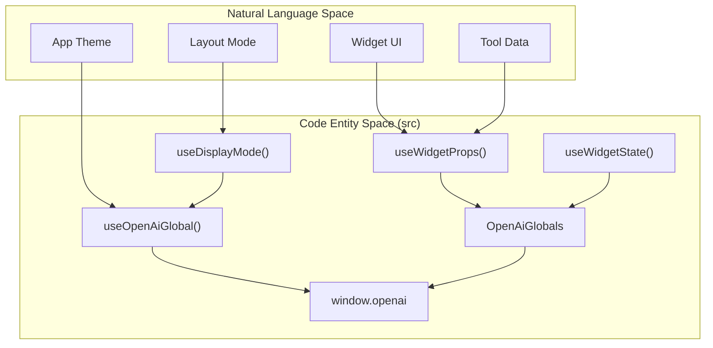
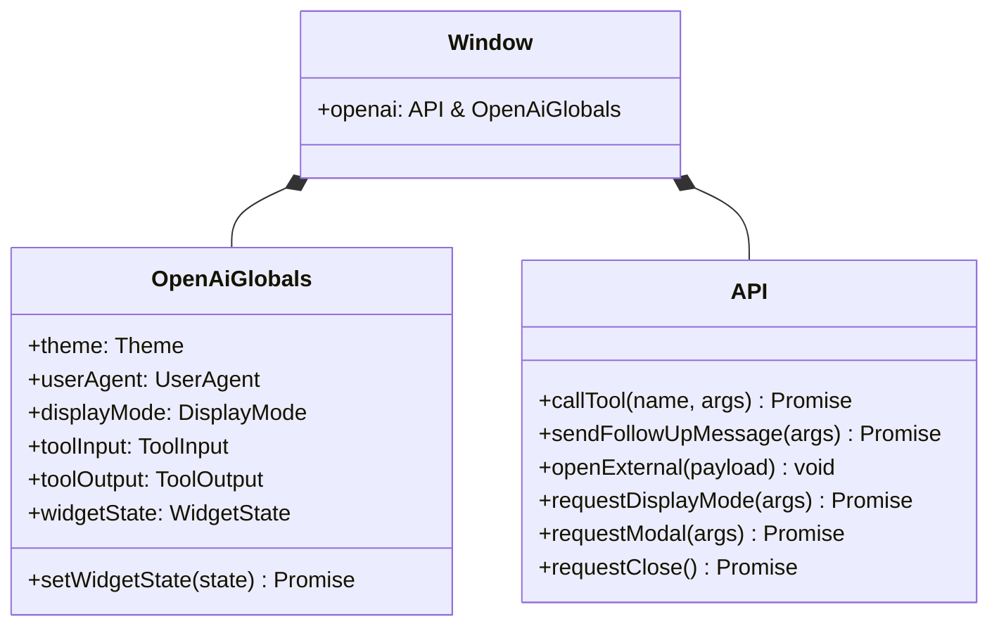

<!-- source: DeepWiki mcp.deepwiki.com · repo openai/openai-apps-sdk-examples · page 4.1 Widget Architecture · fetched 2026-10-26 -->

# Widget Architecture

Relevant source files

The following files were used as context for generating this wiki page:

- [src/index.css](src/index.css)
- [src/pizzaz-albums/AlbumCard.jsx](src/pizzaz-albums/AlbumCard.jsx)
- [src/types.ts](src/types.ts)
- [src/use-display-mode.ts](src/use-display-mode.ts)
- [src/use-max-height.ts](src/use-max-height.ts)
- [src/use-openai-global.ts](src/use-openai-global.ts)
- [src/use-widget-props.ts](src/use-widget-props.ts)
- [src/use-widget-state.ts](src/use-widget-state.ts)

## Overview

Widgets in the Apps SDK Examples repository are self-contained React applications that render rich UI components within ChatGPT conversations. Each widget is compiled into a standalone HTML bundle containing embedded JavaScript and CSS, then served to the Apps SDK runtime for rendering inside an isolated sandbox environment.

This page explains the structural architecture of widgets, common React patterns used in their implementation, and how they integrate with the Apps SDK runtime through the `window.openai` communication bridge.

**Sources:** [src/types.ts:1-103](), [src/use-openai-global.ts:1-96]()

---

## Widget Bundle Structure

### Standalone HTML Bundles

Each widget is packaged as a single HTML file with inline JavaScript and CSS. The build system (documented in page 4.4) compiles source code from `src/` into these bundles.

**Bundle Contents:**
- HTML container with a root element (e.g., `
`)
- Embedded JavaScript (React runtime, widget code, dependencies)
- Embedded CSS (Tailwind utilities, custom styles from `src/index.css`)
- No external dependencies at runtime

**Sources:** [src/index.css:1-108]()

---

## React Component Architecture

### Component Hierarchy and Data Flow

The following diagram bridges the "Natural Language Space" (how users describe the UI) to the "Code Entity Space" (the actual React hooks and types used).

**Sources:** [src/types.ts:1-25](), [src/use-widget-props.ts:1-14](), [src/use-widget-state.ts:1-46](), [src/use-display-mode.ts:1-6]()

### Reusable UI Components

Widgets leverage a shared UI library `@openai/apps-sdk-ui`. Components like `AlbumCard` demonstrate the integration of these library components with widget-specific logic.

**Example Component: AlbumCard**
In `src/pizzaz-albums/AlbumCard.jsx`, the component uses:
- `Button`: For the main card container [src/pizzaz-albums/AlbumCard.jsx:8-15]().
- `Image`: For lazy-loaded album covers [src/pizzaz-albums/AlbumCard.jsx:18-23]().
- `Badge`: To display "Featured" status [src/pizzaz-albums/AlbumCard.jsx:24-32]().

**Sources:** [src/pizzaz-albums/AlbumCard.jsx:1-45]()

---

## Apps SDK Integration

### Communication Bridge: window.openai

The `window.openai` object is the primary interface between the widget and the ChatGPT host. It is defined by the `OpenAiGlobals` and `API` types.

**Sources:** [src/types.ts:1-103]()

### State Management Patterns

Widgets manage state through three specialized hooks that wrap the `window.openai` bridge.

| Hook | Purpose | Source |
|------|---------|--------|
| `useOpenAiGlobal` | Low-level reactive access to any `window.openai` property using `useSyncExternalStore`. | [src/use-openai-global.ts:31-96]() |
| `useWidgetProps` | Retrieves `toolOutput` (the data returned by the MCP tool) with optional fallback. | [src/use-widget-props.ts:3-14]() |
| `useWidgetState` | Manages persistent widget state. Calls `window.openai.setWidgetState` on updates. | [src/use-widget-state.ts:5-46]() |

#### Persistent State Flow
When `useWidgetState` is called, it initializes from `window.openai.widgetState` [src/use-widget-state.ts:14-24](). When the setter is invoked, it updates the local React state and concurrently calls the host API [src/use-widget-state.ts:30-43]().

**Sources:** [src/use-widget-state.ts:1-47](), [src/use-widget-props.ts:1-15]()

---

## Display Mode Architecture

Widgets are designed to be responsive across different `DisplayMode` values: `pip`, `inline`, and `fullscreen` [src/types.ts:71]().

### Layout Handling
1. **useDisplayMode**: Accesses the current mode [src/use-display-mode.ts:4-6]().
2. **useMaxHeight**: Accesses the available vertical space provided by the host [src/use-max-height.ts:3-5]().
3. **CSS Utilities**: `src/index.css` provides specific styles for PiP mode (e.g., `.cards-ai-pip` reducing font size) [src/index.css:59-61]().

### Display Mode Transitions
Widgets can request mode changes via `requestDisplayMode`. Note that the host may reject or coerce these requests (e.g., mobile always coerces `pip` to `fullscreen`) [src/types.ts:72-78]().

**Sources:** [src/types.ts:71-78](), [src/use-display-mode.ts:1-7](), [src/use-max-height.ts:1-6](), [src/index.css:59-61]()

---

## Event-Driven Updates

The bridge uses a custom event system to notify the widget of changes in the host environment.

1. **Event Type**: `openai:set_globals` [src/types.ts:91]().
2. **Event Class**: `SetGlobalsEvent` carries the updated globals in its `detail` property [src/types.ts:92-96]().
3. **Subscription**: `useOpenAiGlobal` attaches a listener to `window` and triggers a re-render via `onChange` when the relevant global key changes [src/use-openai-global.ts:43-60]().

**Sources:** [src/types.ts:91-96](), [src/use-openai-global.ts:34-96]()

---

