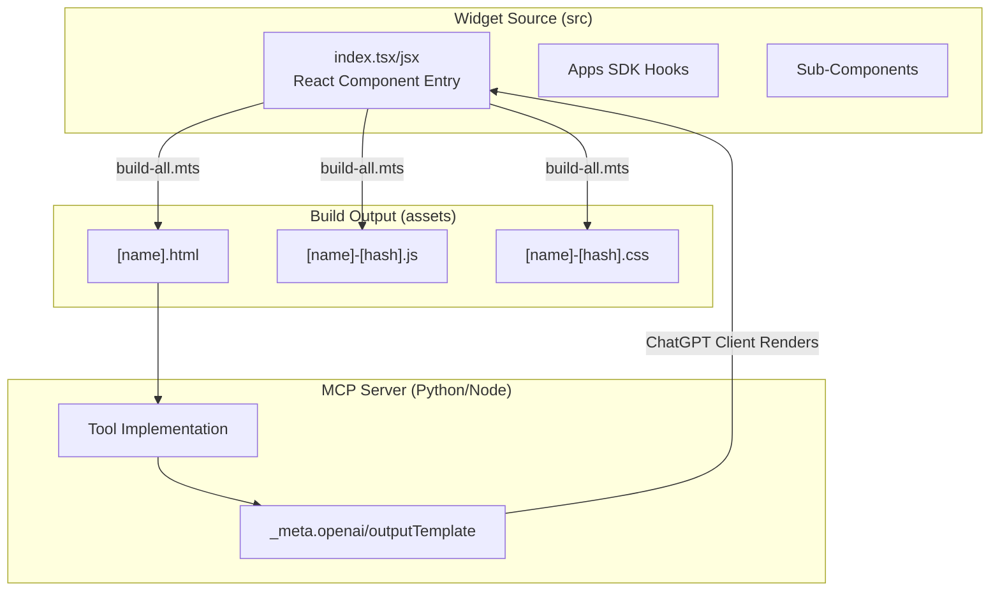
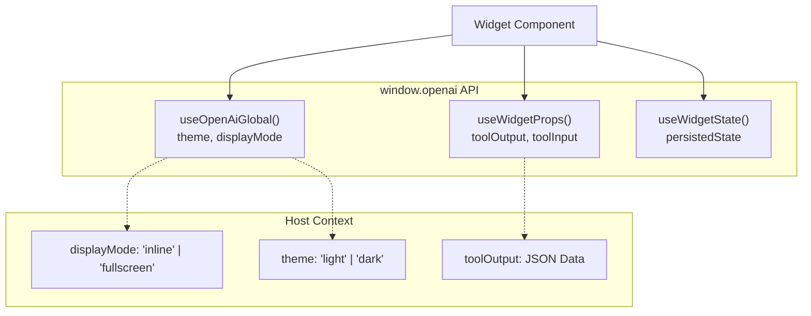

<!-- source: DeepWiki mcp.deepwiki.com · repo openai/openai-apps-sdk-examples · page 4.7 Example Widgets · fetched 2026-10-26 -->

# Example Widgets

Relevant source files

The following files were used as context for generating this wiki page:

- [README.md](README.md)
- [build-all.mts](build-all.mts)

The repository provides a comprehensive gallery of widget implementations organized by category and complexity. These widgets serve as reference implementations for specific UI patterns, state management approaches, and integration techniques with the Apps SDK.

Widgets are implemented as React components located in `src/`, compiled into standalone HTML/JS/CSS bundles via `build-all.mts`, and served from `assets/` by the static server on port 4444. Each widget is paired with corresponding MCP server tools that return the widget's HTML via `_meta.openai/outputTemplate`.

For detailed implementation guides, see:
- [Pizzaz Widgets](#4.7.1) — Detailed breakdown of pizzaz-map, pizzaz-carousel, pizzaz-list, pizzaz-albums, and pizzaz-shop variants.
- [Shopping Cart Widget](#4.7.2) — Walkthrough of shopping cart widget demonstrating `widgetSessionId` and state merging.
- [Solar System Widget](#4.7.3) — 3D visualization widget with planet name normalization and aliases.
- [Kitchen Sink Widget](#4.7.4) — Comprehensive demonstration of `window.openai` API surface via the `kitchen-sink-lite` widget.
- [MCP App Basics Widgets](#4.7.5) — Eleven educational widgets from `mcp_app_basics_node` covering core SDK capabilities.
- [Todo Widget](#4.7.6) — Simple todo list widget demonstrating basic widget patterns.

## Widget Categories

The widgets are organized by demonstration purpose and complexity:

| Category | Widgets | Primary Focus |
|----------|---------|---------------|
| **Visual Display** | `pizzaz-map`, `pizzaz-albums`, `solar-system`, `pizzaz-list` | Third-party library integration (Three.js, Mapbox), display modes, static content. |
| **Interactive Forms** | `pizzaz-shop`, `shopping-cart`, `todo` | Complex state management, user input, and session persistence. |
| **Data Visualization** | `pizzaz-carousel`, `pizzaz-list` | Navigation patterns and content browsing. |
| **API Demonstration** | `kitchen-sink-lite`, `mcp-app-basics-*` | Complete `window.openai` API surface and host capability discovery. |

**Sources:** [README.md:45-116](), [build-all.mts:20-44]()

## Widget Architecture Patterns

All widgets follow a standardized lifecycle from source code to rendering in the ChatGPT client.

### From Source to Bundle

**Diagram: Widget Build and Delivery Flow**

Each widget entry point defined in `build-all.mts` [build-all.mts:20-44]() is bundled into a self-contained environment. The build script generates a versioned hash based on the package version to ensure asset consistency [build-all.mts:172-176]().

### Host Environment Integration

**Diagram: Bridge between Code Entities and Host State**

Widgets interact with the ChatGPT host through specific hooks. For example, `pizzaz-map` uses `useOpenAiGlobal` to detect `displayMode` and adjust its height [src/pizzaz/index.jsx:55-57](). The `shopping-cart` uses `useWidgetState` to synchronize the cart items across different conversational turns [src/shopping-cart/index.tsx:32-35]().

**Sources:** [README.md:51-60](), [build-all.mts:54-84](), [src/pizzaz/index.jsx:55-57]()

## Widget Inventory Overview

### Pizzaz Variants
A collection of five widgets demonstrating different UI layouts for a fictional pizza service.
- **pizzaz-map**: Mapbox integration with marker management [src/pizzaz/index.jsx:25-36]().
- **pizzaz-carousel**: Embla carousel for horizontal browsing.
- **pizzaz-shop**: Complex e-commerce layout with quantity adjustments.
For details, see [Pizzaz Widgets](#4.7.1).

### Interactive & State-Heavy Widgets
- **Shopping Cart**: Demonstrates how `widgetSessionId` in the tool response allows the widget to maintain state between different model calls. For details, see [Shopping Cart Widget](#4.7.2).
- **Todo**: A basic CRUD application demonstrating local state management within the widget frame. For details, see [Todo Widget](#4.7.6).

### Specialized Visualizations
- **Solar System**: A 3D planetary viewer using `@react-three/fiber`. It highlights how to handle complex external libraries within the Apps SDK sandbox. For details, see [Solar System Widget](#4.7.3).

### Educational & API Reference
- **Kitchen Sink Lite**: A "reference" widget that implements every available `window.openai` method, including `callTool`, `requestDisplayMode`, and `sendFollowUpMessage` [README.md:53-58](). For details, see [Kitchen Sink Widget](#4.7.4).
- **MCP App Basics**: A suite of 11 micro-widgets from the `mcp_app_basics_node` server, each designed to teach a single SDK capability like `get-host-version` or `open-link`. For details, see [MCP App Basics Widgets](#4.7.5).

**Sources:** [README.md:45-60](), [build-all.mts:20-44]()

---

