# Page: Overview

# Overview

<details>
<summary>Relevant source files</summary>

The following files were used as context for generating this wiki page:

- [README.md](README.md)
- [build-all.mts](build-all.mts)

</details>


This document provides an architectural overview of the OpenAI Apps SDK Examples repository. It explains what the repository contains, how its components interact, and where to find detailed information about specific subsystems.

This repository is a **reference implementation gallery** that demonstrates how to build MCP (Model Context Protocol) servers and widget components for ChatGPT integration using the Apps SDK. It provides working examples of both server-side tool implementations and client-side UI components, along with the infrastructure needed to build, serve, and deploy them.

**Sources:** [README.md:1-7](), [README.md:18-31]()

## Purpose and Scope

This repository serves three primary purposes:

1.  **Demonstrate MCP + Apps SDK integration patterns**: Shows how MCP servers expose tools that return structured data alongside widget metadata.
2.  **Provide reusable widget examples**: Offers production-quality widget implementations covering common UI patterns (maps, carousels, shopping carts, authentication flows, and 3D visualizations).
3.  **Illustrate full-stack development workflow**: Includes build systems (`build-all.mts`), static asset serving, and cross-language server implementations (Python/Node.js).

The repository is structured as a **monorepo** containing multiple independent MCP servers and a shared widget component library built with React, TypeScript, and Vite.

**Sources:** [README.md:32-44](), [README.md:110-117]()

## Core Architecture

The system operates across three distinct layers that communicate through standardized protocols.

### Three-Layer Architecture Diagram

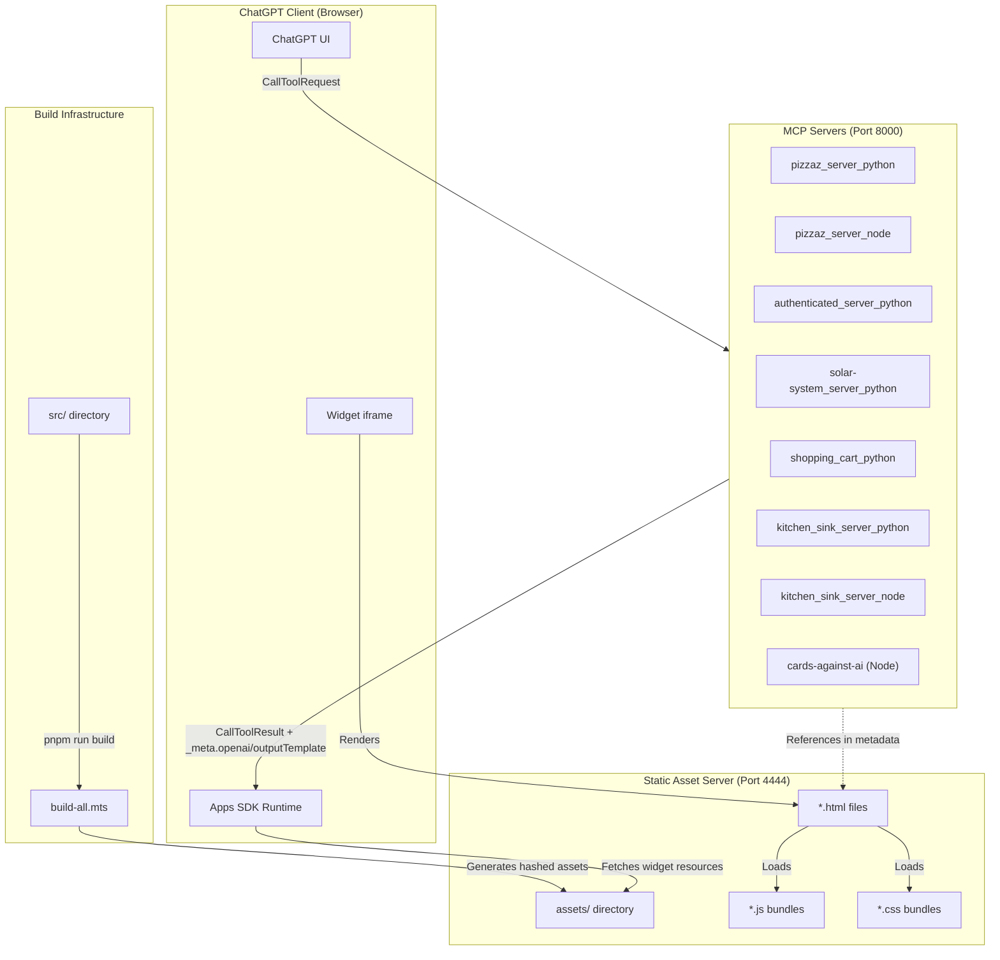

**Sources:** [README.md:18-30](), [README.md:110-117](), [build-all.mts:13-44]()

### Integration Flow

The three layers interact through these integration points:

| Layer | Technology | Port | Communication Protocol |
| :--- | :--- | :--- | :--- |
| **ChatGPT Client** | Browser + Apps SDK | N/A | MCP over SSE/HTTP |
| **MCP Servers** | Python (FastMCP) or Node.js | 8000 | MCP JSON-RPC |
| **Static Assets** | Vite-generated bundles | 4444 | HTTP with CORS |

**Key Integration Points:**

1.  **MCP Protocol**: ChatGPT issues `call_tool` requests to MCP servers with tool name and JSON arguments [README.md:24-25]().
2.  **Widget Metadata**: MCP servers return `_meta.ui.resourceUri` or `_meta.openai/outputTemplate` containing HTML references in tool responses [README.md:26-30]().
3.  **Asset Fetching**: Apps SDK fetches widget resources directly from the static server (port 4444) [README.md:103-104]().
4.  **Widget API**: Rendered widgets access the `window.openai` API for bidirectional communication with the host [README.md:53-58]().

**Sources:** [README.md:18-31](), [README.md:53-58](), [README.md:103-104]()

## Repository Structure

The repository is organized into source code, generated assets, and server implementations.

### Directory Structure Diagram

```mermaid
graph TB
    Root["Repository Root"]
    
    Root --> Src["src/"]
    Root --> Assets["assets/"]
    Root --> BuildTools["Build Tools"]
    Root --> PythonServers["Python MCP Servers"]
    Root --> NodeServers["Node.js MCP Servers"]
    
    Src --> PizzazWidgets["pizzaz-*/ widgets"]
    Src --> ShoppingCart["shopping-cart/"]
    Src --> SolarSystem["solar-system/"]
    Src --> CardsAgainstAI["cards-against-ai/"]
    Src --> KitchenSink["kitchen-sink-lite/"]
    Src --> Basics["mcp-app-basics-*/ widgets"]
    
    Assets --> HTML["*.html"]
    Assets --> JSBundles["*-{hash}.js"]
    Assets --> CSSBundles["*-{hash}.css"]
    
    BuildTools --> BuildAllMts["build-all.mts"]
    BuildTools --> PackageJson["package.json"]
    
    PythonServers --> PizzazPy["pizzaz_server_python/"]
    PythonServers --> AuthPy["authenticated_server_python/"]
    PythonServers --> SolarPy["solar-system_server_python/"]
    PythonServers --> CartPy["shopping_cart_python/"]
    
    NodeServers --> PizzazNode["pizzaz_server_node/"]
    NodeServers --> CardsNode["cards_against_ai_server/"]
    NodeServers --> BasicsNode["mcp_app_basics_node/"]
    
    PizzazPy --> MainPy["main.py"]
    PizzazNode --> ServerTs["src/server.ts"]
    BuildAllMts --> Targets["targets array [line 20-44]"]
```

**Sources:** [README.md:32-44](), [build-all.mts:20-44]()

### Directory Reference

| Directory | Purpose | Key Files |
| :--- | :--- | :--- |
| `src/` | Widget source code (React/TypeScript) | `*/index.tsx`, `*/index.jsx` |
| `assets/` | Generated HTML/JS/CSS bundles | `*.html`, `*-{hash}.js`, `*-{hash}.css` |
| `pizzaz_server_python/` | Python MCP server for Pizzaz widgets | `main.py`, `requirements.txt` |
| `pizzaz_server_node/` | Node.js MCP server for Pizzaz widgets | `src/server.ts`, `package.json` |
| `shopping_cart_python/` | Python server demonstrating `widgetSessionId` | `main.py` |
| `authenticated_server_python/` | Python server demonstrating OAuth | `main.py` |
| `solar-system_server_python/` | Python server for 3D solar system widget | `main.py` |
| `build-all.mts` | Vite build orchestrator | Root level |

**Sources:** [README.md:32-44](), [build-all.mts:13-14]()

## MCP Server Implementations

The repository provides several MCP server implementations demonstrating different patterns and capabilities.

### Server Inventory

*   **Pizzaz (Node & Python)**: Pizza-inspired collection of tools and components [README.md:112]().
*   **Solar system (Python)**: 3D solar system viewer using React [README.md:113]().
*   **Authenticated (Python)**: Demonstrates tools requiring different levels of OAuth [README.md:114]().
*   **Kitchen sink lite (Node & Python)**: Minimal widget + server pairing demonstrating full `window.openai` surface [README.md:115]().
*   **Shopping cart (Python)**: Demonstrates `widgetSessionId` to keep state between tool calls [README.md:116]().
*   **Cards Against AI (Node)**: Complex game server with SSE state streaming and model-mediated actions.

**Sources:** [README.md:110-117]()

## Widget Component Gallery

The repository includes 20+ widget entrypoints (targets) defined in the build system [build-all.mts:20-44]().

### Widget Categories

*   **Visual Display**: `pizzaz-map` (Mapbox), `pizzaz-albums`, `solar-system` (3D).
*   **Interactive Form**: `pizzaz-shop`, `shopping-cart`, `todo`.
*   **Data Visualization**: `pizzaz-carousel`, `pizzaz-list`.
*   **Educational (Basics)**: `show-tool-result`, `send-message`, `update-model-context`, `call-server-tool`, `host-theming`, `open-link`, `request-display-mode`, `streaming-tool-input`, `get-host-capabilities`, `get-host-context`, `get-host-version`.
*   **Complex Game**: `cards-against-ai`.

**Sources:** [build-all.mts:20-44](), [README.md:45-60]()

## Build and Deployment Pipeline

The repository uses a custom Vite-based build system to transform widget source code into standalone, versioned bundles.

### Build Pipeline Flow

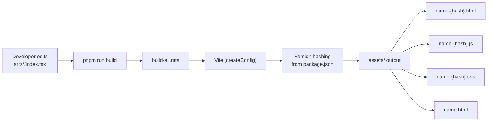

**Sources:** [README.md:80-88](), [build-all.mts:115-157](), [build-all.mts:172-190]()

### Build System Components

The build process involves these key mechanisms:

| Component | Role | Code Reference |
| :--- | :--- | :--- |
| **Entry Discovery** | Uses `fast-glob` to find all `index.{tsx,jsx}` files in `src/` | [build-all.mts:13]() |
| **Virtual Wrapper** | `wrapEntryPlugin` injects CSS imports and exports the App component | [build-all.mts:54-84]() |
| **Hashing** | Generates a 4-character SHA256 hash from `package.json` version | [build-all.mts:172-176]() |
| **HTML Generation** | Writes hashed `.html` files with `__APP_URL_CONFIG__` script | [build-all.mts:218-239]() |

**Sources:** [build-all.mts:13](), [build-all.mts:54-84](), [build-all.mts:172-176](), [build-all.mts:218-239]()

## How Components Interact

The following diagram shows the complete data flow from user query to rendered widget:

### End-to-End Interaction Flow

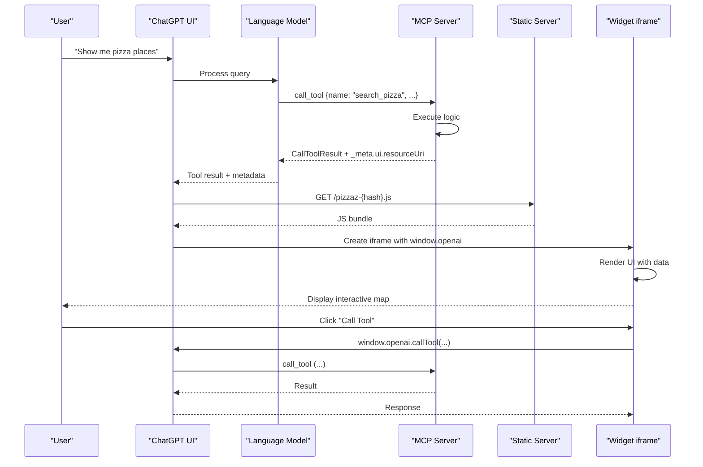

**Sources:** [README.md:18-30](), [README.md:53-58]()

## Next Steps

To start working with these examples:

1.  **Prerequisites**: Ensure you have Node.js 18+, pnpm, and Python 3.10+ installed [README.md:62-67]().
2.  **Installation**: Run `pnpm install` and `pre-commit install` [README.md:69-76]().
3.  **Build**: Run `pnpm run build` to generate the `assets/` directory [README.md:80-88]().
4.  **Serve**: Run `pnpm run serve` to start the local static asset server on port 4444 [README.md:96-104]().
5.  **Run Server**: Start an MCP server (e.g., `cd pizzaz_server_node && pnpm start`) [README.md:108-123]().

---

# Page: Getting Started

# Getting Started

<details>
<summary>Relevant source files</summary>

The following files were used as context for generating this wiki page:

- [.gitignore](.gitignore)
- [README.md](README.md)
- [package.json](package.json)
- [pnpm-lock.yaml](pnpm-lock.yaml)
- [pnpm-workspace.yaml](pnpm-workspace.yaml)
- [src/kitchen-sink-lite/kitchen-sink-lite.tsx](src/kitchen-sink-lite/kitchen-sink-lite.tsx)

</details>


This page guides you through the initial setup and execution of your first widget example. You will install dependencies, build widget assets, start an MCP server, and connect it to ChatGPT to see a live widget rendering.

For detailed architectural concepts and how the system components interact, see [Architecture and Concepts](#3). For in-depth widget development workflows, see [Widget Development](#4). For MCP server implementation patterns, see [MCP Server Development](#5).

---

## Setup and Execution Flow

The following diagram illustrates the complete workflow from repository clone to widget rendering in ChatGPT:

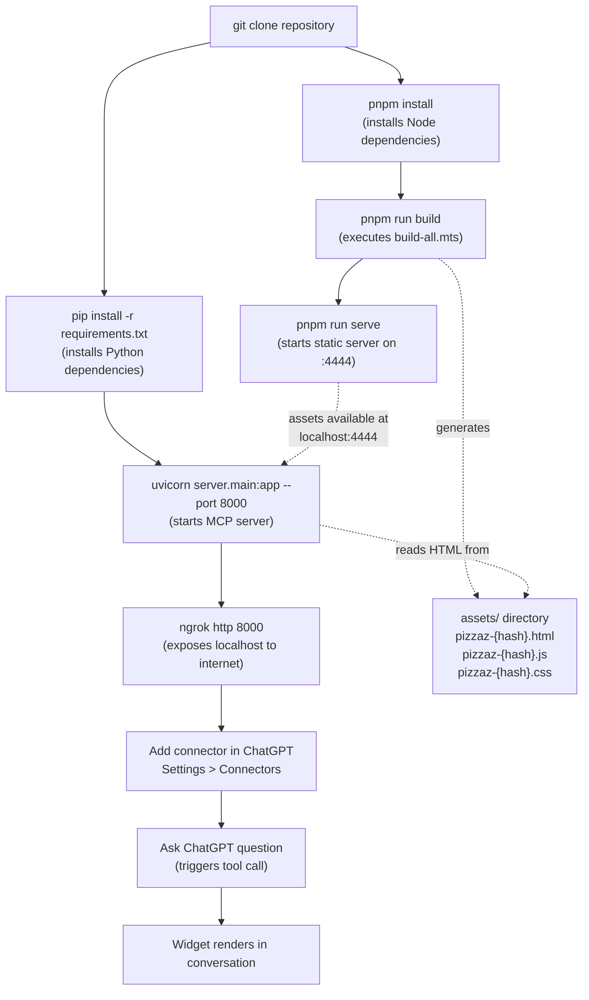

**Sources:** [README.md:62-210]()

---

## Prerequisites and Installation

### Required Software

The repository requires the following runtime environments:

| Dependency | Minimum Version | Purpose |
|------------|----------------|---------|
| Node.js | 18+ | Widget build system and Node.js MCP servers |
| pnpm | 10.24.0+ | Package manager for monorepo [package.json:18]() |
| Python | 3.10+ | Python MCP servers |
| pre-commit | Latest | Code formatting hooks |

**Sources:** [README.md:62-67](), [package.json:18]()

### Installation Steps

Clone the repository and install workspace dependencies:

```bash
git clone https://github.com/openai/openai-apps-sdk-examples
cd openai-apps-sdk-examples
pnpm install
pre-commit install
```

The `pnpm install` command installs all Node.js dependencies defined in the root `package.json` [package.json:34-64]() and workspace packages listed in `pnpm-workspace.yaml` [pnpm-workspace.yaml:1-5](). The `pre-commit install` command configures Git hooks for automatic code formatting.

For Python dependencies, each MCP server directory contains a separate `requirements.txt`. Install them after creating a virtual environment:

```bash
python -m venv .venv
source .venv/bin/activate  # On Windows: .venv\Scripts\activate
pip install -r pizzaz_server_python/requirements.txt
```

**Sources:** [README.md:69-78](), [pnpm-workspace.yaml:1-5](), [package.json:34-64]()

---

## Building and Serving Assets

### Build Process

The build system transforms React/TypeScript source files in `src/` into production-ready HTML, JavaScript, and CSS bundles in `assets/`:

```bash
pnpm run build
```

This command executes the `build-all.mts` orchestrator [package.json:7](), which performs the following operations for each widget:

1. **Entry Point Discovery**: Scans `src/**/index.{tsx,jsx}` for widget entry points.
2. **CSS Collection**: Gathers per-entry CSS files and global stylesheets.
3. **Vite Bundling**: Compiles each entry into a single JavaScript and CSS bundle.
4. **Version Hashing**: Appends a hash to filenames based on the `package.json` version [package.json:3]().
5. **HTML Generation**: Produces HTML files with script and stylesheet references.

The following diagram maps the build pipeline to code entities:

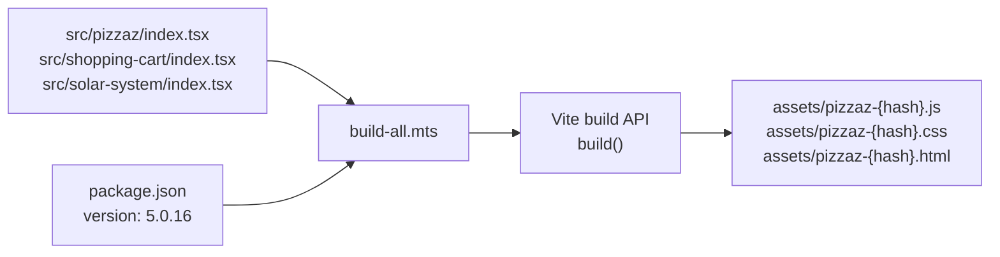

**Sources:** [README.md:80-94](), [package.json:3-7]()

### Serving Static Assets

After building, start the static asset server:

```bash
pnpm run serve
```

This command launches an HTTP server on port 4444 with CORS enabled [package.json:8](). MCP servers reference these assets via URLs like `http://localhost:4444/pizzaz-{hash}.html`.

**Important Caching Behavior:**

- **Python servers** cache HTML with `@lru_cache`. After rebuilding assets, restart the MCP server to pick up changes [README.md:106]().
- **Kitchen Sink Lite**: The `kitchen-sink-lite.tsx` component demonstrates reading host state and calling tools [src/kitchen-sink-lite/kitchen-sink-lite.tsx:4-9]().

**Sources:** [README.md:96-106](), [package.json:8](), [src/kitchen-sink-lite/kitchen-sink-lite.tsx:4-9]()

---

## Running MCP Servers

The repository includes several demo MCP servers demonstrating different widget patterns.

### Server Inventory

| Server | Language | Primary Widget(s) | Key Features |
|--------|----------|-------------------|--------------|
| `pizzaz_server_python` | Python | pizzaz-map, carousel, etc. | FastMCP framework |
| `pizzaz_server_node` | Node.js | Same as Python | Official TypeScript SDK |
| `shopping_cart_python` | Python | shopping-cart | `widgetSessionId` sync |
| `kitchen_sink_server_node` | Node.js | kitchen-sink-lite | Full API demonstration |
| `mcp_app_basics_node` | Node.js | Basic app tools | Educational tool coverage |

**Sources:** [README.md:108-117](), [pnpm-workspace.yaml:2-5]()

### Starting Servers

**Pizzaz Node Server:**
```bash
cd pizzaz_server_node
pnpm start
```

**Kitchen Sink Node Server:**
```bash
pnpm --filter kitchen-sink-mcp-node start
```

**Python Servers (Example: Pizzaz):**
```bash
uvicorn pizzaz_server_python.main:app --port 8000
```

**Sources:** [README.md:118-165]()

---

## ChatGPT Integration

### Local Development with ngrok

Use ngrok to create a public HTTPS tunnel to your local MCP server:

```bash
ngrok http 8000
```

### DNS Rebinding Protection

When using tunnels, configure allowed hosts via environment variables [README.md:201-207]():

```bash
export MCP_ALLOWED_HOSTS="your-ngrok-url.ngrok-free.app"
export MCP_ALLOWED_ORIGINS="https://your-ngrok-url.ngrok-free.app"
```

**Sources:** [README.md:189-207]()

---

## Verification Checklist

| Component | Verification Method | Expected Result |
|-----------|---------------------|----------------|
| Static assets built | `ls assets/` | Contains `*-{hash}.html` files |
| Asset server running | `curl http://localhost:4444/` | Accessible assets |
| Chrome 142 Flag | `chrome://flags/` | `#local-network-access-check` Disabled [README.md:12-14]() |

**Sources:** [README.md:8-16]()

---

## Next Steps

- **Prerequisites and Installation (#2.1)** — Detailed dependency setup.
- **Building and Serving Assets (#2.2)** — Deep dive into `build-all.mts`.
- **Running MCP Servers (#2.3)** — Advanced server configuration.
- **ChatGPT Integration (#2.4)** — Step-by-step connector configuration.

---

# Page: Prerequisites and Installation

# Prerequisites and Installation

<details>
<summary>Relevant source files</summary>

The following files were used as context for generating this wiki page:

- [.gitignore](.gitignore)
- [README.md](README.md)
- [package.json](package.json)
- [pizzaz_server_python/requirements.txt](pizzaz_server_python/requirements.txt)
- [pnpm-lock.yaml](pnpm-lock.yaml)
- [pnpm-workspace.yaml](pnpm-workspace.yaml)
- [solar-system_server_python/requirements.txt](solar-system_server_python/requirements.txt)
- [src/kitchen-sink-lite/kitchen-sink-lite.tsx](src/kitchen-sink-lite/kitchen-sink-lite.tsx)
- [src/pizzaz-albums/albums.json](src/pizzaz-albums/albums.json)
- [tsconfig.app.json](tsconfig.app.json)
- [tsconfig.node.json](tsconfig.node.json)

</details>


This page covers the required tools, dependencies, and installation steps necessary to run the Apps SDK Examples Gallery locally. This includes setting up Node.js and Python environments, installing package dependencies, configuring development tools, and addressing browser-specific requirements.

For information on building widget assets after installation, see [Building and Serving Assets](2.2). For configuring ChatGPT integration with ngrok, see [ChatGPT Integration](2.4).

---

## Overview

The repository requires a polyglot development environment supporting both TypeScript/Node.js (for widget builds and Node.js MCP servers) and Python 3.10+ (for Python MCP servers). The build system uses `pnpm` for monorepo workspace management, `vite` for widget compilation, and `uvicorn` for Python server execution.

**Sources:** [README.md:62-68](), [README.md:108-116]()

---

## System Requirements

### Required Software

| Tool | Minimum Version | Purpose |
|------|----------------|---------|
| **Node.js** | 18.0.0+ | JavaScript runtime for build tools and Node.js MCP servers |
| **pnpm** | 10.24.0 | Package manager with workspace support |
| **Python** | 3.10+ | Runtime for Python MCP servers using FastMCP |
| **pre-commit** | Any | Git hook framework for code formatting |

**Optional:**
- **npm** or **yarn** - Alternative to pnpm (requires adjusting commands) [README.md:78-79]()
- **ngrok** - For exposing local MCP servers to ChatGPT

**Sources:** [README.md:62-68](), [package.json:18]()

---

## Dependency Installation Flow

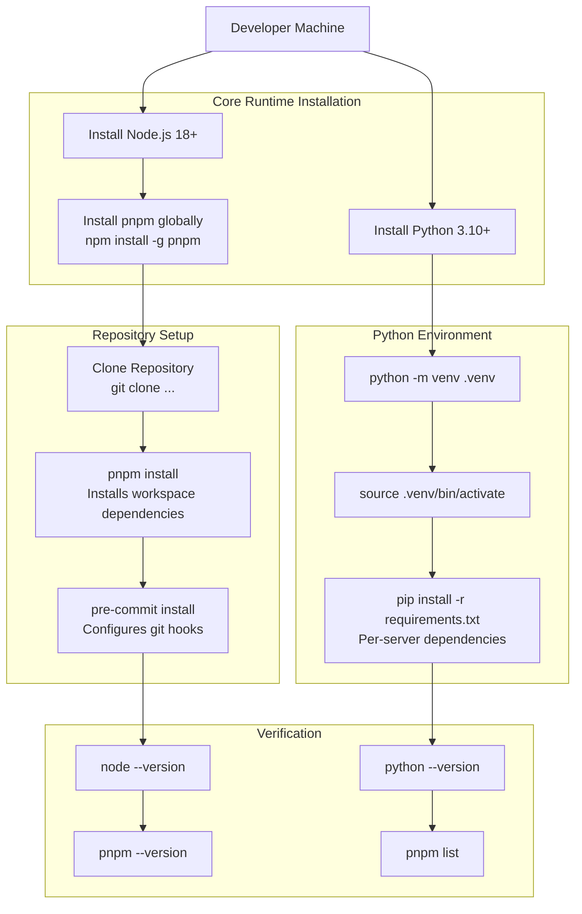

**Sources:** [README.md:62-76](), [README.md:127-132](), [README.md:145-150]()

---

## Node.js and pnpm Installation

### Install Node.js

Download and install Node.js 18 or later from [nodejs.org](https://nodejs.org). Verify installation:

```bash
node --version  # Should output v18.x.x or higher
npm --version   # Comes bundled with Node.js
```

### Install pnpm

The repository specifies `pnpm@10.24.0` as the package manager:

```bash
npm install -g pnpm@10.24.0
```

Verify installation:

```bash
pnpm --version  # Should output 10.24.0
```

The `packageManager` field in [package.json:18]() enforces this version for consistency across development environments.

**Sources:** [package.json:18](), [README.md:64-65]()

---

## Repository Setup

### Clone and Install Dependencies

```bash
# Clone the repository
git clone https://github.com/openai/openai-apps-sdk-examples
cd openai-apps-sdk-examples

# Install all workspace dependencies
pnpm install
```

The `pnpm install` command installs dependencies for the root and all workspace packages defined in `pnpm-workspace.yaml`.

### Workspace Structure

The monorepo contains multiple Node.js packages integrated via `pnpm` workspaces.

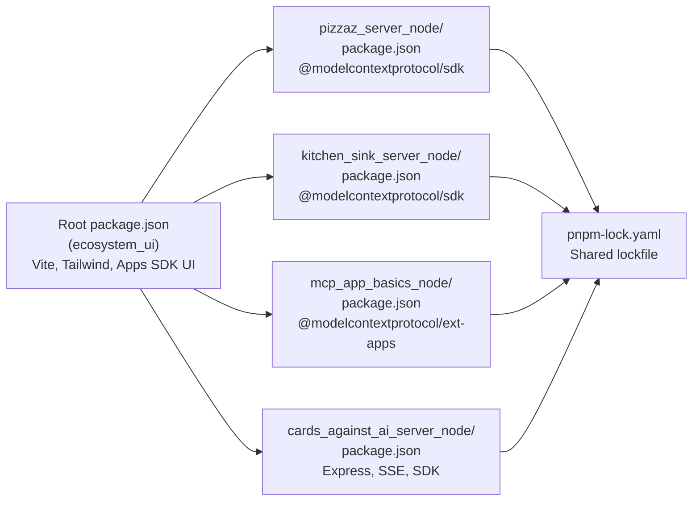

**Sources:** [pnpm-workspace.yaml:1-5](), [package.json:1-3](), [pnpm-lock.yaml:1-220]()

---

## Python Environment Setup

### Create Virtual Environment

Each Python MCP server requires its own dependencies. Create a virtual environment at the repository root to manage these:

```bash
python -m venv .venv
source .venv/bin/activate  # On Windows: .venv\Scripts\activate
```

### Install Python Server Dependencies

The repository includes several Python MCP servers, each with a `requirements.txt` file. For example, to set up the Pizzaz Python server:

```bash
pip install -r pizzaz_server_python/requirements.txt
```

Each `requirements.txt` typically includes:
- `mcp[fastapi]` - FastMCP framework with FastAPI integration [pizzaz_server_python/requirements.txt:2]()
- `uvicorn` - ASGI server for running MCP servers [pizzaz_server_python/requirements.txt:3]()
- `fastapi` - Web framework [pizzaz_server_python/requirements.txt:1]()

**Sources:** [README.md:127-132](), [pizzaz_server_python/requirements.txt:1-4](), [solar-system_server_python/requirements.txt:1-5]()

---

## Development Tools Configuration

### Install pre-commit Hooks

The repository uses `pre-commit` for automated code formatting:

```bash
pre-commit install
```

This installs Git hooks that ensure code quality standards are met before commits are finalized.

**Sources:** [README.md:67-68](), [README.md:75]()

---

## Browser Configuration

### Chrome 142+ Local Network Access Fix

**Critical:** If using Chrome version 142 or later, the browser blocks local network access by default, which prevents widget UI from loading from local servers.

#### Disable the Restriction

1. Navigate to `chrome://flags/`
2. Search for `#local-network-access-check`
3. Set to **Disabled**
4. **Restart Chrome** (required for change to take effect)

**Sources:** [README.md:8-16]()

---

## Installed Dependency Versions

### Root Package Dependencies

The root [package.json]() specifies production and development dependencies used across the project:

| Package | Version | Purpose |
|---------|---------|---------|
| `react` | ^19.1.1 | UI framework for widgets [package.json:55]() |
| `@openai/apps-sdk-ui` | ^0.2.1 | UI components for Apps SDK [package.json:36]() |
| `@modelcontextprotocol/ext-apps` | ^1.0.1 | Apps SDK extensions for MCP [package.json:35]() |
| `tailwindcss` | 4.1.11 | CSS framework [package.json:29]() |
| `vite` | ^7.1.1 | Build tool [package.json:32]() |
| `three` | ^0.179.1 | 3D graphics for Solar System [package.json:62]() |
| `zod` | ^4.1.5 | Schema validation [package.json:63]() |

### Node.js Server Specifics

The Node.js servers utilize the official MCP SDK:
- `pizzaz_server_node` uses `@modelcontextprotocol/sdk` [pnpm-lock.yaml:222]()
- `mcp_app_basics_node` uses `@modelcontextprotocol/ext-apps` [pnpm-lock.yaml:191]()

**Sources:** [package.json:19-64](), [pnpm-lock.yaml:139-224]()

---

## Verification Steps

### Verify Node.js Environment

```bash
# Check Node.js version
node --version

# Check pnpm version
pnpm --version

# Verify dependencies installed
pnpm list --depth=0
```

### Verify TypeScript Compilation

The repository includes scripts to verify types across different targets:

```bash
pnpm run tsc       # Build all projects [package.json:10]()
pnpm run tsc:app   # Check widget code [package.json:11]()
pnpm run tsc:node  # Check build scripts/node code [package.json:12]()
```

The `tsc:app` command uses [tsconfig.app.json]() which targets `ES2022` and includes the `src` directory [tsconfig.app.json:4-26](). The `tsc:node` command uses [tsconfig.node.json]() which targets `ES2023` and includes build orchestration files like `build-all.mts` [tsconfig.node.json:4-24]().

**Sources:** [package.json:10-12](), [tsconfig.app.json:1-27](), [tsconfig.node.json:1-25]()

---

## Installation Directory Structure

After installation, the repository structure appears as follows:

```
openai-apps-sdk-examples/
├── node_modules/              # Root Node.js dependencies
├── .venv/                     # Python virtual environment
├── src/                       # Widget source code [README.md:34]()
├── assets/                    # Built bundles (generated after build) [README.md:35]()
├── pizzaz_server_node/        # Node server [README.md:37]()
├── pizzaz_server_python/      # Python server [README.md:38]()
├── package.json               # Root config [package.json:1]()
├── pnpm-workspace.yaml        # Workspace definition [pnpm-workspace.yaml:1]()
└── build-all.mts              # Build orchestrator [README.md:43]()
```

**Sources:** [README.md:32-43](), [pnpm-workspace.yaml:1-5]()

---

## Next Steps

After completing installation:

1. **Build widgets**: Run `pnpm run build` to generate assets in the `assets/` directory [README.md:85]().
2. **Serve assets**: Run `pnpm run serve` to start the local asset server on port 4444 [README.md:101]().
3. **Run a server**: Navigate to a server directory (e.g., `pizzaz_server_node`) and start it [README.md:120-123]().

**Sources:** [README.md:80-104]()

---

# Page: Building and Serving Assets

# Building and Serving Assets

<details>
<summary>Relevant source files</summary>

The following files were used as context for generating this wiki page:

- [build-all.mts](build-all.mts)
- [vite.config.mts](vite.config.mts)
- [vite.host.config.mts](vite.host.config.mts)

</details>


This document explains the build process for widget components and the static asset server that makes them available to MCP servers and ChatGPT. It covers the `pnpm run build` command, the output structure in the `assets/` directory, and the `pnpm run serve` command that hosts these files.

For information about developing widgets with hot reload, see [Development Workflow](#4.5). For details about how MCP servers load and reference these assets, see [Python Server Architecture Patterns](#5.1.6) and [MCP App Basics Node Server](#5.2.3).

---

## Overview

The build and serve workflow consists of two independent processes:

1.  **Build Process**: Transforms React/TypeScript source code in `src/` into production-ready HTML, JavaScript, and CSS bundles in `assets/`.
2.  **Static Server**: Hosts these bundles on `http://localhost:4444` with CORS enabled so MCP servers can reference them in widget metadata.

These processes are decoupled—MCP servers do not bundle or serve widget assets directly. Instead, they return URLs pointing to the static server in their `_meta.openai/outputTemplate` responses, and the Apps SDK fetches assets independently.

**Process Flow Overview**
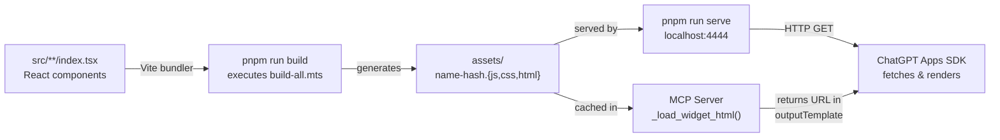

**Sources:** [build-all.mts:1-14](), [build-all.mts:218-239]()

---

## Build Process

### The build-all.mts Script

The build process is orchestrated by `build-all.mts`, a TypeScript module that uses Vite to compile each widget into a standalone bundle. The script performs these operations:

1.  Discovers entry points in `src/`.
2.  Creates virtual modules to inject CSS imports.
3.  Bundles each widget with Vite.
4.  Generates version-based hashes.
5.  Renames output files with hashes.
6.  Creates HTML files with correct asset references and `window.__APP_URL_CONFIG__` injection.

**Sources:** [build-all.mts:1-239]()

### Entry Point Discovery

The script scans for widget entry points using the `fast-glob` library and filters them based on a hardcoded list or CLI arguments.

**Discovery Logic**
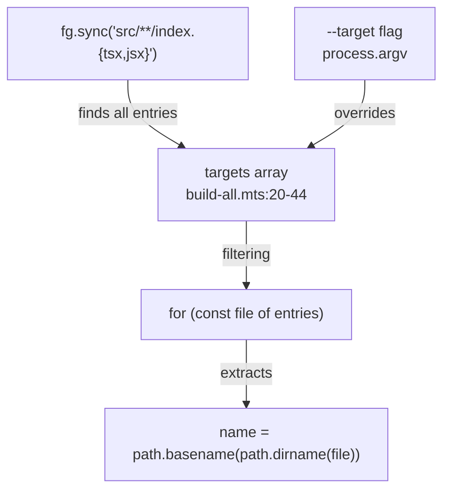

The `targets` array at [build-all.mts:20-44]() specifies which widgets to build by default. Users can target a specific widget using `pnpm run build --target <name>` [build-all.mts:45-50]().

**Sources:** [build-all.mts:13-50]()

### Virtual Entry Plugin Pattern

The `wrapEntryPlugin` function creates virtual modules that inject CSS imports before the actual component code. This ensures CSS is included in the correct cascade order.

**Virtual Module Construction**
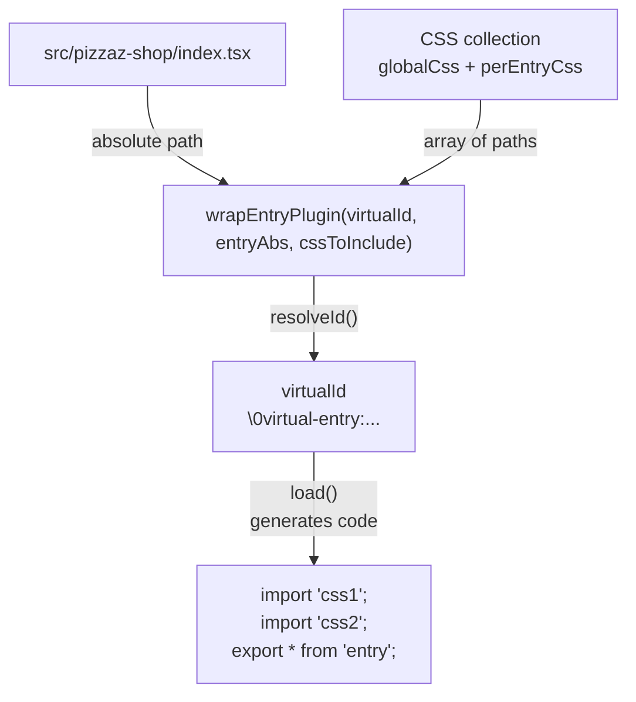

The plugin implements two hooks:
-   **`resolveId(id)`** at [build-all.mts:61-63](): Returns the virtual ID when Vite encounters it.
-   **`load(id)`** at [build-all.mts:64-82](): Generates module code with CSS imports followed by re-exports from the actual entry file.

**Sources:** [build-all.mts:54-84]()

### CSS Collection Strategy

For each entry point, the build script collects CSS files using two sources:
1.  **Global CSS**: `src/index.css` (Tailwind, etc.) [build-all.mts:18]().
2.  **Per-Entry CSS**: Any CSS files within the widget's directory, excluding `.module.css` [build-all.mts:16-17]().

This pattern at [build-all.mts:97-112]() ensures Tailwind and global styles load first, followed by component-specific styles for predictable cascade behavior.

**Sources:** [build-all.mts:16-18](), [build-all.mts:97-112]()

### Vite Configuration

Each widget is built with a custom `InlineConfig` [build-all.mts:115-157]():

| Configuration | Value | Purpose |
| :--- | :--- | :--- |
| `esbuild.target` | `es2022` | Modern JavaScript syntax [build-all.mts:133]() |
| `build.minify` | `esbuild` | Fast minification [build-all.mts:140]() |
| `build.cssCodeSplit` | `false` | Single CSS bundle per widget [build-all.mts:141]() |
| `rollupOptions.inlineDynamicImports` | `true` | No code splitting; standalone bundles [build-all.mts:147]() |
| `rollupOptions.output.format` | `es` | ES modules format [build-all.mts:145]() |
| `rollupOptions.output.entryFileNames` | `${name}.js` | Predictable output names [build-all.mts:146]() |

**Sources:** [build-all.mts:115-157]()

### Hash-Based Versioning

After building, the script generates a version hash from `package.json` and renames output files.

**Hashing Implementation**
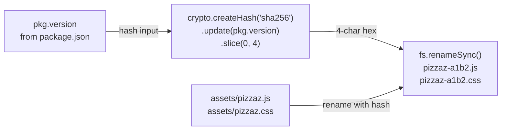

The hashing logic at [build-all.mts:172-188]():
-   Uses the `version` field from `package.json` as input.
-   Generates a SHA-256 hash truncated to 4 hex characters.
-   Renames both `.js` and `.css` files with the hash suffix.

**Sources:** [build-all.mts:8](), [build-all.mts:172-188]()

### HTML Generation and URL Config

The script generates two HTML files for each widget (e.g., `pizzaz-a1b2.html` and `pizzaz.html`) [build-all.mts:220-221](). These files inject a configuration object into the global scope:

```javascript
window.__APP_URL_CONFIG__ = {
  apiBaseUrl: "...",
  assetsBaseUrl: "..."
};
```

The values for `apiBaseUrl` and `assetsBaseUrl` are derived from environment variables `VITE_API_BASE_URL` and `VITE_BASE_URL`, with defaults of `http://localhost:8000` and `http://localhost:4444` respectively [build-all.mts:192-216]().

**Sources:** [build-all.mts:192-239]()

---

## Output Structure

After running `pnpm run build`, the `assets/` directory contains standalone bundles:

| File Type | Naming Pattern | Purpose |
| :--- | :--- | :--- |
| JavaScript | `{name}-{hash}.js` | Minified widget application code. |
| CSS | `{name}-{hash}.css` | Bundled styles (Global + Local). |
| HTML (versioned) | `{name}-{hash}.html` | Entrypoint with hashed script/link tags. |
| HTML (stable) | `{name}.html` | Identical to versioned HTML for stable dev URLs. |

**Sources:** [build-all.mts:14-15](), [build-all.mts:183-185](), [build-all.mts:220-221]()

---

## Serving Assets

### The Static Server

The `pnpm run serve` command (typically mapped to a simple static server like `http-server` or `sirv-cli` in `package.json`) hosts the `assets/` directory.

**Server-Client Interaction**
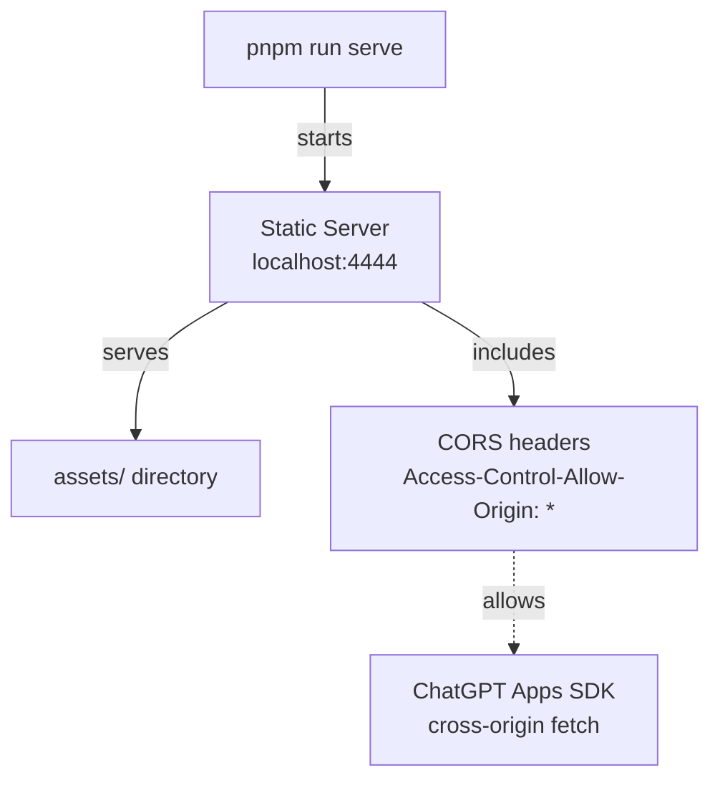

### Vite Dev Server (Development Mode)

During development, `vite.config.mts` provides a specialized `multiEntryDevEndpoints` plugin [vite.config.mts:24](). This plugin:
-   **Virtualizes Entries**: Maps requests for `/{name}.js` or `/{name}.css` to virtual modules that include HMR (Hot Module Replacement) logic [vite.config.mts:126-198]().
-   **Dynamic HTML**: Renders a dev-friendly HTML shell on the fly for any requested widget [vite.config.mts:71-79]().
-   **Index Page**: Generates a directory listing of all available widgets at the root `/` [vite.config.mts:41-69]().

**Sources:** [vite.config.mts:24-199](), [vite.config.mts:210-214]()

---

## Production Deployment

### BASE_URL Configuration

For production, the `BASE_URL` (or `VITE_BASE_URL`) must be set before building to ensure the generated HTML points to the correct remote location.

```bash
VITE_BASE_URL=https://cdn.example.com pnpm run build
```

The build script will then use this URL in the `<script src="...">` and `<link href="...">` tags [build-all.mts:228-229]().

**Sources:** [build-all.mts:193-200](), [build-all.mts:228-229]()

### API_BASE_URL Configuration

Similarly, `VITE_API_BASE_URL` configures where the widget will attempt to communicate with the MCP server for tool calls or state updates [build-all.mts:202-212]().

**Sources:** [build-all.mts:202-216](), [build-all.mts:226]()

---

# Page: Running MCP Servers

# Running MCP Servers

<details>
<summary>Relevant source files</summary>

The following files were used as context for generating this wiki page:

- [LICENSE](LICENSE)
- [README.md](README.md)
- [kitchen_sink_server_node/README.md](kitchen_sink_server_node/README.md)
- [kitchen_sink_server_node/package-lock.json](kitchen_sink_server_node/package-lock.json)
- [kitchen_sink_server_node/package.json](kitchen_sink_server_node/package.json)
- [kitchen_sink_server_node/tsconfig.json](kitchen_sink_server_node/tsconfig.json)
- [kitchen_sink_server_python/README.md](kitchen_sink_server_python/README.md)
- [kitchen_sink_server_python/requirements.txt](kitchen_sink_server_python/requirements.txt)
- [pizzaz_server_node/README.md](pizzaz_server_node/README.md)
- [pizzaz_server_node/package.json](pizzaz_server_node/package.json)
- [pizzaz_server_node/tsconfig.json](pizzaz_server_node/tsconfig.json)
- [pizzaz_server_python/README.md](pizzaz_server_python/README.md)

</details>


This page provides instructions for starting the MCP servers included in this repository. After installing dependencies (see **2.1 Prerequisites and Installation**) and building widget assets (see **2.2 Building and Serving Assets**), you can launch any of the example servers to expose tools via the Model Context Protocol. For connecting these servers to ChatGPT, see **2.4 ChatGPT Integration**.

## Available MCP Servers

The repository includes several MCP server implementations demonstrating different architectural patterns:

| Server Name | Language | Primary Feature | Entry Point |
|-------------|----------|-----------------|-------------|
| Pizzaz Python | Python | Five widget variants (map, carousel, list, albums, shop) | `pizzaz_server_python/main.py` |
| Pizzaz Node | Node.js | Node.js equivalent of Pizzaz Python | `pizzaz_server_node/src/server.ts` |
| Shopping Cart Python | Python | `widgetSessionId` state persistence | `shopping_cart_python/main.py` |
| Solar System Python | Python | 3D visualization widget | `solar-system_server_python/main.py` |
| Authenticated Python | Python | OAuth integration with Auth0 | `authenticated_server_python/main.py` |
| Kitchen Sink Python | Python | Full `window.openai` API demo | `kitchen_sink_server_python/main.py` |
| Kitchen Sink Node | Node.js | Node.js kitchen sink implementation | `kitchen_sink_server_node/src/server.ts` |

All servers listen on port 8000 by default and expose MCP endpoints that ChatGPT can connect to via Connectors.

**Sources:** [README.md:110-176]()

## Python Server Execution

### Virtual Environment Setup

Python servers require dependency installation in a virtual environment. The same virtual environment can be reused across all Python servers:

```bash
# Create virtual environment (one-time)
python -m venv .venv

# Activate virtual environment
source .venv/bin/activate  # On Unix/macOS
# or
.venv\Scripts\activate     # On Windows
```

**Sources:** [README.md:128-129](), [pizzaz_server_python/README.md:13-14](), [kitchen_sink_server_python/README.md:18-19]()

### Installing Server Dependencies

Each Python server directory contains a `requirements.txt` file. Install dependencies for the server you intend to run:

```bash
# Example: Pizzaz Python server
pip install -r pizzaz_server_python/requirements.txt

# Example: Kitchen Sink Python server
pip install -r kitchen_sink_server_python/requirements.txt
```

Note that the official SDK package is `mcp`, which should be installed with the `[fastapi]` extra to provide the `mcp.server.fastmcp` module.

**Sources:** [README.md:130](), [pizzaz_server_python/README.md:15-23](), [kitchen_sink_server_python/requirements.txt:1-4]()

### Starting Python Servers with uvicorn

All Python servers use `uvicorn` as the ASGI server. The command pattern is:

```bash
uvicorn <module_path>:app --port 8000
```

#### Server Commands

*   **Pizzaz Python Server**: `uvicorn pizzaz_server_python.main:app --port 8000` [README.md:131]()
*   **Authenticated Python Server**: `uvicorn authenticated_python_server.main:app --port 8000` [README.md:140-141]()
*   **Solar System Python Server**: `uvicorn solar-system_server_python.main:app --port 8000` [README.md:149]()
*   **Kitchen Sink Python Server**: `uvicorn kitchen_sink_server_python.main:app --port 8000` [README.md:164]()
*   **Shopping Cart Python Server**: `uvicorn shopping_cart_python.main:app --port 8000` [README.md:175]()

**Sources:** [README.md:131-175](), [kitchen_sink_server_python/README.md:21]()

### Python Server Architecture

The following diagram maps the startup sequence to code entities within the Python implementations.

```mermaid
graph TB
    subgraph "Python Server Startup Flow"
        CLI["uvicorn CLI<br/>pizzaz_server_python.main:app"]
        MainModule["pizzaz_server_python/main.py"]
        FastMCPInit["FastMCP()<br/>name='pizzaz-python'<br/>stateless_http=True"]
        TransportSec["_transport_security_settings()<br/>MCP_ALLOWED_HOSTS<br/>MCP_ALLOWED_ORIGINS"]
        AppCreation["mcp.streamable_http_app()"]
        CORSMiddleware["CORSMiddleware<br/>allow_origins=['*']"]
        RequestHandlers["Request Handlers"]
        ListTools["_list_tools()"]
        CallTool["_call_tool_request()"]
        ReadResource["_handle_read_resource()"]
        WidgetLoader["_load_widget_html()<br/>@lru_cache"]
        AssetsDir["assets/ directory<br/>*.html files"]
    end
    
    CLI -->|"imports module"| MainModule
    MainModule -->|"instantiates"| FastMCPInit
    MainModule -->|"calls"| TransportSec
    TransportSec -->|"configures"| FastMCPInit
    FastMCPInit -->|"generates"| AppCreation
    AppCreation -->|"wraps"| CORSMiddleware
    CORSMiddleware -->|"exposes"| RequestHandlers
    RequestHandlers -->|"registers"| ListTools
    RequestHandlers -->|"registers"| CallTool
    RequestHandlers -->|"registers"| ReadResource
    CallTool -->|"uses"| WidgetLoader
    ReadResource -->|"uses"| WidgetLoader
    WidgetLoader -->|"reads from"| AssetsDir
```

**Architecture Details:**

1.  **FastMCP Initialization**: The server uses `FastMCP` with `stateless_http=True` to support SSE-compatible streaming HTTP [kitchen_sink_server_python/README.md:24]().
2.  **Widget HTML Caching**: Python servers use `functools.lru_cache` for `_load_widget_html`. If assets are rebuilt, the server must be restarted to clear this cache [README.md:106]().
3.  **FastAPI Integration**: The server exposes an SSE stream at `GET /mcp` and accepts follow-up messages at `POST /mcp/messages` [pizzaz_server_python/README.md:31-34]().

**Sources:** [README.md:106](), [pizzaz_server_python/README.md:31-36](), [kitchen_sink_server_python/README.md:24]()

## Node.js Server Execution

### Starting Node.js Servers with pnpm

Node.js servers are implemented using the official TypeScript SDK and can be started using `pnpm` scripts.

#### Pizzaz Node Server
```bash
cd pizzaz_server_node
pnpm start
```
This runs `tsx src/server.ts` [pizzaz_server_node/package.json:8-9]().

#### Kitchen Sink Node Server
```bash
pnpm --filter kitchen-sink-mcp-node start
```
This targets the specific workspace package [kitchen_sink_server_node/package.json:8]().

**Sources:** [pizzaz_server_node/package.json:8](), [kitchen_sink_server_node/package.json:8](), [README.md:121-123](), [README.md:154-156]()

### Node.js Server Architecture

The following diagram maps the Node.js implementation logic from the entry point to the protocol transport.

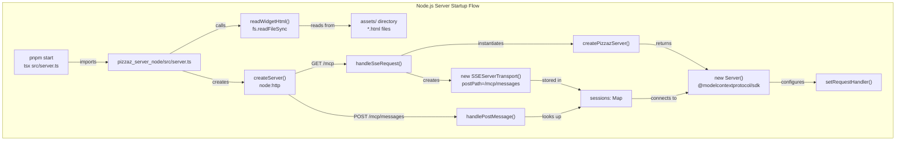

**Architecture Details:**

1.  **Transport Protocol**: The server uses `SSEServerTransport` for compatibility with ChatGPT connectors [pizzaz_server_node/README.md:24]().
2.  **SDK Usage**: Uses `@modelcontextprotocol/sdk` version `^0.5.0` [kitchen_sink_server_node/package.json:11]().
3.  **Response Metadata**: Tools respond with `_meta.openai/outputTemplate` metadata to bind results to widget shells [pizzaz_server_node/README.md:30]().
4.  **Asset Loading**: The server loads bundled assets (e.g., `assets/kitchen-sink-lite*.html`) created by the root build step [kitchen_sink_server_node/README.md:15]().

**Sources:** [pizzaz_server_node/README.md:24-30](), [kitchen_sink_server_node/package.json:11](), [kitchen_sink_server_node/README.md:15]()

## Port Configuration and Endpoints

All servers in this repository use consistent port and path conventions by default:

| Component | Port | Primary Endpoint |
|-----------|------|------------------|
| Python MCP Servers | 8000 | `http://localhost:8000/mcp` |
| Node.js MCP Servers | 8000 | `http://localhost:8000/mcp` (SSE stream) |
| Node.js Message POST | 8000 | `http://localhost:8000/mcp/messages?sessionId=...` |
| Static Asset Server | 4444 | `http://localhost:4444` |

You can override the port for Node.js servers using the `PORT` environment variable:
`PORT=9000 pnpm start` [kitchen_sink_server_node/README.md:26]().

**Sources:** [README.md:104](), [pizzaz_server_python/README.md:31](), [kitchen_sink_server_node/README.md:26]()

## Troubleshooting

### Widget HTML Not Found
If the server fails to find HTML files, ensure you have run `pnpm run build` from the root directory. Node.js servers look for versioned assets in the `assets/` folder [kitchen_sink_server_node/README.md:13-15]().

### Local Network Access (Chrome)
If using Chrome 142+, you must disable the `#local-network-access-check` flag at `chrome://flags/` and restart the browser to allow the widget UI to communicate with local servers [README.md:8-16]().

### Stale Python Assets
The Python Pizzaz server uses `lru_cache`. If you rebuild assets, you **must restart** the MCP server process for it to pick up the new markup [README.md:106]().

**Sources:** [README.md:8-16](), [README.md:106](), [kitchen_sink_server_node/README.md:13-15]()

---

# Page: ChatGPT Integration

# ChatGPT Integration

<details>
<summary>Relevant source files</summary>

The following files were used as context for generating this wiki page:

- [README.md](README.md)
- [ngrok-v3-stable-linux-amd64.tgz](ngrok-v3-stable-linux-amd64.tgz)

</details>


## Purpose and Scope

This page explains how to connect locally running MCP servers to ChatGPT for testing and development. It covers exposing local servers via ngrok tunnels, configuring ChatGPT Connectors, troubleshooting browser compatibility issues, and using widgets in conversations.

For information about setting up the local development environment and running MCP servers, see [2.1 Prerequisites and Installation]() and [2.3 Running MCP Servers](). For details on MCP protocol implementation, see [3.2 Model Context Protocol (MCP)]().

---

## Integration Architecture

The local-to-cloud integration relies on three core components running simultaneously: the static asset server (port `4444`), the MCP server (port `8000`), and an ngrok tunnel exposing the MCP server to ChatGPT's cloud infrastructure.

### Network Topology

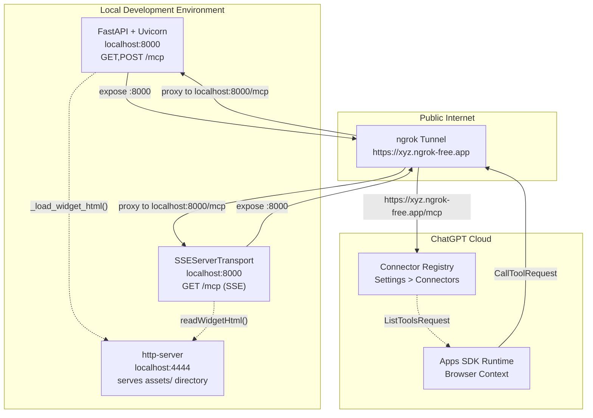

**Sources:** [README.md:18-30](), [README.md:186-209](), [pizzaz_server_python/main.py:1-50](), [pizzaz_server_node/src/server.ts:1-40]()

### Port and Endpoint Mapping

| Service | Local Port | Public Endpoint | Purpose | Code Entry Point |
|---------|-----------|-----------------|---------|------------------|
| Static Asset Server | `4444` | Not exposed | Serves `assets/*.html`, `*.js`, `*.css` | `package.json` script `serve` [README.md:101-104]() |
| MCP Server (Python) | `8000` | `https://*.ngrok-free.app/mcp` | FastAPI + Uvicorn HTTP/SSE | `pizzaz_server_python.main:app` [README.md:131-131]() |
| MCP Server (Node) | `8000` | `https://*.ngrok-free.app/mcp` | TypeScript `SSEServerTransport` | `pizzaz_server_node/src/server.ts` [README.md:121-123]() |
| Vite Dev Server | `5173` | Not exposed | Hot reload (optional) | `pnpm run dev` [README.md:93-94]() |

The static asset server must run on port `4444` as MCP servers reference this URL when invoking `_load_widget_html()` (Python) or `readWidgetHtml()` (Node.js) to load widget HTML files from the local `assets/` directory [README.md:96-104]().

**Sources:** [README.md:96-106](), [pizzaz_server_python/main.py:126-141](), [pizzaz_server_node/src/server.ts:41-60]()

---

## Prerequisites

Before integrating with ChatGPT, ensure the following are configured:

1. **ChatGPT Developer Mode** – Enabled via the OpenAI developer portal.
2. **ngrok Account** – Free tier sufficient for testing [ngrok.com](https://ngrok.com).
3. **Chrome 142+ Flag** – Disable `local-network-access-check` if using Chrome version 142 or later [README.md:8-15]().
4. **Running Services** – Both static asset server and MCP server must be active.

### Chrome Flag Configuration

Chrome version 142 introduced local network access restrictions that block widget rendering. The `local-network-access` flag must be disabled:

**Steps:**
1. Navigate to `chrome://flags/`
2. Search for `#local-network-access-check`
3. Set to **Disabled**
4. Restart browser [README.md:12-16]().

**Sources:** [README.md:8-16]()

---

## Setup Procedure

### Step 1: Start Local Services

Ensure both required services are running in separate terminal sessions:

**Terminal 1 – Static Asset Server:**
```bash
pnpm run serve
```
[README.md:101-101]()

**Terminal 2 – MCP Server (Python example):**
```bash
uvicorn pizzaz_server_python.main:app --port 8000
```
[README.md:131-131]()

Alternatively, use the Node.js MCP server:
```bash
cd pizzaz_server_node
pnpm start
```
[README.md:121-123]()

**Sources:** [README.md:74-118]()

### Step 2: Expose MCP Server with ngrok

With the MCP server running on port `8000`, create a public tunnel:

```bash
ngrok http 8000
```

ngrok will output a forwarding URL in the format:
`Forwarding https://<random-id>.ngrok-free.app -> http://localhost:8000`

The MCP endpoint becomes: `https://<random-id>.ngrok-free.app/mcp` [README.md:195-199]().

### Step 2.1: Configure DNS Rebinding Protection

Python MCP servers enforce DNS rebinding protection by default. When using ngrok, you must allowlist the tunnel hostname before starting the server:

```bash
export MCP_ALLOWED_HOSTS="<random-id>.ngrok-free.app"
export MCP_ALLOWED_ORIGINS="https://<random-id>.ngrok-free.app"
```
[README.md:201-207]()

Replace `<random-id>` with the actual subdomain from your ngrok forwarding URL.

**Sources:** [README.md:201-207](), [shopping_cart_python/main.py:1-20]()

### Step 3: Register Connector in ChatGPT

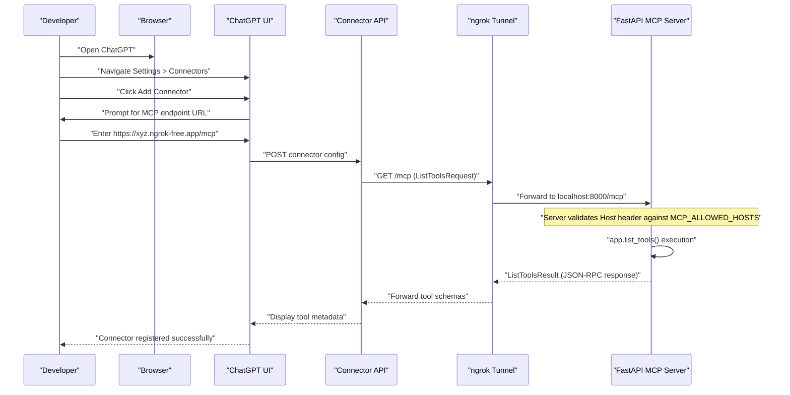

**Navigation Path:**
1. Open ChatGPT interface.
2. Click profile icon → **Settings**.
3. Navigate to **Connectors** section.
4. Click **"Add Connector"**.
5. Paste ngrok URL: `https://<random-id>.ngrok-free.app/mcp` [README.md:195-199]().

**Sources:** [README.md:186-209]()

---

## Connector Lifecycle and Usage

### Connector Activation

Connectors must be explicitly selected via the conversation context menu [README.md:209-215]().

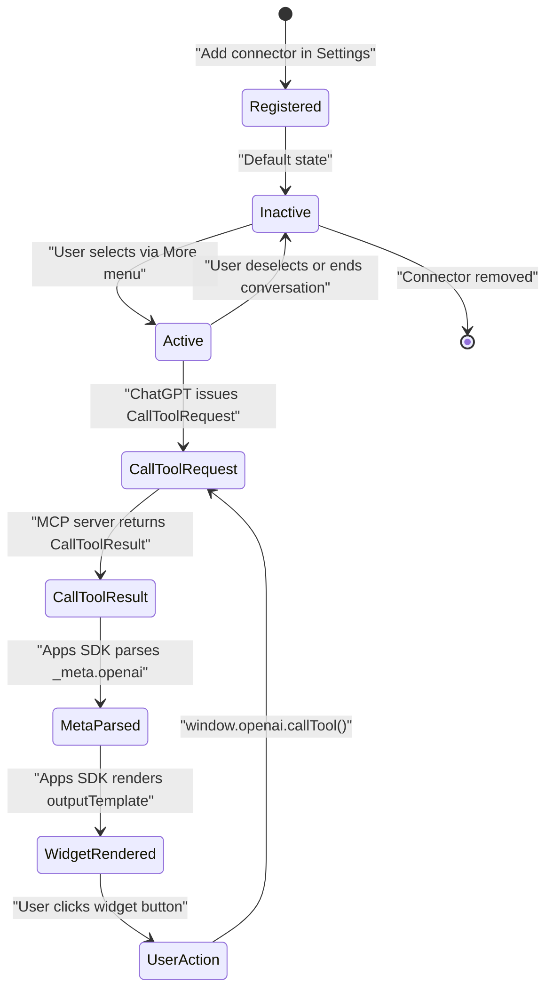

**Sources:** [README.md:209-215]()

### Example Tool Invocation

For the Pizzaz connector, trigger tools with natural language queries like "What are the best pizzas in town?".

**ChatGPT Behavior:**
1. Recognizes intent matches tool schema (e.g., `search_pizza`).
2. Issues `CallToolRequest` to `https://*.ngrok-free.app/mcp`.
3. MCP server executes handler and invokes `_load_widget_html("pizzaz-map")` [pizzaz_server_python/main.py:126-141]().
4. Server returns `CallToolResult` with `_meta.openai/outputTemplate`.
5. Apps SDK renders widget inline.

**Sources:** [README.md:18-30](), [README.md:209-215](), [pizzaz_server_python/main.py:126-141]()

---

## Request Flow Diagram

This diagram maps the complete request lifecycle including specific code entities:

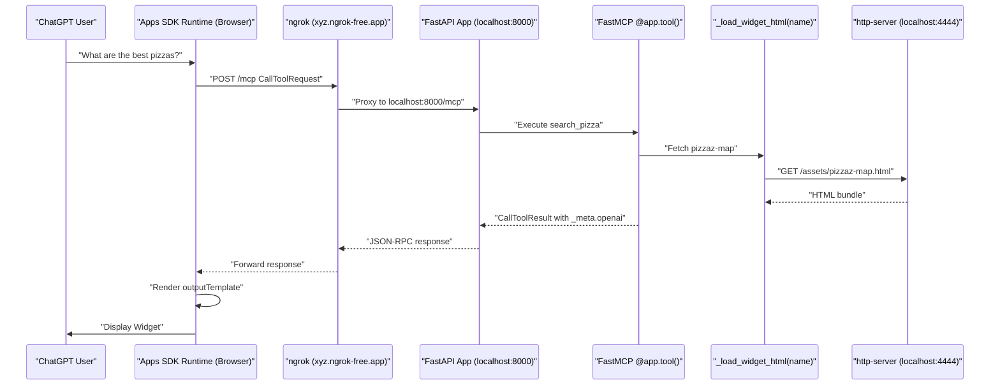

**Sources:** [README.md:18-30](), [README.md:186-215](), [pizzaz_server_python/main.py:126-141](), [pizzaz_server_node/src/server.ts:41-60]()

---

## Troubleshooting

### Connection Issues

| Problem | Symptom | Solution |
|---------|---------|----------|
| ngrok tunnel down | "Cannot connect to server" | Restart `ngrok http 8000`, update connector URL [README.md:195-199]() |
| MCP server not running | "Server unavailable" | Verify `uvicorn` or `pnpm start` is active [README.md:108-117]() |
| Static server not running | Blank UI / Asset 404 | Start `pnpm run serve` on port `4444` [README.md:101-104]() |
| DNS rebinding protection | 403 Forbidden | Set `MCP_ALLOWED_HOSTS` with ngrok hostname [README.md:201-207]() |

**Sources:** [README.md:186-207](), [README.md:96-106]()

### Widget Rendering Issues

| Problem | Symptom | Solution |
|---------|---------|----------|
| Chrome 142+ restrictions | Blank widget, CORS errors | Disable `#local-network-access-check` flag [README.md:8-16]() |
| Cached HTML not updating | Old content after rebuild | Restart Python MCP server (uses `@lru_cache`) [README.md:106-106]() |

**Sources:** [README.md:8-16](), [README.md:106-106](), [pizzaz_server_python/main.py:126-128]()

---

## Production Deployment Considerations

1. **Replace ngrok:** Deploy MCP server to cloud infrastructure.
2. **Update BASE_URL:** Set `BASE_URL` environment variable to CDN or static hosting URL [README.md:222-232]().
3. **CORS configuration:** Ensure proper CORS headers for cross-origin widget loading.
4. **OAuth configuration:** Update `AUTHORIZATION_SERVER_URL` for authenticated servers [authenticated_server_python/README.md:42-48]().

**Sources:** [README.md:222-232](), [authenticated_server_python/README.md:42-51]()

---

# Page: Architecture and Concepts

# Architecture and Concepts

<details>
<summary>Relevant source files</summary>

The following files were used as context for generating this wiki page:

- [README.md](README.md)
- [src/types.ts](src/types.ts)
- [src/use-widget-props.ts](src/use-widget-props.ts)

</details>


This document explains the core architectural patterns and concepts used throughout the OpenAI Apps SDK Examples repository. It provides a conceptual overview of how MCP servers, widget components, and the ChatGPT client interact to deliver rich, interactive user experiences.

For hands-on setup and installation instructions, see [Getting Started](#2). For detailed implementation guides on building widgets and MCP servers, see [Widget Development](#4) and [MCP Server Development](#5).

## Purpose and Scope

This page covers:

- The three-tier architecture separating MCP servers, static assets, and the ChatGPT client.
- The Model Context Protocol (MCP) and its role as the integration layer.
- How widget rendering flows from tool calls to UI display.
- State management patterns using `widgetSessionId` and `widgetState`.
- Authentication flows using OAuth and `WWW-Authenticate` challenges.

Each concept is introduced at a high level here, with references to more detailed documentation in sub-sections [System Architecture Overview](#3.1) through [Authentication and OAuth](#3.5).

## Three-Tier Architecture

The system operates across three distinct tiers, each running in separate processes with clear separation of concerns:

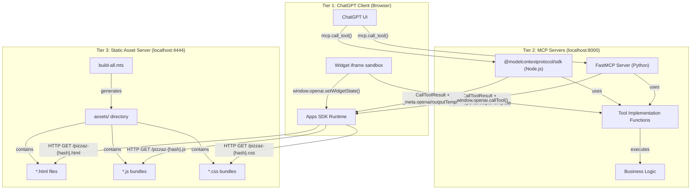

**Sources:** [README.md:18-43](), [README.md:96-106]()

### Tier 1: ChatGPT Client

The ChatGPT web interface hosts the Apps SDK runtime, which manages tool selection, widget rendering in sandboxed iframes, and state persistence. The SDK injects a `window.openai` global object into the widget sandbox, providing APIs defined in `src/types.ts`.

- **Visuals & Layout**: `theme`, `displayMode`, and `safeArea` [src/types.ts:7-16]().
- **State**: `toolInput`, `toolOutput`, and `widgetState` [src/types.ts:18-22]().
- **APIs**: `callTool`, `setWidgetState`, and `sendFollowUpMessage` [src/types.ts:23-38]().

For details, see [System Architecture Overview](#3.1).

### Tier 2: MCP Servers

MCP servers expose tools via the Model Context Protocol specification. This repository includes implementations in both Python and Node.js. Each server implements three core MCP capabilities: listing tools, calling tools, and returning structured content with widget metadata.

**Python Servers (FastMCP):**
- `pizzaz_server_python`: Five pizza-themed widget variants.
- `shopping_cart_python`: Shopping cart with session management.
- `solar-system_server_python`: 3D solar system visualization.
- `authenticated_server_python`: OAuth-protected tools.

**Node.js Servers (MCP SDK):**
- `pizzaz_server_node`: Node.js equivalent of pizzaz server.
- `kitchen_sink_server_node`: Full API demonstration in Node.js.

For details, see [Model Context Protocol (MCP)](#3.2).

### Tier 3: Static Asset Server

The static asset server runs independently on port 4444, serving pre-built widget bundles generated by `build-all.mts` [README.md:96-106](). The build system produces versioned bundles with content hashes, enabling aggressive browser caching [README.md:81-89]().

For details, see [Widget Rendering Flow](#3.3).

## Model Context Protocol (MCP)

MCP serves as the integration layer between ChatGPT and external tools. The protocol defines a standardized wire format for three core capabilities:

### Core Capability Flow

```mermaid
graph LR
    Client["MCP Client (ChatGPT)"]
    Server["MCP Server"]
    
    Client -->|"1. mcp.list_tools()"| Server
    Server -->|"ListToolsResult (JSON Schema)"| Client
    
    Client -->|"2. mcp.call_tool(name, args)"| Server
    Server -->|"CallToolResult (content + _meta)"| Client
    
    Client -->|"3. Parse _meta.openai/outputTemplate"| RenderWidget["Apps SDK Renderer"]
```

#### 1. List Tools (`mcp.list_tools()`)
Servers advertise their capabilities using JSON Schema. This includes the tool name, description, and `inputSchema` [README.md:24-24]().

#### 2. Call Tools (`mcp.call_tool()`)
When the model selects a tool, it issues a request with arguments matching the user intent. The server executes the action and returns structured content [README.md:25-25]().

#### 3. Return Widgets (`_meta.openai/outputTemplate`)
Alongside structured content, servers return embedded resources in response metadata. The Apps SDK uses the `_meta.openai/outputTemplate` field to render the interface inline [README.md:26-26]().

For details, see [Model Context Protocol (MCP)](#3.2).

## Widget Rendering Flow

The flow from user message to rendered widget involves multiple steps across all three tiers. The MCP server returns HTML in the `_meta` field, which contains references to the static asset server. The Apps SDK then fetches these resources independently.

```mermaid
sequenceDiagram
    participant User
    participant ChatUI as "ChatGPT UI"
    participant AppsSDK as "Apps SDK"
    participant MCP as "MCP Server (port 8000)"
    participant Assets as "Static Server (port 4444)"
    participant Widget as "Widget iframe"
    
    User->>ChatUI: "Show me pizza places"
    ChatUI->>ChatUI: Model selects tool
    ChatUI->>MCP: mcp.call_tool(...)
    MCP->>MCP: Execute logic
    MCP->>MCP: Load widget HTML
    MCP-->>ChatUI: CallToolResult + _meta
    ChatUI->>AppsSDK: Parse outputTemplate
    AppsSDK->>Assets: GET widget.html
    AppsSDK->>Widget: Create iframe
    Widget->>Assets: GET widget.js / widget.css
    Widget->>Widget: useWidgetProps() reads toolOutput
    Widget-->>User: Display UI
```

For details, see [Widget Rendering Flow](#3.3).

## State Management Architecture

Widgets maintain state across conversational turns using a three-source synchronization pattern involving `toolOutput`, `widgetState`, and `widgetSessionId`.

- **`toolOutput`**: Read-only data from the last tool call, accessed via `useWidgetProps` [src/use-widget-props.ts:3-14]().
- **`widgetState`**: Persistent state managed by the host, updated via `setWidgetState` [src/types.ts:22-23]().
- **`widgetSessionId`**: A server-provided ID in `_meta` that allows the host to key and persist `widgetState` across turns [README.md:36-36]().

```mermaid
graph TB
    subgraph Sources["State Sources"]
        ToolOutput["toolOutput (from last tool call)"]
        WidgetState["widgetState (persisted by host)"]
    end
    
    subgraph Widget["Widget Component (React)"]
        UseProps["useWidgetProps()"]
        UseState["useWidgetState()"]
        LocalState["Local React State"]
    end
    
    subgraph Server["MCP Server"]
        SessionId["_meta.widgetSessionId"]
        ServerState["Server-side storage"]
    end
    
    ToolOutput --> UseProps
    WidgetState --> UseState
    UseProps --> LocalState
    UseState --> LocalState
    SessionId --> WidgetState
    ServerState --> ToolOutput
```

For details, see [State Management and widgetSessionId](#3.4).

## Authentication Flows

The system supports the MCP authorization specification, allowing tools to require OAuth 2.0 authentication.

- **`WWW-Authenticate`**: Servers can return this challenge to trigger the ChatGPT authentication UI.
- **OAuth Flow**: ChatGPT handles the OAuth flow with the authorization server and retries the tool call with a Bearer token.
- **Security Schemes**: Tools can be configured with "Required" or "Mixed" security patterns [README.md:42-42]().

For details, see [Authentication and OAuth](#3.5).

**Sources:** [README.md:18-43](), [src/types.ts:1-109](), [src/use-widget-props.ts:1-14]()

---

# Page: System Architecture Overview

# System Architecture Overview

<details>
<summary>Relevant source files</summary>

The following files were used as context for generating this wiki page:

- [README.md](README.md)
- [build-all.mts](build-all.mts)

</details>


## Purpose and Scope

This document describes the overall system architecture of the Apps SDK Examples Gallery repository, explaining how the three primary tiers—Development, Server, and Runtime—interact to deliver widget-backed MCP tools to ChatGPT. It covers the build pipeline that compiles React widgets into static assets, the MCP server implementations that expose these widgets as tools, and the runtime integration with ChatGPT's Apps SDK.

For detailed information about the Model Context Protocol itself, see [Model Context Protocol (MCP)](#3.2). For the end-to-end widget rendering flow, see [Widget Rendering Flow](#3.3). For implementation details of specific servers and widgets, see [Widget Development](#4) and [MCP Server Development](#5).

---

## Three-Tier Architecture

The repository implements a layered architecture that separates concerns across three distinct tiers:

| Tier | Primary Components | Key Responsibility | Output Artifacts |
|------|-------------------|-------------------|------------------|
| **Development** | `src/`, `build-all.mts`, Vite | Compile React widgets into standalone bundles | `assets/*.html`, `assets/*.js`, `assets/*.css` |
| **Server** | Python/Node.js MCP servers | Expose widget-backed tools via MCP protocol | Tool schemas, widget metadata, tool execution results |
| **Runtime** | ChatGPT, Apps SDK | Render widgets and orchestrate tool invocations | Live UI components in chat interface |

The Development tier produces static assets that the Server tier references, and the Runtime tier fetches and renders. This separation enables developers to build widgets once and serve them from multiple server implementations written in different languages.

**Sources:** [README.md:32-42](), [README.md:18-30]()

---

## Development Tier: Build System

### Build Orchestration

The `build-all.mts` script orchestrates the Vite build process to compile React widgets into self-contained HTML bundles:

**Build Pipeline Diagram**

```mermaid
graph TB
    subgraph "Source Code"
        SRC_PIZZAZ["src/pizzaz/index.tsx"]
        SRC_SOLAR["src/solar-system/index.tsx"]
        SRC_KITCHEN["src/kitchen-sink-lite/index.tsx"]
        SRC_CSS["src/index.css<br/>(Global Tailwind)"]
    end
    
    subgraph "build-all.mts Orchestrator"
        GLOB["fg.sync('src/**/index.{tsx,jsx}')"]
        TARGETS["targets array:<br/>pizzaz, solar-system,<br/>kitchen-sink-lite, etc."]
        WRAPPER["wrapEntryPlugin()<br/>Injects CSS imports"]
        VITE["Vite build()<br/>React + Tailwind plugins"]
        HASH["crypto.createHash('sha256')<br/>pkg.version → 4-char hash"]
    end
    
    subgraph "Output Assets"
        JS["assets/pizzaz-a1b2.js<br/>assets/solar-system-a1b2.js"]
        CSS_OUT["assets/pizzaz-a1b2.css<br/>assets/solar-system-a1b2.css"]
        HTML["assets/pizzaz-a1b2.html<br/>assets/pizzaz.html (live)"]
    end
    
    SRC_PIZZAZ --> GLOB
    SRC_SOLAR --> GLOB
    SRC_KITCHEN --> GLOB
    SRC_CSS --> WRAPPER
    
    GLOB --> TARGETS
    TARGETS --> WRAPPER
    WRAPPER --> VITE
    VITE --> HASH
    
    HASH --> JS
    HASH --> CSS_OUT
    HASH --> HTML
    
    HTML -.->|"Served by<br/>pnpm run serve<br/>port 4444"| STATIC["Static File Server<br/>http://localhost:4444"]
```

**Key Build Process Steps:**

1. **Entry Discovery** ([build-all.mts:13-13]()): Uses `fast-glob` to find all `src/**/index.{tsx,jsx}` files.
2. **CSS Collection** ([build-all.mts:97-111]()): Gathers global CSS (`src/index.css`) and per-entry CSS files.
3. **Virtual Entry Wrapper** ([build-all.mts:54-84]()): Creates a virtual module that imports both the entry file and required CSS.
4. **Vite Compilation** ([build-all.mts:115-160]()): Runs Vite with React and Tailwind plugins, outputting ES modules.
5. **Hash Generation** ([build-all.mts:172-176]()): Creates 4-character SHA256 hash from `package.json` version.
6. **Asset Renaming** ([build-all.mts:179-188]()): Appends hash to all `.js` and `.css` files for cache-busting.
7. **HTML Generation** ([build-all.mts:218-239]()): Creates HTML files with script/link tags pointing to hashed assets.

**Widget Compilation Targets:**

The `targets` array in `build-all.mts` defines which widgets are compiled:

```typescript
// build-all.mts:20-44
const targets: string[] = [
  "todo",
  "solar-system",
  "cards-against-ai",
  "pizzaz",
  "pizzaz-carousel",
  "pizzaz-list",
  "pizzaz-albums",
  "pizzaz-shop",
  "mixed-auth-search",
  "mixed-auth-past-orders",
  "kitchen-sink-lite",
  "shopping-cart",
  "show-tool-result",
  "send-message",
  "update-model-context",
  "call-server-tool",
  "host-theming",
  "open-link",
  "request-display-mode",
  "streaming-tool-input",
  "get-host-capabilities",
  "get-host-context",
  "get-host-version",
];
```

Each target corresponds to a subdirectory in `src/` containing an `index.tsx` or `index.jsx` entry point file.

**Sources:** [build-all.mts:20-44](), [README.md:80-88]()

### Build Configuration

The build system uses environment variables and package configuration:

| Configuration | Source | Purpose |
|---------------|--------|---------|
| `BASE_URL` | `build-all.mts:192-199` | URL prefix for generated HTML asset references (defaults to `http://localhost:4444`) |
| `API_BASE_URL` | `build-all.mts:202-211` | Backend API URL prefix injected into `window.__APP_URL_CONFIG__` |
| `pkg.version` | `build-all.mts:174-174` | Source for SHA256 hash to version assets |
| `outDir` | `build-all.mts:14-14` | Output directory (`assets/`) |

The generated HTML structure ([build-all.mts:222-235]()):

```html
<!doctype html>
<html>
<head>
  <script>
    window.__APP_URL_CONFIG__ = {"apiBaseUrl":"...","assetsBaseUrl":"..."};
  </script>
  <script type="module" src="http://localhost:4444/pizzaz-a1b2.js"></script>
  <link rel="stylesheet" href="http://localhost:4444/pizzaz-a1b2.css">
</head>
<body>
  <div id="pizzaz-root"></div>
</body>
</html>
```

**Sources:** [build-all.mts:192-239](), [README.md:184-189]()

---

## Server Tier: MCP Server Implementations

### Server Implementation Matrix

The repository provides multiple MCP server implementations demonstrating two technology stacks:

**MCP Server Architecture Diagram**

```mermaid
graph TB
    subgraph PythonServers["Python MCP Servers (FastMCP)"]
        PIZZAZ_PY["pizzaz_server_python"]
        SOLAR_PY["solar-system_server_python"]
        KITCHEN_PY["kitchen_sink_server_python"]
        AUTH_PY["authenticated_server_python"]
        CART_PY["shopping_cart_python"]
    end
    
    subgraph NodeServers["Node.js MCP Servers (@modelcontextprotocol/sdk)"]
        PIZZAZ_NODE["pizzaz_server_node"]
        KITCHEN_NODE["kitchen_sink_server_node"]
        BASICS_NODE["mcp_app_basics_node"]
    end
    
    subgraph StaticAssets["Static Asset Server (port 4444)"]
        STATIC["pnpm run serve<br/>http://localhost:4444"]
        ASSETS["assets/ directory<br/>pizzaz-{hash}.html<br/>solar-system-{hash}.html"]
    end
    
    subgraph ChatGPT["ChatGPT Client (Apps SDK)"]
        CONNECTOR["Connector Config<br/>https://{id}.ngrok-free.app/mcp"]
        APPSDK["Apps SDK Runtime<br/>WidgetRenderer"]
        AUTH_UI["Authentication UI<br/>OAuth flow"]
    end
    
    PIZZAZ_PY -->|"@lru_cache<br/>_load_widget_html()"| STATIC
    SOLAR_PY -->|"@lru_cache<br/>_load_widget_html()"| STATIC
    
    PIZZAZ_NODE -->|"readWidgetHtml()<br/>fs.readFileSync"| ASSETS
    
    PIZZAZ_PY -->|"uvicorn<br/>/mcp endpoint"| CONNECTOR
    AUTH_PY -->|"uvicorn<br/>/mcp endpoint<br/>WWW-Authenticate"| AUTH_UI
    CART_PY -->|"uvicorn<br/>/mcp endpoint<br/>widgetSessionId"| CONNECTOR
    PIZZAZ_NODE -->|"SSEServerTransport<br/>/mcp endpoint"| CONNECTOR
    
    CONNECTOR -->|"_meta.openai/outputTemplate"| APPSDK
    APPSDK -->|"fetch widget resources"| STATIC
```

### Server Implementation Details

| Server | Implementation File | Key Features | Widget Capabilities |
|--------|-------------------|--------------|-------------------|
| **pizzaz_server_python** | `main.py` | 5 widget variants (map, carousel, list, albums, shop) | Mapbox GL JS, Embla carousel, e-commerce flows |
| **pizzaz_server_node** | `src/server.ts` | Node.js equivalent of Python server | SSE transport, session management |
| **solar_system_server_python** | `main.py` | 3D planet visualization | Planet name normalization, `PLANET_ALIASES` |
| **authenticated_server_python** | `main.py` | OAuth integration with Auth0 | Mixed/Required authentication patterns |
| **shopping_cart_python** | `main.py` | Stateful shopping cart | `widgetSessionId` persistence |
| **kitchen_sink_server_python** | `main.py` | Full `window.openai` API demo | `callTool`, `setWidgetState`, `requestDisplayMode` |
| **mcp_app_basics_node** | `src/index.ts` | Educational Node.js server | `registerAppTool`, `registerAppResource` patterns |

**Sources:** [README.md:108-164](), [README.md:36-42]()

### Widget HTML Serving Patterns

**Python Pattern:** HTTP fetch with `@lru_cache` decorator
Python servers typically use `functools.lru_cache` to cache widget HTML fetched from the static asset server. This ensures the server doesn't re-fetch the template on every tool call but requires a restart if assets are rebuilt.

**Node.js Pattern:** File system read at startup
Node.js servers often read widget HTML files directly from the `assets/` directory using `fs.readFileSync`.

**Sources:** [README.md:98-107]()

---

## Runtime Tier: ChatGPT Integration

### Deployment and Connectivity

**Local Development Setup Diagram**

```mermaid
graph LR
    DEV["Developer Machine"]
    
    subgraph "Local Services"
        STATIC["Static Server<br/>localhost:4444<br/>(pnpm run serve)"]
        MCP["MCP Server<br/>localhost:8000<br/>(uvicorn/node)"]
    end
    
    NGROK["ngrok<br/>Tunnel Service<br/>Port 8000"]
    
    CHATGPT["ChatGPT<br/>Settings → Connectors<br/>https://<id>.ngrok-free.app/mcp"]
    
    DEV --> STATIC
    DEV --> MCP
    MCP --> NGROK
    NGROK --> CHATGPT
    
    MCP -.->|"Fetches widget HTML"| STATIC
    CHATGPT -.->|"Fetches widget HTML<br/>via public URL"| WIDGET_FETCH["Widget Assets<br/>(needs public URL<br/>or CORS)"]
```

**Key Integration Points:**

1. **MCP Server Tunnel** ([README.md:154-164]()): Uses ngrok to expose local MCP server on port 8000 to ChatGPT.
2. **Static Asset Serving** ([README.md:96-104]()): Local CORS-enabled server on port 4444 (`pnpm run serve`).
3. **ChatGPT Configuration** ([README.md:152-169]()): Enable developer mode and add connector via the ngrok URL.

**Sources:** [README.md:150-173]()

### Tool Invocation and Widget Rendering

**Tool Execution and Widget Rendering Flow**

```mermaid
sequenceDiagram
    participant User
    participant ChatGPT
    participant MCP_Server as "MCP Server<br/>(Python/Node)"
    participant Static as "Static Server<br/>localhost:4444"
    participant Widget as "Widget UI<br/>(Apps SDK)"
    
    Note over User,ChatGPT: 1. Tool Discovery
    User->>ChatGPT: "Show pizza places"
    ChatGPT->>MCP_Server: "List tools"
    MCP_Server-->>ChatGPT: "Tool schemas"
    
    Note over ChatGPT,Static: 2. Tool Execution
    ChatGPT->>MCP_Server: "call_tool('pizza-map')"
    MCP_Server->>Static: "GET /pizzaz-a1b2.html"
    Static-->>MCP_Server: "HTML Template"
    
    Note over MCP_Server,Widget: 3. Metadata Return
    MCP_Server-->>ChatGPT: "Tool result + _meta.openai/outputTemplate"
    
    Note over ChatGPT,Widget: 4. Widget Rendering
    ChatGPT->>Static: "GET /pizzaz-a1b2.js"
    Static-->>ChatGPT: "JS bundle"
    ChatGPT->>Widget: "Mount React app"
```

**MCP Protocol Capabilities Implemented:**
All servers implement these core capabilities ([README.md:22-26]()):
1. **List tools**: Advertise supported tools and JSON Schema contracts.
2. **Call tools**: Execute actions based on model intent.
3. **Return widgets**: Include `_meta.ui.resourceUri` or `outputTemplate` in metadata to render rich UI.

**Sources:** [README.md:18-30](), [README.md:43-52]()

---

## Key Data Flows

### Build-to-Runtime Asset Flow

**Asset Dependency Chain**

```mermaid
graph TB
    subgraph "1. Build Phase"
        PKG_VERSION["package.json<br/>version field"]
        BUILD_SCRIPT["build-all.mts<br/>build() orchestration"]
        HASH_CALC["SHA256 hash<br/>4-char suffix"]
    end
    
    subgraph "2. Asset Generation"
        JS_BUNDLE["pizzaz-a1b2.js<br/>(ES module)"]
        CSS_BUNDLE["pizzaz-a1b2.css<br/>(Tailwind compiled)"]
        HTML_FILE["pizzaz-a1b2.html<br/>(references JS/CSS)"]
    end
    
    subgraph "3. Server Reference"
        PY_SERVER["Python Server<br/>BASE_URL + '/pizzaz-a1b2.html'"]
        NODE_SERVER["Node Server<br/>fs.readFileSync('assets/pizzaz.html')"]
    end
    
    subgraph "4. MCP Metadata"
        OUTPUT_TEMPLATE["_meta.openai/outputTemplate<br/>{ url: '.../pizzaz-a1b2.html' }"]
    end
    
    subgraph "5. Apps SDK Fetch"
        APPS_SDK["Apps SDK<br/>Fetches HTML/JS/CSS"]
    end
    
    PKG_VERSION --> BUILD_SCRIPT
    BUILD_SCRIPT --> HASH_CALC
    HASH_CALC --> JS_BUNDLE
    HASH_CALC --> CSS_BUNDLE
    HASH_CALC --> HTML_FILE
    
    HTML_FILE --> PY_SERVER
    HTML_FILE --> NODE_SERVER
    
    PY_SERVER --> OUTPUT_TEMPLATE
    NODE_SERVER --> OUTPUT_TEMPLATE
    
    OUTPUT_TEMPLATE --> APPS_SDK
```

**Sources:** [build-all.mts:172-239](), [README.md:179-189]()

---

## Directory Structure and Component Mapping

### Repository Layout

```
openai-apps-sdk-examples/
├── src/                                # Widget source code
│   ├── pizzaz/                         # Pizzaz map widget
│   ├── shopping-cart/                  # Stateful cart widget
│   └── ...                             # Other widget sources
├── assets/                             # Generated bundles (Output)
│   ├── pizzaz-a1b2.html                # Hashed HTML
│   ├── pizzaz-a1b2.js                  # Hashed JS
│   └── pizzaz.html                     # Live (unhashed) HTML
├── pizzaz_server_python/               # Python MCP Server
├── pizzaz_server_node/                 # Node.js MCP Server
├── build-all.mts                       # Build orchestrator
├── package.json                        # Root configuration
└── README.md                           # Documentation
```

### Component Responsibilities Table

| Component | Files | Responsibility | Tier |
|-----------|-------|----------------|------|
| **Widget Source** | `src/*/index.tsx` | Render widget UI via React | Development |
| **Build Orchestrator** | `build-all.mts` | Compile widgets into static bundles | Development |
| **Static Assets** | `assets/` | Versioned bundles for the browser | Output |
| **MCP Servers** | `*_server_*/` | Expose tools and return widget metadata | Server |
| **Apps SDK** | ChatGPT Client | Orchestrate tool calls and render widgets | Runtime |

**Sources:** [README.md:32-42]()

---

# Page: Model Context Protocol (MCP)

# Model Context Protocol (MCP)

<details>
<summary>Relevant source files</summary>

The following files were used as context for generating this wiki page:

- [README.md](README.md)
- [mcp_app_basics_node/README.md](mcp_app_basics_node/README.md)
- [mcp_app_basics_node/package.json](mcp_app_basics_node/package.json)
- [mcp_app_basics_node/src/server.ts](mcp_app_basics_node/src/server.ts)
- [mcp_app_basics_node/tsconfig.json](mcp_app_basics_node/tsconfig.json)
- [pizzaz_server_python/main.py](pizzaz_server_python/main.py)
- [src/call-server-tool/App.tsx](src/call-server-tool/App.tsx)
- [src/call-server-tool/index.css](src/call-server-tool/index.css)

</details>


## Purpose and Scope

This page documents the Model Context Protocol (MCP) as used in this repository to expose widgets as tools to ChatGPT. It covers the protocol's core concepts—tools, resources, and metadata—and shows how MCP servers advertise capabilities, handle requests, and return widget-backed responses. For details on how ChatGPT renders these widgets, see [Widget Rendering Flow](3.3). For implementation guides, see [Python MCP Servers with FastMCP](5.1) and [Node.js MCP Servers with SDK](5.2).

**Sources:** [README.md:18-31]()

---

## MCP Protocol Overview

The Model Context Protocol is an open specification that connects large language model clients (like ChatGPT) to external tools, data, and user interfaces. In this repository, MCP serves as the wire protocol between ChatGPT and the example servers, enabling:

1. **Tool discovery**: Servers advertise available tools with JSON Schema contracts.
2. **Tool execution**: ChatGPT sends `call_tool` requests; servers return structured results.
3. **Widget rendering**: Servers embed HTML resources in response metadata that the Apps SDK renders.

MCP is transport-agnostic. The servers in this repository support both Server-Sent Events (SSE) and streaming HTTP transports [README.md:28-28](). All MCP messages follow a standardized JSON-RPC format with typed request/response objects.

The protocol keeps the server, model, and UI in sync without custom wire formats. ChatGPT reasons about MCP tools the same way it reasons about built-in capabilities, using JSON Schema annotations to control approval prompts and execution behavior.

**Sources:** [README.md:18-28]()

---

## Core Protocol Components

### MCP Message Types

The MCP protocol defines several message types implemented by servers in this repository:

| Message Type | Purpose | Implementation Files |
|--------------|---------|---------------------|
| `List Tools` | Advertise available tools with schemas | [pizzaz_server_python/main.py:185-202]() |
| `Call Tool` | Execute a tool and return results | [pizzaz_server_python/main.py:236-281]() |
| `List Resources` | Advertise available HTML resources | [pizzaz_server_python/main.py:205-217]() |
| `List Resource Templates` | Advertise parameterized resource URIs | [pizzaz_server_python/main.py:220-232]() |
| `Read Resource` | Fetch HTML content for a resource URI | [pizzaz_server_python/main.py:236-255]() |

**Sources:** [pizzaz_server_python/main.py:185-281]()

### Protocol Data Flow

```mermaid
sequenceDiagram
    participant ChatGPT
    participant MCP_Server as "MCP Server<br/>(FastMCP or SDK)"
    participant Static as "Static Server<br/>localhost:4444"
    
    Note over ChatGPT,Static: Tool Discovery Phase
    ChatGPT->>MCP_Server: "list_tools()"
    MCP_Server-->>ChatGPT: "types.Tool[]<br/>with inputSchema + annotations"
    
    ChatGPT->>MCP_Server: "list_resources()"
    MCP_Server-->>ChatGPT: "types.Resource[]<br/>with template URIs"
    
    Note over ChatGPT,Static: Tool Execution Phase
    ChatGPT->>MCP_Server: "types.CallToolRequest<br/>{name, arguments}"
    MCP_Server->>MCP_Server: "Validate with PizzaInput schema"
    MCP_Server->>Static: "Fetch widget HTML (cached)"
    Static-->>MCP_Server: "pizzaz-a1b2.html"
    MCP_Server-->>ChatGPT: "types.CallToolResult<br/>{content, structuredContent, _meta}"
    
    Note over ChatGPT,Static: Widget Rendering Phase
    ChatGPT->>MCP_Server: "types.ReadResourceRequest<br/>{uri}"
    MCP_Server-->>ChatGPT: "types.ReadResourceResult<br/>{text/html+skybridge}"
    ChatGPT->>ChatGPT: "Apps SDK renders widget"
```

**Title:** MCP Protocol Request-Response Cycle
**Sources:** [pizzaz_server_python/main.py:185-281](), [README.md:22-26]()

---

## Tool Definitions

### Tool Structure

MCP tools are defined using the `types.Tool` class with the following structure:

```
types.Tool:
  - name: str (tool identifier, e.g., "pizza-map")
  - title: str (human-readable title)
  - description: str (what the tool does)
  - inputSchema: dict (JSON Schema for arguments)
  - annotations: dict (execution hints)
  - _meta: dict (OpenAI-specific metadata)
```

### Input Schema

Each tool declares its input contract using JSON Schema. The Pizzaz server defines a common schema for all pizza tools:

[pizzaz_server_python/main.py:152-162]()

```python
TOOL_INPUT_SCHEMA: Dict[str, Any] = {
    "type": "object",
    "properties": {
        "pizzaTopping": {
            "type": "string",
            "description": "Topping to mention when rendering the widget.",
        }
    },
    "required": ["pizzaTopping"],
    "additionalProperties": False,
}
```

The server validates incoming arguments against this schema using Pydantic models defined at [pizzaz_server_python/main.py:115-124](). In Node.js implementations, `zod` is typically used for schema validation [mcp_app_basics_node/src/server.ts:119-124]().

### Tool Annotations

Annotations control how ChatGPT presents tools to users:

| Annotation | Type | Purpose |
|------------|------|---------|
| `readOnlyHint` | boolean | Tool does not modify state (disables approval prompt) |
| `destructiveHint` | boolean | Tool performs destructive operations (requires approval) |
| `openWorldHint` | boolean | Tool accesses external resources (requires approval) |

The Pizzaz server sets all tools as read-only to disable approval prompts:

[pizzaz_server_python/main.py:195-199]()

```python
annotations={
    "destructiveHint": False,
    "openWorldHint": False,
    "readOnlyHint": True,
}
```

**Sources:** [pizzaz_server_python/main.py:152-199](), [mcp_app_basics_node/src/server.ts:125-129]()

### Tool Metadata

The `_meta` field on tool definitions contains OpenAI-specific extensions:

```mermaid
graph LR
    Tool["types.Tool"] --> Meta["_meta: dict"]
    Meta --> OutputTemplate["openai/outputTemplate<br/>URI to widget HTML"]
    Meta --> Invoking["openai/toolInvocation/invoking<br/>Loading message"]
    Meta --> Invoked["openai/toolInvocation/invoked<br/>Complete message"]
    Meta --> Accessible["openai/widgetAccessible<br/>Widget availability flag"]
```

**Title:** Tool Metadata Structure

The `_tool_meta()` function at [pizzaz_server_python/main.py:169-175]() constructs this metadata:

```python
def _tool_meta(widget: PizzazWidget) -> Dict[str, Any]:
    return {
        "openai/outputTemplate": widget.template_uri,
        "openai/toolInvocation/invoking": widget.invoking,
        "openai/toolInvocation/invoked": widget.invoked,
        "openai/widgetAccessible": True,
    }
```

**Sources:** [pizzaz_server_python/main.py:169-202]()

---

## Resource System

### Resource Types

MCP resources represent HTML templates that the Apps SDK fetches and renders. The protocol defines three resource-related primitives:

```mermaid
graph TB
    ListResources["list_resources()"] --> Resource["types.Resource<br/>Static resource definition"]
    ListTemplates["list_resource_templates()"] --> Template["types.ResourceTemplate<br/>Parameterized URI template"]
    ReadResource["read_resource(uri)"] --> Contents["types.TextResourceContents<br/>HTML markup + metadata"]
    
    Resource --> URI["uri: str<br/>e.g., ui://widget/pizza-map.html"]
    Template --> URITemplate["uriTemplate: str<br/>Pattern with placeholders"]
    Contents --> Text["text: str<br/>Complete HTML document"]
    
    Resource --> MimeType["mimeType: str<br/>text/html+skybridge"]
    Template --> MimeType
    Contents --> MimeType
```

**Title:** MCP Resource Type Hierarchy

### Resource Definitions

Resources are advertised in response to `list_resources()` calls. The Pizzaz server registers resources corresponding to its tools:

[pizzaz_server_python/main.py:205-217]()

Each resource includes:
- `uri`: A custom URI scheme (`ui://widget/<name>.html`)
- `mimeType`: Always `"text/html+skybridge"` for widgets [pizzaz_server_python/main.py:104-104]()
- `_meta`: Metadata structure including output templates.

### Resource Templates

Resource templates at [pizzaz_server_python/main.py:220-232]() mirror the resource list but use `uriTemplate` instead of `uri`. This allows parameterized resource fetching.

### Reading Resources

When ChatGPT requests a resource via `types.ReadResourceRequest`, the server returns `types.TextResourceContents` with the widget HTML:

[pizzaz_server_python/main.py:236-255]()

The handler function:
1. Looks up the widget by URI in the `WIDGETS_BY_URI` dictionary [pizzaz_server_python/main.py:241-241]().
2. Returns `types.TextResourceContents` with the cached HTML [pizzaz_server_python/main.py:250-250]().
3. Includes the same `_meta` dict used in tool definitions.

**Sources:** [pizzaz_server_python/main.py:104-255]()

---

## Widget HTML Loading

### HTML Caching Strategy

MCP servers load widget HTML from the `assets/` directory. Python implementations often use an LRU cache to avoid repeated file I/O:

[pizzaz_server_python/main.py:39-52]()

The `_load_widget_html()` function:
1. Checks for an exact match: `assets/{component_name}.html`.
2. Falls back to versioned files: `assets/{component_name}-*.html` (sorted alphabetically, uses last) [pizzaz_server_python/main.py:45-47]().
3. Raises `FileNotFoundError` if no match exists.
4. Uses `@lru_cache(maxsize=None)` for indefinite caching [pizzaz_server_python/main.py:39-39]().

Node.js implementations use synchronous file system reads during initialization to populate variables like `showToolResultHtml` [mcp_app_basics_node/src/server.ts:60-91]().

### Widget Metadata Structure

The `PizzazWidget` dataclass at [pizzaz_server_python/main.py:25-33]() encapsulates all metadata needed to expose a widget:

```python
@dataclass(frozen=True)
class PizzazWidget:
    identifier: str      # Tool name, e.g., "pizza-map"
    title: str           # Human-readable title
    template_uri: str    # Resource URI, e.g., "ui://widget/pizza-map.html"
    invoking: str        # Loading message
    invoked: str         # Completion message
    html: str            # Cached HTML content
    response_text: str   # Structured response text
```

**Sources:** [pizzaz_server_python/main.py:25-99](), [mcp_app_basics_node/src/server.ts:60-101]()

---

## Tool Execution Flow

### Call Tool Request Handling

The `_call_tool_request()` handler at [pizzaz_server_python/main.py:258-303]() processes tool invocations:

```mermaid
flowchart TD
    Request["types.CallToolRequest<br/>{name, arguments}"] --> Lookup["WIDGETS_BY_ID.get(name)"]
    Lookup -->|"Not found"| Error["Return types.CallToolResult<br/>{isError: True}"]
    Lookup -->|"Found"| Validate["PizzaInput.model_validate(arguments)"]
    
    Validate -->|"ValidationError"| Error
    Validate -->|"Success"| Extract["Extract payload.pizza_topping"]
    
    Extract --> BuildResult["Construct types.CallToolResult"]
    BuildResult --> TextContent["types.TextContent<br/>{type: 'text', text: response_text}"]
    BuildResult --> StructuredContent["structuredContent:<br/>{pizzaTopping: topping}"]
    BuildResult --> Meta["_meta:<br/>_tool_invocation_meta()"]
    
    TextContent --> Return["Return types.ServerResult"]
    StructuredContent --> Return
    Meta --> Return
```

**Title:** Call Tool Request Handler Flow

### Result Structure

A successful tool call returns a result containing both text for the model and structured data for the widget:

[pizzaz_server_python/main.py:295-303]()

```python
return types.CallToolResult(
    content=[
        types.TextContent(
            type="text",
            text=widget.response_text,
        )
    ],
    structuredContent={"pizzaTopping": topping},
    _meta=_tool_invocation_meta(widget),
)
```

The `structuredContent` field is specifically used by the Apps SDK to hydrate the widget via the `ontoolresult` callback [src/call-server-tool/App.tsx:38-41]().

**Sources:** [pizzaz_server_python/main.py:258-303](), [src/call-server-tool/App.tsx:34-43]()

---

## Request Handler Registration

### Custom Request Handlers

While libraries like FastMCP or the Node SDK provide high-level abstractions, servers often override default request handlers for custom logic:

[pizzaz_server_python/main.py:306-307]()

```python
mcp._mcp_server.request_handlers[types.CallToolRequest] = _call_tool_request
mcp._mcp_server.request_handlers[types.ReadResourceRequest] = _handle_read_resource
```

### Node.js Implementation Pattern

In Node.js, `registerAppTool` and `registerAppResource` are used to bind tools and resources to the server instance:

[mcp_app_basics_node/src/server.ts:109-132]()

```typescript
registerAppTool(
  server,
  "show_tool_result",
  {
    title: "Show Tool Result",
    inputSchema: { name: z.string().optional() },
    _meta: { ui: { resourceUri: SHOW_TOOL_RESULT_URI } },
  },
  async ({ name }) => { /* handler logic */ }
);
```

**Sources:** [pizzaz_server_python/main.py:306-307](), [mcp_app_basics_node/src/server.ts:102-132]()

---

## Security and Transport

### Transport Security

Servers implement protection against DNS rebinding and restrict origins based on environment variables:

[pizzaz_server_python/main.py:133-142]()

```python
def _transport_security_settings() -> TransportSecuritySettings:
    allowed_hosts = _split_env_list(os.getenv("MCP_ALLOWED_HOSTS"))
    allowed_origins = _split_env_list(os.getenv("MCP_ALLOWED_ORIGINS"))
    return TransportSecuritySettings(
        enable_dns_rebinding_protection=True,
        allowed_hosts=allowed_hosts,
        allowed_origins=allowed_origins,
    )
```

### CORS Configuration

For local development, servers typically enable CORS to allow the Apps SDK and MCP inspectors to communicate with the server:

[pizzaz_server_python/main.py:312-323]()

```python
app.add_middleware(
    CORSMiddleware,
    allow_origins=["*"],
    allow_credentials=True,
    allow_methods=["*"],
    allow_headers=["*"],
)
```

**Sources:** [pizzaz_server_python/main.py:133-149](), [pizzaz_server_python/main.py:312-323]()

---

# Page: Widget Rendering Flow

# Widget Rendering Flow

<details>
<summary>Relevant source files</summary>

The following files were used as context for generating this wiki page:

- [README.md](README.md)
- [pizzaz_server_python/main.py](pizzaz_server_python/main.py)
- [src/types.ts](src/types.ts)
- [src/use-widget-props.ts](src/use-widget-props.ts)

</details>


## Purpose and Scope

This document describes the end-to-end flow of widget rendering in the Apps SDK Examples Gallery, from tool invocation through widget display in the ChatGPT interface. It covers how MCP servers propagate widget metadata, how the Apps SDK hydrates widgets with state, and how widgets interact with the host environment during their lifecycle.

For information about the overall system architecture, see [System Architecture Overview](#3.1). For details on the MCP protocol itself, see [Model Context Protocol (MCP)](#3.2). For widget development patterns and the `window.openai` API surface, see [Widget Architecture](#4.1) and [window.openai API Reference](#4.2).

---

## Rendering Flow Overview

Widget rendering is a multi-phase process that begins when a user interacts with ChatGPT and ends with a live, interactive UI component displayed in the chat interface. The flow involves five primary actors:

| Actor | Role | Implementation |
|-------|------|----------------|
| ChatGPT Client | Orchestrates conversation and tool invocations | Proprietary OpenAI client |
| Language Model | Selects tools and generates arguments | GPT model |
| MCP Server | Executes business logic and returns widget metadata | Python (FastMCP) or Node.js (MCP SDK) |
| Static Server | Serves bundled widget HTML | `pnpm run serve` on port 4444 |
| Apps SDK | Parses metadata, fetches HTML, and hydrates widgets | `@openai/apps-sdk-ui` |

The following diagram illustrates the complete rendering flow:

```mermaid
sequenceDiagram
    participant User
    participant ChatGPT as "ChatGPT Client"
    participant LLM as "Language Model"
    participant MCP as "MCP Server"
    participant Static as "Static Server<br/>localhost:4444"
    participant SDK as "Apps SDK"
    participant Widget as "Widget<br/>(window.openai)"
    
    User->>ChatGPT: "Show me pizza places"
    ChatGPT->>LLM: Process user message
    
    rect rgb(245, 245, 245)
    Note over LLM,MCP: Phase 1: Tool Discovery
    LLM->>ChatGPT: Request available tools
    ChatGPT->>MCP: tools/list
    MCP-->>ChatGPT: Tool schemas + annotations
    end
    
    rect rgb(245, 245, 245)
    Note over LLM,MCP: Phase 2: Tool Selection & Execution
    LLM->>ChatGPT: Select tool + args
    ChatGPT->>MCP: tools/call<br/>"pizza-map" {topping: "pepperoni"}
    MCP->>MCP: Execute business logic
    MCP->>Static: GET /pizzaz-a1b2.html
    Static-->>MCP: HTML bundle
    end
    
    rect rgb(245, 245, 245)
    Note over MCP,SDK: Phase 3: Metadata Propagation
    MCP-->>ChatGPT: Tool result +<br/>_meta.openai/outputTemplate
    ChatGPT->>SDK: Parse metadata
    end
    
    rect rgb(245, 245, 245)
    Note over SDK,Widget: Phase 4: Widget Hydration
    SDK->>Static: Fetch widget HTML
    Static-->>SDK: HTML bundle
    SDK->>Widget: Inject window.openai
    SDK->>Widget: Render in iframe
    Widget->>Widget: Read toolInput, toolOutput
    end
    
    rect rgb(245, 245, 245)
    Note over Widget,ChatGPT: Phase 5: Widget Interactivity
    Widget->>ChatGPT: window.openai.callTool()
    Widget->>ChatGPT: window.openai.setWidgetState()
    Widget->>ChatGPT: window.openai.requestDisplayMode()
    end
    
    ChatGPT-->>User: Display widget + results
```

**Sources:** [README.md:18-30](), [src/types.ts:1-103]()

---

## Phase 1: Tool Discovery

Before any widget can render, the language model must discover which tools are available. This happens through the MCP `tools/list` endpoint.

### Tool Schema Structure

MCP servers return tool definitions that include:

| Field | Type | Purpose |
|-------|------|---------|
| `name` | string | Unique tool identifier (e.g., `"pizza-map"`) |
| `description` | string | Natural language description for model selection |
| `inputSchema` | JSON Schema | Defines required/optional parameters |
| `_meta` | object | Contains `openai/outputTemplate` for widget association |
| `annotations` | object | OpenAI-specific hints (`readOnlyHint`, `destructiveHint`) |

### Example Tool Definition (Python)

In `pizzaz_server_python/main.py`, tools are registered with metadata using `_tool_meta` and `_list_tools`:

```python
def _tool_meta(widget: PizzazWidget) -> Dict[str, Any]:
    return {
        "openai/outputTemplate": widget.template_uri,
        "openai/toolInvocation/invoking": widget.invoking,
        "openai/toolInvocation/invoked": widget.invoked,
        "openai/widgetAccessible": True,
    }

@mcp._mcp_server.list_tools()
async def _list_tools() -> List[types.Tool]:
    return [
        types.Tool(
            name=widget.identifier,
            # ...
            _meta=_tool_meta(widget),
            annotations={"readOnlyHint": True},
        )
        for widget in widgets
    ]
```

**Sources:** [pizzaz_server_python/main.py:169-202](), [README.md:18-30]()

---

## Phase 2: Tool Execution

When the language model selects a tool, ChatGPT issues a `tools/call` request.

### Call Request Structure

```mermaid
graph LR
    ChatGPT["ChatGPT Client"]
    MCP["MCP Server"]
    Static["Static Server<br/>localhost:4444"]
    
    ChatGPT -->|"tools/call<br/>{method, params}"| MCP
    MCP -->|"Execute business logic"| MCP
    MCP -->|"GET /pizzaz-a1b2.html"| Static
    Static -->|"HTML bundle"| MCP
    MCP -->|"Tool result + metadata"| ChatGPT
```

### Widget HTML Loading Patterns

#### Python Implementation (with LRU Cache)

Python servers use `functools.lru_cache` and `Path.read_text` to retrieve the bundled assets generated by the build process.

```python
@lru_cache(maxsize=None)
def _load_widget_html(component_name: str) -> str:
    html_path = ASSETS_DIR / f"{component_name}.html"
    if html_path.exists():
        return html_path.read_text(encoding="utf8")
    # ... fallback logic
```

**Sources:** [pizzaz_server_python/main.py:39-52](), [README.md:105-107]()

---

## Phase 3: Metadata Propagation

The critical bridge between tool execution and widget rendering is the `_meta.openai/outputTemplate` metadata field in the MCP tool response.

### Metadata Flow Through System

```mermaid
sequenceDiagram
    participant MCP as "pizzaz_server_python"
    participant Static as "Static Server"
    participant ChatGPT as "ChatGPT Client"
    participant SDK as "Apps SDK"
    
    MCP->>Static: Fetch widget HTML via _load_widget_html
    Static-->>MCP: Return HTML bundle from assets/
    MCP->>MCP: Embed HTML in _meta.openai/outputTemplate
    MCP->>ChatGPT: Return tool result + metadata
    ChatGPT->>SDK: Extract outputTemplate
    SDK->>SDK: Parse HTML and create sandbox iframe
```

The `outputTemplate` contains the complete HTML shell. For example, in the Pizzaz server, the `PizzazWidget` dataclass holds the HTML content loaded from the `assets/` directory.

**Sources:** [pizzaz_server_python/main.py:25-34](), [pizzaz_server_python/main.py:55-101](), [README.md:20-30]()

---

## Phase 4: Widget Hydration

Once the Apps SDK receives the `outputTemplate`, it initiates hydration by injecting the `window.openai` global object into the iframe.

### Apps SDK Hydration and Globals

The Apps SDK populates the `window.openai` global (defined as `OpenAiGlobals` in `src/types.ts`) with state from the conversation context.

| State Field | Source | Type | Example |
|-------------|--------|------|---------|
| `theme` | Host | `Theme` | `"dark"` [src/types.ts:8]() |
| `displayMode` | Host | `DisplayMode` | `"inline"` [src/types.ts:15]() |
| `toolInput` | Tool Call | `ToolInput` | `{ "pizzaTopping": "pepperoni" }` [src/types.ts:19]() |
| `toolOutput` | Tool Result | `ToolOutput` | Result of tool execution [src/types.ts:20]() |
| `widgetState` | Host | `WidgetState` | Persisted UI state [src/types.ts:22]() |

### React Hook Integration

Widgets use hooks like `useWidgetProps` to access the hydrated `toolOutput` data.

```typescript
export function useWidgetProps<T extends Record<string, unknown>>(
  defaultState?: T | (() => T)
): T {
  const props = useOpenAiGlobal("toolOutput") as T;
  // ... fallback logic
  return props ?? fallback;
}
```

**Sources:** [src/types.ts:1-25](), [src/use-widget-props.ts:3-14]()

---

## Phase 5: Widget Interactivity

After hydration, widgets interact bidirectionally with the ChatGPT host through the `API` interface of `window.openai`.

### Interactive Capabilities

```mermaid
graph LR
    Widget["Widget UI"]
    
    Widget -->|"callTool(name, args)"| CallTool["Invoke another<br/>MCP tool"]
    Widget -->|"setWidgetState(state)"| PersistState["Persist UI state<br/>across renders"]
    Widget -->|"requestDisplayMode(mode)"| ChangeLayout["Request fullscreen<br/>or pip mode"]
    Widget -->|"sendFollowUpMessage(prompt)"| SendMessage["Inject message<br/>to conversation"]
```

### State Updates and Re-rendering

The Apps SDK manages widget lifecycle and state updates through the `SET_GLOBALS_EVENT_TYPE` ("openai:set_globals") custom event.

```mermaid
sequenceDiagram
    participant Host as "ChatGPT Host"
    participant SDK as "Apps SDK"
    participant Widget as "Widget Iframe"
    
    Note over Host: State change (e.g. setWidgetState)
    Host->>SDK: Update globals
    SDK->>Widget: Dispatch SET_GLOBALS_EVENT_TYPE
    Widget->>Widget: Update window.openai values
    Widget->>Widget: React re-render
```

The `SetGlobalsEvent` carries the updated partial globals to the widget, allowing it to stay in sync with the host's view of the state.

**Sources:** [src/types.ts:29-38](), [src/types.ts:91-96](), [src/types.ts:101-109]()

---

## Lifecycle and Performance

### Optimization with Caching
MCP servers like the Python Pizzaz server optimize the rendering flow by caching the widget HTML. This ensures that the heavy lifting of reading files from `assets/` is done only once or when the cache is cleared.

```python
@lru_cache(maxsize=None)
def _load_widget_html(component_name: str) -> str:
    # ... logic to read from Path(__file__) / "assets"
```

### Static Asset Deployment
The `pnpm run build` command (orchestrated by `build-all.mts`) produces versioned `.html`, `.js`, and `.css` files. These assets are then served by a local server (usually port 4444) with CORS enabled, allowing the MCP server to fetch them and embed them into the `outputTemplate`.

**Sources:** [pizzaz_server_python/main.py:36-52](), [README.md:85-104]()

---

# Page: State Management and widgetSessionId

# State Management and widgetSessionId

<details>
<summary>Relevant source files</summary>

The following files were used as context for generating this wiki page:

- [shopping_cart_python/README.md](shopping_cart_python/README.md)
- [shopping_cart_python/requirements.txt](shopping_cart_python/requirements.txt)
- [src/shopping-cart/icons.tsx](src/shopping-cart/icons.tsx)
- [src/shopping-cart/index.tsx](src/shopping-cart/index.tsx)
- [src/types.ts](src/types.ts)
- [src/use-display-mode.ts](src/use-display-mode.ts)
- [src/use-max-height.ts](src/use-max-height.ts)
- [src/use-openai-global.ts](src/use-openai-global.ts)
- [src/use-widget-props.ts](src/use-widget-props.ts)
- [src/use-widget-state.ts](src/use-widget-state.ts)

</details>


## Purpose and Scope

This document explains how state management works in the Apps SDK, focusing on the relationship between `widgetState`, `widgetSessionId`, and `toolOutput`. It covers the architectural patterns for maintaining state consistency across conversational turns and the synchronization mechanisms between MCP servers and widget components.

For implementation-specific patterns and hooks (`useWidgetState`, `useWidgetProps`), see [State Management Patterns](#4.3). For the overall widget rendering lifecycle, see [Widget Rendering Flow](#3.3).

## State Sources in Apps SDK

Widgets in the Apps SDK have access to three primary state sources, each serving a distinct purpose:

| State Source | Lifecycle | Access Pattern | Typical Use |
|-------------|-----------|---------------|-------------|
| `toolOutput` | Per tool invocation | Read-only via `window.openai.toolOutput` | Server-computed data from most recent tool call |
| `widgetState` | Persistent across turns | Read/write via `window.openai.widgetState` | User modifications, UI state, derived data |
| `widgetSessionId` | Session identifier | Metadata in tool response `_meta.openai/widgetSessionId` | Keys `widgetState` to specific session/resource |

### toolOutput

The `toolOutput` contains the `structuredContent` returned by the MCP server in the most recent tool call. This data is immutable from the widget's perspective and represents the "source of truth" for server-computed information.

**Example structure:**
```typescript
{
  "cartId": "abc123",
  "items": [
    { "name": "Eggs", "quantity": 2 }
  ]
}
```

### widgetState

The `widgetState` is a persistent storage mechanism managed by the host environment (ChatGPT). Widgets can read and write to this state, and changes persist across tool invocations when properly keyed by `widgetSessionId`.

Widgets access this state through `useWidgetState` hook [src/use-widget-state.ts:5-46]() or directly via `window.openai.widgetState` [src/types.ts:22]().

### widgetSessionId

The `widgetSessionId` is a session identifier returned in the tool response metadata that the host uses to associate `widgetState` with a specific resource or session. When a server includes `_meta.openai/widgetSessionId` in a tool response, the host environment:

1. Uses this identifier to retrieve any previously stored `widgetState` for that session.
2. Makes that state available to the widget via `window.openai.widgetState`.
3. Persists any widget state updates under this session identifier for future turns.

**Sources:** [shopping_cart_python/README.md:35-37](), [src/types.ts:18-23]()

## The widgetSessionId Pattern

The following diagram illustrates how state is maintained and merged across multiple conversational turns.

**State Evolution across Turns**
```mermaid
graph TB
    subgraph Turn1["Turn 1: Initial Tool Call"]
        T1Call["Model calls add_to_cart<br/>arguments: {items: [{name: 'Eggs', qty: 2}]}"]
        T1Server["Server: _get_or_create_cart()<br/>cart_id = uuid4().hex<br/>returns structuredContent + widgetSessionId"]
        T1Meta["Tool Response _meta:<br/>{openai/widgetSessionId: 'abc123'}"]
        T1Widget["Widget receives:<br/>toolOutput.items = [Eggs:2]<br/>widgetState = null"]
        T1Update["Widget writes to widgetState:<br/>{cartId: 'abc123', items: [Eggs:2]}"]
    end
    
    subgraph Turn2["Turn 2: User Modifies UI"]
        T2UI["User clicks + button<br/>adjustQuantity('Eggs', 1)"]
        T2State["Widget updates widgetState:<br/>{cartId: 'abc123', items: [Eggs:3]}"]
        T2NoServer["No server call<br/>State persisted in host"]
    end
    
    subgraph Turn3["Turn 3: Subsequent Tool Call"]
        T3Call["Model calls add_to_cart<br/>arguments: {cartId: 'abc123', items: [{name: 'Milk', qty: 1}]}"]
        T3Server["Server returns same widgetSessionId:<br/>{openai/widgetSessionId: 'abc123'}"]
        T3Restore["Host restores widgetState<br/>from session 'abc123':<br/>{cartId: 'abc123', items: [Eggs:3]}"]
        T3Widget["Widget receives:<br/>toolOutput.items = [Milk:1]<br/>widgetState = {items: [Eggs:3]}"]
        T3Merge["Widget merges:<br/>toolOutput + widgetState<br/>→ {items: [Eggs:3, Milk:1]}"]
    end
    
    T1Call --> T1Server
    T1Server --> T1Meta
    T1Meta --> T1Widget
    T1Widget --> T1Update
    
    T1Update -.persisted.-> T2UI
    T2UI --> T2State
    T2State --> T2NoServer
    
    T2NoServer -.persisted.-> T3Call
    T3Call --> T3Server
    T3Server --> T3Restore
    T3Restore --> T3Widget
    T3Widget --> T3Merge

    style T1Meta fill:#f9f9f9
    style T3Restore fill:#f9f9f9
    style T3Merge fill:#f9f9f9
```

This pattern enables state continuity across three scenarios:

1. **Server-initiated changes**: Tool calls add new data via `toolOutput`.
2. **User-initiated changes**: UI interactions modify `widgetState` without server involvement.
3. **Merged state**: Widget combines both sources to maintain a consistent view.

**Sources:** [shopping_cart_python/README.md:33-37](), [src/shopping-cart/index.tsx:158-224]()

## State Synchronization Flow

The shopping cart implementation demonstrates the canonical synchronization pattern between the MCP server and the React widget.

**Synchronization Sequence**
```mermaid
sequenceDiagram
    participant Model
    participant Server as "MCP Server<br/>(shopping_cart_python/main.py)"
    participant Host as "Host Environment<br/>(ChatGPT)"
    participant Widget as "Widget Component<br/>(src/shopping-cart/index.tsx)"
    
    Note over Model,Widget: Turn 1: Add Eggs
    Model->>Server: call_tool("add_to_cart", {items: [Eggs:2]})
    Server->>Server: cart_id = _get_or_create_cart(None)<br/>cart_id = "abc123"
    Server->>Host: CallToolResult<br/>structuredContent: {cartId: "abc123", items: [Eggs:2]}<br/>_meta: {widgetSessionId: "abc123"}
    Host->>Widget: window.openai.toolOutput = {items: [Eggs:2]}<br/>window.openai.widgetState = null
    Widget->>Widget: useEffect: merge toolOutput + widgetState<br/>merged = {items: [Eggs:2]}
    Widget->>Host: setWidgetState({items: [Eggs:2]})
    Host->>Host: Store state under session "abc123"
    
    Note over Model,Widget: User Action: Increment Eggs
    Widget->>Widget: adjustQuantity("Eggs", 1)<br/>new state = {items: [Eggs:3]}
    Widget->>Host: setWidgetState({items: [Eggs:3]})
    Host->>Host: Update session "abc123"
    
    Note over Model,Widget: Turn 2: Add Milk
    Model->>Server: call_tool("add_to_cart", {cartId: "abc123", items: [Milk:1]})
    Server->>Host: CallToolResult<br/>structuredContent: {items: [Milk:1]}<br/>_meta: {widgetSessionId: "abc123"}
    Host->>Host: Lookup session "abc123"<br/>Restore widgetState = {items: [Eggs:3]}
    Host->>Widget: window.openai.toolOutput = {items: [Milk:1]}<br/>window.openai.widgetState = {items: [Eggs:3]}
    Widget->>Widget: useEffect: merge toolOutput + widgetState<br/>itemsByName.set("Eggs", {qty: 3})<br/>itemsByName.set("Milk", {qty: 1})<br/>merged = {items: [Eggs:3, Milk:1]}
    Widget->>Host: setWidgetState({items: [Eggs:3, Milk:1]})
```

### Key Synchronization Points

1. **Server Response**: The server sets `_meta["openai/widgetSessionId"]` to the cart identifier, ensuring subsequent calls for the same cart restore the correct state.
2. **Widget Effect**: The `useEffect` hook in `App` [src/shopping-cart/index.tsx:160-224]() triggers when `toolOutput` changes, merging incoming items with existing `widgetState`.
3. **State Merge Logic**: Uses a `Map` [src/shopping-cart/index.tsx:201-219]() to combine items by name, preferring existing quantities from `widgetState` while adding new items from `toolOutput`.
4. **Deduplication**: The widget serializes `toolOutput` and `toolResponseMetadata` [src/shopping-cart/index.tsx:169-182]() to detect actual changes, preventing unnecessary merge operations when `widgetState` updates trigger global events.

**Sources:** [src/shopping-cart/index.tsx:84-224](), [shopping_cart_python/README.md:33-37]()

## Widget-Side Implementation

### State Initialization and Hooks

The widget uses several hooks to access global state and manage local synchronization.

**Widget State Hook Architecture**
```mermaid
graph TB
    subgraph "Widget Hooks"
        ToolOutputHook["useOpenAiGlobal('toolOutput')<br/>(line 85)"]
        MetadataHook["useOpenAiGlobal('toolResponseMetadata')<br/>(line 86)"]
        GlobalStateHook["useOpenAiGlobal('widgetState')<br/>(line 87)"]
        LocalStateHook["useWidgetState<CartWidgetState><br/>(lines 88-90)"]
    end
    
    subgraph "State Values"
        ToolOutput["toolOutput:<br/>{items: CartItem[]}"]
        Metadata["toolResponseMetadata:<br/>timestamp, etc"]
        GlobalState["widgetState:<br/>previous session state"]
        LocalState["cartState:<br/>current component state"]
    end
    
    subgraph "Effect Dependencies"
        Effect["useEffect(..., [toolOutput, toolResponseMetadata])<br/>(lines 160-224)"]
        SerCheck["Serialize & compare<br/>lastToolOutputRef<br/>(lines 169-182)"]
        MergeLogic["Merge toolOutput + widgetState<br/>→ nextState<br/>(lines 184-219)"]
        StateUpdate["setCartState(nextState)<br/>(line 223)"]
    end
    
    ToolOutputHook --> ToolOutput
    MetadataHook --> Metadata
    GlobalStateHook --> GlobalState
    LocalStateHook --> LocalState
    
    ToolOutput --> Effect
    Metadata --> Effect
    Effect --> SerCheck
    SerCheck -->|"if changed"| MergeLogic
    SerCheck -->|"if unchanged"| Skip["Skip update<br/>(line 179)"]
    GlobalState --> MergeLogic
    LocalState --> MergeLogic
    MergeLogic --> StateUpdate
    StateUpdate --> LocalState
```

### Merge Algorithm

The widget implements a map-based merge strategy to combine server data with local modifications:

**Algorithm steps** [src/shopping-cart/index.tsx:184-223]():

1. **Extract incoming data**: Parse `toolOutput.items` and `toolOutput.cartId`.
2. **Determine base state**: Use `widgetState ?? cartState ?? createDefaultCartState()` as the foundation.
3. **Build item map**: Create a `Map<string, CartItem>` from base state items, keyed by item name.
4. **Merge incoming items**: For each item in `toolOutput.items`, merge into the map (new items override with the spread operator).
5. **Construct next state**: Convert map values to an array, and preserve or set `cartId`.
6. **Update component state**: Call `setCartState(nextState)`, which automatically syncs to `window.openai.widgetState` via the `useWidgetState` hook [src/use-widget-state.ts:36]().

### User Interaction Handlers

UI interactions such as adding or removing items trigger local state updates that are immediately persisted to the host.

**User Action Flow**
```mermaid
graph TB
    subgraph "User Actions"
        AddBtn["Add button click<br/>addItem(name)"]
        IncBtn["Increment button<br/>adjustQuantity(name, 1)"]
        DecBtn["Decrement button<br/>adjustQuantity(name, -1)"]
    end
    
    subgraph "State Updates"
        AddLogic["setCartState(prevState => {<br/>  items.push({name, quantity: 1})<br/>  return newState<br/>})"]
        AdjustLogic["setCartState(prevState => {<br/>  items[idx].quantity += delta<br/>  if (quantity === 0) items.splice(idx, 1)<br/>  return newState<br/>})"]
    end
    
    subgraph "Host Sync"
        Sync["Automatically syncs to<br/>window.openai.widgetState"]
    end
    
    AddBtn --> AddLogic
    IncBtn --> AdjustLogic
    DecBtn --> AdjustLogic
    AddLogic --> Sync
    AdjustLogic --> Sync
```

**Sources:** [src/shopping-cart/index.tsx:99-156](), [src/use-widget-state.ts:30-43]()

## Bidirectional Data Flow

The relationship between the Server, Host, and Widget creates a bidirectional loop for state.

**System Data Flow**
```mermaid
graph TB
    subgraph "Inbound Flow: Server → Widget"
        ToolCall["Model invokes tool"]
        ServerCompute["Server computes result<br/>+ generates widgetSessionId"]
        HostRestore["Host restores widgetState<br/>using widgetSessionId"]
        WidgetReceive["Widget receives both<br/>toolOutput + widgetState"]
        WidgetMerge["Widget merges sources"]
        WidgetRender["Widget renders UI"]
    end
    
    subgraph "Outbound Flow: Widget → Host"
        UserAction["User interacts with UI"]
        LocalUpdate["Widget updates local state"]
        WidgetWrite["setWidgetState(newState)"]
        HostPersist["Host persists under<br/>current widgetSessionId"]
        NextTurnRestore["Next turn: Host restores<br/>this state for widget"]
    end
    
    subgraph "Outbound Flow: Widget → Server"
        WidgetToolCall["Widget calls<br/>window.openai.callTool()"]
        HostInvoke["Host invokes MCP tool"]
        ServerProcess["Server processes request"]
        ServerResponse["Server returns result<br/>+ widgetSessionId"]
    end
    
    ToolCall --> ServerCompute
    ServerCompute --> HostRestore
    HostRestore --> WidgetReceive
    WidgetReceive --> WidgetMerge
    WidgetMerge --> WidgetRender
    
    WidgetRender -.user sees UI.-> UserAction
    UserAction --> LocalUpdate
    LocalUpdate --> WidgetWrite
    WidgetWrite --> HostPersist
    HostPersist -.persisted.-> NextTurnRestore
    
    UserAction -.alternatively.-> WidgetToolCall
    WidgetToolCall --> HostInvoke
    HostInvoke --> ServerProcess
    ServerProcess --> ServerResponse
    ServerResponse --> HostRestore
```

**Sources:** [shopping_cart_python/README.md:33-45](), [src/types.ts:29-38]()

## Production Considerations

The shopping cart example demonstrates the mechanics of `widgetSessionId`, but production implementations should adopt more robust persistence strategies.

### Server-Side Persistence

**Recommended pattern** [shopping_cart_python/README.md:39-45]():

1. Store data in a persistent datastore (database, Redis, etc.) keyed by session/cart ID.
2. On each tool call:
   - Load state from the datastore using the provided ID.
   - Apply incoming changes and persist.
   - Return state in `structuredContent` and include `_meta.openai/widgetSessionId`.
3. Widget interactions:
   - Invoke MCP tools via `window.openai.callTool()` [src/types.ts:30]() to mutate state server-side.
   - The server responds with updated state, and the widget receives it via `toolOutput`.

### Benefits of Server-Side Persistence

| Aspect | Client-Side State (`widgetState`) | Server-Side Persistence |
|--------|------------------|------------------------|
| **Durability** | Lost on session end | Survives across devices/sessions |
| **Multi-device** | No synchronization | Consistent across all clients |
| **Authority** | Widget is source of truth | Server is source of truth |
| **Conflict Resolution** | Manual merge logic in widget | Centralized transaction control |

**Sources:** [shopping_cart_python/README.md:39-47]()

---

# Page: Authentication and OAuth

# Authentication and OAuth

<details>
<summary>Relevant source files</summary>

The following files were used as context for generating this wiki page:

- [authenticated_server_python/.env.example](authenticated_server_python/.env.example)
- [authenticated_server_python/README.md](authenticated_server_python/README.md)
- [authenticated_server_python/main.py](authenticated_server_python/main.py)
- [authenticated_server_python/requirements.txt](authenticated_server_python/requirements.txt)

</details>


This page explains the MCP authorization specification implementation and OAuth flow used in authenticated MCP servers. It covers how tools trigger ChatGPT's authentication UI, how OAuth discovery works through RFC 9728 metadata, and how tokens are validated.

## MCP Authorization Specification

The MCP protocol defines a standardized way for servers to require OAuth authentication through `WWW-Authenticate` challenges and security schemes metadata. When a protected tool is invoked without a valid bearer token, the server returns an error result containing authentication metadata that triggers ChatGPT's authentication UI.

### WWW-Authenticate Challenge Structure

When authentication is required, the server constructs a `CallToolResult` with `isError=True` and includes a `mcp/www_authenticate` metadata field:

```mermaid
graph TB
    ToolCall["CallToolRequest<br/>name: see_past_orders"]
    TokenCheck["_get_bearer_token_from_request()"]
    HasToken{Token present?}
    OAuthError["_oauth_error_result()"]
    WWWAuth["WWW-Authenticate header value"]
    Meta["CallToolResult._meta"]
    ChatGPT["ChatGPT Authentication UI"]
    
    ToolCall --> TokenCheck
    TokenCheck --> HasToken
    HasToken -->|No| OAuthError
    OAuthError --> WWWAuth
    WWWAuth --> Meta
    Meta --> ChatGPT
    
    WWWAuth -->|Contains| Error["error: invalid_request"]
    WWWAuth -->|Contains| Desc["error_description"]
    WWWAuth -->|Contains| Resource["resource_metadata URL"]
```

**Sources:** [authenticated_server_python/main.py:228-260](), [authenticated_server_python/main.py:499-503](), [authenticated_server_python/README.md:1-16]()

The `_build_www_authenticate_value` function constructs the header value:

| Field | Purpose | Example Value |
|-------|---------|---------------|
| `error` | OAuth 2.0 error code | `"invalid_request"` |
| `error_description` | Human-readable message | `"No access token was provided"` |
| `resource_metadata` | URL to RFC 9728 metadata | `"https://example.ngrok-free.app/.well-known/oauth-protected-resource/mcp"` |

The complete header value follows this format: `Bearer error="{error}", error_description="{description}", resource_metadata="{url}"`

**Sources:** [authenticated_server_python/main.py:228-236]()

### Security Schemes

Tools declare their authentication requirements through `securitySchemes` arrays in the tool metadata. Two patterns are supported in the example:

**Mixed Authentication (MIXED_TOOL_SECURITY_SCHEMES)**

```mermaid
graph LR
    Tool["search_pizza_sf tool"]
    NoAuth["type: noauth"]
    OAuth["type: oauth2<br/>scopes: []"]
    
    Tool --> NoAuth
    Tool --> OAuth
    
    NoAuth -.->|Returns| Limited["Limited features"]
    OAuth -.->|Returns| Enhanced["Enhanced features"]
```

Supports both authenticated and unauthenticated requests. The tool works without a token but may provide degraded functionality or prompt for login.

**Sources:** [authenticated_server_python/main.py:187-193](), [authenticated_server_python/README.md:12-12]()

**OAuth-Only Authentication (OAUTH_ONLY_SECURITY_SCHEMES)**

```mermaid
graph LR
    Tool["see_past_orders tool"]
    OAuth["type: oauth2<br/>scopes: []"]
    
    Tool --> OAuth
    
    OAuth -.->|Requires| Token["Valid bearer token"]
    OAuth -.->|Without token| Challenge["WWW-Authenticate challenge"]
```

Requires a valid OAuth token for all requests. Unauthenticated requests receive a `WWW-Authenticate` challenge.

**Sources:** [authenticated_server_python/main.py:195-200](), [authenticated_server_python/README.md:13-13]()

## OAuth Discovery (RFC 9728)

The server exposes a protected resource metadata endpoint following [RFC 9728](https://datatracker.ietf.org/doc/html/rfc9728) that advertises the authorization server location and supported scopes.

### Protected Resource Metadata Endpoint

```mermaid
graph TB
    ChatGPT["ChatGPT client"]
    WWWAuth["WWW-Authenticate header<br/>resource_metadata URL"]
    Endpoint["/.well-known/oauth-protected-resource/mcp"]
    Handler["protected_resource_metadata()"]
    Response["ProtectedResourceMetadata JSON"]
    
    ChatGPT -->|Receives| WWWAuth
    WWWAuth -->|Contains URL| Endpoint
    ChatGPT -->|GET| Endpoint
    Endpoint --> Handler
    Handler --> Response
    
    Response -->|Fields| Resource["resource: RESOURCE_SERVER_URL"]
    Response -->|Fields| AuthServer["authorization_servers: [AUTHORIZATION_SERVER_URL]"]
    Response -->|Fields| Scopes["scopes_supported: []"]
```

The endpoint path is dynamically constructed from the `RESOURCE_SERVER_URL` environment variable to match the resource being protected:

**Sources:** [authenticated_server_python/main.py:170-178](), [authenticated_server_python/main.py:321-326]()

**Metadata Structure:**

```python
PROTECTED_RESOURCE_METADATA = ProtectedResourceMetadata(
    resource=RESOURCE_SERVER_URL,
    authorization_servers=[AUTHORIZATION_SERVER_URL],
    scopes_supported=RESOURCE_SCOPES,
)
```

| Field | Type | Description |
|-------|------|-------------|
| `resource` | `str` | The protected resource URL (this MCP server's `/mcp` endpoint) |
| `authorization_servers` | `List[str]` | Array containing the Auth0 authorization server URL |
| `scopes_supported` | `List[str]` | OAuth scopes required for access |

**Sources:** [authenticated_server_python/main.py:180-184](), [authenticated_server_python/.env.example:1-2]()

## Complete OAuth Flow

The authentication flow involves coordination between ChatGPT, the MCP server, and the Auth0 authorization server:

```mermaid
sequenceDiagram
    participant User
    participant ChatGPT
    participant MCP["MCP Server<br/>authenticated_server_python"]
    participant Metadata["/.well-known/oauth-protected-resource/mcp"]
    participant Auth0["Auth0 Authorization Server"]
    
    User->>ChatGPT: Invoke "see_past_orders" tool
    ChatGPT->>MCP: CallToolRequest (no token)
    MCP->>MCP: _get_bearer_token_from_request()
    MCP->>MCP: _oauth_error_result()
    MCP->>ChatGPT: CallToolResult (isError, WWW-Authenticate)
    
    ChatGPT->>Metadata: GET (fetch metadata)
    Metadata->>ChatGPT: ProtectedResourceMetadata JSON
    
    ChatGPT->>Auth0: Dynamic Client Registration
    Auth0->>ChatGPT: Client credentials
    
    ChatGPT->>User: Trigger authentication UI
    User->>Auth0: Social login (Google OAuth2)
    Auth0->>ChatGPT: RS256 JWT access token
    
    ChatGPT->>MCP: CallToolRequest (Authorization: Bearer {token})
    MCP->>MCP: _get_bearer_token_from_request()
    MCP->>MCP: _call_tool_request()
    MCP->>ChatGPT: CallToolResult (orders data)
```

**Sources:** [authenticated_server_python/README.md:1-16](), [authenticated_server_python/main.py:477-526]()

### Token Extraction

The `_get_bearer_token_from_request` function extracts the bearer token from multiple possible header locations (ASGI scope, Starlette request headers, or raw dictionary) for compatibility:

**Sources:** [authenticated_server_python/main.py:263-318]()

### Token Validation

The example server checks for token presence but does not validate JWT signatures or claims. In a production environment, you should validate the JWT using the authorization server's public keys.

```python
if not _get_bearer_token_from_request():
    return _oauth_error_result(
        "Authentication required: no access token provided.",
        description="No access token was provided",
    )
```

**Sources:** [authenticated_server_python/main.py:499-503](), [authenticated_server_python/README.md:53-55]()

## Auth0 Configuration

The authenticated server requires specific Auth0 tenant configuration to enable Dynamic Client Registration and issue unencrypted JWT tokens.

### Required Auth0 Setup

```mermaid
graph TB
    subgraph "Auth0 Tenant"
        API["API Resource<br/>Identifier: JWT_AUDIENCES env var"]
        DCR["Dynamic Client Registration<br/>OIDC feature enabled"]
        DefaultAud["Default Audience Tenant Setting<br/>Ensures unencrypted RS256 tokens"]
        Social["Social Connection<br/>Google OAuth2"]
    end
    
    subgraph "Environment Variables"
        AuthURL["AUTHORIZATION_SERVER_URL"]
        ResourceURL["RESOURCE_SERVER_URL"]
    end
    
    API --> DefaultAud
    DCR --> API
    Social --> DCR
    
    AuthURL -.configures.-> DCR
    ResourceURL -.configures.-> API
```

**Configuration Steps:**

| Step | Action | Purpose |
|------|--------|---------|
| 1 | Create API Resource | Define protected resource with identifier matching the server's audience |
| 2 | Set Default Audience | Configure tenant-level default to issue RS256 JWTs (not JWE) |
| 3 | Enable DCR | Allow ChatGPT to register as OAuth client without manual configuration |
| 4 | Add Social Connection | Provide a social login mechanism for users |

**Sources:** [authenticated_server_python/README.md:19-39]()

## Transport Security

The MCP servers implement DNS rebinding protection and CORS policies to secure the transport layer.

### DNS Rebinding Protection

The server uses `TransportSecuritySettings` to manage host and origin validation. If `MCP_ALLOWED_HOSTS` or `MCP_ALLOWED_ORIGINS` are set in the environment, protection is enabled.

```python
def _transport_security_settings() -> TransportSecuritySettings:
    allowed_hosts = _split_env_list(os.getenv("MCP_ALLOWED_HOSTS"))
    allowed_origins = _split_env_list(os.getenv("MCP_ALLOWED_ORIGINS"))
    if not allowed_hosts and not allowed_origins:
        return TransportSecuritySettings(enable_dns_rebinding_protection=False)
    return TransportSecuritySettings(
        enable_dns_rebinding_protection=True,
        allowed_hosts=allowed_hosts,
        allowed_origins=allowed_origins,
    )
```

**Sources:** [authenticated_server_python/main.py:209-218](), [authenticated_server_python/main.py:221-225]()

### Code Entity Mapping

```mermaid
graph TB
    subgraph "Authentication Entities"
        GetToken["_get_bearer_token_from_request()<br/>Line 263"]
        OAuthError["_oauth_error_result()<br/>Line 238"]
        BuildWWW["_build_www_authenticate_value()<br/>Line 228"]
    end
    
    subgraph "Metadata Entities"
        MetaHandler["protected_resource_metadata()<br/>Line 321"]
        MetaObj["PROTECTED_RESOURCE_METADATA<br/>Line 180"]
        MetaPath["PROTECTED_RESOURCE_METADATA_PATH<br/>Line 174"]
    end
    
    subgraph "Security Constants"
        Mixed["MIXED_TOOL_SECURITY_SCHEMES<br/>Line 187"]
        OAuthOnly["OAUTH_ONLY_SECURITY_SCHEMES<br/>Line 195"]
    end
    
    MetaHandler --> MetaObj
    OAuthError --> BuildWWW
    GetToken --> OAuthError
```

**Sources:** [authenticated_server_python/main.py:170-326]()

---

# Page: Widget Development

# Widget Development

<details>
<summary>Relevant source files</summary>

The following files were used as context for generating this wiki page:

- [src/types.ts](src/types.ts)
- [src/use-display-mode.ts](src/use-display-mode.ts)
- [src/use-max-height.ts](src/use-max-height.ts)
- [src/use-openai-global.ts](src/use-openai-global.ts)
- [src/use-widget-props.ts](src/use-widget-props.ts)
- [src/use-widget-state.ts](src/use-widget-state.ts)

</details>


This document provides a comprehensive overview of developing UI widgets for the Apps SDK. Widgets are self-contained React components bundled as standalone HTML files that render rich, interactive interfaces within ChatGPT conversations. They communicate with the host environment through the `window.openai` API and receive data via `toolInput`, `toolOutput`, and `widgetState` globals.

For detailed information on the `window.openai` API surface, see [window.openai API Reference](#4.2). For patterns on state synchronization, see [State Management Patterns](#4.3).

## Overview

Widgets in this repository serve three primary functions:

1.  **Display tool outputs** - Render structured data returned by MCP tool executions in visually rich formats (maps, carousels, 3D visualizations).
2.  **Enable user interactions** - Allow users to interact with data through UI controls that trigger additional tool calls via `window.openai.callTool`.
3.  **Maintain session state** - Persist widget-specific state across display mode changes or conversational turns using `window.openai.setWidgetState`.

Each widget is authored as a React component in `src/`, compiled by Vite into a single HTML file with embedded assets, and served from a static file server. MCP servers reference these HTML files in their tool responses via `_meta.openai/outputTemplate` metadata.

**Sources:** [src/types.ts:1-25](), [src/types.ts:29-38]()

## Widget Architecture

The widget architecture relies on a "Bridge" pattern where the ChatGPT host injects a global `openai` object into the widget's iframe sandbox. This bridge allows the React application to communicate with the model and the chat UI.

### Component Structure
Widgets are typically structured with a root `App.tsx` that utilizes specialized React hooks to access the host context. These hooks provide a reactive interface to the `window.openai` globals.

| Hook | Purpose | Source |
|------|---------|--------|
| `useOpenAiGlobal` | Low-level hook to subscribe to any key in `window.openai` | [src/use-openai-global.ts:31-33]() |
| `useWidgetProps` | Accesses `toolOutput`, allowing for fallback default values | [src/use-widget-props.ts:3-5]() |
| `useWidgetState` | Manages persistent state synced with the host via `setWidgetState` | [src/use-widget-state.ts:5-13]() |
| `useDisplayMode` | Subscribes to the current `DisplayMode` (pip, inline, fullscreen) | [src/use-display-mode.ts:4-4]() |

For details on component patterns and integration, see [Widget Architecture](#4.1).

**Sources:** [src/use-openai-global.ts:31-96](), [src/use-widget-state.ts:5-46](), [src/use-widget-props.ts:3-14]()

## Core Widget API: window.openai

The `window.openai` object is the primary interface between the widget and the Apps SDK. It contains both stateful properties (globals) and functional methods.

### System Mapping: Code Entities to Host Context
The following diagram maps the TypeScript definitions in the SDK to the functional areas of the ChatGPT interface.

```mermaid
graph LR
    subgraph "Code Entity Space (src/types.ts)"
        API_DEF["type API"]
        GLOBALS_DEF["type OpenAiGlobals"]
        
        API_DEF --> CALL_TOOL["callTool()"]
        API_DEF --> REQ_MODE["requestDisplayMode()"]
        API_DEF --> SEND_MSG["sendFollowUpMessage()"]
        
        GLOBALS_DEF --> T_INPUT["toolInput"]
        GLOBALS_DEF --> T_OUTPUT["toolOutput"]
        GLOBALS_DEF --> W_STATE["widgetState"]
        GLOBALS_DEF --> T_THEME["theme"]
    end

    subgraph "Natural Language / UI Space"
        MODEL_ACTION["Model Execution"]
        CHAT_UI["Chat Interface"]
        PERSISTENCE["Session Storage"]
        STYLING["Visual Theme"]
    end

    CALL_TOOL -.->|"Triggers"| MODEL_ACTION
    REQ_MODE -.->|"Updates"| CHAT_UI
    SEND_MSG -.->|"Appends to"| CHAT_UI
    T_INPUT -.->|"Arguments from"| MODEL_ACTION
    T_OUTPUT -.->|"Results from"| MODEL_ACTION
    W_STATE -.->|"Stored in"| PERSISTENCE
    T_THEME -.->|"Matches"| STYLING
```

**Sources:** [src/types.ts:1-25](), [src/types.ts:29-38]()

## State Management Patterns

State in widgets is managed across three layers:
1.  **Tool Input/Output**: Static data passed from the MCP server tool execution [src/types.ts:19-21]().
2.  **Widget State**: Client-side state persisted by the host (e.g., UI toggle positions, map coordinates) via `setWidgetState` [src/types.ts:23]().
3.  **Local Component State**: Standard React `useState` for transient UI interactions that don't require persistence.

The `useWidgetState` hook bridges local React state with the host's persistence layer, ensuring that when a widget is re-mounted (e.g., switching from `inline` to `fullscreen`), its state is restored [src/use-widget-state.ts:16-24]().

For details, see [State Management Patterns](#4.3).

**Sources:** [src/use-widget-state.ts:30-43](), [src/types.ts:70-78]()

## Build and Development

The build system uses a custom TypeScript orchestrator (`build-all.mts`) and Vite to bundle widgets.

### Build Workflow
The build process transforms individual widget directories into hashed HTML assets.

```mermaid
flowchart TD
    subgraph "Code Entity Space"
        ENTRY["src/{widget}/index.tsx"]
        STYLE["src/index.css (Tailwind)"]
        BUILD_SCRIPT["build-all.mts"]
    end

    subgraph "Build Process"
        VITE["Vite Compiler"]
        WRAPPER["wrapEntryPlugin"]
        HASHING["SHA256 Hashing"]
    end

    subgraph "Output Assets"
        HTML["{widget}-{hash}.html"]
        JS["{widget}-{hash}.js"]
    end

    ENTRY --> WRAPPER
    STYLE --> WRAPPER
    WRAPPER --> VITE
    VITE --> HASHING
    HASHING --> HTML
    HASHING --> JS
```

For details on the build process and environment variables like `BASE_URL`, see [Build System](#4.4). For information on the development server and hot reloading, see [Development Workflow](#4.5).

**Sources:** [src/types.ts:101-109](), [src/use-openai-global.ts:34-56]()

## Styling and UI

Widgets use Tailwind CSS for styling. The SDK provides a shared `index.css` that ensures widgets maintain a consistent look and feel with the ChatGPT interface. Widgets also receive `theme` (light/dark) and `safeArea` insets from the host to ensure they render correctly across different devices and system settings.

For details, see [Styling and CSS](#4.6).

**Sources:** [src/types.ts:8](), [src/types.ts:47-58]()

## Example Widgets

The repository includes a variety of examples ranging from simple display components to complex interactive applications:

*   **Pizzaz Widgets**: Demonstrates maps, carousels, and list views.
*   **Solar System**: 3D visualization using Three.js.
*   **Kitchen Sink**: A comprehensive reference for every `window.openai` API.
*   **Cards Against AI**: The most advanced example, featuring real-time state streaming and complex tool interactions.

For an overview of all examples, see [Example Widgets](#4.7). For a deep dive into the most complex implementation, see [Cards Against AI Widget](#4.8).

**Sources:** [src/types.ts:1-109]()

---

# Page: Widget Architecture

# Widget Architecture

<details>
<summary>Relevant source files</summary>

The following files were used as context for generating this wiki page:

- [src/index.css](src/index.css)
- [src/pizzaz-albums/AlbumCard.jsx](src/pizzaz-albums/AlbumCard.jsx)
- [src/types.ts](src/types.ts)
- [src/use-display-mode.ts](src/use-display-mode.ts)
- [src/use-max-height.ts](src/use-max-height.ts)
- [src/use-openai-global.ts](src/use-openai-global.ts)
- [src/use-widget-props.ts](src/use-widget-props.ts)
- [src/use-widget-state.ts](src/use-widget-state.ts)

</details>


## Overview

Widgets in the Apps SDK Examples repository are self-contained React applications that render rich UI components within ChatGPT conversations. Each widget is compiled into a standalone HTML bundle containing embedded JavaScript and CSS, then served to the Apps SDK runtime for rendering inside an isolated sandbox environment.

This page explains the structural architecture of widgets, common React patterns used in their implementation, and how they integrate with the Apps SDK runtime through the `window.openai` communication bridge.

**Sources:** [src/types.ts:1-103](), [src/use-openai-global.ts:1-96]()

---

## Widget Bundle Structure

### Standalone HTML Bundles

Each widget is packaged as a single HTML file with inline JavaScript and CSS. The build system (documented in page 4.4) compiles source code from `src/` into these bundles.

**Bundle Contents:**
- HTML container with a root element (e.g., `<div id="root">`)
- Embedded JavaScript (React runtime, widget code, dependencies)
- Embedded CSS (Tailwind utilities, custom styles from `src/index.css`)
- No external dependencies at runtime

**Sources:** [src/index.css:1-108]()

---

## React Component Architecture

### Component Hierarchy and Data Flow

The following diagram bridges the "Natural Language Space" (how users describe the UI) to the "Code Entity Space" (the actual React hooks and types used).

```mermaid
graph TD
    subgraph "Natural Language Space"
        UI["Widget UI"]
        DATA["Tool Data"]
        THEME["App Theme"]
        MODE["Layout Mode"]
    end

    subgraph "Code Entity Space (src)"
        HOOK_PROPS["useWidgetProps()"]
        HOOK_STATE["useWidgetState()"]
        HOOK_GLOBAL["useOpenAiGlobal()"]
        HOOK_MODE["useDisplayMode()"]
        TYPE_GLOBALS["OpenAiGlobals"]
        
        WINDOW["window.openai"]
    end

    UI --> HOOK_PROPS
    DATA --> HOOK_PROPS
    THEME --> HOOK_GLOBAL
    MODE --> HOOK_MODE
    
    HOOK_PROPS --> TYPE_GLOBALS
    HOOK_STATE --> TYPE_GLOBALS
    HOOK_MODE --> HOOK_GLOBAL
    HOOK_GLOBAL --> WINDOW
    TYPE_GLOBALS --> WINDOW
```
**Sources:** [src/types.ts:1-25](), [src/use-widget-props.ts:1-14](), [src/use-widget-state.ts:1-46](), [src/use-display-mode.ts:1-6]()

### Reusable UI Components

Widgets leverage a shared UI library `@openai/apps-sdk-ui`. Components like `AlbumCard` demonstrate the integration of these library components with widget-specific logic.

**Example Component: AlbumCard**
In `src/pizzaz-albums/AlbumCard.jsx`, the component uses:
- `Button`: For the main card container [src/pizzaz-albums/AlbumCard.jsx:8-15]().
- `Image`: For lazy-loaded album covers [src/pizzaz-albums/AlbumCard.jsx:18-23]().
- `Badge`: To display "Featured" status [src/pizzaz-albums/AlbumCard.jsx:24-32]().

**Sources:** [src/pizzaz-albums/AlbumCard.jsx:1-45]()

---

## Apps SDK Integration

### Communication Bridge: window.openai

The `window.openai` object is the primary interface between the widget and the ChatGPT host. It is defined by the `OpenAiGlobals` and `API` types.

```mermaid
classDiagram
    class Window {
        +openai: API & OpenAiGlobals
    }
    class OpenAiGlobals {
        +theme: Theme
        +userAgent: UserAgent
        +displayMode: DisplayMode
        +toolInput: ToolInput
        +toolOutput: ToolOutput
        +widgetState: WidgetState
        +setWidgetState(state) Promise
    }
    class API {
        +callTool(name, args) Promise
        +sendFollowUpMessage(args) Promise
        +openExternal(payload) void
        +requestDisplayMode(args) Promise
        +requestModal(args) Promise
        +requestClose() Promise
    }
    Window *-- OpenAiGlobals
    Window *-- API
```
**Sources:** [src/types.ts:1-103]()

### State Management Patterns

Widgets manage state through three specialized hooks that wrap the `window.openai` bridge.

| Hook | Purpose | Source |
|------|---------|--------|
| `useOpenAiGlobal` | Low-level reactive access to any `window.openai` property using `useSyncExternalStore`. | [src/use-openai-global.ts:31-96]() |
| `useWidgetProps` | Retrieves `toolOutput` (the data returned by the MCP tool) with optional fallback. | [src/use-widget-props.ts:3-14]() |
| `useWidgetState` | Manages persistent widget state. Calls `window.openai.setWidgetState` on updates. | [src/use-widget-state.ts:5-46]() |

#### Persistent State Flow
When `useWidgetState` is called, it initializes from `window.openai.widgetState` [src/use-widget-state.ts:14-24](). When the setter is invoked, it updates the local React state and concurrently calls the host API [src/use-widget-state.ts:30-43]().

**Sources:** [src/use-widget-state.ts:1-47](), [src/use-widget-props.ts:1-15]()

---

## Display Mode Architecture

Widgets are designed to be responsive across different `DisplayMode` values: `pip`, `inline`, and `fullscreen` [src/types.ts:71]().

### Layout Handling
1. **useDisplayMode**: Accesses the current mode [src/use-display-mode.ts:4-6]().
2. **useMaxHeight**: Accesses the available vertical space provided by the host [src/use-max-height.ts:3-5]().
3. **CSS Utilities**: `src/index.css` provides specific styles for PiP mode (e.g., `.cards-ai-pip` reducing font size) [src/index.css:59-61]().

### Display Mode Transitions
Widgets can request mode changes via `requestDisplayMode`. Note that the host may reject or coerce these requests (e.g., mobile always coerces `pip` to `fullscreen`) [src/types.ts:72-78]().

**Sources:** [src/types.ts:71-78](), [src/use-display-mode.ts:1-7](), [src/use-max-height.ts:1-6](), [src/index.css:59-61]()

---

## Event-Driven Updates

The bridge uses a custom event system to notify the widget of changes in the host environment.

1. **Event Type**: `openai:set_globals` [src/types.ts:91]().
2. **Event Class**: `SetGlobalsEvent` carries the updated globals in its `detail` property [src/types.ts:92-96]().
3. **Subscription**: `useOpenAiGlobal` attaches a listener to `window` and triggers a re-render via `onChange` when the relevant global key changes [src/use-openai-global.ts:43-60]().

**Sources:** [src/types.ts:91-96](), [src/use-openai-global.ts:34-96]()

---

# Page: window.openai API Reference

# window.openai API Reference

<details>
<summary>Relevant source files</summary>

The following files were used as context for generating this wiki page:

- [.gitignore](.gitignore)
- [package.json](package.json)
- [pnpm-lock.yaml](pnpm-lock.yaml)
- [pnpm-workspace.yaml](pnpm-workspace.yaml)
- [src/kitchen-sink-lite/index.tsx](src/kitchen-sink-lite/index.tsx)
- [src/kitchen-sink-lite/kitchen-sink-lite.tsx](src/kitchen-sink-lite/kitchen-sink-lite.tsx)
- [src/types.ts](src/types.ts)
- [src/use-display-mode.ts](src/use-display-mode.ts)
- [src/use-max-height.ts](src/use-max-height.ts)
- [src/use-openai-global.ts](src/use-openai-global.ts)
- [src/use-widget-props.ts](src/use-widget-props.ts)
- [src/use-widget-state.ts](src/use-widget-state.ts)

</details>


This document provides a complete reference for the `window.openai` API available to widgets rendered in the ChatGPT Apps SDK. This API serves as the bidirectional communication bridge between widgets and the ChatGPT host environment, enabling widgets to read context, update state, call MCP tools, and control their display behavior.

For architectural context on how widgets integrate with the Apps SDK, see [Widget Architecture](#4.1). For practical examples of using these APIs, see [Kitchen Sink Widget](#4.7.4).

---

## API Structure Overview

The `window.openai` object combines two type definitions: `OpenAiGlobals` (read-only context properties) and `API` (callable methods). This unified interface is injected by the Apps SDK at widget render time [src/types.ts:98-104]().

**Diagram: window.openai API Structure**

```mermaid
graph TB
    WindowOpenAI["window.openai"]
    
    subgraph OpenAiGlobalsGroup["OpenAiGlobals (Properties)"]
        PropTheme["theme"]
        PropUserAgent["userAgent"]
        PropLocale["locale"]
        PropMaxHeight["maxHeight"]
        PropDisplayMode["displayMode"]
        PropSafeArea["safeArea"]
        PropToolInput["toolInput"]
        PropToolOutput["toolOutput"]
        PropToolMeta["toolResponseMetadata"]
        PropWidgetState["widgetState"]
    end
    
    subgraph APIMethodsGroup["API (Methods)"]
        MethodSetWidgetState["setWidgetState()"]
        MethodCallTool["callTool()"]
        MethodFollowUp["sendFollowUpMessage()"]
        MethodOpenExt["openExternal()"]
        MethodReqMode["requestDisplayMode()"]
        MethodReqModal["requestModal()"]
        MethodReqClose["requestClose()"]
    end
    
    WindowOpenAI --> OpenAiGlobalsGroup
    WindowOpenAI --> APIMethodsGroup
```

**Sources:** [src/types.ts:1-104]()

---

## Global Properties

Global properties provide read-only context about the current widget's environment, display state, and data. These values are hydrated by the Apps SDK when the widget is rendered and may update during the widget's lifecycle.

### Visual and Locale Properties

| Property | Type | Description |
|----------|------|-------------|
| `theme` | `"light" \| "dark"` | Current theme of the ChatGPT interface [src/types.ts:8]() |
| `locale` | `string` | User's locale string (e.g., "en-US") [src/types.ts:11]() |
| `userAgent` | `UserAgent` | Device type and capability information [src/types.ts:10]() |

#### UserAgent Structure

```typescript
userAgent: {
  device: { 
    type: "mobile" | "tablet" | "desktop" | "unknown" 
  };
  capabilities: {
    hover: boolean;  // Whether device supports hover interactions
    touch: boolean;  // Whether device supports touch interactions
  };
}
```

**Sources:** [src/types.ts:8-11](), [src/types.ts:60-68]()

### Layout Properties

| Property | Type | Description |
|----------|------|-------------|
| `displayMode` | `DisplayMode` | Current display mode: `"pip"`, `"inline"`, or `"fullscreen"` [src/types.ts:15]() |
| `maxHeight` | `number` | Maximum height in pixels available to the widget [src/types.ts:14]() |
| `safeArea` | `SafeArea` | Safe area insets for avoiding system UI overlays [src/types.ts:16]() |

#### SafeArea Structure

```typescript
safeArea: {
  insets: {
    top: number;     // Pixels to inset from top edge
    bottom: number;  // Pixels to inset from bottom edge
    left: number;    // Pixels to inset from left edge
    right: number;   // Pixels to inset from right edge
  };
}
```

The `safeArea` property is particularly important for fullscreen widgets on mobile devices where system UI (notches, home indicators) may overlap widget content [src/types.ts:49-58]().

**Sources:** [src/types.ts:14-16](), [src/types.ts:49-58](), [src/types.ts:71]()

### Tool State Properties

These properties contain the data flow between the MCP tool execution and the widget UI.

| Property | Type | Description |
|----------|------|-------------|
| `toolInput` | `ToolInput` | Arguments passed to the MCP tool that generated this widget [src/types.ts:19]() |
| `toolOutput` | `ToolOutput \| null` | Structured result returned by the MCP tool [src/types.ts:20]() |
| `toolResponseMetadata` | `ToolResponseMetadata \| null` | Additional metadata from the MCP tool response [src/types.ts:21]() |
| `widgetState` | `WidgetState \| null` | Persistent state stored by the widget across interactions [src/types.ts:22]() |

**Diagram: Tool State Data Flow**

```mermaid
sequenceDiagram
    participant MCP as "MCP Server"
    participant Host as "ChatGPT Host"
    participant Widget as "Widget Code"
    
    Note over MCP,Widget: Initial Tool Call
    Host->>MCP: call_tool(name, args)
    MCP-->>Host: result + _meta.openai/outputTemplate
    Host->>Widget: Render widget iframe
    
    Note over Widget: Read Initial State
    Widget->>Widget: toolInput = window.openai.toolInput
    Widget->>Widget: toolOutput = window.openai.toolOutput
    Widget->>Widget: widgetState = window.openai.widgetState
    
    Note over Widget: Widget renders UI with data
```

**Sources:** [src/types.ts:18-25](), [src/kitchen-sink-lite/kitchen-sink-lite.tsx:98-104]()

---

## API Methods

API methods enable widgets to interact with the ChatGPT host, trigger actions, and update their own state or display behavior.

### setWidgetState

Persists widget state that survives across widget re-renders and tool calls [src/types.ts:23]().

```typescript
setWidgetState: (state: WidgetState) => Promise<void>
```

**Parameters:**
- `state`: Object containing the widget state to persist

**Returns:** Promise that resolves when state is successfully persisted

**Usage:**
```typescript
await window.openai.setWidgetState({
  note: "User took a note",
  savedAt: new Date().toISOString()
});
```

The persisted state becomes available in `window.openai.widgetState` on subsequent renders [src/use-widget-state.ts:14-24]().

**Sources:** [src/types.ts:23](), [src/use-widget-state.ts:30-43]()

### callTool

Invokes another MCP tool from within the widget, enabling widgets to refresh data or trigger actions without user interaction [src/types.ts:30]().

```typescript
callTool: (name: string, args: Record<string, unknown>) => Promise<CallToolResponse>
```

**Parameters:**
- `name`: The name of the MCP tool to call
- `args`: Arguments object matching the tool's input schema

**Returns:** Promise resolving to `{ result: string }` [src/types.ts:80-82]()

**Usage:**
```typescript
const response = await window.openai.callTool("kitchen-sink-refresh", {
  message: "Refresh requested from widget"
});

// The result is typically a JSON string
const data = JSON.parse(response.result);
```

**Sources:** [src/types.ts:30](), [src/types.ts:85-88](), [src/kitchen-sink-lite/kitchen-sink-lite.tsx:184-210]()

### sendFollowUpMessage

Sends a follow-up message to the conversation on behalf of the user, allowing widgets to suggest next actions or provide clarifying information [src/types.ts:31]().

```typescript
sendFollowUpMessage: (args: { prompt: string, scrollToBottom?: boolean }) => Promise<void>
```

**Parameters:**
- `args.prompt`: The message text to send to the conversation
- `args.scrollToBottom`: Optional boolean to control UI behavior

**Returns:** Promise that resolves when the message is sent

**Sources:** [src/types.ts:31]()

### openExternal

Opens an external URL in the user's default browser [src/types.ts:32]().

```typescript
openExternal(payload: { href: string }): void;
```

**Parameters:**
- `payload.href`: The URL to open

**Returns:** void (synchronous)

**Sources:** [src/types.ts:32]()

### requestDisplayMode

Requests a change to the widget's display mode. The host may grant or reject the request based on device capabilities and user context [src/types.ts:35]().

```typescript
requestDisplayMode: (args: { mode: DisplayMode }) => Promise<{ mode: DisplayMode }>
```

**Parameters:**
- `args.mode`: Requested display mode (`"pip"`, `"inline"`, or `"fullscreen"`)

**Returns:** Promise resolving to `{ mode: DisplayMode }` containing the granted mode [src/types.ts:72-78]()

**Behavior:**
- The granted mode may differ from the requested mode.
- On mobile devices, `"pip"` is automatically coerced to `"fullscreen"` [src/types.ts:75-76]().
- The current display mode is always available via `window.openai.displayMode`.

**Sources:** [src/types.ts:35](), [src/types.ts:71-78]()

### requestModal

Requests the host to display a modal dialog. This API is used for secondary views or detailed information that should appear over the main widget [src/types.ts:36]().

```typescript
requestModal: (args: { title?: string; params?: UnknownObject }) => Promise<unknown>
```

**Parameters:**
- `args.title`: Optional modal title
- `args.params`: Optional parameters passed to the modal content

**Returns:** Promise resolving when the modal is closed.

**Sources:** [src/types.ts:36]()

### requestClose

Requests the widget to close [src/types.ts:37]().

```typescript
requestClose: () => Promise<void>
```

**Returns:** Promise that resolves when the widget is closed.

**Sources:** [src/types.ts:37]()

---

## Type Definitions

### Theme

```typescript
export type Theme = "light" | "dark";
```
**Sources:** [src/types.ts:47]()

### DisplayMode

```typescript
export type DisplayMode = "pip" | "inline" | "fullscreen";
```
**Sources:** [src/types.ts:71]()

### DeviceType

```typescript
export type DeviceType = "mobile" | "tablet" | "desktop" | "unknown";
```
**Sources:** [src/types.ts:60]()

### Generic Type Parameters

The `OpenAiGlobals` type is generic and can be specialized for type-safe tool contracts:

```typescript
export type OpenAiGlobals<
  ToolInput = UnknownObject,
  ToolOutput = UnknownObject,
  ToolResponseMetadata = UnknownObject,
  WidgetState = UnknownObject
>
```
**Sources:** [src/types.ts:1-6]()

---

## Global State Updates

The `window.openai` global properties can be updated dynamically by the host. Widgets can listen for these updates using the `openai:set_globals` custom event [src/types.ts:91-96]().

```typescript
export const SET_GLOBALS_EVENT_TYPE = "openai:set_globals";

export class SetGlobalsEvent extends CustomEvent<{
  globals: Partial<OpenAiGlobals>;
}> {
  readonly type = SET_GLOBALS_EVENT_TYPE;
}
```

**Sources:** [src/types.ts:91-96]()

---

## React Hooks Integration

The SDK examples provide reactive hooks for interacting with the `window.openai` API.

### useOpenAiGlobal

Provides reactive access to individual `window.openai` properties, using `useSyncExternalStore` to listen for `SET_GLOBALS_EVENT_TYPE` [src/use-openai-global.ts:31-96]().

```typescript
const theme = useOpenAiGlobal("theme");
const toolOutput = useOpenAiGlobal("toolOutput");
```

**Sources:** [src/use-openai-global.ts:1-96]()

### useWidgetState

A React hook that synchronizes local component state with the persistent `window.openai.setWidgetState` [src/use-widget-state.ts:5-46]().

```typescript
const [state, setState] = useWidgetState({ note: "" });

// Calling setState will internally call window.openai.setWidgetState
setState({ note: "Updated note" });
```

**Sources:** [src/use-widget-state.ts:30-43]()

### useWidgetProps

A helper hook to retrieve `toolOutput` with an optional fallback [src/use-widget-props.ts:3-14]().

```typescript
const props = useWidgetProps({ fallbackKey: "value" });
```

**Sources:** [src/use-widget-props.ts:1-15]()

---

## Complete Type Declaration

The global `window.openai` object is declared in TypeScript as:

```typescript
declare global {
  interface Window {
    openai: API & OpenAiGlobals;
  }

  interface WindowEventMap {
    [SET_GLOBALS_EVENT_TYPE]: SetGlobalsEvent;
  }
}
```

**Sources:** [src/types.ts:101-109]()

---

# Page: State Management Patterns

# State Management Patterns

<details>
<summary>Relevant source files</summary>

The following files were used as context for generating this wiki page:

- [shopping_cart_python/README.md](shopping_cart_python/README.md)
- [shopping_cart_python/requirements.txt](shopping_cart_python/requirements.txt)
- [src/shopping-cart/icons.tsx](src/shopping-cart/icons.tsx)
- [src/shopping-cart/index.tsx](src/shopping-cart/index.tsx)
- [src/types.ts](src/types.ts)
- [src/use-display-mode.ts](src/use-display-mode.ts)
- [src/use-max-height.ts](src/use-max-height.ts)
- [src/use-openai-global.ts](src/use-openai-global.ts)
- [src/use-widget-props.ts](src/use-widget-props.ts)
- [src/use-widget-state.ts](src/use-widget-state.ts)

</details>


This page documents patterns for managing state in Apps SDK widgets, including the use of `useWidgetState`, `useWidgetProps`, and `useOpenAiGlobal` hooks, state merging strategies, and synchronization mechanisms. It explains how widgets maintain state across conversational turns and user interactions.

For information about the `window.openai` API that underlies these patterns, see [window.openai API Reference](#4.2). For architectural context on state management in the overall system, see [State Management and widgetSessionId](#3.4).

## State Sources in Widgets

Widgets work with three distinct state sources that must be coordinated:

| State Source | Access Method | Persistence | Use Case |
|-------------|---------------|-------------|----------|
| `toolOutput` | `useWidgetProps()` | Single turn | Read-only data from most recent tool invocation |
| `widgetState` | `useWidgetState()` | Cross-turn (with `widgetSessionId`) | Persistent UI state that survives conversation turns |
| Local React State | `useState()` | Component lifecycle only | Ephemeral UI state (hover, focus, filters) |

**Three-Source State Flow**

```mermaid
graph TB
    subgraph "MCP_Server"
        ToolCall["CallToolRequest<br/>User invokes tool"]
        ToolResponse["CallToolResult<br/>structuredContent"]
        SessionMeta["_meta.widgetSessionId<br/>'cart-123'"]
    end
    
    subgraph "Host_Environment_ChatGPT"
        ToolOutputGlobal["window.openai.toolOutput<br/>Last tool response data"]
        WidgetStateGlobal["window.openai.widgetState<br/>Keyed by widgetSessionId"]
        ThemeGlobal["window.openai.theme"]
        DisplayModeGlobal["window.openai.displayMode"]
    end
    
    subgraph "Widget_Component"
        UseWidgetProps["useWidgetProps()<br/>Returns toolOutput"]
        UseWidgetState["useWidgetState()<br/>Returns [state, setState]"]
        UseOpenAiGlobal["useOpenAiGlobal('theme')<br/>Returns theme value"]
        LocalState["useState()<br/>Component-local state"]
    end
    
    subgraph "Derived_State"
        MergeLogic["mergeWithDefaultItems()<br/>Enrich with defaults"]
        EqualityCheck["cartItemsEqual()<br/>Prevent re-renders"]
        UseMemo["useMemo()<br/>Compute subtotal, total"]
    end
    
    ToolCall --> ToolResponse
    ToolResponse --> SessionMeta
    ToolResponse --> ToolOutputGlobal
    SessionMeta --> WidgetStateGlobal
    
    ToolOutputGlobal --> UseWidgetProps
    WidgetStateGlobal --> UseWidgetState
    ThemeGlobal --> UseOpenAiGlobal
    DisplayModeGlobal --> UseOpenAiGlobal
    
    UseWidgetProps --> MergeLogic
    UseWidgetState --> MergeLogic
    MergeLogic --> EqualityCheck
    EqualityCheck --> LocalState
    
    LocalState --> UseMemo
    UseMemo --> Render["UI Rendering"]
    
    LocalState -->|User interaction| UpdateState["setCartState()"]
    UpdateState --> UseWidgetState
    UseWidgetState -->|Updates| WidgetStateGlobal
```

**Sources:**
- [src/shopping-cart/index.tsx:84-90]()
- [shopping_cart_python/README.md:33-37]()
- [src/types.ts:18-23]()

## Core Hooks

### useWidgetProps

Returns read-only data from the most recent tool invocation. This includes the structured content returned by the tool. It serves as a wrapper around `useOpenAiGlobal("toolOutput")`.

```typescript
const props = useWidgetProps<MyProps>(() => ({}));
```

**Implementation details:**
- Accesses `window.openai.toolOutput` via `useOpenAiGlobal` [src/use-widget-props.ts:6-6]().
- Accepts an optional `defaultState` factory or object [src/use-widget-props.ts:3-5]().

**Sources:**
- [src/use-widget-props.ts:3-14]()
- [src/shopping-cart/index.tsx:85-86]()

### useWidgetState

Provides read/write access to persistent state that survives across conversation turns when paired with `widgetSessionId`.

```typescript
const [cartState, setCartState] = useWidgetState<CartWidgetState>(
  createDefaultCartState
);
```

**Key behaviors:**
- State updates automatically synchronize to `window.openai.setWidgetState` [src/use-widget-state.ts:35-37]().
- When `_meta.widgetSessionId` is set in tool responses, the host restores previous state for that session, which is then read from `window.openai.widgetState` [src/use-widget-state.ts:14-14]().
- Uses `useEffect` to keep the local React state in sync with changes to the global `widgetState` from the host [src/use-widget-state.ts:26-28]().

**Sources:**
- [src/use-widget-state.ts:5-46]()
- [src/shopping-cart/index.tsx:88-90]()

### useOpenAiGlobal

Reads global values from the host environment. It uses `useSyncExternalStore` to subscribe to updates and handles polling if the values are not immediately available on `window.openai`.

```typescript
const toolOutput = useOpenAiGlobal("toolOutput");
const widgetState = useOpenAiGlobal("widgetState");
const displayMode = useOpenAiGlobal("displayMode");
```

**Implementation details:**
- Subscribes to `SET_GLOBALS_EVENT_TYPE` ("openai:set_globals") [src/use-openai-global.ts:35-60]().
- Implements a polling fallback (up to 40 checks every 250ms) to ensure initialization [src/use-openai-global.ts:62-84]().

**Sources:**
- [src/use-openai-global.ts:10-96]()
- [src/types.ts:91-96]()

## State Initialization and Defaults

**Factory Pattern for Default State**

```mermaid
graph LR
    CreateDefault["createDefaultCartState()<br/>Factory function"]
    DefaultValue["{ items: [] }"]
    UseWidgetState["useWidgetState(createDefaultCartState)"]
    FirstRender["First render:<br/>cartState = default"]
    
    CreateDefault --> DefaultValue
    DefaultValue --> UseWidgetState
    UseWidgetState --> FirstRender
```

Use factory functions rather than inline objects to prevent unnecessary re-initializations:

**Good:**
```typescript
const createDefaultCartState = (): CartWidgetState => ({
  items: [],
});

const [cartState, setCartState] = useWidgetState(createDefaultCartState);
```

**Sources:**
- [src/shopping-cart/index.tsx:19-21]()
- [src/use-widget-state.ts:21-23]()

## State Merging Patterns

### Merging Tool Output with Widget State

The shopping cart widget demonstrates the canonical pattern for merging incoming data with existing state. This is critical because a user might modify a cart in the UI (updating `widgetState`), and then the model might add an item via a tool (updating `toolOutput`).

**Shopping Cart Merge Flow**

```mermaid
graph TB
    ToolOutputChange["useEffect triggers<br/>toolOutput changed"]
    
    CheckNull{"toolOutput<br/>== null?"}
    CheckSerialized{"Serialized output<br/>same as last?"}
    
    ExtractIncoming["Extract incomingItems<br/>from toolOutput.items"]
    GetBase["Get base state:<br/>widgetState ?? cartState"]
    ExtractBase["Extract baseItems<br/>from base.items"]
    
    BuildMap["Create itemsByName Map<br/>from baseItems"]
    MergeLoop["For each incomingItem:<br/>itemsByName.set(name, item)"]
    
    CreateNext["nextState = {<br/>...baseState,<br/>items: Array.from(itemsByName)"]
    
    UpdateState["setCartState(nextState)"]
    
    ToolOutputChange --> CheckNull
    CheckNull -->|Yes| End["Return early"]
    CheckNull -->|No| CheckSerialized
    CheckSerialized -->|Same| End
    CheckSerialized -->|Different| ExtractIncoming
    
    ExtractIncoming --> GetBase
    GetBase --> ExtractBase
    ExtractBase --> BuildMap
    BuildMap --> MergeLoop
    MergeLoop --> CreateNext
    CreateNext --> UpdateState
```

**Implementation details:**

1. **Deduplication check** prevents redundant updates. Changes to `cartState` trigger global update events, so the widget must verify if the tool response actually changed [src/shopping-cart/index.tsx:169-182]().
2. **Source prioritization** treats `widgetState` (restored from the host session) as the primary source, falling back to local `cartState` [src/shopping-cart/index.tsx:194-194]().
3. **Map-based merging** ensures items are updated or added correctly based on unique keys (like `name`) [src/shopping-cart/index.tsx:201-212]().

**Sources:**
- [src/shopping-cart/index.tsx:160-224]()
- [shopping_cart_python/README.md:33-37]()

## Synchronization Patterns

### Unidirectional Updates from Local to Global

User interactions update local state via the setter from `useWidgetState`, which automatically pushes the update to the host environment.

```typescript
function adjustQuantity(name: string, delta: number) {
  setCartState((prevState) => {
    const baseState: CartWidgetState = prevState ?? {};
    const items = Array.isArray(baseState.items)
      ? baseState.items.map((item) => ({ ...item }))
      : [];

    const idx = items.findIndex((item) => item.name === name);
    if (idx === -1) return baseState;

    const current = items[idx];
    const nextQuantity = Math.max(0, (current.quantity ?? 0) + delta);
    
    if (nextQuantity === 0) {
      items.splice(idx, 1);
    } else {
      items[idx] = { ...current, quantity: nextQuantity };
    }

    return { ...baseState, items };
  });
}
```

**Sources:**
- [src/shopping-cart/index.tsx:125-156]()
- [src/use-widget-state.ts:30-43]()

### Bidirectional Synchronization with Tool Responses

**Complete State Lifecycle**

```mermaid
sequenceDiagram
    participant User
    participant Widget
    participant LocalState
    participant WidgetState
    participant Model
    participant MCPServer
    
    User->>Widget: Adjust quantity (+1)
    Widget->>LocalState: setCartState(prev => {...})
    LocalState->>WidgetState: Auto-sync to window.openai.setWidgetState
    
    User->>Model: "Add milk"
    Model->>MCPServer: call_tool(add_to_cart, {items: [milk]})
    MCPServer->>Model: CallToolResult + _meta.widgetSessionId
    Model->>WidgetState: Update widgetState (keyed by sessionId)
    Model->>Widget: toolOutput changed event
    
    Widget->>Widget: useEffect(toolOutput)
    Widget->>Widget: Merge toolOutput.items + widgetState.items
    Widget->>LocalState: setCartState(merged)
    LocalState->>WidgetState: Auto-sync merged state
    Widget->>User: Render updated cart
```

**Key insight:** The widget merges both sources of truth:
- `toolOutput` contains items from the tool response (e.g., items added by voice).
- `widgetState` contains items from previous UI interactions (e.g., quantity adjustments).

**Sources:**
- [src/shopping-cart/index.tsx:160-224]()
- [shopping_cart_python/README.md:33-37]()

## Session Persistence with widgetSessionId

### How widgetSessionId Enables Cross-Turn State

When a tool response includes `_meta["widgetSessionId"]`, the host environment keys the `widgetState` to that specific session ID. This allows the state to persist across multiple turns of a conversation even if other widgets or tools are used in between.

```mermaid
graph LR
    Turn1Start["Turn 1: User says<br/>'Add eggs'"]
    Turn1Tool["Tool call returns:<br/>items: [eggs]<br/>_meta.widgetSessionId: 'cart-123'"]
    Turn1State["Host stores widgetState<br/>keyed by 'cart-123'"]
    
    UserUI["User clicks +1 on eggs<br/>(between turns)"]
    UIUpdate["Widget updates widgetState<br/>eggs.quantity = 2"]
    
    Turn2Start["Turn 2: User says<br/>'Add milk'"]
    Turn2Restore["Host restores widgetState<br/>for 'cart-123'"]
    Turn2Tool["Tool returns:<br/>items: [milk]<br/>_meta.widgetSessionId: 'cart-123'"]
    Turn2Merge["Widget merges:<br/>[eggs(qty=2), milk(qty=1)]"]
    
    Turn1Start --> Turn1Tool
    Turn1Tool --> Turn1State
    Turn1State --> UserUI
    UserUI --> UIUpdate
    UIUpdate --> Turn2Start
    Turn2Start --> Turn2Restore
    Turn2Restore --> Turn2Tool
    Turn2Tool --> Turn2Merge
```

**Recommended Production Pattern:**
While `window.openai.widgetState` is useful for demo purposes, production apps should keep the authoritative state in a backend datastore. The `widgetSessionId` should still be used to lock the host and widget to the same session/resource ID [shopping_cart_python/README.md:39-47]().

**Sources:**
- [shopping_cart_python/README.md:3-4]()
- [shopping_cart_python/README.md:33-37]()
- [shopping_cart_python/README.md:39-47]()

## State Management Anti-Patterns

### Don't: Direct Mutation
Always use the functional updater pattern with `setCartState` to ensure React detects the change and synchronizes with the host.

### Don't: Inline Object Defaults
```typescript
// WRONG: Creates new object every render, potentially causing sync loops
const [state, setState] = useWidgetState({ items: [] });

// CORRECT: Use factory function
const createDefault = () => ({ items: [] });
const [state, setState] = useWidgetState(createDefault);
```

### Don't: Ignore toolOutput Serialization
Failing to check if the serialized `toolOutput` has actually changed can lead to infinite update loops because `setCartState` triggers a global state change event that the widget itself listens to [src/shopping-cart/index.tsx:167-182]().

**Sources:**
- [src/shopping-cart/index.tsx:104-122]()
- [src/shopping-cart/index.tsx:167-182]()
- [src/use-widget-state.ts:21-23]()

---

# Page: Build System

# Build System

<details>
<summary>Relevant source files</summary>

The following files were used as context for generating this wiki page:

- [build-all.mts](build-all.mts)
- [pizzaz_server_python/requirements.txt](pizzaz_server_python/requirements.txt)
- [solar-system_server_python/requirements.txt](solar-system_server_python/requirements.txt)
- [src/pizzaz-albums/albums.json](src/pizzaz-albums/albums.json)
- [tsconfig.app.json](tsconfig.app.json)
- [tsconfig.node.json](tsconfig.node.json)
- [vite.config.mts](vite.config.mts)
- [vite.host.config.mts](vite.host.config.mts)

</details>


## Purpose and Scope

The build system compiles React widgets from TypeScript source code into standalone, self-contained HTML bundles that MCP servers can serve to ChatGPT. Each widget is packaged with all necessary JavaScript and CSS inlined or referenced, enabling independent deployment and versioning.

This document covers the Vite-based build orchestrator [build-all.mts](), output file structure, versioning strategy, and CSS aggregation. 

---

## Build Pipeline Overview

The build system transforms individual widget entry points into production-ready bundles through a multi-stage pipeline orchestrated by [build-all.mts]().

### Build Pipeline Flow

```mermaid
flowchart TD
    START["pnpm run build"]
    DISCOVER["Entry Discovery<br/>fg.sync('src/**/index.{tsx,jsx}')"]
    FILTER["Target Filtering<br/>targets array"]
    
    subgraph "Per-Widget Build Loop"
        COLLECT_CSS["CSS Collection<br/>Global + Per-Entry"]
        VIRTUAL["Virtual Entry Wrapper<br/>wrapEntryPlugin"]
        VITE["Vite Compilation<br/>React + Tailwind"]
        ROLLUP["Rollup Bundling<br/>Single JS + CSS"]
    end
    
    HASH["Version Hashing<br/>SHA256(pkg.version).slice(0,4)"]
    RENAME["File Renaming<br/>name.js → name-{hash}.js"]
    HTML_GEN["HTML Generation<br/>Script + Link Tags"]
    
    START --> DISCOVER
    DISCOVER --> FILTER
    FILTER --> COLLECT_CSS
    COLLECT_CSS --> VIRTUAL
    VIRTUAL --> VITE
    VITE --> ROLLUP
    ROLLUP --> HASH
    HASH --> RENAME
    RENAME --> HTML_GEN
```

**Sources:** [build-all.mts:1-192]()

---

## Entry Point Discovery

The build script discovers widget entry points using `fast-glob` to scan for `index.tsx` or `index.jsx` files under `src/`.

| Configuration | Value |
|--------------|-------|
| Entry pattern | `src/**/index.{tsx,jsx}` | [build-all.mts:13-13]() |
| Discovery method | `fg.sync()` | [build-all.mts:13-13]() |
| Output Directory | `assets` | [build-all.mts:14-14]() |

### Target Whitelist

The `targets` array [build-all.mts:20-44]() defines the specific directories under `src/` that will be processed. Users can also specify a single target via the CLI using the `--target` flag [build-all.mts:45-50]().

```mermaid
graph LR
    TARGETS["targets array"]
    
    TODO["todo"]
    SOLAR["solar-system"]
    PIZZAZ["pizzaz"]
    CAROUSEL["pizzaz-carousel"]
    LIST["pizzaz-list"]
    ALBUMS["pizzaz-albums"]
    SHOP["pizzaz-shop"]
    KITCHEN["kitchen-sink-lite"]
    BASICS["mcp-app-basics-*"]
    
    TARGETS --> TODO
    TARGETS --> SOLAR
    TARGETS --> PIZZAZ
    TARGETS --> CAROUSEL
    TARGETS --> LIST
    TARGETS --> ALBUMS
    TARGETS --> SHOP
    TARGETS --> KITCHEN
    TARGETS --> BASICS
```

**Sources:** [build-all.mts:20-50]()

---

## CSS Aggregation Strategy

The build system collects CSS from two sources for each widget to ensure that global styles (like Tailwind) and widget-specific styles are bundled correctly.

### CSS Collection Hierarchy

```mermaid
graph TD
    ENTRY["Widget Entry Point<br/>src/{name}/index.tsx"]
    
    subgraph "Global CSS"
        GLOBAL["src/index.css<br/>Tailwind directives"]
    end
    
    subgraph "Per-Entry CSS"
        PER_ENTRY["src/{name}/**/*.{css,pcss,scss,sass}"]
        IGNORE["Exclude: **/*.module.*"]
    end
    
    WRAPPER["Virtual Entry Wrapper<br/>Imports both sources"]
    VITE_OUTPUT["Consolidated CSS Bundle<br/>assets/{name}.css"]
    
    GLOBAL --> WRAPPER
    PER_ENTRY --> WRAPPER
    IGNORE -.excludes.-> PER_ENTRY
    ENTRY --> WRAPPER
    WRAPPER --> VITE_OUTPUT
```

| CSS Source | Pattern / Path | Purpose |
|-----------|---------|---------|
| Global | `src/index.css` | Tailwind base/components/utilities [build-all.mts:18-18]() |
| Per-entry | `**/*.{css,pcss,scss,sass}` | Widget-specific styles [build-all.mts:16-16]() |
| Exclusions | `**/*.module.*` | Excludes CSS modules [build-all.mts:17-17]() |

**Sources:** [build-all.mts:16-18](), [build-all.mts:97-112]()

---

## Virtual Entry Wrapper

To avoid manual imports of global CSS in every widget, the build system uses a virtual module plugin `wrapEntryPlugin` [build-all.mts:54-84]().

### Virtual Module Pattern

```mermaid
flowchart LR
    REAL["src/pizzaz/index.tsx<br/>(Physical Entry)"]
    VIRTUAL["\0virtual-entry:{path}<br/>(Virtual Module)"]
    CSS_IMPORTS["CSS Import Statements<br/>import 'src/index.css'<br/>import 'src/pizzaz/styles.css'"]
    REEXPORT["Re-export Entry<br/>export * from entry<br/>export default entry"]
    
    VITE["Vite Resolver"]
    
    VITE -->|resolveId| VIRTUAL
    VIRTUAL -->|load| CSS_IMPORTS
    VIRTUAL -->|load| REEXPORT
    CSS_IMPORTS --> REAL
    REEXPORT --> REAL
```

The plugin dynamically generates code that imports the required CSS files and then exports the original widget component [build-all.mts:69-81]().

**Sources:** [build-all.mts:54-84]()

---

## Vite Build Configuration

The `createConfig` function [build-all.mts:115-157]() generates a Vite `InlineConfig` for each widget.

### Build Configuration Key Settings

| Option | Value | Purpose |
|--------|-------|---------|
| `target` | `es2022` | Modern JavaScript features [build-all.mts:136-136]() |
| `cssCodeSplit` | `false` | Single CSS bundle per widget [build-all.mts:141-141]() |
| `inlineDynamicImports` | `true` | Prevent code splitting into multiple chunks [build-all.mts:147-147]() |
| `format` | `es` | Output as ES module [build-all.mts:145-145]() |
| `minify` | `esbuild` | Fast minification using esbuild [build-all.mts:140-140]() |

The configuration includes a custom `remove-manual-chunks` plugin [build-all.mts:120-128]() to ensure all code is bundled into a single file by deleting the `manualChunks` option from Rollup.

**Sources:** [build-all.mts:115-157]()

---

## Versioning and Hashing

After the Vite build completes, the system applies a version-based hash to the output files [build-all.mts:172-187]().

### Hash Generation Algorithm

```mermaid
flowchart TD
    PKG["package.json<br/>version field"]
    SHA256["crypto.createHash('sha256')"]
    UPDATE["hash.update(version)"]
    DIGEST["hash.digest('hex')"]
    SLICE["slice(0, 4)"]
    
    APPLY["Rename Files<br/>name.js → name-{hash}.js<br/>name.css → name-{hash}.css"]
    
    PKG --> SHA256
    SHA256 --> UPDATE
    UPDATE --> DIGEST
    DIGEST --> SLICE
    SLICE --> APPLY
```

The hash is derived from the `version` field in `package.json` [build-all.mts:8](), [build-all.mts:172-176](). This ensures that all assets are updated simultaneously when the package version changes.

**Sources:** [build-all.mts:172-187]()

---

## HTML Generation

The final step is generating HTML files that serve as the entry points for the widgets [build-all.mts:218-239]().

### Config Injection

The build system injects a global configuration object `window.__APP_URL_CONFIG__` into the HTML [build-all.mts:225-227](). This object contains:
- `apiBaseUrl`: The URL of the MCP server [build-all.mts:213-213]().
- `assetsBaseUrl`: The URL where static assets (JS/CSS) are hosted [build-all.mts:214-214]().

### HTML Template Structure

The template [build-all.mts:222-235]() generates:
1. A `<script>` block with `__APP_URL_CONFIG__`.
2. A `<script type="module">` pointing to the hashed JS file.
3. A `<link rel="stylesheet">` pointing to the hashed CSS file.
4. A `<div>` with an ID matching `{name}-root` to mount the React application.

**Sources:** [build-all.mts:192-239]()

---

## Development vs. Production Configuration

The repository includes different Vite configurations for development and production:

| File | Purpose |
|------|---------|
| `build-all.mts` | Production build orchestrator for all widgets. |
| `vite.config.mts` | Development server configuration with multi-entry support and HMR [vite.config.mts:203-231](). |
| `vite.host.config.mts` | Configuration for building the "host" test environment [vite.host.config.mts:5-18](). |

### Development Endpoints

The `multiEntryDevEndpoints` plugin in `vite.config.mts` [vite.config.mts:24-199]() provides:
- A directory index at `/` listing all available widgets [vite.config.mts:94-99]().
- Dynamic HTML generation for each widget at `/{name}.html` [vite.config.mts:100-119]().
- Virtual module resolution for development assets with HMR support [vite.config.mts:171-194]().

**Sources:** [vite.config.mts:24-231](), [vite.host.config.mts:5-18]()

---

## TypeScript Project Structure

The build system utilizes multiple `tsconfig` files to manage different environment requirements:

| File | Target | Scope |
|------|--------|-------|
| `tsconfig.json` | Project | References `tsconfig.app.json` and `tsconfig.node.json`. |
| `tsconfig.app.json` | Browser | Widget source code in `src/` [tsconfig.app.json:26-26](). |
| `tsconfig.node.json` | Node.js | Build scripts like `build-all.mts` and Vite configs [tsconfig.node.json:20-24](). |

**Sources:** [tsconfig.app.json:1-27](), [tsconfig.node.json:1-25]()

---

# Page: Development Workflow

# Development Workflow

<details>
<summary>Relevant source files</summary>

The following files were used as context for generating this wiki page:

- [.github/workflows/pre-commit.yml](.github/workflows/pre-commit.yml)
- [.pre-commit-config.yaml](.pre-commit-config.yaml)
- [build-all.mts](build-all.mts)
- [vite.config.mts](vite.config.mts)

</details>


This document describes the day-to-day workflow for developing and debugging widgets and MCP servers. It covers hot reload development, iteration patterns, and testing integration with ChatGPT.

## Purpose and Scope

This page explains:
- **Hot reload development** with Vite dev server for rapid widget iteration.
- **MCP server development loop** for testing tool responses.
- **Integration testing** with ChatGPT using ngrok.
- **Debugging techniques** for widget rendering and state management.

Related pages:
- For build system internals and `build-all.mts` details, see [Build System](#4.4).
- For widget architecture patterns, see [Widget Architecture](#4.1).
- For MCP server implementation details, see [MCP Server Development](#5).

## Development Modes

The repository supports two distinct development modes:

| Mode | Command | Port | Purpose | Hot Reload | Build Required |
|------|---------|------|---------|-----------|----------------|
| **Development** | `pnpm run dev` | 4444 | Widget iteration with HMR | Yes | No |
| **Production** | `pnpm run build` + `pnpm run serve` | 4444 | MCP server integration testing | No | Yes |

Sources: [vite.config.mts:210-212](), [build-all.mts:192-200]()

### Development Mode Architecture

```mermaid
graph TB
    subgraph "Development Mode (pnpm run dev)"
        Dev["Developer edits<br/>src/*/index.tsx"]
        Vite["Vite Dev Server<br/>vite.config.mts"]
        HMR["Hot Module Replacement<br/>@react-refresh"]
        Browser["Browser Preview<br/>localhost:4444"]
    end
    
    subgraph "Production Mode (pnpm run build + serve)"
        Build["build-all.mts<br/>Vite.build()"]
        Assets["assets/ directory<br/>Hashed bundles"]
        Serve["Static Server<br/>pnpm run serve"]
        MCP["MCP Server<br/>localhost:8000"]
    end
    
    Dev -->|save file| Vite
    Vite -->|websocket| HMR
    HMR -->|update module| Browser
    Browser -.iterate.-> Dev
    
    Dev -->|ready for testing| Build
    Build -->|generates| Assets
    Assets -->|served by| Serve
    Serve -->|referenced in| MCP
```

Sources: [vite.config.mts:203-214](), [build-all.mts:135-156]()

## Hot Reload Development Workflow

### Starting the Development Server

The Vite dev server provides instant feedback without requiring builds. It is configured via `vite.config.mts` to handle multiple entry points dynamically.

```bash
pnpm run dev
```

This command starts Vite on `http://localhost:4444` with hot module replacement (HMR) enabled for all widget entrypoints found in `src/**/index.{tsx,jsx}`.

Sources: [vite.config.mts:8-13](), [vite.config.mts:210-212]()

### Development Server Behavior

The dev server uses a custom plugin, `multiEntryDevEndpoints`, to serve virtual HTML and JS files for each widget without them existing on disk.

```mermaid
graph LR
    subgraph "File System"
        SrcFiles["src/pizzaz/index.tsx<br/>src/index.css"]
    end
    
    subgraph "Vite Dev Server (multiEntryDevEndpoints)"
        Resolver["resolveId()<br/>V_PREFIX mapping"]
        Loader["load()<br/>Virtual Entry Generation"]
        Middle["middlewares.use()<br/>renderDevHtml()"]
    end
    
    subgraph "Browser"
        Client["Vite Client<br/>/@vite/client"]
        Refresh["RefreshRuntime<br/>@react-refresh"]
        Render["React Render<br/>Updated component"]
    end
    
    SrcFiles -->|file change| Resolver
    Resolver --> Loader
    Loader -->|Injects| Refresh
    Middle -->|Serves| Client
    Client -->|HMR Patch| Render
```

**Key characteristics:**
- **Virtual Entrypoints**: The server generates virtual modules prefixed with `\0multi-entry:` to wrap your components with HMR logic [vite.config.mts:37-38]().
- **React Fast Refresh**: It injects the React Refresh preamble into every virtual entry to maintain component state across edits [vite.config.mts:179-188]().
- **Dynamic CSS**: Global and per-entry CSS files are collected and injected via virtual style modules [vite.config.mts:162-169]().

Sources: [vite.config.mts:24-35](), [vite.config.mts:81-125](), [vite.config.mts:140-198]()

## Widget Development Cycle

### Step-by-Step Process

#### Phase 1: Widget Development (HMR)

1. Start the dev server: `pnpm run dev`.
2. Navigate to the widget endpoint (e.g., `http://localhost:4444/pizzaz.html`).
3. Edit `src/pizzaz/index.tsx`.
4. Changes reflect immediately. The `multiEntryDevEndpoints` plugin serves the updated JS via a virtual module [vite.config.mts:171-194]().

#### Phase 2: Build and Serve (Integration)

Once the UI is ready, you must generate static assets for the MCP server to reference.

```bash
pnpm run build
pnpm run serve
```

The `build-all.mts` script:
1. Iterates through defined `targets` [build-all.mts:20-44]().
2. Bundles each using `vite.build()` with `cssCodeSplit: false` to ensure one CSS file per widget [build-all.mts:135-141]().
3. Hashes the output filenames based on the version in `package.json` to manage caching [build-all.mts:172-188]().
4. Generates a static HTML file (e.g., `assets/pizzaz.html`) that includes the `__APP_URL_CONFIG__` global for the SDK [build-all.mts:218-239]().

#### Phase 3: MCP Server Integration

**Python servers** (e.g., Pizzaz Python Server) often use `@lru_cache` to serve widget HTML. After running `pnpm run build`, you **must restart the Python server** to clear the cache and pick up the new hashed asset paths.

**Node.js servers** (e.g., Pizzaz Node Server) often use `SSEServerTransport`. Ensure the server is pointed to the `assets/` directory generated by the build.

Sources: [build-all.mts:1-14](), [build-all.mts:218-235]()

## Debugging Widgets

### Inspecting State and Props

Widgets use `@openai/apps-sdk-react` hooks to interact with the host. During development, you can inspect these values in the console.

| Hook | Purpose | Source |
|------|---------|--------|
| `useWidgetProps()` | Access `toolOutput` and `initialWidgetState` | Apps SDK |
| `useWidgetState()` | Manage state persisted across turns via `widgetSessionId` | Apps SDK |

### Tool Response Validation

To debug the connection between the server and the widget, verify the MCP `CallToolResult` structure. It must include the `_meta` field with the `outputTemplate` pointing to the built HTML file.

```json
{
  "result": {
    "structuredContent": { ... },
    "_meta": {
      "openai/outputTemplate": "http://localhost:4444/pizzaz.html",
      "widgetSessionId": "session-123"
    }
  }
}
```

Sources: [build-all.mts:212-216]()

## Best Practices

### Iteration Speed
- **Use `pnpm run dev` for UI**: Don't run the full build/restart cycle for CSS or layout tweaks.
- **Targeted Builds**: Use the `--target` flag with the build script to only rebuild the widget you are working on: `pnpm run build --target pizzaz` [build-all.mts:45-50]().

### Pre-commit Checks
The repository uses `ruff` and standard hooks to ensure code quality before commits are pushed.
- **Linting**: `ruff-check` [ .pre-commit-config.yaml:5]().
- **Formatting**: `ruff-format` [ .pre-commit-config.yaml:6]().
- **Validation**: JSON and YAML schema checks [ .pre-commit-config.yaml:10-11]().

Sources: [ .pre-commit-config.yaml:1-15](), [ .github/workflows/pre-commit.yml:1-15]()

---

# Page: Styling and CSS

# Styling and CSS

<details>
<summary>Relevant source files</summary>

The following files were used as context for generating this wiki page:

- [src/index.css](src/index.css)
- [src/kitchen-sink-lite/kitchen-sink-lite.css](src/kitchen-sink-lite/kitchen-sink-lite.css)
- [src/pizzaz-albums/AlbumCard.jsx](src/pizzaz-albums/AlbumCard.jsx)
- [tailwind.config.ts](tailwind.config.ts)

</details>


This page documents the CSS architecture, compilation strategy, and styling patterns used for widget development. It covers how Tailwind CSS is integrated via Vite, how global styles from `@openai/apps-sdk-ui` are imported, how per-widget CSS is collected and bundled, and the custom utility classes provided for common UI patterns.

For information about the overall build system orchestration, see [Build System](4.4). For details on widget development workflow, see [Development Workflow](4.5).

## CSS Architecture Overview

The styling system follows a layered architecture where global styles cascade into per-entry styles, all compiled into a single CSS bundle per widget. This ensures consistent theming while allowing widget-specific customization.

```mermaid
graph TB
    subgraph "CSS Sources"
        TAILWIND["Tailwind CSS<br/>@tailwindcss/vite"]
        SDK_CSS["@openai/apps-sdk-ui/css<br/>SDK UI components"]
        GLOBAL["src/index.css<br/>Global utilities"]
        PER_ENTRY["Widget-specific CSS<br/>**/*.{css,pcss,scss,sass}"]
    end
    
    subgraph "Build Process"
        WRAP["wrapEntryPlugin<br/>Virtual entry wrapper"]
        VITE_BUILD["Vite Build<br/>CSS processing"]
        TAILWIND_PLUGIN["@tailwindcss/vite<br/>Plugin"]
    end
    
    subgraph "Output"
        BUNDLE["${name}-${hash}.css<br/>Single bundled file"]
        HTML["${name}-${hash}.html<br/>Link tag reference"]
    end
    
    TAILWIND --> GLOBAL
    SDK_CSS --> GLOBAL
    GLOBAL --> WRAP
    PER_ENTRY --> WRAP
    
    WRAP --> VITE_BUILD
    TAILWIND_PLUGIN --> VITE_BUILD
    VITE_BUILD --> BUNDLE
    BUNDLE --> HTML
```

**Sources:** [src/index.css:1-108](), [tailwind.config.ts:1-10]()

## Tailwind CSS Integration

Tailwind CSS is integrated through the `@tailwindcss/vite` plugin (or legacy configuration via `tailwind.config.ts`), which processes utility classes during the build.

**Tailwind Import Syntax:**
The global CSS file uses the modern Tailwind v4 `@import` directive:
```css
@import "tailwindcss";
```
[src/index.css:1]()

This single import replaces the traditional `@tailwind` directives and automatically includes base, components, and utilities layers.

**Source Directives:**
Tailwind uses `@source` directives to discover where utility classes are used:
- `@source "../node_modules/@openai/apps-sdk-ui"`: [src/index.css:3]()
- `@source "."`: [src/index.css:4]()

These directives tell Tailwind where to scan for class usage when tree-shaking unused utilities during the build process. The first directive scans the SDK UI component library, while the second scans the local `src/` directory.

**Content Configuration:**
The `tailwind.config.ts` file specifies the content paths to be scanned for class names:
```typescript
content: [
  "./src/**/*.{html,js,ts,jsx,tsx}",
  "./host/**/*.{html,js,ts,jsx,tsx}",
],
```
[tailwind.config.ts:3-6]()

**Sources:** [src/index.css:1, 3-4](), [tailwind.config.ts:1-10]()

## Global Styles and SDK UI

The global stylesheet `src/index.css` serves as the foundation for all widgets. It imports both Tailwind utilities and the Apps SDK UI component styles, ensuring consistent appearance across all widgets and compatibility with the ChatGPT host environment.

| Import | Purpose | File Reference |
|--------|---------|----------------|
| `tailwindcss` | Core Tailwind CSS framework | [src/index.css:1]() |
| `@openai/apps-sdk-ui/css` | SDK UI component styles, theme variables | [src/index.css:2]() |

**Apps SDK UI Components:**
Widgets leverage pre-styled components from the SDK. For example, the `AlbumCard` component uses `Button`, `Image`, and `Badge`:
```javascript
import { Button } from "@openai/apps-sdk-ui/components/Button";
import { Image } from "@openai/apps-sdk-ui/components/Image";
import { Badge } from "@openai/apps-sdk-ui/components/Badge";
```
[src/pizzaz-albums/AlbumCard.jsx:2-4]()

These components are styled using Tailwind classes combined with the SDK's internal CSS:
- `Badge` with `variant="soft"` and `color="secondary"`: [src/pizzaz-albums/AlbumCard.jsx:24-26]()
- `Button` with `variant="ghost"` and custom Tailwind overrides: [src/pizzaz-albums/AlbumCard.jsx:8-13]()

**Sources:** [src/index.css:1-2](), [src/pizzaz-albums/AlbumCard.jsx:1-15]()

## Custom Utilities and Animations

The global stylesheet defines custom utility classes and animations in the `@layer utilities` block, providing functionality that extends Tailwind's built-in set.

### Scrollbar Styling

Custom scrollbar utilities provide consistent, theme-aware scrollbar appearance across light and dark modes. These utilities target overflow classes like `overflow-auto` and `overflow-scroll`.

**Default State:**
```css
.overflow-auto,
.overflow-scroll,
.overflow-x-auto,
.overflow-y-auto,
.overflow-x-scroll,
.overflow-y-scroll {
  scrollbar-color: rgb(0, 0, 0, 0.1) transparent;

  @media (prefers-color-scheme: dark) {
    scrollbar-color: rgb(255, 255, 255, 0.1) transparent;
  }
}
```
[src/index.css:84-95]()

**Hover State:**
```css
.overflow-auto:hover,
.overflow-scroll:hover,
.overflow-x-auto:hover,
.overflow-y-auto:hover {
  scrollbar-color: rgb(0, 0, 0, 0.2) transparent;

  @media (prefers-color-scheme: dark) {
    scrollbar-color: rgb(255, 255, 255, 0.2) transparent;
  }
}
```
[src/index.css:98-107]()

### Animations

The SDK includes complex animations for specific app states, such as the winner sequence in "Cards Against AI".

| Animation Name | Effect | CSS Definition |
|----------------|--------|----------------|
| `cards-ai-winner-glow` | Pulsing box-shadow with gold/amber colors | [src/index.css:6-21]() |
| `cards-ai-winner-entrance` | Scaling and opacity transition for entrance | [src/index.css:23-36]() |
| `cards-ai-winner-border-glow` | Outer shadow pulse for high emphasis | [src/index.css:38-50]() |

These are applied via composite classes like `.cards-ai-winner-panel`: [src/index.css:52-56]()

**Sources:** [src/index.css:6-56, 84-108]()

## Theme Support

The SDK supports both light and dark modes via the `prefers-color-scheme` media query. Global background and text colors are defined at the body level.

```css
body {
  background-color: rgb(248, 250, 252);
  color: rgb(15, 23, 42);
}

@media (prefers-color-scheme: dark) {
  body {
    background-color: rgb(2, 6, 23);
    color: rgb(241, 245, 249);
  }
}
```
[src/index.css:63-73]()

**Sources:** [src/index.css:63-73]()

## Widget-Specific Styling

While Tailwind is the primary tool, widgets can define their own CSS for niche requirements, such as code block formatting or Picture-in-Picture (PiP) specific sizing.

- **Kitchen Sink Lite:** Defines specific font sizes for code blocks: [src/kitchen-sink-lite/kitchen-sink-lite.css:1-5]()
- **Cards Against AI:** Defines a PiP-specific font size utility: [src/index.css:59-61]()

### Styling Data Flow

The following diagram illustrates how styling properties flow from component props to the final DOM via Tailwind and SDK UI.

```mermaid
graph LR
    subgraph "React Component"
        PROPS["Component Props<br/>variant, color, pill"]
        TW_CLASSES["Tailwind Classes<br/>'group relative w-[272px]'"]
    end
    
    subgraph "SDK UI Library"
        COMP_LOGIC["Button/Badge Logic<br/>Maps props to CSS variables"]
        BASE_STYLING["Base CSS<br/>@openai/apps-sdk-ui/css"]
    end
    
    subgraph "Final DOM"
        RENDERED_EL["Rendered HTML Element<br/>button.group.relative..."]
    end
    
    PROPS --> COMP_LOGIC
    TW_CLASSES --> RENDERED_EL
    COMP_LOGIC --> RENDERED_EL
    BASE_STYLING --> RENDERED_EL
```

**Sources:** [src/pizzaz-albums/AlbumCard.jsx:8-13](), [src/index.css:1-4]()

---

# Page: Example Widgets

# Example Widgets

<details>
<summary>Relevant source files</summary>

The following files were used as context for generating this wiki page:

- [README.md](README.md)
- [build-all.mts](build-all.mts)

</details>


The repository provides a comprehensive gallery of widget implementations organized by category and complexity. These widgets serve as reference implementations for specific UI patterns, state management approaches, and integration techniques with the Apps SDK.

Widgets are implemented as React components located in `src/`, compiled into standalone HTML/JS/CSS bundles via `build-all.mts`, and served from `assets/` by the static server on port 4444. Each widget is paired with corresponding MCP server tools that return the widget's HTML via `_meta.openai/outputTemplate`.

For detailed implementation guides, see:
- [Pizzaz Widgets](#4.7.1) — Detailed breakdown of pizzaz-map, pizzaz-carousel, pizzaz-list, pizzaz-albums, and pizzaz-shop variants.
- [Shopping Cart Widget](#4.7.2) — Walkthrough of shopping cart widget demonstrating `widgetSessionId` and state merging.
- [Solar System Widget](#4.7.3) — 3D visualization widget with planet name normalization and aliases.
- [Kitchen Sink Widget](#4.7.4) — Comprehensive demonstration of `window.openai` API surface via the `kitchen-sink-lite` widget.
- [MCP App Basics Widgets](#4.7.5) — Eleven educational widgets from `mcp_app_basics_node` covering core SDK capabilities.
- [Todo Widget](#4.7.6) — Simple todo list widget demonstrating basic widget patterns.

## Widget Categories

The widgets are organized by demonstration purpose and complexity:

| Category | Widgets | Primary Focus |
|----------|---------|---------------|
| **Visual Display** | `pizzaz-map`, `pizzaz-albums`, `solar-system`, `pizzaz-list` | Third-party library integration (Three.js, Mapbox), display modes, static content. |
| **Interactive Forms** | `pizzaz-shop`, `shopping-cart`, `todo` | Complex state management, user input, and session persistence. |
| **Data Visualization** | `pizzaz-carousel`, `pizzaz-list` | Navigation patterns and content browsing. |
| **API Demonstration** | `kitchen-sink-lite`, `mcp-app-basics-*` | Complete `window.openai` API surface and host capability discovery. |

**Sources:** [README.md:45-116](), [build-all.mts:20-44]()

## Widget Architecture Patterns

All widgets follow a standardized lifecycle from source code to rendering in the ChatGPT client.

### From Source to Bundle
```mermaid
graph TB
    subgraph "Widget Source (src)"
        EntryPoint["index.tsx/jsx<br/>React Component Entry"]
        Hooks["Apps SDK Hooks"]
        Components["Sub-Components"]
    end
    
    subgraph "Build Output (assets)"
        HTMLBundle["[name].html"]
        JSBundle["[name]-[hash].js"]
        CSSBundle["[name]-[hash].css"]
    end
    
    subgraph "MCP Server (Python/Node)"
        ToolImpl["Tool Implementation"]
        MetaOutput["_meta.openai/outputTemplate"]
    end
    
    EntryPoint -->|"build-all.mts"| JSBundle
    EntryPoint -->|"build-all.mts"| CSSBundle
    EntryPoint -->|"build-all.mts"| HTMLBundle
    
    HTMLBundle --> ToolImpl
    ToolImpl --> MetaOutput
    MetaOutput -->|"ChatGPT Client Renders"| EntryPoint
```
**Diagram: Widget Build and Delivery Flow**

Each widget entry point defined in `build-all.mts` [build-all.mts:20-44]() is bundled into a self-contained environment. The build script generates a versioned hash based on the package version to ensure asset consistency [build-all.mts:172-176]().

### Host Environment Integration
```mermaid
graph TB
    Widget["Widget Component"]
    
    subgraph "window.openai API"
        UseGlobal["useOpenAiGlobal()<br/>theme, displayMode"]
        UseProps["useWidgetProps()<br/>toolOutput, toolInput"]
        UseState["useWidgetState()<br/>persistedState"]
    end
    
    subgraph "Host Context"
        DisplayMode["displayMode: 'inline' | 'fullscreen'"]
        Theme["theme: 'light' | 'dark'"]
        ToolData["toolOutput: JSON Data"]
    end
    
    Widget --> UseGlobal
    Widget --> UseProps
    Widget --> UseState
    
    UseGlobal -.-> DisplayMode
    UseGlobal -.-> Theme
    UseProps -.-> ToolData
```
**Diagram: Bridge between Code Entities and Host State**

Widgets interact with the ChatGPT host through specific hooks. For example, `pizzaz-map` uses `useOpenAiGlobal` to detect `displayMode` and adjust its height [src/pizzaz/index.jsx:55-57](). The `shopping-cart` uses `useWidgetState` to synchronize the cart items across different conversational turns [src/shopping-cart/index.tsx:32-35]().

**Sources:** [README.md:51-60](), [build-all.mts:54-84](), [src/pizzaz/index.jsx:55-57]()

## Widget Inventory Overview

### Pizzaz Variants
A collection of five widgets demonstrating different UI layouts for a fictional pizza service.
- **pizzaz-map**: Mapbox integration with marker management [src/pizzaz/index.jsx:25-36]().
- **pizzaz-carousel**: Embla carousel for horizontal browsing.
- **pizzaz-shop**: Complex e-commerce layout with quantity adjustments.
For details, see [Pizzaz Widgets](#4.7.1).

### Interactive & State-Heavy Widgets
- **Shopping Cart**: Demonstrates how `widgetSessionId` in the tool response allows the widget to maintain state between different model calls. For details, see [Shopping Cart Widget](#4.7.2).
- **Todo**: A basic CRUD application demonstrating local state management within the widget frame. For details, see [Todo Widget](#4.7.6).

### Specialized Visualizations
- **Solar System**: A 3D planetary viewer using `@react-three/fiber`. It highlights how to handle complex external libraries within the Apps SDK sandbox. For details, see [Solar System Widget](#4.7.3).

### Educational & API Reference
- **Kitchen Sink Lite**: A "reference" widget that implements every available `window.openai` method, including `callTool`, `requestDisplayMode`, and `sendFollowUpMessage` [README.md:53-58](). For details, see [Kitchen Sink Widget](#4.7.4).
- **MCP App Basics**: A suite of 11 micro-widgets from the `mcp_app_basics_node` server, each designed to teach a single SDK capability like `get-host-version` or `open-link`. For details, see [MCP App Basics Widgets](#4.7.5).

**Sources:** [README.md:45-60](), [build-all.mts:20-44]()

---

# Page: Pizzaz Widgets

# Pizzaz Widgets

<details>
<summary>Relevant source files</summary>

The following files were used as context for generating this wiki page:

- [src/pizzaz-albums/FilmStrip.jsx](src/pizzaz-albums/FilmStrip.jsx)
- [src/pizzaz-albums/FullscreenViewer.jsx](src/pizzaz-albums/FullscreenViewer.jsx)
- [src/pizzaz-albums/index.jsx](src/pizzaz-albums/index.jsx)
- [src/pizzaz-carousel/PlaceCard.jsx](src/pizzaz-carousel/PlaceCard.jsx)
- [src/pizzaz-carousel/index.jsx](src/pizzaz-carousel/index.jsx)
- [src/pizzaz-list/index.jsx](src/pizzaz-list/index.jsx)
- [src/pizzaz-shop/index.tsx](src/pizzaz-shop/index.tsx)
- [src/pizzaz/Inspector.jsx](src/pizzaz/Inspector.jsx)
- [src/pizzaz/Sidebar.jsx](src/pizzaz/Sidebar.jsx)
- [src/pizzaz/index.jsx](src/pizzaz/index.jsx)

</details>


## Overview

The Pizzaz widget suite is a collection of five pizza-themed UI components that demonstrate different interaction patterns and visualization strategies for the OpenAI Apps SDK. Each widget showcases distinct use cases: interactive maps, image carousels, photo albums, list views, and e-commerce interfaces.

The suite demonstrates responsive design patterns, display mode adaptation (inline and fullscreen), state management with the `window.openai` API, and integration with MCP servers that provide pizza restaurant data.

### Widget Components

| Widget | Purpose | Key Technologies |
|--------|---------|------------------|
| **Map** | Interactive map with restaurant markers | Mapbox GL JS, React Router |
| **Carousel** | Horizontal scrolling place cards | Embla Carousel |
| **Albums** | Photo gallery with filmstrip navigation | React state, image loading |
| **List** | Vertical scrolling restaurant list | Standard list view |
| **Shop** | E-commerce interface for pizza ordering | Shopping cart patterns |

All widgets are built with React 19, TypeScript, and Tailwind CSS. They share common integration points with the Apps SDK including `useOpenAiGlobal`, `useMaxHeight`, and `window.oai.widget.setState()`.

**Sources**: [src/pizzaz/index.jsx:1-287](), [src/pizzaz-carousel/PlaceCard.jsx:1-39](), [src/pizzaz-albums/FullscreenViewer.jsx:1-43](), [src/pizzaz-shop/index.tsx:1-45]()

---

## Pizzaz Map Widget

### Purpose and Architecture

The Pizzaz Map Widget is an interactive map-based component that displays pizza restaurant locations using Mapbox GL JS. It demonstrates responsive design with two distinct display modes (inline and fullscreen), URL-based routing for place selection, and bidirectional communication with the OpenAI Apps SDK.

**Sources**: [src/pizzaz/index.jsx:1-287]()

### Component Architecture

The map widget is built as a React Router application with three primary UI regions: a sidebar showing a list of places, a Mapbox map with markers, and an optional inspector panel for detailed place views.

```mermaid
graph TB
    subgraph "Entry Point"
        ROOT["index.jsx<br/>createRoot(#pizzaz-root)"]
        BROWSER_ROUTER["BrowserRouter"]
        ROUTER_ROOT["RouterRoot Component"]
    end
    
    subgraph "Main Application"
        APP["App Component<br/>(Route: /*)"]
        OUTLET["Outlet<br/>(nested routes)"]
        PLACE_ROUTE["Route: /place/:placeId"]
    end
    
    subgraph "UI Components"
        SIDEBAR["Sidebar Component<br/>PlaceListItem[]"]
        INSPECTOR["Inspector Component<br/>(fullscreen only)"]
        MAP_CONTAINER["Map Container<br/>(div with mapRef)"]
        FULLSCREEN_BTN["Maximize2 Button<br/>(inline only)"]
    end
    
    subgraph "Mapbox Integration"
        MAPBOX_INSTANCE["mapboxgl.Map<br/>(mapObj.current)"]
        MARKERS["mapboxgl.Marker[]<br/>(markerObjs.current)"]
    end
    
    subgraph "Data Sources"
        MARKERS_JSON["markers.json<br/>places[]"]
    end
    
    ROOT --> BROWSER_ROUTER
    BROWSER_ROUTER --> ROUTER_ROOT
    ROUTER_ROOT --> APP
    APP --> OUTLET
    OUTLET --> PLACE_ROUTE
    
    APP --> SIDEBAR
    APP --> INSPECTOR
    APP --> MAP_CONTAINER
    APP --> FULLSCREEN_BTN
    
    MAP_CONTAINER --> MAPBOX_INSTANCE
    MAPBOX_INSTANCE --> MARKERS
    
    MARKERS_JSON --> APP
    MARKERS_JSON --> SIDEBAR
    MARKERS_JSON --> INSPECTOR
```

**Sources**: [src/pizzaz/index.jsx:38-287](), [src/pizzaz/Sidebar.jsx:48-165](), [src/pizzaz/Inspector.jsx:7-110]()

### Core Components and Routing

The `App` component serves as the main orchestrator, managing the Mapbox instance, marker state, and routing logic. It uses React Router's `useLocation` and `useNavigate` hooks to implement URL-based place selection [src/pizzaz/index.jsx:44-50]().

| Component | Source Location | Responsibility |
|-----------|----------------|----------------|
| `App` | [src/pizzaz/index.jsx:38-271]() | Main container, Mapbox management, routing |
| `RouterRoot` | [src/pizzaz/index.jsx:273-281]() | Route configuration wrapper |
| `Sidebar` | [src/pizzaz/Sidebar.jsx:48-165]() | Place list display, carousel for mobile |
| `Inspector` | [src/pizzaz/Inspector.jsx:7-110]() | Place detail panel (fullscreen only) |

**Sources**: [src/pizzaz/index.jsx:38-271]()

### Mapbox Integration

The map widget uses Mapbox GL JS for interactive map rendering. The integration includes map initialization, marker management, and coordinated navigation.

#### Map Lifecycle

```mermaid
sequenceDiagram
    participant Component as App Component
    participant Effect as useEffect Hook
    participant Mapbox as mapboxgl.Map
    participant Markers as Marker Objects
    
    Component->>Effect: Initial mount
    Effect->>Mapbox: new mapboxgl.Map(config)
    Effect->>Component: Call addAllMarkers(places)
    Component->>Markers: Create Marker instances
    Markers->>Mapbox: addTo(map)
    Effect->>Mapbox: setTimeout(fitMapToMarkers)
```

The access token is set globally [src/pizzaz/index.jsx:22-23](). The `addAllMarkers()` function creates Mapbox marker instances for each place in the dataset, attaching click event listeners to navigate to place routes [src/pizzaz/index.jsx:97-116]().

---

## Pizzaz Carousel Widget

### Purpose and Architecture

The Pizzaz Carousel Widget implements a horizontal scrolling interface for browsing pizza restaurants using Embla Carousel [src/pizzaz-carousel/index.jsx:11-18]().

### PlaceCard Component

The `PlaceCard` component is the fundamental building block of the carousel, rendering individual restaurant cards with thumbnails, ratings, and descriptions [src/pizzaz-carousel/PlaceCard.jsx:6-40]().

```mermaid
graph TB
    subgraph "PlaceCard Component"
        CONTAINER["div.min-w-[220px]<br/>Card container"]
        IMAGE["img<br/>Thumbnail (aspect-square)"]
        NAME["div.text-base<br/>Place name"]
        META["div.text-xs<br/>Rating + price"]
        DESC["div.text-sm<br/>Description"]
    end
    
    CONTAINER --> IMAGE
    CONTAINER --> NAME
    CONTAINER --> META
    CONTAINER --> DESC
```

**Sources**: [src/pizzaz-carousel/PlaceCard.jsx:1-40]()

---

## Pizzaz Albums Widget

### Purpose and Architecture

The Pizzaz Albums Widget implements a photo gallery interface with a filmstrip navigation sidebar and a large main viewer.

### FullscreenViewer Component

The `FullscreenViewer` component manages the overall layout and photo selection state [src/pizzaz-albums/FullscreenViewer.jsx:5-43](). It uses `useMaxHeight()` to adapt to the container size provided by the Apps SDK [src/pizzaz-albums/FullscreenViewer.jsx:6]().

### FilmStrip Component

The `FilmStrip` component implements the vertical thumbnail navigation sidebar [src/pizzaz-albums/FilmStrip.jsx:3-30](). It renders all photos in the album as clickable thumbnails with visual feedback for the selected photo [src/pizzaz-albums/FilmStrip.jsx:12-16]().

**Sources**: [src/pizzaz-albums/FullscreenViewer.jsx:1-43](), [src/pizzaz-albums/FilmStrip.jsx:1-30]()

---

## Pizzaz List Widget

The Pizzaz List Widget provides a traditional vertical scrolling list view of pizza restaurants, ranked as a "National Best Pizza List" [src/pizzaz-list/index.jsx:24]().

### List Implementation

The component slices the `markers.json` data to show the top 7 pizzerias [src/pizzaz-list/index.jsx:37](). Each list item includes:
- A rank number [src/pizzaz-list/index.jsx:57]().
- A 40x40px or 44x44px thumbnail [src/pizzaz-list/index.jsx:51-55]().
- Rating and city information [src/pizzaz-list/index.jsx:63-77]().
- A "PlusCircle" button to add the place [src/pizzaz-list/index.jsx:86-95]().

**Sources**: [src/pizzaz-list/index.jsx:8-113]()

---

## Pizzaz Shop Widget

The Pizzaz Shop Widget is a complex e-commerce interface for ordering food. It uses `useWidgetState` and `useWidgetProps` for robust state management [src/pizzaz-shop/index.tsx:18-19]().

### State and Data Flow

The widget manages a `PizzazCartWidgetState` containing `cartItems` and a `selectedCartItemId` [src/pizzaz-shop/index.tsx:43-47]().

```mermaid
graph LR
    subgraph "Data Flow"
        PROPS["useWidgetProps()"]
        STATE["useWidgetState()"]
        LOCAL["useState(selectedId)"]
    end
    
    subgraph "UI Variants"
        LIST["Product List View"]
        DETAIL["Product Detail View"]
        CHECKOUT["Checkout View"]
    end
    
    PROPS --> LIST
    STATE --> LIST
    LOCAL --> DETAIL
    STATE --> CHECKOUT
```

### Checkout Logic

The widget calculates order totals including a service fee ($3), delivery fee ($2.99), and tax ($3.40) [src/pizzaz-shop/index.tsx:54-56](). It communicates with the host using a custom event `pizzaz-shop:continue-to-payment` [src/pizzaz-shop/index.tsx:57]().

**Sources**: [src/pizzaz-shop/index.tsx:1-45]()

---

## Common Patterns Across Pizzaz Widgets

### Shared Integration Patterns

All Pizzaz widgets share common integration touchpoints with the OpenAI Apps SDK via global hooks and the `window.oai` API.

#### Apps SDK API Surface

```mermaid
graph TB
    subgraph "Widget Code"
        USE_OPENAI_HOOK["useOpenAiGlobal(key)"]
        WIDGET_SET_STATE["window.oai.widget.setState()"]
        WEBPLUS_API["window.webplus.requestDisplayMode()"]
    end
    
    subgraph "Apps SDK Global APIs"
        OAI_GLOBAL["window.oai.globals"]
        OAI_WIDGET["window.oai.widget"]
        WEBPLUS["window.webplus"]
    end
    
    USE_OPENAI_HOOK --> OAI_GLOBAL
    WIDGET_SET_STATE --> OAI_WIDGET
    WEBPLUS_API --> WEBPLUS
```

#### State Publication Pattern

Widgets publish their internal state to enable Apps SDK features like state persistence [src/pizzaz/index.jsx:165-177]().

```javascript
window.oai.widget.setState({
  center: viewState.center,
  zoom: viewState.zoom,
  markers: markerCoords,
});
```

**Sources**: [src/pizzaz/index.jsx:165-177](), [src/pizzaz-shop/index.tsx:17-19]()

---

# Page: Shopping Cart Widget

# Shopping Cart Widget

<details>
<summary>Relevant source files</summary>

The following files were used as context for generating this wiki page:

- [shopping_cart_python/README.md](shopping_cart_python/README.md)
- [shopping_cart_python/requirements.txt](shopping_cart_python/requirements.txt)
- [src/shopping-cart/icons.tsx](src/shopping-cart/icons.tsx)
- [src/shopping-cart/index.tsx](src/shopping-cart/index.tsx)

</details>


## Purpose and Scope

This document details the Shopping Cart widget implementation, which demonstrates session-based state persistence across conversational turns using `widgetSessionId`. The widget showcases how to synchronize state between the MCP server, the widget UI, and the host environment's `widgetState`, enabling users to modify cart contents both through natural language commands and direct UI interactions while maintaining consistency across all three layers.

For broader state management patterns applicable to all widgets, see [State Management Patterns](). For server-side patterns using FastMCP, see [Python Server Architecture Patterns]().

---

## Architecture Overview

The Shopping Cart widget implements a three-way state synchronization model between the MCP server, the widget component, and the host environment's persistent storage.

```mermaid
graph TB
    subgraph HostEnv["ChatGPT Host Environment"]
        ToolOutput["window.openai.toolOutput<br/>Incoming cart items from tool"]
        WidgetState["window.openai.widgetState<br/>Persistent cart state"]
        SessionId["widgetSessionId<br/>Cart identifier key"]
    end
    
    subgraph Widget["Shopping Cart Widget<br/>src/shopping-cart/index.tsx"]
        App["App Component"]
        UseWidgetState["useWidgetState hook<br/>line 88-90"]
        UseOpenAiGlobal["useOpenAiGlobal hook<br/>line 85-87"]
        MergeEffect["useEffect merge logic<br/>line 160-224"]
        CartState["cartState<br/>Local React state"]
        AddItem["addItem function<br/>line 99-123"]
        AdjustQty["adjustQuantity function<br/>line 125-156"]
    end
    
    subgraph Server["shopping_cart_python/main.py"]
        AddToCart["add_to_cart tool"]
        GetOrCreate["_get_or_create_cart"]
        CartsDict["carts: Dict[str, List]"]
        StructuredContent["structuredContent response"]
        MetaSessionId["_meta.widgetSessionId"]
    end
    
    ToolOutput -->|Read via| UseOpenAiGlobal
    UseOpenAiGlobal -->|Provides| MergeEffect
    WidgetState -->|Read/Write via| UseWidgetState
    UseWidgetState -->|Provides| CartState
    
    MergeEffect -->|Merges incoming items| CartState
    CartState -->|Triggers| UseWidgetState
    UseWidgetState -->|Updates| WidgetState
    
    AddItem -->|User clicks Add| AdjustQty
    AdjustQty -->|Modifies| CartState
    
    AddToCart -->|Returns| StructuredContent
    AddToCart -->|Sets| MetaSessionId
    MetaSessionId -->|Keys| SessionId
    SessionId -->|Restores| WidgetState
    
    AddToCart -->|Retrieves/Creates| GetOrCreate
    GetOrCreate -->|Accesses| CartsDict
    
    StructuredContent -->|Populates| ToolOutput
```

**Sources:**
- [src/shopping-cart/index.tsx:1-224]()
- [shopping_cart_python/README.md:33-48]()

---

## State Synchronization Flow

The widget implements a sophisticated state merge pattern that reconciles three sources of data: incoming tool responses, persistent widget state from previous turns, and user modifications made through the UI.

```mermaid
sequenceDiagram
    participant User
    participant Model
    participant Server as shopping_cart_python.main
    participant Host as window.openai
    participant Widget as App Component
    
    User->>Model: "Add 2 eggs to cart"
    Model->>Server: CallToolRequest<br/>add_to_cart({items: [{name:"Eggs",quantity:2}]})
    
    Server->>Server: _get_or_create_cart(None)<br/>Generate new cart_id
    
    Server->>Host: CallToolResult<br/>structuredContent: {cartId, items}<br/>_meta.widgetSessionId: cart_id
    
    Host->>Widget: Update toolOutput<br/>Update widgetState (via sessionId)
    
    Widget->>Widget: useEffect triggered<br/>line 160-224
    Note over Widget: serializedToolOutput check<br/>line 169-182
    
    Widget->>Widget: Extract incomingItems<br/>from toolOutput.items<br/>line 185-189
    
    Widget->>Widget: Get baseState<br/>from widgetState || cartState<br/>line 194
    
    Widget->>Widget: Merge into itemsByName Map<br/>baseItems + incomingItems<br/>line 201-212
    
    Widget->>Widget: setCartState(nextState)<br/>line 223
    
    Widget->>Host: Updates window.openai.widgetState
    
    Note over Widget: Widget renders with<br/>2 eggs in cart
    
    User->>Widget: Click + button on Eggs
    Widget->>Widget: adjustQuantity("Eggs", 1)<br/>line 125-156
    Widget->>Widget: setCartState updates quantity to 3
    Widget->>Host: Updates widgetState
    
    User->>Model: "Add 1 milk"
    Model->>Server: CallToolRequest<br/>add_to_cart({cartId: cart_id, items: [{name:"Milk",quantity:1}]})
    
    Server->>Host: structuredContent: {items: [milk]}<br/>widgetSessionId: cart_id
    
    Host->>Widget: toolOutput: new milk item<br/>widgetState: existing state (3 eggs)
    
    Widget->>Widget: useEffect merge<br/>baseState has 3 eggs (from widgetState)<br/>incomingItems has milk
    
    Widget->>Widget: itemsByName.set merges both
    
    Note over Widget: Final state:<br/>3 eggs + 1 milk
```

**Sources:**
- [src/shopping-cart/index.tsx:160-224]()
- [shopping_cart_python/README.md:33-37]()

---

## Widget Implementation

### Component Structure

The Shopping Cart widget is a single-page React application that renders a two-column layout with suggested items and the current cart contents.

| Component Element | Purpose | Code Reference |
|-------------------|---------|----------------|
| `App` | Root component managing all state | [src/shopping-cart/index.tsx:84]() |
| `JsonPanel` | Debug view for `widgetState` and `toolOutput` | [src/shopping-cart/index.tsx:37-52]() |
| `suggestedItems` | Static array of pre-defined items with icons | [src/shopping-cart/index.tsx:54-75]() |
| `iconMatchers` | Keyword-based icon selection logic | [src/shopping-cart/index.tsx:77-82]() |

### State Hooks and Data Flow

```mermaid
graph TB
    subgraph Hooks["React Hooks"]
        UseOpenAiGlobal1["useOpenAiGlobal('toolOutput')<br/>line 85"]
        UseOpenAiGlobal2["useOpenAiGlobal('toolResponseMetadata')<br/>line 86"]
        UseOpenAiGlobal3["useOpenAiGlobal('widgetState')<br/>line 87"]
        UseWidgetStateHook["useWidgetState&lt;CartWidgetState&gt;<br/>line 88-90"]
        UseRef["useRef&lt;string&gt;<br/>lastToolOutputRef<br/>line 158"]
        UseEffect["useEffect<br/>Merge logic<br/>line 160-224"]
    end
    
    subgraph State["Component State"]
        ToolOutputVar["toolOutput<br/>Incoming items from server"]
        ToolMetaVar["toolResponseMetadata<br/>Response metadata"]
        WidgetStateVar["widgetState<br/>Host persistent state"]
        CartStateVar["cartState<br/>Local cart snapshot"]
        SetCartState["setCartState<br/>State updater"]
        CartItems["cartItems<br/>Array.isArray check<br/>line 91"]
    end
    
    UseOpenAiGlobal1 --> ToolOutputVar
    UseOpenAiGlobal2 --> ToolMetaVar
    UseOpenAiGlobal3 --> WidgetStateVar
    UseWidgetStateHook --> CartStateVar
    UseWidgetStateHook --> SetCartState
    
    CartStateVar --> CartItems
    
    ToolOutputVar --> UseEffect
    ToolMetaVar --> UseEffect
    WidgetStateVar --> UseEffect
    CartStateVar --> UseEffect
    
    UseEffect --> SetCartState
    SetCartState -.Updates.-> CartStateVar
    SetCartState -.Propagates to.-> WidgetStateVar
    
    UseRef --> UseEffect
```

**Sources:**
- [src/shopping-cart/index.tsx:85-91]()
- [src/shopping-cart/index.tsx:158-224]()

### Merge Logic Implementation

The core state synchronization occurs in the `useEffect` hook, which runs whenever `toolOutput` or `toolResponseMetadata` changes.

**Key Steps:**

1. **Duplicate Detection** ([src/shopping-cart/index.tsx:169-182]()): Serializes `toolOutput` and `toolResponseMetadata` and compares against a ref to prevent redundant merges triggered by UI updates.

2. **Extract Incoming Items** ([src/shopping-cart/index.tsx:185-189]()): Safely extracts the `items` array from `toolOutput` with type guards.

3. **Determine Base State** ([src/shopping-cart/index.tsx:194]()): Uses `widgetState` as the authoritative source if available, falling back to `cartState`, then default state.

4. **Merge Using Map** ([src/shopping-cart/index.tsx:201-212]()): Creates a `Map<string, CartItem>` keyed by item name, populates it with base items, then overwrites/adds incoming items.

5. **Update Cart State** ([src/shopping-cart/index.tsx:223]()): Calls `setCartState` with the merged result, which automatically propagates to `window.openai.widgetState`.

**Sources:**
- [src/shopping-cart/index.tsx:160-224]()

### UI-Triggered Actions

The widget provides two user interaction patterns:

**Add Item** ([src/shopping-cart/index.tsx:99-123]()):
- Triggered by clicking "Add" buttons on suggested items.
- Finds existing item by name or creates new entry.
- Increments quantity if item already exists.
- Updates `cartState` via functional setter to ensure atomic updates.

**Adjust Quantity** ([src/shopping-cart/index.tsx:125-156]()):
- Triggered by +/- buttons on cart items.
- Supports both increment (+1) and decrement (-1).
- Removes item from array when quantity reaches 0.

```mermaid
graph LR
    subgraph UserActions["User Actions"]
        ClickAdd["Click 'Add' on<br/>suggested item"]
        ClickPlus["Click '+' button<br/>on cart item"]
        ClickMinus["Click '-' button<br/>on cart item"]
    end
    
    subgraph Functions["Action Handlers"]
        AddItemFunc["addItem(name)<br/>line 99-123"]
        AdjustFunc["adjustQuantity(name, delta)<br/>line 125-156"]
    end
    
    subgraph StateUpdate["State Update Logic"]
        PrevState["setCartState((prevState) => {...})"]
        FindIdx["items.findIndex<br/>Find item by name"]
        CheckQty["Check if nextQuantity === 0"]
        SpliceOrUpdate["Splice if 0,<br/>else update quantity"]
    end
    
    ClickAdd --> AddItemFunc
    ClickPlus --> AdjustFunc
    ClickMinus --> AdjustFunc
    
    AddItemFunc --> PrevState
    AdjustFunc --> PrevState
    
    PrevState --> FindIdx
    FindIdx --> CheckQty
    CheckQty --> SpliceOrUpdate
```

**Sources:**
- [src/shopping-cart/index.tsx:99-156]()

---

## Server Implementation

### Tool Definition and Session Management

The server ships an `add_to_cart` tool. Every `call_tool` response sets `_meta["widgetSessionId"]` to the cart identifier and returns a `structuredContent` payload containing the new cart items ([shopping_cart_python/README.md:35]()).

### Resource Serving

The server implements MCP resource serving to provide the widget HTML. It uses a fallback pattern to load the static assets ([shopping_cart_python/README.md:17-21]()).

**Sources:**
- [shopping_cart_python/README.md:15-31]()

---

## Production Considerations

The README explicitly notes that this demo relies on `window.openai.widgetState` for simplicity, but production systems should implement server-side persistence ([shopping_cart_python/README.md:40-46]()):

1. **Persist to Datastore**: On each `add_to_cart` tool call, load the cart from your datastore using the session ID, apply changes, and persist.
2. **Authoritative Server State**: Treat the datastore as the source of truth. UX interactions (like incrementing quantities) should invoke the backend—either via MCP tool call or direct HTTP request.
3. **Session Locking**: Continue setting `_meta["widgetSessionId"]` so the host and widget stay locked to the same cart across turns.

**Sources:**
- [shopping_cart_python/README.md:40-48]()

---

## Testing the Widget

### Example Conversation Flow

The README provides a test script demonstrating multi-turn state persistence ([shopping_cart_python/README.md:49-61]()):

1. **Turn 1**: "Add 2 eggs to my cart" → Widget renders with 2 eggs.
2. **Turn 2**: "Now add milk" → Widget shows 2 eggs + 1 milk (merged).
3. **UI Interaction**: Add 2 avocados from the UI → `widgetState` updates.
4. **Turn 3**: "Now add 3 tomatoes" → Widget shows merged state of eggs, milk, avocados, and tomatoes.

**Sources:**
- [shopping_cart_python/README.md:49-61]()

---

# Page: Solar System Widget

# Solar System Widget

<details>
<summary>Relevant source files</summary>

The following files were used as context for generating this wiki page:

- [solar-system_server_python/main.py](solar-system_server_python/main.py)
- [src/solar-system/index.jsx](src/solar-system/index.jsx)
- [src/solar-system/solar-system.jsx](src/solar-system/solar-system.jsx)

</details>


## Purpose and Scope

The Solar System widget is a 3D visualization example that demonstrates how to build an interactive, data-driven widget with flexible input handling. This widget displays an animated 3D model of the solar system using React Three Fiber and allows the user to focus on specific planets through natural language requests. The implementation showcases planet name normalization, alias resolution, and prefix matching patterns that enable robust handling of user input variations.

This page covers the widget's architecture, planet name normalization logic, and integration with its MCP server. For other example widgets, see [Pizzaz Widgets](#4.7.1), [Shopping Cart Widget](#4.7.2), and [Kitchen Sink Widget](#4.7.4). For general widget development patterns, see [Widget Architecture](#4.1) and [State Management Patterns](#4.3).

**Sources:** [solar-system_server_python/main.py:1-48](), [src/solar-system/solar-system.jsx:1-12]()

---

## Widget Features

The Solar System widget provides the following capabilities:

| Feature | Description |
|---------|-------------|
| **3D Visualization** | Renders an animated model of the solar system using `@react-three/fiber` and `@react-three/drei`. |
| **Planet Focus** | Centers the camera on a specific planet when requested via `planet_name` prop. |
| **Auto-Orbit Mode** | Continuously orbits the camera when enabled or when target planet is missing. |
| **Flexible Input** | Accepts planet names with case variations, aliases (e.g., "Terra" → "Earth"), and prefix matching (e.g., "Jup" → "Jupiter"). |
| **Planet Descriptions** | Displays educational text about the focused planet with streaming animation. |

The widget is read-only and does not maintain persistent state across conversational turns. Each tool invocation creates a fresh view focused on the requested planet.

**Sources:** [solar-system_server_python/main.py:93-106](), [solar-system_server_python/main.py:39-48](), [src/solar-system/solar-system.jsx:202-212]()

---

## System Architecture

The Solar System widget follows the standard MCP + Apps SDK architecture with a Python server and a standalone HTML/JS bundle:

### Component Relationship Diagram

```mermaid
graph TB
    subgraph "ChatGPT Client (Natural Language Space)"
        User["User: 'Show me Jupiter'"]
        Model["Model selects<br/>focus-solar-planet tool"]
        AppsSDK["Apps SDK<br/>Widget Renderer"]
    end
    
    subgraph "solar-system_server_python (Code Entity Space)"
        ListTools["_list_tools()<br/>returns focus-solar-planet"]
        CallTool["_call_tool_request()<br/>handles CallToolRequest"]
        Normalize["_normalize_planet()<br/>resolves planet name"]
        LoadHTML["_load_widget_html()<br/>@lru_cache decorator"]
        
        Constants["Constants:<br/>PLANETS list<br/>PLANET_ALIASES dict<br/>PLANET_DESCRIPTIONS dict"]
    end
    
    subgraph "Static Assets"
        HTML["assets/solar-system.html"]
        Bundle["src/solar-system/solar-system.jsx<br/>React Component"]
    end
    
    subgraph "Response Structure"
        TextContent["TextContent:<br/>'Centered on Jupiter'"]
        StructuredContent["structuredContent:<br/>planet_name: Jupiter<br/>planet_description: ..."]
        MetaWidget["_meta:<br/>openai.com/widget<br/>openai/outputTemplate"]
    end
    
    User --> Model
    Model --> CallTool
    CallTool --> Normalize
    Normalize --> Constants
    
    Normalize -->|Resolved planet| CallTool
    CallTool --> TextContent
    CallTool --> StructuredContent
    CallTool --> LoadHTML
    LoadHTML --> HTML
    HTML --> MetaWidget
    
    AppsSDK -->|Fetches widget| Bundle
    Bundle -->|useWidgetProps| AppsSDK
    
    style Normalize fill:#f9f9f9
    style LoadHTML fill:#f9f9f9
    style Constants fill:#f9f9f9
```

**Key components:**

- **`focus-solar-planet` tool**: Single MCP tool that accepts planet name and auto-orbit flag [solar-system_server_python/main.py:198-203]().
- **`_normalize_planet()` function**: Handles flexible input resolution [solar-system_server_python/main.py:167-192]().
- **`_load_widget_html()` function**: Loads and caches widget HTML with fallback to versioned filenames [solar-system_server_python/main.py:66-79]().
- **`SolarInput` Pydantic model**: Validates tool input with `planetName` (aliased) and `autoOrbit` fields [solar-system_server_python/main.py:93-107]().
- **`SolarSystem` React Component**: Main 3D rendering logic using `useWidgetProps` to receive data [src/solar-system/solar-system.jsx:202-212]().

**Sources:** [solar-system_server_python/main.py:1-343](), [src/solar-system/solar-system.jsx:202-212]()

---

## Planet Name Normalization

The widget implements sophisticated planet name resolution to handle diverse user input patterns.

### Normalization Flow

```mermaid
graph TB
    Input["Input: user-provided<br/>planet name string"]
    
    EmptyCheck{"Empty or<br/>whitespace-only?"}
    Clean["Remove non-alphanumeric<br/>characters, lowercase"]
    
    ExactMatch{"Exact match<br/>in PLANETS?"}
    AliasLookup{"Found in<br/>PLANET_ALIASES?"}
    PrefixMatch{"Prefix matches<br/>any PLANETS?"}
    
    ReturnDefault["Return DEFAULT_PLANET<br/>(Earth)"]
    ReturnPlanet["Return matched planet"]
    ReturnAlias["Return alias target"]
    ReturnPrefix["Return prefix-matched planet"]
    ReturnNone["Return None<br/>(unknown planet)"]
    
    Input --> EmptyCheck
    EmptyCheck -->|Yes| ReturnDefault
    EmptyCheck -->|No| Clean
    
    Clean --> ExactMatch
    ExactMatch -->|Yes| ReturnPlanet
    ExactMatch -->|No| AliasLookup
    
    AliasLookup -->|Yes| ReturnAlias
    AliasLookup -->|No| PrefixMatch
    
    PrefixMatch -->|Yes| ReturnPrefix
    PrefixMatch -->|No| ReturnNone
```

### Implementation Details

The `_normalize_planet()` function [solar-system_server_python/main.py:167-192]() implements the following strategies:

1. **Empty Input Handling**: Returns `"Earth"` (the `DEFAULT_PLANET` constant) for null or whitespace-only input [solar-system_server_python/main.py:168-173]().

2. **Exact Matching**: Compares the cleaned input against each planet in the `PLANETS` list [solar-system_server_python/main.py:177-180]().
   - Example: `"jupiter"`, `"Jupiter"`, `"JUPITER"` → `"Jupiter"`

3. **Alias Resolution**: Looks up the cleaned input in `PLANET_ALIASES` dictionary [solar-system_server_python/main.py:182-184]().
   - Supported aliases [solar-system_server_python/main.py:27-38]():
     - `"terra"`, `"gaia"`, `"soliii"`, `"tellus"` → `"Earth"`
     - `"ares"` → `"Mars"`
     - `"jove"`, `"zeus"` → `"Jupiter"`
     - `"cronus"` → `"Saturn"`
     - `"ouranos"` → `"Uranus"`
     - `"poseidon"` → `"Neptune"`

4. **Prefix Matching**: Checks if the cleaned input is a prefix of any planet name [solar-system_server_python/main.py:186-189]().
   - Example: `"jup"` → `"Jupiter"`, `"sat"` → `"Saturn"`

**Sources:** [solar-system_server_python/main.py:17-49](), [solar-system_server_python/main.py:167-192]()

---

## Tool Definition and Invocation

### Tool Schema

The `focus-solar-planet` tool is defined with the following JSON Schema input contract:

| Parameter | Type | Default | Description |
|-----------|------|---------|-------------|
| `planetName` | `string` | `"Earth"` | Planet to focus (case insensitive, supports aliases and prefixes) |
| `autoOrbit` | `boolean` | `true` | Whether to keep camera orbiting if target planet is missing |

The schema is generated from the `SolarInput` Pydantic model [solar-system_server_python/main.py:93-107]() with field aliases for camelCase JSON properties.

### Tool Metadata

The tool includes metadata annotations for the Apps SDK:

```python
{
    "openai/outputTemplate": "ui://widget/solar-system.html",
    "openai/toolInvocation/invoking": "Charting the solar system",
    "openai/toolInvocation/invoked": "Solar system ready",
    "openai/widgetAccessible": True,
    "annotations": {
        "destructiveHint": False,
        "openWorldHint": False,
        "readOnlyHint": True,
    }
}
```

The `readOnlyHint: True` annotation indicates that this tool does not modify any state or data [solar-system_server_python/main.py:141-152]().

**Sources:** [solar-system_server_python/main.py:134-152](), [solar-system_server_python/main.py:194-204]()

---

## Tool Call Handling

### Request Processing Flow

```mermaid
graph TB
    Request["CallToolRequest<br/>arguments: {planetName, autoOrbit}"]
    
    Validate["SolarInput.model_validate()<br/>Pydantic validation"]
    Normalize["_normalize_planet()<br/>resolve name"]
    
    LoadWidget["_embedded_widget_resource()<br/>loads HTML from cache"]
    
    BuildResponse["Build CallToolResult:<br/>TextContent<br/>structuredContent<br/>_meta with widget"]
    
    Request --> Validate
    Validate --> Normalize
    Normalize --> LoadWidget
    LoadWidget --> BuildResponse
    
    subgraph "Structured Content (Code Space)"
        SC["planet_name<br/>planet_description<br/>autoOrbit"]
    end
    
    BuildResponse --> SC
```

### Response Structure

A successful tool call returns a `CallToolResult` with three components:

1. **TextContent**: Human-readable message for the model.
2. **structuredContent**: Data for the widget to consume, including `planet_name`, `planet_description`, and `autoOrbit` [solar-system_server_python/main.py:301-305]().
3. **_meta**: Widget resource and metadata containing the HTML markup [solar-system_server_python/main.py:311-314]().

**Sources:** [solar-system_server_python/main.py:258-318]()

---

## Frontend Implementation

The widget is built using React and Three.js.

### Key Frontend Entities

| Entity | File | Role |
|--------|------|------|
| `SolarSystem` | [src/solar-system/solar-system.jsx:202]() | Main component; manages camera focus and planet selection. |
| `useWidgetProps` | [src/solar-system/solar-system.jsx:205]() | Hook used to extract `planet_name` and other data from the tool call. |
| `SceneBackground` | [src/solar-system/solar-system.jsx:75]() | Renders the starfield environment map. |
| `Effects` | [src/solar-system/solar-system.jsx:89]() | Manages Post-processing (Bloom, Depth of Field). |
| `StreamText` | [src/solar-system/solar-system.jsx:61]() | Animates the display of planet descriptions. |

### State Synchronization

The widget synchronizes its internal state (like whether it is currently orbiting or which planet is in focus) back to the host via `window.oai.widget.setState` [src/solar-system/solar-system.jsx:223-227]().

**Sources:** [src/solar-system/solar-system.jsx:1-230]()

---

## Usage Examples

### Starting the Server

```bash
# Install dependencies
pip install -r solar-system_server_python/requirements.txt

# Build widget assets
pnpm run build

# Start the MCP server
uvicorn solar-system_server_python.main:app --port 8000
```

### Example User Queries

- "Show me Jupiter" → Focuses on Jupiter with description.
- "What does mars look like?" → Focuses on Mars.
- "Display terra" → Resolves alias to Earth via `PLANET_ALIASES` [solar-system_server_python/main.py:28]().
- "Focus on nep" → Prefix matches to Neptune [solar-system_server_python/main.py:188]().

**Sources:** [solar-system_server_python/main.py:27-38](), [solar-system_server_python/main.py:167-192]()

---

# Page: Kitchen Sink Widget

# Kitchen Sink Widget

<details>
<summary>Relevant source files</summary>

The following files were used as context for generating this wiki page:

- [.gitignore](.gitignore)
- [package.json](package.json)
- [pnpm-lock.yaml](pnpm-lock.yaml)
- [pnpm-workspace.yaml](pnpm-workspace.yaml)
- [src/kitchen-sink-lite/index.tsx](src/kitchen-sink-lite/index.tsx)
- [src/kitchen-sink-lite/kitchen-sink-lite.css](src/kitchen-sink-lite/kitchen-sink-lite.css)
- [src/kitchen-sink-lite/kitchen-sink-lite.tsx](src/kitchen-sink-lite/kitchen-sink-lite.tsx)

</details>


## Purpose and Scope

The Kitchen Sink Widget is a comprehensive demonstration widget that showcases the complete `window.openai` API surface provided by the Apps SDK. It serves as a reference implementation for developers building custom widgets, illustrating how to integrate all available host environment APIs, state management patterns, and MCP tool interactions in a single example [src/kitchen-sink-lite/kitchen-sink-lite.tsx:1-12]().

This page documents the widget implementation, its demonstrated capabilities, and the corresponding MCP server implementations. For general widget architecture concepts, see [Widget Architecture](#4.1). For detailed API reference documentation, see [window.openai API Reference](#4.2). For state management patterns used in production widgets, see [State Management Patterns](#4.3).

**Sources:** [src/kitchen-sink-lite/kitchen-sink-lite.tsx:1-12]()

## Overview

The `kitchen-sink-lite` widget demonstrates several core capabilities of the Apps SDK:

| Capability | API Method / Property | Purpose |
|------------|------------|---------|
| Read host state | `toolInput`, `toolOutput`, `userAgent` | Access conversation context and tool invocation data [src/kitchen-sink-lite/kitchen-sink-lite.tsx:98-107]() |
| Write widget state | `setWidgetState()` | Persist widget state across conversational turns [src/kitchen-sink-lite/kitchen-sink-lite.tsx:162-170]() |
| Call MCP tools | `callTool()` | Invoke other tools from within the widget [src/kitchen-sink-lite/kitchen-sink-lite.tsx:184-210]() |
| Request display mode | `requestDisplayMode()` | Toggle between inline and fullscreen views [src/kitchen-sink-lite/kitchen-sink-lite.tsx:172-182]() |
| Open external URLs | `openExternal()` | Navigate user to external resources [src/kitchen-sink-lite/kitchen-sink-lite.tsx:212-220]() |
| Send follow-up messages | `sendFollowUpMessage()` | Programmatically continue the conversation [src/kitchen-sink-lite/kitchen-sink-lite.tsx:222-230]() |
| Request Modal | `requestModal()` | Trigger a host-rendered modal dialog [src/kitchen-sink-lite/kitchen-sink-lite.tsx:232-243]() |

The widget is implemented as a React component [src/kitchen-sink-lite/kitchen-sink-lite.tsx:97]() and is supported by both Python and Node.js MCP server implementations.

**Sources:** [src/kitchen-sink-lite/kitchen-sink-lite.tsx:1-12](), [src/kitchen-sink-lite/kitchen-sink-lite.tsx:97-243]()

## Widget Architecture

```mermaid
graph TB
    subgraph "Kitchen Sink Widget [src/kitchen-sink-lite/kitchen-sink-lite.tsx]"
        Component["KitchenSinkLite Component"]
        ReadAPIs["Host State Readers<br/>useOpenAiGlobal()<br/>useWidgetState()"]
        ActionHandlers["Action Handlers<br/>handleCallTool()<br/>handleRequestDisplayMode()<br/>handleSaveWidgetState()"]
    end
    
    subgraph "Apps SDK Runtime [window.openai]"
        GlobalAPI["window.openai API Surface"]
        StateStore["Widget State Storage"]
        ToolBridge["callTool() Implementation"]
        DisplayMgr["requestDisplayMode()"]
    end
    
    subgraph "MCP Server [kitchen_sink_server_node]"
        ToolHandler["kitchen-sink-refresh tool"]
        OutputTemplate["_meta.openai/outputTemplate"]
    end
    
    Component --> ReadAPIs
    Component --> ActionHandlers
    
    ReadAPIs --> GlobalAPI
    ActionHandlers --> GlobalAPI
    ActionHandlers --> StateStore
    ActionHandlers --> ToolBridge
    ActionHandlers --> DisplayMgr
    
    ToolBridge --> ToolHandler
    ToolHandler --> OutputTemplate
    OutputTemplate --> GlobalAPI
```

**Diagram: Kitchen Sink Widget Architecture showing API interactions**

The widget acts as a comprehensive test harness for the Apps SDK runtime. The component reads from `window.openai` global properties via the `useOpenAiGlobal` hook [src/kitchen-sink-lite/kitchen-sink-lite.tsx:98-107](), invokes action methods, and observes state changes.

**Sources:** [src/kitchen-sink-lite/kitchen-sink-lite.tsx:97-243](), [src/kitchen-sink-lite/index.tsx:1-11]()

## Demonstrated API Surface

### Host State Reading

The widget demonstrates reading all available host state properties using the `useOpenAiGlobal` helper:

```mermaid
graph LR
    Widget["KitchenSinkLite Component"]
    
    subgraph "Host Properties [src/kitchen-sink-lite/kitchen-sink-lite.tsx]"
        ToolInput["toolInput"]
        ToolOutput["toolOutput"]
        ToolMeta["toolResponseMetadata"]
        UserAgent["userAgent"]
        DisplayMode["displayMode"]
        Theme["theme"]
    end
    
    Widget --> ToolInput
    Widget --> ToolOutput
    Widget --> ToolMeta
    Widget --> UserAgent
    Widget --> DisplayMode
    Widget --> Theme
```

**Diagram: Host state properties accessed by Kitchen Sink Widget**

Each property is displayed in the widget UI, often using the `CodeBlock` component for inspection [src/kitchen-sink-lite/kitchen-sink-lite.tsx:16]().

**Sources:** [src/kitchen-sink-lite/kitchen-sink-lite.tsx:98-107]()

### State Persistence

The widget demonstrates `setWidgetState()` for persisting data across conversational turns via the `useWidgetState` hook [src/kitchen-sink-lite/kitchen-sink-lite.tsx:109-113]():

| Method | Implementation | Purpose |
|--------|-----------|---------|
| `setWidgetState` | `handleSaveWidgetState` | Persists `note` and `highlight` values to the host [src/kitchen-sink-lite/kitchen-sink-lite.tsx:162-170]() |

The widget includes `Input` and `Checkbox` components to modify these state values before saving [src/kitchen-sink-lite/kitchen-sink-lite.tsx:17-18]().

**Sources:** [src/kitchen-sink-lite/kitchen-sink-lite.tsx:109-118](), [src/kitchen-sink-lite/kitchen-sink-lite.tsx:162-170]()

### Tool Invocation from Widget

The widget demonstrates calling MCP tools directly using `window.openai.callTool()` [src/kitchen-sink-lite/kitchen-sink-lite.tsx:184-210]():

```mermaid
sequenceDiagram
    participant Widget as "Kitchen Sink Widget"
    participant SDK as "window.openai"
    participant Server as "MCP Server"
    
    Widget->>SDK: callTool('kitchen-sink-refresh', args)
    SDK->>Server: CallToolRequest
    Server->>SDK: CallToolResult
    SDK->>Widget: Response Data
```

**Diagram: Tool invocation flow from widget context**

This capability enables widgets to fetch additional data or trigger server-side actions. The widget provides a text input to customize the message sent to the `kitchen-sink-refresh` tool [src/kitchen-sink-lite/kitchen-sink-lite.tsx:120-122]().

**Sources:** [src/kitchen-sink-lite/kitchen-sink-lite.tsx:184-210]()

## MCP Server Implementations

The kitchen sink widget is supported by server implementations in both Python and Node.js.

### Node.js Server

The Node.js implementation is located in `kitchen_sink_server_node/` [pnpm-workspace.yaml:3]().

```mermaid
graph TB
    Server["kitchen_sink_server_node"]
    SDK["@modelcontextprotocol/sdk"]
    Tools["kitchen-sink-show<br/>kitchen-sink-refresh"]
    
    Server --> SDK
    Server --> Tools
```

**Diagram: Node.js MCP server structure for Kitchen Sink Widget**

The Node.js server defines tools that return the necessary `_meta.openai/outputTemplate` to render the widget [pnpm-lock.yaml:173-180]().

**Sources:** [pnpm-workspace.yaml:3](), [pnpm-lock.yaml:173-180]()

## Widget Code Structure

The widget source code is located in `src/kitchen-sink-lite/`:

| File | Purpose |
|--------------|----------|
| `index.tsx` | Entry point that mounts the React component to the DOM [src/kitchen-sink-lite/index.tsx:1-12]() |
| `kitchen-sink-lite.tsx` | Core logic and UI implementation [src/kitchen-sink-lite/kitchen-sink-lite.tsx:1-12]() |
| `kitchen-sink-lite.css` | Minimal custom CSS for code block styling [src/kitchen-sink-lite/kitchen-sink-lite.css:1-5]() |

The component uses several components from the `@openai/apps-sdk-ui` library, including `Badge`, `Button`, `CodeBlock`, `Checkbox`, `Input`, and `Textarea` [src/kitchen-sink-lite/kitchen-sink-lite.tsx:14-19]().

**Sources:** [src/kitchen-sink-lite/index.tsx:1-12](), [src/kitchen-sink-lite/kitchen-sink-lite.tsx:14-21]()

## Build and Serving

The kitchen sink widget is built using the monorepo's build system:

1. **Bundling**: Vite bundles the source code into the `assets/` directory [package.json:9]().
2. **Serving**: The `pnpm run serve` command serves these assets on port 4444 [package.json:8]().

**Sources:** [package.json:8-9](), [pnpm-workspace.yaml:1-11]()

---

# Page: MCP App Basics Widgets

# MCP App Basics Widgets

<details>
<summary>Relevant source files</summary>

The following files were used as context for generating this wiki page:

- [mcp_app_basics_node/README.md](mcp_app_basics_node/README.md)
- [mcp_app_basics_node/package.json](mcp_app_basics_node/package.json)
- [mcp_app_basics_node/src/server.ts](mcp_app_basics_node/src/server.ts)
- [mcp_app_basics_node/tsconfig.json](mcp_app_basics_node/tsconfig.json)
- [src/call-server-tool/App.tsx](src/call-server-tool/App.tsx)
- [src/call-server-tool/index.css](src/call-server-tool/index.css)
- [src/call-server-tool/index.tsx](src/call-server-tool/index.tsx)
- [src/get-host-capabilities/App.tsx](src/get-host-capabilities/App.tsx)
- [src/get-host-context/App.tsx](src/get-host-context/App.tsx)
- [src/get-host-version/App.tsx](src/get-host-version/App.tsx)
- [src/host-theming/App.tsx](src/host-theming/App.tsx)
- [src/open-link/App.tsx](src/open-link/App.tsx)
- [src/request-display-mode/App.tsx](src/request-display-mode/App.tsx)
- [src/send-message/App.tsx](src/send-message/App.tsx)
- [src/show-tool-result/App.tsx](src/show-tool-result/App.tsx)
- [src/streaming-tool-input/App.tsx](src/streaming-tool-input/App.tsx)
- [src/update-model-context/App.tsx](src/update-model-context/App.tsx)

</details>


The **MCP App Basics** collection is an educational suite of eleven interactive widgets designed to demonstrate the core capabilities of the MCP Apps SDK. Each widget focuses on a specific API or data flow pattern, providing a live demonstration alongside an expandable code walkthrough.

## Overview

The `mcp-app-basics-node` server implements eleven tools, each paired with a dedicated React widget. These examples cover the spectrum of App-to-Host, App-to-Model, and App-to-Server communication.

| Category | Widgets | Key APIs |
| :--- | :--- | :--- |
| **Data Flow** | `show_tool_result`, `send_message`, `update_model_context` | `ontoolresult`, `app.sendMessage`, `app.updateModelContext` |
| **Widget ↔ Server** | `call_server_tool` | `app.callServerTool` |
| **Host Interaction** | `open_link`, `request_display_mode`, `host_theming`, `get_host_capabilities`, `get_host_context`, `get_host_version` | `app.openLink`, `app.requestDisplayMode`, `useHostStyles`, `app.getHostCapabilities` |
| **Lifecycle** | `streaming_tool_input` | `ontoolinputpartial` |

Sources: [mcp_app_basics_node/src/server.ts:4-15](), [mcp_app_basics_node/README.md:22-52]()

## Implementation Architecture

The server uses the `registerAppTool` and `registerAppResource` helpers from `@modelcontextprotocol/ext-apps/server` to simplify the association between MCP tools and their corresponding UI assets.

### Server-Side Registration
Each tool is registered with a `resourceUri` in its metadata. This URI points to a virtual resource that serves the widget's HTML.

```mermaid
title "MCP App Basics Registration Flow"
graph TD
    subgraph "Server (Node.js)"
        S["McpServer"]
        RAT["registerAppTool()"]
        RAR["registerAppResource()"]
    end

    subgraph "Assets"
        HTML["Widget HTML Files"]
    end

    S --> RAT
    RAT -- "metadata._meta.ui.resourceUri" --> URI["ui://widget-name/index.html"]
    RAR -- "serves" --> HTML
    URI -.-> RAR
```

Sources: [mcp_app_basics_node/src/server.ts:22-28](), [mcp_app_basics_node/src/server.ts:102-131]()

### Widget Initialization
All widgets in this collection use the `useApp` hook from `@modelcontextprotocol/ext-apps/react` to establish the connection with the host (e.g., ChatGPT).

Sources: [src/call-server-tool/App.tsx:34-43](), [src/get-host-capabilities/App.tsx:32-46]()

---

## Data Flow Widgets

### Show Tool Result (`show_tool_result`)
Demonstrates how structured data flows from a server tool handler into a widget. The server returns a `structuredContent` object, which the widget consumes via the `ontoolresult` callback.

*   **Key Function**: The server handler returns an object containing both `content` (for the model) and `structuredContent` (for the widget) [mcp_app_basics_node/src/server.ts:147-152]().
*   **Widget Consumption**: The React component listens for `app.ontoolresult` and updates its local state with the provided data [src/call-server-tool/App.tsx:38-41]().

### Send Message (`send_message`)
Shows how a widget can programmatically insert a message into the conversation on behalf of the user using `app.sendMessage()`.

### Update Model Context (`update_model_context`)
Demonstrates "silent" context injection. The widget uses `app.updateModelContext()` to provide the model with background information that doesn't appear as a visible message in the chat history.

---

## Widget ↔ Server Interaction

### Call Server Tool (`call_server_tool`)
This widget demonstrates direct communication between the UI and the MCP server, bypassing the LLM. It allows the widget to trigger server-side logic (like rolling a dice) without the model needing to "decide" to call the tool.

```mermaid
title "Direct Tool Call Flow (call_server_tool)"
sequenceDiagram
    participant W as "Widget (App.tsx)"
    participant H as "Host (ChatGPT)"
    participant S as "Server (server.ts)"

    W->>H: app.callServerTool("roll_dice", {sides: 20})
    H->>S: call_server_tool__roll_dice({sides: 20})
    S-->>H: {rolled: 18}
    H-->>W: ToolResult
    Note over W: Update React state with result.rolled
```

*   **Server Implementation**: The server registers a specific "app-only" tool, often prefixed to distinguish it from model-accessible tools [mcp_app_basics_node/src/server.ts:291-300]().
*   **Widget Implementation**: The widget calls `app.callServerTool` and awaits the result [src/call-server-tool/App.tsx:74-77]().

Sources: [src/call-server-tool/App.tsx:69-99](), [mcp_app_basics_node/src/server.ts:291-310]()

---

## Host Interaction Widgets

### Host Theming (`host_theming`)
Demonstrates how to synchronize widget styles with the host application's appearance (Light/Dark mode and accent colors).

*   **`useHostStyles`**: Injects host-provided CSS variables into the widget's document [src/host-theming/App.tsx:44]().
*   **`useDocumentTheme`**: A hook that returns the current active theme string ("light" or "dark") [src/host-theming/App.tsx:45]().

### Host Information APIs
Three widgets demonstrate how to query the environment:
1.  **`get_host_capabilities`**: Uses `app.getHostCapabilities()` to check for features like `openLinks` or `serverTools` support [src/get-host-capabilities/App.tsx:39-40]().
2.  **`get_host_context`**: Uses `app.getHostContext()` for live info (dimensions, locale) and `app.onhostcontextchanged` to react to window resizing or theme flips [src/get-host-context/App.tsx:26-45]().
3.  **`get_host_version`**: Uses `app.getHostVersion()` to identify the host (e.g., "ChatGPT") and its current version [src/get-host-version/App.tsx:34-35]().

### UI Control
*   **Open Link**: Uses `app.openLink({ url })`. The host intercepts this and may apply security policies before opening [src/open-link/App.tsx:74]().
*   **Request Display Mode**: Allows the widget to request a transition between `normal`, `compact`, or `fullscreen` modes using `app.requestDisplayMode()`.

---

## Tool Lifecycle

### Streaming Tool Input (`streaming_tool_input`)
This advanced example shows how a widget can display real-time feedback as the model generates tool arguments.

*   **`ontoolinputpartial`**: This callback triggers as the model is still "typing" the JSON arguments for a tool call.
*   **`ontoolinput`**: Triggers once the model has finished generating arguments but before the tool is actually executed.
*   **`ontoolresult`**: Triggers after the server has processed the call.

Sources: [mcp_app_basics_node/src/server.ts:518-525](), [mcp_app_basics_node/README.md:51]()

---

# Page: Todo Widget

# Todo Widget

<details>
<summary>Relevant source files</summary>

The following files were used as context for generating this wiki page:

- [src/todo/index.jsx](src/todo/index.jsx)
- [src/todo/todo.css](src/todo/todo.css)
- [src/todo/todo.jsx](src/todo/todo.jsx)

</details>


The **Todo Widget** is a functional React-based todo list demonstration. It showcases standard widget patterns including complex state management for nested lists, interactive UI components using `framer-motion`, and integration with external libraries like `react-datepicker` within the Apps SDK environment.

## Overview and Purpose

The purpose of the Todo Widget is to provide a reference implementation for:
*   **Nested State Management**: Managing multiple lists, each containing an array of todo items with individual properties (completion status, notes, due dates).
*   **Interactive UI**: Implementing drag-and-drop reordering, animations for adding/removing items, and custom date picking.
*   **Data Normalization**: Ensuring that data passed from the model (via `window.todoData`) is sanitized and assigned stable identifiers for React rendering.

## Implementation Details

### Data Initialization and Normalization
The widget initializes its state by consuming `window.todoData`, which is injected by the host environment. The `buildInitialData` function [src/todo/todo.jsx:152-170]() ensures that every list and todo item has a stable `id` (generated via `uid()`) and that boolean flags or optional fields (like `dueDate`) are normalized to prevent runtime errors.

### State Structure
The widget's internal state is managed via a single `state` object containing an array of `lists`.

| Entity | Properties | Source |
| :--- | :--- | :--- |
| **List** | `id`, `title`, `isCurrentlyOpen`, `todos[]` | [src/todo/todo.jsx:162-167]() |
| **Todo** | `id`, `isComplete`, `note`, `title`, `dueDate` | [src/todo/todo.jsx:153-160]() |

### Key Components

*   **App**: The root component that manages the global state and renders either the list overview or a specific active list [src/todo/todo.jsx:780-877]().
*   **TodoItem**: Represents a single task. It handles local interactions like toggling completion, editing text, and opening the date picker [src/todo/todo.jsx:426-590]().
*   **CircleCheckbox**: A custom accessible checkbox component used for marking tasks as complete [src/todo/todo.jsx:194-222]().
*   **CustomHeader (DatePicker)**: A bespoke header for the `react-datepicker` to match the widget's aesthetic [src/todo/todo.jsx:382-424]().

## Data Flow and Interactions

The widget uses a "lifted state" pattern where the root `App` component holds the master data. Sub-components communicate changes back to the root via callback functions.

### Natural Language to Code Entity Mapping: Rendering Flow
The following diagram illustrates how the widget transitions from raw data to a rendered interactive UI.

"Widget Rendering Flow"
```mermaid
graph TD
    subgraph "Natural Language Space"
        A["User requests todo list"]
        B["Model generates JSON"]
    end

    subgraph "Code Entity Space"
        C["window.todoData"]
        D["buildInitialData()"]
        E["useState(initialData)"]
        F["App Component"]
        G["ListView Component"]
        H["TodoItem Component"]
    end

    A --> B
    B -- "Injected as" --> C
    C -- "Input to" --> D
    D -- "Returns normalized state" --> E
    E -- "Stored in" --> F
    F -- "Renders" --> G
    G -- "Maps over todos" --> H
```
Sources: [src/todo/todo.jsx:13-13](), [src/todo/todo.jsx:152-170](), [src/todo/todo.jsx:783-783]()

### Natural Language to Code Entity Mapping: Interaction Flow
This diagram maps user actions (like completing a task) to the underlying code functions.

"Task Interaction Flow"
```mermaid
graph TD
    subgraph "User Actions"
        UA["Clicks Checkbox"]
        UB["Drags Task"]
        UC["Sets Date"]
    end

    subgraph "Code Entities (src/todo/todo.jsx)"
        CA["onToggle()"]
        CB["CircleCheckbox"]
        CC["Reorder.Group / Reorder.Item"]
        CD["DatePicker"]
        CE["updateTodo()"]
        CF["setLists()"]
    end

    UA --> CB
    CB --> CA
    CA --> CE
    UB --> CC
    CC -- "onReorder" --> CF
    UC --> CD
    CD -- "onChange" --> CE
    CE --> CF
```
Sources: [src/todo/todo.jsx:194-222](), [src/todo/todo.jsx:435-442](), [src/todo/todo.jsx:530-540](), [src/todo/todo.jsx:660-675]()

## Styling and Animations

### CSS Injection
The widget uses a manual CSS injection pattern for the date picker to ensure styles are encapsulated and consistent with the ChatGPT UI theme. The `injectDatepickerStylesOnce` function [src/todo/todo.jsx:19-93]() creates a `<style>` block in the document head containing custom overrides for `.react-datepicker`.

### Motion Patterns
`framer-motion` is utilized for fluid UI transitions:
*   **Reordering**: The `Reorder` component allows users to drag tasks to change their priority [src/todo/todo.jsx:660-675]().
*   **Presence**: `AnimatePresence` handles the entrance and exit animations when tasks are added or deleted [src/todo/todo.jsx:658-677]().
*   **Layout**: `layout` props on motion components ensure that surrounding elements slide smoothly when a neighbor is removed [src/todo/todo.jsx:681-681]().

## Utility Functions

| Function | Description | File Location |
| :--- | :--- | :--- |
| `uid()` | Generates a stable unique identifier using `crypto.randomUUID` or a fallback. | [src/todo/todo.jsx:108-115]() |
| `formatDueDate()` | Formats a `YYYY-MM-DD` string into a human-readable format like "Aug 12". | [src/todo/todo.jsx:118-132]() |
| `toYMD()` | Converts a JavaScript `Date` object into a `YYYY-MM-DD` string. | [src/todo/todo.jsx:143-149]() |
| `useClickOutside()` | A custom hook to detect clicks outside a specific element (used for menus). | [src/todo/todo.jsx:173-181]() |

Sources: [src/todo/todo.jsx:1-900]()

---

# Page: Cards Against AI Widget

# Cards Against AI Widget

<details>
<summary>Relevant source files</summary>

The following files were used as context for generating this wiki page:

- [cards_against_ai_server_node/cards-against-ai-mcp-node@0.1.0](cards_against_ai_server_node/cards-against-ai-mcp-node@0.1.0)
- [cards_against_ai_server_node/tsx](cards_against_ai_server_node/tsx)
- [src/cards-against-ai/App.tsx](src/cards-against-ai/App.tsx)
- [src/cards-against-ai/Cards.tsx](src/cards-against-ai/Cards.tsx)
- [src/cards-against-ai/DESIGN.md](src/cards-against-ai/DESIGN.md)
- [src/cards-against-ai/PlayArea.tsx](src/cards-against-ai/PlayArea.tsx)
- [src/cards-against-ai/Scoreboard.tsx](src/cards-against-ai/Scoreboard.tsx)
- [src/cards-against-ai/SplashScreen.tsx](src/cards-against-ai/SplashScreen.tsx)
- [src/cards-against-ai/index.tsx](src/cards-against-ai/index.tsx)
- [src/cards-against-ai/types.ts](src/cards-against-ai/types.ts)
- [src/cards-against-ai/vite-env.d.ts](src/cards-against-ai/vite-env.d.ts)

</details>


The Cards Against AI widget is the most sophisticated example in the OpenAI Apps SDK gallery. It demonstrates a complex game loop requiring high-frequency state updates, model-mediated NPC actions, and a hybrid communication strategy that combines direct tool calls with Server-Sent Events (SSE) [src/cards-against-ai/DESIGN.md:1-15]().

## Overview and Purpose

The widget provides a full-featured "party game" experience where a human player competes against CPU personas. It is designed to showcase:
*   **SSE State Streaming**: Real-time game state synchronization from server to widget [src/cards-against-ai/App.tsx:35-36]().
*   **Direct Tool Calls**: Using `app.callServerTool` to bypass the model for instant user interactions [src/cards-against-ai/App.tsx:166-169]().
*   **Model-Mediated Actions**: Using `sendFollowUpMessage` to prompt the LLM to perform CPU turns [src/cards-against-ai/App.tsx:178-181]().
*   **Complex Animations**: A 3D card-playing interface built with React and Tailwind CSS [src/cards-against-ai/Cards.tsx:59-87]().

## Architecture and Data Flow

The widget employs a hybrid approach to data management. While standard widgets rely on the model to pass state back and forth, Cards Against AI uses an external SSE channel for high-fidelity state updates, ensuring the UI remains responsive even when the LLM is not actively generating a response [src/cards-against-ai/DESIGN.md:9-15]().

### Communication Channels

| Channel | Mechanism | Purpose |
| :--- | :--- | :--- |
| **SSE Stream** | `EventSource` | Pushes full `GameState` to the widget on every change [src/cards-against-ai/App.tsx:92-95](). |
| **Direct Tools** | `app.callServerTool` | Executes human actions (playing/judging) without LLM latency [src/cards-against-ai/App.tsx:187-197](). |
| **Follow-up** | `window.openai.sendFollowUpMessage` | Prompts the model to handle CPU turns or banter [src/cards-against-ai/App.tsx:17-21](). |
| **Bootstrapping** | `app.ontoolresult` | Captures the initial `gameId` to establish the SSE connection [src/cards-against-ai/App.tsx:59-65](). |

### Natural Language to Code Mapping

This diagram maps the conceptual game loop to the specific code entities responsible for each phase.

**Game Loop Entity Mapping**

```mermaid
graph TD
    subgraph "Natural Language Space"
        A["'I want to play this card'"]
        B["'CPU Players, take your turns'"]
        C["'Next Round'"]
    end

    subgraph "Code Entity Space"
        A --> D["playCard() in App.tsx"]
        D --> E["callServerTool('play-answer-card')"]
        
        B --> F["sendFollowUp() in App.tsx"]
        F --> G["window.openai.sendFollowUpMessage"]
        
        C --> H["nextRound() in App.tsx"]
        H --> I["submit-prompt tool"]
    end

    E -.-> J["SSE Update: GameState"]
    G -.-> K["LLM calls play-cpu-answer-cards"]
    K -.-> J
    J --> L["PlayArea.tsx Rendering"]
```
Sources: [src/cards-against-ai/App.tsx:13-30](), [src/cards-against-ai/App.tsx:187-206](), [src/cards-against-ai/DESIGN.md:21-35]()

## Implementation Details

### State Synchronization (SSE)

The widget maintains a `gameId` which it uses to open an `EventSource` connection to the server [src/cards-against-ai/App.tsx:75-93](). The server streams a `GameState` object whenever the internal game engine advances.

**State Flow Architecture**

```mermaid
sequenceDiagram
    participant W as Cards AI Widget
    participant S as MCP Server
    participant L as LLM (Model)

    W->>L: start-game
    L->>S: Call start-game
    S-->>L: Return gameId
    L-->>W: ontoolresult (gameId)
    W->>S: Open SSE (/mcp/game/:id/state-stream)
    Note over W,S: Persistent State Connection
    
    W->>S: callServerTool('play-answer-card')
    S->>S: Update Internal State
    S-->>W: SSE: New GameState
    W->>L: sendFollowUpMessage ("CPU turn required")
    L->>S: Call play-cpu-answer-cards
    S-->>W: SSE: New GameState
```
Sources: [src/cards-against-ai/App.tsx:75-131](), [src/cards-against-ai/DESIGN.md:9-15](), [src/cards-against-ai/DESIGN.md:21-35]()

### Key Components

#### `useCardsAgainstAIGame` Hook
This custom hook in `App.tsx` manages the lifecycle of the game. It handles:
*   **SSE Connection**: Managing the `EventSource` and reconnection logic [src/cards-against-ai/App.tsx:82-120]().
*   **Watchdog Timer**: If the model fails to respond to a `notifyModel` hint within 15 seconds, the widget sends a "nudge" message to keep the game moving [src/cards-against-ai/App.tsx:134-148]().
*   **Action Dispatching**: Wrappers for playing cards and judging that coordinate tool calls and model notifications [src/cards-against-ai/App.tsx:159-183]().

#### `PlayArea` Component
The `PlayArea` is responsible for the visual layout. It uses a `ResizeObserver` to calculate card positions dynamically based on the widget's current dimensions [src/cards-against-ai/PlayArea.tsx:61-74]().
*   **Card Positioning**: Calculates X/Y coordinates and rotations for cards in hand, played cards, and the prompt card [src/cards-against-ai/PlayArea.tsx:79-216]().
*   **Interaction Logic**: Determines if a card is "interactive" (clickable) based on the `localPlayerIsJudge` state and the current `GameStatus` [src/cards-against-ai/PlayArea.tsx:184-185]().

#### `Card` Component
A low-level presentation component that handles 3D CSS transforms for card flips and movement animations [src/cards-against-ai/Cards.tsx:59-87](). It uses `requestAnimationFrame` to trigger transitions after the initial mount [src/cards-against-ai/Cards.tsx:48-57]().

## Game Logic Patterns

### The `notifyModel` Pattern
Because some actions are performed by the human (via the widget) and others by the model (CPU turns), the server includes a `NextActionHint` in its responses. If `nextAction.notifyModel` is `true`, the widget automatically triggers a `sendFollowUpMessage` to tell the model it is its turn to act [src/cards-against-ai/types.ts:68-73](), [src/cards-against-ai/App.tsx:174-182]().

### Picture-in-Picture (PiP) Support
The widget is designed to be responsive. When the user scrolls away from the widget in the chat, the Apps SDK may move the widget into a PiP overlay. The `PlayArea` component's use of `ResizeObserver` ensures the game board re-layouts correctly in the smaller PiP dimensions [src/cards-against-ai/PlayArea.tsx:61-74]().

### Data Structures
The `GameState` interface is the single source of truth for the UI [src/cards-against-ai/types.ts:87-99](). It tracks:
*   `players`: List of human and CPU players, their scores, and hands [src/cards-against-ai/types.ts:28-34]().
*   `status`: The current phase of the game (e.g., `waiting-for-answers`, `judging`, `display-judgement`) [src/cards-against-ai/types.ts:42-49]().
*   `playedAnswerCards`: The cards currently on the table [src/cards-against-ai/types.ts:90]().

Sources: [src/cards-against-ai/App.tsx:1-206](), [src/cards-against-ai/PlayArea.tsx:1-216](), [src/cards-against-ai/Cards.tsx:1-187](), [src/cards-against-ai/types.ts:1-100](), [src/cards-against-ai/DESIGN.md:1-60]()

---

# Page: MCP Server Development

# MCP Server Development

<details>
<summary>Relevant source files</summary>

The following files were used as context for generating this wiki page:

- [README.md](README.md)

</details>


This document covers the implementation of Model Context Protocol (MCP) servers that expose tools and widgets to ChatGPT. It explains the core MCP capabilities, server architecture patterns, and how to register tools and resources in both Python and Node.js environments.

For detailed widget rendering concepts, see [Widget Rendering Flow](#3.3). For state persistence patterns, see [State Management and widgetSessionId](#3.4). For OAuth integration, see [Authentication and OAuth](#3.5).

## MCP Server Role and Architecture

MCP servers act as the backend layer between ChatGPT and your application logic. Each server exposes tools that the model can call during a conversation, returns structured data that the model can parse, and provides widget metadata that the Apps SDK uses to render rich UI components.

### System Interaction Diagram

```mermaid
graph TB
    subgraph "ChatGPT Client Environment"
        Model["Model<br/>(GPT-4)"]
        AppsSDK["Apps SDK Runtime"]
        MCPClient["MCP Client"]
    end
    
    subgraph "MCP Server Process (Port 8000)"
        Transport["SSEServerTransport or<br/>streamable_http_app()"]
        RequestRouter["Request Handler Router<br/>types.CallToolRequest<br/>types.ReadResourceRequest<br/>types.ListToolsRequest"]
        ToolRegistry["Tool Registry<br/>@mcp._mcp_server.list_tools()"]
        ResourceRegistry["Resource Registry<br/>@mcp._mcp_server.list_resources()"]
        BusinessLogic["Tool Implementation<br/>_call_tool_request()<br/>widget: PizzazWidget"]
        WidgetLoader["Widget HTML Loader<br/>@lru_cache<br/>_load_widget_html()"]
    end
    
    subgraph "Static Assets (Port 4444)"
        WidgetHTML["assets/pizzaz-a1b2.html<br/>assets/pizzaz-shop-a1b2.html"]
    end
    
    Model -->|"tool selection"| MCPClient
    MCPClient -->|"CallToolRequest"| Transport
    Transport --> RequestRouter
    RequestRouter --> BusinessLogic
    BusinessLogic --> WidgetLoader
    WidgetLoader -->|"reads"| WidgetHTML
    BusinessLogic -->|"CallToolResult<br/>structuredContent<br/>_meta"| RequestRouter
    RequestRouter --> Transport
    Transport -->|"tool response"| MCPClient
    MCPClient -->|"structuredContent"| Model
    MCPClient -->|"_meta.openai/outputTemplate"| AppsSDK
    AppsSDK -->|"fetches widget"| WidgetHTML
    
    Model -->|"list available tools"| MCPClient
    MCPClient -->|"ListToolsRequest"| Transport
    Transport --> ToolRegistry
    ToolRegistry -->|"types.Tool[]"| Transport
```

**Sources:** [README.md:18-30](), [pizzaz_server_python/main.py:1-23]()

## Core MCP Capabilities

Every MCP server in this repository implements three essential capabilities defined by the Model Context Protocol specification:

### 1. List Tools

The server advertises available tools through the `list_tools` handler. Each tool includes:
- `name`: Unique tool identifier (e.g., `"pizza-map"`, `"add_to_cart"`)
- `title`: Human-readable display name
- `description`: Natural language explanation for the model
- `inputSchema`: JSON Schema defining required and optional parameters
- `_meta`: OpenAI-specific metadata including `openai/outputTemplate` URI
- `annotations`: Hints like `readOnlyHint`, `destructiveHint`, `openWorldHint`

```mermaid
graph LR
    subgraph "Tool Registration Pattern"
        ListToolsRequest["ListToolsRequest"]
        ListToolsHandler["@mcp._mcp_server.list_tools()<br/>async def _list_tools()"]
        ToolDefinition["types.Tool(<br/>name='pizza-map'<br/>inputSchema=TOOL_INPUT_SCHEMA<br/>_meta=_tool_meta()<br/>annotations=readOnlyHint)"]
        ToolArray["List[types.Tool]"]
    end
    
    ListToolsRequest --> ListToolsHandler
    ListToolsHandler --> ToolDefinition
    ToolDefinition --> ToolArray
```

**Sources:** [pizzaz_server_python/main.py:185-202]()

### 2. Call Tools

When the model selects a tool, the client sends a `CallToolRequest` with validated arguments. The server executes business logic and returns a `CallToolResult` containing:
- `content`: Array of `TextContent` objects with response text
- `structuredContent`: Structured data (JSON object) that the widget receives as `widgetProps.toolOutput`
- `isError`: Boolean indicating execution failure
- `_meta`: Metadata including `openai/toolInvocation/invoking` and `openai/toolInvocation/invoked` status messages

```mermaid
graph TB
    subgraph "Tool Call Flow"
        CallToolRequest["CallToolRequest<br/>params.name='pizza-map'<br/>params.arguments={'pizzaTopping': 'pepperoni'}"]
        RequestHandler["mcp._mcp_server.request_handlers<br/>[types.CallToolRequest]<br/>= _call_tool_request"]
        ValidationLayer["PizzaInput.model_validate(arguments)<br/>Pydantic validation"]
        BusinessLogic["widget = WIDGETS_BY_ID.get(req.params.name)<br/>topping = payload.pizza_topping"]
        ResponseBuilder["types.CallToolResult(<br/>content=[TextContent]<br/>structuredContent={'pizzaTopping': topping}<br/>_meta=_tool_invocation_meta())"]
        ServerResult["types.ServerResult(CallToolResult)"]
    end
    
    CallToolRequest --> RequestHandler
    RequestHandler --> ValidationLayer
    ValidationLayer -->|"Valid"| BusinessLogic
    ValidationLayer -->|"Invalid"| ErrorResponse["isError=True<br/>ValidationError"]
    BusinessLogic --> ResponseBuilder
    ResponseBuilder --> ServerResult
```

**Sources:** [pizzaz_server_python/main.py:257-302]()

### 3. Return Widgets via Resources

The server exposes widget HTML through MCP resources. Resources are registered with:
- `uri`: Resource identifier (e.g., `"ui://widget/pizza-map.html"`)
- `mimeType`: Always `"text/html+skybridge"` for widgets
- `description`: Resource description
- `_meta`: Same metadata as tool definition

When a tool's `_meta.openai/outputTemplate` references a resource URI, the Apps SDK fetches it via `ReadResourceRequest`, and the server returns the HTML content through `ReadResourceResult`.

```mermaid
graph TB
    subgraph "Resource Registration and Retrieval"
        ListResourcesRequest["ListResourcesRequest"]
        ListResourcesHandler["@mcp._mcp_server.list_resources()<br/>async def _list_resources()"]
        ResourceDefinition["types.Resource(<br/>uri='ui://widget/pizza-map.html'<br/>mimeType='text/html+skybridge'<br/>_meta=_tool_meta())"]
        
        ReadResourceRequest["ReadResourceRequest<br/>params.uri='ui://widget/pizza-map.html'"]
        ReadResourceHandler["@mcp._mcp_server.request_handlers<br/>[types.ReadResourceRequest]<br/>= _handle_read_resource"]
        LookupWidget["widget = WIDGETS_BY_URI.get(req.params.uri)"]
        LoadHTML["widget.html<br/>= _load_widget_html('pizzaz')"]
        ResourceContent["types.TextResourceContents(<br/>uri=widget.template_uri<br/>mimeType=MIME_TYPE<br/>text=widget.html)"]
        ReadResourceResult["types.ReadResourceResult(contents=[])"]
    end
    
    ListResourcesRequest --> ListResourcesHandler
    ListResourcesHandler --> ResourceDefinition
    
    ReadResourceRequest --> ReadResourceHandler
    ReadResourceHandler --> LookupWidget
    LookupWidget --> LoadHTML
    LoadHTML --> ResourceContent
    ResourceContent --> ReadResourceResult
```

**Sources:** [pizzaz_server_python/main.py:205-217](), [pizzaz_server_python/main.py:235-254]()

## Server Implementation Patterns

### Python Servers with FastMCP

Python servers use the `FastMCP` helper library, which provides a simplified API over the lower-level `mcp.server` module. Key characteristics:

| Component | Implementation | Purpose |
|-----------|---------------|---------|
| Server instance | `FastMCP(name="pizzaz-python", stateless_http=True)` | Creates MCP server with HTTP/SSE support |
| Tool registration | `@mcp._mcp_server.list_tools()` decorator | Registers tool list handler |
| Request routing | `mcp._mcp_server.request_handlers[types.CallToolRequest]` | Maps request types to handlers |
| Transport | `mcp.streamable_http_app()` | Exposes Starlette ASGI app for uvicorn |
| Validation | `pydantic.BaseModel` subclasses | Validates tool input schemas |
| Widget loading | `@lru_cache` decorated functions | Caches HTML reads from disk |
| Transport security | `TransportSecuritySettings(enable_dns_rebinding_protection)` | Validates allowed hosts/origins |

For details, see [Python MCP Servers with FastMCP](#5.1).

**Sources:** [pizzaz_server_python/main.py:145-149](), [pizzaz_server_python/main.py:305-309]()

### Node.js Servers with MCP SDK

Node.js servers use the official `@modelcontextprotocol/sdk` package. Key characteristics:

| Component | Implementation | Purpose |
|-----------|---------------|---------|
| Server instance | `new Server(...)` | Creates MCP server instance |
| Tool registration | `server.setRequestHandler(ListToolsRequestSchema, ...)` | Registers tool list handler |
| Request routing | `server.setRequestHandler(CallToolRequestSchema, ...)` | Type-safe request handlers |
| Transport | `new SSEServerTransport(...)` | Server-Sent Events transport layer |
| Validation | `zod` schemas | Validates tool input parameters |
| Session management | `Map<string, SessionData>` | Stores per-session state |
| Widget loading | `readFileSync` with fallback pattern | Reads versioned HTML files |

For details, see [Node.js MCP Servers with SDK](#5.2).

**Sources:** [README.md:37-38]()

## Widget HTML Loading Strategy

Both Python and Node.js servers implement similar widget loading patterns to support versioned asset bundles generated by the build system.

### Python Pattern: `@lru_cache` with Fallback

```mermaid
graph TB
    LoadWidget["_load_widget_html(component_name='pizzaz')"]
    CacheCheck{Cache hit?}
    DirectPath["html_path = ASSETS_DIR / 'pizzaz.html'"]
    DirectExists{File exists?}
    ReadDirect["html_path.read_text(encoding='utf8')"]
    FallbackGlob["sorted(ASSETS_DIR.glob('pizzaz-*.html'))"]
    FallbackExists{Candidates found?}
    ReadFallback["candidates[-1].read_text()"]
    RaiseError["FileNotFoundError"]
    ReturnHTML["return html"]
    
    LoadWidget --> CacheCheck
    CacheCheck -->|Yes| ReturnHTML
    CacheCheck -->|No| DirectPath
    DirectPath --> DirectExists
    DirectExists -->|Yes| ReadDirect
    DirectExists -->|No| FallbackGlob
    ReadDirect --> ReturnHTML
    FallbackGlob --> FallbackExists
    FallbackExists -->|Yes| ReadFallback
    FallbackExists -->|No| RaiseError
    ReadFallback --> ReturnHTML
```

The `@lru_cache` decorator ensures HTML is read only once per server process. After `pnpm run build` regenerates assets, the server must be restarted to invalidate the cache.

**Sources:** [pizzaz_server_python/main.py:39-52](), [README.md:106-107]()

## Tool and Resource Metadata

All tools and resources include `_meta` dictionaries with OpenAI-specific annotations:

### Core Metadata Fields

| Field | Type | Purpose | Example |
|-------|------|---------|---------|
| `openai/outputTemplate` | string | Resource URI for widget HTML | `"ui://widget/pizza-map.html"` |
| `openai/toolInvocation/invoking` | string | Status text while tool executes | `"Hand-tossing a map"` |
| `openai/toolInvocation/invoked` | string | Status text after completion | `"Served a fresh map"` |
| `openai/widgetAccessible` | boolean | Indicates widget support | `true` |
| `widgetSessionId` | string | Session key for persistent state | `"cart-session-123"` |

**Sources:** [pizzaz_server_python/main.py:169-182]()

### Metadata Generation Pattern

```mermaid
graph LR
    PizzazWidget["PizzazWidget dataclass<br/>identifier='pizza-map'<br/>template_uri='ui://widget/pizza-map.html'<br/>invoking='Hand-tossing a map'<br/>invoked='Served a fresh map'"]
    
    ToolMetaFunction["_tool_meta(widget) -><br/>{'openai/outputTemplate': uri<br/>'openai/toolInvocation/invoking': invoking<br/>'openai/toolInvocation/invoked': invoked<br/>'openai/widgetAccessible': True}"]
    
    ToolDefinition["types.Tool(<br/>name=widget.identifier<br/>_meta=_tool_meta(widget))"]
    
    ResourceDefinition["types.Resource(<br/>uri=widget.template_uri<br/>_meta=_tool_meta(widget))"]
    
    PizzazWidget --> ToolMetaFunction
    ToolMetaFunction --> ToolDefinition
    ToolMetaFunction --> ResourceDefinition
```

**Sources:** [pizzaz_server_python/main.py:25-33](), [pizzaz_server_python/main.py:169-182]()

## Example Server Inventory

The repository includes several demo MCP servers highlighting different capabilities:

- **[Python MCP Servers with FastMCP](#5.1)**: Reference implementations for Pizzaz, Shopping Cart, Solar System, and Authenticated flows.
- **[Node.js MCP Servers with SDK](#5.2)**: Reference implementations for Pizzaz, Kitchen Sink, and educational basics.
- **[Cards Against AI Server](#5.3)**: Advanced Node.js server demonstrating stateful SSE streaming and complex game logic.
- **[MCP Tool Design Best Practices](#5.4)**: Guidelines for JSON Schema and annotations.
- **[Authentication and Security](#5.5)**: Implementation details for OAuth and transport security.

**Sources:** [README.md:32-43](), [README.md:110-117]()

---

# Page: Python MCP Servers with FastMCP

# Python MCP Servers with FastMCP

<details>
<summary>Relevant source files</summary>

The following files were used as context for generating this wiki page:

- [authenticated_server_python/.env.example](authenticated_server_python/.env.example)
- [authenticated_server_python/main.py](authenticated_server_python/main.py)
- [pizzaz_server_python/main.py](pizzaz_server_python/main.py)

</details>


This page provides an introduction to implementing MCP servers in Python using the FastMCP framework. It covers the core architecture patterns, key components, and server lifecycle common to all Python MCP server implementations in this repository.

For detailed implementation walkthroughs of specific servers, see:
- [Pizzaz Python Server](#5.1.1)
- [Shopping Cart Python Server](#5.1.2)
- [Solar System Python Server](#5.1.3)
- [Authenticated Python Server](#5.1.4)
- [Kitchen Sink Python Server](#5.1.5)
- [Python Server Architecture Patterns](#5.1.6)

For Node.js MCP server implementations, see [Node.js MCP Servers with SDK](#5.2).

---

## FastMCP Framework Overview

FastMCP is a Python framework that provides a high-level API for implementing MCP servers on top of FastAPI. It abstracts the MCP protocol details and provides decorators for registering tools, resources, and prompts. The framework handles transport-level concerns (SSE, HTTP POST) and protocol serialization, allowing developers to focus on business logic.

### Key Characteristics

| Characteristic | Implementation |
|---------------|----------------|
| **Base Framework** | FastAPI (ASGI web framework) |
| **Server Runtime** | uvicorn (ASGI server) |
| **Input Validation** | Pydantic models with JSON Schema generation |
| **Transport** | HTTP + Server-Sent Events (SSE) via `stateless_http=True` |
| **Protocol Handling** | Automatic via `mcp.server.fastmcp.FastMCP` |
| **Widget Caching** | `functools.lru_cache` for HTML content |

All Python MCP servers in this repository use FastMCP with the `stateless_http=True` configuration, which enables the HTTP/SSE transport pattern required for ChatGPT integration [pizzaz_server_python/main.py:145-149](). The servers run on port 8000 by default and expose an `/mcp` endpoint [pizzaz_server_python/main.py:307-308]().

**Sources:** [pizzaz_server_python/main.py:1-8](), [pizzaz_server_python/main.py:145-149](), [pizzaz_server_python/main.py:307-308]()

---

## Python MCP Server Architecture

### System Component Mapping

```mermaid
graph TB
    subgraph "Application Layer"
        MAIN["main.py<br/>Module Entry Point"]
        WIDGETS["widgets: List[PizzazWidget]<br/>Widget Metadata Registry"]
        SCHEMAS["Pydantic Models<br/>PizzaInput, etc."]
    end
    
    subgraph "FastMCP Framework Layer"
        MCP["mcp = FastMCP()<br/>Server Instance"]
        SERVER["mcp._mcp_server<br/>Internal Server"]
        HANDLERS["Request Handlers<br/>_call_tool_request<br/>_handle_read_resource"]
        DECORATORS["Protocol Methods<br/>@list_tools()<br/>@list_resources()"]
    end
    
    subgraph "Transport Layer"
        APP["app = mcp.streamable_http_app()<br/>ASGI Application"]
        CORS["CORSMiddleware<br/>allow_origins=['*']"]
        UVICORN["uvicorn.run()<br/>ASGI Server on port 8000"]
    end
    
    subgraph "File System"
        ASSETS["ASSETS_DIR<br/>../assets/*.html"]
        CACHE["@lru_cache<br/>_load_widget_html()"]
    end
    
    MAIN --> WIDGETS
    MAIN --> SCHEMAS
    MAIN --> MCP
    
    MCP --> SERVER
    SERVER --> HANDLERS
    SERVER --> DECORATORS
    
    HANDLERS --> SCHEMAS
    DECORATORS --> WIDGETS
    
    MCP --> APP
    APP --> CORS
    APP --> UVICORN
    
    HANDLERS --> CACHE
    CACHE --> ASSETS
    
    UVICORN -.->|"HTTP POST /mcp"| SERVER
    UVICORN -.->|"GET /sse (SSE)"| SERVER
```

The architecture consists of four layers:

1. **Application Layer**: Defines widget metadata (`PizzazWidget` dataclass), input schemas (Pydantic models), and the widget registry (`widgets` list) [pizzaz_server_python/main.py:25-101]().

2. **FastMCP Framework Layer**: The `FastMCP` instance provides decorators for registering protocol handlers and automatically generates the MCP server (`mcp._mcp_server`) [pizzaz_server_python/main.py:145-149]().

3. **Transport Layer**: FastMCP generates an ASGI application via `streamable_http_app()`, which is wrapped with CORS middleware and served by uvicorn [pizzaz_server_python/main.py:288-308]().

4. **File System**: Widget HTML is cached using `@lru_cache` and loaded from the `assets/` directory [pizzaz_server_python/main.py:36-52]().

**Sources:** [pizzaz_server_python/main.py:25-101](), [pizzaz_server_python/main.py:145-149](), [pizzaz_server_python/main.py:288-308](), [pizzaz_server_python/main.py:36-52]()

---

## Core Components

### FastMCP Instance

```python
mcp = FastMCP(
    name="pizzaz-python",
    stateless_http=True,
    transport_security=_transport_security_settings(),
)
```

The `FastMCP` instance is the central component that:
- Generates the underlying MCP server (`mcp._mcp_server`)
- Provides decorators for protocol method registration
- Exposes `streamable_http_app()` to generate the ASGI application
- Handles protocol serialization and deserialization [pizzaz_server_python/main.py:145-149]()

**Configuration Options:**
- `name`: Server identifier returned in MCP handshake.
- `stateless_http=True`: Enables HTTP/SSE transport (required for ChatGPT).
- `transport_security`: Configures DNS rebinding protection and CORS origins [pizzaz_server_python/main.py:133-142]().

**Sources:** [pizzaz_server_python/main.py:133-149]()

### Widget Metadata Dataclass

```python
@dataclass(frozen=True)
class PizzazWidget:
    identifier: str          # Tool name (e.g., "pizza-map")
    title: str              # Human-readable title
    template_uri: str       # Resource URI (e.g., "ui://widget/pizza-map.html")
    invoking: str          # Loading state text
    invoked: str           # Complete state text
    html: str              # Cached HTML content
    response_text: str     # Tool response text
```

This immutable dataclass encapsulates all metadata for a widget-backed tool, including protocol identifiers, UI states for tool invocation, and cached HTML content [pizzaz_server_python/main.py:25-33]().

**Sources:** [pizzaz_server_python/main.py:25-33]()

### Widget HTML Loading

```python
@lru_cache(maxsize=None)
def _load_widget_html(component_name: str) -> str:
    html_path = ASSETS_DIR / f"{component_name}.html"
    if html_path.exists():
        return html_path.read_text(encoding="utf8")
    
    fallback_candidates = sorted(ASSETS_DIR.glob(f"{component_name}-*.html"))
    if fallback_candidates:
        return fallback_candidates[-1].read_text(encoding="utf8")
    ...
```

The `_load_widget_html()` function:
1. Attempts to load the "live" version (`{component_name}.html`) [pizzaz_server_python/main.py:41-43]().
2. Falls back to the latest versioned file (`{component_name}-*.html`) [pizzaz_server_python/main.py:45-47]().
3. Uses `@lru_cache(maxsize=None)` to cache HTML content indefinitely [pizzaz_server_python/main.py:39-39]().

**Sources:** [pizzaz_server_python/main.py:39-47]()

### Pydantic Input Models

```python
class PizzaInput(BaseModel):
    pizza_topping: str = Field(
        ...,
        alias="pizzaTopping",
        description="Topping to mention when rendering the widget.",
    )
    
    model_config = ConfigDict(populate_by_name=True, extra="forbid")
```

Pydantic models provide field validation, alias mapping (e.g., `pizzaTopping` to `pizza_topping`), and automatic JSON Schema generation for MCP tool input contracts [pizzaz_server_python/main.py:115-124]().

**Sources:** [pizzaz_server_python/main.py:115-124]()

---

## MCP Protocol Implementation

### Protocol Flow: Natural Language to Code Entity

```mermaid
sequenceDiagram
    participant ChatGPT
    participant uvicorn["uvicorn<br/>ASGI Server"]
    participant FastMCP["mcp._mcp_server<br/>MCP Server"]
    participant Handlers["Request Handlers<br/>_call_tool_request<br/>_handle_read_resource"]
    participant Cache["@lru_cache<br/>_load_widget_html"]
    participant Assets["assets/<br/>*.html files"]
    
    rect rgb(245, 245, 245)
        Note over ChatGPT,FastMCP: Protocol Handshake
        ChatGPT->>uvicorn: POST /mcp (initialize)
        uvicorn->>FastMCP: Forward request
        FastMCP-->>uvicorn: Server capabilities
        uvicorn-->>ChatGPT: {name, version, capabilities}
    end
    
    rect rgb(245, 245, 245)
        Note over ChatGPT,Handlers: Tool Discovery
        ChatGPT->>uvicorn: POST /mcp (tools/list)
        uvicorn->>FastMCP: types.ListToolsRequest
        FastMCP->>FastMCP: Call _list_tools()
        FastMCP-->>uvicorn: List[types.Tool]
        uvicorn-->>ChatGPT: Tool schemas + metadata
    end
    
    rect rgb(245, 245, 245)
        Note over ChatGPT,Cache: Tool Execution
        ChatGPT->>uvicorn: POST /mcp (tools/call)
        uvicorn->>FastMCP: types.CallToolRequest
        FastMCP->>Handlers: _call_tool_request(req)
        Handlers->>Handlers: PizzaInput.model_validate()
        Handlers->>Cache: _load_widget_html() (cached)
        Cache->>Assets: Read HTML (on cache miss)
        Assets-->>Cache: HTML content
        Handlers-->>FastMCP: types.CallToolResult
        FastMCP-->>uvicorn: structuredContent + _meta
        uvicorn-->>ChatGPT: Tool result + widget URI
    end
```

### Protocol Method Registration

FastMCP provides two patterns for registering protocol handlers:

**Pattern 1: Decorators (List Operations)**
Used for operations that return lists of available entities, such as `_list_tools` [pizzaz_server_python/main.py:185-202]() and `_list_resources` [pizzaz_server_python/main.py:205-217]().

**Pattern 2: Direct Handler Registration (Request/Response)**
Used for operations that process individual requests, such as `_call_tool_request` [pizzaz_server_python/main.py:236-281]() and `_handle_read_resource` [pizzaz_server_python/main.py:219-234](). These are registered via `mcp._mcp_server.request_handlers` [pizzaz_server_python/main.py:284-285]().

**Sources:** [pizzaz_server_python/main.py:185-285]()

---

## Metadata Generation Patterns

### Tool Metadata Structure

The `_meta` field controls widget rendering and tool invocation UI [pizzaz_server_python/main.py:169-176]():

| Field | Purpose |
|-------|---------|
| `openai/outputTemplate` | Resource URI for widget HTML (e.g., `ui://widget/pizza-map.html`). |
| `openai/toolInvocation/invoking` | Loading state text (e.g., "Hand-tossing a map"). |
| `openai/toolInvocation/invoked` | Complete state text (e.g., "Served a fresh map"). |
| `openai/widgetAccessible` | Indicates widget is accessible from tool. |

**Sources:** [pizzaz_server_python/main.py:169-176]()

### Tool Annotations

Annotations control approval prompts in ChatGPT [pizzaz_server_python/main.py:195-199]():
- **`readOnlyHint: True`**: Indicates read-only operation, may skip approval.
- **`destructiveHint: False`**: No data modification, reduced approval friction.
- **`openWorldHint: False`**: No external API calls, safer execution.

**Sources:** [pizzaz_server_python/main.py:195-199]()

---

## Authentication and Security

Python servers implement security through `TransportSecuritySettings` and standard OAuth patterns:

1. **DNS Rebinding Protection**: Enabled via `enable_dns_rebinding_protection=True` when `MCP_ALLOWED_HOSTS` is provided [pizzaz_server_python/main.py:133-142]().
2. **OAuth Integration**: Authenticated servers (see [Authenticated Python Server](#5.1.4)) use `ProtectedResourceMetadata` to define resource servers and scopes [authenticated_server_python/main.py:180-184]().
3. **WWW-Authenticate Challenges**: Servers return 401 Unauthorized with `WWW-Authenticate` headers to trigger the ChatGPT OAuth flow [authenticated_server_python/main.py:228-245]().

**Sources:** [pizzaz_server_python/main.py:133-142](), [authenticated_server_python/main.py:180-184](), [authenticated_server_python/main.py:228-245]()

---

## Server Lifecycle

### Server Startup Flow

1. **Module Import**: Python loads the module and imports dependencies.
2. **Widget Loading**: `_load_widget_html()` is called for each widget, caching HTML [pizzaz_server_python/main.py:55-101]().
3. **Registry Initialization**: `WIDGETS_BY_ID` and `WIDGETS_BY_URI` dictionaries are populated [pizzaz_server_python/main.py:107-112]().
4. **FastMCP Creation**: The `FastMCP` instance is initialized with `stateless_http=True` [pizzaz_server_python/main.py:145-149]().
5. **Handler Registration**: Protocol methods are registered via decorators and direct assignment [pizzaz_server_python/main.py:185-285]().
6. **App Generation**: `streamable_http_app()` generates the ASGI application [pizzaz_server_python/main.py:288-288]().
7. **Middleware Setup**: CORS middleware is added to the app [pizzaz_server_python/main.py:291-299]().
8. **Server Start**: uvicorn starts the server on `0.0.0.0:8000` [pizzaz_server_python/main.py:307-308]().

**Sources:** [pizzaz_server_python/main.py:55-308]()

---

# Page: Pizzaz Python Server

# Pizzaz Python Server

<details>
<summary>Relevant source files</summary>

The following files were used as context for generating this wiki page:

- [pizzaz_server_python/main.py](pizzaz_server_python/main.py)
- [pizzaz_server_python/requirements.txt](pizzaz_server_python/requirements.txt)
- [solar-system_server_python/requirements.txt](solar-system_server_python/requirements.txt)
- [src/pizzaz-albums/albums.json](src/pizzaz-albums/albums.json)
- [tsconfig.app.json](tsconfig.app.json)
- [tsconfig.node.json](tsconfig.node.json)

</details>


## Purpose and Scope

This document describes the Python implementation of the Pizzaz MCP server, located in `pizzaz_server_python/main.py` [pizzaz_server_python/main.py:1-8](). This server serves as a reference implementation demonstrating how to expose widget-backed tools using the `FastMCP` library [pizzaz_server_python/main.py:145-149](). It showcases five widget variants—map, carousel, albums, list, and shop—and implements the complete Model Context Protocol (MCP) for tools, resources, and widget rendering [pizzaz_server_python/main.py:55-101]().

The server handles loading widget HTML from disk, defining tool schemas, and generating the necessary metadata for ChatGPT to render the Apps SDK widgets [pizzaz_server_python/main.py:169-175]().

**Sources:** [pizzaz_server_python/main.py:1-101](), [pizzaz_server_python/main.py:145-149](), [pizzaz_server_python/main.py:169-175]()

---

## Server Architecture

The Pizzaz Python server implements a stateless MCP server with HTTP/SSE transport. It uses the `FastMCP` library to coordinate tool definitions and resource serving.

### Code-to-System Mapping
The following diagram maps internal code entities to their roles in the MCP ecosystem.

```mermaid
graph TB
    subgraph "Natural Language / User Space"
        UserIntent["'Show me a pizza map'"]
        ChatDisplay["Widget Rendering in ChatGPT"]
    end

    subgraph "Code Entity Space (pizzaz_server_python/main.py)"
        FastMCP_Instance["mcp = FastMCP('pizzaz-python')"]
        
        subgraph "Definitions"
            WidgetList["widgets: List[PizzazWidget]"]
            InputModel["class PizzaInput(BaseModel)"]
        end

        subgraph "MCP Handlers"
            ListTools["_list_tools()"]
            CallTool["_call_tool_request()"]
            ReadRes["_handle_read_resource()"]
        end

        subgraph "Asset Management"
            HTMLLoader["_load_widget_html()"]
            AssetDir["ASSETS_DIR = Path(...)"]
        end
    end

    UserIntent --> ListTools
    ListTools --> WidgetList
    CallTool --> InputModel
    CallTool --> WidgetList
    HTMLLoader --> AssetDir
    ReadRes --> HTMLLoader
    ReadRes --> ChatDisplay
```
**Sources:** [pizzaz_server_python/main.py:25-36](), [pizzaz_server_python/main.py:39-40](), [pizzaz_server_python/main.py:115](), [pizzaz_server_python/main.py:145](), [pizzaz_server_python/main.py:185](), [pizzaz_server_python/main.py:234](), [pizzaz_server_python/main.py:257]()

---

## Widget and Tool Definitions

The server defines five widget variants using the `PizzazWidget` dataclass [pizzaz_server_python/main.py:25-34](). These definitions populate both the tools and resources advertised to the client.

### PizzazWidget Dataclass
| Field | Type | Purpose |
|-------|------|---------|
| `identifier` | `str` | The tool name (e.g., `pizza-map`) [pizzaz_server_python/main.py:57]() |
| `title` | `str` | Human-readable title for the tool/resource [pizzaz_server_python/main.py:58]() |
| `template_uri` | `str` | URI for resource lookup (e.g., `ui://widget/pizza-map.html`) [pizzaz_server_python/main.py:59]() |
| `html` | `str` | The actual HTML content loaded from assets [pizzaz_server_python/main.py:62]() |
| `response_text` | `str` | Text description returned in the tool response [pizzaz_server_python/main.py:63]() |

### Tool Metadata and Output Templates
A critical part of the widget integration is the `_meta` field returned during tool listing and tool calls. The `_tool_meta` function generates these required keys [pizzaz_server_python/main.py:169-175]():

- `openai/outputTemplate`: Points to the `template_uri` [pizzaz_server_python/main.py:171]().
- `openai/widgetAccessible`: Set to `True` to signal widget support [pizzaz_server_python/main.py:174]().
- `openai/toolInvocation/invoking`: Custom text shown during tool execution [pizzaz_server_python/main.py:172]().

**Sources:** [pizzaz_server_python/main.py:25-34](), [pizzaz_server_python/main.py:57-63](), [pizzaz_server_python/main.py:169-175]()

---

## HTML Loading and Asset Resolution

The server must serve the compiled HTML files generated by the frontend build process. These files are located in the `assets/` directory [pizzaz_server_python/main.py:36]().

### The `_load_widget_html` Logic
The function `_load_widget_html` handles resolving filenames, supporting both static names and versioned hashes [pizzaz_server_python/main.py:39-52]().

```mermaid
graph TD
    Start["_load_widget_html(component_name)"] --> CacheCheck{"@lru_cache check"}
    CacheCheck -->|"Not Cached"| PathCheck{"Does exact {name}.html exist?"}
    PathCheck -->|"Yes"| ReadFile["Read and return text"]
    PathCheck -->|"No"| GlobSearch["Glob for {name}-*.html"]
    GlobSearch -->|"Found"| SortFiles["Sort alphabetically"]
    SortFiles -->|"Select Last"| ReadVersioned["Read and return latest version"]
    GlobSearch -->|"Not Found"| RaiseError["Raise FileNotFoundError"]
```

The use of `@lru_cache(maxsize=None)` ensures that disk I/O only occurs once per widget during the server's lifecycle [pizzaz_server_python/main.py:39]().

**Sources:** [pizzaz_server_python/main.py:36-52]()

---

## Request Handling

The server implements two primary MCP handlers: `CallToolRequest` and `ReadResourceRequest`.

### Call Tool Implementation
When a tool like `pizza-map` is called, `_call_tool_request` processes the input [pizzaz_server_python/main.py:257-302]().

1.  **Validation**: It validates the input using the `PizzaInput` Pydantic model [pizzaz_server_python/main.py:270-271]().
2.  **Lookup**: It retrieves the corresponding `PizzazWidget` from `WIDGETS_BY_ID` [pizzaz_server_python/main.py:263-264]().
3.  **Response**: It returns a `CallToolResult` containing:
    - `content`: A text description [pizzaz_server_python/main.py:284-286]().
    - `structuredContent`: The raw data (e.g., `pizzaTopping`) used by the widget for hydration [pizzaz_server_python/main.py:287-289]().
    - `_meta`: Tool invocation status and template URI [pizzaz_server_python/main.py:290-293]().

### Read Resource Implementation
When the client needs to render the widget, it requests the URI defined in the tool's `outputTemplate`. The `_handle_read_resource` function resolves this [pizzaz_server_python/main.py:234-254]().

- It looks up the widget by URI in `WIDGETS_BY_URI` [pizzaz_server_python/main.py:239]().
- It returns a `TextResourceContents` object with the `mimeType` set to `text/html+skybridge` and the loaded `widget.html` [pizzaz_server_python/main.py:245-250]().

**Sources:** [pizzaz_server_python/main.py:234-254](), [pizzaz_server_python/main.py:257-302]()

---

## Transport and Security

The server is configured to run as a streamable HTTP application, typically hosted via `uvicorn` [pizzaz_server_python/main.py:310]().

### Security Settings
The `_transport_security_settings` function configures protection against DNS rebinding and restricts origins based on environment variables [pizzaz_server_python/main.py:133-142]().

- **Allowed Hosts**: Parsed from `MCP_ALLOWED_HOSTS` [pizzaz_server_python/main.py:134]().
- **Allowed Origins**: Parsed from `MCP_ALLOWED_ORIGINS` [pizzaz_server_python/main.py:135]().

### Middleware
The server applies `CORSMiddleware` to allow cross-origin requests from the ChatGPT client [pizzaz_server_python/main.py:312-322]().

| Middleware | Configuration | Purpose |
|------------|---------------|---------|
| `CORSMiddleware` | `allow_origins=["*"]` | Allows the Apps SDK host to communicate with the MCP server [pizzaz_server_python/main.py:315](). |
| `FastMCP` | `stateless_http=True` | Configures the server for standard HTTP/SSE transport rather than persistent stdio [pizzaz_server_python/main.py:147](). |

**Sources:** [pizzaz_server_python/main.py:133-142](), [pizzaz_server_python/main.py:147](), [pizzaz_server_python/main.py:310-322]()

---

# Page: Shopping Cart Python Server

# Shopping Cart Python Server

<details>
<summary>Relevant source files</summary>

The following files were used as context for generating this wiki page:

- [shopping_cart_python/README.md](shopping_cart_python/README.md)
- [shopping_cart_python/main.py](shopping_cart_python/main.py)
- [shopping_cart_python/requirements.txt](shopping_cart_python/requirements.txt)
- [src/shopping-cart/icons.tsx](src/shopping-cart/icons.tsx)
- [src/shopping-cart/index.tsx](src/shopping-cart/index.tsx)

</details>


## Purpose and Scope

This document describes the Shopping Cart Python MCP server implementation located in `shopping_cart_python/`. This server demonstrates how to maintain stateful widget interactions across conversational turns using the `widgetSessionId` pattern. The server exposes a single `add_to_cart` tool that manages shopping cart state and synchronizes it with the shopping cart widget.

For information about the client-side shopping cart widget implementation, see [Shopping Cart Widget](#4.7.2). For general Python MCP server patterns, see [Python MCP Servers with FastMCP](#5.1). For conceptual information about state management, see [State Management and widgetSessionId](#3.4).

**Sources:** [shopping_cart_python/README.md:1-3]()

---

## Server Architecture

The shopping cart server is built using FastMCP and follows a stateless HTTP transport model with in-memory session storage.

### System Components to Code Entities

This diagram bridges the conceptual server components to the specific identifiers used in the Python implementation.

```mermaid
graph TB
    subgraph "shopping_cart_python/main.py"
        FastMCP["FastMCP(name='ecommerce-python')<br/>stateless_http=True"]
        ToolHandler["_handle_call_tool<br/>CallToolRequest handler"]
        ResourceHandler["_handle_read_resource<br/>ReadResourceRequest handler"]
        ListTools["_list_tools<br/>Tool advertiser"]
        ListResources["_list_resources<br/>Resource advertiser"]
    end
    
    subgraph "Data Models"
        CartItem["CartItem<br/>BaseModel<br/>name, quantity"]
        AddToCartInput["AddToCartInput<br/>BaseModel<br/>items, cart_id"]
        Schema["TOOL_INPUT_SCHEMA<br/>JSON Schema"]
    end
    
    subgraph "Storage"
        Carts["carts: Dict[str, List[Dict]]<br/>In-memory cart storage"]
    end
    
    subgraph "Widget Assets"
        LoadHTML["_load_widget_html()<br/>Load from ASSETS_DIR"]
        HTML["SHOPPING_CART_HTML<br/>Cached HTML string"]
    end
    
    subgraph "Security"
        TransportSec["_transport_security_settings()<br/>DNS rebinding protection"]
        CORS["CORSMiddleware<br/>allow_origins=['*']"]
    end
    
    FastMCP --> ToolHandler
    FastMCP --> ResourceHandler
    FastMCP --> ListTools
    FastMCP --> ListResources
    
    CartItem --> AddToCartInput
    AddToCartInput --> Schema
    Schema --> ListTools
    
    ToolHandler --> Carts
    ToolHandler --> CartItem
    
    LoadHTML --> HTML
    HTML --> ResourceHandler
    
    TransportSec --> FastMCP
    CORS --> FastMCP
```

**Key Components:**

| Component | Type | Purpose |
|-----------|------|---------|
| `FastMCP` | Framework | Provides MCP protocol implementation with stateless HTTP transport [shopping_cart_python/main.py:93-97]() |
| `add_to_cart` | Tool | Single tool exposed by server for cart manipulation [shopping_cart_python/main.py:15]() |
| `carts` | Dict[str, List[Dict]] | In-memory storage keyed by cart ID [shopping_cart_python/main.py:91]() |
| `CartItem` | Pydantic Model | Validates individual cart item structure [shopping_cart_python/main.py:60-71]() |
| `AddToCartInput` | Pydantic Model | Validates tool input payload [shopping_cart_python/main.py:73-87]() |
| `_load_widget_html()` | Function | Loads widget HTML from `assets/` directory [shopping_cart_python/main.py:24-36]() |

**Sources:** [shopping_cart_python/main.py:1-244]()

---

## Tool Definition and Input Schema

The server exposes a single tool named `add_to_cart` with a Pydantic-based input schema.

### Pydantic Models

```mermaid
classDiagram
    class CartItem {
        +str name
        +int quantity (default=1, ge=1)
        +ConfigDict extra="allow"
    }
    
    class AddToCartInput {
        +List[CartItem] items
        +str|None cart_id (alias="cartId")
        +ConfigDict extra="forbid"
    }
    
    AddToCartInput --> CartItem : contains
```

**CartItem Model** [shopping_cart_python/main.py:60-71]()

The `CartItem` model represents a single item in the cart:
- `name`: String identifier for the item (required).
- `quantity`: Number of units to add (must be ≥1, defaults to 1).
- `extra="allow"`: Permits additional fields for extensibility.

**AddToCartInput Model** [shopping_cart_python/main.py:73-87]()

The `AddToCartInput` model defines the tool's input contract:
- `items`: List of `CartItem` objects to add (required).
- `cart_id`: Optional identifier to target an existing cart (aliased as `cartId` in JSON).
- `extra="forbid"`: Rejects unknown fields to enforce schema strictness.

### Tool Registration

The tool is registered with comprehensive metadata [shopping_cart_python/main.py:123-133]():

| Field | Value | Purpose |
|-------|-------|---------|
| `name` | `TOOL_NAME` ("add_to_cart") | Tool identifier [shopping_cart_python/main.py:15]() |
| `title` | `"Add items to cart"` | Human-readable name |
| `description` | `"Adds the provided items to the active cart and returns its state."` | Tool description for model |
| `inputSchema` | `TOOL_INPUT_SCHEMA` | JSON Schema with camelCase aliases [shopping_cart_python/main.py:89]() |
| `_meta.openai/outputTemplate` | `WIDGET_TEMPLATE_URI` | Widget resource URI [shopping_cart_python/main.py:16]() |

**Sources:** [shopping_cart_python/main.py:60-133]()

---

## Cart Storage and Session Management

The server maintains carts in a simple in-memory dictionary.

### Storage Structure

```mermaid
graph LR
    subgraph "Module-Level State"
        Carts["carts: Dict[str, List[Dict[str, Any]]]<br/>Line 91"]
    end
    
    subgraph "Cart Operations"
        GetOrCreate["_get_or_create_cart(cart_id)<br/>Lines 105-111"]
        Serialize["_serialize_item(item)<br/>Lines 100-102"]
    end
    
    subgraph "Session IDs"
        UUID["uuid4().hex<br/>12-character hex string"]
        Existing["Existing cart_id from input"]
    end
    
    Existing --> GetOrCreate
    UUID --> GetOrCreate
    GetOrCreate --> Carts
    Serialize --> Carts
```

### Cart Lifecycle

**Cart Creation** [shopping_cart_python/main.py:105-111]()

The `_get_or_create_cart()` function handles cart lifecycle:
1. If `cart_id` is provided and exists in `carts`, return that ID.
2. Otherwise, generate a new UUID-based ID using `uuid4().hex`.
3. Initialize empty list in `carts` dictionary at that ID.
4. Return the cart ID.

**Item Serialization** [shopping_cart_python/main.py:100-102]()

The `_serialize_item()` function converts `CartItem` Pydantic models to plain dictionaries:
- Uses `model_dump(by_alias=True)` to convert to camelCase JSON-compatible format.
- Preserves extra fields due to `extra="allow"` configuration.
- Returns `Dict[str, Any]` suitable for JSON serialization.

### Current Implementation Limitation

**Note:** In this demonstration implementation, line 199 retrieves the existing cart but line 200 immediately initializes `cart_items` as an empty list [shopping_cart_python/main.py:199-202](). This illustrates the `widgetSessionId` pattern where the widget itself manages the merged snapshot, rather than relying on server-side persistence for this specific example.

**Sources:** [shopping_cart_python/main.py:91-111, 199-202]()

---

## Widget Session ID Pattern

The `widgetSessionId` mechanism enables stateful widgets across conversational turns by establishing a stable session identifier.

### Session Flow

```mermaid
sequenceDiagram
    participant Model as "ChatGPT Model"
    participant Server as "shopping_cart_python"
    participant Host as "Apps SDK Host"
    participant Widget as "Shopping Cart Widget"
    
    Model->>Server: add_to_cart(items=["Eggs"])
    Server->>Server: cart_id = _get_or_create_cart(None)<br/>Creates "abc123"
    Server->>Host: CallToolResult<br/>_meta.widgetSessionId = "abc123"<br/>structuredContent.cartId = "abc123"
    Host->>Host: Store widgetState keyed by "abc123"
    Host->>Widget: Render with toolOutput + widgetState
    Widget->>Widget: Merge toolOutput.items + widgetState.items
    Widget->>Host: setWidgetState({cartId: "abc123", items: [...]})
    Host->>Host: Update widgetState["abc123"]
    
    Note over Widget,Host: User adjusts quantity in UI
    Widget->>Host: setWidgetState({items: [Eggs(qty=3)]})
    Host->>Host: Update widgetState["abc123"]
    
    Model->>Server: add_to_cart(items=["Milk"], cartId="abc123")
    Server->>Server: cart_id = _get_or_create_cart("abc123")
    Server->>Host: CallToolResult<br/>_meta.widgetSessionId = "abc123"<br/>structuredContent.items = ["Milk"]
    Host->>Widget: Render with toolOutput + widgetState["abc123"]
    Widget->>Widget: Merge new items with existing state
    Widget->>Widget: Previous Eggs(qty=3) + new Milk(qty=1)
```

### Implementation Details

**Setting widgetSessionId** [shopping_cart_python/main.py:208-209]()

The server includes `widgetSessionId` in the tool response metadata:
```python
meta = _widget_meta()
meta["openai/widgetSessionId"] = cart_id
```

**Response Structure** [shopping_cart_python/main.py:204-218]()

Each tool response includes:
- `content`: Text message describing the operation.
- `structuredContent`: JSON object with `cartId` and `items` array.
- `_meta`: Dictionary containing widget metadata and session ID.

**Widget State Restoration** [src/shopping-cart/index.tsx:192-194]()

When a new tool response arrives, the widget uses `widgetState` as the base:
```typescript
const baseState = widgetState ?? cartState ?? createDefaultCartState();
```

This ensures UI modifications (like quantity adjustments) persist across turns because the host restores `widgetState` keyed by the session ID.

**Sources:** [shopping_cart_python/main.py:204-218](), [shopping_cart_python/README.md:33-37](), [src/shopping-cart/index.tsx:160-224]()

---

## State Synchronization Flow

The widget implements a merge strategy to combine incoming tool responses with existing widget state.

### Merge Implementation

**Effect Hook** [src/shopping-cart/index.tsx:160-224]()

The widget uses a `useEffect` hook that triggers on `toolOutput` changes:

1. **Extract Incoming Items** [src/shopping-cart/index.tsx:184-189]()
   - Parse `toolOutput.items` array.
   - Extract `toolOutput.cartId` if present.

2. **Establish Base State** [src/shopping-cart/index.tsx:194]()
   - Use `widgetState` as primary source (restored by host).
   - Fall back to `cartState` then default empty state.

3. **Merge by Name** [src/shopping-cart/index.tsx:201-212]()
   - Create `Map<string, CartItem>` from base items.
   - Iterate incoming items, overwriting or updating by name.
   - Preserves UI modifications not in new `toolOutput`.

4. **Update Widget State** [src/shopping-cart/index.tsx:221-223]()
   - Call `setCartState()` with merged result.
   - Automatically syncs to `window.openai.widgetState`.

**Deduplication Logic** [src/shopping-cart/index.tsx:169-182]()

The widget tracks `lastToolOutputRef` to prevent redundant merges when `useEffect` fires due to UI-triggered state updates rather than actual tool responses.

**Sources:** [src/shopping-cart/index.tsx:160-224](), [shopping_cart_python/README.md:33-37]()

---

## Widget HTML Loading

The server loads widget HTML from the `assets/` directory with fallback logic for versioned filenames.

### Loading Strategy Implementation

```mermaid
graph TB
    subgraph "Loading Strategy"
        LoadFunc["_load_widget_html()<br/>Lines 24-36"]
        PrimaryPath["ASSETS_DIR / 'shopping-cart.html'<br/>Stable filename"]
        Fallback["ASSETS_DIR.glob('shopping-cart-*.html')<br/>Versioned filename"]
        Error["FileNotFoundError"]
    end
    
    subgraph "Caching"
        ModuleLoad["Module load time<br/>Line 39"]
        Constant["SHOPPING_CART_HTML<br/>Cached string"]
    end
    
    LoadFunc --> PrimaryPath
    PrimaryPath -->|exists| Constant
    PrimaryPath -->|not found| Fallback
    Fallback -->|sorted, last| Constant
    Fallback -->|empty| Error
    ModuleLoad --> LoadFunc
```

**Load Function** [shopping_cart_python/main.py:24-36]()

The `_load_widget_html()` function implements a two-tier loading strategy:
1. **Primary**: Attempt to load `assets/shopping-cart.html`.
2. **Fallback**: Use glob pattern `shopping-cart-*.html`, sort lexicographically, and take the last match.
3. **Error**: Raise `FileNotFoundError` with instructions to run `pnpm run build`.

**Resource Handler** [shopping_cart_python/main.py:150-167]()

The `_handle_read_resource()` function serves the cached `SHOPPING_CART_HTML`:
- Checks that requested URI matches `WIDGET_TEMPLATE_URI`.
- Returns `TextResourceContents` with MIME type `text/html+skybridge`.

**Sources:** [shopping_cart_python/main.py:24-167]()

---

## Transport Security Configuration

The server implements DNS rebinding protection and CORS configuration for secure operation.

### Security Implementation

**Security Settings Function** [shopping_cart_python/main.py:42-57]()

The `_transport_security_settings()` function configures protection:
1. **Parse Environment Variables**: Splits `MCP_ALLOWED_HOSTS` and `MCP_ALLOWED_ORIGINS` by comma [shopping_cart_python/main.py:49-50]().
2. **Conditional Protection**: If both variables are unset, disables DNS rebinding protection for local development [shopping_cart_python/main.py:51-52]().
3. **TransportSecuritySettings**: Creates settings object passed to `FastMCP` [shopping_cart_python/main.py:53-57, 96]().

**CORS Middleware** [shopping_cart_python/main.py:227-237]()

CORS is configured permissively for development via `CORSMiddleware`, allowing all origins, methods, and headers.

**Sources:** [shopping_cart_python/main.py:42-97, 227-237]()

---

## Running the Server

### Installation

[shopping_cart_python/README.md:9-13]()

```bash
python -m venv .venv
source .venv/bin/activate
pip install -r shopping_cart_python/requirements.txt
```

### Execution

**Asset Server** [shopping_cart_python/README.md:19-21]()

Serve static assets from the repo root:
```bash
pnpm run serve
```

**MCP Server** [shopping_cart_python/README.md:23-31]()

Start the server using `uvicorn`:
```bash
python -m uvicorn shopping_cart_python.main:app --host 0.0.0.0 --port 8000
```

The server exposes SSE endpoints for initial connection and session-based message handling [shopping_cart_python/README.md:31]().

**Sources:** [shopping_cart_python/README.md:9-31](), [shopping_cart_python/requirements.txt:1-4]()

---

## Production Considerations

The current implementation uses in-memory storage for demonstration. Production deployments should implement persistent storage.

### Recommended Architecture Pattern

[shopping_cart_python/README.md:39-47]()

1. **Server-Side Persistence**: On each `add_to_cart` tool call, load the cart from a datastore using the session ID, apply changes, and persist the new snapshot [shopping_cart_python/README.md:41-43]().
2. **Source of Truth**: The widget should treat the datastore as the source of truth. UX interactions (like incrementing quantities) should invoke the backend—either via MCP tool calls or direct HTTP requests [shopping_cart_python/README.md:44]().
3. **Session Stability**: Continue using `_meta["widgetSessionId"]` to ensure the host and widget stay locked to the same cart across conversational turns [shopping_cart_python/README.md:45]().

**Sources:** [shopping_cart_python/README.md:39-47]()

---

## Example Usage Flow

[shopping_cart_python/README.md:49-62]()

The following sequence demonstrates state persistence across turns:

1. **Ask "Add 2 eggs to my cart"**: Tool is called, `widgetSessionId` is established.
2. **Say "Now add milk"**: Tool is called with the same `cartId`, milk is added to existing items.
3. **Add 2 avocados from UI**: Widget updates `window.openai.widgetState` directly.
4. **Say "Now add 3 tomatoes"**: Tool returns new items; widget merges them with the 2 avocados in `widgetState`.

**Sources:** [shopping_cart_python/README.md:49-62]()

---

# Page: Solar System Python Server

# Solar System Python Server

<details>
<summary>Relevant source files</summary>

The following files were used as context for generating this wiki page:

- [solar-system_server_python/README.md](solar-system_server_python/README.md)
- [solar-system_server_python/main.py](solar-system_server_python/main.py)

</details>


The Solar System Python server implements an MCP server using FastMCP that exposes a single tool (`focus-solar-planet`) for rendering a 3D solar system widget. The server provides HTTP/SSE endpoints for MCP protocol communication and demonstrates widget integration with planet normalization logic and structured metadata responses.

For other Python server implementations, see pages 5.1.1 (Pizzaz) and 5.1.5 (Kitchen Sink). For MCP protocol fundamentals, see page 3.2.

**Sources**: [solar-system_server_python/main.py:1-132]()

## Purpose and Capabilities

The server implements one MCP tool (`focus-solar-planet`) that accepts `planetName` and `autoOrbit` parameters, returning structured planet data with widget metadata. It maintains three constant dictionaries: `PLANETS` (8 canonical names) [solar-system_server_python/main.py:17-26](), `PLANET_ALIASES` (mappings for mythological names) [solar-system_server_python/main.py:27-38](), and `PLANET_DESCRIPTIONS` (scientific descriptions) [solar-system_server_python/main.py:39-48](). The `_normalize_planet()` function [solar-system_server_python/main.py:167-191]() handles fuzzy matching with exact match, alias lookup, and prefix matching fallback logic.

**Sources**: [solar-system_server_python/main.py:17-48](), [solar-system_server_python/main.py:167-191]()

## Server Architecture

**Server Component Architecture**

```mermaid
graph TB
    subgraph "FastMCP[mcp]"
        MCPServer["mcp._mcp_server<br/>(FastMCP instance)"]
    end
    
    subgraph "Handlers[request_handlers]"
        ListTools["_list_tools()"]
        ListRes["_list_resources()"]
        ListTempl["_list_resource_templates()"]
        CallTool["_call_tool_request()"]
    end
    
    subgraph "Data[Constants]"
        SolarWidget["SolarWidget(dataclass)<br/>WIDGET instance"]
        SolarInput["SolarInput(BaseModel)"]
        PLANETS["PLANETS: List[str]"]
        PLANET_ALIASES["PLANET_ALIASES: Dict"]
        PLANET_DESCRIPTIONS["PLANET_DESCRIPTIONS: Dict"]
    end
    
    subgraph "Logic[Helper Functions]"
        LoadWidget["_load_widget_html()"]
        NormalizePlanet["_normalize_planet()"]
        EmbedResource["_embedded_widget_resource()"]
        ToolMeta["_tool_meta()"]
        ResourceDesc["_resource_description()"]
    end
    
    MCPServer --> ListTools
    MCPServer --> ListRes
    MCPServer --> ListTempl
    MCPServer --> CallTool
    
    ListTools --> SolarWidget
    ListTools --> SolarInput
    ListTools --> ToolMeta
    
    CallTool --> SolarInput
    CallTool --> NormalizePlanet
    CallTool --> PLANETS
    CallTool --> PLANET_DESCRIPTIONS
    CallTool --> EmbedResource
    
    NormalizePlanet --> PLANETS
    NormalizePlanet --> PLANET_ALIASES
    
    SolarWidget --> LoadWidget
    EmbedResource --> SolarWidget
    ToolMeta --> SolarWidget
    ResourceDesc --> SolarWidget
```

The server uses `FastMCP(name="solar-system-python", stateless_http=True)` [solar-system_server_python/main.py:128-132]() to generate ASGI endpoints. Request handlers are manually registered using `mcp._mcp_server` decorators or internal methods.

**Sources**: [solar-system_server_python/main.py:128-132](), [solar-system_server_python/main.py:194-222]()

## FastMCP Configuration

The server instantiates FastMCP with stateless HTTP mode enabled and transport security settings:

| Configuration Key | Value | Purpose |
|------------------|-------|---------|
| `name` | `"solar-system-python"` | MCP server identifier [solar-system_server_python/main.py:129]() |
| `stateless_http` | `True` | Enables per-request session isolation [solar-system_server_python/main.py:130]() |
| `transport_security` | `_transport_security_settings()` | DNS rebinding and host protection [solar-system_server_python/main.py:131]() |

The `_transport_security_settings()` function [solar-system_server_python/main.py:116-125]() configures `TransportSecuritySettings` based on `MCP_ALLOWED_HOSTS` and `MCP_ALLOWED_ORIGINS` environment variables.

**Sources**: [solar-system_server_python/main.py:116-132](), [solar-system_server_python/README.md:30-36]()

## Data Structures and Constants

### SolarWidget Dataclass

**SolarWidget Structure**

```mermaid
classDiagram
    class SolarWidget {
        +str identifier
        +str title
        +str template_uri
        +str invoking
        +str invoked
        +str html
        +str response_text
    }
    
    class WIDGET {
        identifier = "solar-system"
        title = "Explore the Solar System"
        template_uri = "ui://widget/solar-system.html"
        invoking = "Charting the solar system"
        invoked = "Solar system ready"
        html = _load_widget_html("solar-system")
        response_text = "Solar system ready"
    }
    
    class _load_widget_html {
        <<function>>
        +lru_cache(maxsize=None)
        reads from ASSETS_DIR
    }
    
    SolarWidget <|-- WIDGET : frozen instance
    WIDGET ..> _load_widget_html : uses
```

The `SolarWidget` dataclass [solar-system_server_python/main.py:52-60]() is defined with `@dataclass(frozen=True)` for immutability. The singleton `WIDGET` instance [solar-system_server_python/main.py:82-90]() loads HTML from the local `assets/` directory using `_load_widget_html("solar-system")` [solar-system_server_python/main.py:66-79](), which implements `@lru_cache(maxsize=None)` for caching.

**Sources**: [solar-system_server_python/main.py:52-60](), [solar-system_server_python/main.py:66-79](), [solar-system_server_python/main.py:82-90]()

### SolarInput Validation Schema

The `SolarInput` Pydantic model [solar-system_server_python/main.py:93-108]() defines the tool's input contract:

| Field | Type | Default | Alias | Description |
|-------|------|---------|-------|-------------|
| `planet_name` | `str` | `DEFAULT_PLANET` ("Earth") | `planetName` | Target planet (case insensitive) [solar-system_server_python/main.py:96-100]() |
| `auto_orbit` | `bool` | `True` | `autoOrbit` | Enable camera orbit if planet missing [solar-system_server_python/main.py:101-105]() |

The JSON schema is extracted at [solar-system_server_python/main.py:134]() via `TOOL_INPUT_SCHEMA = SolarInput.model_json_schema()` for MCP tool registration.

**Sources**: [solar-system_server_python/main.py:49](), [solar-system_server_python/main.py:93-108](), [solar-system_server_python/main.py:134]()

### Planet Catalog

**Planet Data Constants**

```mermaid
graph TB
    subgraph "PLANETS[List]"
        P1["0: Mercury"]
        P2["1: Venus"]
        P3["2: Earth"]
        P4["3: Mars"]
        P5["4: Jupiter"]
        P6["5: Saturn"]
        P7["6: Uranus"]
        P8["7: Neptune"]
    end
    
    subgraph "PLANET_ALIASES[Dict]"
        A1["terra → Earth"]
        A2["gaia → Earth"]
        A3["soliii → Earth"]
        A4["tellus → Earth"]
        A5["ares → Mars"]
        A6["jove → Jupiter"]
        A7["zeus → Jupiter"]
        A8["cronus → Saturn"]
        A9["ouranos → Uranus"]
        A10["poseidon → Neptune"]
    end
    
    P3 -.-> A1
    P3 -.-> A2
    P3 -.-> A3
    P3 -.-> A4
    P4 -.-> A5
    P5 -.-> A6
    P5 -.-> A7
    P6 -.-> A8
    P7 -.-> A9
    P8 -.-> A10
```

Three module-level constants [solar-system_server_python/main.py:17-48]() define planetary data:
- `PLANETS`: List of 8 canonical planet names.
- `PLANET_ALIASES`: Dict mapping mythological/alternate names (e.g., "ares" to "Mars").
- `PLANET_DESCRIPTIONS`: Dict providing scientific descriptions for each planet.

**Sources**: [solar-system_server_python/main.py:17-48](), [solar-system_server_python/main.py:167-191]()

## MCP Handler Functions

### Tool Listing

The `_list_tools()` async function [solar-system_server_python/main.py:194-204]() returns a `types.Tool` list:
- **name**: `"focus-solar-planet"`
- **inputSchema**: `TOOL_INPUT_SCHEMA`
- **_meta**: Generated by `_tool_meta(WIDGET)` [solar-system_server_python/main.py:141-152]().

The `_tool_meta()` function [solar-system_server_python/main.py:141-152]() specifies that the widget is accessible and provides a `readOnlyHint`.

**Sources**: [solar-system_server_python/main.py:141-152](), [solar-system_server_python/main.py:194-204]()

### Resource Management

The server manages resources through three handlers:

1. **_list_resources()** [solar-system_server_python/main.py:207-218]() - Returns the `WIDGET` title and URI ("ui://widget/solar-system.html").
2. **_list_resource_templates()** [solar-system_server_python/main.py:221-224]() - Provides templates for dynamic resource discovery.
3. **_embedded_widget_resource()** [solar-system_server_python/main.py:155-164]() - Wraps the `WIDGET.html` in a `types.EmbeddedResource` with the `text/html+skybridge` MIME type.

**Sources**: [solar-system_server_python/main.py:16](), [solar-system_server_python/main.py:155-164](), [solar-system_server_python/main.py:207-224]()

## Planet Normalization Algorithm

The `_normalize_planet()` function [solar-system_server_python/main.py:167-191]() implements fuzzy matching logic:

1. **Empty check** [solar-system_server_python/main.py:168-173](): Returns `DEFAULT_PLANET` if input is missing.
2. **Exact match** [solar-system_server_python/main.py:177-180](): Compares alphanumeric-only versions of the input and canonical names.
3. **Alias lookup** [solar-system_server_python/main.py:182-184](): Checks the `PLANET_ALIASES` dictionary.
4. **Prefix match** [solar-system_server_python/main.py:186-189](): Returns a planet if the input is a prefix of its name (e.g., "Jup" → "Jupiter").

**Sources**: [solar-system_server_python/main.py:167-191]()

## Tool Call Handling

The tool call process involves input validation, normalization, and response assembly.

**_call_tool_request() Execution Sequence**

```mermaid
sequenceDiagram
    participant Client as "ChatGPT MCP Client"
    participant CallTool as "_call_tool_request()"
    participant SolarInput as "SolarInput.model_validate()"
    participant NormPlanet as "_normalize_planet()"
    participant EmbedRes as "_embedded_widget_resource()"
    
    Client->>CallTool: "CallToolRequest(planetName, autoOrbit)"
    CallTool->>SolarInput: "validate arguments"
    
    alt "Valid"
        CallTool->>NormPlanet: "_normalize_planet(planet_name)"
        NormPlanet-->>CallTool: "canonical planet name"
        CallTool->>EmbedRes: "_embedded_widget_resource(WIDGET)"
        EmbedRes-->>CallTool: "EmbeddedResource"
        CallTool-->>Client: "CallToolResult with _meta and structuredContent"
    else "Invalid"
        SolarInput-->>CallTool: "ValidationError"
        CallTool-->>Client: "isError=True"
    end
```

The response includes `structuredContent` [solar-system_server_python/main.py:134]() containing the planet name and scientific description, along with `_meta` containing the embedded widget HTML [solar-system_server_python/main.py:141-152]().

**Sources**: [solar-system_server_python/main.py:134-164](), [solar-system_server_python/main.py:237-296]()

## Installation and Execution

### Setup and Execution

Standard Python installation steps:

1. **Virtual environment**: `python -m venv .venv` [solar-system_server_python/README.md:16]()
2. **Dependencies**: `pip install -r requirements.txt` [solar-system_server_python/README.md:18]()
3. **Execution**: `python main.py` [solar-system_server_python/README.md:28]()

The server runs on `http://127.0.0.1:8000` [solar-system_server_python/README.md:31](). It exposes:
- `GET /mcp`: SSE stream for protocol messages [solar-system_server_python/README.md:35]().
- `POST /mcp/messages`: Endpoint for client-to-server messages [solar-system_server_python/README.md:36]().

**Sources**: [solar-system_server_python/README.md:15-36]()

---

# Page: Authenticated Python Server

# Authenticated Python Server

<details>
<summary>Relevant source files</summary>

The following files were used as context for generating this wiki page:

- [authenticated_server_python/.env.example](authenticated_server_python/.env.example)
- [authenticated_server_python/README.md](authenticated_server_python/README.md)
- [authenticated_server_python/main.py](authenticated_server_python/main.py)
- [authenticated_server_python/requirements.txt](authenticated_server_python/requirements.txt)

</details>


## Purpose and Scope

This document covers the `authenticated_server_python` implementation, which demonstrates OAuth integration with the Model Context Protocol. The server showcases two authentication patterns: mixed authentication (tools that work with or without tokens) and strict OAuth requirements. It implements the MCP authorization specification including `WWW-Authenticate` challenges and RFC 9728 protected resource metadata.

For general OAuth concepts in the Apps SDK, see [Authentication and OAuth](#3.5). For authentication implementation in Node.js servers, see [MCP App Basics Node Server](#5.2.3). For other Python server patterns, see [Python Server Architecture Patterns](#5.1.6).

**Sources:** [authenticated_server_python/README.md:1-16](), [authenticated_server_python/main.py:1-16]()

---

## Server Architecture Overview

The authenticated server is built using `FastMCP` with `stateless_http=True` [authenticated_server_python/main.py:221-225](). It exposes two tools with different authentication requirements, demonstrating how to implement graceful degradation and strict OAuth protection within the same MCP server.

### Component Relationship Diagram

The following diagram maps the Natural Language concepts of authentication and tool handling to the specific Code Entities in `main.py`.

```mermaid
graph TB
    subgraph "FastMCP Application"
        App["app = mcp.streamable_http_app()"]
        MCPServer["mcp = FastMCP<br/>name='authenticated-server-python'"]
    end
    
    subgraph "Tool Handlers"
        ListTools["_list_tools()"]
        CallTool["_call_tool_request(req)"]
        SearchHandler["search_pizza_sf logic"]
        OrdersHandler["see_past_orders logic"]
    end
    
    subgraph "Authentication Layer"
        TokenExtract["_get_bearer_token_from_request()"]
        AuthCheck{{"token present?"}}
        OAuthError["_oauth_error_result()"]
        WWWBuild["_build_www_authenticate_value()"]
    end
    
    subgraph "OAuth Discovery"
        MetaEndpoint["protected_resource_metadata()<br/>GET /.well-known/oauth-protected-resource"]
        MetaData["PROTECTED_RESOURCE_METADATA<br/>ProtectedResourceMetadata"]
    end
    
    subgraph "Widget Configuration"
        SearchWidget["SEARCH_WIDGET<br/>PizzazWidget"]
        OrdersWidget["PAST_ORDERS_WIDGET<br/>PizzazWidget"]
        LoadHTML["_load_widget_html(component_name)<br/>@lru_cache"]
    end
    
    subgraph "Security Schemes"
        MixedSchemes["MIXED_TOOL_SECURITY_SCHEMES<br/>[noauth, oauth2]"]
        OAuthOnly["OAUTH_ONLY_SECURITY_SCHEMES<br/>[oauth2]"]
    end
    
    App --> MCPServer
    MCPServer --> ListTools
    MCPServer --> CallTool
    
    ListTools --> MixedSchemes
    ListTools --> OAuthOnly
    ListTools --> SearchWidget
    ListTools --> OrdersWidget
    
    CallTool --> SearchHandler
    CallTool --> OrdersHandler
    
    SearchHandler --> SearchWidget
    OrdersHandler --> AuthCheck
    
    AuthCheck -->|"no token"| OAuthError
    AuthCheck -->|"has token"| OrdersWidget
    
    OAuthError --> WWWBuild
    WWWBuild --> MetaData
    
    MetaEndpoint --> MetaData
    
    LoadHTML --> SearchWidget
    LoadHTML --> OrdersWidget
    
    OrdersHandler --> TokenExtract
    TokenExtract --> AuthCheck
```

**Sources:** [authenticated_server_python/main.py:22-31,180-201,221-225,263-319,321-326,365-399,477-527]()

---

## Authentication Patterns

The server demonstrates two distinct authentication patterns through tool-level `securitySchemes` configuration.

| Tool Name | Authentication Pattern | Security Schemes | Behavior |
|-----------|----------------------|------------------|----------|
| `search_pizza_sf` | Mixed authentication | `MIXED_TOOL_SECURITY_SCHEMES` | Works without token, returns `mixed-auth-search` widget |
| `see_past_orders` | OAuth required | `OAUTH_ONLY_SECURITY_SCHEMES` | Returns `WWW-Authenticate` challenge if token missing |

### Security Scheme Logic Flow

```mermaid
graph LR
    subgraph "MIXED_TOOL_SECURITY_SCHEMES"
        Mixed1["type: noauth"]
        Mixed2["type: oauth2<br/>scopes: []"]
    end
    
    subgraph "OAUTH_ONLY_SECURITY_SCHEMES"
        OAuth1["type: oauth2<br/>scopes: []"]
    end
    
    subgraph "search_pizza_sf Tool"
        SearchDef["types.Tool<br/>name='search_pizza_sf'"]
        SearchLogic{{"_get_bearer_token_from_request()"}}
        SearchYes["Execute with auth context"]
        SearchNo["Execute without auth"]
    end
    
    subgraph "see_past_orders Tool"
        OrdersDef["types.Tool<br/>name='see_past_orders'"]
        OrdersCheck{{"_get_bearer_token_from_request()"}}
        OrdersYes["Return PAST_ORDERS_DATA"]
        OrdersNo["Return _oauth_error_result()"]
    end
    
    Mixed1 --> SearchDef
    Mixed2 --> SearchDef
    OAuth1 --> OrdersDef
    
    SearchDef --> SearchLogic
    SearchLogic -->|"token"| SearchYes
    SearchLogic -->|"no token"| SearchNo
    
    OrdersDef --> OrdersCheck
    OrdersCheck -->|"token"| OrdersYes
    OrdersCheck -->|"no token"| OrdersNo
```

**Sources:** [authenticated_server_python/main.py:187-201,365-399,477-527]()

---

## OAuth Configuration

The server requires two environment variables to configure the OAuth flow [authenticated_server_python/main.py:148-164]():

| Variable | Purpose | Example |
|----------|---------|---------|
| `AUTHORIZATION_SERVER_URL` | Base URL of OAuth authorization server (Auth0 tenant) | `https://your-domain.example.com` |
| `RESOURCE_SERVER_URL` | Public URL to this MCP server's `/mcp` endpoint | `https://your-mcp-server.app/mcp` |

### RFC 9728 Metadata URL Construction

The server constructs the protected resource metadata endpoint URL according to RFC 9728 conventions [authenticated_server_python/main.py:170-179]():

```python
_parsed_resource_url = urlparse(str(RESOURCE_SERVER_URL))
_resource_path = (
    _parsed_resource_url.path if _parsed_resource_url.path not in ("", "/") else ""
)
PROTECTED_RESOURCE_METADATA_PATH = (
    f"/.well-known/oauth-protected-resource{_resource_path}"
)
PROTECTED_RESOURCE_METADATA_URL = f"{_parsed_resource_url.scheme}://{_parsed_resource_url.netloc}{PROTECTED_RESOURCE_METADATA_PATH}"
```

If `RESOURCE_SERVER_URL` is `https://example.com/mcp`, the metadata path becomes `/.well-known/oauth-protected-resource/mcp`.

**Sources:** [authenticated_server_python/main.py:148-179](), [authenticated_server_python/.env.example:1-3]()

---

## Token Extraction Implementation

The `_get_bearer_token_from_request` function implements a comprehensive strategy for extracting Bearer tokens from various request contexts, including standard headers, ASGI scope headers, and dictionary fallbacks [authenticated_server_python/main.py:263-319]().

### Token Extraction Strategy

1. **Standard Headers**: Checks `request.headers.get("authorization")` with case-insensitive fallback.
2. **ASGI Scope Headers**: Iterates through `request.scope["headers"]` for ASGI-compatible contexts.
3. **Byte Decoding**: Converts bytes to `latin-1` strings if necessary.
4. **Bearer Prefix**: Validates that the scheme is "Bearer" and extracts the token [authenticated_server_python/main.py:313-317]().

**Sources:** [authenticated_server_python/main.py:263-319]()

---

## WWW-Authenticate Challenge Generation

When a protected tool is called without authentication, the server returns a `CallToolResult` with `isError=True` and special metadata containing `WWW-Authenticate` header information.

### OAuth Error Result Construction

The `_oauth_error_result` function [authenticated_server_python/main.py:238-260]() creates the MCP error response:

```python
def _oauth_error_result(
    user_message: str,
    *,
    error: str = "invalid_request",
    description: str | None = None,
) -> types.ServerResult:
    # ...
    return types.ServerResult(
        types.CallToolResult(
            # ...
            _meta={
                "mcp/www_authenticate": [
                    _build_www_authenticate_value(error, description_text)
                ]
            },
            isError=True,
        )
    )
```

The `_build_www_authenticate_value` helper [authenticated_server_python/main.py:228-236]() constructs the actual header string, including the `resource_metadata` pointer to the discovery endpoint.

**Sources:** [authenticated_server_python/main.py:228-260]()

---

## Tool Implementation

### search_pizza_sf (Mixed Auth)
Accepts an optional `searchTerm` and returns the `SEARCH_WIDGET` (`mixed-auth-search`). It echoes the search term as `pizzaTopping` in the `structuredContent` [authenticated_server_python/main.py:482-496]().

### see_past_orders (OAuth Required)
Strictly checks for a token using `_get_bearer_token_from_request()` [authenticated_server_python/main.py:499](). If present, it returns a subset of `PAST_ORDERS_DATA` [authenticated_server_python/main.py:109-146]() based on the `limit` argument [authenticated_server_python/main.py:504-524]().

**Sources:** [authenticated_server_python/main.py:477-527]()

---

## RFC 9728 Metadata Endpoint

The server exposes a metadata endpoint at `/.well-known/oauth-protected-resource{resource_path}` [authenticated_server_python/main.py:321-326]() that advertises OAuth configuration to clients.

```python
@mcp.custom_route(PROTECTED_RESOURCE_METADATA_PATH, methods=["GET", "OPTIONS"])
async def protected_resource_metadata(request: Request) -> Response:
    # ...
    return JSONResponse(PROTECTED_RESOURCE_METADATA.model_dump(mode="json"))
```

The `PROTECTED_RESOURCE_METADATA` object [authenticated_server_python/main.py:180-184]() contains the `authorization_servers` list (pointing to the `AUTHORIZATION_SERVER_URL`) and `scopes_supported`.

**Sources:** [authenticated_server_python/main.py:180-184,321-326]()

---

## Transport Security Configuration

The server implements DNS rebinding protection and CORS configuration via `_transport_security_settings()` [authenticated_server_python/main.py:209-218]().

- **DNS Rebinding**: Enabled if `MCP_ALLOWED_HOSTS` or `MCP_ALLOWED_ORIGINS` are provided in the environment.
- **CORS Middleware**: permissive `CORSMiddleware` is added to the Starlette app to allow cross-origin requests from ChatGPT [authenticated_server_python/main.py:535-546]().

**Sources:** [authenticated_server_python/main.py:209-225,535-546]()

---

# Page: Kitchen Sink Python Server

# Kitchen Sink Python Server

<details>
<summary>Relevant source files</summary>

The following files were used as context for generating this wiki page:

- [kitchen_sink_server_node/README.md](kitchen_sink_server_node/README.md)
- [kitchen_sink_server_node/package-lock.json](kitchen_sink_server_node/package-lock.json)
- [kitchen_sink_server_node/package.json](kitchen_sink_server_node/package.json)
- [kitchen_sink_server_node/src/server.ts](kitchen_sink_server_node/src/server.ts)
- [kitchen_sink_server_node/tsconfig.json](kitchen_sink_server_node/tsconfig.json)
- [kitchen_sink_server_python/README.md](kitchen_sink_server_python/README.md)
- [kitchen_sink_server_python/main.py](kitchen_sink_server_python/main.py)
- [kitchen_sink_server_python/requirements.txt](kitchen_sink_server_python/requirements.txt)

</details>


## Purpose and Scope

The Kitchen Sink Python Server ([kitchen_sink_server_python/main.py]()) is a comprehensive demonstration MCP server implemented with `FastMCP`. It showcases the complete `window.openai` API surface by pairing with the `src/kitchen-sink-lite` widget bundle. The server exposes two primary tools: `kitchen-sink-show` for initial rendering and `kitchen-sink-refresh` for demonstrating client-side tool calls via `window.openai.callTool`.

Unlike specialized examples, this server exercises all host environment capabilities, including structured content hydration, tool metadata configuration, and resource serving for widget templates.

**Sources:** [kitchen_sink_server_python/main.py:1-11](), [kitchen_sink_server_python/README.md:3-9]()

---

## Server Architecture

The server utilizes the `FastMCP` framework with `stateless_http=True` to support SSE-compatible streaming over FastAPI. It manages widget assets and implements DNS rebinding protection via transport security settings.

### System Components and Data Flow

```mermaid
graph TB
    subgraph "kitchen_sink_server_python/main.py"
        FastMCPInstance["FastMCP(name='kitchen-sink-python')"]
        WidgetPayload["WidgetPayload(BaseModel)"]
        LoadHtml["load_widget_html()<br/>@lru_cache"]
        ToolMeta["tool_meta(invocation)"]
        
        subgraph "MCP Handlers"
            ShowTool["@mcp.tool()<br/>kitchen_sink_show"]
            RefreshTool["@mcp.tool()<br/>kitchen_sink_refresh"]
            TemplateResource["@mcp.resource()<br/>kitchen_sink_template"]
        end
    end
    
    subgraph "Assets Directory"
        HtmlAsset["kitchen-sink-lite.html<br/>(or versioned glob)"]
    end
    
    subgraph "External"
        Uvicorn["uvicorn (Port 8000)"]
        ChatGPT["ChatGPT Client / Apps SDK"]
    end
    
    LoadHtml -- "reads" --> HtmlAsset
    TemplateResource -- "calls" --> LoadHtml
    ShowTool -- "returns" --> WidgetPayload
    RefreshTool -- "returns" --> WidgetPayload
    
    FastMCPInstance -- "provides" --> ShowTool
    FastMCPInstance -- "provides" --> RefreshTool
    FastMCPInstance -- "provides" --> TemplateResource
    
    Uvicorn -- "serves" --> FastMCPInstance
    ChatGPT -- "MCP over SSE" --> Uvicorn
```

**Sources:** [kitchen_sink_server_python/main.py:26-93](), [kitchen_sink_server_python/main.py:152-157]()

---

## Core Implementation Details

### Data Models and Metadata
The server defines a `WidgetPayload` Pydantic model to ensure structured content sent to the widget is consistent across different tool calls.

| Field | Type | Description |
|-------|------|-------------|
| `message` | `str` | Primary message rendered in the widget. |
| `accentColor` | `str` | Hex code for header styling (default: `#2d6cdf`). |
| `details` | `str` | Optional supporting text. |
| `fromTool` | `str` | Identifies which tool generated the payload. |

**Sources:** [kitchen_sink_server_python/main.py:31-42]()

The `tool_meta` function provides the necessary MCP metadata to trigger widget rendering in the ChatGPT UI, specifically using the `openai/outputTemplate` key.

**Sources:** [kitchen_sink_server_python/main.py:61-69]()

### Widget Loading Mechanism
The server dynamically locates the widget HTML in the `assets/` directory. It supports both exact filename matches and versioned files (e.g., `kitchen-sink-lite-HASH.html`) generated by the build system.

```mermaid
graph LR
    subgraph "load_widget_html logic"
        CheckDirect["Check kitchen-sink-lite.html"]
        GlobCandidates["Glob kitchen-sink-lite-*.html"]
        Sort["Sort alphabetically"]
        Select["Select latest (last)"]
    end
    
    CheckDirect -- "Missing" --> GlobCandidates
    GlobCandidates --> Sort
    Sort --> Select
```

**Sources:** [kitchen_sink_server_python/main.py:45-59]()

---

## Tool Definitions

The server implements two distinct tools to demonstrate different interaction patterns.

### 1. kitchen-sink-show
Used for the initial rendering of the widget. It accepts parameters for customization and returns `CallToolResult` containing `structuredContent` and `_meta`.

*   **Arguments:** `message` (required), `accent_color` (aliased to `accentColor`), `details`.
*   **Behavior:** Hydrates the widget with provided text and colors.

**Sources:** [kitchen_sink_server_python/main.py:101-130]()

### 2. kitchen-sink-refresh
A lightweight echo tool designed to be called directly from the widget's JavaScript environment using `window.openai.callTool`.

*   **Arguments:** `message` (required).
*   **Behavior:** Returns a payload identifying itself as `fromTool: kitchen-sink-refresh`, allowing the widget to demonstrate dynamic updates without a full conversational turn.

**Sources:** [kitchen_sink_server_python/main.py:133-149]()

---

## Security and Transport

The server includes built-in DNS rebinding protection, configured via environment variables.

| Environment Variable | Function |
|----------------------|----------|
| `MCP_ALLOWED_HOSTS` | Comma-separated list of valid `Host` headers. |
| `MCP_ALLOWED_ORIGINS` | Comma-separated list of valid `Origin` headers. |

If neither is provided, DNS rebinding protection is disabled for easier local development.

**Sources:** [kitchen_sink_server_python/main.py:71-86]()

---

## Setup and Execution

### Prerequisites
*   Python 3.10+
*   Built static assets (run `pnpm run build` from the repository root).

**Sources:** [kitchen_sink_server_python/README.md:10-13]()

### Installation and Running
1.  **Install dependencies:**
    ```bash
    pip install -r kitchen_sink_server_python/requirements.txt
    ```
2.  **Start the server:**
    ```bash
    uvicorn kitchen_sink_server_python.main:app --port 8000
    ```
    The server will be available at `http://localhost:8000/mcp`.

**Sources:** [kitchen_sink_server_python/README.md:15-25](), [kitchen_sink_server_python/main.py:154-157]()

---

# Page: Python Server Architecture Patterns

# Python Server Architecture Patterns

<details>
<summary>Relevant source files</summary>

The following files were used as context for generating this wiki page:

- [authenticated_server_python/.env.example](authenticated_server_python/.env.example)
- [authenticated_server_python/main.py](authenticated_server_python/main.py)
- [pizzaz_server_python/main.py](pizzaz_server_python/main.py)
- [shopping_cart_python/main.py](shopping_cart_python/main.py)

</details>


This page documents common architectural patterns and reusable code constructs found across Python MCP servers in this repository. All Python servers use the FastMCP library and share consistent patterns for widget loading, security configuration, validation, and request handling.

For server-specific implementation details, see:
- [Pizzaz Python Server](#5.1.1) - Reference implementation
- [Shopping Cart Python Server](#5.1.2) - Session management
- [Solar System Python Server](#5.1.3) - Input normalization
- [Authenticated Python Server](#5.1.4) - OAuth integration

For general MCP server concepts, see [Model Context Protocol (MCP)](#3.2).

---

## Widget HTML Loading Pattern

All Python servers implement a consistent pattern for loading widget HTML files from the `assets/` directory using the `@lru_cache` decorator for performance optimization.

### Pattern Structure

**Widget Loading Data Flow**
```mermaid
graph TB
    ServerInit["Server Initialization"]
    LoadWidget["_load_widget_html(component_name)"]
    CheckPrimary{"html_path.exists()?"}
    ReadPrimary["html_path.read_text()"]
    CheckFallback{"fallback_candidates?"}
    ReadFallback["fallback_candidates[-1].read_text()"]
    RaiseError["raise FileNotFoundError"]
    Cache["@lru_cache returns cached result"]
    
    ServerInit -->|"calls _load_widget_html('pizzaz')"| LoadWidget
    LoadWidget --> CheckPrimary
    CheckPrimary -->|"Yes"| ReadPrimary
    CheckPrimary -->|"No"| CheckFallback
    CheckFallback -->|"Yes"| ReadFallback
    CheckFallback -->|"No"| RaiseError
    ReadPrimary --> Cache
    ReadFallback --> Cache
    
    subgraph "ASSETS_DIR Path Resolution"
        PathCalc["Path(__file__).resolve().parent.parent / 'assets'"]
    end
```

The pattern consists of three key components:

| Component | Purpose | Implementation Details |
|-----------|---------|----------------------|
| `ASSETS_DIR` | Resolve assets directory path | `Path(__file__).resolve().parent.parent / "assets"` |
| `@lru_cache(maxsize=None)` | Cache loaded HTML indefinitely | Decorator on `_load_widget_html` function |
| Fallback logic | Support versioned filenames | `sorted(ASSETS_DIR.glob(f"{component_name}-*.html"))` |

### Implementation Example

[pizzaz_server_python/main.py:36-52]() demonstrates the canonical implementation:

```python
ASSETS_DIR = Path(__file__).resolve().parent.parent / "assets"

@lru_cache(maxsize=None)
def _load_widget_html(component_name: str) -> str:
    html_path = ASSETS_DIR / f"{component_name}.html"
    if html_path.exists():
        return html_path.read_text(encoding="utf8")
    
    fallback_candidates = sorted(ASSETS_DIR.glob(f"{component_name}-*.html"))
    if fallback_candidates:
        return fallback_candidates[-1].read_text(encoding="utf8")
    
    raise FileNotFoundError(
        f'Widget HTML for "{component_name}" not found in {ASSETS_DIR}. '
        "Run `pnpm run build` to generate the assets before starting the server."
    )
```

The function first attempts to load `{component_name}.html`, then falls back to versioned files matching `{component_name}-*.html` (sorted lexicographically), selecting the last match which represents the latest version due to hash-based naming.

### Cache Implications

The `@lru_cache` decorator means:
- Widget HTML is loaded only once per server process.
- Changes to HTML files require server restart to take effect.
- Memory footprint is minimal (5-10 KB per widget).
- No I/O overhead after initial load.

**Sources:**
- [pizzaz_server_python/main.py:36-52]()
- [authenticated_server_python/main.py:36-52]()
- [shopping_cart_python/main.py:24-36]()

---

## Transport Security Configuration

Python servers implement DNS rebinding protection through the `TransportSecuritySettings` class, configurable via environment variables.

### Security Configuration Flow

**Security Settings Initialization**
```mermaid
graph TB
    EnvVars["Environment Variables:<br/>MCP_ALLOWED_HOSTS<br/>MCP_ALLOWED_ORIGINS"]
    SplitFunc["_split_env_list(value)"]
    CheckEmpty{"Both empty?"}
    DisabledSettings["TransportSecuritySettings(<br/>enable_dns_rebinding_protection=False)"]
    EnabledSettings["TransportSecuritySettings(<br/>enable_dns_rebinding_protection=True,<br/>allowed_hosts=[...],<br/>allowed_origins=[...])"]
    FastMCPInit["FastMCP(<br/>transport_security=settings)"]
    
    EnvVars -->|"os.getenv('MCP_ALLOWED_HOSTS')"| SplitFunc
    EnvVars -->|"os.getenv('MCP_ALLOWED_ORIGINS')"| SplitFunc
    SplitFunc --> CheckEmpty
    CheckEmpty -->|"Yes"| DisabledSettings
    CheckEmpty -->|"No"| EnabledSettings
    DisabledSettings --> FastMCPInit
    EnabledSettings --> FastMCPInit
```

### Implementation Pattern

All servers implement identical `_split_env_list` and `_transport_security_settings` functions:

[pizzaz_server_python/main.py:127-142]() shows the standard implementation:

```python
def _split_env_list(value: str | None) -> List[str]:
    if not value:
        return []
    return [item.strip() for item in value.split(",") if item.strip()]

def _transport_security_settings() -> TransportSecuritySettings:
    allowed_hosts = _split_env_list(os.getenv("MCP_ALLOWED_HOSTS"))
    allowed_origins = _split_env_list(os.getenv("MCP_ALLOWED_ORIGINS"))
    if not allowed_hosts and not allowed_origins:
        return TransportSecuritySettings(enable_dns_rebinding_protection=False)
    return TransportSecuritySettings(
        enable_dns_rebinding_protection=True,
        allowed_hosts=allowed_hosts,
        allowed_origins=allowed_origins,
    )
```

### Configuration Examples

| Scenario | `MCP_ALLOWED_HOSTS` | `MCP_ALLOWED_ORIGINS` | Result |
|----------|---------------------|----------------------|--------|
| Local development (default) | Not set | Not set | DNS rebinding protection **disabled** |
| Ngrok tunnel | `abc123.ngrok.io` | Not set | Protection enabled for specific host |
| Production deployment | `api.example.com` | `https://chatgpt.com` | Full protection with host and origin validation |
| Multiple hosts | `host1.com,host2.com` | Not set | Comma-separated list support |

### Security Behavior

When DNS rebinding protection is enabled:
- `FastMCP` validates `Host` header against `allowed_hosts`.
- `FastMCP` validates `Origin` header against `allowed_origins`.
- Requests from non-allowlisted sources receive HTTP 403 Forbidden.
- Empty allowlists disable protection entirely (development mode).

**Sources:**
- [pizzaz_server_python/main.py:127-149]()
- [authenticated_server_python/main.py:203-225]()
- [shopping_cart_python/main.py:42-58]()

---

## CORS Middleware Configuration

All Python servers apply identical CORS middleware configuration to enable cross-origin requests from ChatGPT's browser environment.

### CORS Middleware Pattern

[pizzaz_server_python/main.py:309-322]() demonstrates the standard pattern:

```python
app = mcp.streamable_http_app()

try:
    from starlette.middleware.cors import CORSMiddleware
    
    app.add_middleware(
        CORSMiddleware,
        allow_origins=["*"],
        allow_methods=["*"],
        allow_headers=["*"],
        allow_credentials=False,
    )
except Exception:
    pass
```

### Configuration Details

| Parameter | Value | Rationale |
|-----------|-------|-----------|
| `allow_origins` | `["*"]` | Permits requests from any origin (necessary for ChatGPT's domain) |
| `allow_methods` | `["*"]` | Allows all HTTP methods (GET, POST, OPTIONS) |
| `allow_headers` | `["*"]` | Permits any request headers including custom MCP headers |
| `allow_credentials` | `False` | No cookies/credentials needed for MCP protocol |

### Relationship to Transport Security

CORS and DNS rebinding protection serve different purposes:

**Middleware vs Protocol Security**
```mermaid
graph LR
    Browser["Browser<br/>(ChatGPT Client)"]
    CORS["CORSMiddleware<br/>Layer"]
    Transport["TransportSecuritySettings<br/>Layer"]
    MCP["MCP Request Handlers"]
    
    Browser -->|"Preflight OPTIONS"| CORS
    Browser -->|"POST /mcp/sse"| CORS
    CORS -->|"CORS headers added"| Transport
    Transport -->|"Host/Origin validated"| MCP
```

- **CORS**: Browser-enforced policy, handled by middleware at HTTP layer.
- **Transport Security**: MCP-enforced policy, validated before request processing.
- Both can coexist; CORS allows the browser to make the request, transport security validates it server-side.

**Sources:**
- [pizzaz_server_python/main.py:309-322]()
- [authenticated_server_python/main.py:533-546]()
- [shopping_cart_python/main.py:224-237]()

---

## Pydantic Model Validation Pattern

Python servers use Pydantic models for type-safe input validation with MCP-compatible JSON Schema generation.

### Validation Architecture

**Input Validation Flow**
```mermaid
graph TB
    CallTool["CallToolRequest<br/>req.params.arguments"]
    Validate["Model.model_validate(arguments)"]
    Success["Validated Pydantic instance"]
    ValidationError["ValidationError exception"]
    ErrorResult["CallToolResult<br/>isError=True"]
    ProcessTool["Process tool logic"]
    
    CallTool --> Validate
    Validate -->|"Valid"| Success
    Validate -->|"Invalid"| ValidationError
    Success --> ProcessTool
    ValidationError --> ErrorResult
    
    subgraph "Pydantic Configuration"
        ConfigDict["model_config = ConfigDict(<br/>populate_by_name=True,<br/>extra='forbid')"]
        FieldAlias["Field(..., alias='camelCase')"]
    end
```

### Model Definition Pattern

[pizzaz_server_python/main.py:115-124]() shows the standard structure:

```python
class PizzaInput(BaseModel):
    """Schema for pizza tools."""
    
    pizza_topping: str = Field(
        ...,
        alias="pizzaTopping",
        description="Topping to mention when rendering the widget.",
    )
    
    model_config = ConfigDict(populate_by_name=True, extra="forbid")
```

### Key Configuration Options

| Config Option | Value | Purpose |
|---------------|-------|---------|
| `populate_by_name=True` | Enabled | Accept both `pizza_topping` and `pizzaTopping` keys |
| `extra="forbid"` | Enforced | Reject unknown fields (strict validation) |
| `extra="allow"` | Permissive | Pass through extra fields (used in [shopping_cart_python/main.py:70]()) |
| `by_alias=True` | In `model_dump()` | Serialize using camelCase aliases |

### Validation in Request Handlers

[pizzaz_server_python/main.py:273-286]() shows the standard validation pattern using `PizzaInput`:

```python
arguments = req.params.arguments or {}
try:
    payload = PizzaInput.model_validate(arguments)
except ValidationError as exc:
    return types.ServerResult(
        types.CallToolResult(
            content=[
                types.TextContent(
                    type="text",
                    text=f"Input validation error: {exc.errors()}",
                )
            ],
            isError=True,
        )
    )

# Use validated payload
topping = payload.pizza_topping
```

**Sources:**
- [pizzaz_server_python/main.py:115-124,273-286]()
- [shopping_cart_python/main.py:60-89,184-196]()

---

## FastMCP Initialization Pattern

All Python servers initialize `FastMCP` with consistent parameters for stateless HTTP transport.

### Initialization Structure

**Server Component Lifecycle**
```mermaid
graph LR
    TransportSettings["_transport_security_settings()"]
    FastMCPInit["FastMCP(<br/>name='server-name',<br/>stateless_http=True,<br/>transport_security=settings)"]
    MCPInstance["mcp instance"]
    ServerHandlers["mcp._mcp_server.request_handlers"]
    ListHandlers["mcp._mcp_server.list_tools()<br/>mcp._mcp_server.list_resources()"]
    StreamableApp["mcp.streamable_http_app()"]
    
    TransportSettings --> FastMCPInit
    FastMCPInit --> MCPInstance
    MCPInstance --> ServerHandlers
    MCPInstance --> ListHandlers
    MCPInstance --> StreamableApp
```

### Standard Initialization Pattern

[pizzaz_server_python/main.py:145-149]() demonstrates the typical initialization:

```python
mcp = FastMCP(
    name="pizzaz-python",
    stateless_http=True,
    transport_security=_transport_security_settings(),
)
```

### Server Names by Implementation

| Server | Name | File |
|--------|------|------|
| Pizzaz | `pizzaz-python` | [pizzaz_server_python/main.py:146]() |
| Shopping Cart | `ecommerce-python` | [shopping_cart_python/main.py:94]() |
| Authenticated | `authenticated-server-python` | [authenticated_server_python/main.py:222]() |

### Accessing Internal Components

FastMCP exposes the underlying MCP server through `mcp._mcp_server`:

```python
# Register custom request handlers
mcp._mcp_server.request_handlers[types.CallToolRequest] = _call_tool_request
mcp._mcp_server.request_handlers[types.ReadResourceRequest] = _handle_read_resource

# Register list handlers (decorator-based alternative)
@mcp._mcp_server.list_tools()
async def _list_tools() -> List[types.Tool]:
    return [...]
```

**Sources:**
- [pizzaz_server_python/main.py:145-149,309]()
- [authenticated_server_python/main.py:221-225,533]()
- [shopping_cart_python/main.py:93-97,224]()

---

## Metadata Construction Patterns

Python servers use consistent helper functions to construct `_meta` dictionaries for tools, resources, and tool responses.

### Metadata Helper Functions

[pizzaz_server_python/main.py:165-182]() implements standard helper functions:

```python
def _resource_description(widget: PizzazWidget) -> str:
    return f"{widget.title} widget markup"

def _tool_meta(widget: PizzazWidget) -> Dict[str, Any]:
    return {
        "openai/outputTemplate": widget.template_uri,
        "openai/toolInvocation/invoking": widget.invoking,
        "openai/toolInvocation/invoked": widget.invoked,
        "openai/widgetAccessible": True,
    }

def _tool_invocation_meta(widget: PizzazWidget) -> Dict[str, Any]:
    return {
        "openai/toolInvocation/invoking": widget.invoking,
        "openai/toolInvocation/invoked": widget.invoked,
    }
```

### Metadata Keys Reference

| Key | Usage | Value Type | Purpose |
|-----|-------|-----------|---------|
| `openai/outputTemplate` | Tool/Resource registration | `str` (URI) | References widget HTML resource |
| `openai/toolInvocation/invoking` | Tool registration, responses | `str` | Status message during execution |
| `openai/toolInvocation/invoked` | Tool registration, responses | `str` | Status message after completion |
| `openai/widgetAccessible` | Tool/Resource registration | `bool` | Marks tool as widget-enabled |
| `openai/widgetSessionId` | Tool responses | `str` | Session identifier for state persistence |

**Sources:**
- [pizzaz_server_python/main.py:25-34,55-112,165-182]()
- [authenticated_server_python/main.py:22-31,333-353]()

---

## Request Handler Registration Pattern

Python servers register custom request handlers for `CallToolRequest` and `ReadResourceRequest` through the `mcp._mcp_server.request_handlers` dictionary.

### Handler Registration Architecture

**MCP Protocol to Python Function Mapping**
```mermaid
graph TB
    MCPServer["mcp._mcp_server"]
    HandlerDict["request_handlers: Dict[Type, Callable]"]
    CallTool["types.CallToolRequest"]
    ReadResource["types.ReadResourceRequest"]
    
    CallToolHandler["async def _call_tool_request(req):<br/>  widget = WIDGETS_BY_ID.get(req.params.name)<br/>  validate input<br/>  return CallToolResult"]
    
    ReadResourceHandler["async def _handle_read_resource(req):<br/>  widget = WIDGETS_BY_URI.get(req.params.uri)<br/>  return ReadResourceResult"]
    
    MCPServer --> HandlerDict
    HandlerDict -->|"[CallToolRequest]"| CallToolHandler
    HandlerDict -->|"[ReadResourceRequest]"| ReadResourceHandler
    
    CallTool -.->|"key"| CallToolHandler
    ReadResource -.->|"key"| ReadResourceHandler
```

### Standard Registration Pattern

[pizzaz_server_python/main.py:305-306]() shows the registration syntax:

```python
mcp._mcp_server.request_handlers[types.CallToolRequest] = _call_tool_request
mcp._mcp_server.request_handlers[types.ReadResourceRequest] = _handle_read_resource
```

### CallToolRequest Handler Pattern

[pizzaz_server_python/main.py:257-302]() implements the standard tool call handler:

```python
async def _call_tool_request(req: types.CallToolRequest) -> types.ServerResult:
    # 1. Lookup widget by tool name
    widget = WIDGETS_BY_ID.get(req.params.name)
    # ... validation and execution logic ...
    
    # 4. Return structured response
    return types.ServerResult(
        types.CallToolResult(
            content=[types.TextContent(type="text", text=widget.response_text)],
            structuredContent={"pizzaTopping": topping},
            _meta=meta,
        )
    )
```

**Sources:**
- [pizzaz_server_python/main.py:235-306]()
- [authenticated_server_python/main.py:446-530]()
- [shopping_cart_python/main.py:150-222]()

---

## Error Handling Patterns

Python servers implement consistent error handling patterns for validation failures, unknown tools, and authentication errors.

### Error Response Comparison

| Error Type | Result Type | `isError` Field | Error Location | Additional Fields |
|-----------|-------------|----------------|----------------|------------------|
| Validation | `CallToolResult` | `True` | `content[0].text` | None |
| Unknown tool | `CallToolResult` | `True` | `content[0].text` | None |
| Unknown resource | `ReadResourceResult` | N/A | `_meta.error` | None |
| OAuth error | `CallToolResult` | `True` | `content[0].text` | `_meta.mcp/www_authenticate` |

### OAuth Authentication Error Pattern

[authenticated_server_python/main.py:238-260]() implements OAuth error responses:

```python
def _oauth_error_result(
    user_message: str,
    *,
    error: str = "invalid_request",
    description: str | None = None,
) -> types.ServerResult:
    description_text = description or user_message
    return types.ServerResult(
        types.CallToolResult(
            content=[types.TextContent(type="text", text=user_message)],
            _meta={
                "mcp/www_authenticate": [
                    _build_www_authenticate_value(error, description_text)
                ]
            },
            isError=True,
        )
    )
```

**Sources:**
- [pizzaz_server_python/main.py:236-286]()
- [authenticated_server_python/main.py:228-260,356-362]()
- [shopping_cart_python/main.py:170-196]()

---

## Environment Variable Patterns

Python servers use environment variables for configuration with consistent parsing and validation patterns.

### Required Environment Variable Validation

[authenticated_server_python/main.py:148-164]() validates required variables:

```python
AUTHORIZATION_SERVER_URL = os.getenv("AUTHORIZATION_SERVER_URL")
RESOURCE_SERVER_URL = os.getenv("RESOURCE_SERVER_URL")

missing_env = [
    name
    for name, value in (
        ("AUTHORIZATION_SERVER_URL", AUTHORIZATION_SERVER_URL),
        ("RESOURCE_SERVER_URL", RESOURCE_SERVER_URL),
    )
    if not value
]
if missing_env:
    raise RuntimeError(
        "Missing required environment variables: "
        + ", ".join(missing_env)
        + ". Set them in authenticated_server_python/.env."
    )
```

**Sources:**
- [authenticated_server_python/main.py:33-34,148-164]()
- [authenticated_server_python/.env.example:1-3]()
- [pizzaz_server_python/main.py:127-142]()

---

## Complete Server Startup Pattern

All Python servers follow an identical startup pattern with `uvicorn`.

### Startup Flow

**ASGI Server Initialization**
```mermaid
graph LR
    Module["main.py module"]
    InitFastMCP["FastMCP initialization"]
    RegisterHandlers["Register request handlers"]
    CreateApp["mcp.streamable_http_app()"]
    AddCORS["app.add_middleware(CORSMiddleware)"]
    MainGuard["if __name__ == '__main__'"]
    Uvicorn["uvicorn.run(app, host='0.0.0.0', port=8000)"]
    
    Module --> InitFastMCP
    InitFastMCP --> RegisterHandlers
    RegisterHandlers --> CreateApp
    CreateApp --> AddCORS
    AddCORS --> MainGuard
    MainGuard --> Uvicorn
```

### Standard Startup Code

[pizzaz_server_python/main.py:325-328]() shows the canonical pattern:

```python
if __name__ == "__main__":
    import uvicorn
    
    uvicorn.run("main:app", host="0.0.0.0", port=8000)
```

**Sources:**
- [pizzaz_server_python/main.py:325-328]()
- [authenticated_server_python/main.py:549-552]()
- [shopping_cart_python/main.py:240-243]()

---

# Page: Node.js MCP Servers with SDK

# Node.js MCP Servers with SDK

<details>
<summary>Relevant source files</summary>

The following files were used as context for generating this wiki page:

- [cards_against_ai_server_node/README.md](cards_against_ai_server_node/README.md)
- [cards_against_ai_server_node/package.json](cards_against_ai_server_node/package.json)
- [pizzaz_server_node/src/server.ts](pizzaz_server_node/src/server.ts)
- [src/cards-against-ai/api-base-url.ts](src/cards-against-ai/api-base-url.ts)

</details>


This page introduces implementing MCP servers in Node.js using the official `@modelcontextprotocol/sdk` package. The repository includes multiple Node.js server implementations that demonstrate how to expose widgets as MCP tools with Server-Sent Events (SSE) transport and advanced state management.

For detailed implementation walkthroughs, see:
- **[Pizzaz Node Server](#5.2.1)** — Node.js reference implementation with SSE transport, session management, and widget serving.
- **[Kitchen Sink Node Server](#5.2.2)** — Node.js server demonstrating full API surface with `kitchen-sink-show` and `kitchen-sink-refresh` tools.
- **[MCP App Basics Node Server](#5.2.3)** — Educational Node.js server with eleven tools covering all MCP Apps SDK APIs, using `registerAppTool` and `registerAppResource` patterns.
- **[Node.js Server Architecture Patterns](#5.2.4)** — Common patterns: session Maps, `SSEServerTransport`, widget HTML fallback logic, Zod schemas, and `registerAppTool` vs manual `McpServer`.

For Python implementations using FastMCP, see page **5.1**.

**Sources:** [pizzaz_server_node/src/server.ts:1-27](), [cards_against_ai_server_node/README.md:35-45]()

## SDK Overview

The `@modelcontextprotocol/sdk` package provides the official TypeScript/JavaScript implementation of the Model Context Protocol. It handles protocol details, message serialization, and transport management. For advanced Apps SDK features like real-time state streaming, the `@modelcontextprotocol/ext-apps` extension is used.

### Key Features

| Feature | Description |
|---------|-------------|
| **Protocol Implementation** | Complete MCP specification compliance with request/response schemas. |
| **Type Safety** | TypeScript definitions for all protocol messages and types. |
| **Transport Abstraction** | Built-in `SSEServerTransport` for Server-Sent Events communication. |
| **Request Handlers** | Schema-based handler registration with automatic validation. |
| **Session Management** | Per-connection isolation with cleanup lifecycle hooks. |
| **Zod Integration** | Support for Zod schemas in `registerAppTool` for automatic JSON Schema conversion. |

**Sources:** [pizzaz_server_node/src/server.ts:10-26](), [cards_against_ai_server_node/package.json:14-20](), [cards_against_ai_server_node/README.md:44-45]()

## Core SDK Components

The SDK provides primary classes for building MCP servers:

### Server Class
The `Server` class represents an MCP server instance. In simple implementations, a single server is created. In advanced scenarios like Cards Against AI, a fresh `McpServer` is created per request to maintain a stateless transport while storing game state in an external Map.

**Sources:** [pizzaz_server_node/src/server.ts:10](), [pizzaz_server_node/src/server.ts:195-207](), [cards_against_ai_server_node/README.md:42-42]()

### SSEServerTransport Class
Implements Server-Sent Events transport. It manages the SSE stream and handles incoming POST messages. In the `cards_against_ai_server_node`, a custom SSE endpoint is also used to push game state to widgets independently of the MCP protocol.

**Sources:** [pizzaz_server_node/src/server.ts:11](), [pizzaz_server_node/src/server.ts:294-296](), [cards_against_ai_server_node/README.md:43-43]()

## Architecture Overview

**Node.js MCP Server Architecture (Natural Language to Code Space)**

```mermaid
graph TB
    subgraph "Natural Language Space (Client)"
        User["User Prompt"]
        Model["ChatGPT Model"]
    end
    
    subgraph "Code Entity Space (Server)"
        HTTPServer["http.createServer()"]
        Sessions["Map<string, SessionRecord>"]
        
        subgraph "SDK Core"
            McpServer["Server (class)"]
            Transport["SSEServerTransport (class)"]
        end
        
        subgraph "App Logic"
            ToolHandler["CallToolRequestSchema handler"]
            WidgetLoader["readWidgetHtml()"]
            ToolRegistry["registerAppTool()"]
        end
    end
    
    subgraph "Data & Assets"
        AssetsDir["/assets/*.html"]
        GameMap["Map<string, GameState>"]
    end
    
    User --> Model
    Model --> HTTPServer
    HTTPServer --> Sessions
    Sessions --> Transport
    Transport --> McpServer
    McpServer --> ToolRegistry
    ToolRegistry --> ToolHandler
    ToolHandler --> WidgetLoader
    WidgetLoader --> AssetsDir
    ToolHandler --> GameMap
```

**Sources:** [pizzaz_server_node/src/server.ts:43-75](), [pizzaz_server_node/src/server.ts:281-286](), [pizzaz_server_node/src/server.ts:353-400](), [cards_against_ai_server_node/README.md:42-43]()

## SSE Transport Layer

Node.js MCP servers use Server-Sent Events (SSE) for bidirectional communication. While the SDK handles the standard MCP-over-SSE flow, advanced servers may implement additional SSE endpoints for real-time widget synchronization.

### SSE Connection Flow

**SSE Message Exchange (Code Identifiers)**

```mermaid
sequenceDiagram
    participant Client as "ChatGPT Client"
    participant Express as "Express/Node HTTP"
    participant SDK as "@modelcontextprotocol/sdk"
    participant Logic as "Server Implementation"
    
    Note over Client,Logic: Connection
    Client->>Express: GET /mcp
    Express->>SDK: new SSEServerTransport("/mcp/messages", res)
    SDK-->>Client: HTTP 200 (text/event-stream)
    
    Note over Client,Logic: Message Handling
    Client->>Express: POST /mcp/messages?sessionId=XYZ
    Express->>Logic: sessions.get("XYZ")
    Logic->>SDK: transport.handlePostMessage(req, res)
    SDK->>Logic: CallToolRequestSchema handler
    Logic-->>Client: buildGameToolResponse() via SSE
```

**Sources:** [pizzaz_server_node/src/server.ts:291-348](), [cards_against_ai_server_node/README.md:37-38](), [cards_against_ai_server_node/README.md:42-43]()

## Widget Integration Patterns

Node.js servers utilize specific patterns to bind widgets to model responses:

1.  **Widget Session Binding**: Using `openai/widgetSessionId` to tie tool responses to a persistent widget iframe across multiple turns.
2.  **Resource Registration**: Serving widget HTML as an MCP resource (e.g., `ui://widget/*.html`) so ChatGPT can render it.
3.  **Tool Annotations**: Providing hints like `readOnlyHint` or `destructiveHint` to control ChatGPT's UI behavior (e.g., approval prompts).
4.  **Three-Channel Responses**: Using `buildGameToolResponse` to return `_meta.ui.resourceUri` (UI binding), `content` (model text), and `structuredContent` (widget data).

**Sources:** [pizzaz_server_node/src/server.ts:172-176](), [cards_against_ai_server_node/README.md:37-41]()

## Project Structure and Setup

Node.js MCP servers in this repository are typically structured as standalone packages within the monorepo, sharing a common `assets/` directory for widget bundles.

| File/Directory | Role |
|----------------|------|
| `src/server.ts` | Main entry point; defines MCP server and HTTP endpoints. |
| `package.json` | Defines dependencies like `@modelcontextprotocol/sdk` and `zod`. |
| `../assets/` | Shared directory containing pre-built widget HTML. |
| `.env.local` | Configuration for `BASE_URL` (used for ngrok/tunnels). |

**Sources:** [cards_against_ai_server_node/package.json:1-27](), [cards_against_ai_server_node/README.md:1-23](), [pizzaz_server_node/src/server.ts:39-41]()

For more details on specific implementations, refer to the child pages listed in the overview.

---

# Page: Pizzaz Node Server

# Pizzaz Node Server

<details>
<summary>Relevant source files</summary>

The following files were used as context for generating this wiki page:

- [LICENSE](LICENSE)
- [pizzaz_server_node/README.md](pizzaz_server_node/README.md)
- [pizzaz_server_node/package.json](pizzaz_server_node/package.json)
- [pizzaz_server_node/src/server.ts](pizzaz_server_node/src/server.ts)
- [pizzaz_server_node/tsconfig.json](pizzaz_server_node/tsconfig.json)
- [pizzaz_server_python/README.md](pizzaz_server_python/README.md)

</details>


The Pizzaz Node Server is a reference implementation of an MCP server using the official `@modelcontextprotocol/sdk` package in Node.js. It exposes five pizza-themed widget tools (map, carousel, albums, list, shop) through the Model Context Protocol, demonstrating session management with SSE transport, widget HTML serving via MCP resources, and tool execution patterns. [pizzaz_server_node/src/server.ts:1-26](), [pizzaz_server_node/README.md:1-4]()

For the Python implementation of the same functionality, see [Pizzaz Python Server](#5.1.1). For general Node.js server patterns, see [Node.js Server Architecture Patterns](#5.2.4).

## Server Architecture

The Pizzaz Node server implements a stateful, multi-session architecture where each ChatGPT connection establishes its own MCP server instance with dedicated SSE transport. The server exposes two HTTP endpoints: one for SSE stream initialization and one for receiving client messages. [pizzaz_server_node/src/server.ts:281-348]()

### System to Code Mapping
The following diagram maps high-level system components to specific code entities and files.

```mermaid
graph TB
    subgraph "HTTP Server Layer [server.ts]"
        HTTP["http.createServer()"]
        SSE_GET["GET /mcp<br/>handleSseRequest()"]
        POST["POST /mcp/messages<br/>handlePostMessage()"]
    end
    
    subgraph "Session Management [server.ts]"
        SESSIONS["sessions: Map&lt;string, SessionRecord&gt;"]
        SESSION_RECORD["interface SessionRecord<br/>{server: Server, transport: SSEServerTransport}"]
    end
    
    subgraph "MCP Server Instance [server.ts]"
        CREATE["createPizzazServer()"]
        SERVER["class Server<br/>@modelcontextprotocol/sdk"]
        TRANSPORT["class SSEServerTransport<br/>sessionId-based"]
    end
    
    subgraph "Widget Configuration [server.ts]"
        WIDGETS["widgets: PizzazWidget[]<br/>5 widget definitions"]
        BY_ID["widgetsById: Map"]
        BY_URI["widgetsByUri: Map"]
        HTML["readWidgetHtml()<br/>fs.readFileSync()"]
    end
    
    subgraph "Request Handlers [server.ts]"
        LIST_TOOLS["ListToolsRequestSchema"]
        CALL_TOOL["CallToolRequestSchema"]
        LIST_RES["ListResourcesRequestSchema"]
        READ_RES["ReadResourceRequestSchema"]
        LIST_TMPL["ListResourceTemplatesRequestSchema"]
    end
    
    HTTP --> SSE_GET
    HTTP --> POST
    
    SSE_GET --> CREATE
    CREATE --> SERVER
    CREATE --> TRANSPORT
    SERVER --> SESSION_RECORD
    TRANSPORT --> SESSION_RECORD
    SESSION_RECORD --> SESSIONS
    
    POST --> SESSIONS
    
    WIDGETS --> BY_ID
    WIDGETS --> BY_URI
    HTML --> WIDGETS
    
    SERVER --> LIST_TOOLS
    SERVER --> CALL_TOOL
    SERVER --> LIST_RES
    SERVER --> READ_RES
    SERVER --> LIST_TMPL
```
**Sources:** [pizzaz_server_node/src/server.ts:1-401]()

## Server Initialization

The server creates a Node.js HTTP server listening on port 8000 (configurable via `PORT` environment variable). [pizzaz_server_node/src/server.ts:350-400]() The `createPizzazServer()` function instantiates a new `Server` instance from the MCP SDK with server metadata and capability declarations. [pizzaz_server_node/src/server.ts:195-207]()

The server initialization happens on-demand for each SSE connection request, creating isolated server instances per session. Each server instance registers five request handlers for the MCP protocol operations. [pizzaz_server_node/src/server.ts:209-278]()

**Key Components:**
| Component | Type | Purpose |
|-----------|------|---------|
| `createPizzazServer()` | Function | Factory creating isolated MCP server instances [pizzaz_server_node/src/server.ts:195]() |
| `Server` | Class | MCP SDK server with request routing [pizzaz_server_node/src/server.ts:10]() |
| `port` | number | HTTP listening port from env or default 8000 [pizzaz_server_node/src/server.ts:350]() |
| `httpServer` | http.Server | Node.js HTTP server handling all requests [pizzaz_server_node/src/server.ts:352]() |

**Sources:** [pizzaz_server_node/src/server.ts:195-207](), [pizzaz_server_node/src/server.ts:350-400]()

## Widget Configuration

The server defines five `PizzazWidget` objects, each containing metadata for tool presentation, widget HTML content, and response text. [pizzaz_server_node/src/server.ts:29-37](), [pizzaz_server_node/src/server.ts:93-139]() Widget HTML is loaded once at module initialization via `readWidgetHtml()`, which searches the `assets/` directory for versioned or direct HTML files. [pizzaz_server_node/src/server.ts:43-75]()

```mermaid
graph TB
    subgraph "Widget Type Definition"
        TYPE["PizzazWidget<br/>{id, title, templateUri,<br/>invoking, invoked,<br/>html, responseText}"]
    end
    
    subgraph "Widget Array [server.ts:93]"
        MAP["pizza-map"]
        CAROUSEL["pizza-carousel"]
        ALBUMS["pizza-albums"]
        LIST["pizza-list"]
        SHOP["pizza-shop"]
    end
    
    subgraph "HTML Loading [server.ts:43]"
        READ["readWidgetHtml()"]
        DIRECT["assets/{name}.html"]
        VERSIONED["assets/{name}-{hash}.html"]
    end
    
    subgraph "Lookup Maps [server.ts:141]"
        BY_ID["widgetsById"]
        BY_URI["widgetsByUri"]
    end
    
    TYPE -.-> MAP
    MAP --> READ
    READ --> DIRECT
    READ --> VERSIONED
    MAP --> BY_ID
    MAP --> BY_URI
```

The `readWidgetHtml()` function implements a fallback strategy: it first checks for a direct match (e.g., `pizzaz.html`), then searches for versioned files (e.g., `pizzaz-a1b2c3.html`) and selects the lexicographically last one. [pizzaz_server_node/src/server.ts:50-66]()

**Sources:** [pizzaz_server_node/src/server.ts:29-75](), [pizzaz_server_node/src/server.ts:93-147]()

## MCP Tool Implementation

The server exposes five tools corresponding to the five widgets. Each tool uses the same input schema (`pizzaTopping: string`) and returns structured content with widget metadata. [pizzaz_server_node/src/server.ts:149-177]()

**Tool Execution Flow:**
1. Request arrives via `CallToolRequestSchema`. [pizzaz_server_node/src/server.ts:253]()
2. Look up widget by `request.params.name` in `widgetsById`. [pizzaz_server_node/src/server.ts:255]()
3. Parse arguments with `toolInputParser` (Zod schema). [pizzaz_server_node/src/server.ts:261]()
4. Return response with `content` (text), `structuredContent` (data), and `_meta` (widget metadata). [pizzaz_server_node/src/server.ts:263-274]()

**Tool Annotations:**
All tools are marked with `readOnlyHint: true`, `destructiveHint: false`, and `openWorldHint: false` to prevent approval prompts in ChatGPT. [pizzaz_server_node/src/server.ts:172-176]()

**Sources:** [pizzaz_server_node/src/server.ts:149-177](), [pizzaz_server_node/src/server.ts:252-276]()

## MCP Resource Implementation

Resources expose the widget HTML as downloadable content through the MCP protocol. [pizzaz_server_node/src/server.ts:179-193]()

| Handler | Schema | Purpose | Response |
|---------|--------|---------|----------|
| List Resources | `ListResourcesRequestSchema` | Return all available resources | `{ resources: Resource[] }` [pizzaz_server_node/src/server.ts:209-214]() |
| Read Resource | `ReadResourceRequestSchema` | Return HTML content for URI | `{ contents: [{ text: html }] }` [pizzaz_server_node/src/server.ts:217-236]() |
| List Templates | `ListResourceTemplatesRequestSchema` | Return resource templates | `{ resourceTemplates: ResourceTemplate[] }` [pizzaz_server_node/src/server.ts:238-243]() |

**Sources:** [pizzaz_server_node/src/server.ts:179-243]()

## Session Management and SSE Transport

The server maintains a `sessions` map keyed by session ID, where each session contains an MCP `Server` instance and its corresponding `SSEServerTransport`. [pizzaz_server_node/src/server.ts:281-286]()

```mermaid
sequenceDiagram
    participant Client as ChatGPT Client
    participant Handler as handleSseRequest() [server.ts:288]
    participant Sessions as sessions Map [server.ts:286]
    participant Transport as SSEServerTransport
    participant Server as MCP Server [server.ts:195]
    
    Client->>Handler: GET /mcp
    Handler->>Server: createPizzazServer()
    Handler->>Transport: new SSEServerTransport("/mcp/messages", res)
    Handler->>Sessions: sessions.set(sessionId, {server, transport})
    Handler->>Server: server.connect(transport)
    Server-->>Client: SSE stream established
    
    Note over Transport,Sessions: Active Session
    
    Client->>Handler: POST /mcp/messages?sessionId=xyz
    Handler->>Sessions: sessions.get(sessionId)
    Handler->>Transport: transport.handlePostMessage(req, res)
    Transport->>Server: Route Request
    Server-->>Client: Response via SSE/HTTP
```

**Sources:** [pizzaz_server_node/src/server.ts:281-348]()

## Metadata Generation

The server uses two metadata helper functions to generate OpenAI-specific metadata: `widgetDescriptorMeta()` for tool/resource definitions, and `widgetInvocationMeta()` for tool execution responses. [pizzaz_server_node/src/server.ts:77-91]()

| Field | Purpose |
|-------|---------|
| `openai/outputTemplate` | URI to widget HTML for rendering. [pizzaz_server_node/src/server.ts:79]() |
| `openai/toolInvocation/invoking` | Present tense action text ("Hand-tossing a map"). [pizzaz_server_node/src/server.ts:80]() |
| `openai/toolInvocation/invoked` | Past tense completion text ("Served a fresh map"). [pizzaz_server_node/src/server.ts:81]() |
| `openai/widgetAccessible` | Marks widget as accessible to Apps SDK. [pizzaz_server_node/src/server.ts:82]() |

**Sources:** [pizzaz_server_node/src/server.ts:77-91]()

## Input Validation

Tool arguments are validated using Zod schemas. The server defines both a JSON Schema for MCP tool description and a corresponding Zod schema for runtime validation. [pizzaz_server_node/src/server.ts:149-163]()

```mermaid
graph LR
    subgraph "Validation Entities"
        JSON["const toolInputSchema [server.ts:149]"]
        ZOD["const toolInputParser [server.ts:161]"]
    end
    
    subgraph "Application"
        TOOL_DEF["Tool definition<br/>inputSchema"]
        VALIDATION["toolInputParser.parse()<br/>[server.ts:261]"]
    end
    
    JSON --> TOOL_DEF
    ZOD --> VALIDATION
```

**Sources:** [pizzaz_server_node/src/server.ts:149-163](), [pizzaz_server_node/src/server.ts:261-261]()

---

# Page: Kitchen Sink Node Server

# Kitchen Sink Node Server

<details>
<summary>Relevant source files</summary>

The following files were used as context for generating this wiki page:

- [kitchen_sink_server_node/README.md](kitchen_sink_server_node/README.md)
- [kitchen_sink_server_node/package-lock.json](kitchen_sink_server_node/package-lock.json)
- [kitchen_sink_server_node/package.json](kitchen_sink_server_node/package.json)
- [kitchen_sink_server_node/src/server.ts](kitchen_sink_server_node/src/server.ts)
- [kitchen_sink_server_node/tsconfig.json](kitchen_sink_server_node/tsconfig.json)
- [kitchen_sink_server_python/README.md](kitchen_sink_server_python/README.md)
- [kitchen_sink_server_python/main.py](kitchen_sink_server_python/main.py)
- [kitchen_sink_server_python/requirements.txt](kitchen_sink_server_python/requirements.txt)

</details>


## Purpose and Scope

The Kitchen Sink Node.js MCP server is a comprehensive implementation demonstrating the full `window.openai` API surface. It pairs with the `kitchen-sink-lite` widget bundle to showcase host state reading, state modification, tool invocation, and host helper functions within the ChatGPT environment. 

The server exposes two primary tools:
- `kitchen-sink-show`: Renders the widget and echoes a provided message with optional styling.
- `kitchen-sink-refresh`: A lightweight echo tool designed to be called directly from the widget via `window.openai.callTool`.

**Sources:** [kitchen_sink_server_node/src/server.ts:1-10](), [kitchen_sink_server_node/README.md:1-10]()

---

## Server Architecture

The Kitchen Sink Node server utilizes the `@modelcontextprotocol/sdk` to implement the Model Context Protocol over an SSE (Server-Sent Events) transport. It serves both the widget's structured data (via tools) and the widget's UI markup (via resources).

### System Component Mapping

This diagram maps the high-level system requirements to specific code entities within the Node.js implementation.

```mermaid
graph TB
    subgraph "Natural Language Space"
        ShowTool["'Show the widget'"]
        RefreshTool["'Refresh data'"]
        WidgetMarkup["'Widget UI'"]
    end

    subgraph "Code Entity Space (server.ts)"
        Handler["createServer()"]
        McpServer["new Server()"]
        
        subgraph "Tools"
            TSink["kitchen-sink-show"]
            TRefresh["kitchen-sink-refresh"]
        end
        
        subgraph "Resources"
            RTemplate["TEMPLATE_URI"]
            RHtml["readWidgetHtml()"]
        end

        McpServer --> TSink
        McpServer --> TRefresh
        McpServer --> RTemplate
        RTemplate --> RHtml
    end

    ShowTool -.-> TSink
    RefreshTool -.-> TRefresh
    WidgetMarkup -.-> RTemplate
```

**Sources:** [kitchen_sink_server_node/src/server.ts:20-36](), [kitchen_sink_server_node/src/server.ts:50-51](), [kitchen_sink_server_node/src/server.ts:145-170](), [kitchen_sink_server_node/src/server.ts:192-204]()

---

## Implementation Details

### Tool Definitions and Schemas
The server defines two tools using JSON Schema for input validation and Zod for runtime parsing.

| Tool Name | Input Schema | Purpose |
|-----------|--------------|---------|
| `kitchen-sink-show` | `message` (req), `accentColor`, `details` | Initial rendering of the widget with custom content. |
| `kitchen-sink-refresh` | `message` (req) | Lightweight endpoint for `window.openai.callTool` demonstrations. |

Both tools include `_meta` fields required by the Apps SDK to locate the widget template and provide user-facing status strings during invocation.

**Sources:** [kitchen_sink_server_node/src/server.ts:106-143](), [kitchen_sink_server_node/src/server.ts:145-170](), [kitchen_sink_server_node/src/server.ts:88-102]()

### Widget HTML Loading
The server dynamically locates the widget HTML in the `assets/` directory. It supports a fallback mechanism to handle versioned filenames generated by the build process.

```mermaid
flowchart TD
    A["readWidgetHtml()"] --> B{"ASSETS_DIR exists?"}
    B -- No --> C["Throw Error"]
    B -- Yes --> D{"Direct match: kitchen-sink-lite.html?"}
    D -- Yes --> E["Read & Return"]
    D -- No --> F["Filter for 'kitchen-sink-lite-*.html'"]
    F --> G{"Any candidates?"}
    G -- Yes --> H["Sort and pick latest"]
    H --> E
    G -- No --> C
```

**Sources:** [kitchen_sink_server_node/src/server.ts:53-86]()

---

## Data Flow: Widget Hydration

The following diagram illustrates how the server bridges the gap between a tool call and the rendered widget state.

```mermaid
sequenceDiagram
    participant Host as ChatGPT/Host
    participant Server as kitchen-sink-node
    participant Widget as kitchen-sink-lite (IFrame)

    Host->>Server: CallToolRequest (kitchen-sink-show)
    Server->>Server: Parse args with showParser
    Note right of Server: Injects processedAt & echoed msg
    Server-->>Host: CallToolResult (structuredContent + _meta)
    
    Host->>Host: Resolve _meta.openai/outputTemplate
    Host->>Server: ReadResourceRequest (TEMPLATE_URI)
    Server-->>Host: ResourceContent (widgetHtml)
    
    Host->>Widget: Mount IFrame with window.openai
    Widget->>Host: window.openai.toolOutput
    Host-->>Widget: Returns structuredContent
```

**Sources:** [kitchen_sink_server_node/src/server.ts:214-225](), [kitchen_sink_server_node/src/server.ts:242-262](), [kitchen_sink_server_node/src/server.ts:50-51]()

---

## Configuration and Execution

### Prerequisites
- **Node.js**: Version 18 or higher is required.
- **Assets**: The widget assets must be built prior to starting the server. This is done via `pnpm run build` from the repository root, which populates the `assets/` directory.

**Sources:** [kitchen_sink_server_node/README.md:12-16]()

### Environment Variables
The server respects the following environment variables:
- `PORT`: The port on which the HTTP server listens (defaults to `8000`).

### Running the Server
The server can be started using `tsx` to run the TypeScript source directly.

```bash
# Install dependencies
pnpm install

# Start the server
pnpm start
```

The server exposes an SSE endpoint at `http://localhost:8000/mcp`.

**Sources:** [kitchen_sink_server_node/package.json:7-17](), [kitchen_sink_server_node/README.md:17-27]()

### Summary of Provided Tools

| Functionality | Code Reference |
|---------------|----------------|
| Tool List Handler | `server.setRequestHandler(ListToolsRequestSchema, ...)` [kitchen_sink_server_node/src/server.ts:234-239]() |
| Resource List Handler | `server.setRequestHandler(ListResourcesRequestSchema, ...)` [kitchen_sink_server_node/src/server.ts:206-211]() |
| Tool Execution Handler | `server.setRequestHandler(CallToolRequestSchema, ...)` [kitchen_sink_server_node/src/server.ts:241-262]() |
| SSE Transport Setup | `new SSEServerTransport("/mcp/messages", res)` [kitchen_sink_server_node/src/server.ts:21]() |

**Sources:** [kitchen_sink_server_node/src/server.ts:206-262]()

---

# Page: MCP App Basics Node Server

# MCP App Basics Node Server

<details>
<summary>Relevant source files</summary>

The following files were used as context for generating this wiki page:

- [mcp_app_basics_node/README.md](mcp_app_basics_node/README.md)
- [mcp_app_basics_node/package.json](mcp_app_basics_node/package.json)
- [mcp_app_basics_node/src/server.ts](mcp_app_basics_node/src/server.ts)
- [mcp_app_basics_node/tsconfig.json](mcp_app_basics_node/tsconfig.json)
- [src/call-server-tool/App.tsx](src/call-server-tool/App.tsx)
- [src/call-server-tool/index.css](src/call-server-tool/index.css)

</details>


The **MCP App Basics Node Server** is an educational demonstration server designed to showcase the full breadth of the Model Context Protocol (MCP) Apps SDK APIs. It implements eleven distinct tools, each paired with a specific widget to illustrate core concepts like data flow, host interaction, and tool lifecycle [mcp_app_basics_node/src/server.ts:1-16]().

## Implementation Overview

The server is built using `@modelcontextprotocol/sdk` and the `@modelcontextprotocol/ext-apps` extension library [mcp_app_basics_node/package.json:11-12](). It utilizes a stateless `StreamableHTTPServerTransport` to communicate with the MCP host [mcp_app_basics_node/src/server.ts:28]().

### Key Architectural Patterns
*   **`registerAppTool`**: Simplifies tool definition by automatically handling the mapping between the tool and its corresponding UI resource [mcp_app_basics_node/src/server.ts:109-131]().
*   **`registerAppResource`**: Used to serve the HTML/JS assets for the widgets [mcp_app_basics_node/src/server.ts:23]().
*   **`structuredContent`**: A primary mechanism for passing rich, typed data from the server's tool handler directly into the widget's `ontoolresult` callback [mcp_app_basics_node/src/server.ts:147-185]().

### Data Flow: Server to Widget
The following diagram illustrates how a tool call results in a rendered widget with data populated via `structuredContent`.

**Natural Language to Code: Tool Result Flow**
```mermaid
graph TD
    User["User: 'Show tool result'"] --> Host["MCP Host (ChatGPT)"]
    Host --> Server["McpServer (server.ts)"]
    Server --> Handler["registerAppTool('show_tool_result')"]
    Handler --> Result["Return structuredContent"]
    Result --> Widget["Widget: show-tool-result.html"]
    Widget --> Hook["useApp() Hook"]
    Hook --> Callback["app.ontoolresult"]
    Callback --> UI["Render greeting + timestamp"]
```
Sources: [mcp_app_basics_node/src/server.ts:109-185](), [src/call-server-tool/App.tsx:34-43]()

## Tool Categories and APIs

The server organizes its eleven tools into functional categories to demonstrate different SDK capabilities.

| Category | Tool Name | Primary API Demonstrated |
| :--- | :--- | :--- |
| **Data Flow** | `show_tool_result` | `ontoolresult` + `structuredContent` [mcp_app_basics_node/src/server.ts:111]() |
| | `send_message` | `app.sendMessage()` [mcp_app_basics_node/src/server.ts:4-6]() |
| | `update_model_context` | `app.updateModelContext()` [mcp_app_basics_node/src/server.ts:7]() |
| **Widget ↔ Server** | `call_server_tool` | `app.callServerTool()` [mcp_app_basics_node/src/server.ts:8]() |
| **Host Interaction** | `open_link` | `app.openLink()` [mcp_app_basics_node/src/server.ts:10]() |
| | `request_display_mode`| `app.requestDisplayMode()` [mcp_app_basics_node/src/server.ts:11]() |
| | `host_theming` | `useHostStyles` + `useDocumentTheme` [mcp_app_basics_node/src/server.ts:9]() |
| | `get_host_capabilities`| `app.getHostCapabilities()` [mcp_app_basics_node/src/server.ts:13]() |
| | `get_host_context` | `app.getHostContext()` [mcp_app_basics_node/src/server.ts:14]() |
| | `get_host_version` | `app.getHostVersion()` [mcp_app_basics_node/src/server.ts:15]() |
| **Tool Lifecycle** | `streaming_tool_input`| `app.ontoolinputpartial` [mcp_app_basics_node/src/server.ts:12]() |

Sources: [mcp_app_basics_node/src/server.ts:4-15](), [mcp_app_basics_node/README.md:22-52]()

## Detailed Implementation: `call_server_tool`

The `call_server_tool` example demonstrates how a widget can trigger server-side logic without involving the LLM in the loop. This is useful for high-frequency interactions or private data processing.

### Server-Side Registration
The server registers a main tool to show the UI and a secondary "hidden" tool for the actual logic.
*   **Main Tool**: `call_server_tool` returns the widget URI [mcp_app_basics_node/src/server.ts:46-47]().
*   **Logic Tool**: `call_server_tool__roll_dice` performs a calculation and returns a result [src/call-server-tool/App.tsx:75]().

### Client-Side Execution
In the widget, the `app.callServerTool` method is invoked inside a standard React event handler.

**Natural Language to Code: Widget Tool Call**
```mermaid
graph TD
    Button["'Roll' Button Click"] --> Handler["handleRoll() (App.tsx)"]
    Handler --> SDK["app.callServerTool('call_server_tool__roll_dice')"]
    SDK --> Transport["StreamableHTTPServerTransport"]
    Transport --> Server["McpServer"]
    Server --> Logic["Dice Roll Logic"]
    Logic --> Response["toolResult.content"]
    Response --> UI["setResult(parsed)"]
```
Sources: [src/call-server-tool/App.tsx:69-99](), [mcp_app_basics_node/src/server.ts:28]()

## Asset Management

The server dynamically serves widget HTML files from an `assets` directory [mcp_app_basics_node/src/server.ts:40]().

### `readWidgetHtml` Function
This helper function manages the retrieval of built widget assets. It supports:
1.  **Direct Lookup**: Checks for `${widgetName}.html` [mcp_app_basics_node/src/server.ts:67-71]().
2.  **Hashed Fallback**: If a direct match is not found (common in production builds), it searches for patterns like `${widgetName}-{hash}.html` and returns the most recent version [mcp_app_basics_node/src/server.ts:74-84]().

Sources: [mcp_app_basics_node/src/server.ts:60-89]()

## Server Configuration

The server runs as an Express application using the `StreamableHTTPServerTransport` for MCP communication [mcp_app_basics_node/src/server.ts:28-30]().

*   **Entry Point**: `src/server.ts` [mcp_app_basics_node/package.json:8]().
*   **Port**: Defaults to `8000`, configurable via `PORT` environment variable [mcp_app_basics_node/README.md:15-18]().
*   **Dependencies**: Uses `zod` for input schema validation and `cors` for cross-origin resource sharing [mcp_app_basics_node/package.json:13-15]().

Sources: [mcp_app_basics_node/src/server.ts:22-34](), [mcp_app_basics_node/package.json:7-16]()

---

# Page: Node.js Server Architecture Patterns

# Node.js Server Architecture Patterns

<details>
<summary>Relevant source files</summary>

The following files were used as context for generating this wiki page:

- [cards_against_ai_server_node/src/server.ts](cards_against_ai_server_node/src/server.ts)
- [mcp_app_basics_node/README.md](mcp_app_basics_node/README.md)
- [mcp_app_basics_node/package.json](mcp_app_basics_node/package.json)
- [mcp_app_basics_node/src/server.ts](mcp_app_basics_node/src/server.ts)
- [mcp_app_basics_node/tsconfig.json](mcp_app_basics_node/tsconfig.json)
- [pizzaz_server_node/src/server.ts](pizzaz_server_node/src/server.ts)
- [src/call-server-tool/App.tsx](src/call-server-tool/App.tsx)
- [src/call-server-tool/index.css](src/call-server-tool/index.css)

</details>


## Purpose and Scope

This page documents the architectural patterns used in Node.js MCP server implementations. It covers the evolution from manual `McpServer` setups with `SSEServerTransport` to the higher-level `registerAppTool` abstractions provided by `@modelcontextprotocol/ext-apps`. These patterns are demonstrated across `pizzaz_server_node`, `mcp_app_basics_node`, and `cards_against_ai_server_node`.

**Sources:** [pizzaz_server_node/src/server.ts:1-26]() [mcp_app_basics_node/src/server.ts:1-34]() [cards_against_ai_server_node/src/server.ts:1-25]()

---

## MCP Registration Patterns

Node.js servers in this repository use two primary methods for registering tools and resources: the standard MCP SDK and the Apps-specific extension SDK.

### registerAppTool vs manual McpServer

While the base `@modelcontextprotocol/sdk` requires manual handling of request schemas, the `@modelcontextprotocol/ext-apps` package provides `registerAppTool` and `registerAppResource` helpers. These helpers automatically inject the necessary `_meta` fields required for ChatGPT widget rendering.

| Feature | Manual `McpServer` | `registerAppTool` |
|---------|-------------------|-------------------|
| **Input Validation** | Manual `Zod` parsing in handler | Automatic via Zod schema in definition |
| **Metadata** | Manually added to `_meta` | Automatically handled via options |
| **MIME Types** | Explicitly set for resources | Uses `RESOURCE_MIME_TYPE` constant |
| **Implementation** | `server.setRequestHandler(...)` | `registerAppTool(server, name, options, handler)` |

**Sources:** [pizzaz_server_node/src/server.ts:209-279]() [mcp_app_basics_node/src/server.ts:109-131]() [cards_against_ai_server_node/src/server.ts:18-21]()

### Metadata Abstraction Diagram

This diagram shows how `registerAppTool` bridges the gap between high-level tool definitions and the low-level MCP protocol structure.

```mermaid
graph TD
    subgraph "registerAppTool Entity"
        ZOD["Zod Input Schema"]
        META["_meta: { ui: { resourceUri } }"]
        HANDLER["Async Handler Function"]
    end

    subgraph "McpServer Protocol Space"
        LTS["ListToolsRequestSchema"]
        CTS["CallToolRequestSchema"]
        JSON_SCHEMA["JSON Schema (Converted from Zod)"]
    end

    ZOD -- "Internal Conversion" --> JSON_SCHEMA
    META -- "Auto-Injected" --> LTS
    HANDLER -- "Bound to" --> CTS
```

**Sources:** [mcp_app_basics_node/src/server.ts:109-131]() [cards_against_ai_server_node/src/server.ts:181-223]()

---

## Session and State Management

Node.js servers implement two distinct state patterns: **Session-Based Isolation** (standard for SSE) and **External State Mapping** (for shared or persistent state).

### Session Map Pattern

In servers like `pizzaz_server_node`, each SSE connection is isolated. A `Map` stores the `Server` instance and its `transport`, keyed by a unique `sessionId`.

[pizzaz_server_node/src/server.ts:281-286]()

### External Game State Pattern

In `cards_against_ai_server_node`, game state is decoupled from the connection. This allows the server to remain stateless regarding the transport while managing multiple active games.

```mermaid
graph LR
    subgraph "State Storage"
        GAMES_MAP["gamesById: Map<string, GameRecord>"]
    end

    subgraph "Code Entities"
        GI["GameInstance.ts"]
        SRV["server.ts"]
    end

    SRV -- "Lookup gameId" --> GAMES_MAP
    GAMES_MAP -- "Contains" --> GI
    GI -- "Emits" --> SSE["SSE State Stream"]
```

**Sources:** [cards_against_ai_server_node/src/server.ts:77-77]() [cards_against_ai_server_node/src/GameInstance.ts:1-50]()

---

## Widget HTML and Asset Fallback Logic

Node.js servers often bundle widgets by inlining JS and CSS into a single HTML file to bypass CSP issues in the ChatGPT iframe.

### Asset Loading Flow

The `readWidgetHtml` function implements a robust lookup for built assets, supporting both static names and hashed filenames generated by Vite.

1.  **Direct Path**: Checks for `[name].html` [pizzaz_server_node/src/server.ts:50-55]()
2.  **Hashed Fallback**: Scans `ASSETS_DIR` for `[name]-[hash].html` [pizzaz_server_node/src/server.ts:56-65]()
3.  **Inlining (Advanced)**: The `cards_against_ai` server reads `.js` and `.css` files separately and injects them into a template string to create a self-contained page [cards_against_ai_server_node/src/server.ts:124-154]().

**Sources:** [pizzaz_server_node/src/server.ts:43-75]() [cards_against_ai_server_node/src/server.ts:100-154]()

---

## Transport Architectures

### SSEServerTransport (Standard)

Used in `pizzaz_server_node`, this pattern uses a dedicated SSE endpoint for server-to-client events and a POST endpoint for client-to-server messages.

[pizzaz_server_node/src/server.ts:288-348]()

### StreamableHTTPServerTransport (Stateless)

Used in `mcp_app_basics_node` and `cards_against_ai_server_node`. This transport is designed for environments where long-lived SSE connections might be proxied or where a more "web-native" HTTP approach is preferred.

[mcp_app_basics_node/src/server.ts:28]() [cards_against_ai_server_node/src/server.ts:14]()

---

## Input Validation with Zod Schemas

Unlike the Python SDK which uses Pydantic, Node.js servers rely on **Zod** for schema definition and runtime validation.

### Complex Schema Example

The `cards_against_ai` server demonstrates deeply nested Zod objects to validate complex game inputs like player personas and card arrays.

[cards_against_ai_server_node/src/server.ts:184-218]()

These schemas serve a dual purpose:
1.  **Type Safety**: Providing TypeScript types via `z.infer`.
2.  **Tool Discovery**: Being converted to JSON Schema for the `ListTools` MCP response [cards_against_ai_server_node/src/server.ts:181-182]().

**Sources:** [cards_against_ai_server_node/src/server.ts:181-235]() [pizzaz_server_node/src/server.ts:161-163]()

---

## Comparison of Server Architectures

| Server | Transport | Tool Registration | State Pattern |
|--------|-----------|-------------------|---------------|
| `pizzaz_server_node` | `SSEServerTransport` | Manual `setRequestHandler` | Connection-isolated |
| `mcp_app_basics_node` | `StreamableHTTP` | `registerAppTool` | Stateless |
| `cards_against_ai` | `StreamableHTTP` | `registerAppTool` | Shared `Map` (Game Engine) |

**Sources:** [pizzaz_server_node/src/server.ts:195-207]() [mcp_app_basics_node/src/server.ts:102-107]() [cards_against_ai_server_node/src/server.ts:77-78]()

---

# Page: Cards Against AI Server

# Cards Against AI Server

<details>
<summary>Relevant source files</summary>

The following files were used as context for generating this wiki page:

- [cards_against_ai_server_node/ANSWER_DECK_GUIDANCE.md](cards_against_ai_server_node/ANSWER_DECK_GUIDANCE.md)
- [cards_against_ai_server_node/README.md](cards_against_ai_server_node/README.md)
- [cards_against_ai_server_node/RULES.md](cards_against_ai_server_node/RULES.md)
- [cards_against_ai_server_node/package.json](cards_against_ai_server_node/package.json)
- [cards_against_ai_server_node/src/GameInstance.ts](cards_against_ai_server_node/src/GameInstance.ts)
- [cards_against_ai_server_node/src/server.ts](cards_against_ai_server_node/src/server.ts)
- [cards_against_ai_server_node/src/shared-types.ts](cards_against_ai_server_node/src/shared-types.ts)
- [src/cards-against-ai/README.md](src/cards-against-ai/README.md)
- [src/cards-against-ai/api-base-url.ts](src/cards-against-ai/api-base-url.ts)

</details>


The **Cards Against AI** Node.js server is the most sophisticated example in the repository. It demonstrates a complex, multi-turn game loop using a stateless MCP transport coupled with an external state `Map`. It highlights advanced features such as Server-Sent Events (SSE) for real-time UI synchronization, Zod-based schema validation, and the use of `rules://` resources to guide Model behavior.

## Technical Overview

The server is built using the `@modelcontextprotocol/sdk` and the `@modelcontextprotocol/ext-apps` wrapper. Unlike simpler examples, this server manages a dynamic game state that persists across multiple tool calls and conversational turns, even though the MCP transport itself remains stateless.

### Key Architectural Patterns

| Pattern | Implementation |
|:---|:---|
| **Stateless Transport** | A fresh `McpServer` instance is created per request, with state looked up via `gameId` [cards_against_ai_server_node/src/server.ts:318-320](). |
| **External State Map** | `gamesById` (a `Map<string, GameRecord>`) stores `GameInstance` objects in memory [cards_against_ai_server_node/src/server.ts:77-77](). |
| **Real-time Streaming** | A dedicated `/api/game-state/:gameId/stream` endpoint uses SSE to push updates to the widget [cards_against_ai_server_node/src/server.ts:335-337](). |
| **Model Guidance** | `rules://` resources provide the Model with game logic and deck generation instructions [cards_against_ai_server_node/src/server.ts:43-44](). |
| **Self-Contained Assets** | The server inlines JS and CSS into the widget HTML to avoid CSP and cross-origin loading issues in the ChatGPT sandbox [cards_against_ai_server_node/src/server.ts:133-153](). |

**Sources:** [cards_against_ai_server_node/src/server.ts:31-77](), [cards_against_ai_server_node/src/server.ts:133-153](), [cards_against_ai_server_node/src/server.ts:318-337](), [cards_against_ai_server_node/README.md:35-45]()

---

## Data Flow and State Synchronization

The system uses a "Dual-Channel" update pattern. When a tool is called, it returns the current state to the Model (via `structuredContent`). Simultaneously, the `GameInstance` emits an event that triggers an SSE push to the widget, ensuring the UI stays in sync even if the Model hasn't finished processing the response.

### System Entity Mapping

This diagram maps the natural language game concepts to the specific classes and functions in the codebase.

"Game Logic to Code Mapping"
```mermaid
graph TD
    subgraph "Natural Language Space"
        A["Game Session"]
        B["Game Rules"]
        C["Player Hand"]
        D["Judge Verdict"]
    end

    subgraph "Code Entity Space (cards_against_ai_server_node/src)"
        A1["class GameInstance"]
        B1["RULES.md"]
        C1["type AnswerCard"]
        D1["type JudgementResult"]
        E1["function buildGameToolResponse"]
    end

    A --- A1
    B --- B1
    C --- C1
    D --- D1
    A1 -- "serializes to" --> E1
    E1 -- "returns" --> D1
```
**Sources:** [cards_against_ai_server_node/src/GameInstance.ts:88-105](), [cards_against_ai_server_node/src/server.ts:46-50](), [cards_against_ai_server_node/src/shared-types.ts:3-13](), [cards_against_ai_server_node/src/server.ts:287-287]()

---

## Key Server Functions

### Game State Management
The `GameInstance` class (defined in `GameInstance.ts`) acts as a finite state machine. It handles actions like `playAnswerCard` and `judgeAnswers`, updating its internal `GameState` and emitting events [cards_against_ai_server_node/src/GameInstance.ts:88-260]().

### `buildGameToolResponse`
This utility function is critical for MCP Apps. It constructs a standardized response that includes:
1.  **`_meta.ui`**: Binds the response to the specific widget [cards_against_ai_server_node/src/server.ts:175-179]().
2.  **`content`**: Textual descriptions for the Model to read/narrate [cards_against_ai_server_node/src/server.ts:291-291]().
3.  **`structuredContent`**: JSON data for the widget, including `gameState` and `nextAction` [cards_against_ai_server_node/src/server.ts:292-298]().

### Resource Registration
The server registers two types of resources using `registerAppResource`:
*   **UI Resources**: `ui://widget/cards-against-ai.html` provides the inlined HTML for the widget [cards_against_ai_server_node/src/server.ts:42-42]().
*   **Rule Resources**: `rules://cards-against-ai` provides the Markdown ruleset [cards_against_ai_server_node/src/server.ts:43-43]().

**Sources:** [cards_against_ai_server_node/src/server.ts:175-179](), [cards_against_ai_server_node/src/server.ts:287-308](), [cards_against_ai_server_node/src/GameInstance.ts:143-260]()

---

## Tool Execution Flow

The following diagram illustrates how a tool call (e.g., `play-answer-card`) flows through the server to update both the Model and the Widget.

"Tool Call Sequence"
```mermaid
sequenceDiagram
    participant H as Host (ChatGPT)
    participant S as McpServer (server.ts)
    participant G as GameInstance
    participant W as Widget (SSE Client)

    H->>S: Call Tool: play-answer-card(gameId, cardId)
    S->>G: Lookup GameInstance in gamesById Map
    S->>G: call playAnswerCard()
    G->>G: Update internal state
    G-->>W: Emit 'change' -> SSE Push (New State)
    G-->>S: Return updated GameState
    S->>S: buildGameToolResponse()
    S-->>H: Return ToolResponse (UI Meta + structuredContent)
```
**Sources:** [cards_against_ai_server_node/src/server.ts:77-77](), [cards_against_ai_server_node/src/server.ts:287-308](), [cards_against_ai_server_node/src/server.ts:318-340](), [cards_against_ai_server_node/src/GameInstance.ts:143-182]()

---

## Schema and Validation

The server uses **Zod** for input validation. `registerAppTool` automatically converts these Zod schemas into JSON Schema for the MCP tool definitions.

*   **`cpuPersonaParser`**: Defines the complex personality traits for AI players [cards_against_ai_server_node/src/server.ts:184-197]().
*   **`startGameShape`**: Validates the initial game setup, requiring exactly 4 players and intro dialog [cards_against_ai_server_node/src/server.ts:219-223]().
*   **`playAnswerCardShape`**: Ensures tool calls include the necessary IDs [cards_against_ai_server_node/src/server.ts:225-229]().

**Sources:** [cards_against_ai_server_node/src/server.ts:181-223](), [cards_against_ai_server_node/README.md:44-44]()

---

## Rules and Guidance

The server provides two primary Markdown files as resources to guide the Model's creative output:

1.  **`RULES.md`**: Explains the game flow, card types, and specifically how to use the `nextAction` hints provided in tool responses [cards_against_ai_server_node/RULES.md:1-60]().
2.  **`ANSWER_DECK_GUIDANCE.md`**: Instructs the Model on how to generate "punchy, irreverent" answer cards when refilling player hands [cards_against_ai_server_node/ANSWER_DECK_GUIDANCE.md:1-20]().

**Sources:** [cards_against_ai_server_node/src/server.ts:46-55](), [cards_against_ai_server_node/RULES.md:1-223]()

---

# Page: MCP Tool Design Best Practices

# MCP Tool Design Best Practices

<details>
<summary>Relevant source files</summary>

The following files were used as context for generating this wiki page:

- [cards_against_ai_server_node/README.md](cards_against_ai_server_node/README.md)
- [cards_against_ai_server_node/package.json](cards_against_ai_server_node/package.json)
- [mcp_app_basics_node/README.md](mcp_app_basics_node/README.md)
- [mcp_app_basics_node/package.json](mcp_app_basics_node/package.json)
- [mcp_app_basics_node/src/server.ts](mcp_app_basics_node/src/server.ts)
- [mcp_app_basics_node/tsconfig.json](mcp_app_basics_node/tsconfig.json)
- [pizzaz_server_python/main.py](pizzaz_server_python/main.py)
- [src/call-server-tool/App.tsx](src/call-server-tool/App.tsx)
- [src/call-server-tool/index.css](src/call-server-tool/index.css)
- [src/cards-against-ai/api-base-url.ts](src/cards-against-ai/api-base-url.ts)

</details>


## Purpose and Scope

This document provides guidelines for designing MCP tools that integrate seamlessly with ChatGPT and the Apps SDK. It covers input schema design, annotation patterns, metadata fields, validation strategies, and error handling conventions used throughout the example servers in this repository.

For implementation details of Python servers using FastMCP, see [5.1 Python MCP Servers with FastMCP](). For Node.js implementations, see [5.2 Node.js MCP Servers with SDK]().

---

## Tool Definition Anatomy

An MCP tool consists of several required and optional components that control how ChatGPT presents and executes the tool. The following diagram shows the complete structure:

### Tool Structure Hierarchy

```mermaid
graph TB
    Tool["types.Tool / Tool"]
    
    Tool --> Name["name: string<br/>(identifier for call_tool)"]
    Tool --> Title["title?: string<br/>(display name)"]
    Tool --> Description["description: string<br/>(LLM instructions)"]
    Tool --> InputSchema["inputSchema: JSONSchema<br/>(argument validation)"]
    Tool --> Annotations["annotations?: object<br/>(approval hints)"]
    Tool --> Meta["_meta?: object<br/>(widget metadata)"]
    
    InputSchema --> Type["type: 'object'"]
    InputSchema --> Properties["properties: {...}"]
    InputSchema --> Required["required: string[]"]
    InputSchema --> Additional["additionalProperties: false"]
    
    Annotations --> ReadOnly["readOnlyHint: boolean"]
    Annotations --> Destructive["destructiveHint: boolean"]
    Annotations --> OpenWorld["openWorldHint: boolean"]
    
    Meta --> OutputTemplate["openai/outputTemplate: URI"]
    Meta --> Invoking["openai/toolInvocation/invoking"]
    Meta --> Invoked["openai/toolInvocation/invoked"]
    Meta --> WidgetAccessible["openai/widgetAccessible: boolean"]
```

**Sources:** [pizzaz_server_python/main.py:185-202](), [mcp_app_basics_node/src/server.ts:109-131]()

---

## Input Schema Design

### JSON Schema Requirements

Tool input schemas must follow the [JSON Schema Draft 2020-12](https://json-schema.org/draft/2020-12/json-schema-core.html) specification. The Apps SDK requires well-formed schemas for argument parsing and validation.

| Schema Field | Required | Purpose | Example |
|-------------|----------|---------|---------|
| `type` | Yes | Must be `"object"` | `"object"` |
| `properties` | Yes | Defines available parameters | `{"pizzaTopping": {...}}` |
| `required` | No | Lists mandatory fields | `["pizzaTopping"]` |
| `additionalProperties` | Recommended | Should be `false` to prevent unknown args | `false` |

### Schema Example from Pizzaz Server

The Pizzaz tools use a simple schema with a single required string parameter:

```json
{
  "type": "object",
  "properties": {
    "pizzaTopping": {
      "type": "string",
      "description": "Topping to mention when rendering the widget."
    }
  },
  "required": ["pizzaTopping"],
  "additionalProperties": false
}
```

**Sources:** [pizzaz_server_python/main.py:152-162]()

### Field Description Guidelines

Property descriptions should be concise and actionable:

- ✅ **Good:** `"Topping to mention when rendering the widget"` [pizzaz_server_python/main.py:157]()
- ✅ **Good:** `"Optional name to greet (defaults to 'World')"` [mcp_app_basics_node/src/server.ts:123]()
- ❌ **Avoid:** `"The topping that the user wants to see"`
- ❌ **Avoid:** Generic descriptions that don't guide argument generation

The LLM uses these descriptions to generate appropriate argument values from user intent.

---

## Tool Annotations for Approval Control

Annotations control when ChatGPT displays approval prompts before executing a tool. All three hints should be explicitly set to avoid default behavior.

### Annotation Properties

```mermaid
graph LR
    Annotations["annotations object"]
    
    Annotations --> ReadOnly["readOnlyHint: boolean<br/>No external effects"]
    Annotations --> Destructive["destructiveHint: boolean<br/>Modifies/deletes data"]
    Annotations --> OpenWorld["openWorldHint: boolean<br/>Accesses internet"]
    
    ReadOnly -->|true| NoPrompt1["No approval prompt"]
    ReadOnly -->|false| MayPrompt1["May require approval"]
    
    Destructive -->|true| AlwaysPrompt["Always requires approval"]
    Destructive -->|false| SkipPrompt["Skip destructive check"]
    
    OpenWorld -->|true| PromptExternal["Prompt for external access"]
    OpenWorld -->|false| NoPromptExternal["No external access prompt"]
```

### Common Annotation Patterns

| Tool Type | readOnlyHint | destructiveHint | openWorldHint | Example |
|-----------|--------------|-----------------|---------------|---------|
| Widget display | `true` | `false` | `false` | Pizzaz map, carousel [pizzaz_server_python/main.py:196-198]() |
| Data query | `true` | `false` | `false` | show_tool_result [mcp_app_basics_node/src/server.ts:126-128]() |
| State update | `false` | `false` | `false` | Game actions |
| External API | `false` | May vary | `true` | HTTP requests |

---

## Metadata Fields for Widget Integration

The `_meta` object contains OpenAI-specific fields that control widget rendering and tool invocation display.

### Metadata Field Reference

```mermaid
graph TB
    Meta["_meta object"]
    
    Meta --> OutputTemplate["openai/outputTemplate<br/>Resource URI for widget HTML"]
    Meta --> Invoking["openai/toolInvocation/invoking<br/>Present-tense loading message"]
    Meta --> Invoked["openai/toolInvocation/invoked<br/>Past-tense completion message"]
    Meta --> WidgetAccessible["openai/widgetAccessible<br/>true if widget can use callTool"]
    
    OutputTemplate --> TemplateUri["ui://widget/pizza-map.html"]
    Invoking --> InvokingMsg["Hand-tossing a map"]
    Invoked --> InvokedMsg["Served a fresh map"]
    WidgetAccessible --> Bool["boolean value"]
```

### Metadata Field Details

| Field | Type | Required | Purpose |
|-------|------|----------|---------|
| `openai/outputTemplate` | string (URI) | Yes (for widgets) | Points to resource containing widget HTML |
| `openai/toolInvocation/invoking` | string | No | Present-tense message shown during execution |
| `openai/toolInvocation/invoked` | string | No | Past-tense message shown after completion |
| `openai/widgetAccessible` | boolean | No | If `true`, widget can call `window.openai.callTool()` |

### Metadata Construction Pattern (Python)

```python
def _tool_meta(widget: PizzazWidget) -> Dict[str, Any]:
    return {
        "openai/outputTemplate": widget.template_uri,
        "openai/toolInvocation/invoking": widget.invoking,
        "openai/toolInvocation/invoked": widget.invoked,
        "openai/widgetAccessible": True,
    }
```

**Sources:** [pizzaz_server_python/main.py:169-175]()

---

## Input Validation Strategies

### Python: Pydantic Models

Python servers use Pydantic models to validate and parse tool arguments with type safety:

```mermaid
graph LR
    Request["CallToolRequest"]
    Arguments["request.params.arguments"]
    Validation["PizzaInput.model_validate()"]
    Parsed["PizzaInput instance"]
    Error["ValidationError"]
    
    Request --> Arguments
    Arguments --> Validation
    Validation -->|success| Parsed
    Validation -->|failure| Error
    Error --> ErrorResponse["types.CallToolResult<br/>isError=True"]
```

**Example Pydantic Model:**

```python
class PizzaInput(BaseModel):
    """Schema for pizza tools."""
    
    pizza_topping: str = Field(
        ...,
        alias="pizzaTopping",
        description="Topping to mention when rendering the widget.",
    )
    
    model_config = ConfigDict(populate_by_name=True, extra="forbid")
```

**Sources:** [pizzaz_server_python/main.py:115-125]()

### Node.js: Zod Schemas

Node.js servers use Zod for runtime validation and type inference, particularly when using `registerAppTool`:

```mermaid
graph LR
    Server["McpServer"]
    Tool["registerAppTool"]
    Schema["Zod Object Schema"]
    Handler["Async Handler"]
    
    Server --> Tool
    Tool --> Schema
    Tool --> Handler
    Handler --> ValidArgs["Typed arguments from Zod"]
```

**Example Zod Parser:**

```typescript
registerAppTool(
  server,
  "show_tool_result",
  {
    inputSchema: {
      name: z.string().optional().describe("Optional name to greet"),
    },
    // ... meta
  },
  async ({ name }) => { /* name is typed as string | undefined */ }
);
```

**Sources:** [mcp_app_basics_node/src/server.ts:109-131]()

---

## Tool Response Structure

### Response Components

```mermaid
graph TB
    Response["types.CallToolResult"]
    
    Response --> Content["content: TextContent[]<br/>Human-readable result"]
    Response --> Structured["structuredContent?: object<br/>Data for widget hydration"]
    Response --> Meta["_meta?: object<br/>Invocation metadata"]
    Response --> IsError["isError?: boolean<br/>Error indicator"]
    
    Content --> TextType["type: 'text'"]
    Content --> TextValue["text: string"]
    
    Structured --> ToolData["Tool-specific data<br/>Passed to window.openai.toolOutput"]
```

### Example Response Construction (Node.js)

```typescript
return {
  content: [
    {
      type: "text" as const,
      text: "The tool was called successfully.",
    },
  ],
  structuredContent: {
    greeting: `Hello, ${resolvedName}!`,
    timestamp: new Date().toISOString(),
  },
};
```

**Sources:** [mcp_app_basics_node/src/server.ts:135-152]()

---

## Resource URI Conventions

### URI Scheme Guidelines

Resource URIs must use the `ui://` scheme for widget templates:

| Component | Format | Example |
|-----------|--------|---------|
| Scheme | `ui://` | Required prefix |
| Full URI | `ui://widget/pizzaz.html` | [pizzaz_server_python/main.py:59]() |
| Full URI | `ui://show-tool-result/show-tool-result.html` | [mcp_app_basics_node/src/server.ts:42]() |

### Widget-to-File Mapping

Servers must map these URIs to actual files on disk. The pattern typically involves an `ASSETS_DIR` and a lookup function.

**Python Loading Pattern:**
```python
@lru_cache(maxsize=None)
def _load_widget_html(component_name: str) -> str:
    html_path = ASSETS_DIR / f"{component_name}.html"
    if html_path.exists():
        return html_path.read_text(encoding="utf8")
    
    # Fallback to hashed filename
    fallback_candidates = sorted(ASSETS_DIR.glob(f"{component_name}-*.html"))
    if fallback_candidates:
        return fallback_candidates[-1].read_text(encoding="utf8")
    ...
```

**Sources:** [pizzaz_server_python/main.py:36-52]()

---

## Summary Checklist

When designing an MCP tool, ensure:

- ✅ **Input schema** is valid (JSON Schema or Zod) with clear descriptions.
- ✅ **All three annotations** (`readOnlyHint`, `destructiveHint`, `openWorldHint`) are explicitly set. [pizzaz_server_python/main.py:195-199]()
- ✅ **Metadata fields** include `openai/outputTemplate` for widget-backed tools. [pizzaz_server_python/main.py:171]()
- ✅ **Tool names** use `snake_case` (Python) or descriptive identifiers (Node). [mcp_app_basics_node/src/server.ts:111]()
- ✅ **Validation** is performed before business logic execution. [pizzaz_server_python/main.py:115-125]()
- ✅ **Response includes** both `content` (for the model) and `structuredContent` (for the widget). [mcp_app_basics_node/src/server.ts:136-147]()

**Sources:** [pizzaz_server_python/main.py](), [mcp_app_basics_node/src/server.ts]()

---

# Page: Authentication and Security

# Authentication and Security

<details>
<summary>Relevant source files</summary>

The following files were used as context for generating this wiki page:

- [authenticated_server_python/.env.example](authenticated_server_python/.env.example)
- [authenticated_server_python/README.md](authenticated_server_python/README.md)
- [authenticated_server_python/main.py](authenticated_server_python/main.py)
- [authenticated_server_python/requirements.txt](authenticated_server_python/requirements.txt)
- [src/mixed-auth-past-orders/index.jsx](src/mixed-auth-past-orders/index.jsx)
- [src/mixed-auth-search/SliceCard.jsx](src/mixed-auth-search/SliceCard.jsx)
- [src/mixed-auth-search/index.jsx](src/mixed-auth-search/index.jsx)

</details>


This document covers the implementation of authentication and security features in MCP servers, including OAuth 2.0 integration, token validation, transport security, and CORS configuration. It focuses on server-side security patterns used in the example implementations.

For widget-level state management and session persistence, see [State Management and widgetSessionId](#3.4). For OAuth flow from the client perspective, see [Authentication and OAuth](#3.5).

---

## OAuth 2.0 Integration via MCP Authorization Specification

The MCP protocol supports OAuth 2.0 authorization through standardized metadata and challenge-response patterns. The `authenticated_server_python` example demonstrates full implementation of the [MCP authorization specification](https://modelcontextprotocol.io/docs/tutorials/security/authorization).

### WWW-Authenticate Challenge Flow

When a protected tool is invoked without valid credentials, the server returns a `CallToolResult` with `isError=True` and a `_meta` field containing WWW-Authenticate challenge data. This triggers ChatGPT's authentication UI.

**Sequence Diagram: Authentication Trigger and Resolution**

```mermaid
sequenceDiagram
    participant Client as "ChatGPT Client"
    participant Server as "main.py (FastMCP)"
    participant Metadata as "RFC 9728 Endpoint"
    participant Auth0 as "Authorization Server"
    
    Client->>Server: "CallToolRequest (see_past_orders)"
    Server->>Server: "_get_bearer_token_from_request()"
    Note over Server: No token found
    Server->>Server: "_oauth_error_result()"
    Server->>Client: "CallToolResult (isError=True)"
    Note over Server,Client: _meta['mcp/www_authenticate']<br/>includes resource_metadata URL
    
    Client->>Metadata: "GET /.well-known/oauth-protected-resource"
    Metadata->>Client: "ProtectedResourceMetadata"
    Note over Client: Extracts authorization_servers[0]
    
    Client->>Auth0: "Dynamic Client Registration"
    Auth0->>Client: "Client credentials"
    
    Client->>Auth0: "OAuth flow (user authenticates)"
    Auth0->>Client: "RS256 JWT (Bearer token)"
    
    Client->>Server: "CallToolRequest with Authorization header"
    Server->>Server: "_get_bearer_token_from_request()"
    Note over Server: Token present and valid
    Server->>Client: "CallToolResult (success + widget)"
```

**Sources:** [authenticated_server_python/main.py:228-260](), [authenticated_server_python/README.md:1-16]()

### WWW-Authenticate Header Construction

The `_build_www_authenticate_value` function constructs RFC 6750 compliant challenge headers with additional MCP-specific metadata.

[authenticated_server_python/main.py:228-235]():
```python
def _build_www_authenticate_value(error: str, description: str) -> str:
    safe_error = error.replace('"', r"\"")
    safe_description = description.replace('"', r"\"")
    parts = [
        f'error="{safe_error}"error_description="{safe_description}"',
    ]
    parts.append(f'resource_metadata="{PROTECTED_RESOURCE_METADATA_URL}"')
    return f"Bearer {', '.join(parts)}"
```

The `_oauth_error_result` function wraps this into a proper `CallToolResult`:

[authenticated_server_python/main.py:238-260]():
```python
def _oauth_error_result(
    user_message: str,
    *,
    error: str = "invalid_request",
    description: str | None = None,
) -> types.ServerResult:
    description_text = description or user_message
    return types.ServerResult(
        types.CallToolResult(
            content=[
                types.TextContent(
                    type="text",
                    text=user_message,
                )
            ],
            _meta={
                "mcp/www_authenticate": [
                    _build_www_authenticate_value(error, description_text)
                ]
            },
            isError=True,
        )
    )
```

**Sources:** [authenticated_server_python/main.py:228-260]()

### RFC 9728 Protected Resource Metadata

The server exposes an OAuth 2.0 Protected Resource Metadata endpoint per [RFC 9728](https://datatracker.ietf.org/doc/html/rfc9728). This endpoint advertises the authorization server URL and supported scopes.

**Diagram: Metadata Endpoint Configuration**

```mermaid
graph TB
    EnvVars["Environment Variables<br/>AUTHORIZATION_SERVER_URL<br/>RESOURCE_SERVER_URL"]
    ParseURL["urlparse(RESOURCE_SERVER_URL)"]
    ComputePath["PROTECTED_RESOURCE_METADATA_PATH"]
    Metadata["ProtectedResourceMetadata<br/>resource<br/>authorization_servers<br/>scopes_supported"]
    Endpoint["@mcp.custom_route()<br/>/.well-known/oauth-protected-resource"]
    
    EnvVars-->ParseURL
    ParseURL-->ComputePath
    ComputePath-->|"/.well-known/oauth-protected-resource{path}"|Endpoint
    EnvVars-->Metadata
    Metadata-->Endpoint
    
    Endpoint-->Response["JSONResponse<br/>PROTECTED_RESOURCE_METADATA.model_dump()"]
```

**Path Computation:**

[authenticated_server_python/main.py:170-179]():
```python
_parsed_resource_url = urlparse(str(RESOURCE_SERVER_URL))
_resource_path = (
    _parsed_resource_url.path if _parsed_resource_url.path not in ("", "/") else ""
)
PROTECTED_RESOURCE_METADATA_PATH = (
    f"/.well-known/oauth-protected-resource{_resource_path}"
)
PROTECTED_RESOURCE_METADATA_URL = f"{_parsed_resource_url.scheme}://{_parsed_resource_url.netloc}{PROTECTED_RESOURCE_METADATA_PATH}"
```

**Metadata Structure:**

[authenticated_server_python/main.py:180-184]():
```python
PROTECTED_RESOURCE_METADATA = ProtectedResourceMetadata(
    resource=RESOURCE_SERVER_URL,
    authorization_servers=[AUTHORIZATION_SERVER_URL],
    scopes_supported=RESOURCE_SCOPES,
)
```

**Endpoint Handler:**

[authenticated_server_python/main.py:321-326]():
```python
@mcp.custom_route(PROTECTED_RESOURCE_METADATA_PATH, methods=["GET", "OPTIONS"])
async def protected_resource_metadata(request: Request) -> Response:
    """Expose RFC 9728 metadata so clients can find the Auth0 authorization server."""
    if request.method == "OPTIONS":
        return Response(status_code=204)
    return JSONResponse(PROTECTED_RESOURCE_METADATA.model_dump(mode="json"))
```

**Sources:** [authenticated_server_python/main.py:170-184](), [authenticated_server_python/main.py:321-326]()

### Auth0 Configuration Requirements

The example uses Auth0 as the authorization server. Configuration steps are documented in [authenticated_server_python/README.md:19-40]().

| Requirement | Purpose | Configuration |
|------------|---------|---------------|
| **API Resource** | JWT audience validation | Identifier matches `JWT_AUDIENCES` env var |
| **Default Audience** | Unencrypted RS256 tokens | Tenant Settings → Default Audience |
| **Dynamic Client Registration** | Programmatic client registration | Dashboard → Settings → Advanced → OIDC DCR |
| **Social Connection** | User authentication mechanism | Authentication → Social → Promote to Domain Level |

**Sources:** [authenticated_server_python/README.md:19-40]()

---

## Security Schemes and Tool-Level Authorization

MCP supports per-tool security requirements through `securitySchemes` arrays. Tools can specify mixed authentication (works with or without tokens) or strict OAuth requirements.

### Security Scheme Types

```mermaid
graph LR
    subgraph "MIXED_TOOL_SECURITY_SCHEMES"
        NoAuth["type: noauth"]
        OAuth2Mixed["type: oauth2<br/>scopes: []"]
    end
    
    subgraph "OAUTH_ONLY_SECURITY_SCHEMES"
        OAuth2Only["type: oauth2<br/>scopes: []"]
    end
    
    SearchTool["search_pizza_sf"]
    OrdersTool["see_past_orders"]
    
    SearchTool-->|securitySchemes|NoAuth
    SearchTool-->|securitySchemes|OAuth2Mixed
    OrdersTool-->|securitySchemes|OAuth2Only
    
    NoAuth-.->|"No token: basic results"|SearchHandler["_call_tool_request()"]
    OAuth2Mixed-.->|"With token: enhanced results"|SearchHandler
    OAuth2Only-.->|"No token: _oauth_error_result()"|OrdersHandler["_call_tool_request()"]
    OAuth2Only-.->|"With token: full data"|OrdersHandler
```

**Definitions:**

[authenticated_server_python/main.py:187-200]():
```python
MIXED_TOOL_SECURITY_SCHEMES = [
    {"type": "noauth"},
    {
        "type": "oauth2",
        "scopes": RESOURCE_SCOPES,
    },
]

OAUTH_ONLY_SECURITY_SCHEMES = [
    {
        "type": "oauth2",
        "scopes": RESOURCE_SCOPES,
    }
]
```

**Tool Registration:**

[authenticated_server_python/main.py:365-399]():
- `search_pizza_sf` uses `MIXED_TOOL_SECURITY_SCHEMES` and `securitySchemes=list(MIXED_TOOL_SECURITY_SCHEMES)`
- `see_past_orders` uses `OAUTH_ONLY_SECURITY_SCHEMES` and `securitySchemes=list(OAUTH_ONLY_SECURITY_SCHEMES)`

**Sources:** [authenticated_server_python/main.py:187-200](), [authenticated_server_python/main.py:365-399]()

### Tool Handler Implementation

```mermaid
graph TB
    Request["CallToolRequest"]
    Router["_call_tool_request()"]
    TokenCheck{"_get_bearer_token_from_request()"}
    
    Request-->Router
    Router-->|"params.name == 'search_pizza_sf'"|SearchLogic["Return widget + structuredContent<br/>No auth check required"]
    Router-->|"params.name == 'see_past_orders'"|TokenCheck
    
    TokenCheck-->|"None"|OAuthError["_oauth_error_result()<br/>WWW-Authenticate challenge"]
    TokenCheck-->|"string"|ValidateToken["Token validation<br/>(simplified in demo)"]
    
    ValidateToken-->OrdersLogic["Return widget + orders data<br/>from PAST_ORDERS_DATA"]
    
    SearchLogic-->Response["CallToolResult"]
    OAuthError-->Response
    OrdersLogic-->Response
```

[authenticated_server_python/main.py:477-526]():
- Line 482-496: `search_pizza_sf` handler does not check for tokens
- Line 498-524: `see_past_orders` handler calls `_get_bearer_token_from_request()` and returns `_oauth_error_result()` if missing

**Sources:** [authenticated_server_python/main.py:477-526]()

---

## Token Extraction and Validation

The `_get_bearer_token_from_request` function extracts Bearer tokens from various header locations to maximize compatibility with different request contexts.

### Token Extraction Strategy

**Diagram: Token Extraction Logic in main.py**

```mermaid
graph TB
    Start["_get_bearer_token_from_request()"]
    GetContext["mcp._mcp_server.request_context"]
    GetRequest["getattr(request_context, 'request', None)"]
    
    Start-->GetContext
    GetContext-->|LookupError|ReturnNone["return None"]
    GetContext-->GetRequest
    GetRequest-->|None|ReturnNone
    
    GetRequest-->CheckHeaders["getattr(request, 'headers', None)"]
    CheckHeaders-->|Not None|TryAuth["headers.get('authorization')<br/>or headers.get('Authorization')"]
    TryAuth-->|Found|ParseBearer
    TryAuth-->|None|CheckScope
    
    CheckHeaders-->|None|CheckScope["getattr(request, 'scope', None)"]
    CheckScope-->|dict|ScopeHeaders["scope.get('headers')"]
    ScopeHeaders-->IterateHeaders["for key, value in scope_headers:<br/>if decoded_key == 'authorization'"]
    IterateHeaders-->ParseBearer
    
    CheckScope-->|None or no match|CheckDict["isinstance(request, dict)"]
    CheckDict-->|True|DictLookup["request.get('authorization')<br/>or request.get('Authorization')"]
    DictLookup-->ParseBearer
    CheckDict-->|False|ReturnNone
    
    ParseBearer["Parse header value"]
    ParseBearer-->DecodeBytes{"isinstance(header_value, bytes)"}
    DecodeBytes-->|True|Decode["header_value.decode('latin-1')"]
    DecodeBytes-->|False|CheckBearer
    Decode-->CheckBearer{"header_value.lower()<br/>.startswith('bearer ')"}
    
    CheckBearer-->|False|ReturnNone
    CheckBearer-->|True|ExtractToken["token = header_value[7:].strip()"]
    ExtractToken-->ReturnToken["return token or None"]
```

**Implementation:**

[authenticated_server_python/main.py:263-318]():
```python
def _get_bearer_token_from_request() -> str | None:
    try:
        request_context = mcp._mcp_server.request_context
    except LookupError:
        return None

    request = getattr(request_context, "request", None)
    if request is None:
        return None

    header_value: Any = None
    headers = getattr(request, "headers", None)
    if headers is not None:
        try:
            header_value = headers.get("authorization")
            if header_value is None:
                header_value = headers.get("Authorization")
        except Exception:
            header_value = None

    if header_value is None:
        # Attempt to read from ASGI scope headers if available
        scope = getattr(request, "scope", None)
        scope_headers = scope.get("headers") if isinstance(scope, dict) else None
        if scope_headers:
            for key, value in scope_headers:
                decoded_key = (
                    key.decode("latin-1")
                    if isinstance(key, (bytes, bytearray))
                    else str(key)
                ).lower()
                if decoded_key == "authorization":
                    header_value = (
                        value.decode("latin-1")
                        if isinstance(value, (bytes, bytearray))
                        else str(value)
                    )
                    break

    if header_value is None and isinstance(request, dict):
        # Fall back to dictionary-like request contexts
        raw_value = request.get("authorization") or request.get("Authorization")
        header_value = raw_value

    if header_value is None:
        return None

    if isinstance(header_value, (bytes, bytearray)):
        header_value = header_value.decode("latin-1")

    header_value = header_value.strip()
    if not header_value.lower().startswith("bearer "):
        return None

    token = header_value[7:].strip()
    return token or None
```

The function handles standard header access, case-insensitivity, ASGI scope headers, and dictionary-based contexts.

**Sources:** [authenticated_server_python/main.py:263-318]()

---

## Transport Security

MCP servers implement multiple layers of transport security to prevent unauthorized access and cross-origin attacks.

### DNS Rebinding Protection

The `TransportSecuritySettings` class enables protection against DNS rebinding attacks when `MCP_ALLOWED_HOSTS` or `MCP_ALLOWED_ORIGINS` environment variables are set.

[authenticated_server_python/main.py:209-219]():
```python
def _transport_security_settings() -> TransportSecuritySettings:
    allowed_hosts = _split_env_list(os.getenv("MCP_ALLOWED_HOSTS"))
    allowed_origins = _split_env_list(os.getenv("MCP_ALLOWED_ORIGINS"))
    if not allowed_hosts and not allowed_origins:
        return TransportSecuritySettings(enable_dns_rebinding_protection=False)
    return TransportSecuritySettings(
        enable_dns_rebinding_protection=True,
        allowed_hosts=allowed_hosts,
        allowed_origins=allowed_origins,
    )
```

**FastMCP Initialization:**

[authenticated_server_python/main.py:221-225]():
```python
mcp = FastMCP(
    name="authenticated-server-python",
    stateless_http=True,
    transport_security=_transport_security_settings(),
)
```

**Sources:** [authenticated_server_python/main.py:209-225]()

### CORS Configuration

CORS middleware is added to allow widget asset requests from ChatGPT's origin.

[authenticated_server_python/main.py:536-546]():
```python
try:
    from starlette.middleware.cors import CORSMiddleware

    app.add_middleware(
        CORSMiddleware,
        allow_origins=["*"],
        allow_methods=["*"],
        allow_headers=["*"],
        allow_credentials=False,
    )
except Exception:
    pass
```

**Sources:** [authenticated_server_python/main.py:536-546]()

---

## Environment Variables Reference

### Security-Related Environment Variables

| Variable | Required | Example | Purpose |
|----------|----------|---------|---------|
| `AUTHORIZATION_SERVER_URL` | Yes (OAuth) | `https://dev-xyz.us.auth0.com` | Base URL for OAuth authorization server |
| `RESOURCE_SERVER_URL` | Yes (OAuth) | `https://abc123.ngrok-free.app/mcp` | Public URL to MCP server's `/mcp` endpoint |
| `MCP_ALLOWED_HOSTS` | Optional | `localhost,127.0.0.1,*.ngrok-free.app` | Allowlist for DNS rebinding protection |
| `MCP_ALLOWED_ORIGINS` | Optional | `https://chatgpt.com` | Allowlist for origin validation |

**Sources:** [authenticated_server_python/main.py:148-168](), [authenticated_server_python/.env.example]()

---

## Security Architecture Summary

**Diagram: Comprehensive Security Layers**

```mermaid
graph TB
    Request["Incoming Request"]
    
    subgraph "Layer 1: Transport Security"
        DNSCheck["TransportSecuritySettings<br/>DNS Rebinding Check"]
        CORSCheck["CORSMiddleware<br/>Origin validation"]
    end
    
    subgraph "Layer 2: Tool Security Schemes"
        ToolMeta["Tool.securitySchemes<br/>MIXED or OAUTH_ONLY"]
    end
    
    subgraph "Layer 3: Token Validation"
        Extract["_get_bearer_token_from_request()"]
        Validate["JWT signature + claims<br/>(production only)"]
    end
    
    Request-->DNSCheck
    DNSCheck-->CORSCheck
    CORSCheck-->ToolMeta
    
    ToolMeta-->|"type: noauth"|Execute["Execute tool logic"]
    ToolMeta-->|"type: oauth2"|Extract
    
    Extract-->|None|WWWAuth["_oauth_error_result()<br/>WWW-Authenticate"]
    Extract-->|Token|Validate
    
    Validate-->|Valid|Execute
    
    Execute-->Response["CallToolResult"]
    WWWAuth-->Response
```

**Sources:** [authenticated_server_python/main.py:1-553]()

---

# Page: Configuration Reference

# Configuration Reference

<details>
<summary>Relevant source files</summary>

The following files were used as context for generating this wiki page:

- [.gitignore](.gitignore)
- [README.md](README.md)
- [package.json](package.json)
- [pnpm-lock.yaml](pnpm-lock.yaml)
- [pnpm-workspace.yaml](pnpm-workspace.yaml)
- [src/kitchen-sink-lite/kitchen-sink-lite.tsx](src/kitchen-sink-lite/kitchen-sink-lite.tsx)

</details>


This page provides reference documentation for configuration files, environment variables, and settings used throughout the repository. The system uses environment variables for runtime configuration, TypeScript for type safety, Vite for building and development, and various development tools for code quality.

---

## Configuration Files Overview

The repository uses the following configuration files to manage dependencies, build processes, and runtime environments:

| File | Category | Purpose | Detailed Docs |
|------|----------|---------|---------------|
| Environment Variables | Runtime | Server configuration, deployment URLs, security settings | [Environment Variables](#6.1) |
| `tsconfig.app.json` | TypeScript | Compiler settings for React/widget application code in `src/` | [TypeScript Configuration](#6.2) |
| `tsconfig.node.json` | TypeScript | Compiler settings for Node.js build scripts and tooling | [TypeScript Configuration](#6.2) |
| `build-all.mts` | Build | Production build orchestrator with asset hashing | [Build System](#4.4) |
| `package.json` | Package | Root package metadata, scripts, and dependencies | [Package Configuration](#6.3) |
| `pnpm-workspace.yaml` | Package | Workspace structure definition for Node.js packages | [Package Configuration](#6.3) |
| `.gitignore` | Version Control | Build artifact and cache exclusion patterns | [Development Tools](#6.4) |

**Sources:** [README.md:18-43](), [package.json:1-14](), [pnpm-workspace.yaml:1-5]()

---

## Environment Variables Overview

The system uses environment variables for runtime configuration across MCP servers and build processes. These variables control deployment URLs, security settings, and authentication configuration.

### Core Environment Variables

| Variable | Used By | Purpose | Default Value |
|----------|---------|---------|---------------|
| `BASE_URL` | `build-all.mts` | Asset CDN URL for production deployments | `http://localhost:4444` |
| `MCP_ALLOWED_HOSTS` | Python MCP servers | DNS rebinding protection - allowlisted hostnames | None (disabled) |
| `MCP_ALLOWED_ORIGINS` | Python MCP servers | DNS rebinding protection - allowlisted origins | None (disabled) |
| `AUTHORIZATION_SERVER_URL` | `authenticated_server_python` | OAuth authorization server discovery URL | None (required for auth) |
| `JWT_AUDIENCES` | `authenticated_server_python` | Expected JWT audience claim for token validation | None (required for auth) |

For a complete reference including OAuth configuration and transport security settings, see [Environment Variables](#6.1).

**Sources:** [README.md:103-104](), [package.json:44]()

---

## Configuration Architecture

The following diagram shows how configuration files and environment variables interact during development and build processes, bridging the gap between natural language concepts and code entities.

**Diagram: Configuration System Architecture**

```mermaid
graph TB
    subgraph "Natural Language Space"
        CONFIG_VAR["Environment Variable"]
        MANIFEST["Package Manifest"]
        TS_RULES["TypeScript Rules"]
    end

    subgraph "Code Entity Space"
        ENV_BASE_URL["BASE_URL<br/>(build-all.mts)"]
        PKG_JSON["package.json<br/>(version: 5.0.16)"]
        TS_APP["tsconfig.app.json"]
        BUILD_MTS["build-all.mts"]
        ASSETS_DIR["/assets<br/>(.gitignore)"]
    end
    
    subgraph "Runtime Components"
        PYTHON_SRV["pizzaz_server_python.main:app"]
        NODE_SRV["pizzaz_server_node"]
        WIDGET_APP["src/kitchen-sink-lite"]
    end
    
    CONFIG_VAR -.-> ENV_BASE_URL
    MANIFEST -.-> PKG_JSON
    TS_RULES -.-> TS_APP
    
    ENV_BASE_URL --> BUILD_MTS
    PKG_JSON --> BUILD_MTS
    TS_APP --> WIDGET_APP
    
    BUILD_MTS --> ASSETS_DIR
    ASSETS_DIR --> PYTHON_SRV
    ASSETS_DIR --> NODE_SRV
```

**Sources:** [package.json:3-14](), [pnpm-workspace.yaml:1-5](), [README.md:96-106]()

---

## TypeScript Configuration Overview

The repository uses separate TypeScript configurations to handle different environments (browser-based widgets vs. Node.js tooling).

*   **`tsconfig.app.json`**: Targets the browser environment for React components in `src/`.
*   **`tsconfig.node.json`**: Targets the Node.js environment for build scripts like `build-all.mts`.

Both configurations enforce strict type checking and use `"moduleResolution": "bundler"` to align with Vite's behavior. For details, see [TypeScript Configuration](#6.2).

**Sources:** [package.json:10-12]()

---

## Package Configuration Overview

The root `package.json` defines the `ecosystem_ui` package, orchestrating the monorepo and individual examples.

### Core Scripts

| Script | Command | Purpose |
|--------|---------|---------|
| `build` | `tsx ./build-all.mts` | Production build with asset versioning |
| `serve` | `serve -s ./assets -p 4444 --cors` | Serves built assets with CORS enabled |
| `dev` | `vite --config vite.config.mts` | Local dev server for widgets |
| `tsc` | `tsc -b` | Project-wide type checking |

For details on workspace management and dependency structures, see [Package Configuration](#6.3).

**Sources:** [package.json:6-14](), [pnpm-workspace.yaml:1-5]()

---

## Development Tools Overview

Local development relies on a suite of tools to bridge the local environment with the ChatGPT client.

**Diagram: Local Development Tooling Flow**

```mermaid
graph LR
    subgraph "Developer Tools"
        PNPM_SERVE["pnpm run serve<br/>(Port 4444)"]
        UVICORN["uvicorn main:app<br/>(Port 8000)"]
        NGROK["ngrok http 8000"]
    end

    subgraph "Build Artifacts"
        ASSETS["/assets/*.html<br/>/assets/*.js"]
    end

    subgraph "External"
        CHATGPT["ChatGPT Client"]
    end

    PNPM_SERVE --> ASSETS
    ASSETS --> UVICORN
    UVICORN --> NGROK
    NGROK --> CHATGPT
```

*   **Vite**: Powers the development server and production bundling.
*   **pnpm**: Manages the monorepo workspace.
*   **uvicorn**: Serves the Python-based MCP implementations.
*   **ngrok**: Provides a secure tunnel for ChatGPT to access local MCP servers.

For details on tool setup and usage, see [Development Tools](#6.4).

**Sources:** [README.md:80-106](), [README.md:125-132](), [package.json:8-9]()

---

## Version Control and Artifacts

The `.gitignore` file ensures that build artifacts and environment-specific configurations are not committed to the repository.

### Key Exclusions
*   **`/assets`**: Generated by the build process; contains hashed bundles.
*   **`node_modules/` & `.pnpm-store/`**: Managed by the package manager.
*   **`.env*`**: Local environment variables (potential secrets).
*   **`__pycache__/` & `.venv/`**: Python execution and environment artifacts.

**Sources:** [.gitignore:1-42]()

---

# Page: Environment Variables

# Environment Variables

<details>
<summary>Relevant source files</summary>

The following files were used as context for generating this wiki page:

- [authenticated_server_python/.env.example](authenticated_server_python/.env.example)
- [authenticated_server_python/main.py](authenticated_server_python/main.py)
- [build-all.mts](build-all.mts)
- [cards_against_ai_server_node/README.md](cards_against_ai_server_node/README.md)
- [cards_against_ai_server_node/package.json](cards_against_ai_server_node/package.json)
- [src/cards-against-ai/api-base-url.ts](src/cards-against-ai/api-base-url.ts)

</details>


This document provides a comprehensive reference for all environment variables used across the MCP servers and build system in the OpenAI Apps SDK Examples repository. These variables control transport security, asset serving, and OAuth authentication behavior.

---

## Transport Security Variables

### MCP_ALLOWED_HOSTS

**Purpose:** Defines a comma-separated list of hostnames permitted to access the MCP server when DNS rebinding protection is enabled.

**Required:** Only when using ngrok or other tunneling tools for local development.

**Default:** If unset (along with `MCP_ALLOWED_ORIGINS`), DNS rebinding protection is disabled.

**Format:** Comma-separated list of domain names without protocol or path.

**Example:**
```bash
export MCP_ALLOWED_HOSTS="abc123.ngrok-free.app,chatgpt.com"
```

**Implementation:**

The variable is parsed and applied in Python MCP servers via `TransportSecuritySettings`. In `authenticated_server_python/main.py`, the `_transport_security_settings` function reads this value:

[authenticated_server_python/main.py:203-218]()

```python
def _split_env_list(value: str | None) -> List[str]:
    if not value:
        return []
    return [item.strip() for item in value.split(",") if item.strip()]

def _transport_security_settings() -> TransportSecuritySettings:
    allowed_hosts = _split_env_list(os.getenv("MCP_ALLOWED_HOSTS"))
    allowed_origins = _split_env_list(os.getenv("MCP_ALLOWED_ORIGINS"))
    if not allowed_hosts and not allowed_origins:
        return TransportSecuritySettings(enable_dns_rebinding_protection=False)
    return TransportSecuritySettings(
        enable_dns_rebinding_protection=True,
        allowed_hosts=allowed_hosts,
        allowed_origins=allowed_origins,
    )
```

The security settings are then passed to the `FastMCP` instance:

[authenticated_server_python/main.py:221-225]()

**Sources:** [authenticated_server_python/main.py:203-225]()

---

### MCP_ALLOWED_ORIGINS

**Purpose:** Defines a comma-separated list of full origin URLs permitted to access the MCP server. More specific than `MCP_ALLOWED_HOSTS` as it includes the protocol and port.

**Required:** Only when using ngrok or other tunneling tools for local development.

**Default:** If unset (along with `MCP_ALLOWED_HOSTS`), DNS rebinding protection is disabled.

**Format:** Comma-separated list of full origin URLs including protocol.

**Implementation:**

Parsed using the same `_split_env_list` helper and applied to `TransportSecuritySettings` in Python servers [authenticated_server_python/main.py:211-218]().

**Relationship with MCP_ALLOWED_HOSTS:**

Both variables work together. If either is set, DNS rebinding protection is enabled. The server validates incoming requests against both allow lists:

| Variable Set | DNS Protection | Behavior |
|-------------|----------------|----------|
| Neither | Disabled | All hosts/origins accepted |
| `MCP_ALLOWED_HOSTS` only | Enabled | Validates Host header |
| `MCP_ALLOWED_ORIGINS` only | Enabled | Validates Origin header |
| Both | Enabled | Validates both headers |

**Sources:** [authenticated_server_python/main.py:209-218]()

---

## Asset Serving and API Base URLs

### BASE_URL / VITE_BASE_URL

**Purpose:** Specifies the base URL for serving static widget assets. The build system uses this to generate the HTML entry points for widgets.

**Default:** `http://localhost:4444` [build-all.mts:192]()

**Implementation:**
The build script `build-all.mts` prioritizes `VITE_BASE_URL` over `BASE_URL`. It normalizes the URL to ensure no trailing slashes and uses it to inject `<script>` and `<link>` tags into the generated HTML:

[build-all.mts:193-200]()
[build-all.mts:228-229]()

### API_BASE_URL / VITE_API_BASE_URL

**Purpose:** Specifies the base URL of the MCP server API that the widget should communicate with.

**Default:** `http://localhost:8000` [build-all.mts:202]()

**Implementation:**
The build script injects this into a global configuration object in the widget's HTML:

[build-all.mts:204-216]()
[build-all.mts:225-227]()

```javascript
window.__APP_URL_CONFIG__ = {
  apiBaseUrl: "...",
  assetsBaseUrl: "..."
};
```

Within the widget code (e.g., `src/cards-against-ai/api-base-url.ts`), the application retrieves these values via `getApiBaseUrl()` and `getAssetsBaseUrl()`, checking `window.__APP_URL_CONFIG__` first before falling back to environment variables [src/cards-against-ai/api-base-url.ts:31-53]().

**Sources:** [build-all.mts:192-216](), [src/cards-against-ai/api-base-url.ts:31-53]()

---

## OAuth and Authentication Variables

### AUTHORIZATION_SERVER_URL

**Purpose:** The base URL of the OAuth 2.0 authorization server (e.g., Auth0 tenant).

**Required:** Yes, for `authenticated_server_python`.

**Implementation:**
The server reads this variable to initialize `ProtectedResourceMetadata`, which is advertised to ChatGPT via the MCP protocol to signal that tools require authentication [authenticated_server_python/main.py:148-184]().

### RESOURCE_SERVER_URL

**Purpose:** The public URL of the MCP server itself, used as the `resource` identifier in the OAuth flow.

**Required:** Yes, for `authenticated_server_python`.

**Implementation:**
Used to construct the `ProtectedResourceMetadata` and the `.well-known/oauth-protected-resource` path [authenticated_server_python/main.py:170-184]().

**Sources:** [authenticated_server_python/main.py:148-184](), [authenticated_server_python/.env.example:1-3]()

---

## Environment Variable Flow Diagrams

### Transport Security Configuration Flow

```mermaid
graph TB
    subgraph "Env Configuration"
        HOSTS["MCP_ALLOWED_HOSTS"]
        ORIGINS["MCP_ALLOWED_ORIGINS"]
    end

    subgraph "FastMCP Setup"
        Split["_split_env_list()"]
        TS_Func["_transport_security_settings()"]
        TS_Class["TransportSecuritySettings"]
        Server["FastMCP Instance"]
    end

    HOSTS --> Split
    ORIGINS --> Split
    Split --> TS_Func
    TS_Func --> TS_Class
    TS_Class --> Server

    subgraph "Request Handling"
        Req["Incoming Request"]
        Check{"Validation"}
        Allow["200 OK"]
        Deny["403 Forbidden"]
    end

    Server --> Req
    Req --> Check
    Check -->|Valid| Allow
    Check -->|Invalid| Deny
```
**Sources:** [authenticated_server_python/main.py:203-225]()

### Build-Time Asset URL Injection

```mermaid
graph LR
    subgraph "Environment"
        V_BASE["VITE_BASE_URL / BASE_URL"]
        V_API["VITE_API_BASE_URL / API_BASE_URL"]
    end

    subgraph "build-all.mts"
        Norm["Normalize URLs"]
        HTML["Generate HTML Template"]
        Config["window.__APP_URL_CONFIG__"]
    end

    subgraph "Widget Runtime"
        GetBase["getApiBaseUrl() / getAssetsBaseUrl()"]
        API_Call["window.openai.callTool()"]
    end

    V_BASE --> Norm
    V_API --> Norm
    Norm --> HTML
    HTML --> Config
    Config --> GetBase
    GetBase --> API_Call
```
**Sources:** [build-all.mts:192-216](), [src/cards-against-ai/api-base-url.ts:31-53]()

---

## Environment Variable Reference Table

| Variable | Scope | Default | Description |
|----------|-------|---------|-------------|
| `MCP_ALLOWED_HOSTS` | Python Servers | `None` | Comma-separated list of allowed hostnames for DNS rebinding protection. |
| `MCP_ALLOWED_ORIGINS` | Python Servers | `None` | Comma-separated list of allowed origin URLs. |
| `BASE_URL` | Build System | `http://localhost:4444` | Base URL for static assets (`.js`, `.css`, `.html`). |
| `VITE_BASE_URL` | Build System | `BASE_URL` | Vite-specific override for `BASE_URL`. |
| `API_BASE_URL` | Build System | `http://localhost:8000` | Base URL for the MCP server API. |
| `VITE_API_BASE_URL` | Build System | `API_BASE_URL` | Vite-specific override for `API_BASE_URL`. |
| `AUTHORIZATION_SERVER_URL` | Auth Server | `None` | The OAuth2 authorization server URL (e.g. Auth0). |
| `RESOURCE_SERVER_URL` | Auth Server | `None` | The identifier for the MCP server resource in OAuth. |
| `PORT` | Servers | Varies | The port on which the MCP server or asset server listens. |

**Sources:** [build-all.mts:192-212](), [authenticated_server_python/main.py:148-156](), [authenticated_server_python/main.py:210-211]()

---

# Page: TypeScript Configuration

# TypeScript Configuration

<details>
<summary>Relevant source files</summary>

The following files were used as context for generating this wiki page:

- [pizzaz_server_python/requirements.txt](pizzaz_server_python/requirements.txt)
- [solar-system_server_python/requirements.txt](solar-system_server_python/requirements.txt)
- [src/pizzaz-albums/albums.json](src/pizzaz-albums/albums.json)
- [tsconfig.app.json](tsconfig.app.json)
- [tsconfig.json](tsconfig.json)
- [tsconfig.node.json](tsconfig.node.json)
- [vite-env.d.ts](vite-env.d.ts)

</details>


This page details the TypeScript configuration for the OpenAI Apps SDK examples repository. The project uses a multi-layered configuration strategy to handle React widget development, Node.js server compilation, and build automation scripts.

## Configuration Strategy

The repository utilizes **TypeScript Project References** to manage different compilation targets within a single monorepo structure [tsconfig.json:3-6](). This allows for strict isolation between browser-based widget code and Node.js-based server or build logic.

### Configuration Hierarchy

```mermaid
graph TD
    Root["tsconfig.json<br/>(Project References)"]
    AppConfig["tsconfig.app.json<br/>(Widget Frontend)"]
    NodeConfig["tsconfig.node.json<br/>(Build & Server Scripts)"]
    
    Root --> AppConfig
    Root --> NodeConfig
    
    subgraph "tsconfig.app.json Scope"
        Widgets["src/**/*.tsx"]
        Hooks["src/hooks/*.ts"]
    end
    
    subgraph "tsconfig.node.json Scope"
        BuildScript["build-all.mts"]
        ViteConfig["vite.config.mts"]
        HostConfig["vite.host.config.mts"]
    end
```

**Sources**: [tsconfig.json:1-8](), [tsconfig.app.json:26](), [tsconfig.node.json:20-24]()

---

## Widget Frontend Configuration (`tsconfig.app.json`)

The `tsconfig.app.json` file governs the compilation of React widgets. It is optimized for modern browser environments and React 19.

### Key Compiler Options

| Option | Setting | Purpose |
|--------|---------|---------|
| `target` | `ES2022` | Modern JS output compatible with current browsers [tsconfig.app.json:4]() |
| `lib` | `["ES2022", "DOM", "DOM.Iterable"]` | Includes browser APIs and modern ES features [tsconfig.app.json:6]() |
| `moduleResolution` | `bundler` | Optimized for Vite/Rollup bundling [tsconfig.app.json:9]() |
| `jsx` | `react-jsx` | Enables the modern React JSX transform [tsconfig.app.json:14]() |
| `types` | `["vite/client", "@react-three/fiber"]` | Global types for Vite env and 3D graphics [tsconfig.app.json:16]() |

### Code Entity Association: Widget Environment

```mermaid
graph LR
    subgraph "Source Space"
        WidgetTS["src/pizzaz-albums/index.tsx"]
        EnvTypes["vite-env.d.ts"]
    end

    subgraph "Config Entity Space"
        TSApp["tsconfig.app.json"]
        ViteClient["vite/client types"]
    end

    WidgetTS -- "Validated by" --> TSApp
    EnvTypes -- "References" --> ViteClient
    TSApp -- "Includes" --> WidgetTS
```

**Sources**: [tsconfig.app.json:1-27](), [vite-env.d.ts:1]()

---

## Node.js and Build Configuration (`tsconfig.node.json`)

The `tsconfig.node.json` file is used for scripts that run in the Node.js environment, specifically the build pipeline and Vite configuration files.

### Included Files
This configuration specifically targets the build infrastructure [tsconfig.node.json:20-24]():
- `build-all.mts`: The main widget bundling script.
- `vite.config.mts`: Core Vite configuration.
- `vite.host.config.mts`: Configuration for the local host emulator.

### Strictness and Safety
The Node configuration enforces high code quality for the build system:
- `strict: true`: Enables all strict type-checking options [tsconfig.node.json:13]().
- `verbatimModuleSyntax: true`: Ensures imports are preserved exactly as written, critical for ESM compatibility [tsconfig.node.json:10]().
- `noEmit: true`: TypeScript is used only for type checking; `tsx` or `vite` handles the actual execution/bundling [tsconfig.node.json:12]().

**Sources**: [tsconfig.node.json:1-25]()

---

## Data Flow: Type Checking vs. Bundling

TypeScript in this repository acts as a validation layer rather than a transpilation layer. The actual transformation of code is handled by Vite and `tsx`.

```mermaid
sequenceDiagram
    participant Developer
    participant TSC as "TSC (Type Checker)"
    participant Vite as "Vite/Build Script"
    participant Output as "assets/*.html"

    Developer->>TSC: pnpm tsc (tsc -b)
    Note over TSC: References tsconfig.json
    TSC->>TSC: Validate src/ (tsconfig.app.json)
    TSC->>TSC: Validate build scripts (tsconfig.node.json)
    TSC-->>Developer: Type Errors (if any)

    Developer->>Vite: pnpm build (tsx build-all.mts)
    Note over Vite: Uses ESBuild internally
    Vite->>Output: Generate Bundled Widgets
```

**Sources**: [package.json:9-11](), [tsconfig.json:3-6](), [tsconfig.node.json:12](), [tsconfig.app.json:13]()

---

## Shared Compiler Defaults

Both configurations share a set of "modern strict" defaults to ensure consistency across the monorepo:

- **Module System**: Both use `ESNext` modules [tsconfig.app.json:7](), [tsconfig.node.json:6]().
- **Resolution**: Both use `bundler` resolution to support modern package exports [tsconfig.app.json:9](), [tsconfig.node.json:8]().
- **Extensions**: `allowImportingTsExtensions: true` is enabled in both, allowing `.ts` extensions in import paths when using no-emit tools [tsconfig.app.json:10](), [tsconfig.node.json:9]().
- **Unused Code**: Both enforce `noUnusedLocals` and `noUnusedParameters` to keep the codebase clean [tsconfig.app.json:20-21](), [tsconfig.node.json:14-15]().

**Sources**: [tsconfig.app.json:1-27](), [tsconfig.node.json:1-25]()

---

# Page: Package Configuration

# Package Configuration

<details>
<summary>Relevant source files</summary>

The following files were used as context for generating this wiki page:

- [.gitignore](.gitignore)
- [cards_against_ai_server_node/tsconfig.json](cards_against_ai_server_node/tsconfig.json)
- [package.json](package.json)
- [pnpm-lock.yaml](pnpm-lock.yaml)
- [pnpm-workspace.yaml](pnpm-workspace.yaml)
- [src/kitchen-sink-lite/kitchen-sink-lite.tsx](src/kitchen-sink-lite/kitchen-sink-lite.tsx)

</details>


This page documents the package configuration for the OpenAI Apps SDK Examples Gallery, including the root `package.json`, workspace setup using pnpm, and dependency management.

---

## Overview

The repository uses a **pnpm monorepo** structure with a root package containing widget source code and build tooling, plus four Node.js MCP server workspace packages. The root [package.json:1-65]() defines the unified build system, widget dependencies, and npm scripts, while [pnpm-workspace.yaml:1-5]() configures the workspace boundaries for Node.js server implementations.

**Sources:** [package.json:1-65](), [pnpm-workspace.yaml:1-5]()

---

## Package Metadata and Manager

```mermaid
graph LR
    ROOT["Root Package<br/>ecosystem_ui@5.0.16"]
    PNPM["pnpm@10.24.0<br/>Package Manager"]
    WS1["pizzaz_server_node"]
    WS2["kitchen_sink_server_node"]
    WS3["cards_against_ai_server_node"]
    WS4["mcp_app_basics_node"]
    
    ROOT -->|"manages via"| PNPM
    PNPM -->|"workspace link"| WS1
    PNPM -->|"workspace link"| WS2
    PNPM -->|"workspace link"| WS3
    PNPM -->|"workspace link"| WS4
```

The root package is named `ecosystem_ui` at version `5.0.16` [package.json:2-3](). The repository enforces **pnpm@10.24.0** as the package manager via the `packageManager` field [package.json:18](), ensuring consistent dependency resolution and workspace linking.

**Sources:** [package.json:2-3,18](), [pnpm-workspace.yaml:1-5]()

---

## NPM Scripts

The root package defines scripts for building, serving, and developing widgets:

| Script | Command | Purpose |
|--------|---------|---------|
| `build` | `tsx ./build-all.mts` | Executes the Vite build orchestrator to compile all widgets into `assets/` [package.json:7]() |
| `serve` | `serve -s ./assets -p 4444 --cors` | Starts a CORS-enabled static file server on port 4444 [package.json:8]() |
| `dev` | `vite --config vite.config.mts` | Launches Vite dev server for widget development [package.json:9]() |
| `tsc` | `tsc -b` | Builds all TypeScript projects [package.json:10]() |
| `tsc:app` | `tsc -p tsconfig.app.json` | Type-checks widget application code [package.json:11]() |
| `tsc:node` | `tsc -p tsconfig.node.json` | Type-checks Node.js build scripts [package.json:12]() |
| `dev:host` | `vite --config vite.host.config.mts` | Launches Vite dev server for host environment [package.json:13]() |

```mermaid
sequenceDiagram
    participant Dev as Developer
    participant Build as "build-all.mts"
    participant Vite as "Vite (Rollup)"
    participant Assets as "assets/"
    participant Serve as "serve (Static Server)"
    
    Dev->>Build: pnpm run build
    Build->>Vite: Compile each widget
    Vite->>Assets: Write versioned HTML bundles
    
    Dev->>Serve: pnpm run serve
    Serve->>Assets: Serve on localhost:4444
    
    Note over Dev,Serve: For development
    Dev->>Vite: pnpm run dev
    Vite->>Dev: HMR-enabled dev server
```

**Sources:** [package.json:6-14]()

---

## Dependencies

### Runtime Dependencies

The root package includes dependencies for UI frameworks, 3D graphics, and OpenAI integration:

```mermaid
graph TB
    subgraph "UI Framework"
        REACT["react@19.1.1"]
        REACTDOM["react-dom@19.1.1"]
        ROUTER["react-router-dom@7.8.2"]
    end
    
    subgraph "OpenAI Integration"
        APPSSDK["@openai/apps-sdk-ui@0.2.1"]
        EXTAPPS["@modelcontextprotocol/ext-apps@1.0.1"]
    end
    
    subgraph "3D Graphics"
        THREE["three@0.179.1"]
        FIBER["@react-three/fiber@9.3.0"]
        DREI["@react-three/drei@10.6.1"]
    end
    
    subgraph "Validation"
        ZOD["zod@4.1.5"]
    end
    
    REACT --> APPSSDK
    REACT --> FIBER
    FIBER --> THREE
    FIBER --> DREI
```

Key dependencies:
- **React 19.1.1**: UI framework [package.json:55]().
- **@openai/apps-sdk-ui@0.2.1**: UI components like `Badge`, `Button`, and `CodeBlock` [package.json:36](), [src/kitchen-sink-lite/kitchen-sink-lite.tsx:14-16]().
- **@modelcontextprotocol/ext-apps@1.0.1**: MCP extensions for Apps SDK [package.json:35]().
- **Three.js Stack**: `three`, `@react-three/fiber`, and `@react-three/drei` for 3D visualizations [package.json:38-40,62]().
- **zod@4.1.5**: Schema validation [package.json:63]().

**Sources:** [package.json:34-64](), [src/kitchen-sink-lite/kitchen-sink-lite.tsx:14-19]()

### Development Dependencies

Key devDependencies for the build pipeline:
- **vite@7.1.1**: Build tool [package.json:32]().
- **tailwindcss@4.1.11**: Styling framework [package.json:29]().
- **tsx@4.20.4**: TypeScript executor for `build-all.mts` [package.json:30]().
- **typescript@5.9.2**: Compiler [package.json:31]().

**Sources:** [package.json:19-33]()

---

## Workspace Configuration

The repository uses **pnpm workspaces** to manage four Node.js MCP server packages [pnpm-workspace.yaml:1-5]().

### Workspace Package Structure

```mermaid
graph TB
    ROOT["Root: ecosystem_ui"]
    
    subgraph "Workspace Packages"
        PIZZAZ["pizzaz_server_node"]
        KITCHEN["kitchen_sink_server_node"]
        CARDS["cards_against_ai_server_node"]
        BASICS["mcp_app_basics_node"]
    end
    
    CARDS -->|"uses"| MCPSDK["@modelcontextprotocol/sdk@1.26.0"]
    CARDS -->|"uses"| EXPRESS["express@5.2.1"]
    CARDS -->|"uses"| ZOD3["zod@3.25.76"]
    
    BASICS -->|"uses"| MCPSDK
    BASICS -->|"uses"| EXPRESS
```

**Workspace Package Highlights:**
- **cards_against_ai_server_node**: Uses `express` for SSE transport and `@modelcontextprotocol/sdk@1.26.0` [pnpm-lock.yaml:141-158]().
- **mcp_app_basics_node**: Uses `@modelcontextprotocol/ext-apps` for specialized app tool registration [pnpm-lock.yaml:191-196]().
- **Shared Validation**: Workspace packages typically use `zod@3.25.76` for server-side validation [pnpm-lock.yaml:156-158, 203-205]().

**Sources:** [pnpm-workspace.yaml:1-5](), [pnpm-lock.yaml:139-219]()

---

## Lock File and Resolution

The `pnpm-lock.yaml` uses lockfile version `9.0` [pnpm-lock.yaml:1](). It configures `autoInstallPeers: true` [pnpm-lock.yaml:4]() and manages dependencies for five distinct importers (root + 4 workspace packages) [pnpm-lock.yaml:7-226]().

The `onlyBuiltDependencies` field in [pnpm-workspace.yaml:7-11]() restricts which packages are allowed to run install scripts, including `@modelcontextprotocol/ext-apps`, `@tailwindcss/oxide`, and `esbuild`.

**Sources:** [pnpm-lock.yaml:1-226](), [pnpm-workspace.yaml:7-11]()

---

## CSS and Asset Handling

The repository includes specific CSS handling via package links:
- `mapbox-gl.css`: Linked to `mapbox-gl/dist/mapbox-gl.css` [package.json:52]().
- `react-datepicker.css`: Linked to `react-datepicker/dist/react-datepicker.css` [package.json:57]().

Build outputs, dependency directories (`node_modules`), and Python artifacts (`__pycache__`, `.venv`) are excluded from version control via `.gitignore` [.gitignore:1-35]().

**Sources:** [package.json:52,57](), [.gitignore:1-35]()

---

# Page: Development Tools

# Development Tools

<details>
<summary>Relevant source files</summary>

The following files were used as context for generating this wiki page:

- [.github/workflows/pre-commit.yml](.github/workflows/pre-commit.yml)
- [.pre-commit-config.yaml](.pre-commit-config.yaml)
- [ngrok-v3-stable-linux-amd64.tgz](ngrok-v3-stable-linux-amd64.tgz)
- [vite.config.mts](vite.config.mts)
- [vite.host.config.mts](vite.host.config.mts)

</details>


## Purpose and Scope

This document details the configuration and implementation of the development environment for the OpenAI Apps SDK Examples. It covers the local development lifecycle, including the **Vite** multi-entry build system, **pnpm** workspace management, **Python/Uvicorn** server orchestration, and **ngrok** tunneling for ChatGPT integration.

---

## Package and Workspace Management

The repository utilizes **pnpm workspaces** to manage a monorepo containing the widget build system and Node.js-based MCP servers.

### Workspace Configuration
The workspace is defined in [pnpm-workspace.yaml:1-3](), including the `pizzaz_server_node` package. Python servers remain outside the JavaScript workspace to maintain isolation of the Python dependency ecosystem.

### Package Manager Enforcement
The repository enforces **pnpm 10.13.1** via the `packageManager` field in [package.json:18](). This ensures consistent dependency resolution and binary integrity via SHA-512 validation across all development environments.

**Sources:** [pnpm-workspace.yaml:1-3](), [package.json:18]()

---

## Vite Development System

The development workflow is powered by **Vite**, configured to support a multi-entry architecture. This allows developers to work on dozens of independent widgets within a single dev server instance.

### Multi-Entry Architecture
The build system dynamically discovers widget entries using `fast-glob` to find `index.tsx` or `index.jsx` files within the `src/` directory [vite.config.mts:8-13]().

**Widget Discovery to Code Entity Mapping**
```mermaid
graph TD
    subgraph "Natural Language Space"
        W1["Pizzaz Map Widget"]
        W2["Solar System Widget"]
        W3["Kitchen Sink Widget"]
    end

    subgraph "Code Entity Space"
        GLOB["buildInputs() function"]
        VITE["vite.config.mts"]
        
        SRC_P["src/pizzaz-map/index.tsx"]
        SRC_S["src/solar-system/index.tsx"]
        SRC_K["src/kitchen-sink-lite/index.tsx"]

        GLOB -->|finds| SRC_P
        GLOB -->|finds| SRC_S
        GLOB -->|finds| SRC_K
        
        VITE -->|defines inputs| GLOB
    end

    W1 -.-> SRC_P
    W2 -.-> SRC_S
    W3 -.-> SRC_K
```
**Sources:** [vite.config.mts:8-13]()

### Custom Dev Server Middleware
The `multiEntryDevEndpoints` plugin [vite.config.mts:24-199]() implements custom middleware to handle virtual routes:
- **Index Page:** Renders a list of available examples at `/` or `/index.html` [vite.config.mts:41-69]().
- **Virtual HTML/JS:** Dynamically generates HTML wrappers for each widget (e.g., `/[widget-name].html`) and maps `.js` requests to virtual entry points [vite.config.mts:126-138]().
- **CSS Injection:** Automatically collects global CSS and per-entry CSS files, injecting them into the virtual style modules [vite.config.mts:151-169]().

### Dev Server Configuration
The dev server is configured to run on port **4444** with CORS enabled to allow the ChatGPT client or the local host simulator to fetch assets [vite.config.mts:210-214]().

**Sources:** [vite.config.mts:24-199](), [vite.config.mts:210-214]()

---

## Python Development with Uvicorn

Python-based MCP servers (e.g., `pizzaz_server_python`, `solar-system_server_python`) are typically served using **Uvicorn**, an ASGI server.

### Server Lifecycle
The servers use the `FastMCP` framework, which integrates with Uvicorn to provide:
1. **SSE Transport:** Handling the Model Context Protocol over Server-Sent Events.
2. **Static Asset Serving:** While Vite handles assets in development, the Python servers are configured to reference these assets via the `BASE_URL` environment variable.

---

## Tunneling with ngrok

For local development to be accessible by the ChatGPT web client, a secure tunnel is required. **ngrok** is the recommended tool for exposing the local server (typically port 4444 for assets and 8000+ for MCP servers) to the internet.

### Integration Flow
When a developer starts `ngrok`, it provides a public HTTPS URL that must be configured in the ChatGPT Developer Console as the **MCP Endpoint**.

**Local Development Data Flow**
```mermaid
sequenceDiagram
    participant GPT["ChatGPT Client"]
    participant NGROK["ngrok Tunnel"]
    participant VITE["Vite Dev Server (4444)"]
    participant MCP["MCP Server (8000+)"]

    GPT->>NGROK: MCP Request (List Tools)
    NGROK->>MCP: Forward to localhost:8000
    MCP-->>NGROK: Return Tool Definitions
    NGROK-->>GPT: Return JSON

    Note over GPT, MCP: User triggers widget tool

    GPT->>VITE: Fetch Widget Bundle (/[name].js)
    VITE-->>GPT: Return Compiled JS/CSS
```

---

## Pre-commit and Linting

To maintain code quality, the repository uses `pre-commit` to run automated checks before code is committed.

### Hooks Configuration
The hooks are defined in [.pre-commit-config.yaml:1-15]() and include:
- **Ruff:** For Python linting and formatting [ .pre-commit-config.yaml:5-6]().
- **Standard Hooks:** YAML/JSON validation, end-of-file fixing, and trailing whitespace removal [ .pre-commit-config.yaml:10-14]().

### CI Integration
These checks are mirrored in GitHub Actions [.github/workflows/pre-commit.yml:1-15](), ensuring that all PRs adhere to the project's formatting standards.

**Sources:** [.pre-commit-config.yaml:1-15](), [.github/workflows/pre-commit.yml:1-15]()

---

## Summary of Dev Scripts

Key commands defined in [package.json:6-13]():

| Command | Tool | Purpose |
|:---|:---|:---|
| `pnpm run dev` | Vite | Starts the widget development server on port 4444. |
| `pnpm run build` | tsx/Vite | Compiles all widgets into production-ready assets. |
| `pnpm run serve` | serve | Serves the `assets/` directory for local production testing. |
| `pnpm run tsc` | tsc | Executes project-wide type checking using TypeScript project references. |

**Sources:** [package.json:6-13]()

---

# Page: Glossary

# Glossary

<details>
<summary>Relevant source files</summary>

The following files were used as context for generating this wiki page:

- [README.md](README.md)
- [authenticated_server_python/.env.example](authenticated_server_python/.env.example)
- [authenticated_server_python/main.py](authenticated_server_python/main.py)
- [mcp_app_basics_node/README.md](mcp_app_basics_node/README.md)
- [mcp_app_basics_node/package.json](mcp_app_basics_node/package.json)
- [mcp_app_basics_node/src/server.ts](mcp_app_basics_node/src/server.ts)
- [mcp_app_basics_node/tsconfig.json](mcp_app_basics_node/tsconfig.json)
- [pizzaz_server_python/main.py](pizzaz_server_python/main.py)
- [src/call-server-tool/App.tsx](src/call-server-tool/App.tsx)
- [src/call-server-tool/index.css](src/call-server-tool/index.css)
- [src/cards-against-ai/DESIGN.md](src/cards-against-ai/DESIGN.md)
- [src/types.ts](src/types.ts)
- [src/use-widget-props.ts](src/use-widget-props.ts)

</details>


This glossary defines the technical terms, protocol extensions, and codebase-specific patterns used across the OpenAI Apps SDK examples. It serves as a reference for engineers onboarding to the monorepo to understand how the Model Context Protocol (MCP) and the Apps SDK interact.

## Core Protocol and SDK Terms

### Model Context Protocol (MCP)
An open specification for connecting LLMs to external data and tools [README.md:20-21](). In this repository, MCP is extended to support UI widgets by including metadata in tool responses that points to hosted HTML resources [README.md:22-26]().

### Apps SDK
The client-side library and runtime (typically within ChatGPT) that handles the rendering of widgets and provides the `window.openai` (or `@modelcontextprotocol/ext-apps`) API to those widgets [README.md:5-6](), [src/types.ts:98-103]().

### Widget
A rich UI component rendered inline within a conversation turn [README.md:20-22](). Widgets are standard web bundles (HTML/JS/CSS) that communicate with the host via a postMessage-based bridge [src/cards-against-ai/DESIGN.md:5-6]().

### Resource URI
A unique identifier (e.g., `ui://widget/pizza-map.html`) used by the server to tell the Apps SDK which widget bundle to fetch and render [pizzaz_server_python/main.py:59-60]().

---

## Data Flow Concepts

The following diagram maps the relationship between Natural Language intents and the specific code entities that handle them.

**Diagram: Intent to Code Entity Mapping**
```mermaid
graph TD
    subgraph "Natural Language Space"
        UserIntent["'Show me the pizza map'"]
    end

    subgraph "MCP Server Space (Python/Node)"
        ToolDef["types.Tool (name='pizza-map')"]
        Handler["_list_tools() / registerAppTool()"]
        Metadata["_meta['openai/outputTemplate']"]
    end

    subgraph "Widget Space (React/Vite)"
        Bundle["pizzaz.html"]
        Hook["useWidgetProps()"]
    end

    UserIntent -->|Triggers| ToolDef
    ToolDef -->|Defined in| Handler
    Handler -->|Returns| Metadata
    Metadata -->|Points to| Bundle
    Bundle -->|Hydrates with| Hook
```
Sources: [README.md:22-27](), [pizzaz_server_python/main.py:185-202](), [mcp_app_basics_node/src/server.ts:109-131](), [src/use-widget-props.ts:3-14]()

### structuredContent
A field in the MCP tool response containing a JSON object meant specifically for the widget to consume [mcp_app_basics_node/src/server.ts:147-153](). Unlike the standard `content` field (meant for the LLM), `structuredContent` is used to hydrate the UI [mcp_app_basics_node/src/server.ts:172-174]().

### widgetSessionId
A unique identifier returned in tool metadata (`_meta["openai/widgetSessionId"]`) that allows the server to associate subsequent tool calls with a specific widget instance [README.md:36-37](). This is critical for maintaining state (like a shopping cart) across multiple conversational turns [README.md:116-117]().

### widgetState
A client-side state object managed by the Apps SDK. Widgets can read this via `window.openai.widgetState` and update it using `window.openai.setWidgetState` [src/types.ts:22-23]().

---

## window.openai API Reference

The `window.openai` object is the primary interface between the widget and the ChatGPT host [src/types.ts:101-103]().

| Method / Property | Description | Source |
|:---|:---|:---|
| `callTool(name, args)` | Calls another MCP tool directly from the widget. | [src/types.ts:85-88]() |
| `setWidgetState(state)` | Persists a JSON-serializable state for the current widget. | [src/types.ts:23-23]() |
| `sendFollowUpMessage(args)` | Sends a message to the LLM as if the user typed it. | [src/types.ts:31-31]() |
| `requestDisplayMode(mode)` | Requests a change to `inline`, `pip`, or `fullscreen`. | [src/types.ts:72-78]() |
| `openExternal(payload)` | Opens a URL in a new browser tab. | [src/types.ts:32-32]() |
| `theme` | Returns the host theme (`light` or `dark`). | [src/types.ts:8-8]() |
| `toolOutput` | The `structuredContent` returned by the tool that spawned the widget. | [src/types.ts:20-20]() |

---

## Server Implementation Patterns

### FastMCP (Python)
A high-level wrapper around the MCP Python SDK used to quickly define tools and resources [pizzaz_server_python/main.py:20-21](). It supports decorators for listing tools and resources [pizzaz_server_python/main.py:185-205]().

### registerAppTool (Node.js)
A utility function from `@modelcontextprotocol/ext-apps/server` that simplifies registering tools that return widgets by automatically handling the `_meta` template requirements [mcp_app_basics_node/src/server.ts:109-111]().

### WWW-Authenticate Challenge
A pattern used in the `authenticated_server_python` example where the server returns a 401 response with a `WWW-Authenticate` header to trigger the Apps SDK OAuth flow [authenticated_server_python/main.py:228-234]().

---

## Complex Interaction Patterns

The following diagram illustrates the "Cards Against AI" game loop, which represents the most advanced use of the SDK, combining direct tool calls and SSE streaming.

**Diagram: Advanced State Synchronization (Cards Against AI)**
```mermaid
sequenceDiagram
    participant W as Widget (React)
    participant H as ChatGPT Host
    participant S as MCP Server (Node)

    W->>H: callServerTool("play-answer-card")
    H->>S: POST /mcp/call (play-answer-card)
    S-->>S: Update In-Memory Game State
    S->>W: SSE Push: "gameState" update
    W-->>W: Re-render UI with new cards
    W->>H: sendFollowUpMessage("CPU's turn")
    H->>S: POST /mcp/call (play-cpu-answer-cards)
    S->>W: SSE Push: "gameState" update
```
Sources: [src/cards-against-ai/DESIGN.md:9-15](), [src/cards-against-ai/DESIGN.md:21-35](), [src/cards-against-ai/DESIGN.md:39-46]()

### Model-Mediated Action
An action triggered by the widget using `sendFollowUpMessage`, which requires the LLM to process the request and decide which tool to call next [src/cards-against-ai/DESIGN.md:11-12]().

### Direct Tool Call (`callServerTool`)
An action triggered by the widget that bypasses the LLM's reasoning loop, executing the tool immediately on the server. This is used for low-latency interactions like playing a card [src/cards-against-ai/DESIGN.md:11-11]().

### Stateless Transport Security
Settings used in MCP servers to prevent DNS rebinding and enforce CORS, typically configured via `MCP_ALLOWED_HOSTS` and `MCP_ALLOWED_ORIGINS` environment variables [pizzaz_server_python/main.py:133-142](), [authenticated_server_python/main.py:209-218]().