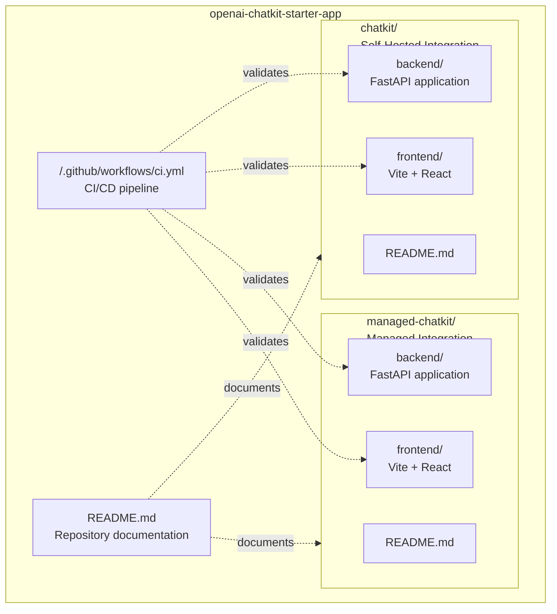
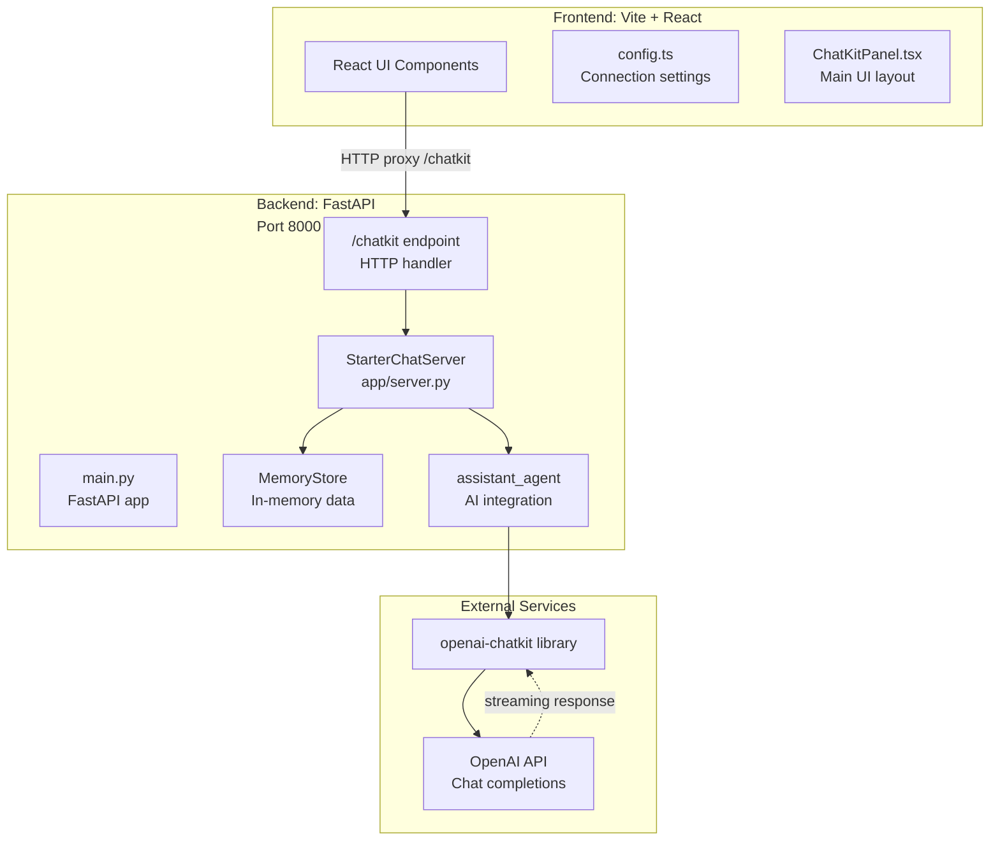
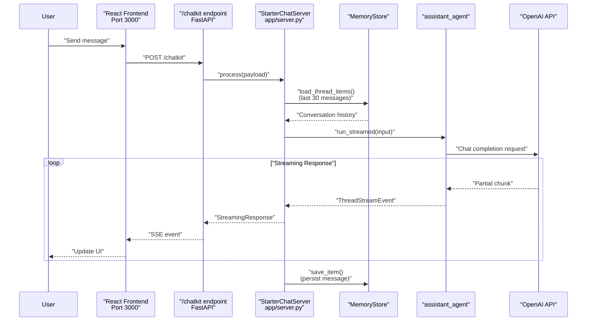
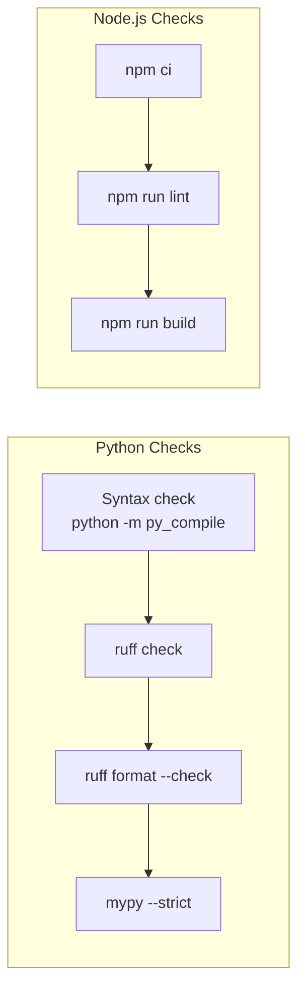

<!-- source: DeepWiki mcp.deepwiki.com · repo openai/openai-chatkit-starter-app · page 1 Overview · fetched 2026-10-26 -->

# Overview

<details>
<summary>Relevant source files</summary>

The following files were used as context for generating this wiki page:

- [README.md](README.md)

</details>


## Repository Purpose

This repository contains two independent starter applications that serve as reference implementations for integrating OpenAI's ChatKit service into conversational AI applications. The repository demonstrates two distinct integration patterns, allowing developers to choose the approach that best fits their infrastructure and operational requirements.

**Sources:** [README.md:1-9]()

---

## Two Starter Applications

The repository provides two complete, working examples:

| Application | Directory | Integration Pattern | Operational Model |
|-------------|-----------|---------------------|-------------------|
| **Self-Hosted ChatKit** | `chatkit/` | Full control over all components | Developer manages infrastructure and scaling |
| **Managed ChatKit** | `managed-chatkit/` | Uses OpenAI hosted workflows | Reduced operational complexity |

Both applications share identical technology stacks (FastAPI + Vite/React) but differ in how they handle conversation orchestration. The self-hosted variant provides complete control and customization, while the managed variant offloads workflow execution to OpenAI's hosted infrastructure.

For detailed comparison of these patterns, see [Two Integration Patterns](#1.1).

**Sources:** [README.md:5-8]()

---

## Repository Structure

The repository is organized as two independent projects with parallel structures:

### High-Level Organization



Each application directory (`chatkit/` and `managed-chatkit/`) contains:
- `backend/` - FastAPI Python backend with AI agent integration
- `frontend/` - Vite + React TypeScript frontend
- `README.md` - Application-specific setup instructions

For detailed directory layout, see [Repository Structure](#1.3).

**Sources:** [README.md:1-9]()

---

## Shared Architecture Pattern

Both starter applications follow an identical architectural pattern with separate backend and frontend components:

### Self-Hosted ChatKit Architecture (chatkit)



The managed variant (`managed-chatkit/`) uses the same structure but delegates workflow execution to hosted infrastructure instead of local agent processing.

For detailed architecture of each variant, see:
- Self-hosted: [Self-Hosted ChatKit Architecture](#3.1)
- Managed: [Managed ChatKit Architecture](#4.2)

**Sources:** High-level system architecture diagrams

---

## Technology Stack Overview

Both starter applications are built on modern, production-ready technologies:

### Backend Technologies

| Technology | Version | Purpose |
|------------|---------|---------|
| **Python** | 3.11+ | Programming language |
| **FastAPI** | 0.114-0.116 | High-performance async web framework |
| **Uvicorn** | Latest | ASGI server for FastAPI |
| **openai** | ≥1.40 | OpenAI Python SDK |
| **openai-chatkit** | 1.4.0-2.0 | ChatKit integration library |

### Frontend Technologies

| Technology | Version | Purpose |
|------------|---------|---------|
| **Node.js** | 22 | JavaScript runtime |
| **Vite** | Latest | Fast build tool and dev server |
| **React** | Latest | UI component library |
| **TypeScript** | Latest | Type-safe JavaScript |

### Development Tools

Both projects use modern quality assurance tools:
- **ruff** - Fast Python linter and formatter
- **mypy** - Python static type checker
- **ESLint** - JavaScript/TypeScript linter

For comprehensive dependency documentation, see [Key Technologies](#1.2) and [Dependencies & Package Management](#5).

**Sources:** High-level system architecture diagrams

---

## Request Flow Example

The following sequence shows a typical chat interaction in the self-hosted variant:

### Complete Request Lifecycle



This streaming architecture enables real-time response rendering while maintaining conversation context through the `MemoryStore` component.

For detailed flow analysis, see [Request Flow & Data Model](#3.4).

**Sources:** High-level system architecture diagrams

---

## Getting Started

Each starter application can be run independently with the following setup:

### Quick Start

1. **Install dependencies**:
   - Python 3.11+ and Node.js 22
   - Backend: Python virtual environment with `pip install -r requirements.txt`
   - Frontend: `npm install` in frontend directory

2. **Configure environment**:
   - Set `OPENAI_API_KEY` in backend `.env.local`
   - Configure `VITE_CHATKIT_API_URL` and `VITE_CHATKIT_API_DOMAIN_KEY` in frontend `.env.local`

3. **Run both servers**:
   ```bash
   npm run dev  # Starts both backend (port 8000) and frontend (port 3000)
   ```

For detailed setup instructions, see [Getting Started](#2).

**Sources:** [README.md:1-9]()

---

## Key Customization Points

The starter applications are designed for easy customization:

### Backend Customization

| Component | File Path | Customization |
|-----------|-----------|---------------|
| **Data Storage** | `backend/app/server.py` | Replace `MemoryStore` with persistent database |
| **AI Agent** | `backend/app/server.py` | Modify `assistant_agent` configuration and system prompts |
| **Context Window** | `backend/app/server.py` | Adjust `load_thread_items(limit=30)` for more/less history |

### Frontend Customization

| Component | File Path | Customization |
|-----------|-----------|---------------|
| **UI Layout** | `frontend/src/components/ChatKitPanel.tsx` | Modify chat interface layout and styling |
| **Connection Settings** | `frontend/src/lib/config.ts` | Configure API endpoints and domain keys |

For detailed customization guidance, see [Customization Guide](#3.5).

**Sources:** High-level system architecture diagrams

---

## CI/CD Validation

The repository includes automated quality checks via GitHub Actions:

### Validation Pipeline



All four projects (`chatkit/backend`, `chatkit/frontend`, `managed-chatkit/backend`, `managed-chatkit/frontend`) are validated in parallel on every push and pull request.

For complete CI/CD documentation, see [CI/CD Pipeline](#6).

**Sources:** High-level system architecture diagrams

---

## Next Steps

After reading this overview, explore the following sections for detailed documentation:

- **Setup Instructions**: [Getting Started](#2) for step-by-step setup
- **Architecture Deep Dive**: [Application Architecture](#5) for component relationships
- **API Documentation**: [Backend API](#7) for session endpoint details
- **Customization Guide**: [Configuration System](#8) for modifying prompts and behavior
- **Deployment**: [Deployment Guide](#12) for production builds

**Sources:** Table of contents structure

---

