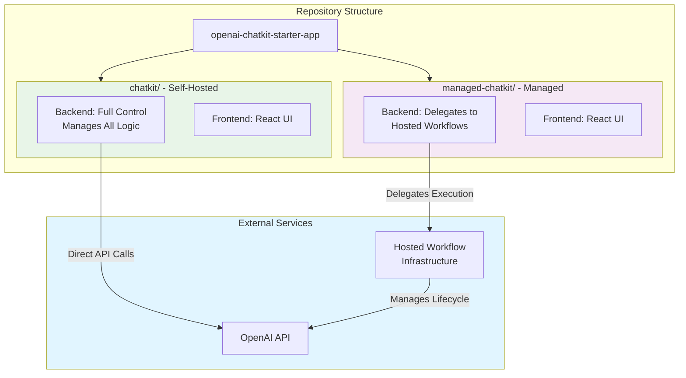
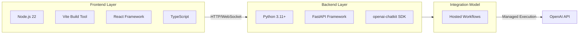
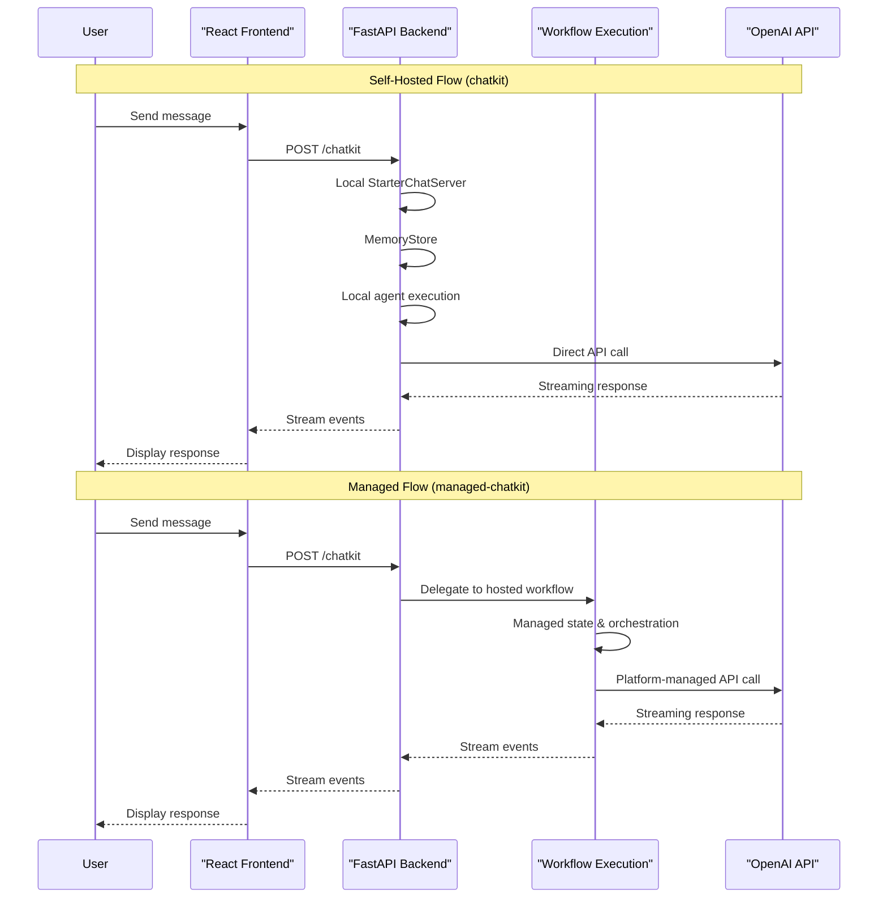
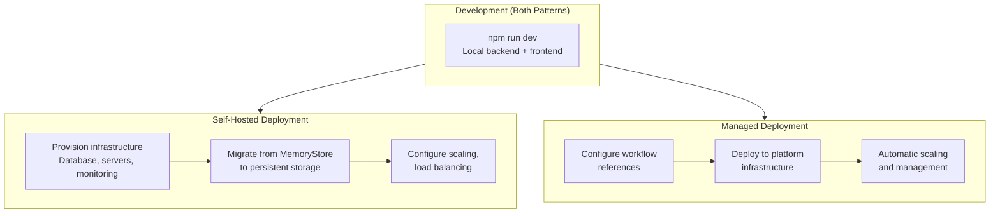

<!-- source: DeepWiki mcp.deepwiki.com · repo openai/openai-chatkit-starter-app · page 4 Managed ChatKit (managed-chatkit) · fetched 2026-10-26 -->

# Managed ChatKit (managed-chatkit)

<details>
<summary>Relevant source files</summary>

The following files were used as context for generating this wiki page:

- [README.md](README.md)

</details>


## Purpose and Scope

This document describes the **Managed ChatKit** starter application, which demonstrates integration with ChatKit using hosted workflows. This is one of two reference implementations in the repository, offering an alternative to the self-hosted approach.

For detailed information about the self-hosted ChatKit implementation, see [Self-Hosted ChatKit](#3). For general repository structure and setup instructions, see [Overview](#1) and [Getting Started](#2).

**Sources:** [README.md:1-9]()

---

## 4.1 Overview & Hosted Workflows

### What is Managed ChatKit?

The `managed-chatkit/` directory contains a starter application that integrates with ChatKit using **hosted workflows**. Unlike the self-hosted variant, this approach offloads workflow execution and management to hosted infrastructure, reducing operational complexity for developers.



**Diagram: Integration Pattern Comparison**

**Sources:** [README.md:7-8]()

### Hosted Workflows Explained

Hosted workflows refer to a deployment model where ChatKit conversation management, state handling, and AI orchestration are handled by managed infrastructure rather than developer-maintained servers. This architectural pattern provides:

| Aspect | Self-Hosted (chatkit) | Managed (managed-chatkit) |
|--------|------------------------|---------------------------|
| **Infrastructure Management** | Developer responsibility | Handled by platform |
| **Conversation State** | Custom implementation (e.g., MemoryStore) | Managed persistence |
| **Workflow Execution** | Local agent orchestration | Remote hosted execution |
| **Operational Complexity** | Full control, full responsibility | Reduced operational burden |
| **Customization Flexibility** | Complete code-level control | Configuration-based customization |

**Sources:** [README.md:8]()

### Technology Stack Similarity

Despite architectural differences in workflow execution, the `managed-chatkit/` example maintains the same technology foundation as the self-hosted variant:



**Diagram: Managed ChatKit Technology Stack**

**Sources:** [README.md:7-8]()

### When to Choose Managed ChatKit

The managed integration pattern is appropriate when:

- **Reduced Operations**: Team prefers to minimize infrastructure management overhead
- **Rapid Prototyping**: Quick deployment without server maintenance concerns
- **Scalability**: Automatic scaling handled by hosted infrastructure
- **Standard Workflows**: Application requirements align with platform-provided workflow patterns

Conversely, choose self-hosted ChatKit (see [Self-Hosted ChatKit](#3)) when requiring:
- Complete control over conversation logic and state management
- Custom storage backends (databases, caching layers)
- Integration with existing infrastructure
- Specific security or compliance requirements

**Sources:** [README.md:7-8]()

---

## 4.2 Architecture Differences

### Structural Organization

The `managed-chatkit/` directory follows the same structural pattern as `chatkit/`, maintaining consistency across examples:

```
managed-chatkit/
├── backend/          # FastAPI application
│   ├── app/
│   ├── pyproject.toml
│   └── requirements.txt
└── frontend/         # Vite + React UI
    ├── src/
    ├── package.json
    └── vite.config.ts
```

This parallel structure allows developers to compare implementations directly and understand the specific modifications required for hosted workflow integration.

**Sources:** [README.md:8]()

### Request Flow Comparison

The fundamental difference between self-hosted and managed approaches lies in **where workflow execution occurs**:



**Diagram: Request Flow Comparison Between Integration Patterns**

**Sources:** [README.md:7-8]()

### Component Responsibilities

The managed approach shifts several responsibilities from application code to platform infrastructure:

| Component | Self-Hosted Implementation | Managed Implementation |
|-----------|---------------------------|------------------------|
| **Conversation State** | `MemoryStore` class in [chatkit/backend/app/server.py]() | Hosted platform persistence |
| **Agent Orchestration** | `StarterChatServer.respond()` method | Hosted workflow engine |
| **API Key Management** | Application environment variables | Platform credential management |
| **Streaming Logic** | `run_streamed()` in application code | Platform streaming infrastructure |
| **Error Handling** | Custom retry/fallback logic | Platform-managed resilience |

**Sources:** [README.md:7-8]()

### Configuration Differences

While both implementations require similar environment variables for frontend configuration (see [Environment Configuration](#2.2)), the backend configuration differs:

**Common Frontend Variables:**
```
VITE_CHATKIT_API_URL=/chatkit
VITE_CHATKIT_API_DOMAIN_KEY=domain_pk_*
```

**Backend Configuration Differences:**

| Variable | Self-Hosted | Managed |
|----------|-------------|---------|
| `OPENAI_API_KEY` | Required for direct API access | May be platform-managed |
| Workflow Identifiers | N/A | Required to specify hosted workflow |
| Platform Credentials | N/A | Required for platform authentication |

**Sources:** [README.md:7-8]()

### Development and Deployment

Both implementations share the same development workflow (see [Local Development Setup](#7.1)):

```bash
npm run dev  # Starts both backend and frontend
```

However, deployment considerations differ:



**Diagram: Deployment Path Comparison**

**Sources:** [README.md:7-8]()

### Code Reuse and Portability

The parallel structure between `chatkit/` and `managed-chatkit/` facilitates:

1. **Pattern Migration**: Developers can start with managed workflows and migrate to self-hosted as requirements evolve
2. **Frontend Compatibility**: UI components remain largely identical, requiring only configuration changes
3. **Learning Path**: Understanding one implementation provides foundation for the other

**Sources:** [README.md:1-9]()

---

## Integration with CI/CD

Both starter applications are validated through the same CI/CD pipeline (see [CI/CD Pipeline](#6)), ensuring code quality consistency:

- Python backend validation: syntax, linting (ruff), formatting, type checking (mypy)
- Frontend validation: dependency installation, ESLint, build verification

This unified quality assurance approach ensures both examples maintain equivalent code standards regardless of their deployment model.

**Sources:** [README.md:1-9]()

---

## Next Steps

To get started with Managed ChatKit:

1. Review [Installation & Prerequisites](#2.1) for required software versions
2. Configure environment variables as described in [Environment Configuration](#2.2)
3. Follow [Running the Application](#2.3) to start the development servers
4. For production deployment considerations, see [Deployment Considerations](#8)

To compare with the self-hosted approach in detail, see [Self-Hosted ChatKit](#3) for complete implementation documentation including `StarterChatServer`, `MemoryStore`, and agent configuration.

**Sources:** [README.md:1-9]()

---

