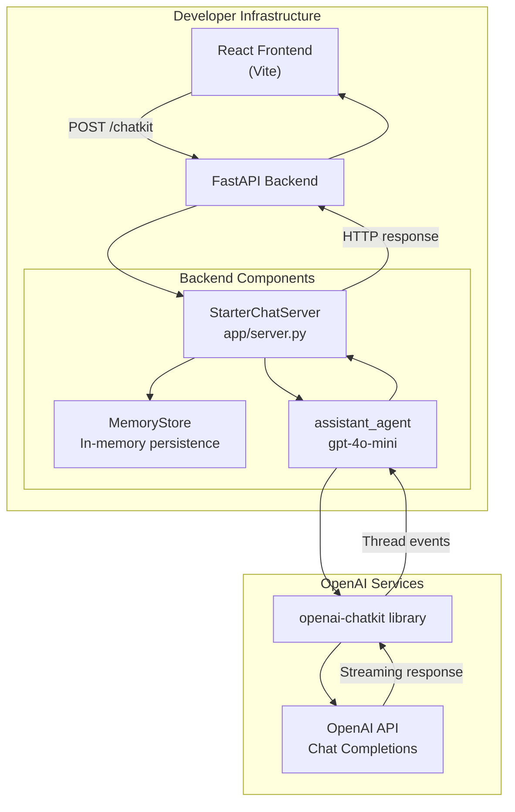
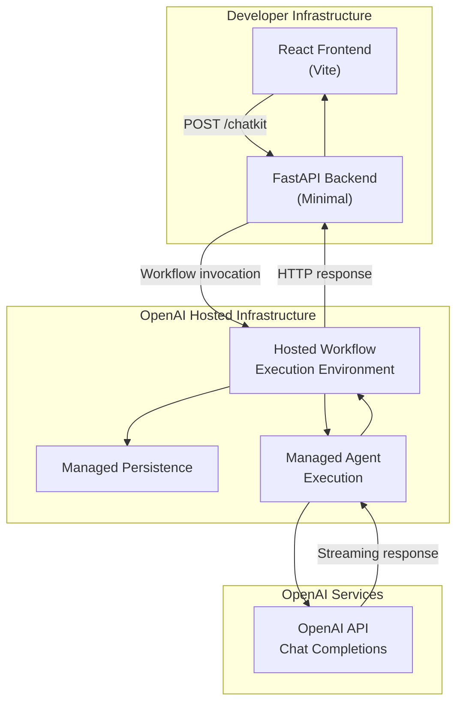
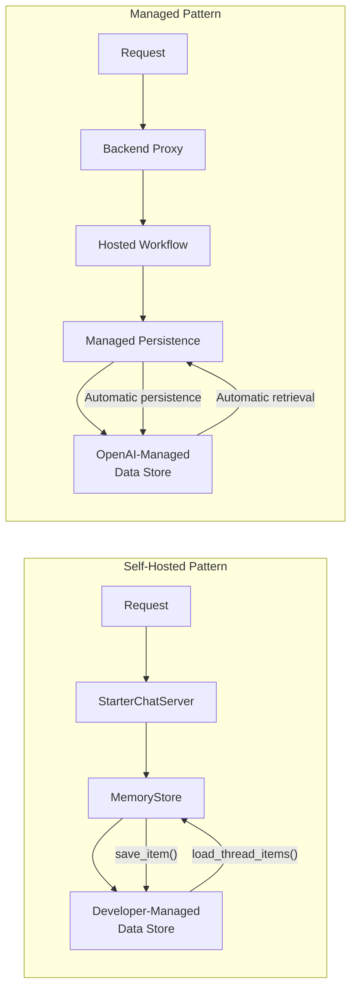
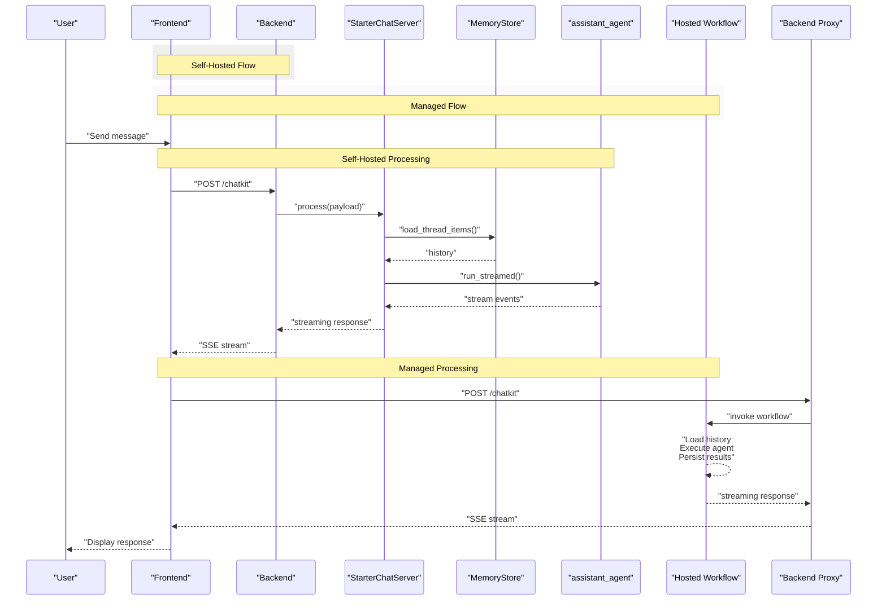
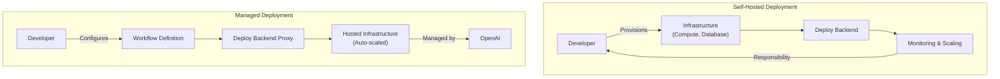
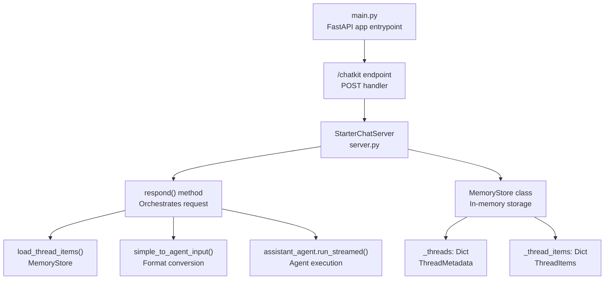
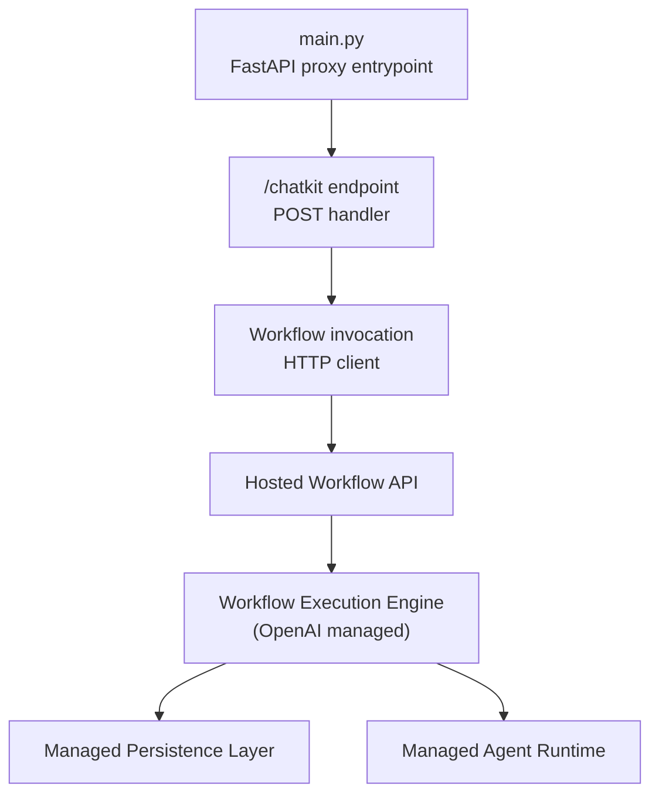

<!-- source: DeepWiki mcp.deepwiki.com · repo openai/openai-chatkit-starter-app · page 4.2 Architecture Differences · fetched 2026-10-26 -->

# Architecture Differences

Relevant source files

The following files were used as context for generating this wiki page:

- [README.md](README.md)

## Purpose and Scope

This document details the architectural differences between the self-hosted ChatKit implementation ([chatkit/]()) and the managed ChatKit implementation ([managed-chatkit/]()). While both starter applications share identical technology stacks and similar project structures, they differ fundamentally in where conversation logic executes and how operational responsibilities are distributed.

For an overview of hosted workflows and the managed integration approach, see [Overview & Hosted Workflows](#4.1). For detailed self-hosted architecture documentation, see [Architecture Overview](#3.1).

## High-Level Architectural Comparison

The two implementations represent different operational models for ChatKit integration:

| Aspect | Self-Hosted (chatkit) | Managed (managed-chatkit) |
|--------|------------------------|----------------------------|
| **Conversation Logic** | Runs in developer-controlled FastAPI backend | Delegated to hosted workflows |
| **Infrastructure Responsibility** | Developer manages all services | OpenAI manages workflow execution |
| **Agent Execution** | Local `assistant_agent` instance | Hosted workflow processing |
| **Data Persistence** | Developer implements storage (MemoryStore example) | Managed by hosted infrastructure |
| **Operational Complexity** | Higher (full control) | Lower (reduced operational burden) |
| **Customization Flexibility** | Complete control over logic | Constrained to workflow configuration |

**Sources:** [README.md:1-9]()

## Component Architecture Comparison

### Self-Hosted Architecture (chatkit)

In the self-hosted architecture, all conversation orchestration occurs within the developer's infrastructure. The `StarterChatServer` class loads conversation history from `MemoryStore`, prepares context for the `assistant_agent`, and streams responses through the FastAPI backend.

**Sources:** [README.md:7]()

### Managed Architecture (managed-chatkit)

The managed architecture offloads conversation orchestration to hosted workflows. The developer's FastAPI backend serves primarily as a routing layer, forwarding requests to the hosted workflow environment where agent execution and persistence are handled by OpenAI infrastructure.

**Sources:** [README.md:8]()

## Key Architectural Differences

### 1. Backend Responsibility

**Self-Hosted:**
- Backend implements full `StarterChatServer` orchestration logic
- Manages `MemoryStore` for conversation persistence
- Instantiates and configures `assistant_agent` locally
- Handles streaming event conversion and response formatting
- Developer responsible for scaling, monitoring, and availability

**Managed:**
- Backend acts as thin API proxy layer
- Workflow invocation replaces local orchestration
- No local agent instantiation required
- Hosted infrastructure handles event streaming
- OpenAI responsible for workflow scaling and availability

### 2. Data Persistence Model

**Self-Hosted:** Developer implements storage interface (example: `MemoryStore` with methods like `load_thread_items()`, `save_item()`). Production requires replacing with persistent database.

**Managed:** Persistence handled automatically by hosted infrastructure. Developer does not implement or manage storage layer directly.

**Sources:** [README.md:1-9]()

### 3. Agent Configuration and Execution

**Self-Hosted:**
- Direct instantiation of agent in backend code
- Full control over agent parameters (model, temperature, tools)
- Agent runs in developer's compute environment
- Can customize agent behavior through code modifications

**Managed:**
- Agent configured through workflow definitions
- Limited to workflow-supported configuration options
- Agent execution occurs in hosted environment
- Customization constrained to workflow API surface

### 4. Request Flow Comparison

The self-hosted flow requires multiple local component interactions, while the managed flow consolidates these operations within the hosted workflow environment.

**Sources:** [README.md:1-9]()

## Technology Stack Overlap and Divergence

### Shared Components

Both implementations use:

| Component | Purpose | Location |
|-----------|---------|----------|
| **FastAPI** | HTTP server framework | Backend |
| **Uvicorn** | ASGI server | Backend |
| **Vite** | Frontend build tool | Frontend |
| **React** | UI framework | Frontend |
| **TypeScript** | Frontend type safety | Frontend |
| **openai-chatkit** | ChatKit client library | Backend |

### Divergent Components

| Component | Self-Hosted | Managed |
|-----------|-------------|---------|
| **Orchestration** | `StarterChatServer` class | Hosted workflow API |
| **Persistence** | `MemoryStore` (example implementation) | Managed persistence service |
| **Agent Runtime** | Local `assistant_agent` instance | Hosted agent execution |
| **Backend Complexity** | Full server implementation | Minimal proxy layer |

**Sources:** [README.md:1-9]()

## Operational Differences

### Development and Testing

**Self-Hosted:**
- Complete local development environment
- Can debug full request flow in local IDE
- Test storage implementations locally
- Modify agent behavior without external dependencies

**Managed:**
- Local development proxies to hosted workflows
- Limited visibility into workflow execution internals
- Cannot test workflow logic locally (requires hosted environment)
- Agent behavior changes require workflow reconfiguration

### Deployment Considerations

**Self-Hosted Deployment Requirements:**
- Provision compute infrastructure for FastAPI backend
- Configure and manage persistent database
- Implement monitoring and logging
- Handle scaling for traffic patterns
- Maintain agent runtime environment

**Managed Deployment Requirements:**
- Configure workflow definitions
- Deploy minimal backend proxy
- Monitor workflow invocations (via hosted platform)
- Reduced operational overhead

**Sources:** [README.md:1-9]()

### Customization Boundaries

**Self-Hosted Customization Points:**
- Replace `MemoryStore` with any database ([backend/app/server.py]())
- Modify `assistant_agent` configuration and tools
- Implement custom preprocessing/postprocessing logic
- Add middleware and authentication layers
- Control streaming event transformation

**Managed Customization Points:**
- Configure workflow parameters within hosted platform
- Customize frontend UI components
- Modify backend proxy routing logic
- Limited to workflow API capabilities

## Code Entity Mapping

### Self-Hosted Key Classes and Files

**Sources:** [README.md:7]()

### Managed Key Components (Conceptual)

The managed implementation abstracts away the `StarterChatServer`, `MemoryStore`, and local agent execution into hosted workflow services.

**Sources:** [README.md:8]()

## Decision Matrix: When to Use Each Pattern

| Scenario | Recommended Pattern | Rationale |
|----------|---------------------|-----------|
| **Prototyping and learning** | Self-Hosted | Complete visibility into implementation details |
| **Production with custom storage** | Self-Hosted | Full control over persistence layer |
| **Custom agent behaviors** | Self-Hosted | Unrestricted agent configuration and tool integration |
| **Rapid deployment** | Managed | Reduced infrastructure setup |
| **Minimal operational overhead** | Managed | No need to manage scaling and availability |
| **Compliance requirements** | Self-Hosted | Data remains in developer-controlled infrastructure |
| **Standard workflow patterns** | Managed | Leverage hosted infrastructure optimizations |

**Sources:** [README.md:1-9]()

## Summary

The architectural differences between self-hosted and managed ChatKit stem from the fundamental choice of where conversation orchestration executes:

- **Self-Hosted ([chatkit/]())**: Full-featured implementation with `StarterChatServer`, `MemoryStore`, and local `assistant_agent` execution. Provides complete control and customization at the cost of operational responsibility.

- **Managed ([managed-chatkit/]())**: Simplified implementation that delegates orchestration to hosted workflows. Reduces operational burden while constraining customization to workflow API capabilities.

Both share identical frontend and backend technology stacks (FastAPI, Vite, React), differing primarily in backend logic complexity and operational responsibility distribution.

**Sources:** [README.md:1-9]()

---

