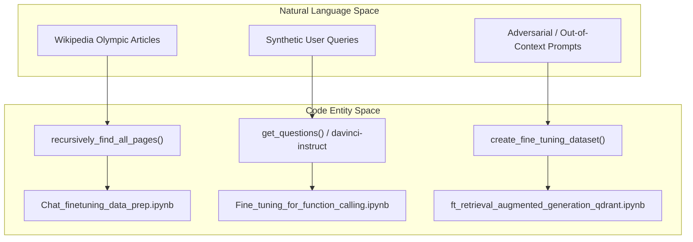
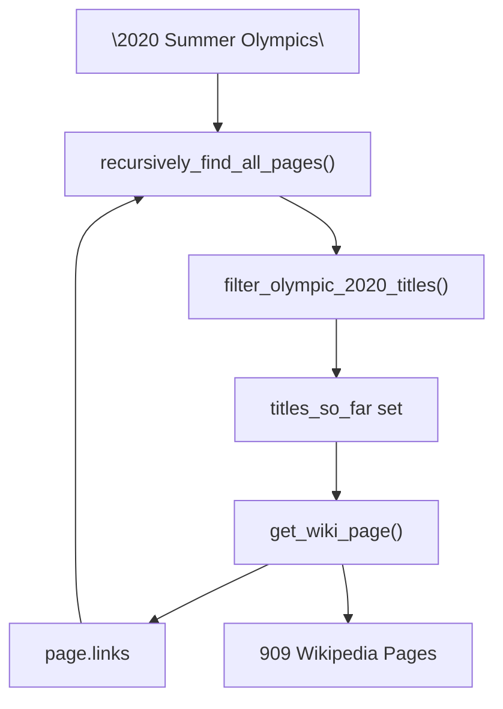
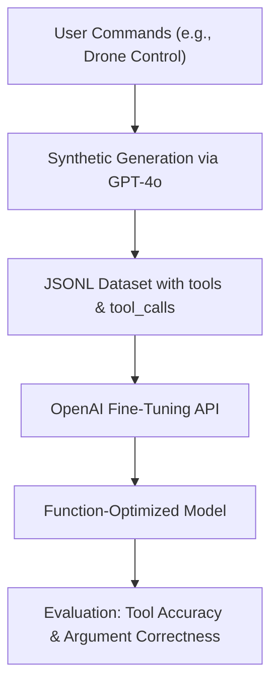

<!-- source: DeepWiki mcp.deepwiki.com · repo openai/openai-cookbook · page 8.1 Fine-tuning Workflow and Evaluation · fetched 2026-10-26 -->

# Fine-uning Workflow and Evaluation

Relevant source files

The following files were used as context for generating this wiki page:

- [examples/Chat_finetuning_data_prep.ipynb](examples/Chat_finetuning_data_prep.ipynb)
- [examples/Fine_tuning_for_function_calling.ipynb](examples/Fine_tuning_for_function_calling.ipynb)
- [examples/How_to_finetune_chat_models.ipynb](examples/How_to_finetune_chat_models.ipynb)
- [examples/book_translation/translate_latex_book.ipynb](examples/book_translation/translate_latex_book.ipynb)
- [examples/data/drone_training.jsonl](examples/data/drone_training.jsonl)
- [examples/data/toy_chat_fine_tuning.jsonl](examples/data/toy_chat_fine_tuning.jsonl)
- [examples/data/winemag/winemag-data-130k-v2.csv](examples/data/winemag/winemag-data-130k-v2.csv)
- [examples/fine-tuned_qa/answers_with_ft.py](examples/fine-tuned_qa/answers_with_ft.py)
- [examples/fine-tuned_qa/ft_retrieval_augmented_generation_qdrant.ipynb](examples/fine-tuned_qa/ft_retrieval_augmented_generation_qdrant.ipynb)
- [examples/fine-tuned_qa/olympics-1-collect-data.ipynb](examples/fine-tuned_qa/olympics-1-collect-data.ipynb)
- [examples/fine-tuned_qa/olympics-2-create-qa.ipynb](examples/fine-tuned_qa/olympics-2-create-qa.ipynb)
- [examples/fine-tuned_qa/olympics-3-train-qa.ipynb](examples/fine-tuned_qa/olympics-3-train-qa.ipynb)
- [images/distilling.png](images/distilling.png)
- [images/filtering-out-completions.png](images/filtering-out-completions.png)
- [images/fine-tuning-job.png](images/fine-tuning-job.png)

This document covers the complete fine-tuning pipeline for language models, including data collection, synthetic training data generation, adversarial example creation, chat data preparation, function calling fine-tuning, Qdrant-backed RAG integration, distillation, DPO, vision fine-tuning, and business-outcome evaluation using metrics like Stripe conversion rates.

**Note:** For question answering tasks specifically, embeddings-based approaches with RAG are now preferred over fine-tuning. See Embeddings Fundamentals and RAG and Vector Database Integration. However, the fine-tuning workflow and evaluation principles documented here remain applicable to other specialized use cases.

## Fine-tuning Pipeline Architecture

The fine-tuning pipeline spans from raw data extraction to the deployment of specialized models. The following diagram bridges natural language data collection to the specific code entities used in the `fine-tuned_qa` and fine-tuning pipelines.

Sources: [examples/fine-tuned_qa/olympics-1-collect-data.ipynb:74-98](), [examples/fine-tuned_qa/olympics-2-create-qa.ipynb:177-275](), [examples/fine-tuned_qa/olympics-3-train-qa.ipynb:265-621]()

## Data Collection, Synthetic Q&A, and Adversarial Datasets

The data collection phase extracts Wikipedia content related to the 2020 Summer Olympics to build domain-specific Q&A knowledge bases.

### Wikipedia Data Extraction and Processing
The `recursively_find_all_pages()` function implements recursive crawling starting from seed pages [examples/fine-tuned_qa/olympics-1-collect-data.ipynb:74-98](). It uses `filter_olympic_2020_titles()` to ensure relevance and `get_wiki_page()` to handle retrieval and disambiguation errors [examples/fine-tuned_qa/olympics-1-collect-data.ipynb:55-73]().

Sources: [examples/fine-tuned_qa/olympics-1-collect-data.ipynb:55-98]()

### Synthetic Q&A Generation and Discriminator Models
Using instruction-tuned models like `davinci-instruct-beta-v3`, the pipeline generates plausible questions and corresponding answers for each section [examples/fine-tuned_qa/olympics-2-create-qa.ipynb:14-16](). 

To prevent model confabulation when context is missing, adversarial datasets are constructed [examples/fine-tuned_qa/olympics-3-train-qa.ipynb:14-18](). A discriminator model is trained alongside the Q&A generator to predict whether a given question can be answered from the provided context (outputting binary indicators or fallback phrases like `"No sufficient context for answering the question"`) [examples/fine-tuned_qa/olympics-3-train-qa.ipynb:14-18]().

Sources: [examples/fine-tuned_qa/olympics-2-create-qa.ipynb:14-20](), [examples/fine-tuned_qa/olympics-3-train-qa.ipynb:14-18]()

## Chat Fine-tuning Data Preparation and Validation

For modern chat models (such as `gpt-4o-mini`), data must be structured into conversational message lists (`system`, `user`, `assistant`) and rigorously validated [examples/Chat_finetuning_data_prep.ipynb:9-14]().

### Format Validation Checks
The data preparation utility performs systematic checks [examples/Chat_finetuning_data_prep.ipynb:79-92]():
1. **Data Type Check**: Ensures each entry is a dictionary (`data_type`) [examples/Chat_finetuning_data_prep.ipynb:83-83]().
2. **Message List Presence**: Confirms the `messages` array exists (`missing_messages_list`) [examples/Chat_finetuning_data_prep.ipynb:84-84]().
3. **Key Validation**: Checks that messages contain `role` and `content` (`message_missing_key`) [examples/Chat_finetuning_data_prep.ipynb:85-85]().
4. **Role Validation**: Restricts roles to `system`, `user`, `assistant`, or `function` (`unrecognized_role`) [examples/Chat_finetuning_data_prep.ipynb:87-87]().
5. **Assistant Message Check**: Ensures every conversation includes an assistant response (`example_missing_assistant_message`) [examples/Chat_finetuning_data_prep.ipynb:89-89]().

Token counts are estimated using `tiktoken` (e.g., encoding with `cl100k_base`) to project fine-tuning costs and respect context limits [examples/Chat_finetuning_data_prep.ipynb:167-180]().

Sources: [examples/Chat_finetuning_data_prep.ipynb:79-146](), [examples/Chat_finetuning_data_prep.ipynb:167-180]()

## Fine-Tuning for Function Calling

As task complexity and the number of available tools scale, base models can hallucinate or invoke incorrect tool arguments. Fine-tuning models specifically for function calling improves reliability [examples/Fine_tuning_for_function_calling.ipynb:30-37]().

### Function Calling Training Flow
The pipeline generates synthetic golden prompt-tool invocation pairs or uses recorded production logs formatted into chat completions training examples containing tool schemas (`tools`) and tool call responses (`tool_calls`) [examples/Fine_tuning_for_function_calling.ipynb:51-56](), [examples/data/drone_training.jsonl:1-2]().

Sources: [examples/Fine_tuning_for_function_calling.ipynb:51-56](), [examples/data/drone_training.jsonl:1-2]()

## RAG and Fine-Tuning with Qdrant

Combining Retrieval-Augmented Generation (RAG) with fine-tuning minimizes hallucinations on domain-specific data [examples/fine-tuned_qa/ft_retrieval_augmented_generation_qdrant.ipynb:8-12](). 

### Qdrant Vector Integration Pipeline
1. **Embedding Generation**: Text chunks are embedded and indexed in [Qdrant](https://qdrant.tech) [examples/fine-tuned_qa/ft_retrieval_augmented_generation_qdrant.ipynb:51-55]().
2. **Context Retrieval**: At inference or dataset construction time, top-k relevant snippets are retrieved via vector similarity.
3. **Few-Shot Prompt Augmentation**: Retrieved contexts are injected into training examples as few-shot prompts to condition the fine-tuned generator [examples/fine-tuned_qa/ft_retrieval_augmented_generation_qdrant.ipynb:34-38]().

Sources: [examples/fine-tuned_qa/ft_retrieval_augmented_generation_qdrant.ipynb:8-64]()

## Model Distillation, DPO, and Vision Fine-Tuning

Advanced workflows extend standard fine-tuning into distillation, preference optimization, and multimodal domains:
- **Model Distillation**: Transferring capabilities from larger models (like GPT-4) to smaller, faster models (like `gpt-4o-mini`) by training on teacher model completions.
- **DPO (Direct Preference Optimization)**: Aligning model outputs directly with human or grader preferences without a separate reward model.
- **Vision Fine-Tuning**: Adapting multimodal models like `gpt-4o-mini` on domain-specific image-text pairs for specialized visual extraction tasks (e.g., receipt inspection, medical imaging, or named entity recognition from visual documents).

Sources: [examples/How_to_finetune_chat_models.ipynb:10-21]()

## Model Evaluation: Accuracy, Retrieval, and Business Metrics

Evaluating fine-tuned models requires combining offline technical benchmarks with online business metrics.

### Evaluation Methodologies
| Evaluation Type | Metrics / Techniques | Implementation Reference |
|----------------|----------------------|--------------------------|
| **Retrieval Rank Evaluation** | Context rank within top-200, token distance thresholds | [examples/fine-tuned_qa/olympics-2-create-qa.ipynb:595-622]() |
| **Discriminator Accuracy** | Confusion matrix, false positive/negative rates on adversarial sets | [examples/fine-tuned_qa/ft_retrieval_augmented_generation_qdrant.ipynb:106-106]() |
| **Business Conversion** | Stripe conversion rate via A/B testing framework | [examples/stripe_model_eval/selecting_a_model_based_on_stripe_conversion.ipynb:25-63]() |

Sources: [examples/fine-tuned_qa/olympics-2-create-qa.ipynb:595-622](), [examples/fine-tuned_qa/ft_retrieval_augmented_generation_qdrant.ipynb:106-106]()

---

