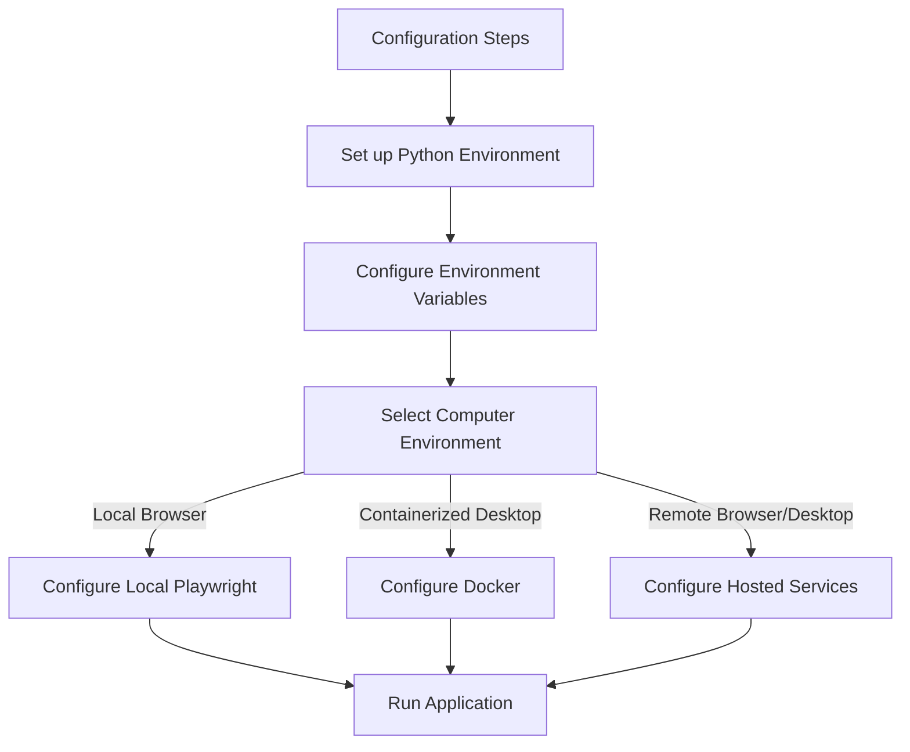
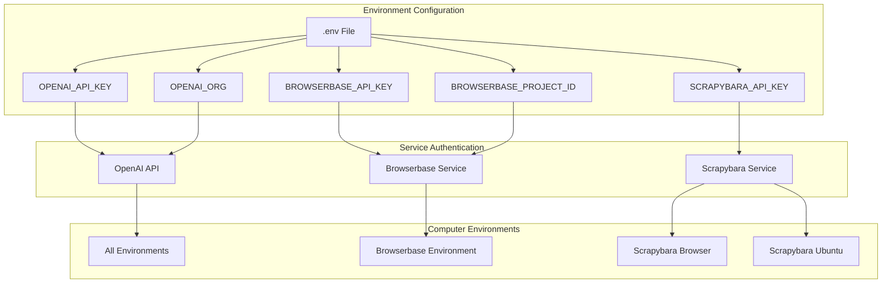
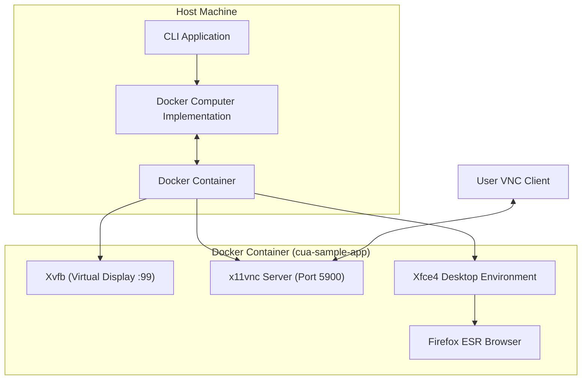
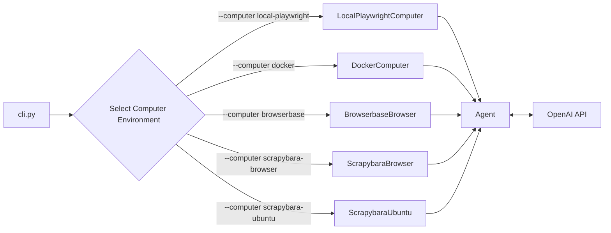

<!-- source: DeepWiki mcp.deepwiki.com · repo openai/openai-cua-sample-app · page 7 Configuration · fetched 2026-10-26 -->

# Configuration and Deployment

<details>
<summary>Relevant source files</summary>

The following files were used as context for generating this wiki page:

- [.env.example](.env.example)
- [README.md](README.md)

</details>


This page explains how to configure and deploy the OpenAI Computer Using Agent (CUA) sample application. It covers environment setup, configuration variables, different computer environment options, and deployment considerations. For information about the CLI usage, see [Command Line Interface](#2).

## Configuration Overview

The CUA sample application requires proper configuration of the environment, API keys, and computer environments to function correctly. The application supports multiple computer environments, each with specific configuration requirements.



Sources: [README.md:8-16]()

## Environment Setup

Before running the application, you need to set up a Python environment with all required dependencies.

```bash
python3 -m venv .venv
source .venv/bin/activate  # On Windows: .venv\Scripts\activate
pip install -r requirements.txt
```

When using Playwright for the first time, you may need to install additional browser dependencies when prompted.

Sources: [README.md:10-16](), [README.md:24-25]()

## Environment Variables Configuration

The application uses environment variables for API keys and service configuration. Create a `.env` file in the project root directory based on the provided `.env.example` template.

### Required Environment Variables

| Environment Variable | Purpose | Required For |
|-------------------|---------|-------------|
| `OPENAI_API_KEY` | OpenAI API authentication | All environments |
| `OPENAI_ORG` | OpenAI organization ID | All environments |
| `BROWSERBASE_API_KEY` | Browserbase API authentication | Browserbase environment |
| `BROWSERBASE_PROJECT_ID` | Browserbase project identifier | Browserbase environment |
| `SCRAPYBARA_API_KEY` | Scrapybara API authentication | Scrapybara environments |



Sources: [.env.example:1-9](), [README.md:139-143]()

## Computer Environment Configuration

The CUA sample application supports multiple computer environments, each with specific setup requirements.

### Computer Environment Types

| Computer Type | Option | Environment Type | Description |
|---------------|--------|------------------|-------------|
| `LocalPlaywright` | local-playwright | browser | Local browser window |
| `Docker` | docker | linux | Docker container environment |
| `Browserbase` | browserbase | browser | Remote browser environment |
| `ScrapybaraBrowser` | scrapybara-browser | browser | Remote browser environment |
| `ScrapybaraUbuntu` | scrapybara-ubuntu | linux | Remote Ubuntu desktop |

Sources: [README.md:92-98]()

### Local Playwright Environment

The simplest environment to get started with is the local-playwright environment, which opens a browser window on your local machine.

To run with local-playwright:

```bash
python cli.py --computer local-playwright
```

Sources: [README.md:18-22]()

### Docker Environment Setup

The Docker environment runs a containerized Ubuntu desktop with a GUI accessible via VNC. This provides an isolated environment for the agent to operate in.

#### Building and Running the Docker Container

1. Build the Docker image:
```bash
docker build -t cua-sample-app .
```

2. Run the Docker container:
```bash
docker run --rm -it --name cua-sample-app -p 5900:5900 --dns=1.1.1.3 -e DISPLAY=:99 cua-sample-app
```

3. Run the application with the Docker environment:
```bash
python cli.py --computer docker
```

#### Docker Container Architecture

The Docker container includes:
- Ubuntu 22.04 with Xfce4 desktop environment
- Firefox ESR browser
- VNC server accessible on port 5900 (password: "secret")
- Screen resolution: 1280x800
- DNS restrictions for safety



#### Docker Troubleshooting

If you encounter a container name conflict, remove the existing container:

```bash
docker rm -f cua-sample-app
```

Sources: [README.md:112-137](), [Dockerfile:1-45]()

### Hosted Environments Setup

The sample application supports remote hosted environments through third-party services.

#### Browserbase Configuration

To use the Browserbase remote browser environment:

1. Create an account on [Browserbase](https://www.browserbase.com)
2. Obtain your API key and project ID
3. Add them to your `.env` file:
   ```
   BROWSERBASE_API_KEY="your-api-key"
   BROWSERBASE_PROJECT_ID="your-project-id"
   ```
4. Run the application with Browserbase:
   ```bash
   python cli.py --computer browserbase
   ```

#### Scrapybara Configuration

Scrapybara offers both browser and Ubuntu desktop environments:

1. Create an account on [Scrapybara](https://scrapybara.com/dashboard)
2. Obtain your API key
3. Add it to your `.env` file:
   ```
   SCRAPYBARA_API_KEY="your-api-key"
   ```
4. Run the application with your preferred Scrapybara environment:
   ```bash
   # For browser environment
   python cli.py --computer scrapybara-browser
   
   # For Ubuntu desktop environment
   python cli.py --computer scrapybara-ubuntu
   ```

Sources: [README.md:139-143](), [README.md:30-32]()

## Running the Application

The application can be run with various configuration options using the CLI.

### Running with Different Computer Environments



### CLI Options

| Option | Description | Default | Example |
|--------|-------------|---------|---------|
| `--computer` | Computer environment to use | `local-playwright` | `--computer docker` |
| `--input` | Initial input to the agent | (prompts user) | `--input "Check the weather"` |
| `--debug` | Enable debug mode | (disabled) | `--debug` |
| `--show` | Show screenshots during execution | (disabled) | `--show` |
| `--start-url` | Starting URL for browser environments | `https://bing.com` | `--start-url https://example.com` |

Example commands:

```bash
# Run with local Playwright showing screenshots
python cli.py --computer local-playwright --show

# Run with Docker environment and custom start URL
python cli.py --computer docker --start-url https://example.com

# Run with Browserbase and initial query
python cli.py --computer browserbase --input "Search for pizza recipes"
```

Sources: [README.md:49-58](), [README.md:99-110]()

## Deployment Considerations

When deploying the CUA sample application, consider the following aspects:

### Security Considerations

1. **API Key Management**: Store API keys securely and never commit them to version control
2. **Network Restrictions**: Use DNS restrictions for Docker environments with `--dns=1.1.1.3` flag to limit accessible websites
3. **Environment Isolation**: Use isolated environments, particularly for untrusted operations
4. **Risk Management**: Review the risks outlined in the OpenAI documentation for Computer Using Agents

### Performance Considerations

1. **Resource Requirements**: Ensure the host has sufficient CPU, memory, and disk space, especially for Docker environments
2. **Network Bandwidth**: Remote environments (Browserbase, Scrapybara) require stable internet connections with adequate bandwidth

### Custom Implementation

The sample application is designed to be extended with:

1. **Custom Computer Implementations**: Implement the `Computer` interface for custom environments
2. **Function Integration**: Add custom functions to your `Computer` implementation for specific tasks

Sources: [README.md:150-154](), [README.md:118-124]()

---

