# Page: Overview

# Overview

<details>
<summary>Relevant source files</summary>

The following files were used as context for generating this wiki page:

- [README.md](README.md)

</details>


This document provides an introduction to the OpenAI Computer Using Agent (CUA) Sample App, a reference implementation that demonstrates how to build agents capable of using computer interfaces through the OpenAI API. The sample app includes a flexible architecture that supports multiple computer environments and provides a foundation for developing your own CUA applications.

## What is a Computer Using Agent?

A Computer Using Agent (CUA) is an AI agent that can interact with computer interfaces by performing actions like clicking, typing, and scrolling based on visual information from screenshots. The agent uses the OpenAI model to:

1. Understand what's visible on the screen
2. Decide what actions to take
3. Execute those actions through a defined computer interface

Sources: [README.md:34-38]()

## System Architecture

The sample app is built around a modular architecture with clean separation of concerns, making it extensible and adaptable to different environments.

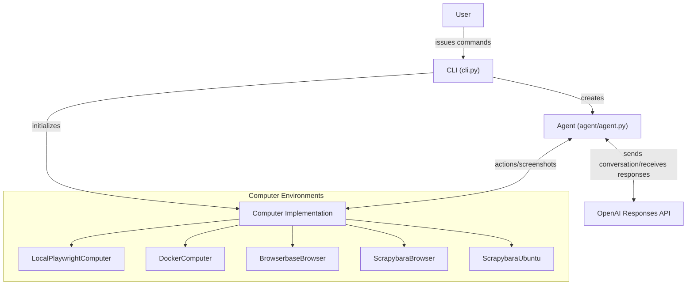

Sources: [cli.py:3-9](), [cli.py:58-66](), [README.md:40-47]()

## Core Components

The system consists of three main components:

1. **Command Line Interface (CLI)**: The primary entry point for the application that initializes the selected computer environment and creates an agent to interact with it.

2. **Agent**: Manages the interaction between the user, OpenAI model, and computer environment. It processes user input, obtains actions from the model, and executes them on the computer.

3. **Computer**: An abstraction that defines a consistent interface for interacting with different computing environments, with implementations for various platforms (browsers, desktop environments, etc.).

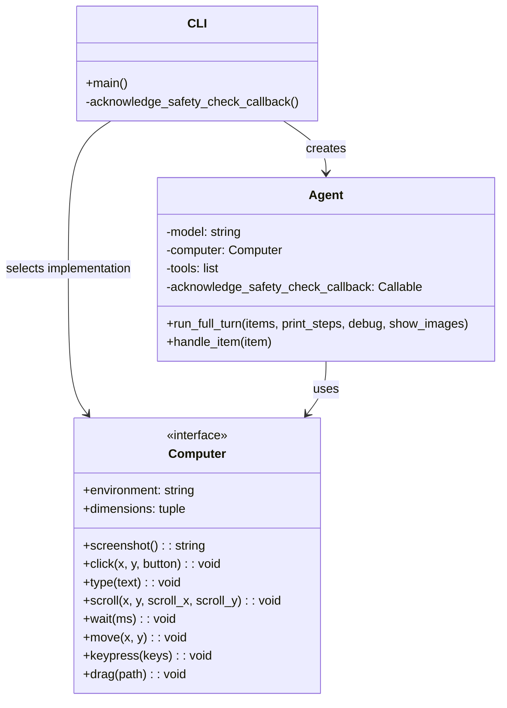

Sources: [cli.py:18-100](), [README.md:40-47]()

## Execution Flow

The typical execution flow in the CUA sample app follows this pattern:

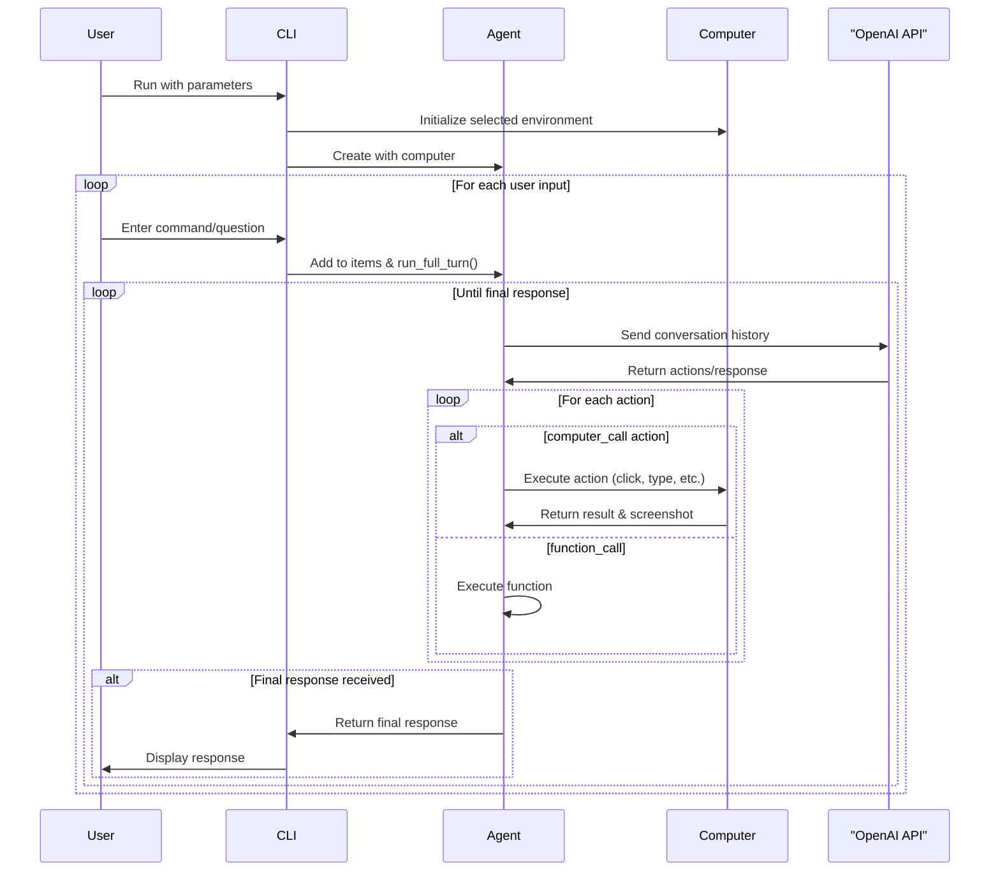

Sources: [cli.py:81-97](), [README.md:34-38]()

## Computer Environments

The sample app provides several computer environment implementations:

| Environment | Type | Description | Implementation |
|-------------|------|-------------|----------------|
| LocalPlaywrightComputer | Browser | Uses Playwright to control a local browser | `computers/local_playwright_computer.py` |
| DockerComputer | Linux | Controls a Docker container with VNC | `computers/docker_computer.py` |
| BrowserbaseBrowser | Browser | Uses Browserbase remote browser service | `computers/browserbase_browser.py` |
| ScrapybaraBrowser | Browser | Uses Scrapybara remote browser service | `computers/scrapybara_browser.py` |
| ScrapybaraUbuntu | Linux | Uses Scrapybara remote Ubuntu desktop | `computers/scrapybara_ubuntu.py` |

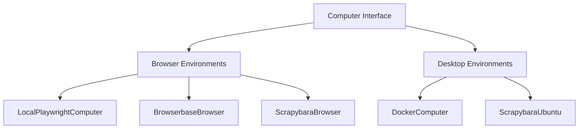

Sources: [cli.py:3-9](), [cli.py:58-66](), [README.md:92-98]()

## Actions Supported by Computer Environments

All computer environments support a standard set of actions that allow the agent to interact with the interface:

| Action | Description | Example |
|--------|-------------|---------|
| `click(x, y, button)` | Click at specific coordinates | `click(24, 150)` |
| `double_click(x, y)` | Double-click at specific coordinates | `double_click(24, 150)` |
| `scroll(x, y, scroll_x, scroll_y)` | Scroll at specific coordinates | `scroll(24, 150, 0, -100)` |
| `type(text)` | Type the specified text | `type("Hello, World!")` |
| `wait(ms)` | Wait for specified milliseconds | `wait(2000)` |
| `move(x, y)` | Move cursor to coordinates | `move(24, 150)` |
| `keypress(keys)` | Press specified keys | `keypress(["CTRL", "C"])` |
| `drag(path)` | Drag along a path | `drag([[24, 150], [100, 200]])` |

Sources: [README.md:79-88]()

## Getting Started

To get started with the CUA sample app, you'll typically:

1. **Select a computer environment**: Choose from local browser, Docker container, or cloud-based options
2. **Initialize the environment**: Set up the selected environment with necessary parameters
3. **Create an agent**: Create an agent instance that will interact with the environment
4. **Start the interaction loop**: Begin accepting user input and passing it to the agent

The CLI provides a convenient way to start the application with different configurations using command-line arguments.

Sources: [README.md:8-22](), [cli.py:18-100]()

## Related Pages

- For detailed information about the system architecture, see [Architecture Overview](#1.1)
- For more about core concepts, see [Core Concepts](#1.2)
- For details about the CLI, see [Command Line Interface](#2)
- For in-depth explanation of the Computer abstraction, see [Computer Abstraction](#3)
- For information about the Agent system, see [Agent System](#4)

---

# Page: Architecture Overview

# Architecture Overview

<details>
<summary>Relevant source files</summary>

The following files were used as context for generating this wiki page:

- [README.md](README.md)

</details>


## Purpose and Scope

This document provides a high-level view of the openai-cua-sample-app system architecture, focusing on the structural organization of applications and packages, their dependencies, and communication patterns. For conceptual definitions of scenarios, workspaces, and execution modes, see [Core Concepts](#1.2). For detailed information about the Responses API integration, see [Responses API Integration](#5).

The architecture follows a three-tier design:
1. **Frontend**: Next.js operator console for initiating runs and viewing results
2. **Backend**: Fastify service managing execution orchestration and workspace isolation
3. **Shared Packages**: Reusable business logic for scenario execution, browser control, and type contracts

## System Architecture

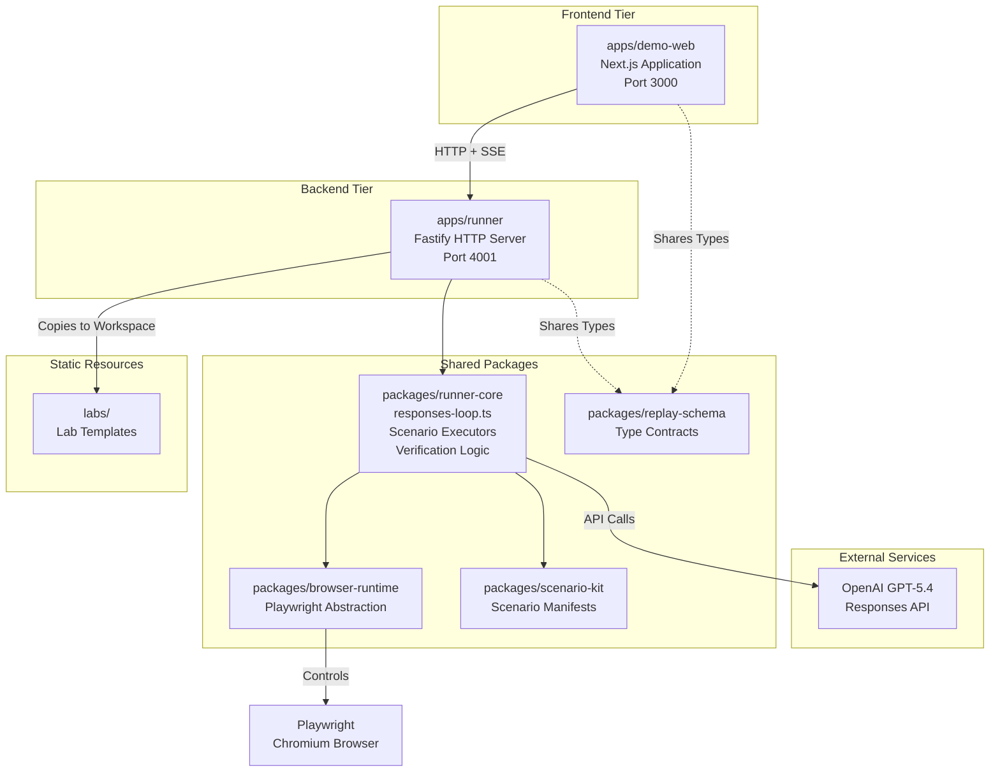

**Sources**: [README.md:1-123]()

The most critical component in this architecture is `packages/runner-core`, which contains [packages/runner-core/src/responses-loop.ts](), the canonical integration point for the OpenAI Responses API.

## Applications

The monorepo contains two main applications that run as separate Node.js processes:

| Application | Technology | Default Port | Primary Responsibility |
|------------|------------|--------------|------------------------|
| `apps/demo-web` | Next.js 15 | 3000 | Operator console UI for initiating runs and viewing replay bundles |
| `apps/runner` | Fastify 5 | 4001 | HTTP/SSE server, workspace management, browser session orchestration |

### apps/demo-web

The operator console is a Next.js application that provides the user interface for:
- Selecting scenarios and configuring execution parameters
- Starting new runs via HTTP POST requests
- Receiving real-time updates via Server-Sent Events (SSE)
- Displaying replay bundles (screenshots, events, verification results)

The application reads configuration from `apps/demo-web/.env.local` and communicates with the runner service via the `RUNNER_BASE_URL` environment variable (default: `http://127.0.0.1:4001`).

**Sources**: [README.md:5](), [README.md:108-109](), [README.md:136-139]()

### apps/runner

The runner service is a Fastify application responsible for:
- Serving HTTP endpoints for run creation and status queries
- Streaming real-time events via SSE during execution
- Creating isolated workspaces by copying lab templates from `labs/`
- Managing Playwright browser sessions
- Delegating execution to `packages/runner-core`
- Bundling replay artifacts for operator review

The service reads configuration from the repository root `.env` file and exposes endpoints on `HOST:PORT` (default: `127.0.0.1:4001`).

**Sources**: [README.md:6](), [README.md:110-111](), [README.md:127-134]()

## Core Packages

The shared packages provide reusable functionality across both applications:

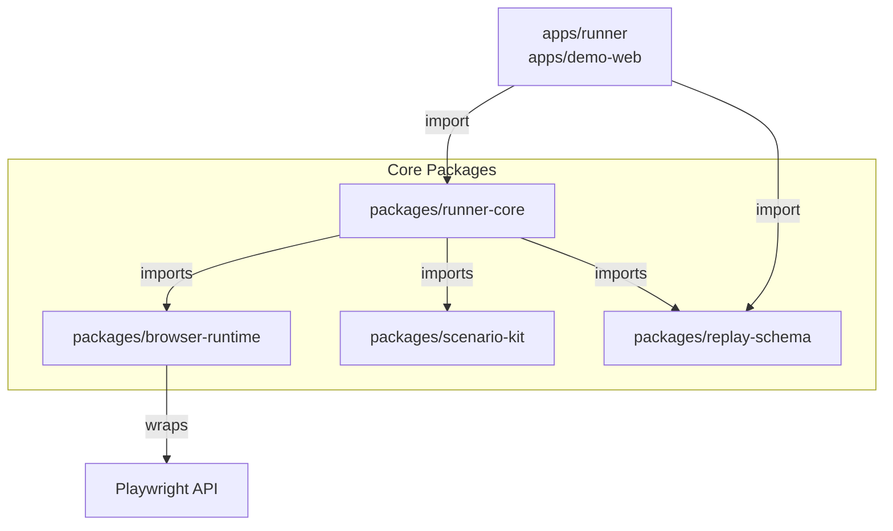

**Sources**: [README.md:7](), [README.md:112-121]()

### packages/runner-core

The orchestration hub containing:
- **responses-loop.ts**: The canonical Responses API integration point
- Scenario executors for `kanban`, `paint`, and `booking` scenarios
- Verification logic for drag-and-drop state, canvas state, and form completion
- Event capture and replay bundle generation

This package has the most dependencies, integrating browser control, scenario definitions, and OpenAI API interactions.

**Sources**: [README.md:13](), [README.md:118-119]()

### packages/browser-runtime

A Playwright abstraction layer providing:
- Browser session lifecycle management
- Page navigation and interaction primitives
- Screenshot capture
- Event recording for replay bundles

This package wraps Playwright to provide a stable interface for browser automation regardless of execution mode.

**Sources**: [README.md:116-117]()

### packages/scenario-kit

Contains scenario manifest definitions that specify:
- Scenario identifiers and display names
- Lab template paths
- Default prompts and task descriptions
- Verification requirements

The manifests provide a declarative interface for defining new scenarios without modifying core execution logic.

**Sources**: [README.md:114-115]()

### packages/replay-schema

A pure contract layer defining shared TypeScript types for:
- HTTP request and response payloads
- SSE event structures
- Replay bundle formats
- Error codes and messages

Both `apps/demo-web` and `apps/runner` import this package to ensure type consistency across the HTTP/SSE boundary.

**Sources**: [README.md:112-113]()

## Communication Architecture

The system uses two communication patterns between the frontend and backend:

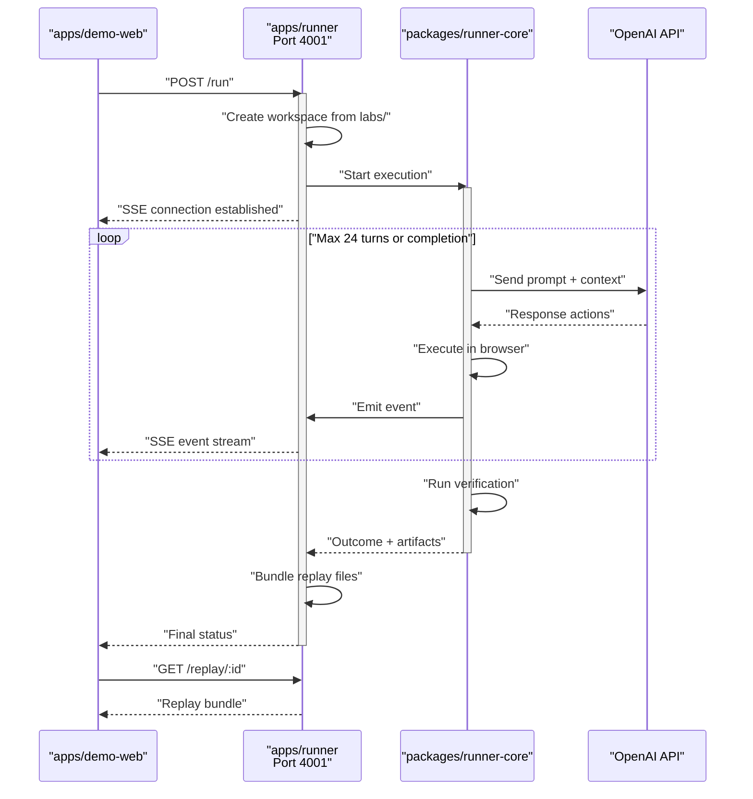

**Sources**: [README.md:5-6](), [README.md:139]()

### HTTP Endpoints

The runner service exposes RESTful endpoints for:
- **POST /run**: Initiate a new scenario execution with configuration
- **GET /runs/:id**: Query run status and metadata
- **GET /replay/:id**: Retrieve bundled replay artifacts

### Server-Sent Events (SSE)

Real-time execution updates stream from runner to console via SSE, delivering:
- Turn-by-turn progress indicators
- Screenshot captures
- Model actions and responses
- Verification results
- Error notifications

The default maximum of 24 response turns prevents infinite loops while allowing sufficient iterations for complex multi-step scenarios.

**Sources**: [README.md:6](), [README.md:139]()

## Package Dependency Graph

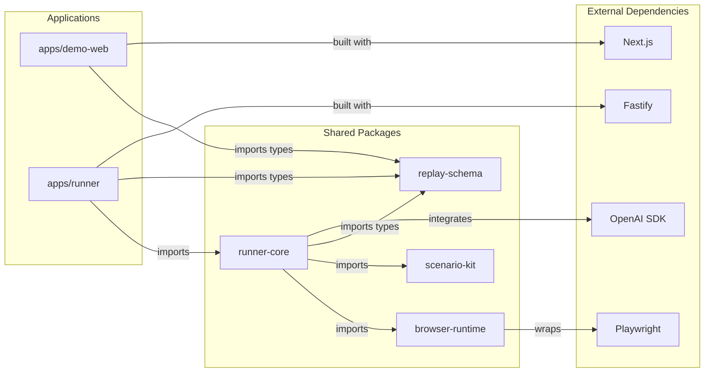

**Sources**: [README.md:7](), [README.md:108-121]()

This dependency structure ensures:
- **Separation of concerns**: Frontend and backend share only type contracts
- **Modularity**: Core packages can be tested and developed independently
- **Type safety**: `replay-schema` enforces consistent data structures across HTTP boundaries
- **Testability**: Execution logic in `runner-core` is decoupled from HTTP serving

## Execution Modes

The system supports two execution modes that share the same infrastructure but differ in how the model controls the browser:

| Mode | Environment Variable | Computer Tool | Description |
|------|---------------------|---------------|-------------|
| `native` | `CUA_RESPONSES_MODE=native` | Yes | Model emits raw computer actions (clicks, drags, typing) |
| `code` | `CUA_RESPONSES_MODE=code` | No | Model scripts browser via `exec_js` Playwright REPL |

Both modes:
- Use identical scenario manifests from `packages/scenario-kit`
- Execute through the same `responses-loop.ts` integration point
- Generate compatible replay bundles
- Support all three official scenarios

The mode selection affects only how `packages/runner-core` interprets model responses, not the overall architecture.

**Sources**: [README.md:92-96](), [README.md:14]()

## Workspace Isolation

Each run executes in an isolated workspace created by copying lab templates:

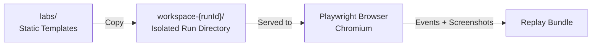

**Sources**: [README.md:120-121](), [README.md:15]()

This isolation ensures:
- **Deterministic starting conditions**: Each run begins from a known state
- **No cross-contamination**: Runs cannot interfere with each other
- **Clean verification**: Expected outcomes match lab template structure
- **Reproducibility**: Failed runs can be debugged using identical starting conditions

Workspaces are managed by `apps/runner` and populated from the `labs/` directory containing HTML, CSS, JavaScript, and asset files for each scenario.

---

# Page: Core Concepts

# Core Concepts

<details>
<summary>Relevant source files</summary>

The following files were used as context for generating this wiki page:

- [README.md](README.md)

</details>


This document explains the key concepts underlying Computer Using Agents (CUAs) in the OpenAI CUA sample application. It covers the fundamental abstractions, interaction models, and environments that enable agents to control computer interfaces. For a higher-level overview of the system architecture, see [Architecture Overview](#1.1).

## What is a Computer Using Agent?

A Computer Using Agent (CUA) is an AI agent that can interact with computer interfaces by viewing screenshots and performing actions such as clicking, typing, scrolling, and other typical user interactions. It perceives the computer environment through screenshots and takes actions based on those visual inputs to accomplish tasks.

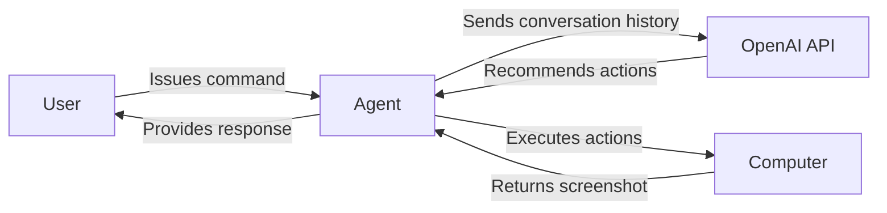

Sources: [README.md:34-38](), [simple_cua_loop.py:56-95]()

## Core Abstractions

The CUA sample app is built around two fundamental abstractions that provide a clean separation of concerns:

| Abstraction | Purpose | Implementation |
|-------------|---------|----------------|
| `Computer` | Interface for executing actions on different environments | `computers/computer.py` |
| `Agent` | Manages interaction between user, model, and computer | `agent/agent.py` |

### Computer Abstraction

The `Computer` interface provides a unified way to interact with various computing environments (local browsers, remote browsers, Docker containers, etc.). This abstraction handles the execution of actions like clicking, typing, and scrolling, while isolating the rest of the system from the specifics of the environment.

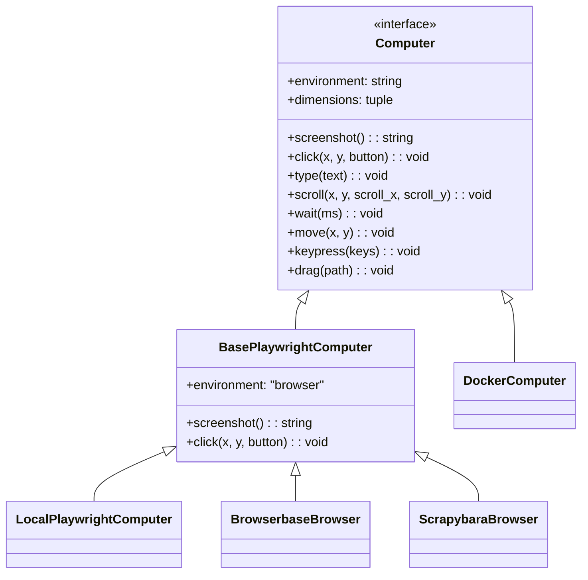

Sources: [README.md:40-47](), [README.md:76-89]()

### Agent Abstraction

The `Agent` class is responsible for managing the interaction loop between the user, the OpenAI model, and the computer environment. It handles:

1. Processing user input
2. Sending conversation history to the OpenAI API
3. Executing model-recommended actions
4. Performing safety checks
5. Returning responses to the user

Sources: [README.md:40-47](), [simple_cua_loop.py:13-53]()

## CUA Interaction Loop

The core interaction loop in a CUA system follows a well-defined sequence of steps that enable the agent to process user commands and interact with computing environments.

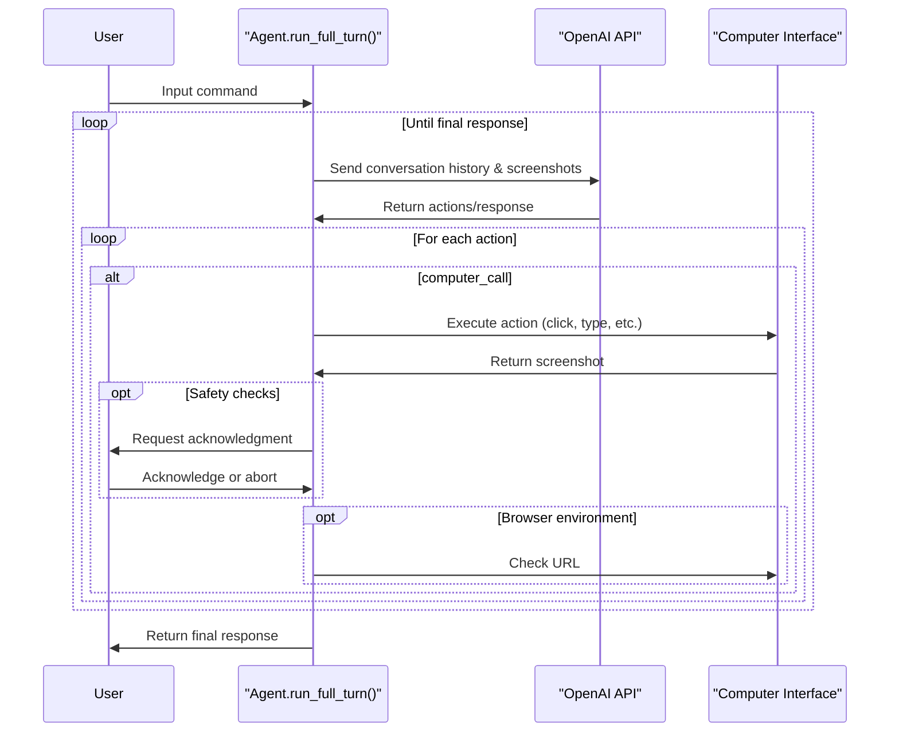

Sources: [simple_cua_loop.py:56-95](), [README.md:34-38]()

### Item Handling

Within the interaction loop, the agent must handle different types of items returned by the model:

1. **Messages**: Text responses from the model to the user
2. **Computer Calls**: Actions to be performed on the computer environment
3. **Function Calls**: Specialized functions that can be called directly

Each computer call results in:
1. Executing the action on the environment
2. Taking a screenshot
3. Processing any pending safety checks
4. Providing the screenshot back to the model

Sources: [simple_cua_loop.py:13-53]()

## Computer Environments

The CUA sample app supports multiple computer environments through the `Computer` interface abstraction. These environments fall into two main categories:

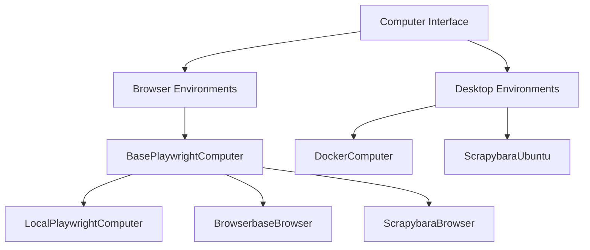

### Browser Environments

Browser environments provide access to web browsers. These are implemented using the `BasePlaywrightComputer` class, which uses Playwright for browser automation. Options include:

- `LocalPlaywrightComputer`: Uses a local browser window
- `BrowserbaseBrowser`: Uses a remote browser via Browserbase
- `ScrapybaraBrowser`: Uses a remote browser via Scrapybara

### Desktop Environments

Desktop environments provide access to complete operating system environments:

- `DockerComputer`: Uses a Docker container running Linux
- `ScrapybaraUbuntu`: Uses a remote Ubuntu desktop environment via Scrapybara

Sources: [README.md:90-98]()

## CUA Actions

Computer Using Agents interact with environments through a standard set of actions:

| Action | Example | Description |
|--------|---------|-------------|
| `click(x, y, button)` | `click(24, 150)` | Click at the specified coordinates |
| `double_click(x, y)` | `double_click(24, 150)` | Double-click at coordinates |
| `scroll(x, y, scroll_x, scroll_y)` | `scroll(24, 150, 0, -100)` | Scroll at position |
| `type(text)` | `type("Hello, World!")` | Type the specified text |
| `wait(ms)` | `wait(2000)` | Wait for milliseconds |
| `move(x, y)` | `move(24, 150)` | Move cursor to coordinates |
| `keypress(keys)` | `keypress(["CTRL", "C"])` | Press keyboard keys |
| `drag(path)` | `drag([[24, 150], [100, 200]])` | Drag from point to point |

Sources: [README.md:76-89]()

## Safety Mechanisms

The CUA sample app implements several safety mechanisms to prevent potentially harmful actions:

1. **Safety Checks**: Before executing certain actions, the agent may require explicit user acknowledgment.

2. **URL Blocking**: For browser environments, there's a mechanism to block access to certain websites.

3. **Docker DNS Restrictions**: When using the Docker environment, DNS settings can be used to restrict accessible websites.

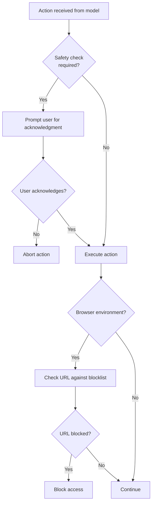

The safety check process allows users to review potentially risky actions before they're executed, providing a critical layer of oversight.

Sources: [simple_cua_loop.py:5-10](), [simple_cua_loop.py:27-32](), [simple_cua_loop.py:45-49](), [README.md:150-154]()

## Function Calling Enhancement

In addition to standard computer actions, the `Agent` class supports function calling. This allows for:

1. Providing custom tools to the agent
2. Extending the computer interface with additional capabilities
3. Implementing higher-level functions not directly provided by the computer interface

When a function is both defined in `tools` and as a method on the `Computer` instance, the agent will route calls to the computer implementation. This is particularly useful for browser-specific functions like `back()` or `goto(url)` that may be difficult to perform through standard CUA actions.

Sources: [README.md:144-148]()

---

# Page: Getting Started

# Getting Started

<details>
<summary>Relevant source files</summary>

The following files were used as context for generating this wiki page:

- [.env.example](.env.example)
- [README.md](README.md)

</details>


This page provides a quick-start guide for setting up and running the openai-cua-sample-app for the first time. It covers the essential steps from cloning the repository to executing your first scenario with the Responses API. For detailed information on system prerequisites and installation troubleshooting, see [Prerequisites and Installation](#2.1). For a comprehensive list of development commands, see [Development Commands](#2.2). For a step-by-step walkthrough of scenario execution, see [Running Your First Scenario](#2.3).

## Setup Overview

The getting started process involves three main phases: installing dependencies, configuring your OpenAI API credentials, and starting the two-service architecture. The system consists of a Next.js frontend (`apps/demo-web`) running on port 3000 and a Fastify backend (`apps/runner`) running on port 4001.

**Setup Flow Diagram**

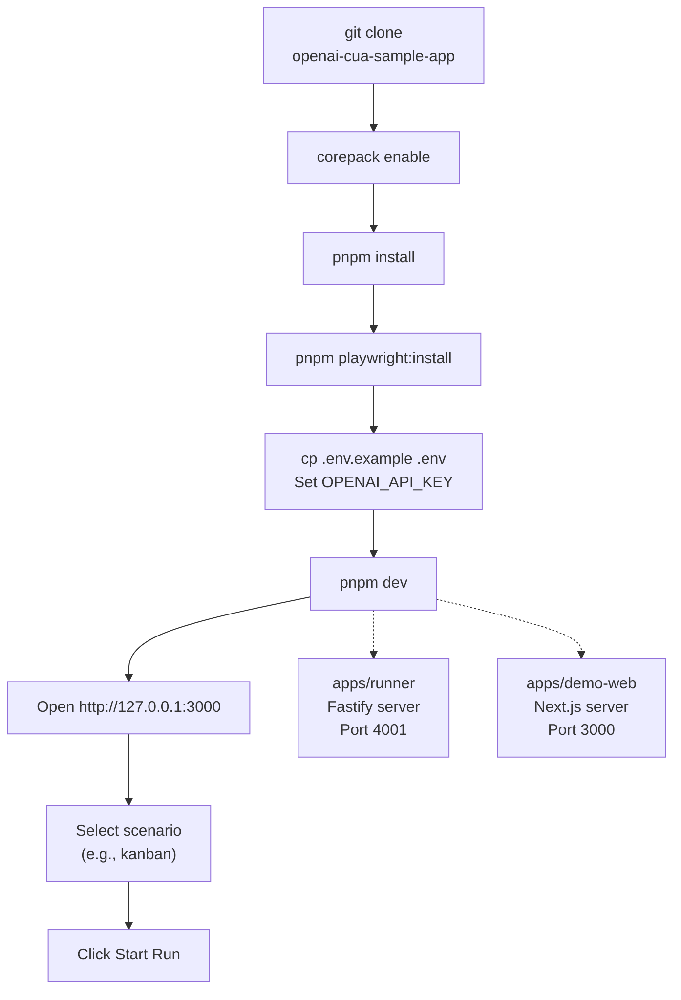

Sources: [README.md:18-64]()

## Prerequisites Summary

The following are required before installation:

| Component | Version | Purpose |
|-----------|---------|---------|
| Node.js | 22.20.0 | JavaScript runtime |
| pnpm | 10.26.0 | Package manager |
| Playwright Chromium | Latest | Browser automation |

Sources: [README.md:18-22]()

## Installation

Clone the repository and install dependencies:

```bash
git clone <repo-url>
cd openai-cua-sample-app
corepack enable
pnpm install
```

The `corepack enable` command ensures the correct version of pnpm is used. The `pnpm install` command installs all dependencies for both applications (`apps/demo-web` and `apps/runner`) and all shared packages.

Sources: [README.md:26-32]()

### Install Playwright Browser

Install the Chromium browser required by the `packages/browser-runtime` abstraction:

```bash
pnpm playwright:install
```

On Linux systems, additional OS-level dependencies are required:

```bash
pnpm playwright:install:with-deps
```

This command installs system libraries needed by Chromium. If Playwright later reports missing libraries, rerun this command.

Sources: [README.md:44-56]()

## Configuration

Copy the example environment file and configure your OpenAI API key:

```bash
cp .env.example .env
```

Edit `.env` and set the required variable:

```bash
OPENAI_API_KEY=your_key_here
```

The runner service (`apps/runner`) reads from the repository root `.env` file. The web application uses built-in defaults and optionally reads from `apps/demo-web/.env.local` for Next.js-specific overrides.

**Key Configuration Variables**

| Variable | Service | Default | Purpose |
|----------|---------|---------|---------|
| `OPENAI_API_KEY` | Runner | (required) | API authentication |
| `HOST` | Runner | `127.0.0.1` | Runner bind address |
| `PORT` | Runner | `4001` | Runner port |
| `CUA_DEFAULT_MODEL` | Runner | `gpt-5.4` | Model selection |
| `RUNNER_BASE_URL` | Web | `http://127.0.0.1:4001` | Runner endpoint |

For a complete list of configuration options, see [Environment Variables](#7.1).

Sources: [README.md:31-41](), [.env.example:1-11](), [README.md:125-141]()

## Starting the System

Start both services with a single command:

```bash
pnpm dev
```

This command launches both `apps/runner` and `apps/demo-web` simultaneously using the monorepo workspace configuration. The runner service starts first on port 4001, followed by the web interface on port 3000.

**Service Startup Architecture**

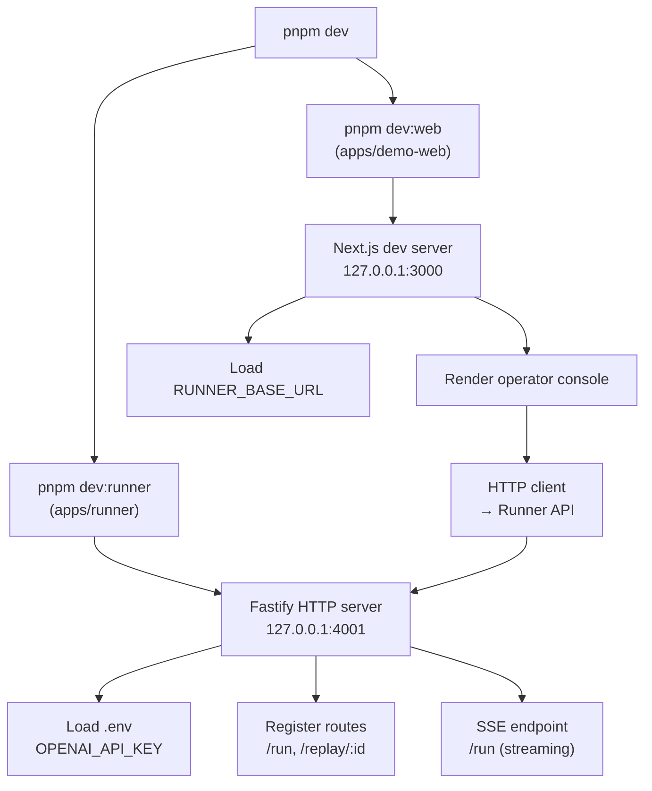

Sources: [README.md:58-62](), [README.md:66-73]()

### Separate Service Mode

For independent logs and debugging, run services separately:

```bash
# Terminal 1
pnpm dev:runner

# Terminal 2
RUNNER_BASE_URL=http://127.0.0.1:4001 pnpm dev:web
```

The `RUNNER_BASE_URL` environment variable configures the web application to connect to the runner service. This is useful when running services on different hosts or troubleshooting network issues.

Sources: [README.md:68-73]()

## Running Your First Scenario

Once both services are running, open the operator console at [http://127.0.0.1:3000](http://127.0.0.1:3000).

**First Run Workflow**

```mermaid
sequenceDiagram
    participant User
    participant DemoWeb["apps/demo-web<br/>(Port 3000)"]
    participant Runner["apps/runner<br/>(Port 4001)"]
    participant Core["packages/runner-core<br/>responses-loop.ts"]
    participant Playwright["Playwright<br/>Chromium"]
    
    User->>DemoWeb: "Navigate to http://127.0.0.1:3000"
    DemoWeb->>User: "Display scenario selection"
    User->>DemoWeb: "Select scenario (e.g., kanban)"
    User->>DemoWeb: "Keep Headless selected"
    User->>DemoWeb: "Click Start Run"
    
    DemoWeb->>Runner: "POST /run<br/>{scenarioId, config}"
    activate Runner
    
    Runner->>Runner: "Create workspace from labs/"
    Runner->>Playwright: "Launch browser session"
    Runner->>Core: "Start responses-loop.ts"
    
    loop "Up to 24 turns"
        Core->>Core: "Call Responses API"
        Core->>Playwright: "Execute actions"
        Core->>Runner: "Emit event"
        Runner->>DemoWeb: "SSE stream update"
    end
    
    Core->>Core: "Run verification"
    Core->>Runner: "Return outcome"
    deactivate Runner
    
    Runner->>DemoWeb: "Final status"
    DemoWeb->>User: "Display results"
```

The console displays three pre-configured scenarios:
- `kanban-reprioritize-sprint`: Drag-and-drop task prioritization
- `paint-draw-poster`: Canvas drawing and verification  
- `booking-complete-reservation`: Multi-step form completion

Select any scenario, keep the `Headless` checkbox selected (recommended for first run), and click **Start Run**. The system will:

1. Create an isolated workspace from `labs/` templates
2. Launch a Chromium browser session via `packages/browser-runtime`
3. Execute the scenario through `packages/runner-core/src/responses-loop.ts`
4. Stream live updates via Server-Sent Events (SSE)
5. Verify the outcome using scenario-specific verification logic
6. Generate a replay bundle with screenshots and events

For a detailed walkthrough with screenshots and troubleshooting, see [Running Your First Scenario](#2.3).

Sources: [README.md:64](), [README.md:98-104]()

## Verifying the Installation

A successful run displays:
- Live screenshot updates in the operator console
- Event stream showing model actions
- Final status indicating success or failure
- Replay bundle available for review

If the run completes successfully, the system is properly configured. The replay bundle contains:
- Screenshots at each turn
- Full event history
- Verification results
- Metadata about the run configuration

For more information on replay artifacts, see [Replay Bundles](#8.1).

**Common First-Run Issues**

| Issue | Likely Cause | Solution |
|-------|--------------|----------|
| Runner unreachable | Service not started | Verify `pnpm dev` output shows both services |
| API authentication error | Missing/invalid `OPENAI_API_KEY` | Check `.env` file configuration |
| Playwright missing | Browser not installed | Run `pnpm playwright:install` |
| Port conflict | Port 3000 or 4001 in use | Stop conflicting services or change `PORT`/`HOST` |

Sources: [README.md:64](), [README.md:150-157]()

## Next Steps

After completing your first run:

- **Explore execution modes**: Try switching between `native` and `code` mode by setting `CUA_RESPONSES_MODE` in `.env`. See [Native Mode](#5.2) and [Code Mode](#5.3).
- **Try other scenarios**: Execute `paint-draw-poster` or `booking-complete-reservation` to see different verification mechanisms. See [Official Scenarios](#6.2).
- **Review development commands**: Learn about linting, type checking, and testing. See [Development Commands](#2.2).
- **Understand the architecture**: Dive into how `responses-loop.ts` integrates with the Responses API. See [runner-core and responses-loop](#4.1).
- **Examine replay bundles**: Review captured screenshots and events from completed runs. See [Replay Bundles](#8.1).

Sources: [README.md:91-96](), [README.md:106-123]()

---

# Page: Prerequisites and Installation

# Prerequisites and Installation

<details>
<summary>Relevant source files</summary>

The following files were used as context for generating this wiki page:

- [README.md](README.md)

</details>


This page documents the required dependencies and installation steps necessary to set up a local development environment for the openai-cua-sample-app repository. It covers system prerequisites, dependency installation, environment configuration, and initial verification. For information about available development commands after installation, see [Development Commands](#2.2). For a walkthrough of running your first scenario, see [Running Your First Scenario](#2.3).

## System Requirements

The openai-cua-sample-app requires specific versions of Node.js and pnpm, along with Playwright's Chromium browser. The following table lists all required dependencies:

| Dependency | Required Version | Purpose |
|------------|------------------|---------|
| Node.js | `22.20.0` | JavaScript runtime for executing TypeScript applications |
| pnpm | `10.26.0` | Package manager for monorepo workspace management |
| Playwright Chromium | Latest stable | Browser automation engine for executing scenarios |
| Git | Any recent version | Version control for cloning the repository |

The repository uses `corepack` to manage the pnpm version, ensuring consistent package manager behavior across development environments. The specific Node.js version is enforced to maintain compatibility with dependencies and the OpenAI API client.

**Sources:** [README.md:18-23]()

## Installation Workflow

The installation process follows a deterministic sequence that prepares the monorepo structure, installs dependencies, configures environment variables, and provisions the Playwright browser.

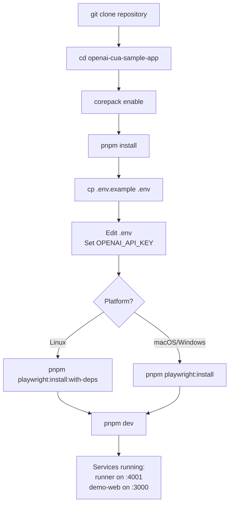

**Installation Sequence**

Sources: [README.md:24-64]()

### Step 1: Repository Cloning

```bash
git clone <repo-url>
cd openai-cua-sample-app
```

Clone the repository and navigate into the root directory. All subsequent commands assume execution from this root directory, which contains the `package.json`, `pnpm-workspace.yaml`, and `.env.example` files.

### Step 2: Package Manager Initialization

```bash
corepack enable
pnpm install
```

The `corepack enable` command activates Node.js's built-in package manager version management, ensuring that the exact version of pnpm specified in [package.json]() is used. The `pnpm install` command then installs all workspace dependencies, including packages for `apps/demo-web`, `apps/runner`, and all shared packages under `packages/*`.

If `pnpm install` prints an `Ignored build scripts` warning for optional dependencies like `sharp` or `esbuild`, these warnings can be safely ignored for local development. The repository builds and runs successfully without approving optional build scripts.

Sources: [README.md:26-42]()

### Step 3: Environment Configuration

```bash
cp .env.example .env
```

Copy the example environment file to create a `.env` file in the repository root. This file is read automatically by `apps/runner` when started through the provided development scripts. Edit `.env` to set the required `OPENAI_API_KEY` variable:

```bash
OPENAI_API_KEY=your_key_here
```

The runner service requires this API key to communicate with the OpenAI Responses API at [packages/runner-core/src/responses-loop.ts](). Without a valid API key, scenario execution will fail with authentication errors.

Sources: [README.md:31-40]()

### Step 4: Playwright Browser Installation

```bash
pnpm playwright:install
```

This command downloads and installs the Chromium browser binary required by Playwright. The `playwright:install` script is defined in the root [package.json]() and delegates to Playwright's installation command.

**Linux-specific requirements:**

On Linux systems, Playwright requires additional OS-level dependencies (shared libraries for graphics, fonts, and media codecs). Install these dependencies using:

```bash
pnpm playwright:install:with-deps
```

This command installs both the Chromium browser and all necessary system libraries. If Playwright later reports missing system libraries during scenario execution, rerun this command and follow any OS package prompts it displays.

Sources: [README.md:44-56]()

## Configuration File Structure

The repository uses multiple environment files to separate concerns between the runner service and the web console. The following diagram illustrates the configuration file locations and which services read them:

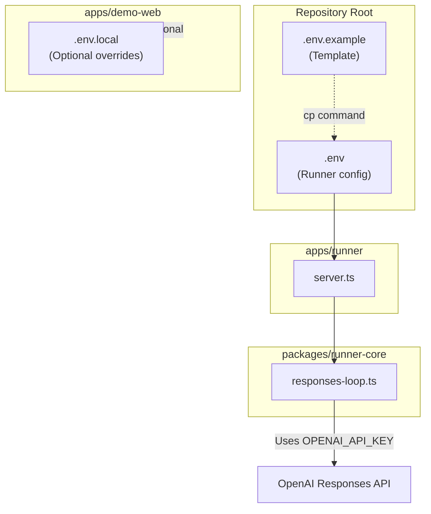

**Configuration File Hierarchy**

The runner service (`apps/runner`) reads the root `.env` file automatically. The web application (`apps/demo-web`) uses Next.js built-in defaults but can be overridden by creating `apps/demo-web/.env.local` for local development customization. The `.env.local` file supports overriding `NEXT_PUBLIC_*` variables that control client-side behavior like model selection and maximum response turns.

Sources: [README.md:34-40](), [README.md:125-141]()

## Environment Variable Reference

The following table lists all environment variables recognized by the runner and web applications:

### Runner Environment Variables

| Variable | Default | Required | Description |
|----------|---------|----------|-------------|
| `OPENAI_API_KEY` | None | Yes | API key for OpenAI Responses API authentication |
| `HOST` | `127.0.0.1` | No | Network interface for runner HTTP server |
| `PORT` | `4001` | No | TCP port for runner HTTP server |
| `CUA_DEFAULT_MODEL` | `gpt-5.4` | No | Default model for scenario execution |
| `CUA_RESPONSES_MODE` | `auto` | No | Responses API mode: `auto`, `fallback`, or `live` |

### Web Application Environment Variables

| Variable | Default | Required | Description |
|----------|---------|----------|-------------|
| `RUNNER_BASE_URL` | `http://127.0.0.1:4001` | No | HTTP endpoint for runner service |
| `NEXT_PUBLIC_CUA_DEFAULT_MODEL` | `gpt-5.4` | No | Default model displayed in UI |
| `NEXT_PUBLIC_CUA_DEFAULT_MAX_RESPONSE_TURNS` | `24` | No | Default maximum turns per scenario run |

Only `OPENAI_API_KEY` is required for basic operation. All other variables have sensible defaults for local development.

Sources: [README.md:125-141]()

## Dependency Graph

The installation process establishes dependencies between multiple components. Understanding this graph helps diagnose installation issues:

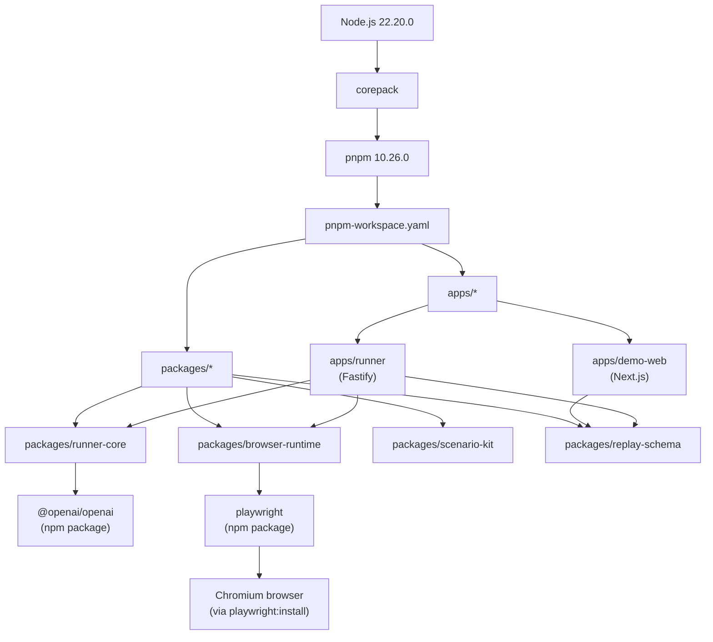

**Dependency Resolution Flow**

The monorepo uses pnpm workspaces defined in [pnpm-workspace.yaml]() to link local packages without publishing them to npm. The `apps/runner` depends on `packages/runner-core` and `packages/browser-runtime`, which in turn depend on external npm packages like `@openai/openai` and `playwright`. The Playwright Chromium binary is installed separately through the `playwright:install` script and is not managed by pnpm.

Sources: [README.md:106-123]()

## Installation Verification

After completing the installation steps, verify the setup by starting both services:

```bash
pnpm dev
```

This command starts both `apps/runner` (on port 4001) and `apps/demo-web` (on port 3000) concurrently. Successful startup produces log output similar to:

```
[runner] Server listening at http://127.0.0.1:4001
[demo-web] ▲ Next.js ready on http://127.0.0.1:3000
```

Navigate to `http://127.0.0.1:3000` in a web browser to access the operator console. The console should display the scenario selection interface. If the runner is unreachable, the console displays connection error messages.

For detailed information about running scenarios through the operator console, see [Running Your First Scenario](#2.3).

Sources: [README.md:58-64]()

## Platform-Specific Considerations

### Linux Systems

Linux installations require additional Playwright system dependencies. The `pnpm playwright:install:with-deps` command installs these automatically, but manual installation may be required on some distributions. If Playwright reports errors like `libgobject-2.0.so.0: cannot open shared object file`, install the missing libraries using your distribution's package manager.

### macOS and Windows

macOS and Windows systems typically require only the `pnpm playwright:install` command. Playwright automatically downloads the appropriate Chromium binary for the platform.

### Docker and CI Environments

The installation process is compatible with Docker and CI environments. For containerized deployments, use a Node.js 22.20.0 base image and install Playwright dependencies explicitly using `pnpm playwright:install:with-deps`. The repository does not include a Dockerfile in the current release branch.

Sources: [README.md:50-56]()

## Common Installation Issues

The following table lists common installation problems and their solutions:

| Issue | Symptom | Solution |
|-------|---------|----------|
| Wrong Node.js version | `pnpm install` fails with version error | Install Node.js 22.20.0 using nvm or system package manager |
| Missing corepack | `corepack: command not found` | Run `corepack enable` after installing Node.js |
| Playwright libraries missing | Browser launch fails with library errors | Run `pnpm playwright:install:with-deps` on Linux |
| Missing API key | Scenario execution fails with 401 | Set `OPENAI_API_KEY` in `.env` file |
| Port conflicts | Runner or web app fails to start | Change `PORT` in `.env` or `RUNNER_BASE_URL` in `apps/demo-web/.env.local` |

Sources: [README.md:42-56]()

## Next Steps

With prerequisites installed and environment configured, proceed to [Development Commands](#2.2) to learn about available pnpm scripts for development, testing, and building. To execute your first scenario, see [Running Your First Scenario](#2.3).

Sources: [README.md:1-158]()

---

# Page: Development Commands

# CLI Usage Examples

<details>
<summary>Relevant source files</summary>

The following files were used as context for generating this wiki page:

- [README.md](README.md)

</details>


This page provides concrete examples of how to use the Command Line Interface (CLI) for the OpenAI Computer Using Agent (CUA) sample application. It demonstrates various invocation patterns and parameter combinations for different computer environments. For detailed information about all supported CLI arguments, see [CLI Arguments](#2.1).

## Basic CLI Invocation

The CLI is the primary entry point for running the CUA sample application. The basic invocation pattern is simple and uses the default local-playwright environment.

```bash
python cli.py
```

This command starts the CUA with a local browser window using Playwright. The CLI will open a browser window, navigate to the default URL (https://bing.com), and prompt you for input with a `>` character.

To exit the CLI at any time, type `exit` at the prompt or press `Ctrl+C`.

Sources: [cli.py:18-101](), [README.md:49-57]()

## CLI Invocation Flow

The following diagram illustrates the basic flow when invoking the CLI:

```mermaid
sequenceDiagram
    participant User
    participant CLI as "CLI (cli.py)"
    participant Computer as "Computer Environment"
    participant Agent as "Agent"
    
    User->>CLI: "python cli.py [options]"
    Note over CLI: Parse arguments
    CLI->>CLI: Select computer class
    CLI->>Computer: Initialize environment
    CLI->>Agent: Create agent with computer
    
    alt If browser environment
        CLI->>Computer: goto(start_url)
    end
    
    loop Until user types 'exit'
        CLI->>User: Prompt for input (>)
        User->>CLI: Enter command/query
        CLI->>Agent: Add input to items & run_full_turn()
        Agent->>Agent: Process interactions
        Agent->>CLI: Return output items
        CLI->>CLI: Add output to items
    end
```

Sources: [cli.py:18-101]()

## Environment Selection Examples

The CUA sample application supports multiple computer environments through the `--computer` parameter. Here are examples for each supported environment:

### Local Playwright (Default)

```bash
python cli.py --computer local-playwright
```

This runs the agent with a local browser window using Playwright. It's the default option if `--computer` is not specified.

**First-time setup note**: If you haven't used Playwright before, you may be prompted to install browser dependencies. Follow the instructions provided in the command line to complete the setup.

### Docker Environment

```bash
python cli.py --computer docker
```

This connects the agent to a running Docker container environment. Before running this command, ensure you've built and started the Docker container:

```bash
docker build -t cua-sample-app .
docker run --rm -it --name cua-sample-app -p 5900:5900 --dns=1.1.1.3 -e DISPLAY=:99 cua-sample-app
```

### Browserbase Environment

```bash
python cli.py --computer browserbase
```

This connects to a remote browser via Browserbase. This requires setting up a Browserbase account and adding your API key to the `.env` file.

### Scrapybara Environments

For Scrapybara's browser environment:

```bash
python cli.py --computer scrapybara-browser
```

For Scrapybara's Ubuntu desktop environment:

```bash
python cli.py --computer scrapybara-ubuntu
```

Both require setting up a Scrapybara account and adding your API key to the `.env` file.

Sources: [cli.py:22-33](), [cli.py:58-64](), [README.md:91-98]()

## Computer Environment Selection

```mermaid
flowchart TD
    CLI["CLI Invocation"] --> ArgumentParser["Parse Arguments"]
    ArgumentParser --> ComputerArg{"--computer\nargument?"}
    
    ComputerArg -->|"local-playwright\nor not specified"| LocalPW["LocalPlaywrightComputer"]
    ComputerArg -->|"docker"| Docker["DockerComputer"]
    ComputerArg -->|"browserbase"| BrowserBase["BrowserbaseBrowser"]
    ComputerArg -->|"scrapybara-browser"| ScrapybaraB["ScrapybaraBrowser"]
    ComputerArg -->|"scrapybara-ubuntu"| ScrapybaraU["ScrapybaraUbuntu"]
    
    LocalPW --> Initialize["Initialize Selected Computer"]
    Docker --> Initialize
    BrowserBase --> Initialize
    ScrapybaraB --> Initialize
    ScrapybaraU --> Initialize
    
    Initialize --> CreateAgent["Create Agent with Computer"]
    CreateAgent --> StartLoop["Start Interaction Loop"]
```

Sources: [cli.py:58-72]()

## Common Parameter Combinations

### Starting with a Specific URL

For browser-based environments, you can specify a starting URL:

```bash
python cli.py --start-url google.com
```

Note that the CLI automatically adds `https://` if the URL doesn't start with `http` or `https`.

### Enabling Debug Mode

To see detailed output during execution:

```bash
python cli.py --debug
```

This enables debug mode, which provides more detailed information about the agent's execution flow, including model requests and responses.

### Showing Images During Execution

To display screenshots during execution:

```bash
python cli.py --show
```

This is useful for observing what the agent is seeing and how it's interacting with the computer environment.

### Providing Initial Input

Instead of waiting for user input at the prompt, you can provide an initial command:

```bash
python cli.py --input "Search for the weather in San Francisco"
```

This is particularly useful for automation scripts or when you want to start with a specific task.

Sources: [cli.py:34-55](), [cli.py:76-97]()

## Combined Parameter Examples

You can combine multiple parameters for more complex usage scenarios:

### Example 1: Browser with Debug and Images

```bash
python cli.py --computer local-playwright --debug --show --start-url github.com
```

This starts the agent with a local browser pointed at GitHub, with both debug output and screenshots enabled.

### Example 2: Docker with Initial Input

```bash
python cli.py --computer docker --input "Open a text editor and write a hello world program"
```

This connects to a Docker environment and immediately instructs the agent to open a text editor and write a hello world program.

### Example 3: Remote Browser with Custom URL

```bash
python cli.py --computer browserbase --start-url docs.python.org --show
```

This connects to a Browserbase remote browser, navigates to the Python documentation, and shows screenshots during execution.

Sources: [cli.py:18-101](), [README.md:49-57]()

## CLI Runtime Flow

```mermaid
stateDiagram-v2
    [*] --> ParseArgs: Start CLI
    ParseArgs --> SelectComputer: Process arguments
    SelectComputer --> Initialize: Map to computer class
    Initialize --> CreateAgent: Initialize computer
    
    CreateAgent --> BrowserCheck: Create agent
    
    BrowserCheck --> OpenURL: If browser environment
    BrowserCheck --> InputLoop: If not browser
    OpenURL --> InputLoop
    
    state InputLoop {
        [*] --> WaitForInput
        WaitForInput --> ProcessExit: User types 'exit'
        WaitForInput --> RunAgent: User provides input
        RunAgent --> AddResults: Agent processes input
        AddResults --> WaitForInput: Ready for next input
    }
    
    InputLoop --> Cleanup: Loop exits
    Cleanup --> [*]: End CLI
```

Sources: [cli.py:66-97]()

## Troubleshooting Common Issues

### First-time Playwright Setup

When running with `local-playwright` for the first time, you may see a message about missing browser executables. Follow the suggested command to install the necessary dependencies:

```bash
# Example of dependency installation command
playwright install
```

### Docker Container Conflicts

If you receive an error like:

```
docker: Error response from daemon: Conflict. The container name "/cua-sample-app" is already in use...
```

You'll need to remove the existing container:

```bash
docker rm -f cua-sample-app
```

### Environment Variables for Hosted Environments

For Browserbase or Scrapybara environments, ensure you've added your API key to the `.env` file:

```
# Example .env file
BROWSERBASE_API_KEY=your_api_key_here
SCRAPYBARA_API_KEY=your_api_key_here
```

Without these API keys, the remote environments will fail to initialize.

Sources: [README.md:24-26](), [README.md:126-137](), [README.md:139-143]()

---

# Page: Running Your First Scenario

# Running Your First Scenario

<details>
<summary>Relevant source files</summary>

The following files were used as context for generating this wiki page:

- [README.md](README.md)

</details>


This page provides a step-by-step walkthrough for executing your first scenario using the operator console. It assumes you have completed the installation steps from [Prerequisites and Installation](#2.1) and are familiar with the development commands from [Development Commands](#2.2). For details on how the operator console UI is implemented, see [Operator Console (demo-web)](#3.1). For information about the underlying execution flow, see [Execution Flow](#5.1).

## Starting the Services

After completing installation, start both the runner service and the operator console together:

```bash
pnpm dev
```

This command launches two services in parallel:

| Service | Location | Default Port | Purpose |
|---------|----------|-------------|---------|
| Runner | `apps/runner` | 4001 | Fastify server that manages workspaces, browser sessions, and execution orchestration |
| Operator Console | `apps/demo-web` | 3000 | Next.js web application providing the UI for initiating runs and reviewing results |

The services are now accessible at:
- Operator Console: `http://127.0.0.1:3000`
- Runner API: `http://127.0.0.1:4001`

Verify the runner is healthy by checking its status endpoint:

```bash
curl http://127.0.0.1:4001/health
```

The runner reads configuration from `.env` at the repository root, including `OPENAI_API_KEY`, `CUA_DEFAULT_MODEL`, and `CUA_RESPONSES_MODE`. The console reads from `apps/demo-web/.env.local` if present, otherwise uses built-in defaults for `NEXT_PUBLIC_*` variables.

**Sources:** [README.md:58-73]()

---

## Accessing the Operator Console

Open `http://127.0.0.1:3000` in your browser. The console displays the scenario selection interface, which includes:

- **Scenario dropdown**: Lists all available scenarios from `packages/scenario-kit`
- **Configuration panel**: Allows customization of execution parameters
- **Run history**: Shows previous runs and their outcomes

The console communicates with the runner service via two channels:
1. HTTP requests for initiating runs and fetching replay data
2. Server-Sent Events (SSE) for real-time streaming of execution updates

The base URL for runner communication is configured via `RUNNER_BASE_URL` (defaults to `http://127.0.0.1:4001`).

**Sources:** [README.md:64-65](), [README.md:137]()

---

## Configuring a Run

### Selecting a Scenario

The dropdown presents three official scenarios:

| Scenario ID | Display Name | Verification Type |
|-------------|--------------|-------------------|
| `kanban-reprioritize-sprint` | Kanban Sprint Reprioritization | Drag-and-drop state |
| `paint-draw-poster` | Paint Poster Drawing | Canvas state |
| `booking-complete-reservation` | Booking Reservation Completion | Form completion |

Each scenario has a manifest in `packages/scenario-kit` that defines its lab template path, prompt, and verification logic.

### Configuration Options

The configuration panel exposes several parameters:

| Parameter | Default | Purpose |
|-----------|---------|---------|
| **Headless Mode** | `true` | Controls whether the browser window is visible during execution |
| **Model** | `gpt-5.4` | Specifies which OpenAI model to use |
| **Max Response Turns** | `24` | Limits the number of response loop iterations |
| **Execution Mode** | `native` | Selects between `native` (computer tool API) and `code` (Playwright REPL) |

For your first run, keep **Headless Mode** selected. Headless execution is faster and more reliable for automated verification. To observe browser actions in real-time, disable headless mode in subsequent runs.

**Sources:** [README.md:64](), [README.md:91-96](), [README.md:138-139]()

---

## Starting the Run

Click the **Start Run** button. The console sends a `POST /run` request to the runner service with the selected configuration:

```typescript
// Request payload structure from replay-schema
{
  scenarioId: string;
  headless: boolean;
  model: string;
  maxResponseTurns: number;
  mode: "native" | "code";
}
```

The runner immediately responds with a run ID and begins execution:

1. **Workspace Creation**: The runner copies the scenario's lab template from `labs/` to a temporary workspace directory
2. **Browser Launch**: A Playwright Chromium session is initialized, either headless or headful
3. **Responses Loop Initialization**: The runner starts the execution loop in `packages/runner-core/src/responses-loop.ts`

The console establishes an SSE connection to `GET /sse/:runId` to receive real-time updates.

**Diagram: Run Initiation Sequence**

```mermaid
sequenceDiagram
    participant UI as "demo-web<br/>(Port 3000)"
    participant API as "apps/runner<br/>(Port 4001)"
    participant WS as "Workspace Manager"
    participant PW as "Playwright"
    participant RL as "responses-loop.ts"
    
    UI->>API: "POST /run<br/>{scenarioId, headless, model, ...}"
    activate API
    API->>API: "Generate runId"
    API->>WS: "createWorkspace(runId, scenarioId)"
    WS->>WS: "Copy from labs/"
    API->>PW: "launch({headless: true/false})"
    PW-->>API: "Browser session"
    API->>RL: "executeScenario(config)"
    activate RL
    API-->>UI: "{runId}"
    UI->>API: "GET /sse/:runId"
    API-->>UI: "SSE stream established"
    
    loop "Up to maxResponseTurns (default 24)"
        RL->>RL: "Send prompt + context to GPT-5.4"
        RL->>RL: "Execute actions in browser"
        RL->>RL: "Capture screenshot + events"
        RL->>API: "Emit event"
        API-->>UI: "data: {type, payload}"
    end
    
    RL->>RL: "Run verification"
    RL-->>API: "Outcome + artifacts"
    deactivate RL
    API->>API: "Bundle replay files"
    API-->>UI: "data: {type: 'complete', outcome}"
    deactivate API
```

**Sources:** [README.md:6](), [README.md:13]()

---

## Observing Execution

### Real-Time Updates

As the scenario executes, the console displays streaming updates via SSE events:

| Event Type | Payload | Purpose |
|------------|---------|---------|
| `turn:start` | `{turnNumber}` | Indicates a new response loop iteration |
| `action` | `{type, ...params}` | Shows individual actions (click, type, screenshot, etc.) |
| `screenshot` | `{imageData, timestamp}` | Provides current browser state |
| `turn:complete` | `{turnNumber}` | Marks end of iteration |
| `run:complete` | `{outcome, verification}` | Final result with success/failure |

The console renders these events in real-time, showing:
- A timeline of actions taken by the model
- Live screenshots of the browser state
- Progress through the maximum turn count

### Execution Flow

The runner orchestrates execution through `packages/runner-core/src/responses-loop.ts`, which implements the core Responses API integration:

**Diagram: Responses Loop Execution Flow**

```mermaid
graph TB
    Start["Run Started"] --> Init["Initialize context<br/>Load scenario manifest"]
    Init --> Loop["Responses Loop<br/>(responses-loop.ts)"]
    
    Loop --> Prompt["Build prompt with<br/>scenario instructions<br/>+ current state"]
    Prompt --> API["Call OpenAI Responses API<br/>Model: gpt-5.4"]
    API --> Response["Receive response<br/>(actions or code)"]
    
    Response --> Native{"Mode?"}
    Native -->|"native"| ComputerActions["Execute computer actions:<br/>- click(x, y)<br/>- drag(x1, y1, x2, y2)<br/>- type(text)<br/>- screenshot()"]
    Native -->|"code"| CodeExec["Execute JavaScript via<br/>exec_js function<br/>in Playwright context"]
    
    ComputerActions --> Capture["Capture state:<br/>- Screenshot<br/>- DOM events<br/>- Metadata"]
    CodeExec --> Capture
    
    Capture --> Stream["Stream SSE event<br/>to console"]
    Stream --> Check{"Turn limit<br/>or complete?"}
    
    Check -->|"Continue"| Loop
    Check -->|"Done"| Verify["Run verification logic<br/>from scenario executor"]
    
    Verify --> Bundle["Create replay bundle:<br/>- screenshots/<br/>- events.jsonl<br/>- metadata.json"]
    Bundle --> End["Run Complete"]
```

**Sources:** [README.md:13](), [README.md:91-96]()

---

## Viewing Results

### Completion States

When execution completes, the console displays one of three outcomes:

| Outcome | Description | Next Steps |
|---------|-------------|------------|
| **Success** | Verification passed | Review replay bundle to understand model behavior |
| **Failure** | Verification failed or error occurred | Examine error messages and screenshots to diagnose issue |
| **Timeout** | Maximum turns reached without completion | Increase `maxResponseTurns` or adjust scenario complexity |

### Replay Bundle

Every run generates a replay bundle in the runner's workspace directory, containing:

```
workspace/<runId>/
├── screenshots/
│   ├── turn-001-screenshot-001.png
│   ├── turn-001-screenshot-002.png
│   └── ...
├── events.jsonl
└── metadata.json
```

The console provides download and inspection capabilities for these artifacts:

- **Screenshots**: Chronological view of browser state at each screenshot action
- **Events**: Detailed log of all actions, API calls, and browser interactions in JSONL format
- **Metadata**: Run configuration, timing information, and verification results

Access the replay bundle via:
- Console UI: Click on a completed run to view its details
- Direct API: `GET /replay/:runId` returns a downloadable archive
- File system: Navigate to the runner's workspace directory

**Diagram: Result Data Flow**

```mermaid
graph LR
    RL["responses-loop.ts"] --> WS["Workspace<br/>workspace/<runId>/"]
    WS --> Screenshots["screenshots/<br/>PNG files"]
    WS --> Events["events.jsonl<br/>Action log"]
    WS --> Meta["metadata.json<br/>Config + outcome"]
    
    Runner["apps/runner"] --> Serve["/replay/:runId<br/>endpoint"]
    Serve --> Console["demo-web<br/>Replay viewer"]
    
    Screenshots -.-> Serve
    Events -.-> Serve
    Meta -.-> Serve
```

**Sources:** [README.md:5-6]()

---

## Troubleshooting First Runs

### Common Issues

| Issue | Cause | Solution |
|-------|-------|----------|
| "Missing OPENAI_API_KEY" | Environment variable not set | Verify `.env` contains valid API key |
| "Playwright not installed" | Browser binary missing | Run `pnpm playwright:install` |
| Connection refused (port 4001) | Runner not started | Ensure `pnpm dev` or `pnpm dev:runner` is running |
| Timeout after 24 turns | Scenario too complex for defaults | Increase `maxResponseTurns` in console UI |

### Verifying Setup

Before starting a run, confirm:

1. **API Key**: `echo $OPENAI_API_KEY` or check `.env` file
2. **Runner Health**: `curl http://127.0.0.1:4001/health` returns success
3. **Playwright**: Browser binary installed at correct path (shown in runner startup logs)
4. **Workspace Permissions**: Runner can write to temporary directory

### Inspecting Logs

The runner emits detailed logs during execution:

```bash
# View runner logs separately
pnpm dev:runner
```

Logs include:
- Workspace creation paths
- Browser launch details
- Responses API request/response summaries
- Verification step results

For more information on the execution flow and debugging strategies, see [Execution Flow](#5.1) and [Development Workflow](#8.3).

**Sources:** [README.md:24-65](), [README.md:66-83]()

---

# Page: Applications

# Applications

<details>
<summary>Relevant source files</summary>

The following files were used as context for generating this wiki page:

- [README.md](README.md)

</details>


This document describes the two main applications in the openai-cua-sample-app monorepo: the operator console (`apps/demo-web`) and the runner service (`apps/runner`). These applications work together to provide a complete system for executing browser-focused computer-use scenarios using GPT-5.4.

For detailed information about the shared packages these applications depend on, see [Core Packages](#4). For information about how scenarios are executed within the runner, see [Scenarios](#6).

## System Architecture

The repository implements a client-server architecture with two distinct applications that communicate over HTTP and Server-Sent Events (SSE).

### Application Overview

```mermaid
graph TB
    subgraph DemoWeb["apps/demo-web"]
        WebUI["Next.js Application<br/>Port 3000"]
        WebUIPages["Pages:<br/>• / (scenario selection)<br/>• /runs/[id] (live view)<br/>• /replays/[id] (replay view)"]
        WebUIComponents["Components:<br/>• ScenarioSelector<br/>• RunMonitor<br/>• ReplayViewer"]
        WebUIAPI["API Client:<br/>fetch + EventSource"]
    end
    
    subgraph Runner["apps/runner"]
        RunnerServer["Fastify Server<br/>Port 4001"]
        RunnerEndpoints["HTTP Endpoints:<br/>• POST /run<br/>• GET /replay/:id<br/>• GET /runs/:id/stream"]
        RunnerWorkspace["Workspace Manager:<br/>• Creates isolated dirs<br/>• Copies labs templates<br/>• Bundles artifacts"]
        RunnerOrchestration["Orchestration:<br/>• Browser sessions<br/>• SSE streams<br/>• Replay bundles"]
    end
    
    subgraph Packages["Shared Packages"]
        ReplaySchema["replay-schema<br/>Type contracts"]
        RunnerCore["runner-core<br/>Execution logic"]
        BrowserRuntime["browser-runtime<br/>Playwright wrapper"]
        ScenarioKit["scenario-kit<br/>Manifests"]
    end
    
    WebUI --> WebUIPages
    WebUI --> WebUIComponents
    WebUIComponents --> WebUIAPI
    WebUIAPI -->|"HTTP + SSE"| RunnerServer
    
    RunnerServer --> RunnerEndpoints
    RunnerServer --> RunnerWorkspace
    RunnerServer --> RunnerOrchestration
    
    WebUI -.->|imports| ReplaySchema
    RunnerServer -.->|imports| ReplaySchema
    RunnerOrchestration --> RunnerCore
    RunnerCore --> BrowserRuntime
    RunnerCore --> ScenarioKit
```

**Sources:** [README.md:5-7](), [README.md:108-121]()

The system separates presentation concerns (`demo-web`) from execution concerns (`runner`), enabling:
- Independent development and deployment of each service
- Clear responsibility boundaries
- Type-safe communication via `replay-schema` contracts
- Flexible hosting configurations (same machine or distributed)

### Communication Patterns

The applications communicate using three distinct patterns:

| Pattern | Direction | Purpose | Endpoint |
|---------|-----------|---------|----------|
| HTTP POST | Web → Runner | Initiate scenario execution | `POST /run` |
| SSE Stream | Runner → Web | Real-time execution updates | `GET /runs/:id/stream` |
| HTTP GET | Web → Runner | Retrieve replay artifacts | `GET /replay/:id` |

```mermaid
sequenceDiagram
    participant Browser as "Browser<br/>(User)"
    participant DemoWeb as "demo-web<br/>:3000"
    participant RunnerAPI as "runner<br/>:4001"
    participant RunnerCore as "runner-core"
    
    Browser->>DemoWeb: "Visit /"
    DemoWeb-->>Browser: "Scenario selection UI"
    
    Browser->>DemoWeb: "Select scenario + Start"
    DemoWeb->>RunnerAPI: "POST /run<br/>{scenarioId, config}"
    activate RunnerAPI
    
    RunnerAPI->>RunnerAPI: "Create workspace"
    RunnerAPI-->>DemoWeb: "201 {runId, streamUrl}"
    deactivate RunnerAPI
    
    DemoWeb->>Browser: "Navigate to /runs/[id]"
    Browser->>DemoWeb: "Load run monitor"
    DemoWeb->>RunnerAPI: "EventSource /runs/:id/stream"
    activate RunnerAPI
    
    RunnerAPI->>RunnerCore: "Execute scenario"
    
    loop "Each turn"
        RunnerCore-->>RunnerAPI: "Event + screenshot"
        RunnerAPI-->>DemoWeb: "SSE: event data"
        DemoWeb-->>Browser: "Update UI"
    end
    
    RunnerCore-->>RunnerAPI: "Completion + outcome"
    RunnerAPI->>RunnerAPI: "Bundle replay artifacts"
    RunnerAPI-->>DemoWeb: "SSE: done"
    deactivate RunnerAPI
    
    DemoWeb-->>Browser: "Show results link"
    
    Browser->>DemoWeb: "Navigate to /replays/[id]"
    DemoWeb->>RunnerAPI: "GET /replay/:id"
    RunnerAPI-->>DemoWeb: "Replay bundle"
    DemoWeb-->>Browser: "Replay viewer"
```

**Sources:** [README.md:5-7](), Diagram 5 from architecture overview

## Application Services

### Service Ports and URLs

Both applications run on localhost by default with fixed ports:

| Service | Default URL | Environment Variable |
|---------|-------------|---------------------|
| `demo-web` | `http://127.0.0.1:3000` | `RUNNER_BASE_URL` (to configure runner location) |
| `runner` | `http://127.0.0.1:4001` | `HOST` and `PORT` |

**Sources:** [README.md:130-131](), [README.md:137](), [README.md:64]()

### Monorepo Structure

```mermaid
graph LR
    subgraph Root["openai-cua-sample-app/"]
        EnvFile[".env<br/>(runner config)"]
        
        subgraph AppsDir["apps/"]
            DemoWeb["demo-web/<br/>Next.js app"]
            Runner["runner/<br/>Fastify app"]
        end
        
        subgraph PackagesDir["packages/"]
            ReplaySchema["replay-schema/"]
            ScenarioKit["scenario-kit/"]
            BrowserRuntime["browser-runtime/"]
            RunnerCore["runner-core/"]
        end
        
        subgraph LabsDir["labs/"]
            KanbanLab["kanban/"]
            PaintLab["paint/"]
            BookingLab["booking/"]
        end
    end
    
    DemoWeb -->|reads| EnvFile
    Runner -->|reads| EnvFile
    
    DemoWeb -->|imports| ReplaySchema
    Runner -->|imports| ReplaySchema
    Runner -->|imports| RunnerCore
    
    RunnerCore -->|imports| BrowserRuntime
    RunnerCore -->|imports| ScenarioKit
    
    Runner -->|copies templates from| LabsDir
```

**Sources:** [README.md:106-123]()

The monorepo uses pnpm workspaces to manage dependencies between applications and packages. Both applications import the `replay-schema` package for type-safe communication contracts.

## Development Modes

The system supports three development modes:

### Full System Mode

```bash
pnpm dev
```

Starts both `demo-web` (port 3000) and `runner` (port 4001) simultaneously. This is the standard development mode.

**Sources:** [README.md:60-62]()

### Independent Services Mode

```bash
# Terminal 1: Start runner only
pnpm dev:runner

# Terminal 2: Start web only with runner URL
RUNNER_BASE_URL=http://127.0.0.1:4001 pnpm dev:web
```

Runs services in separate terminals for independent log viewing. The `RUNNER_BASE_URL` environment variable configures the web application to connect to a specific runner instance.

**Sources:** [README.md:66-73]()

### Configuration Matrix

The following environment variables control inter-service communication:

| Variable | Location | Purpose | Default |
|----------|----------|---------|---------|
| `HOST` | Runner `.env` | Runner bind address | `127.0.0.1` |
| `PORT` | Runner `.env` | Runner listen port | `4001` |
| `RUNNER_BASE_URL` | Web `.env.local` or env | Runner API endpoint | `http://127.0.0.1:4001` |

**Sources:** [README.md:130-131](), [README.md:137]()

This configuration enables flexible deployment scenarios:
- Local development: both services on localhost
- Distributed development: runner on separate host/container
- Production: services behind reverse proxy or load balancer

## Workspace Management

The runner creates isolated workspace directories for each execution:

```mermaid
graph TB
    subgraph WorkspaceLifecycle["Workspace Lifecycle"]
        Start["Run initiated:<br/>POST /run"]
        Create["Create unique workspace dir:<br/>/tmp/run-{uuid}"]
        Copy["Copy lab templates:<br/>labs/{scenario}/* → workspace/"]
        Execute["Execute scenario:<br/>Browser points to workspace"]
        Bundle["Bundle artifacts:<br/>screenshots + events + metadata"]
        Serve["Serve replay:<br/>GET /replay/{id}"]
    end
    
    Start --> Create
    Create --> Copy
    Copy --> Execute
    Execute --> Bundle
    Bundle --> Serve
    
    subgraph LabTemplates["labs/"]
        KanbanTemplate["kanban/index.html"]
        PaintTemplate["paint/index.html"]
        BookingTemplate["booking/index.html"]
    end
    
    subgraph Workspace["Workspace: /tmp/run-abc123/"]
        WorkspaceFiles["index.html<br/>(copied from lab)"]
        WorkspaceArtifacts["artifacts/<br/>• screenshots/<br/>• events.json<br/>• metadata.json"]
    end
    
    Copy -.->|"cp -r"| KanbanTemplate
    Copy -.->|"cp -r"| PaintTemplate
    Copy -.->|"cp -r"| BookingTemplate
    
    Copy --> WorkspaceFiles
    Execute --> WorkspaceArtifacts
```

**Sources:** [README.md:6](), [README.md:121]()

Each run receives:
- A unique workspace directory for isolated execution
- A copy of the appropriate lab template from `labs/{scenario}/`
- Write access for saving artifacts and screenshots
- Automatic cleanup after replay bundle creation

## Type Safety Boundary

The `replay-schema` package enforces type consistency across the HTTP boundary:

```mermaid
graph LR
    subgraph DemoWebTypes["demo-web (TypeScript)"]
        WebRequest["RunRequest type"]
        WebResponse["RunResponse type"]
        WebEvents["ReplayEvent types"]
    end
    
    subgraph ReplaySchemaPackage["packages/replay-schema"]
        SchemaRequest["RunRequest interface"]
        SchemaResponse["RunResponse interface"]
        SchemaEvents["ReplayEvent union"]
        SchemaErrors["ErrorCode enum"]
    end
    
    subgraph RunnerTypes["runner (TypeScript)"]
        RunnerRequest["RunRequest type"]
        RunnerResponse["RunResponse type"]
        RunnerEvents["ReplayEvent types"]
    end
    
    DemoWebTypes -->|imports| ReplaySchemaPackage
    RunnerTypes -->|imports| ReplaySchemaPackage
    
    WebRequest -.->|"same type"| RunnerRequest
    WebResponse -.->|"same type"| RunnerResponse
    WebEvents -.->|"same type"| RunnerEvents
```

**Sources:** [README.md:112-113](), [README.md:7]()

Both applications import from `@cua/replay-schema`, ensuring:
- Request/response contracts match exactly
- Enum values are consistent
- Event types are validated at compile time
- Refactoring safety across the HTTP boundary

For details on specific schema types, see [replay-schema](#4.4).

## Next Steps

- For detailed documentation of the operator console UI, see [Operator Console (demo-web)](#3.1)
- For detailed documentation of the runner service API and orchestration, see [Runner Service](#3.2)
- For information about the execution logic within the runner, see [runner-core and responses-loop](#4.1)

---

# Page: Operator Console (demo-web)

# Operator Console (demo-web)

<details>
<summary>Relevant source files</summary>

The following files were used as context for generating this wiki page:

- [.env.example](.env.example)
- [README.md](README.md)

</details>


## Purpose and Scope

The Operator Console is a Next.js web application located in `apps/demo-web` that provides the user interface for interacting with the CUA sample app. It enables operators to select scenarios, configure execution parameters, initiate runs, monitor progress in real-time via Server-Sent Events, and review replay artifacts including screenshots and event logs.

This page documents the operator console's architecture, features, and integration points. For details about the backend service that executes runs, see [Runner Service](#3.2). For information about the SSE streaming protocol, see [Server-Sent Events (SSE)](#8.2). For replay bundle structure, see [Replay Bundles](#8.1).

**Sources:** [README.md:5-5](), [README.md:108-109]()

## Architecture Overview

The operator console is a Next.js application running on port 3000 by default. It communicates with the runner service through HTTP requests and receives real-time updates via SSE connections. The application shares type contracts with the runner through the `replay-schema` package to ensure type safety across the HTTP boundary.

### Application Structure

```mermaid
graph TB
    subgraph DemoWeb["apps/demo-web (Port 3000)"]
        NextApp["Next.js Application"]
        UIComponents["UI Components"]
        APIClient["Runner API Client"]
        SSEHandler["SSE Event Handler"]
        EnvConfig["Environment Configuration"]
    end
    
    subgraph SharedTypes["packages/replay-schema"]
        RunRequest["RunRequest"]
        RunResponse["RunResponse"]
        ReplayBundle["ReplayBundle"]
        ErrorTypes["Error Types"]
    end
    
    subgraph RunnerService["apps/runner (Port 4001)"]
        POSTRun["POST /run"]
        GETReplay["GET /replay/:id"]
        SSEStream["SSE Stream"]
    end
    
    UIComponents --> APIClient
    APIClient --> POSTRun
    APIClient --> GETReplay
    SSEHandler --> SSEStream
    
    APIClient -.->|"imports types"| RunRequest
    APIClient -.->|"imports types"| RunResponse
    UIComponents -.->|"imports types"| ReplayBundle
    UIComponents -.->|"imports types"| ErrorTypes
    
    EnvConfig -->|"RUNNER_BASE_URL"| APIClient
    EnvConfig -->|"NEXT_PUBLIC_CUA_DEFAULT_MODEL"| UIComponents
    EnvConfig -->|"NEXT_PUBLIC_CUA_DEFAULT_MAX_RESPONSE_TURNS"| UIComponents
```

**Diagram: Operator Console Architecture and Dependencies**

The console imports shared type definitions from `replay-schema` to maintain contract compatibility with the runner service. Configuration is managed through environment variables with the `NEXT_PUBLIC_` prefix for client-side access.

**Sources:** [README.md:5-7](), [README.md:112-113](), [README.md:136-139]()

## Core Features

### Scenario Selection and Configuration

The operator console provides a UI for selecting from the three official scenarios and configuring execution parameters:

| Feature | Description | Configuration |
|---------|-------------|---------------|
| Scenario Selection | Choose from `kanban`, `paint`, or `booking` scenarios | Loaded from `scenario-kit` manifests |
| Model Selection | Specify the GPT model to use | Default: `NEXT_PUBLIC_CUA_DEFAULT_MODEL` |
| Max Response Turns | Configure iteration limit | Default: `NEXT_PUBLIC_CUA_DEFAULT_MAX_RESPONSE_TURNS` (24) |
| Headless Mode | Toggle browser visibility | Boolean toggle (default: true) |
| Custom Prompt | Override scenario system prompt | Optional text input |

**Sources:** [README.md:64-64](), [README.md:98-103](), [README.md:136-139]()

### Run Initiation Workflow

```mermaid
sequenceDiagram
    participant User as "Operator"
    participant UI as "demo-web UI"
    participant API as "Runner API Client"
    participant Runner as "apps/runner"
    
    User->>UI: "Select scenario and config"
    User->>UI: "Click Start Run"
    UI->>API: "Prepare RunRequest"
    API->>Runner: "POST /run"
    Note over API,Runner: "HTTP request with scenario,<br/>model, maxTurns, headless"
    Runner-->>API: "RunResponse { runId }"
    API-->>UI: "Return runId"
    UI->>UI: "Open SSE connection"
    UI->>User: "Display run status"
```

**Diagram: Run Initiation Flow**

The console sends a `POST /run` request with scenario configuration and immediately establishes an SSE connection to receive real-time updates. The run proceeds asynchronously on the runner service.

**Sources:** [README.md:64-64]()

### Real-Time Progress Monitoring

The console receives Server-Sent Events from the runner service to provide live updates during run execution:

```mermaid
graph LR
    Runner["apps/runner<br/>SSE Endpoint"]
    SSEHandler["SSE Event Handler"]
    UIUpdate["UI State Updates"]
    Display["Progress Display"]
    
    Runner -->|"event stream"| SSEHandler
    SSEHandler -->|"parse events"| UIUpdate
    UIUpdate --> Display
    
    subgraph EventTypes["Event Types Received"]
        TurnEvent["Turn completion"]
        ScreenshotEvent["Screenshot capture"]
        ActionEvent["Action execution"]
        ErrorEvent["Error occurrence"]
        CompleteEvent["Run completion"]
    end
    
    SSEHandler -.-> EventTypes
```

**Diagram: Real-Time Event Streaming Architecture**

The SSE handler processes incoming events and updates the UI state, displaying screenshots, action logs, and completion status as the run progresses.

**Sources:** [README.md:5-5](), [README.md:6-6]()

### Replay Artifact Viewing

After a run completes (successfully or with failure), the console retrieves and displays the replay bundle:

| Artifact Type | Description | Display Format |
|---------------|-------------|----------------|
| Screenshots | Captured at each turn | Image gallery with timestamps |
| Event Log | Chronological action and response log | Scrollable text with syntax highlighting |
| Metadata | Run configuration and outcome | Key-value display |
| Verification Results | Success/failure with details | Status indicator and message |
| Error Information | Stack traces and error codes | Formatted error display |

The console fetches replay bundles via `GET /replay/:id` and presents them in a user-friendly format, enabling operators to understand what occurred during execution even when the runner is offline or a run has failed.

**Sources:** [README.md:5-5](), [README.md:16-16]()

## Communication Patterns

### HTTP Request-Response

```mermaid
graph TB
    subgraph ConsoleHTTP["HTTP Requests from demo-web"]
        InitRun["POST /run<br/>Initiate new run"]
        FetchReplay["GET /replay/:id<br/>Retrieve replay bundle"]
    end
    
    subgraph RunnerHTTP["apps/runner HTTP Endpoints"]
        HandleRun["POST /run handler<br/>Create workspace,<br/>launch browser,<br/>start responses-loop"]
        ServeReplay["GET /replay/:id handler<br/>Read replay bundle,<br/>serve JSON artifacts"]
    end
    
    InitRun --> HandleRun
    FetchReplay --> ServeReplay
    
    HandleRun -.->|"returns"| RunId["{ runId: string }"]
    ServeReplay -.->|"returns"| Bundle["ReplayBundle<br/>(screenshots, events, metadata)"]
```

**Diagram: HTTP Communication Patterns**

The console uses standard HTTP request-response patterns for run initiation and artifact retrieval. Run initiation returns immediately with a `runId`, while the actual execution proceeds asynchronously.

**Sources:** [README.md:6-6](), [README.md:111-111]()

### Server-Sent Events (SSE)

The console establishes a long-lived SSE connection to receive real-time updates throughout the run lifecycle:

```mermaid
stateDiagram-v2
    [*] --> Connecting: "Open SSE connection"
    Connecting --> Streaming: "Connection established"
    
    state Streaming {
        [*] --> ReceivingEvents
        ReceivingEvents --> UpdateUI: "Parse event data"
        UpdateUI --> ReceivingEvents: "Continue streaming"
    }
    
    Streaming --> Complete: "Run finishes"
    Streaming --> Error: "Connection error"
    Streaming --> Reconnecting: "Network interruption"
    
    Reconnecting --> Streaming: "Reconnect successful"
    Reconnecting --> Error: "Reconnect failed"
    
    Complete --> [*]
    Error --> [*]
```

**Diagram: SSE Connection Lifecycle**

The SSE connection remains open for the duration of the run, providing continuous updates. The console handles connection errors gracefully and displays appropriate status messages.

**Sources:** [README.md:6-6](), [README.md:111-111]()

## Configuration

### Environment Variables

The operator console is configured through environment variables. For client-side access in Next.js, variables must be prefixed with `NEXT_PUBLIC_`.

| Variable | Type | Default | Purpose |
|----------|------|---------|---------|
| `RUNNER_BASE_URL` | string | `http://127.0.0.1:4001` | Base URL for runner service API |
| `NEXT_PUBLIC_CUA_DEFAULT_MODEL` | string | `gpt-5.4` | Default model selection in UI |
| `NEXT_PUBLIC_CUA_DEFAULT_MAX_RESPONSE_TURNS` | number | `24` | Default maximum response turns |

**Configuration Location:** `apps/demo-web/.env.local`

The console reads configuration from `.env.local` following Next.js conventions. The `RUNNER_BASE_URL` enables flexible deployment configurations, allowing the runner service to be hosted separately from the web application.

**Sources:** [README.md:40-40](), [README.md:136-139](), [.env.example:8-11]()

### Development Configuration

When running the services separately for development:

```bash
# Terminal 1: Start runner on default port 4001
pnpm dev:runner

# Terminal 2: Start web with explicit runner URL
RUNNER_BASE_URL=http://127.0.0.1:4001 pnpm dev:web
```

The `RUNNER_BASE_URL` environment variable overrides the default runner location, enabling independent service development.

**Sources:** [README.md:68-73]()

## User Workflow

### Typical Operator Interaction Flow

```mermaid
flowchart TD
    Start["Operator opens<br/>http://127.0.0.1:3000"]
    
    Start --> SelectScenario["Select scenario<br/>(kanban/paint/booking)"]
    SelectScenario --> ConfigureRun["Configure parameters:<br/>- Model<br/>- Max turns<br/>- Headless mode<br/>- Custom prompt (optional)"]
    ConfigureRun --> InitiateRun["Click 'Start Run'"]
    
    InitiateRun --> WaitForStart["Wait for run initiation"]
    WaitForStart --> MonitorProgress["Monitor real-time progress:<br/>- View screenshots<br/>- See action logs<br/>- Track turn count"]
    
    MonitorProgress --> CheckComplete{"Run complete?"}
    CheckComplete -->|"No"| MonitorProgress
    CheckComplete -->|"Yes"| ViewResults["View final results:<br/>- Verification outcome<br/>- Complete event log<br/>- All screenshots"]
    
    ViewResults --> AnalyzeOutcome{"Successful?"}
    AnalyzeOutcome -->|"Yes"| ReviewSuccess["Review successful<br/>completion details"]
    AnalyzeOutcome -->|"No"| ReviewFailure["Review error messages,<br/>failed verification details"]
    
    ReviewSuccess --> End["End session or<br/>start new run"]
    ReviewFailure --> End
```

**Diagram: Operator Workflow Through the Console**

The console is designed to provide clear visibility into run status and outcomes, supporting iterative development and debugging even when runs fail or the runner service experiences issues.

**Sources:** [README.md:16-16](), [README.md:64-64]()

### Error Handling and Offline Scenarios

The operator console is designed to remain functional and informative even when the runner service is unavailable:

| Scenario | Console Behavior | User Experience |
|----------|------------------|-----------------|
| Runner offline at startup | Display connection error | Clear message indicating runner unavailable |
| Runner crashes during run | SSE connection breaks | Show last known state, indicate disconnection |
| Run fails with error | Receive error event via SSE | Display error code, message, and stack trace |
| Replay bundle corrupted | `GET /replay/:id` fails | Show error message, allow retry |
| Network interruption | SSE reconnection attempts | Show reconnecting status, resume on success |

The console's resilience ensures operators can diagnose issues effectively, fulfilling the design goal stated in the README: "how to build an operator-facing console that is understandable even when the runner is offline or a run fails."

**Sources:** [README.md:16-16]()

---

# Page: Runner Service

# Runner Service

<details>
<summary>Relevant source files</summary>

The following files were used as context for generating this wiki page:

- [.env.example](.env.example)
- [README.md](README.md)

</details>


## Purpose and Scope

The Runner Service is a Fastify-based HTTP backend located in [apps/runner]() that orchestrates scenario execution workflows. It serves as the integration layer between the operator console and the core execution engine, managing isolated workspaces, browser session lifecycles, and real-time event streaming.

This page documents the service's architecture, HTTP API surface, workspace management, and deployment configuration. For the execution logic that runs within the runner service, see [runner-core and responses-loop](#4.1). For the frontend that communicates with this service, see [Operator Console (demo-web)](#3.1).

**Sources:** [README.md:1-158]()

---

## Service Architecture

The runner service acts as a stateful HTTP server that coordinates between the operator console, execution packages, and browser automation infrastructure.

### Component Overview

```mermaid
graph TB
    subgraph External["External Clients"]
        DemoWeb["apps/demo-web<br/>Operator Console<br/>Port 3000"]
    end
    
    subgraph RunnerApp["apps/runner (Port 4001)"]
        FastifyServer["Fastify Server"]
        WorkspaceManager["Workspace Manager"]
        RunOrchestrator["Run Orchestrator"]
        SSEHandler["SSE Stream Handler"]
        ReplayServer["Replay Bundle Server"]
    end
    
    subgraph CorePackages["Core Packages"]
        RunnerCore["packages/runner-core<br/>responses-loop.ts"]
        BrowserRuntime["packages/browser-runtime"]
        ScenarioKit["packages/scenario-kit"]
    end
    
    subgraph Resources["File System"]
        LabsDir["labs/<br/>Static templates"]
        WorkspacesDir["run-workspaces/<br/>Isolated runtime dirs"]
    end
    
    DemoWeb -->|"HTTP POST /run"| FastifyServer
    DemoWeb -->|"SSE GET /run/:id/stream"| FastifyServer
    DemoWeb -->|"HTTP GET /replay/:id"| FastifyServer
    
    FastifyServer --> WorkspaceManager
    FastifyServer --> RunOrchestrator
    FastifyServer --> SSEHandler
    FastifyServer --> ReplayServer
    
    WorkspaceManager -->|Copy templates| LabsDir
    WorkspaceManager -->|Create directories| WorkspacesDir
    
    RunOrchestrator --> RunnerCore
    RunnerCore --> BrowserRuntime
    RunnerCore --> ScenarioKit
    
    RunOrchestrator -->|Emit events| SSEHandler
    ReplayServer -->|Serve artifacts| WorkspacesDir
```

**Sources:** [README.md:6](), [README.md:108-124]()

---

## HTTP API Surface

The runner service exposes three primary endpoint categories: run initiation, event streaming, and replay artifact retrieval.

### Endpoint Catalog

| Method | Path | Purpose | Response Type |
|--------|------|---------|---------------|
| `POST` | `/run` | Start a new scenario execution | JSON (run metadata) |
| `GET` | `/run/:id/stream` | Subscribe to real-time run events | Server-Sent Events |
| `GET` | `/replay/:id` | Retrieve replay bundle for completed run | JSON (replay artifacts) |
| `GET` | `/health` | Service health check | JSON (status) |

### Run Initiation Flow

```mermaid
sequenceDiagram
    participant Client as "demo-web"
    participant API as "Fastify Server"
    participant WM as "Workspace Manager"
    participant RO as "Run Orchestrator"
    participant RC as "runner-core"
    
    Client->>API: POST /run<br/>{scenario, mode, config}
    activate API
    
    API->>API: Generate run ID
    API->>WM: Create workspace
    WM->>WM: Copy lab templates
    WM->>WM: Initialize directory
    WM-->>API: Workspace path
    
    API->>RO: Start execution
    activate RO
    
    RO->>RC: Launch responses-loop
    activate RC
    
    API-->>Client: 200 OK<br/>{runId, status}
    deactivate API
    
    Note over RC: Execution continues async
    
    RC-->>RO: Events
    RO->>API: SSE broadcasts
    
    RC-->>RO: Completion
    deactivate RC
    
    RO->>RO: Bundle replay files
    RO-->>API: Final status
    deactivate RO
```

**Sources:** [README.md:6](), Diagram 5 from context (Data Flow and Communication Patterns)

---

## Workspace Management

The runner service creates isolated filesystem workspaces for each execution. Each workspace contains a copy of the appropriate lab template and serves as the browser's working directory.

### Workspace Lifecycle

```mermaid
stateDiagram-v2
    [*] --> TemplateSelection: POST /run received
    TemplateSelection --> DirectoryCreation: Select from labs/
    DirectoryCreation --> TemplateCopy: mkdir run-workspaces/{runId}
    TemplateCopy --> BrowserLaunch: cp labs/{scenario}/* to workspace
    BrowserLaunch --> Execution: Browser CWD = workspace
    Execution --> BundleCreation: Run completes
    BundleCreation --> Retention: Package artifacts
    Retention --> [*]: Ready for /replay/:id
```

### Directory Structure

Each run workspace follows this structure:

```
run-workspaces/
└── {runId}/
    ├── index.html          # Copied from labs/{scenario}/
    ├── styles.css          # Lab static assets
    ├── script.js           # Lab JavaScript
    ├── screenshots/        # Created during execution
    │   ├── 0001.png
    │   ├── 0002.png
    │   └── ...
    └── replay-bundle.json  # Created after verification
```

**Sources:** [README.md:121](), [README.md:15](), Diagram 1 from context (System Overview)

---

## Execution Orchestration

The runner service coordinates scenario execution by integrating with `runner-core` and managing browser session lifecycles.

### Orchestration Responsibilities

```mermaid
graph LR
    subgraph RunOrchestrator["Run Orchestrator"]
        Init["Initialize Run"]
        Browser["Launch Browser Session"]
        Core["Start responses-loop"]
        Monitor["Monitor Execution"]
        Verify["Invoke Verification"]
        Bundle["Create Replay Bundle"]
    end
    
    subgraph External["External Components"]
        Playwright["Playwright Browser"]
        ResponsesLoop["runner-core<br/>responses-loop.ts"]
        Verifier["Scenario Verifiers"]
    end
    
    Init --> Browser
    Browser --> Playwright
    Browser --> Core
    Core --> ResponsesLoop
    Core --> Monitor
    Monitor --> Verify
    Verify --> Verifier
    Verify --> Bundle
```

The orchestrator:
1. Allocates a unique run identifier
2. Creates an isolated workspace from lab templates
3. Launches a Playwright browser session pointing to the workspace
4. Invokes the `responses-loop` from `runner-core` with scenario configuration
5. Monitors execution progress and captures events
6. Triggers scenario-specific verification after completion
7. Packages screenshots, events, and verification results into a replay bundle

**Sources:** [README.md:6](), [README.md:118-119](), Diagram 2 from context (Run Execution Lifecycle)

---

## Server-Sent Events (SSE)

Real-time run updates stream to the operator console via Server-Sent Events. Each connected client receives a continuous stream of structured events during execution.

### Event Stream Protocol

```mermaid
sequenceDiagram
    participant Client as "demo-web"
    participant SSE as "SSE Handler"
    participant RO as "Run Orchestrator"
    participant RC as "runner-core"
    
    Client->>SSE: GET /run/:id/stream
    activate SSE
    SSE-->>Client: Connection established
    
    loop Until completion
        RC->>RO: Emit event<br/>(screenshot, action, state)
        RO->>SSE: Broadcast event
        SSE-->>Client: data: {JSON event}
    end
    
    RC->>RO: Execution complete
    RO->>SSE: Send completion event
    SSE-->>Client: data: {status: "complete"}
    SSE->>SSE: Close stream
    deactivate SSE
```

### Event Types

The SSE stream emits these event categories:

| Event Type | Payload | Frequency |
|------------|---------|-----------|
| `screenshot` | Base64-encoded PNG, timestamp | After each model turn |
| `action` | Computer action or exec_js call | Per response turn |
| `state` | Browser DOM state snapshot | Periodic |
| `turn` | Turn number, cumulative actions | Per response cycle |
| `completion` | Final status, verification outcome | Once at end |
| `error` | Error code, message, stack trace | On failure |

Clients maintain open connections throughout run execution. The server closes the stream after emitting the final `completion` or `error` event.

**Sources:** [README.md:6](), [README.md:111](), Diagram 5 from context (Data Flow and Communication Patterns)

---

## Replay Bundle Serving

After execution completes, the runner service packages all run artifacts into a replay bundle accessible via HTTP.

### Bundle Structure

The replay bundle aggregates:

- **Screenshots**: PNG captures after each model turn
- **Events**: Timestamped log of all computer actions or exec_js calls
- **Metadata**: Scenario ID, execution mode, model configuration
- **Verification**: Pass/fail status and verification-specific data
- **Timing**: Turn durations, total execution time

### Retrieval Flow

```mermaid
graph TB
    Client["demo-web"]
    API["GET /replay/:id"]
    FS["File System"]
    Bundle["replay-bundle.json"]
    Screenshots["screenshots/"]
    
    Client -->|Request replay| API
    API -->|Read workspace| FS
    FS -->|Load| Bundle
    FS -->|Reference| Screenshots
    API -->|Return JSON| Client
    
    Client -->|Display in UI| ReplayViewer["Replay Viewer Component"]
```

The replay endpoint serves a JSON response conforming to the `replay-schema` package contracts. Screenshot paths are either inlined as base64 or served as relative URLs depending on configuration.

**Sources:** [README.md:6](), [README.md:112-113](), [README.md:5]()

---

## Configuration

The runner service reads configuration from environment variables defined in the repository root `.env` file.

### Environment Variables

| Variable | Default | Purpose |
|----------|---------|---------|
| `OPENAI_API_KEY` | *(required)* | OpenAI API authentication |
| `HOST` | `127.0.0.1` | Bind address for Fastify server |
| `PORT` | `4001` | HTTP listen port |
| `CUA_DEFAULT_MODEL` | `gpt-5.4` | Default model for responses-loop |
| `CUA_RESPONSES_MODE` | `auto` | Execution mode: `auto`, `fallback`, or `live` |

### Startup Sequence

```mermaid
stateDiagram-v2
    [*] --> LoadEnv: Read .env
    LoadEnv --> ValidateConfig: Parse variables
    ValidateConfig --> InitFastify: Validate OPENAI_API_KEY
    InitFastify --> RegisterRoutes: Create server instance
    RegisterRoutes --> ListenPort: Mount /run, /replay endpoints
    ListenPort --> Ready: Bind to HOST:PORT
    Ready --> [*]: Service available
```

The runner automatically loads `.env` when started via `pnpm dev:runner` or `pnpm dev`. For manual execution, ensure environment variables are exported before starting the process.

**Sources:** [README.md:34-38](), [README.md:40](), [README.md:127-134](), [.env.example:1-12]()

---

## Deployment Considerations

### Development Mode

Start the runner independently:

```bash
pnpm dev:runner
```

This launches the Fastify server on the configured `HOST` and `PORT`, typically `127.0.0.1:4001`.

### Production Readiness

The runner service includes these production-oriented features:

- **Health checks**: `/health` endpoint for load balancer probes
- **Graceful shutdown**: Pending runs complete before process exit
- **Structured logging**: JSON logs for aggregation pipelines
- **Error boundaries**: Unhandled exceptions don't crash the server

### Resource Requirements

Each concurrent run consumes:
- One Playwright browser instance (100-300MB RAM)
- One isolated workspace directory (10-50MB disk)
- One SSE connection (minimal network overhead)

Disk usage grows linearly with retained replay bundles. Implement cleanup policies for production deployments.

**Sources:** [README.md:68-73](), [README.md:6]()

---

## Integration Points

### Upstream: Operator Console

The runner service serves requests from [demo-web](#3.1) running on port 3000. The console configures the runner's base URL via `RUNNER_BASE_URL`.

### Downstream: runner-core

The service delegates execution logic to [runner-core](#4.1), specifically invoking `responses-loop.ts` for Responses API integration. The runner owns workspace and browser lifecycle, while runner-core owns model interaction and verification.

### Shared Contracts: replay-schema

Both the runner service and demo-web import types from [replay-schema](#4.4) to ensure HTTP request/response compatibility. This package defines the canonical structure for run configurations, event payloads, and replay bundles.

**Sources:** [README.md:5-7](), [README.md:112-119](), Diagram 4 from context (Package Dependency Architecture)

---

# Page: Core Packages

# Core Packages

<details>
<summary>Relevant source files</summary>

The following files were used as context for generating this wiki page:

- [README.md](README.md)

</details>


This document provides an overview of the four shared packages that comprise the business logic and infrastructure layer of the openai-cua-sample-app. These packages enable code reuse between the web console and runner service, enforce contract boundaries, and provide modular abstractions for browser control, scenario execution, and API integration.

For detailed information about specific packages, see:
- [runner-core and responses-loop](#4.1) for the canonical Responses API integration and scenario execution
- [browser-runtime](#4.2) for the Playwright abstraction layer
- [scenario-kit](#4.3) for scenario manifest definitions
- [replay-schema](#4.4) for shared type contracts

For information about the applications that consume these packages, see [Applications](#3).

**Sources:** [README.md:1-158]()

---

## Package Overview

The monorepo contains four shared packages located in the `packages/` directory:

| Package | Location | Primary Responsibility |
|---------|----------|----------------------|
| `runner-core` | `packages/runner-core/` | Orchestrates scenario execution, contains `responses-loop.ts` (the canonical Responses API integration point), implements scenario executors and verification logic |
| `browser-runtime` | `packages/browser-runtime/` | Provides Playwright session abstraction and browser control primitives |
| `scenario-kit` | `packages/scenario-kit/` | Defines scenario manifests and prompt defaults for the three official scenarios |
| `replay-schema` | `packages/replay-schema/` | Exports shared TypeScript contracts for requests, responses, replay data structures, and error types |

All packages are written in TypeScript and managed as pnpm workspaces, enabling type-safe imports across application boundaries.

**Sources:** [README.md:106-124]()

---

## Package Dependency Architecture

```mermaid
graph TB
    subgraph apps["Application Layer"]
        DemoWeb["apps/demo-web"]
        RunnerApp["apps/runner"]
    end
    
    subgraph packages["Core Packages"]
        RunnerCore["packages/runner-core"]
        BrowserRuntime["packages/browser-runtime"]
        ScenarioKit["packages/scenario-kit"]
        ReplaySchema["packages/replay-schema"]
    end
    
    subgraph external["External Dependencies"]
        Playwright["@playwright/test"]
        OpenAI["openai SDK"]
    end
    
    DemoWeb -->|"imports types"| ReplaySchema
    
    RunnerApp -->|"imports executors"| RunnerCore
    RunnerApp -->|"imports types"| ReplaySchema
    
    RunnerCore -->|"imports"| BrowserRuntime
    RunnerCore -->|"imports manifests"| ScenarioKit
    RunnerCore -->|"imports types"| ReplaySchema
    RunnerCore -->|"calls API"| OpenAI
    
    BrowserRuntime -->|"wraps"| Playwright
    
    style RunnerCore stroke-width:3px
```

**Package Dependency Rules:**

The dependency graph enforces a clean separation of concerns:

1. **`replay-schema`** has zero internal dependencies. It serves as a pure contract layer imported by both applications and other packages.
2. **`scenario-kit`** has zero dependencies on other internal packages. It provides static scenario definitions.
3. **`browser-runtime`** depends only on Playwright. It abstracts browser control without knowledge of scenarios or API integration.
4. **`runner-core`** imports all three other packages and orchestrates execution. It is the only package that integrates with the OpenAI API.
5. **`apps/demo-web`** imports only `replay-schema`, ensuring the frontend has no direct dependency on execution logic.
6. **`apps/runner`** imports both `runner-core` and `replay-schema`, acting as the HTTP/SSE serving layer.

**Sources:** [README.md:106-124]()

---

## Key Exports by Package

This section maps high-level package responsibilities to concrete code symbols, enabling readers to locate specific functionality in the codebase.

### replay-schema Package

Located in `packages/replay-schema/`, this package exports TypeScript types and interfaces used across HTTP boundaries.

**Primary Exports:**
- Request/response contracts for the `/run` endpoint
- `ReplayBundle` type representing captured artifacts (screenshots, events, metadata)
- Error type definitions for structured error handling
- Event stream schemas for Server-Sent Events (SSE)

This package contains no runtime logic—only type definitions. Both `apps/demo-web` and `apps/runner` import these contracts to maintain type safety across the network boundary.

### scenario-kit Package

Located in `packages/scenario-kit/`, this package exports scenario manifest objects.

**Primary Exports:**
- Scenario manifest definitions for `kanban-reprioritize-sprint`, `paint-draw-poster`, and `booking-complete-reservation`
- Default prompt templates used by the operator console
- Scenario metadata (display names, descriptions, verification types)

The manifests are plain JavaScript objects that describe scenario configuration, including which lab template to use, what verification logic to apply, and what instructions to provide to the model.

### browser-runtime Package

Located in `packages/browser-runtime/`, this package wraps Playwright with a simplified API surface.

**Primary Exports:**
- Browser session lifecycle management (launch, teardown)
- Screenshot capture utilities
- Navigation and page state inspection primitives
- Headless/headful browser mode configuration

The `browser-runtime` package provides a stable abstraction over Playwright, allowing the rest of the system to avoid direct Playwright API coupling.

### runner-core Package

Located in `packages/runner-core/`, this is the most complex package, containing the core execution logic.

**Primary Exports:**
- `responses-loop.ts`: The canonical integration point for the Responses API (see [responses-loop](#4.1))
- Scenario executor implementations for each official scenario
- Verification functions that check drag-and-drop state, canvas state, and form completion
- Turn-by-turn orchestration logic that coordinates browser actions with model responses

The `packages/runner-core/src/responses-loop.ts` file is explicitly called out in the README as the single canonical place where Responses API integration occurs.

**Sources:** [README.md:1-158]()

---

## Package Integration Points

```mermaid
graph LR
    subgraph frontend["Frontend (Next.js)"]
        UIComponents["UI Components"]
        APIClient["API Client"]
    end
    
    subgraph backend["Backend (Fastify)"]
        HTTPHandlers["HTTP Handlers<br/>/run, /replay"]
        SSEEndpoint["SSE Endpoint<br/>/stream"]
        WorkspaceMgr["Workspace Manager"]
    end
    
    subgraph core["runner-core"]
        ResponsesLoop["responses-loop.ts"]
        KanbanExec["kanban executor"]
        PaintExec["paint executor"]
        BookingExec["booking executor"]
        Verifiers["verification logic"]
    end
    
    subgraph runtime["browser-runtime"]
        PlaywrightWrapper["Playwright wrapper"]
    end
    
    subgraph scenarios["scenario-kit"]
        Manifests["scenario manifests"]
    end
    
    subgraph contracts["replay-schema"]
        Types["TypeScript types"]
    end
    
    UIComponents -->|"imports"| Types
    APIClient -->|"sends RunRequest"| HTTPHandlers
    HTTPHandlers -->|"imports"| Types
    HTTPHandlers -->|"calls"| ResponsesLoop
    WorkspaceMgr -->|"copies labs"| Manifests
    ResponsesLoop -->|"reads"| Manifests
    ResponsesLoop -->|"calls"| KanbanExec
    ResponsesLoop -->|"calls"| PaintExec
    ResponsesLoop -->|"calls"| BookingExec
    KanbanExec -->|"calls"| Verifiers
    PaintExec -->|"calls"| Verifiers
    BookingExec -->|"calls"| Verifiers
    ResponsesLoop -->|"uses"| PlaywrightWrapper
    Verifiers -->|"uses"| PlaywrightWrapper
    SSEEndpoint -->|"streams"| APIClient
```

**Integration Flow:**

1. **Frontend → Backend:** `apps/demo-web` imports types from `replay-schema` and sends HTTP requests to `apps/runner` endpoints
2. **Backend → Core:** `apps/runner` HTTP handlers invoke functions from `runner-core`, passing in configuration and workspace paths
3. **Core → Runtime:** `runner-core` executors call `browser-runtime` functions to control the browser
4. **Core → Scenarios:** `runner-core` reads manifests from `scenario-kit` to determine execution parameters
5. **Backend → Frontend:** `apps/runner` streams events back to `apps/demo-web` via SSE, using event types defined in `replay-schema`

The `replay-schema` package acts as a shared vocabulary between frontend and backend, while `runner-core` acts as the orchestration hub that integrates all other packages.

**Sources:** [README.md:1-158]()

---

## Execution Mode Support

Both `native` and `code` execution modes are implemented entirely within `packages/runner-core/`. The mode selection (controlled by the `CUA_RESPONSES_MODE` environment variable) affects how `responses-loop.ts` constructs the Responses API request.

**Mode Implementation:**

- **Native Mode:** The `responses-loop.ts` file constructs Responses API requests that expose the computer tool directly. The model emits raw computer actions (clicks, drags, typing) which are then translated into Playwright commands by `runner-core`.

- **Code Mode:** The `responses-loop.ts` file constructs Responses API requests that expose an `exec_js` function. The model writes Playwright JavaScript code, which `runner-core` executes directly in the browser context.

Both modes use the same:
- Scenario manifests from `scenario-kit`
- Browser control primitives from `browser-runtime`
- Verification logic in `runner-core`
- Replay bundle structure from `replay-schema`

This design ensures that execution mode is an implementation detail of the orchestration layer, not a system-wide architectural constraint.

**Sources:** [README.md:91-97]()

---

## Workspace and Lab Integration

The `packages/runner-core/` execution logic relies on isolated workspaces created by `apps/runner`. Each workspace is populated by copying static HTML/CSS/JavaScript files from the `labs/` directory.

**Lab Template Mapping:**

| Scenario | Lab Template | Package Usage |
|----------|-------------|---------------|
| `kanban-reprioritize-sprint` | `labs/kanban/` | Manifest in `scenario-kit`, executor in `runner-core` |
| `paint-draw-poster` | `labs/paint/` | Manifest in `scenario-kit`, executor in `runner-core` |
| `booking-complete-reservation` | `labs/booking/` | Manifest in `scenario-kit`, executor in `runner-core` |

The scenario manifest in `scenario-kit` specifies which lab template to use. The `apps/runner` workspace manager copies the lab files into a run-specific directory. The `runner-core` executor then launches a browser pointed at that workspace using `browser-runtime`.

**Sources:** [README.md:98-124]()

---

## Package Modularity Benefits

The four-package architecture provides several advantages:

1. **Type Safety Across Boundaries:** `replay-schema` ensures that HTTP requests, SSE events, and replay bundles maintain type consistency between frontend and backend.

2. **Testability:** Each package can be tested independently. `browser-runtime` can be tested against Playwright without requiring OpenAI API calls. `runner-core` can be tested with mocked browser sessions.

3. **Clear Ownership:** The `packages/runner-core/src/responses-loop.ts` file is the single canonical integration point for the Responses API, making it easy to audit and modify API usage.

4. **Extensibility:** New scenarios can be added by creating manifests in `scenario-kit` and executors in `runner-core`, without modifying `browser-runtime` or `replay-schema`.

5. **Deployment Flexibility:** The clean separation allows `apps/demo-web` to be deployed independently of `apps/runner`, as long as both agree on the `replay-schema` contracts.

For detailed documentation of each package's implementation, see the child pages [runner-core](#4.1), [browser-runtime](#4.2), [scenario-kit](#4.3), and [replay-schema](#4.4).

**Sources:** [README.md:1-158]()

---

# Page: runner-core and responses-loop

# runner-core and responses-loop

<details>
<summary>Relevant source files</summary>

The following files were used as context for generating this wiki page:

- [README.md](README.md)

</details>


## Purpose and Scope

The `runner-core` package contains the canonical integration with OpenAI's Responses API through `responses-loop.ts`, along with scenario execution orchestration and verification logic. This page documents the package structure, the responses loop implementation, scenario executors, and verification mechanisms. For details on the Responses API execution flow, see [Execution Flow](#5.1). For scenario definitions and manifests, see [Scenario System](#6.1).

**Sources:** [README.md:13](), [README.md:118-119]()

---

## Package Structure

The `runner-core` package is organized into several key areas:

| Directory/File | Purpose |
|---|---|
| `src/responses-loop.ts` | Core Responses API integration loop |
| `src/executors/` | Scenario-specific execution logic for kanban, paint, and booking |
| `src/verification/` | Verification functions for different scenario types |
| `src/index.ts` | Package exports for consumption by `apps/runner` |

The package serves as the orchestration hub, importing from:
- `browser-runtime` for Playwright session control
- `scenario-kit` for scenario manifests and prompts
- `replay-schema` for type contracts

It exports execution functions that the runner service calls to initiate and manage scenario runs.

**Sources:** [README.md:118-119]()

---

## Responses Loop Architecture

#### Diagram: responses-loop.ts Integration Points

```mermaid
graph TB
    ResponsesLoop["responses-loop.ts<br/>Core orchestration"]
    
    subgraph Inputs["Inputs"]
        ScenarioManifest["Scenario Manifest<br/>from scenario-kit"]
        BrowserSession["Browser Session<br/>from browser-runtime"]
        RunConfig["Run Configuration<br/>maxTurns, mode, model"]
    end
    
    subgraph APIIntegration["OpenAI API Integration"]
        CreatePrompt["Build initial prompt<br/>scenario + instructions"]
        SendRequest["POST to Responses API<br/>with tools config"]
        ReceiveResponse["Parse response<br/>actions or code"]
    end
    
    subgraph Execution["Execution Layer"]
        NativeActions["Execute native actions<br/>click, drag, type, wait"]
        CodeExecution["Execute exec_js code<br/>Playwright JavaScript"]
        CaptureScreenshot["Capture screenshot"]
        RecordEvents["Record events"]
    end
    
    subgraph Output["Output"]
        StreamUpdate["Emit SSE events<br/>to runner service"]
        TurnComplete["Turn completion check<br/>max 24 turns default"]
        FinalArtifacts["Return artifacts<br/>screenshots + events"]
    end
    
    ScenarioManifest --> ResponsesLoop
    BrowserSession --> ResponsesLoop
    RunConfig --> ResponsesLoop
    
    ResponsesLoop --> CreatePrompt
    CreatePrompt --> SendRequest
    SendRequest --> ReceiveResponse
    
    ReceiveResponse --> NativeActions
    ReceiveResponse --> CodeExecution
    
    NativeActions --> CaptureScreenshot
    CodeExecution --> CaptureScreenshot
    CaptureScreenshot --> RecordEvents
    
    RecordEvents --> StreamUpdate
    StreamUpdate --> TurnComplete
    TurnComplete --> SendRequest
    TurnComplete --> FinalArtifacts
```

The responses loop implements the core turn-based interaction pattern:

1. **Initialization**: Receives scenario manifest, browser session, and configuration
2. **Prompt Construction**: Builds initial system and user prompts from scenario instructions
3. **API Request**: Sends prompt to GPT-5.4 Responses API with tool configuration (native computer tool or exec_js)
4. **Response Processing**: Parses model response to extract actions or code
5. **Execution**: Executes actions in browser via `browser-runtime`
6. **State Capture**: Takes screenshot and records execution events
7. **Streaming**: Emits events to runner service for SSE transmission
8. **Iteration**: Repeats until completion signal, max turns (default 24), or error

**Sources:** [README.md:13](), [README.md:91-96]()

---

## Execution Modes

The responses loop supports two execution modes through the `CUA_RESPONSES_MODE` environment variable:

#### Diagram: Mode-Specific Execution Paths

```mermaid
graph LR
    subgraph Setup["responses-loop.ts Setup"]
        ReadMode["Read CUA_RESPONSES_MODE<br/>from config"]
        InitTools["Initialize tool configuration"]
    end
    
    subgraph NativeMode["native Mode"]
        ComputerTool["Expose 'computer' tool<br/>to Responses API"]
        RawActions["Parse raw actions:<br/>click, drag, type, wait"]
        BrowserRuntime1["browser-runtime.performAction"]
    end
    
    subgraph CodeMode["code Mode"]
        ExecJsTool["Expose 'exec_js' tool<br/>to Responses API"]
        JSCode["Parse JavaScript code<br/>Playwright scripts"]
        BrowserRuntime2["browser-runtime.executeCode"]
    end
    
    ReadMode --> InitTools
    InitTools --> ComputerTool
    InitTools --> ExecJsTool
    
    ComputerTool --> RawActions
    RawActions --> BrowserRuntime1
    
    ExecJsTool --> JSCode
    JSCode --> BrowserRuntime2
    
    BrowserRuntime1 --> Capture["Capture screenshot<br/>and state"]
    BrowserRuntime2 --> Capture
```

### Native Mode
- Exposes the Responses API `computer` tool directly
- Model emits coordinates for clicks, drag operations, text for typing, and wait durations
- Closest representation of the raw computer tool capabilities
- Actions executed through `browser-runtime` coordinate-based methods

### Code Mode
- Exposes an `exec_js` function as a tool
- Model generates Playwright JavaScript code
- Provides a browser REPL harness
- Code executed through `browser-runtime.executeCode` with full Playwright API access

Both modes share the same verification pipeline and replay artifact generation.

**Sources:** [README.md:91-96]()

---

## Scenario Executors

#### Diagram: Scenario Executor Architecture

```mermaid
graph TB
    subgraph ExecutorRegistry["Executor Registry in runner-core"]
        KanbanExecutor["kanban-executor.ts<br/>Handles kanban-reprioritize-sprint"]
        PaintExecutor["paint-executor.ts<br/>Handles paint-draw-poster"]
        BookingExecutor["booking-executor.ts<br/>Handles booking-complete-reservation"]
    end
    
    subgraph ExecutorInterface["Common Executor Interface"]
        PrepareWorkspace["prepareWorkspace()<br/>Copy lab templates"]
        BuildPrompt["buildPrompt()<br/>Inject scenario instructions"]
        RunLoop["runLoop()<br/>Call responses-loop.ts"]
        Verify["verify()<br/>Run verification logic"]
    end
    
    subgraph Dependencies["Dependencies"]
        ResponsesLoop["responses-loop.ts"]
        BrowserRuntime["browser-runtime<br/>Playwright control"]
        ScenarioManifest["scenario-kit<br/>Manifest definitions"]
        VerificationFns["verification/<br/>Scenario-specific checks"]
    end
    
    KanbanExecutor --> ExecutorInterface
    PaintExecutor --> ExecutorInterface
    BookingExecutor --> ExecutorInterface
    
    PrepareWorkspace --> LabTemplates["labs/ templates"]
    BuildPrompt --> ScenarioManifest
    RunLoop --> ResponsesLoop
    Verify --> VerificationFns
    
    ResponsesLoop --> BrowserRuntime
```

Each scenario has a dedicated executor that implements a common interface:

| Method | Responsibility |
|---|---|
| `prepareWorkspace()` | Copies lab templates from `labs/` into isolated workspace |
| `buildPrompt()` | Constructs scenario-specific instructions from manifest |
| `runLoop()` | Invokes `responses-loop.ts` with scenario context |
| `verify()` | Executes scenario-specific verification after completion |

### Example: Kanban Executor Flow

1. Copies `labs/kanban/` HTML and assets to workspace
2. Builds prompt including target board state from operator input
3. Calls responses loop with browser pointed at workspace URL
4. After completion, verifies drag-and-drop state matches target configuration

**Sources:** [README.md:100-102](), [README.md:118-119]()

---

## Verification Logic

The verification subsystem validates scenario outcomes against expected criteria:

#### Diagram: Verification Pipeline

```mermaid
graph TB
    subgraph VerificationEntry["Verification Entry Points"]
        ExecutorVerify["executor.verify()<br/>Called after responses-loop"]
    end
    
    subgraph VerificationTypes["Verification Type Routing"]
        KanbanVerify["kanban-verification.ts<br/>Check drag-drop state"]
        PaintVerify["paint-verification.ts<br/>Check canvas state"]
        BookingVerify["booking-verification.ts<br/>Check form completion"]
    end
    
    subgraph VerificationMethods["Verification Methods"]
        InjectScript["Inject verification script<br/>into page context"]
        ReadState["Read DOM state or data<br/>from browser"]
        CompareTarget["Compare against expected<br/>target state"]
        GenerateOutcome["Generate success/failure<br/>with details"]
    end
    
    subgraph Results["Verification Results"]
        SuccessOutcome["Success<br/>Mark run as passed"]
        FailureOutcome["Failure<br/>Mark run as failed<br/>Include diff details"]
        ArtifactUpdate["Update replay bundle<br/>with verification metadata"]
    end
    
    ExecutorVerify --> KanbanVerify
    ExecutorVerify --> PaintVerify
    ExecutorVerify --> BookingVerify
    
    KanbanVerify --> InjectScript
    PaintVerify --> InjectScript
    BookingVerify --> InjectScript
    
    InjectScript --> ReadState
    ReadState --> CompareTarget
    CompareTarget --> GenerateOutcome
    
    GenerateOutcome --> SuccessOutcome
    GenerateOutcome --> FailureOutcome
    
    SuccessOutcome --> ArtifactUpdate
    FailureOutcome --> ArtifactUpdate
```

### Verification Types

| Scenario | Verification Method | Success Criteria |
|---|---|---|
| `kanban-reprioritize-sprint` | Parse DOM to extract card positions in columns | Card order matches operator-specified target state |
| `paint-draw-poster` | Execute canvas pixel comparison or state serialization | Saved canvas state matches expected drawing criteria |
| `booking-complete-reservation` | Read form submission data from page | Form fields populated correctly and submission confirmed |

### Verification Process

1. **State Extraction**: Inject JavaScript into page to read current state (DOM structure, canvas data, form values)
2. **Target Comparison**: Compare extracted state against expected target defined in scenario manifest or operator input
3. **Outcome Generation**: Produce structured success/failure result with details
4. **Metadata Capture**: Include verification details in replay bundle for operator review

**Sources:** [README.md:100-102]()

---

## Integration with Runner Service

#### Diagram: runner-core Export Interface

```mermaid
graph TB
    subgraph RunnerService["apps/runner"]
        RunEndpoint["POST /run endpoint<br/>Receives scenario requests"]
        WorkspaceManager["Workspace Manager<br/>Creates isolated directories"]
        SSEEmitter["SSE Emitter<br/>Streams updates to console"]
        ReplayBundler["Replay Bundler<br/>Packages artifacts"]
    end
    
    subgraph RunnerCoreExports["packages/runner-core exports"]
        ExecuteScenario["executeScenario()<br/>Main entry point"]
        ScenarioRegistry["getScenarioExecutor()<br/>Route to executor"]
    end
    
    subgraph ExecutionFlow["Execution Flow"]
        SelectExecutor["Select executor<br/>based on scenario ID"]
        PrepareEnv["Prepare workspace<br/>and browser"]
        RunResponsesLoop["Run responses-loop<br/>with event streaming"]
        RunVerification["Run verification<br/>generate outcome"]
        ReturnArtifacts["Return artifacts<br/>to runner service"]
    end
    
    RunEndpoint --> WorkspaceManager
    WorkspaceManager --> ExecuteScenario
    ExecuteScenario --> ScenarioRegistry
    
    ScenarioRegistry --> SelectExecutor
    SelectExecutor --> PrepareEnv
    PrepareEnv --> RunResponsesLoop
    RunResponsesLoop --> SSEEmitter
    RunResponsesLoop --> RunVerification
    RunVerification --> ReturnArtifacts
    
    ReturnArtifacts --> ReplayBundler
```

The runner service consumes `runner-core` through a clean API:

### Entry Point
`executeScenario(scenarioId, config, eventCallback)` is the primary export that:
- Accepts scenario ID (e.g., `"kanban"`, `"paint"`, `"booking"`)
- Receives configuration including model, max turns, execution mode
- Takes event callback for real-time SSE streaming
- Returns promise resolving to execution outcome and artifacts

### Event Streaming
The responses loop emits events during execution:
- `turn_start`: New API request initiated
- `action_executed`: Browser action completed
- `screenshot_captured`: New screenshot available
- `turn_complete`: Turn finished, next iteration beginning
- `run_complete`: All turns finished or early completion
- `error`: Execution error occurred

These events flow through the callback to the runner service's SSE endpoint, enabling real-time console updates.

### Artifact Return
After execution, `runner-core` returns:
- Array of screenshots (base64-encoded or file paths)
- Event log with timestamps and action details
- Verification outcome (success/failure with details)
- Metadata (turn count, execution mode, model used)

The runner service bundles these artifacts for replay via `GET /replay/:runId`.

**Sources:** [README.md:6](), [README.md:118-119]()

---

## Configuration and Tunables

The responses loop respects several configuration parameters:

| Parameter | Source | Default | Description |
|---|---|---|---|
| `maxResponseTurns` | Run config | `24` | Maximum API request turns before termination |
| `model` | Run config | `"gpt-5.4"` | OpenAI model identifier |
| `mode` | `CUA_RESPONSES_MODE` | `"auto"` | Execution mode: `native` or `code` |
| `headless` | Run config | `true` | Browser visibility during execution |

### Turn Limit Rationale
The default 24-turn limit prevents infinite loops while allowing sufficient iterations for complex scenarios like multi-step form completion. The limit can be adjusted per-run through the operator console.

### Mode Selection
- `native`: Direct computer tool exposure
- `code`: Playwright REPL exposure via `exec_js`

Both modes execute against the same scenario manifests and produce equivalent replay artifacts.

**Sources:** [README.md:91-96](), [README.md:139]()

---

## Error Handling

The responses loop handles several error categories:

| Error Type | Handling Strategy | Outcome |
|---|---|---|
| API errors | Capture error response, terminate loop | Run marked failed with API error details |
| Browser errors | Catch Playwright exceptions, log context | Run marked failed with browser error details |
| Verification failures | Normal execution completion, verification reports failure | Run marked failed with verification diff |
| Timeout errors | Max turns exceeded without completion | Run marked failed with timeout indicator |
| Safety acknowledgements | Return stable error code | Run failed with `unsupported_safety_acknowledgement` |

All errors are captured in the replay bundle with full context for debugging.

**Sources:** [README.md:145-147]()

---

# Page: browser-runtime

# browser-runtime

<details>
<summary>Relevant source files</summary>

The following files were used as context for generating this wiki page:

- [README.md](README.md)

</details>


## Overview

The `browser-runtime` package provides a Playwright abstraction layer that enables browser control capabilities for the openai-cua-sample-app. It serves as the interface between the execution orchestration in `runner-core` and the underlying Playwright browser automation framework.

**Key Responsibilities:**
- Abstract Playwright browser and page lifecycle management
- Provide consistent browser session interfaces for scenario execution
- Expose browser control primitives (clicks, navigation, screenshots)
- Support both headless and headful browser modes
- Handle browser configuration and session isolation

Sources: [README.md:116-117]()
</thinking>

## Package Role in System Architecture

The `browser-runtime` package sits at a critical layer in the system architecture, mediating between high-level execution logic and low-level browser automation:

```mermaid
graph TB
    subgraph "Execution Layer"
        ResponsesLoop["responses-loop.ts<br/>(runner-core)"]
        Executors["Scenario Executors<br/>(runner-core)"]
    end
    
    subgraph "Abstraction Layer"
        BrowserRuntime["browser-runtime<br/>Package"]
    end
    
    subgraph "Browser Layer"
        Playwright["Playwright<br/>Framework"]
        Chromium["Chromium<br/>Browser Instance"]
    end
    
    ResponsesLoop --> BrowserRuntime
    Executors --> BrowserRuntime
    BrowserRuntime -->|"Wraps"| Playwright
    Playwright -->|"Controls"| Chromium
    
    note1["Provides:<br/>• Session management<br/>• Action primitives<br/>• Screenshot capture"]
    BrowserRuntime -.-> note1
```

Sources: [README.md:6-7](), [README.md:116-119]()

## Browser Session Management

The `browser-runtime` package manages the complete lifecycle of browser sessions, from initialization through cleanup. Each scenario execution receives an isolated browser context to ensure clean, reproducible runs.

**Browser Session Lifecycle Diagram:**
```mermaid
stateDiagram-v2
    [*] --> Initialize: Create session
    Initialize --> Configure: Set viewport, options
    Configure --> Launch: Start Chromium
    Launch --> Ready: Page loaded
    
    state Ready {
        [*] --> Idle
        Idle --> ExecutingAction: Action request
        ExecutingAction --> Capturing: Take screenshot
        Capturing --> Idle: Return state
    }
    
    Ready --> Teardown: Run complete
    Teardown --> [*]: Close browser
```

**Key Configuration Options:**

| Option | Purpose | Values |
|--------|---------|--------|
| Headless Mode | Browser visibility | `true` (default), `false` |
| Viewport Size | Browser dimensions | Default matches computer tool expectations |
| Chromium Path | Browser binary location | Set by Playwright installation |
| Context Isolation | Per-run isolation | Always enabled for scenario runs |

Sources: [README.md:22](), [README.md:44-57](), [README.md:64]()

## Browser Action Primitives

The `browser-runtime` package exposes browser control primitives that support both execution modes. These primitives form the foundation for scenario execution:

**Core Action Categories:**

| Category | Actions | Used By |
|----------|---------|---------|
| Navigation | Page load, URL navigation | Both modes |
| Input | Clicks, typing, key presses | Native mode primary |
| State Capture | Screenshots, DOM snapshots | Both modes |
| Evaluation | JavaScript execution in page context | Code mode primary |

**Action Execution Flow:**
```mermaid
sequenceDiagram
    participant Core as "responses-loop.ts"
    participant Runtime as "browser-runtime"
    participant PW as "Playwright API"
    participant Browser as "Chromium"
    
    Core->>Runtime: Request action<br/>(click, type, screenshot)
    Runtime->>Runtime: Validate parameters
    Runtime->>PW: Translate to Playwright call
    PW->>Browser: Execute in browser
    Browser-->>PW: Action result
    PW-->>Runtime: Wrapped result
    Runtime->>Runtime: Capture screenshot
    Runtime-->>Core: Action result + screenshot
    
    Note over Core,Browser: Each action produces<br/>screenshot for next turn
```

The abstraction ensures consistent behavior regardless of whether actions originate from native computer tool calls or code mode JavaScript execution.

Sources: [README.md:93-94]()

## Integration with Execution Modes

The `browser-runtime` package supports both native and code execution modes through a unified interface. The mode selection determines how browser actions are invoked:

**Execution Mode Comparison:**
```mermaid
graph TB
    subgraph NativeMode["Native Mode Flow"]
        direction TB
        NativeLoop["responses-loop.ts"]
        NativeActions["Computer Tool Actions<br/>• mouse_move<br/>• left_click<br/>• type<br/>• screenshot"]
        NativeRuntime["browser-runtime<br/>action methods"]
        
        NativeLoop -->|"Receives from GPT-5.4"| NativeActions
        NativeActions -->|"Maps to"| NativeRuntime
    end
    
    subgraph CodeMode["Code Mode Flow"]
        direction TB
        CodeLoop["responses-loop.ts"]
        CodeExec["exec_js calls<br/>Playwright JavaScript"]
        CodeRuntime["browser-runtime<br/>page.evaluate()"]
        
        CodeLoop -->|"Receives from GPT-5.4"| CodeExec
        CodeExec -->|"Executes via"| CodeRuntime
    end
    
    NativeRuntime --> PW["Playwright Browser Instance"]
    CodeRuntime --> PW
    
    Note1["browser-runtime provides:<br/>• Action primitives for native<br/>• Evaluation context for code"]
    PW -.-> Note1
```

**Native Mode Action Mapping:**

| Computer Tool Action | browser-runtime Method | Playwright Call |
|---------------------|------------------------|-----------------|
| `mouse_move(x, y)` | Mouse position tracking | `page.mouse.move(x, y)` |
| `left_click(x, y)` | Click at coordinates | `page.mouse.click(x, y)` |
| `type(text)` | Text input | `page.keyboard.type(text)` |
| `screenshot()` | Capture viewport | `page.screenshot()` |

**Code Mode Integration:**

In code mode, the `browser-runtime` exposes the Playwright `page` object context to JavaScript execution, allowing the model to script browser interactions directly through `page.click()`, `page.fill()`, `page.evaluate()`, and other Playwright APIs.

Sources: [README.md:91-96]()

## Workspace and Lab Integration

The `browser-runtime` package operates within isolated workspaces created for each scenario run. Each run receives a dedicated directory containing lab templates copied from the `labs/` directory:

**Workspace Browser Flow:**
```mermaid
flowchart LR
    subgraph Workspace["Run Workspace"]
        LabFiles["Lab HTML/JS/CSS<br/>Copied from labs/"]
        LocalServer["Local file:// URLs"]
    end
    
    subgraph Runtime["browser-runtime"]
        Browser["Browser Instance"]
        Page["Page Context"]
    end
    
    LabFiles -->|"Served via"| LocalServer
    LocalServer -->|"Loaded in"| Page
    Page -->|"Managed by"| Browser
    
    Executor["Scenario Executor<br/>(runner-core)"] -->|"Initializes"| Browser
    Executor -->|"Provides workspace path"| LocalServer
```

**Workspace Initialization Sequence:**
```mermaid
sequenceDiagram
    participant Runner as "apps/runner"
    participant Core as "runner-core"
    participant Runtime as "browser-runtime"
    participant FS as "File System"
    
    Runner->>FS: Create workspace directory
    Runner->>FS: Copy labs/ templates
    Runner->>Core: Start scenario executor
    Core->>Runtime: Initialize browser session
    Runtime->>Runtime: Launch Chromium
    Core->>Runtime: Navigate to workspace files
    Runtime->>FS: Load lab HTML via file://
    Runtime-->>Core: Browser ready
```

The workspace isolation ensures:
- Clean state for each run
- No cross-run contamination
- Deterministic lab starting conditions
- Safe file system access boundaries

Sources: [README.md:106-121]()

## Screenshot and State Capture

The `browser-runtime` package captures browser state after each action, providing visual context for the next response turn:

**Screenshot Capture Process:**

| Stage | Operation | Output |
|-------|-----------|--------|
| Pre-action | Current viewport state | Baseline screenshot |
| Action execution | Browser interaction | DOM/UI changes |
| Post-action | Viewport capture | New state screenshot |
| Encoding | Base64 encoding | Embeddable image data |

**State Capture Architecture:**
```mermaid
graph LR
    subgraph BrowserState["Browser State"]
        DOM["DOM Tree"]
        Viewport["Visible Viewport"]
        Console["Console Logs"]
    end
    
    subgraph CaptureLayer["browser-runtime Capture"]
        Screenshot["screenshot()<br/>PNG capture"]
        Metadata["Metadata<br/>timestamp, dimensions"]
    end
    
    subgraph Output["Captured Artifacts"]
        Image["Base64 PNG"]
        Events["Browser events"]
    end
    
    Viewport --> Screenshot
    DOM -.-> Screenshot
    Console -.-> Events
    
    Screenshot --> Image
    Metadata --> Events
    
    Image --> ReplayBundle["Replay Bundle"]
    Events --> ReplayBundle
```

Screenshots are taken at full viewport resolution and encoded as PNG images. Each screenshot is tagged with metadata including timestamp and viewport dimensions, enabling accurate replay reconstruction.

Sources: [README.md:5-6]()

## Usage Examples

### Basic Usage with CLI

To use a browser environment with the CUA Sample App CLI:

```bash
python cli.py --computer local-playwright --start-url https://example.com
```

This starts the CLI with the LocalPlaywrightComputer and navigates to the specified URL.

### Adding Browser-Specific Functions

You can provide browser-specific functions to the Agent by implementing them in your Computer subclass and specifying them as tools. This is useful for cases where screenshots might not capture UI elements like the browser's back button.

For example, to add a `goto` function:

```python
# Define the function schema
goto_function = {
    "type": "function",
    "function": {
        "name": "goto",
        "description": "Navigate to a URL",
        "parameters": {
            "type": "object",
            "properties": {
                "url": {
                    "type": "string",
                    "description": "The URL to navigate to"
                }
            },
            "required": ["url"]
        }
    }
}

# Create the agent with the function
agent = Agent(
    model="gpt-4o",
    computer=computer,
    tools=[goto_function]
)
```

Since `goto` is already implemented in `BasePlaywrightComputer`, the function call will be routed to the Computer's implementation.

Sources: [README.md:144-148]()

---

# Page: scenario-kit

# scenario-kit

<details>
<summary>Relevant source files</summary>

The following files were used as context for generating this wiki page:

- [README.md](README.md)

</details>


## Purpose and Scope

The `scenario-kit` package provides public scenario manifest definitions and prompt defaults for the openai-cua-sample-app. It serves as a declarative registry of available scenarios, defining what each scenario does, how it should be initialized, and what prompt templates to use. This package contains no execution logic; it only defines the static configuration that runner-core uses to orchestrate runs. For information about scenario execution and verification, see [Scenario System](#6.1). For details about the execution engine that consumes these manifests, see [runner-core and responses-loop](#4.1).

**Sources:** [README.md:1-158]()

---

## Package Role in Architecture

The `scenario-kit` package acts as a configuration layer between the static lab templates and the execution engine. It translates high-level scenario descriptions into concrete initialization parameters that runner-core can consume.

```mermaid
graph TB
    subgraph "Static Resources"
        Labs["labs/<br/>HTML/CSS/JS templates"]
    end
    
    subgraph "Configuration Layer"
        ScenarioKit["packages/scenario-kit"]
        Manifests["Scenario Manifests"]
        Prompts["Prompt Defaults"]
    end
    
    subgraph "Execution Layer"
        RunnerCore["packages/runner-core"]
        Executors["Scenario Executors"]
        Verifiers["Verification Logic"]
    end
    
    subgraph "Applications"
        Runner["apps/runner<br/>Workspace setup"]
        Console["apps/demo-web<br/>Scenario selection UI"]
    end
    
    Labs -->|"Copied by"| Runner
    ScenarioKit --> Manifests
    ScenarioKit --> Prompts
    
    Manifests -->|"Read by"| RunnerCore
    Prompts -->|"Read by"| RunnerCore
    
    RunnerCore --> Executors
    RunnerCore --> Verifiers
    
    Console -->|"Lists scenarios"| Runner
    Runner -->|"Queries manifests"| ScenarioKit
    Runner -->|"Executes via"| RunnerCore
```

**Sources:** [README.md:106-124]()

---

## Scenario Manifest Structure

Each scenario manifest defines the essential metadata and configuration needed to execute that scenario. While the exact TypeScript interface resides in the package source, the manifest conceptually includes:

| Manifest Field | Purpose | Example |
|---------------|---------|---------|
| **Scenario ID** | Unique identifier for API and routing | `"kanban-reprioritize-sprint"` |
| **Short Name** | Human-readable alias | `"kanban"` |
| **Display Name** | UI-friendly title | `"Kanban Board Reprioritization"` |
| **Lab Template** | Directory in `labs/` to copy | `"kanban"` |
| **Entry Point** | Initial HTML file to load | `"index.html"` |
| **Prompt Template** | System/user message structure | Operator-customizable text |
| **Verification Type** | How to determine success | `"drag-and-drop"`, `"canvas"`, `"form"` |

The manifest serves as a contract between the operator console (which lists available scenarios), the runner (which sets up workspaces), and runner-core (which executes and verifies outcomes).

**Sources:** [README.md:99-104](), [README.md:106-124]()

---

## Official Scenario Definitions

The package defines three official scenarios that demonstrate different verification patterns and interaction paradigms:

```mermaid
graph LR
    subgraph ScenarioKit["scenario-kit Package"]
        KanbanManifest["kanban-reprioritize-sprint<br/>Manifest"]
        PaintManifest["paint-draw-poster<br/>Manifest"]
        BookingManifest["booking-complete-reservation<br/>Manifest"]
    end
    
    subgraph LabTemplates["labs/ Directory"]
        KanbanLab["labs/kanban/<br/>Drag-and-drop UI"]
        PaintLab["labs/paint/<br/>Canvas drawing app"]
        BookingLab["labs/booking/<br/>Multi-page forms"]
    end
    
    subgraph VerificationTypes["Verification Patterns"]
        DragDrop["Drag-and-drop<br/>State comparison"]
        Canvas["Canvas state<br/>Image persistence"]
        Form["Form completion<br/>Record validation"]
    end
    
    KanbanManifest -->|"References"| KanbanLab
    KanbanManifest -->|"Uses"| DragDrop
    
    PaintManifest -->|"References"| PaintLab
    PaintManifest -->|"Uses"| Canvas
    
    BookingManifest -->|"References"| BookingLab
    BookingManifest -->|"Uses"| Form
```

### Kanban Reprioritize Sprint

- **Scenario ID:** `kanban-reprioritize-sprint`
- **Short Name:** `kanban`
- **Focus:** Stateful drag-and-drop verification against a target board state derived from the operator prompt
- **Lab Template:** Kanban board with draggable task cards
- **Verification:** Compares final card positions to expected state

### Paint Draw Poster

- **Scenario ID:** `paint-draw-poster`
- **Short Name:** `paint`
- **Focus:** Cursor control, drawing, and verifying saved canvas state
- **Lab Template:** Canvas-based drawing application
- **Verification:** Validates that canvas state was saved and matches drawing expectations

### Booking Complete Reservation

- **Scenario ID:** `booking-complete-reservation`
- **Short Name:** `booking`
- **Focus:** Multi-step browsing and form completion
- **Lab Template:** Multi-page booking flow with forms
- **Verification:** Checks local confirmation record against form data

**Sources:** [README.md:98-104]()

---

## Prompt Defaults and Templates

The `scenario-kit` package provides prompt templates that define the initial context given to GPT-5.4 when starting a run. These templates typically include:

- **System message:** Establishes the scenario context, available tools, and success criteria
- **User message template:** Incorporates operator-provided customization (e.g., "reprioritize tasks based on urgency")
- **Default parameters:** Max response turns, model name, execution mode preferences

The prompt templates are designed to be operator-customizable through the console UI while maintaining the core scenario instructions. When runner-core initiates a responses-loop, it combines:

1. The base prompt template from scenario-kit
2. Operator customizations from the run request
3. Dynamic context (browser state, screenshots, previous actions)

This separation allows scenario definitions to remain stable while operators adapt prompts to specific test cases.

**Sources:** [README.md:106-124](), [README.md:136-140]()

---

## Package Exports and Imports

The `scenario-kit` package exports its manifests and utilities for consumption by other packages in the monorepo:

```mermaid
graph TB
    subgraph ScenarioKit["packages/scenario-kit"]
        Manifests["Scenario manifests<br/>exported objects"]
        Utilities["Manifest lookup utils<br/>getScenario(), listScenarios()"]
        Types["TypeScript types<br/>ScenarioManifest interface"]
    end
    
    subgraph Consumers["Package Consumers"]
        RunnerCore["packages/runner-core<br/>Execution orchestration"]
        Runner["apps/runner<br/>Workspace initialization"]
        DemoWeb["apps/demo-web<br/>Scenario selection"]
    end
    
    Manifests --> RunnerCore
    Manifests --> Runner
    Manifests --> DemoWeb
    
    Utilities --> RunnerCore
    Utilities --> Runner
    Utilities --> DemoWeb
    
    Types --> RunnerCore
    Types --> Runner
    Types --> DemoWeb
```

**Typical import patterns:**

- `runner-core` imports manifests to match scenario IDs to execution and verification strategies
- `apps/runner` imports manifests to set up workspaces by copying the correct lab template
- `apps/demo-web` imports manifests to populate the scenario selection dropdown

The package maintains a stable interface so that adding new scenarios requires changes only to scenario-kit and runner-core (for new verification types), not to the applications.

**Sources:** [README.md:106-124]()

---

## Relationship to Execution and Verification

While `scenario-kit` defines *what* scenarios exist and their configuration, it does not implement execution or verification logic. The division of responsibilities is:

| Responsibility | Package | Details |
|---------------|---------|---------|
| **Manifest Definition** | `scenario-kit` | Static configuration, prompt templates, metadata |
| **Workspace Setup** | `apps/runner` | Copies lab templates based on manifest |
| **Execution** | `runner-core` | responses-loop, browser control, turn management |
| **Verification** | `runner-core` | Scenario-specific outcome validation |

This separation enables:

- **Declarative scenario additions:** New scenarios can be added by defining manifests without modifying execution code (unless new verification types are needed)
- **Execution mode flexibility:** The same manifest works for both `native` and `code` execution modes
- **Testability:** Manifests can be validated independently of runtime behavior

For details on how manifests are executed, see [runner-core and responses-loop](#4.1). For verification patterns, see [Verification Mechanisms](#6.3).

**Sources:** [README.md:92-97](), [README.md:106-124]()

---

## Adding Custom Scenarios

The package structure supports custom scenario definitions by following the established pattern:

```mermaid
graph TB
    Define["1. Define Scenario Manifest<br/>in scenario-kit"]
    Template["2. Create Lab Template<br/>in labs/ directory"]
    Executor["3. Add Executor Logic<br/>(optional, if new pattern)"]
    Verifier["4. Add Verification<br/>(if new type needed)"]
    Test["5. Test via Console"]
    
    Define --> Template
    Template --> Executor
    Executor --> Verifier
    Verifier --> Test
    
    Template -.->|"If using existing<br/>verification type"| Test
```

**Steps to add a scenario:**

1. **Create manifest** in `scenario-kit` with unique ID, display name, and lab reference
2. **Add lab template** in `labs/<scenario-name>/` with HTML/CSS/JS assets
3. **Add executor** in `runner-core` if the scenario requires new initialization patterns
4. **Add verifier** in `runner-core` if the scenario requires a new verification type (drag-and-drop, canvas, form are already implemented)
5. **Test** by selecting the scenario in the operator console

Most simple scenarios can reuse existing verification types and require no changes to runner-core.

**Sources:** [README.md:7](), [README.md:106-124]()

---

## Integration with replay-schema

The `scenario-kit` manifests influence the structure of replay bundles through the `replay-schema` package, which defines shared contracts. When a run completes:

1. The manifest's scenario ID appears in replay metadata
2. The prompt template influences stored prompt data
3. Verification type determines what verification artifacts are captured

The scenario manifest serves as the source of truth for what constitutes a valid run of that scenario, ensuring consistency between initiation, execution, and replay.

For details on replay bundle structure, see [Replay Bundles](#8.1). For the shared type definitions, see [replay-schema](#4.4).

**Sources:** [README.md:106-124]()

---

# Page: replay-schema

# replay-schema

<details>
<summary>Relevant source files</summary>

The following files were used as context for generating this wiki page:

- [README.md](README.md)

</details>


## Purpose and Scope

The `replay-schema` package defines shared TypeScript contracts for requests, responses, replay artifacts, and errors used across the `demo-web` operator console and `runner` service. This package serves as the single source of truth for API communication and ensures type safety across the HTTP and Server-Sent Events (SSE) boundaries.

For information about how these contracts are used in the operator console, see [Operator Console (demo-web)](#3.1). For details on how the runner service implements these contracts, see [Runner Service](#3.2). For the actual replay bundle creation and structure, see [Replay Bundles](#8.1).

**Sources:** [README.md:112-113]()

---

## Package Role in System Architecture

```mermaid
graph TB
    subgraph Frontend["Frontend: apps/demo-web"]
        UI["Next.js UI Components"]
        FrontendAPI["API Client"]
    end
    
    subgraph Schema["packages/replay-schema"]
        Requests["Request Contracts"]
        Responses["Response Contracts"]
        Events["SSE Event Types"]
        Replay["Replay Data Types"]
        Errors["Error Contracts"]
    end
    
    subgraph Backend["Backend: apps/runner"]
        HTTPHandlers["Fastify Route Handlers"]
        SSEStreams["SSE Stream Handlers"]
        BackendCore["Runner Core Integration"]
    end
    
    UI -->|imports| Requests
    UI -->|imports| Responses
    FrontendAPI -->|imports| Events
    FrontendAPI -->|imports| Errors
    
    HTTPHandlers -->|imports| Requests
    HTTPHandlers -->|imports| Responses
    SSEStreams -->|imports| Events
    BackendCore -->|imports| Replay
    BackendCore -->|imports| Errors
    
    Requests -.->|validates| HTTPHandlers
    Responses -.->|validates| FrontendAPI
    Events -.->|validates| SSEStreams
```

The `replay-schema` package acts as a contract layer ensuring both applications agree on data structures at compile time, preventing runtime type mismatches during HTTP and SSE communication.

**Sources:** [README.md:112-113](), high-level architecture diagrams

---

## Core Type Categories

The package organizes contracts into five primary categories:

| Category | Purpose | Used By |
|----------|---------|---------|
| **Request Contracts** | Define the shape of HTTP POST/GET request bodies and query parameters | `demo-web` (sends), `runner` (validates) |
| **Response Contracts** | Define the shape of HTTP response bodies for run status, results, and metadata | `runner` (sends), `demo-web` (consumes) |
| **Event Stream Types** | Define SSE message payloads for real-time run updates | `runner` (emits), `demo-web` (listens) |
| **Replay Data Types** | Define the structure of replay bundles including screenshots, events, and metadata | `runner-core` (generates), `runner` (serves), `demo-web` (displays) |
| **Error Contracts** | Define standardized error shapes and codes for failure scenarios | Both applications for consistent error handling |

**Sources:** [README.md:112-113](), system architecture overview

---

## Request/Response Contracts

### HTTP API Surface

The schema defines contracts for the runner's HTTP endpoints:

```mermaid
graph LR
    subgraph ClientRequests["Client → Runner"]
        StartRun["POST /run<br/>StartRunRequest"]
        GetStatus["GET /runs/:id<br/>no body"]
        GetReplay["GET /replay/:id<br/>no body"]
        ListRuns["GET /runs<br/>query params"]
    end
    
    subgraph ServerResponses["Runner → Client"]
        RunCreated["RunCreatedResponse<br/>{id, status}"]
        RunStatus["RunStatusResponse<br/>{id, status, outcome}"]
        ReplayBundle["ReplayBundleResponse<br/>{screenshots, events, metadata}"]
        RunsList["RunsListResponse<br/>{runs[]}"]
    end
    
    StartRun --> RunCreated
    GetStatus --> RunStatus
    GetReplay --> ReplayBundle
    ListRuns --> RunsList
```

### StartRunRequest Structure

Typical fields in a start run request contract:

- `scenarioId`: string identifier (e.g., `"kanban"`, `"paint"`, `"booking"`)
- `executionMode`: `"native"` or `"code"` 
- `model`: optional model override (defaults from env var)
- `maxResponseTurns`: optional turn limit (defaults to 24)
- `headless`: boolean for browser visibility
- `customPrompt`: optional string for operator-provided instructions

### Response Status Types

Common status values defined in response contracts:

- `"pending"`: run queued but not started
- `"running"`: active execution in progress
- `"completed"`: finished successfully
- `"failed"`: terminated with error
- `"timeout"`: exceeded turn or time limit

**Sources:** [README.md:93-96](), [README.md:139]()

---

## Replay Data Structures

### Replay Bundle Schema

```mermaid
graph TB
    subgraph ReplayBundle["ReplayBundle Type"]
        Meta["metadata<br/>{runId, scenario, timestamp, outcome}"]
        Screenshots["screenshots[]<br/>{turn, base64, timestamp}"]
        Events["events[]<br/>{type, turn, data, timestamp}"]
        Verification["verification<br/>{success, details, reason}"]
    end
    
    subgraph EventTypes["Event Type Union"]
        ActionEvent["ActionEvent<br/>{action: click|drag|type}"]
        CodeEvent["CodeExecEvent<br/>{code, result}"]
        StateEvent["StateChangeEvent<br/>{before, after}"]
        ErrorEvent["ErrorEvent<br/>{code, message}"]
    end
    
    Events --> EventTypes
```

### Screenshot Data Contract

Screenshots captured during execution include:

- `turn`: integer index (0-23 typically)
- `imageData`: base64-encoded PNG string
- `timestamp`: ISO 8601 timestamp
- `width`: viewport width in pixels
- `height`: viewport height in pixels
- `metadata`: optional object with cursor position, active element

### Event Record Contract

Each event in the replay bundle contains:

- `eventId`: unique string identifier
- `turn`: which response turn generated this event
- `eventType`: discriminated union type
- `payload`: type-specific data object
- `timestamp`: ISO 8601 timestamp
- `duration`: optional milliseconds for timed actions

**Sources:** [README.md:5-7](), system overview diagrams

---

## Event Stream Schema

### Server-Sent Event Types

```mermaid
graph TB
    subgraph SSEMessages["SSE Message Types"]
        RunStart["run:start<br/>{runId, scenario}"]
        TurnStart["turn:start<br/>{turn, prompt}"]
        TurnComplete["turn:complete<br/>{turn, actions}"]
        Screenshot["screenshot:captured<br/>{turn, imageUrl}"]
        StateUpdate["state:update<br/>{changes}"]
        RunComplete["run:complete<br/>{outcome, verification}"]
        RunError["run:error<br/>{code, message}"]
    end
    
    subgraph StreamLifecycle["Lifecycle"]
        Connect["Client connects<br/>GET /run/:id/stream"]
        Active["Stream active<br/>emits events"]
        Close["Stream closes<br/>run complete or error"]
    end
    
    Connect --> Active
    Active --> RunStart
    Active --> TurnStart
    Active --> TurnComplete
    Active --> Screenshot
    Active --> StateUpdate
    Active --> RunComplete
    Active --> RunError
    Active --> Close
```

### SSE Message Format

All SSE messages follow a common envelope:

- `type`: discriminated event type string
- `timestamp`: ISO 8601 timestamp
- `runId`: string identifier for correlation
- `data`: type-specific payload object

The `demo-web` console establishes an SSE connection immediately after creating a run via `POST /run`, then processes these messages to update the UI in real-time as execution progresses.

**Sources:** [README.md:5-6](), [README.md:111](), SSE documentation in system diagrams

---

## Error Contracts

### Error Code Taxonomy

```mermaid
graph TB
    subgraph ErrorCodes["Standard Error Codes"]
        ValidationError["validation_error<br/>Invalid request parameters"]
        ScenarioNotFound["scenario_not_found<br/>Unknown scenario ID"]
        WorkspaceError["workspace_error<br/>Filesystem setup failure"]
        BrowserError["browser_error<br/>Playwright launch/control failure"]
        APIError["api_error<br/>OpenAI API failure"]
        VerificationFailed["verification_failed<br/>Outcome check failed"]
        Timeout["timeout<br/>Exceeded turn/time limit"]
        SafetyAck["unsupported_safety_acknowledgement<br/>Safety feature not implemented"]
    end
```

### Error Response Structure

Error contracts define a consistent shape:

- `code`: string error code from taxonomy above
- `message`: human-readable description
- `details`: optional object with additional context
- `runId`: optional string if error relates to specific run
- `turn`: optional integer if error occurred during specific turn
- `timestamp`: ISO 8601 timestamp

The `unsupported_safety_acknowledgement` code is explicitly mentioned in the README as an unimplemented safety feature that causes runs to fail with a stable error code.

**Sources:** [README.md:147]()

---

## Type Safety Guarantees

### Compile-Time Validation

```mermaid
graph LR
    subgraph Development["Development Time"]
        WebCode["demo-web TypeScript"]
        RunnerCode["runner TypeScript"]
        Schema["replay-schema types"]
    end
    
    subgraph Guarantees["TypeScript Enforces"]
        RequestShape["Request shape matches handler expectations"]
        ResponseShape["Response shape matches client expectations"]
        EventShape["SSE event payloads match listener expectations"]
    end
    
    WebCode -->|imports| Schema
    RunnerCode -->|imports| Schema
    Schema --> RequestShape
    Schema --> ResponseShape
    Schema --> EventShape
    
    RequestShape -.->|compile error if mismatch| WebCode
    ResponseShape -.->|compile error if mismatch| RunnerCode
```

By centralizing all interface contracts in `replay-schema`, the codebase achieves:

1. **Zero runtime serialization errors** from type mismatches between `demo-web` and `runner`
2. **Refactoring safety** - changing a contract triggers compile errors at all usage sites
3. **API documentation** - contracts serve as machine-readable API documentation
4. **Shared enums** - status codes, error codes, and other enumerations defined once

The TypeScript compiler enforces that both applications conform to these contracts, catching integration issues at build time rather than runtime.

**Sources:** [README.md:112-113](), system architecture diagrams

---

## Usage Patterns

### In demo-web (Frontend)

The operator console imports types for API calls:

```typescript
// Typical import pattern in apps/demo-web
import type { 
  StartRunRequest, 
  RunStatusResponse, 
  SSEMessage 
} from '@cua/replay-schema';

// Type-safe API client
async function startRun(req: StartRunRequest): Promise<RunStatusResponse> {
  // Implementation validates against schema
}
```

### In runner (Backend)

The runner service validates incoming requests:

```typescript
// Typical import pattern in apps/runner
import type { 
  StartRunRequest, 
  RunStatusResponse, 
  ReplayBundle 
} from '@cua/replay-schema';

// Type-safe route handler
fastify.post<{ Body: StartRunRequest }>('/run', async (request, reply) => {
  // Request body automatically typed
});
```

### In runner-core (Execution)

The core execution logic produces typed replay data:

```typescript
// Typical import pattern in packages/runner-core
import type { 
  ReplayBundle, 
  EventRecord, 
  VerificationResult 
} from '@cua/replay-schema';

// Type-safe replay bundle construction
function buildReplayBundle(...): ReplayBundle {
  // Return typed bundle
}
```

**Sources:** [README.md:112-113](), package dependency architecture diagrams

---

## Integration with Monorepo

The `replay-schema` package is designed for zero runtime dependencies - it exports only TypeScript types and interfaces. This makes it lightweight and safe to import from any package in the monorepo without creating circular dependencies or adding bundle weight.

```mermaid
graph TB
    subgraph Workspace["Monorepo Workspace"]
        Schema["packages/replay-schema<br/>Pure types, zero deps"]
        
        subgraph Apps["Applications"]
            Web["apps/demo-web"]
            Runner["apps/runner"]
        end
        
        subgraph Packages["Shared Packages"]
            Core["packages/runner-core"]
            BrowserRT["packages/browser-runtime"]
            ScenarioKit["packages/scenario-kit"]
        end
    end
    
    Web -->|imports types| Schema
    Runner -->|imports types| Schema
    Core -->|imports types| Schema
    BrowserRT -.->|optional| Schema
    ScenarioKit -.->|optional| Schema
```

Because `replay-schema` contains only type definitions with no runtime code, it can be freely imported by any package without concerns about circular dependencies or increasing bundle size. TypeScript's type erasure means these imports have zero cost in production builds.

**Sources:** [README.md:107-123](), package architecture diagrams

---

# Page: Responses API Integration

# Responses API Integration

<details>
<summary>Relevant source files</summary>

The following files were used as context for generating this wiki page:

- [README.md](README.md)

</details>


## Purpose and Scope

This section documents how the openai-cua-sample-app integrates with OpenAI's GPT-5.4 Responses API for browser automation. The integration is centralized in a single canonical location: `packages/runner-core/src/responses-loop.ts`. This design makes it easy to understand how the system communicates with the model, processes responses, and executes actions in the browser.

The Responses API integration supports two execution modes (native and code), handles turn-based execution with configurable limits, and manages error handling and safety checks. This page focuses on the integration mechanics; for execution flow details see [Execution Flow (5.1)](#5.1), for mode-specific behavior see [Native Mode (5.2)](#5.2) and [Code Mode (5.3)](#5.3).

Sources: [README.md:13-14](), [README.md:91-96]()

## Integration Architecture

The Responses API integration sits at the heart of the runner-core package, coordinating between the OpenAI model, browser runtime, and scenario execution logic.

### Responses API Integration in System Context

```mermaid
flowchart TB
    subgraph RunnerCore["packages/runner-core"]
        ResponsesLoop["responses-loop.ts<br/>Canonical API Integration"]
        ScenarioExec["Scenario Executors"]
        Verification["Verification Logic"]
    end
    
    subgraph External["External Services"]
        OpenAIAPI["OpenAI GPT-5.4<br/>Responses API"]
    end
    
    subgraph BrowserLayer["Browser Layer"]
        BrowserRuntime["packages/browser-runtime<br/>Playwright Abstraction"]
        Browser["Chromium Browser"]
    end
    
    subgraph RunnerApp["apps/runner"]
        RunEndpoint["/run Endpoint"]
        SSEStream["SSE Event Stream"]
    end
    
    RunEndpoint -->|"initiates"| ScenarioExec
    ScenarioExec -->|"calls"| ResponsesLoop
    ResponsesLoop -->|"API requests"| OpenAIAPI
    OpenAIAPI -->|"responses"| ResponsesLoop
    ResponsesLoop -->|"executes actions"| BrowserRuntime
    BrowserRuntime -->|"controls"| Browser
    Browser -->|"screenshots + state"| BrowserRuntime
    BrowserRuntime -->|"results"| ResponsesLoop
    ResponsesLoop -->|"events"| SSEStream
    ResponsesLoop -->|"outcome"| Verification
```

Sources: [README.md:13-14](), [README.md:118-119]()

The `responses-loop.ts` file is the only place in the codebase that makes direct API calls to the Responses API. This centralization makes it straightforward to understand the integration, modify API parameters, or add instrumentation.

## responses-loop.ts: The Canonical Integration Point

The `responses-loop.ts` file contains the complete implementation of the Responses API integration loop. It manages the conversation state, constructs API requests, processes responses, executes actions, and emits events for the SSE stream.

### Key Components in responses-loop.ts

```mermaid
classDiagram
    class ResponsesLoopFunction {
        +scenario: ScenarioManifest
        +browserRuntime: BrowserRuntime
        +maxTurns: number
        +mode: 'native' | 'code'
        +model: string
        +eventEmitter: EventEmitter
        +executeResponsesLoop(): Promise~RunOutcome~
    }
    
    class RunOutcome {
        +success: boolean
        +turns: number
        +events: ResponseEvent[]
        +screenshots: Screenshot[]
        +metadata: object
    }
    
    class BrowserRuntime {
        +screenshot(): Promise~string~
        +click(x, y): Promise~void~
        +type(text): Promise~void~
        +evaluate(code): Promise~any~
    }
    
    class ScenarioManifest {
        +id: string
        +prompt: string
        +initialState: object
        +verification: VerificationConfig
    }
    
    ResponsesLoopFunction --> BrowserRuntime: executes actions via
    ResponsesLoopFunction --> ScenarioManifest: uses config from
    ResponsesLoopFunction ..> RunOutcome: returns
```

Sources: [README.md:13-14](), [README.md:118-119]()

The responses loop is invoked by scenario executors and runs until either:
- The model indicates completion
- The maximum turn count is reached (default 24)
- An error occurs that cannot be recovered

## Turn-Based Execution Model

The Responses API integration implements a turn-based execution model where each "turn" consists of sending a prompt to the model and processing its response. The loop continues until completion or the maximum turn count is reached.

### Turn Execution Flow

```mermaid
flowchart TD
    Start(["responses-loop starts"]) --> InitState["Initialize conversation state<br/>Load scenario prompt"]
    InitState --> TurnLoop{{"Turn count < maxTurns?"}}
    
    TurnLoop -->|"No"| MaxReached["Return outcome<br/>max turns reached"]
    TurnLoop -->|"Yes"| BuildRequest["Build API request<br/>Include conversation history<br/>Add mode-specific tools"]
    
    BuildRequest --> APICall["POST to Responses API<br/>model: CUA_DEFAULT_MODEL"]
    APICall --> ParseResponse["Parse API response<br/>Extract actions/messages"]
    
    ParseResponse --> CheckType{{"Response type?"}}
    CheckType -->|"Actions"| ExecuteActions["Execute actions via<br/>BrowserRuntime"]
    CheckType -->|"Code (code mode)"| ExecuteCode["Execute JavaScript via<br/>page.evaluate()"]
    CheckType -->|"Message"| ProcessMessage["Process text message"]
    
    ExecuteActions --> CaptureState["Capture screenshot<br/>Capture page state"]
    ExecuteCode --> CaptureState
    ProcessMessage --> CaptureState
    
    CaptureState --> EmitEvent["Emit SSE event<br/>with turn data"]
    EmitEvent --> UpdateHistory["Update conversation<br/>history"]
    
    UpdateHistory --> CheckComplete{{"Model signals<br/>completion?"}}
    CheckComplete -->|"No"| IncrementTurn["Increment turn count"]
    IncrementTurn --> TurnLoop
    
    CheckComplete -->|"Yes"| ReturnSuccess["Return outcome<br/>success"]
    
    MaxReached --> End(["responses-loop ends"])
    ReturnSuccess --> End
```

Sources: [README.md:139]()

### Turn Count Configuration

| Configuration | Location | Default |
|---------------|----------|---------|
| Backend default | `packages/runner-core` | 24 |
| Frontend default | `NEXT_PUBLIC_CUA_DEFAULT_MAX_RESPONSE_TURNS` | 24 |
| Runtime override | Request body `maxResponseTurns` | Uses default |

The 24-turn default provides sufficient iterations for complex scenarios while preventing infinite loops.

Sources: [README.md:139]()

## Request Structure

Each API request to the Responses API includes the conversation history, scenario context, and mode-specific tool definitions.

### API Request Components

```mermaid
flowchart LR
    subgraph Request["Responses API Request"]
        Model["model:<br/>CUA_DEFAULT_MODEL"]
        Messages["messages:<br/>conversation history"]
        Tools["tools:<br/>mode-specific"]
        MaxTokens["max_tokens"]
        Temperature["temperature"]
    end
    
    subgraph MessagesArray["messages[]"]
        SystemMsg["system message:<br/>scenario prompt"]
        UserMsg["user messages"]
        AssistantMsg["assistant responses"]
        ToolResults["tool results:<br/>screenshots, outputs"]
    end
    
    subgraph ToolsConfig["tools (mode-dependent)"]
        NativeTools["native mode:<br/>computer tool"]
        CodeTools["code mode:<br/>exec_js function"]
    end
    
    Request --> Messages
    Messages --> MessagesArray
    Request --> Tools
    Tools --> ToolsConfig
```

Sources: [README.md:132-133]()

### Message Array Structure

The messages array maintains the complete conversation history:

1. **System message**: Contains the scenario prompt from the scenario manifest
2. **User messages**: Initial task description and context
3. **Assistant responses**: Model's actions, code, or messages from previous turns
4. **Tool results**: Screenshots, execution outputs, and state information from browser actions

This structure allows the model to maintain context across multiple turns and make informed decisions based on previous actions and their results.

Sources: [README.md:91-96]()

## Response Processing

The Responses API returns different response types depending on the execution mode. The responses-loop processes these and routes them to the appropriate handlers.

### Response Type Handling

```mermaid
flowchart TB
    APIResponse["Responses API Response"] --> ParseContent["Parse response content"]
    ParseContent --> CheckType{{"Response content type?"}}
    
    CheckType -->|"tool_calls (native)"| NativeHandler["Native Mode Handler"]
    CheckType -->|"tool_calls (code)"| CodeHandler["Code Mode Handler"]
    CheckType -->|"text message"| MessageHandler["Message Handler"]
    
    NativeHandler --> ExtractActions["Extract computer actions:<br/>click, drag, type, etc."]
    ExtractActions --> ExecuteNative["Execute via BrowserRuntime<br/>native methods"]
    
    CodeHandler --> ExtractCode["Extract JavaScript code<br/>from exec_js call"]
    ExtractCode --> ExecuteCode["Execute via<br/>page.evaluate()"]
    
    MessageHandler --> ProcessText["Process text response<br/>May indicate completion"]
    
    ExecuteNative --> Screenshot["Capture screenshot"]
    ExecuteCode --> Screenshot
    ProcessText --> Screenshot
    
    Screenshot --> BuildToolResult["Build tool result message<br/>Include screenshot + state"]
    BuildToolResult --> AppendHistory["Append to conversation<br/>history"]
```

Sources: [README.md:91-96]()

### Tool Call Response Format

In native mode, tool calls specify actions like:
- `click`: Click at coordinates (x, y)
- `drag`: Drag along a path of coordinates
- `type`: Type text into the active element
- `screenshot`: Capture current page state
- `wait`: Wait for specified milliseconds

In code mode, tool calls specify:
- `exec_js`: Execute Playwright JavaScript code in the browser context

Each response is processed, executed, and the result (including screenshot) is added back to the conversation history for the next turn.

Sources: [README.md:91-96]()

## Mode Configuration and Selection

The execution mode determines how the model controls the browser. The mode is configured via the `CUA_RESPONSES_MODE` environment variable and affects which tools are exposed to the model.

### Mode Selection Flow

```mermaid
flowchart TB
    Start["responses-loop initialization"] --> ReadEnv["Read CUA_RESPONSES_MODE<br/>from environment"]
    
    ReadEnv --> CheckMode{{"CUA_RESPONSES_MODE?"}}
    
    CheckMode -->|"not set"| DefaultNative["Default to 'native' mode"]
    CheckMode -->|"'native'"| ConfigureNative["Configure native mode"]
    CheckMode -->|"'code'"| ConfigureCode["Configure code mode"]
    CheckMode -->|"'auto'"| AutoDetect["Auto-detect based on<br/>scenario requirements"]
    CheckMode -->|"'fallback'"| FallbackMode["Try native, fallback to code<br/>if unsupported"]
    CheckMode -->|"'live'"| LiveMode["Use live API<br/>no fallback"]
    
    DefaultNative --> SetupTools["Setup tool definitions"]
    ConfigureNative --> SetupTools
    ConfigureCode --> SetupTools
    AutoDetect --> SetupTools
    FallbackMode --> SetupTools
    LiveMode --> SetupTools
    
    SetupTools --> BuildRequest["Build API request<br/>with mode-specific tools"]
```

Sources: [README.md:133]()

### Mode Configuration Table

| Mode | Tool Exposed | Behavior | Use Case |
|------|--------------|----------|----------|
| `native` | computer tool | Model emits raw actions (click, drag, type) | Closest sample of computer tool |
| `code` | exec_js function | Model writes Playwright JavaScript | Clearest sample of browser REPL |
| `auto` | Selected automatically | System chooses based on scenario | Convenience |
| `fallback` | Tries native first | Falls back to code if native unsupported | Development |
| `live` | Based on API | Uses actual API capabilities | Production |

Sources: [README.md:91-96](), [README.md:133]()

The mode selection affects:
- Which tools are included in the API request
- How responses are processed and executed
- Which BrowserRuntime methods are invoked
- How verification is performed

For detailed information on how each mode works, see [Native Mode (5.2)](#5.2) and [Code Mode (5.3)](#5.3).

## Error Handling and Safety

The Responses API integration implements error handling for API failures, safety acknowledgements, and execution errors.

### Error Handling Flow

```mermaid
flowchart TB
    APICall["API Request"] --> CheckResponse{{"API Response<br/>Status?"}}
    
    CheckResponse -->|"Success"| ProcessNormal["Process response normally"]
    CheckResponse -->|"Rate Limit"| RateLimitError["Emit rate limit event<br/>Return error outcome"]
    CheckResponse -->|"Invalid Request"| ValidationError["Emit validation error<br/>Return error outcome"]
    CheckResponse -->|"Safety Acknowledgement Required"| SafetyCheck["Check for safety ack<br/>implementation"]
    
    SafetyCheck --> SafetySupported{{"Safety ack<br/>supported?"}}
    SafetySupported -->|"No"| UnsupportedError["Return error outcome<br/>unsupported_safety_acknowledgement"]
    SafetySupported -->|"Yes"| PromptUser["Prompt operator<br/>for acknowledgement"]
    
    PromptUser --> UserResponse{{"User<br/>acknowledges?"}}
    UserResponse -->|"Yes"| RetryWithAck["Retry API call<br/>with acknowledgement"]
    UserResponse -->|"No"| UserDenied["Return error outcome<br/>user denied"]
    
    RetryWithAck --> ProcessNormal
    
    ProcessNormal --> ExecutionError{{"Execution<br/>error?"}}
    ExecutionError -->|"Yes"| CaptureError["Capture error details<br/>Emit error event"]
    ExecutionError -->|"No"| Continue["Continue turn execution"]
    
    CaptureError --> RecoveryPossible{{"Recovery<br/>possible?"}}
    RecoveryPossible -->|"Yes"| AddErrorToHistory["Add error to<br/>conversation history<br/>Let model retry"]
    RecoveryPossible -->|"No"| TerminateRun["Terminate run<br/>Return error outcome"]
    
    AddErrorToHistory --> Continue
```

Sources: [README.md:146-148]()

### Safety Acknowledgement Handling

The system currently does not implement safety acknowledgement callbacks. When the API requests a safety acknowledgement:

1. The responses-loop detects the `unsupported_safety_acknowledgement` error code
2. It emits an error event to the SSE stream
3. It returns a failed outcome with error details
4. The run terminates with a clear error message

This behavior is documented as a known limitation in the README.

Sources: [README.md:146-148]()

### Common Error Scenarios

| Error Type | Cause | Handling |
|------------|-------|----------|
| Rate limit exceeded | Too many API requests | Emit event, return error outcome |
| Invalid request | Malformed API request | Emit event, return error outcome |
| Safety acknowledgement required | API requires safety check | Fail with `unsupported_safety_acknowledgement` |
| Browser execution error | Playwright action fails | Add to history, let model retry if possible |
| Network timeout | API unreachable | Emit event, return error outcome |

The error handling ensures that operators receive clear feedback through the SSE stream and can review error details in the replay bundle.

Sources: [README.md:146-148]()

## Conclusion

The Agent system serves as the intelligent intermediary between the user, the OpenAI model, and the computer environment. It manages the conversation flow, processes different types of actions, implements safety mechanisms, and adapts to different computing environments. Through its modular design, it can be extended to support new environments and features while maintaining a consistent interface for user interaction.

For more details on how the Agent processes specific item types, see [Item Handling](#4.2). For information on the safety mechanisms, see [Safety Mechanisms](#4.3).

---

# Page: Execution Flow

# Execution Flow

<details>
<summary>Relevant source files</summary>

The following files were used as context for generating this wiki page:

- [README.md](README.md)

</details>


## Purpose and Scope

This document describes the complete execution flow from scenario initiation through model interaction to verification and artifact bundling. It covers the orchestration logic that applies to both Native and Code execution modes.

For details on how the model controls the browser in Native mode, see [Native Mode](#5.2). For details on Code mode's Playwright JavaScript REPL, see [Code Mode](#5.3). For information on how scenarios are defined and verified, see [Scenario System](#6.1).

---

## Overview

The execution flow begins when an operator selects a scenario in the console and submits a run request. The runner service creates an isolated workspace, launches a Playwright browser session, and enters the response loop where GPT-5.4 iteratively controls the browser until the task completes or the turn limit is reached. After execution, the system runs scenario-specific verification and bundles all artifacts for replay.

**Key Components**

| Component | Location | Role |
|-----------|----------|------|
| Operator Console | `apps/demo-web` | UI for initiating runs and viewing results |
| Runner Service | `apps/runner` | HTTP/SSE server, workspace management |
| Response Loop | `packages/runner-core/src/responses-loop.ts` | Canonical Responses API integration point |
| Scenario Executors | `packages/runner-core/src/scenarios/` | Scenario-specific execution and verification |
| Browser Runtime | `packages/browser-runtime` | Playwright session abstraction |

Sources: [README.md:1-158]()

---

## Complete Execution Sequence

The following diagram shows the end-to-end flow with actual code entities and API endpoints:

### Execution Flow with Code Entities

```mermaid
sequenceDiagram
    participant Op as "Operator"
    participant UI as "apps/demo-web<br/>Next.js UI"
    participant API as "apps/runner<br/>Fastify Server"
    participant WS as "Workspace Manager"
    participant Core as "packages/runner-core<br/>responses-loop.ts"
    participant Exec as "ScenarioExecutor"
    participant BR as "BrowserRuntime<br/>Playwright"
    participant GPT as "GPT-5.4<br/>Responses API"
    
    Op->>UI: "Select scenario, configure options"
    UI->>API: "POST /run<br/>{scenarioId, mode, model, ...}"
    activate API
    
    API->>WS: "createWorkspace(runId)"
    WS->>WS: "Copy from labs/ to workspace"
    WS-->>API: "workspacePath"
    
    API->>BR: "launchBrowser(headless, workspacePath)"
    BR-->>API: "BrowserSession"
    
    API->>Core: "executeResponsesLoop(params)"
    activate Core
    
    Core->>Exec: "createExecutor(scenarioId)"
    Exec-->>Core: "IScenarioExecutor"
    
    Core->>Exec: "setup(browser, workspace)"
    
    loop "Up to maxResponseTurns (default 24)"
        Core->>GPT: "POST /v1/responses<br/>{messages, tools, ...}"
        GPT-->>Core: "response with actions"
        
        Core->>Exec: "executeActions(response)"
        Exec->>BR: "click/drag/type or exec_js"
        BR-->>Exec: "execution result"
        Exec-->>Core: "state update"
        
        Core->>BR: "captureScreenshot()"
        BR-->>Core: "screenshot buffer"
        
        Core->>API: "emit('event', data)"
        API-->>UI: "SSE: event stream"
        UI-->>Op: "Live update"
        
        Core->>Core: "Check completion criteria"
        alt "Task complete"
            Core->>Core: "Break loop"
        end
    end
    
    Core->>Exec: "verify(workspace)"
    Exec-->>Core: "VerificationResult<br/>{success, message}"
    
    Core-->>API: "ExecutionOutcome<br/>{events, screenshots, outcome}"
    deactivate Core
    
    API->>WS: "createReplayBundle(runId)"
    WS-->>API: "bundlePath"
    
    deactivate API
    API-->>UI: "RunResult<br/>{runId, status, outcome}"
    
    UI-->>Op: "Display final status"
    
    Op->>UI: "Request replay review"
    UI->>API: "GET /replay/:runId"
    API-->>UI: "Replay bundle ZIP"
    UI-->>Op: "Replay artifacts"
```

Sources: [README.md:5-7](), [README.md:13]()

---

## Phase Breakdown

### Phase 1: Run Initiation

The execution flow begins when the operator submits a run request from the console UI.

**Request Contract**

The console sends a `POST /run` request with the following structure:

| Field | Type | Description |
|-------|------|-------------|
| `scenarioId` | `string` | One of: `kanban`, `paint`, `booking` |
| `mode` | `string` | Execution mode: `native` or `code` |
| `model` | `string` | Model name (default: `gpt-5.4`) |
| `maxResponseTurns` | `number` | Turn limit (default: `24`) |
| `headless` | `boolean` | Browser visibility |
| `operatorPrompt` | `string` | Optional task-specific instructions |

The runner service receives this request and assigns a unique `runId` (UUID) for tracking.

Sources: [README.md:138-139]()

---

### Phase 2: Workspace Initialization

Before browser launch, the runner creates an isolated workspace by copying lab templates.

```mermaid
graph LR
    Labs["labs/<br/>{scenarioId}/"] --> Copy["Copy operation"]
    Copy --> Workspace["workspaces/{runId}/<br/>Isolated files"]
    
    Workspace --> HTML["index.html"]
    Workspace --> CSS["styles.css"]
    Workspace --> JS["app.js"]
    Workspace --> Data["data.json"]
    
    style Labs fill:#f9f9f9
    style Workspace fill:#f9f9f9
```

**Workspace Structure**

Each workspace is a complete copy of the scenario's lab template, ensuring:
- Isolation: concurrent runs do not interfere
- Determinism: each run starts from identical state
- Mutability: verification can inspect modified files

The workspace path becomes the base URL for browser navigation: `file://${workspacePath}/index.html`

Sources: [README.md:120-121]()

---

### Phase 3: Browser Session Launch

The `BrowserRuntime` from `packages/browser-runtime` launches a Playwright Chromium session.

**Launch Parameters**

| Parameter | Source | Purpose |
|-----------|--------|---------|
| `headless` | Request body | Operator visibility preference |
| `workspacePath` | Workspace manager | File system base for navigation |
| `viewport` | Fixed (1024x768) | Consistent screenshot dimensions |
| `slowMo` | Optional | Debugging delay between actions |

The browser session persists for the entire response loop and is closed only after verification completes.

Sources: [README.md:116-117]()

---

### Phase 4: Response Loop Execution

The core orchestration occurs in `responses-loop.ts`, which implements an iterative conversation with the GPT-5.4 Responses API.

### Response Loop State Machine

```mermaid
stateDiagram-v2
    [*] --> Initialize: "executeResponsesLoop()"
    
    Initialize --> PreparePrompt: "Load scenario manifest"
    
    state "Response Loop" as Loop {
        PreparePrompt --> SendRequest: "Build messages array"
        SendRequest --> ReceiveResponse: "POST /v1/responses"
        ReceiveResponse --> ParseActions: "Extract actions/code"
        ParseActions --> ExecuteActions: "executeActions()"
        ExecuteActions --> CaptureState: "screenshot + DOM state"
        CaptureState --> StreamEvent: "emit event via SSE"
        StreamEvent --> CheckCompletion: "turnCount < maxTurns?"
        
        CheckCompletion --> PreparePrompt: "Continue"
        CheckCompletion --> [*]: "Complete or max turns"
    }
    
    Loop --> Verify: "executor.verify()"
    Verify --> [*]: "Return outcome"
```

**Turn Structure**

Each turn consists of:

1. **Prompt Construction**: Scenario instructions + conversation history + current browser state
2. **API Call**: `POST /v1/responses` with tools configuration (Native or Code mode)
3. **Action Execution**: Model's chosen actions applied to the browser
4. **State Capture**: Screenshot + event metadata
5. **Event Emission**: SSE stream to console for live updates

**Conversation History**

The response loop maintains a `messages` array that grows with each turn:
- Initial system prompt from scenario manifest
- User message with task description
- Assistant responses with actions taken
- User messages with execution results and screenshots

Sources: [README.md:13](), [README.md:92-96]()

---

### Phase 5: Action Execution

Depending on the execution mode (`CUA_RESPONSES_MODE`), actions are executed differently:

```mermaid
graph TB
    Response["GPT-5.4 Response"]
    
    Response --> ModeCheck{"Execution Mode"}
    
    ModeCheck -->|"native"| NativeActions["Computer Tool Actions<br/>• click(x, y)<br/>• drag(x1, y1, x2, y2)<br/>• type(text)<br/>• wait(ms)<br/>• screenshot()"]
    
    ModeCheck -->|"code"| CodeActions["exec_js Function<br/>• page.click(selector)<br/>• page.fill(selector, text)<br/>• page.evaluate(script)<br/>• Custom Playwright code"]
    
    NativeActions --> BrowserOps["BrowserRuntime"]
    CodeActions --> BrowserOps
    
    BrowserOps --> Result["Action Result<br/>• success/failure<br/>• error messages<br/>• state changes"]
    
    style NativeActions fill:#f9f9f9
    style CodeActions fill:#f9f9f9
```

The `ScenarioExecutor` interface defines the `executeActions()` method that translates model responses into browser operations. Implementation details differ by mode but the interface remains consistent.

Sources: [README.md:92-96]()

---

### Phase 6: Turn Limit and Completion

The response loop enforces a configurable turn limit to prevent infinite loops.

**Completion Criteria**

The loop terminates when:
- **Explicit Completion**: Model indicates task is complete (mode-specific signal)
- **Turn Limit**: `turnCount >= maxResponseTurns` (default: `24`)
- **Error Condition**: Unrecoverable browser or API error

**Turn Limit Configuration**

| Location | Variable | Default |
|----------|----------|---------|
| Console UI | `NEXT_PUBLIC_CUA_DEFAULT_MAX_RESPONSE_TURNS` | `24` |
| Runner Service | Passed via request | Operator override |

The 24-turn default provides sufficient iterations for complex multi-step scenarios while preventing runaway execution costs.

Sources: [README.md:138-139]()

---

### Phase 7: Verification

After the response loop completes, the scenario executor runs verification logic.

```mermaid
graph TB
    Complete["Response Loop Complete"]
    
    Complete --> Executor["ScenarioExecutor.verify()"]
    
    Executor --> Type{"Scenario Type"}
    
    Type -->|"kanban"| KanbanVerify["Drag-Drop State Verification<br/>• Read workspace data.json<br/>• Compare against target state<br/>• Check task positions"]
    
    Type -->|"paint"| PaintVerify["Canvas State Verification<br/>• Read saved_canvas.png<br/>• Compare against live canvas<br/>• Pixel-level validation"]
    
    Type -->|"booking"| BookingVerify["Form Completion Verification<br/>• Check confirmation_record.json<br/>• Validate required fields<br/>• Verify data correctness"]
    
    KanbanVerify --> Result["VerificationResult"]
    PaintVerify --> Result
    BookingVerify --> Result
    
    Result --> Success["success: boolean"]
    Result --> Message["message: string"]
    Result --> Details["details?: object"]
```

**Verification Interface**

Each scenario executor implements:

```typescript
interface VerificationResult {
  success: boolean;
  message: string;
  details?: Record<string, unknown>;
}
```

Verification logic reads from the mutable workspace to check that the model's actions achieved the intended outcome.

Sources: [README.md:100-104](), [README.md:118-119]()

---

### Phase 8: Artifact Bundling

The runner creates a replay bundle containing all execution artifacts.

**Replay Bundle Contents**

| Artifact | Format | Purpose |
|----------|--------|---------|
| `screenshots/` | PNG files | Visual timeline of execution |
| `events.json` | JSON array | Action-by-action event log |
| `metadata.json` | JSON object | Run configuration and outcome |
| `verification.json` | JSON object | Verification result details |
| `workspace/` | Copied files | Final workspace state |

The bundle is served via `GET /replay/:runId` as a ZIP archive. The console can download and inspect artifacts for debugging or demonstration purposes.

Sources: [README.md:5](), [README.md:112-113]()

---

## Event Streaming

Throughout execution, the runner emits Server-Sent Events (SSE) to provide real-time updates to the console.

### SSE Event Types

```mermaid
graph LR
    Runner["Response Loop"]
    
    Runner --> TurnStart["turn_start<br/>{turnNumber}"]
    Runner --> Action["action_executed<br/>{action, result}"]
    Runner --> Screenshot["screenshot_captured<br/>{url, turn}"]
    Runner --> TurnEnd["turn_end<br/>{turnNumber, elapsed}"]
    Runner --> Complete["run_complete<br/>{outcome, verification}"]
    Runner --> Error["error<br/>{code, message}"]
    
    TurnStart --> SSE["SSE Stream<br/>Content-Type:<br/>text/event-stream"]
    Action --> SSE
    Screenshot --> SSE
    TurnEnd --> SSE
    Complete --> SSE
    Error --> SSE
    
    SSE --> Console["Operator Console<br/>Live UI Updates"]
```

The console maintains an active SSE connection during execution, updating the UI in real-time as each event arrives. This provides live visibility into long-running scenarios without polling.

Sources: [README.md:6](), [README.md:111]()

---

## Error Handling

The execution flow includes multiple error handling layers:

**Error Categories**

| Category | Location | Behavior |
|----------|----------|----------|
| API Errors | `responses-loop.ts` | Retry with exponential backoff |
| Browser Errors | `BrowserRuntime` | Capture and report, attempt recovery |
| Verification Errors | `ScenarioExecutor` | Mark as failed, include diagnostic details |
| Safety Acknowledgements | API response | Fail with `unsupported_safety_acknowledgement` |

**Safety Acknowledgement Limitation**

The current implementation does not support pending computer-use safety acknowledgements. When the API requests one, the run fails immediately with a stable error code. This is documented as a known limitation.

Sources: [README.md:146-148]()

---

## Data Flow Summary

The following diagram shows how data flows through the system with actual schema types:

### Data Flow with Schema Types

```mermaid
graph TB
    subgraph "Operator Console (demo-web)"
        UI["UI Form"]
        Display["Results Display"]
    end
    
    subgraph "Runner Service (apps/runner)"
        RunEndpoint["POST /run<br/>StartRunRequest"]
        ReplayEndpoint["GET /replay/:id<br/>Returns ZIP"]
        SSEEndpoint["GET /run/:id/events<br/>EventStream"]
    end
    
    subgraph "Runner Core (packages/runner-core)"
        Loop["responses-loop.ts<br/>ExecutionParams"]
        Outcome["ExecutionOutcome<br/>{events, screenshots}"]
    end
    
    subgraph "Replay Schema (packages/replay-schema)"
        Types["Shared Types<br/>• StartRunRequest<br/>• RunResult<br/>• ReplayEvent<br/>• ErrorPayload"]
    end
    
    subgraph "External"
        API["OpenAI API<br/>Responses endpoint"]
    end
    
    UI -->|"StartRunRequest"| RunEndpoint
    RunEndpoint -->|"ExecutionParams"| Loop
    Loop <-->|"API calls + responses"| API
    Loop -->|"ExecutionOutcome"| Outcome
    Outcome -->|"RunResult"| RunEndpoint
    RunEndpoint -->|"SSE events"| SSEEndpoint
    SSEEndpoint -->|"ReplayEvent[]"| Display
    RunEndpoint -->|"RunResult"| Display
    Display -->|"Request replay"| ReplayEndpoint
    ReplayEndpoint -->|"ZIP bundle"| Display
    
    Types -.->|"Type contracts"| UI
    Types -.->|"Type contracts"| RunEndpoint
    Types -.->|"Type contracts"| Loop
```

Sources: [README.md:112-113](), [README.md:5-7]()

---

## Key Execution Parameters

The following table summarizes configuration that affects execution flow:

| Parameter | Location | Default | Impact |
|-----------|----------|---------|--------|
| `OPENAI_API_KEY` | `.env` | Required | API authentication |
| `CUA_DEFAULT_MODEL` | `.env` | `gpt-5.4` | Model selection |
| `CUA_RESPONSES_MODE` | `.env` | `auto` | Native vs Code execution |
| `NEXT_PUBLIC_CUA_DEFAULT_MAX_RESPONSE_TURNS` | `.env.local` | `24` | Turn limit |
| `headless` | Request body | `true` | Browser visibility |
| `operatorPrompt` | Request body | Scenario default | Task instructions |

All parameters are optional except `OPENAI_API_KEY`. The system uses sensible defaults for typical development and demonstration workflows.

Sources: [README.md:128-141]()

---

# Page: Native Mode

# Native Mode

<details>
<summary>Relevant source files</summary>

The following files were used as context for generating this wiki page:

- [README.md](README.md)

</details>


## Purpose and Scope

This document describes native mode execution, where the GPT-5.4 model controls the browser through raw computer actions emitted by the Responses API computer tool. Native mode provides the most direct demonstration of OpenAI's computer-use capabilities, exposing clicks, drags, typing, waits, and screenshots as primitive operations against the live browser session.

For information about the alternative execution approach where the model scripts the browser using Playwright JavaScript, see [Code Mode](#5.3). For the overall execution flow shared by both modes, see [Execution Flow](#5.1).

Sources: [README.md:91-96]()

---

## Native Mode Overview

Native mode configures the system to use the Responses API's computer tool directly, without any intermediate scripting layer. In this mode, the model receives screenshots of the browser viewport and emits low-level computer actions such as mouse clicks at specific coordinates, drag operations, keyboard input, and wait commands.

The mode is selected via the `CUA_RESPONSES_MODE` environment variable and represents the canonical integration pattern for the computer tool. As stated in the README: "native is the closest sample of the computer tool itself."

Sources: [README.md:91-96]()

---

## Configuration

### Environment Variable

Native mode is enabled through the runner's environment configuration:

| Variable | Values | Description |
|----------|--------|-------------|
| `CUA_RESPONSES_MODE` | `auto`, `fallback`, `live` | Controls Responses API mode configuration |

The runner reads this value from the repository root `.env` file at startup. The specific mapping between these values and native mode behavior is determined by the runner-core implementation.

Sources: [README.md:133]()

### Mode Selection Logic

The execution mode determination occurs in `responses-loop.ts`, the canonical Responses API integration point. This file orchestrates the interaction between the model and browser runtime, translating mode configuration into the appropriate tool exposure.

Sources: [README.md:13](), [README.md:119]()

---

## Computer Actions in Native Mode

### Action Types

```mermaid
graph TB
    subgraph ResponsesAPI["Responses API Computer Tool"]
        ToolOutput["Computer Tool Output"]
    end
    
    subgraph Actions["Raw Computer Actions"]
        Click["click<br/>Coordinate-based mouse click"]
        Drag["drag<br/>Click and drag operation"]
        Type["type<br/>Keyboard text input"]
        Wait["wait<br/>Pause execution"]
        Screenshot["screenshot<br/>Capture viewport state"]
    end
    
    subgraph BrowserRuntime["packages/browser-runtime"]
        PlaywrightOps["Playwright Operations"]
    end
    
    subgraph Browser["Chromium Browser Session"]
        Viewport["Live Viewport"]
    end
    
    ResponsesAPI --> ToolOutput
    ToolOutput --> Click
    ToolOutput --> Drag
    ToolOutput --> Type
    ToolOutput --> Wait
    ToolOutput --> Screenshot
    
    Click --> PlaywrightOps
    Drag --> PlaywrightOps
    Type --> PlaywrightOps
    Wait --> PlaywrightOps
    Screenshot --> PlaywrightOps
    
    PlaywrightOps --> Viewport
```

**Computer Action Translation Flow**

Sources: [README.md:93]()

### Action Characteristics

Each action type in native mode operates at the primitive computer-use level:

- **click**: Accepts pixel coordinates relative to the viewport origin. The browser-runtime translates these to Playwright click operations at the specified location.

- **drag**: Defines start and end coordinates for click-and-drag operations, enabling interactions like repositioning elements or drawing on canvas surfaces.

- **type**: Emits keyboard input character sequences. The browser-runtime handles text insertion at the currently focused element.

- **wait**: Introduces delays between actions, allowing the browser to complete rendering or asynchronous operations before the next action.

- **screenshot**: Captures the current viewport state as an image, which becomes part of the context for the next model turn.

Sources: [README.md:93]()

---

## Native Mode Execution Flow

### Turn-Based Interaction

```mermaid
sequenceDiagram
    participant Loop as responses-loop.ts
    participant API as OpenAI Responses API
    participant Runtime as browser-runtime
    participant Browser as Chromium Session
    
    Note over Loop: Native mode configured
    
    loop Max 24 turns
        Loop->>Browser: Capture screenshot
        Browser-->>Loop: Viewport image
        
        Loop->>API: Send screenshot + context
        Note over API: Model analyzes viewport<br/>Plans computer actions
        API-->>Loop: Computer tool output<br/>(click/drag/type/wait)
        
        Loop->>Runtime: Translate action
        Note over Runtime: Convert to Playwright calls
        Runtime->>Browser: Execute at coordinates
        Browser-->>Runtime: State change
        Runtime-->>Loop: Action complete
        
        Loop->>Loop: Emit SSE event
        Note over Loop: Screenshot + action logged
    end
```

**Native Mode Turn Cycle**

Sources: [README.md:13](), [README.md:93](), [README.md:139]()

### Coordinate-Based Interaction Model

Native mode fundamentally differs from code mode in how it addresses browser elements. Instead of using DOM selectors or JavaScript evaluation, native mode operates purely through:

1. **Visual analysis**: The model receives screenshots showing the current viewport state
2. **Coordinate targeting**: Actions specify pixel locations rather than semantic element references
3. **State observation**: Subsequent screenshots confirm whether actions achieved their intended effect

This approach mirrors how a human operator would interact with an application using only mouse and keyboard input, without access to the underlying DOM structure or JavaScript environment.

Sources: [README.md:93-96]()

---

## Integration with Runner Core

### Responses Loop Implementation

The `responses-loop.ts` file in `packages/runner-core/src/` serves as the integration point for both execution modes. In native mode, this module:

1. Configures the Responses API client to expose the computer tool
2. Manages the screenshot capture and submission cycle
3. Receives computer tool output from the API
4. Dispatches actions to the browser-runtime for execution
5. Captures post-action state for the next turn

The loop continues until either the scenario reaches completion criteria, the maximum turn count (default 24) is reached, or an error condition occurs.

Sources: [README.md:13](), [README.md:119](), [README.md:139]()

### Browser Runtime Translation

```mermaid
graph LR
    subgraph ResponsesLoop["responses-loop.ts"]
        ActionReceiver["Receive Computer Action"]
        Dispatcher["Dispatch to Runtime"]
    end
    
    subgraph BrowserRuntime["packages/browser-runtime"]
        ActionParser["Parse Action Type"]
        CoordMapper["Map Coordinates"]
        PlaywrightAPI["Playwright API Calls"]
    end
    
    subgraph PlaywrightOps["Playwright Operations"]
        PageClick["page.mouse.click(x, y)"]
        PageDrag["page.mouse.move() + down/up"]
        PageType["page.keyboard.type(text)"]
        PageWait["page.waitForTimeout()"]
        PageScreenshot["page.screenshot()"]
    end
    
    ActionReceiver --> Dispatcher
    Dispatcher --> ActionParser
    ActionParser --> CoordMapper
    CoordMapper --> PlaywrightAPI
    
    PlaywrightAPI --> PageClick
    PlaywrightAPI --> PageDrag
    PlaywrightAPI --> PageType
    PlaywrightAPI --> PageWait
    PlaywrightAPI --> PageScreenshot
```

**Action Translation to Playwright Layer**

The browser-runtime package provides the abstraction layer that translates native mode computer actions into concrete Playwright operations. This separation ensures that the responses loop remains agnostic to the specific browser automation framework, while the runtime handles implementation details like coordinate system normalization and browser-specific quirks.

Sources: [README.md:116-117](), [README.md:119]()

---

## Native Mode with Official Scenarios

### Scenario Compatibility

All three official scenarios support native mode execution:

| Scenario | Native Mode Interaction Pattern |
|----------|--------------------------------|
| `kanban-reprioritize-sprint` | Click-and-drag operations to reposition task cards across board columns |
| `paint-draw-poster` | Cursor movements and click-drag sequences to draw on canvas surface |
| `booking-complete-reservation` | Click coordinates for form fields and buttons, type actions for text input |

Each scenario uses the same verification pipeline regardless of execution mode. The scenario executor does not need to differentiate between actions performed via native computer tool vs. code mode scripting.

Sources: [README.md:99-102](), [README.md:96]()

### Verification Independence

Native mode actions ultimately produce the same browser state changes as code mode operations. The verification mechanisms described in [Verification Mechanisms](#6.3) evaluate final states (drag-and-drop positions, canvas pixel data, form completion records) without regard to how those states were achieved.

This mode-agnostic verification design allows scenarios to be tested and validated under both execution modes, ensuring the runner-core implementation handles both approaches correctly.

Sources: [README.md:96]()

---

## Event Streaming and Replay

### Native Mode Events

During native mode execution, the runner emits Server-Sent Events (SSE) containing:

- The computer action type and parameters (coordinates, text, duration)
- Pre-action and post-action screenshots showing viewport state before and after execution
- Timing information for each action
- Error conditions if action execution fails

These events populate the replay bundle, enabling the operator console to reconstruct the exact sequence of model decisions and browser responses.

Sources: [README.md:6](), [README.md:111]()

### Replay Bundle Structure

The replay artifacts captured during native mode runs include:

- **Screenshots**: Timestamped viewport captures at each turn
- **Actions**: Structured records of each computer action with coordinates and parameters
- **Metadata**: Scenario configuration, model selection, turn count
- **Verification results**: Final outcome determination based on scenario-specific criteria

The replay-schema package defines the contracts for these artifacts, ensuring consistent structure across both execution modes.

Sources: [README.md:112-113]()

---

## Limitations and Considerations

### Coordinate Precision

Native mode relies on pixel-perfect coordinate specification. Viewport size changes, DPI scaling, or dynamic layout shifts can affect action targeting accuracy. The browser-runtime attempts to normalize coordinate systems, but scenarios should design UIs with stable layouts and predictable element positions.

### Visual Context Dependency

Unlike code mode where the model can query DOM state or evaluate JavaScript expressions, native mode operates purely on visual information. Complex UI states that are not visually distinct may be challenging for the model to differentiate.

### Action Primitives

Native mode exposes only the core computer actions supported by the Responses API computer tool. Operations that would require multiple coordinated primitives (e.g., text selection via shift+arrow keys, multi-key shortcuts) must be decomposed into individual click, type, and key press actions.

Sources: [README.md:93-96]()

---

## Debugging Native Mode

### Common Issues

When native mode runs fail or produce unexpected results:

1. **Coordinate misalignment**: Review screenshots in the replay bundle to verify click targets align with intended UI elements
2. **Timing issues**: Verify that wait actions provide sufficient delays for asynchronous UI updates
3. **Viewport assumptions**: Confirm the browser viewport size matches scenario expectations

### Headful Mode

For debugging native mode behavior, the operator console supports headful browser execution:

```bash
# Start with headful browser visible
pnpm dev
# In console UI: uncheck "Headless" before starting run
```

Headful mode allows direct observation of how computer actions translate to browser interactions, making it easier to diagnose coordinate or timing issues.

Sources: [README.md:64]()

---

# Page: Code Mode

# Code Mode

<details>
<summary>Relevant source files</summary>

The following files were used as context for generating this wiki page:

- [README.md](README.md)

</details>


## Purpose and Scope

This page documents code mode, one of two execution modes available in the openai-cua-sample-app for browser automation with GPT-5.4. Code mode exposes a persistent Playwright JavaScript REPL through the `exec_js` function, allowing the model to script browser interactions rather than emit raw computer actions.

For information about the alternative execution approach using raw computer actions, see [Native Mode](#5.2). For the overall execution flow common to both modes, see [Execution Flow](#5.1).

**Sources:** [README.md:91-96]()

---

## Overview

Code mode transforms the browser automation interface from a low-level computer tool into a high-level scripting environment. Instead of the model issuing discrete click coordinates, drag operations, and keystrokes, it generates Playwright JavaScript code that executes in the browser context.

### Key Characteristics

| Aspect | Description |
|--------|-------------|
| **API Interface** | `exec_js` function exposed to GPT-5.4 |
| **Control Paradigm** | Script-based browser automation |
| **Persistence** | REPL maintains state across function calls |
| **Code Target** | Playwright API (page.click, page.fill, page.evaluate, etc.) |
| **Use Case** | Clearest sample of a browser REPL harness |

The mode choice is orthogonal to scenario selection—all official scenarios (`kanban`, `paint`, `booking`) execute successfully in either mode using identical scenario manifests and verification pipelines.

**Sources:** [README.md:91-96](), Diagram 3 from system architecture overview

---

## Configuration

### Environment Variable

Code mode activation is controlled through the `CUA_RESPONSES_MODE` environment variable in the runner service's `.env` file:

```bash
CUA_RESPONSES_MODE=auto|fallback|live
```

| Value | Behavior |
|-------|----------|
| `auto` | System automatically selects mode based on model capabilities |
| `fallback` | Falls back to code mode if native computer tool unavailable |
| `live` | Explicitly uses the Responses API's current recommendation |

**Sources:** [README.md:133]()

### Runtime Mode Selection

The actual mode determination happens in the responses loop orchestration logic within `packages/runner-core`. The system constructs the appropriate function call interface based on the resolved mode.

**Sources:** Inferred from [README.md:13]() and package architecture

---

## Execution Flow

```mermaid
sequenceDiagram
    participant GPT as "GPT-5.4 Responses API"
    participant Loop as "responses-loop.ts"
    participant ExecJS as "exec_js Handler"
    participant Runtime as "browser-runtime"
    participant PW as "Playwright Session"
    participant Browser as "Chromium Browser"
    
    Loop->>GPT: "Send prompt + exec_js function definition"
    GPT-->>Loop: "Response with JavaScript code"
    Loop->>ExecJS: "Extract code from function call"
    ExecJS->>Runtime: "Execute JavaScript in context"
    Runtime->>PW: "page.evaluate() or page.click()"
    PW->>Browser: "Browser automation action"
    Browser-->>PW: "Action result"
    PW-->>Runtime: "Execution outcome"
    Runtime-->>ExecJS: "Return value or error"
    ExecJS-->>Loop: "Function call result"
    Loop->>Loop: "Capture screenshot + events"
    Loop->>GPT: "Next turn with updated context"
```

**Diagram: Code Mode Execution Sequence**

**Sources:** [README.md:13](), Diagram 2 and Diagram 5 from system architecture overview

### Turn-by-Turn Process

1. **Prompt Construction**: `responses-loop.ts` sends scenario context and task description to GPT-5.4
2. **Function Exposure**: The `exec_js` function definition is included in the tools array
3. **Model Response**: GPT-5.4 returns JavaScript code wrapped in an `exec_js` function call
4. **Code Extraction**: The responses loop extracts the JavaScript string from the function parameters
5. **Execution**: Code runs in the Playwright context with access to the `page` object
6. **State Capture**: Screenshot and events recorded regardless of execution success/failure
7. **Iteration**: Process repeats up to `NEXT_PUBLIC_CUA_DEFAULT_MAX_RESPONSE_TURNS` (default 24)

**Sources:** [README.md:139](), Diagram 2 from system architecture overview

---

## The exec_js Function

### Function Signature

The `exec_js` function serves as the primary interface between GPT-5.4 and the browser runtime. While the exact implementation resides in `packages/runner-core`, the function conceptually accepts a JavaScript code string and executes it in the Playwright session context.

### Persistent REPL Characteristics

```mermaid
graph TB
    subgraph Turn1["Turn 1"]
        T1Call["exec_js('const items = [1,2,3]')"]
        T1State["REPL State: items defined"]
    end
    
    subgraph Turn2["Turn 2"]
        T2Call["exec_js('items.push(4)')"]
        T2State["REPL State: items = [1,2,3,4]"]
    end
    
    subgraph Turn3["Turn 3"]
        T3Call["exec_js('console.log(items.length)')"]
        T3State["REPL State: outputs 4"]
    end
    
    T1Call --> T1State
    T1State --> T2Call
    T2Call --> T2State
    T2State --> T3Call
    T3Call --> T3State
    
    Session["Persistent Playwright Session"]
    Session -.->|"Context maintained across turns"| T1Call
    Session -.->|"Same page object"| T2Call
    Session -.->|"Same page object"| T3Call
```

**Diagram: REPL Persistence Across Turns**

The REPL maintains state between function calls within a single run. Variables, functions, and DOM modifications persist until the run completes or the browser session terminates.

**Sources:** [README.md:94](), Diagram 3 from system architecture overview

---

## Playwright JavaScript Access

### Available APIs

Code mode exposes the full Playwright JavaScript API to the model. The `page` object provides the primary interface:

| Category | Example Methods |
|----------|----------------|
| **Navigation** | `page.goto()`, `page.goBack()`, `page.reload()` |
| **Selectors** | `page.click()`, `page.fill()`, `page.locator()` |
| **Evaluation** | `page.evaluate()`, `page.evaluateHandle()` |
| **Waiting** | `page.waitForSelector()`, `page.waitForTimeout()` |
| **Screenshots** | `page.screenshot()` (captured automatically by system) |
| **DOM Manipulation** | Via `page.evaluate()` with arbitrary JavaScript |

### Code Execution Context

```mermaid
graph LR
    subgraph ModelSpace["GPT-5.4 Model Space"]
        GenCode["Generated JavaScript String"]
    end
    
    subgraph ExecutionSpace["Execution Environment"]
        ExecJS["exec_js Function"]
        PWContext["Playwright Context"]
        PageObj["page Object"]
    end
    
    subgraph BrowserSpace["Browser Space"]
        DOM["DOM Elements"]
        Canvas["Canvas APIs"]
        Console["Console Output"]
    end
    
    GenCode -->|"Function call argument"| ExecJS
    ExecJS -->|"Evaluate code"| PWContext
    PWContext -->|"Provides access to"| PageObj
    PageObj -->|"page.click()"| DOM
    PageObj -->|"page.evaluate()"| Canvas
    PageObj -->|"Direct access"| Console
```

**Diagram: Code Execution Context and Scope**

**Sources:** [README.md:94](), packages structure from architecture overview

### Example JavaScript Patterns

The model typically generates code patterns like:

- **Direct element interaction**: `await page.click('button[data-testid="submit"]')`
- **Form filling**: `await page.fill('input[name="email"]', 'test@example.com')`
- **DOM inspection**: `const text = await page.textContent('.result')`
- **Custom evaluation**: `await page.evaluate(() => document.querySelector('canvas').toDataURL())`
- **Waiting strategies**: `await page.waitForSelector('.loading', {state: 'hidden'})`

**Sources:** Inferred from [README.md:94]() and Playwright documentation patterns

---

## Integration with Scenario System

### Scenario Executor Compatibility

Both code mode and native mode share the same scenario executor infrastructure located in `packages/runner-core`. The executor's responsibility is to:

1. Load the scenario manifest from `packages/scenario-kit`
2. Initialize the workspace from `labs/` templates
3. Launch the browser session via `packages/browser-runtime`
4. Invoke the responses loop in the appropriate mode
5. Run scenario-specific verification logic

```mermaid
graph TB
    ScenarioManifest["Scenario Manifest<br/>(scenario-kit)"]
    Executor["Scenario Executor<br/>(runner-core)"]
    ResponsesLoop["responses-loop.ts"]
    
    subgraph ModeSpecific["Mode-Specific Execution"]
        CodeMode["Code Mode:<br/>exec_js Interface"]
        NativeMode["Native Mode:<br/>Computer Tool"]
    end
    
    Verification["Verification Logic<br/>(runner-core)"]
    
    ScenarioManifest --> Executor
    Executor --> ResponsesLoop
    ResponsesLoop --> CodeMode
    ResponsesLoop --> NativeMode
    CodeMode --> Verification
    NativeMode --> Verification
```

**Diagram: Scenario System Integration Points**

**Sources:** [README.md:13](), [README.md:118-119](), Diagram 6 from system architecture overview

### Verification Agnosticism

Verification mechanisms operate identically regardless of execution mode:

| Scenario | Verification Type | Code Mode Compatible |
|----------|------------------|---------------------|
| `kanban-reprioritize-sprint` | Drag-and-drop state comparison | ✓ Yes |
| `paint-draw-poster` | Canvas state extraction and verification | ✓ Yes |
| `booking-complete-reservation` | Form completion record validation | ✓ Yes |

The verification logic inspects final browser state and artifacts, not the execution path that produced them.

**Sources:** [README.md:99-103](), section 6.3 reference

---

## Comparison with Native Mode

### Architectural Differences

```mermaid
graph TB
    subgraph Setup["Common Infrastructure"]
        Manifest["Scenario Manifest"]
        Workspace["Isolated Workspace"]
        Browser["Browser Session"]
        ResponseLoop["responses-loop.ts"]
    end
    
    subgraph CodePath["Code Mode Path"]
        direction TB
        CodeAPI["exec_js Function API"]
        JSCode["Playwright JavaScript:<br/>• page.click(selector)<br/>• page.fill(selector, value)<br/>• page.evaluate(fn)<br/>• page.waitForSelector()"]
        CodeExec["JavaScript Execution<br/>in Playwright Context"]
    end
    
    subgraph NativePath["Native Mode Path"]
        direction TB
        ComputerAPI["Computer Tool API"]
        RawActions["Raw Computer Actions:<br/>• click(x, y)<br/>• drag(x1, y1, x2, y2)<br/>• type(text)<br/>• wait(ms)"]
        ActionExec["Direct Computer<br/>Control"]
    end
    
    ResponseLoop --> CodeAPI
    ResponseLoop --> ComputerAPI
    
    CodeAPI --> JSCode
    JSCode --> CodeExec
    
    ComputerAPI --> RawActions
    RawActions --> ActionExec
    
    CodeExec --> Results["Verification &<br/>Replay Bundle"]
    ActionExec --> Results
```

**Diagram: Mode Comparison Architecture**

**Sources:** [README.md:91-96](), Diagram 3 from system architecture overview

### When to Use Code Mode

| Use Case | Code Mode Advantage |
|----------|-------------------|
| **Development/Debugging** | JavaScript errors provide clearer feedback than coordinate-based failures |
| **Rapid Prototyping** | Faster to test scenario logic with direct Playwright API |
| **DOM Complexity** | Selectors more resilient than pixel coordinates for dynamic layouts |
| **Learning/Demonstration** | Code output shows exactly what the model "thinks" about the task |
| **Fallback Mode** | Provides functionality when native computer tool unavailable |

### When to Use Native Mode

| Use Case | Native Mode Advantage |
|----------|---------------------|
| **Computer Tool Fidelity** | Closest sample of the actual Responses API computer capabilities |
| **Cross-Application Tasks** | Not limited to browser (though this repo is browser-focused) |
| **Vision-First Workflows** | Model reasons directly from screenshots without DOM knowledge |
| **Production Samples** | Demonstrates the recommended computer-use API surface |

**Sources:** [README.md:91-96]()

---

## Replay Bundle Generation

Code mode generates identical replay bundle artifacts to native mode:

- **Screenshots**: Captured after each turn
- **Events**: Function call parameters and results logged
- **Metadata**: Execution timing, model responses, verification outcomes
- **Workspace State**: Final browser state and any modified files

The replay system, defined in `packages/replay-schema`, maintains mode-agnostic contracts for artifact serialization.

**Sources:** [README.md:112-113](), section 8.1 reference

---

## Error Handling

### JavaScript Execution Errors

When `exec_js` code throws an exception:

1. The error is caught by the Playwright context
2. Error details are returned to `responses-loop.ts`
3. The error information is included in the next prompt to GPT-5.4
4. The model can attempt recovery or alternative approaches
5. Screenshot captured regardless of success/failure

### Timeout Handling

The browser runtime enforces execution timeouts to prevent infinite loops or hung operations. Timeouts result in error responses that the model can reason about in subsequent turns.

**Sources:** Inferred from [README.md:13]() and Playwright runtime patterns

---

## Implementation Location

The code mode implementation spans multiple packages:

| Component | Package | Key Files |
|-----------|---------|-----------|
| **Responses Loop** | `packages/runner-core` | `responses-loop.ts` |
| **exec_js Handler** | `packages/runner-core` | Scenario executors |
| **Browser Runtime** | `packages/browser-runtime` | Playwright session abstraction |
| **Mode Configuration** | `apps/runner` | Environment variable handling |
| **Type Contracts** | `packages/replay-schema` | Shared request/response types |

**Sources:** [README.md:106-124](), Diagram 4 from system architecture overview

---

## Limitations

- **Browser-Focused Only**: This repository intentionally limits code mode to browser automation via Playwright. File system operations, shell commands, or other computer-use capabilities are out of scope.
- **No Safety Acknowledgements**: Pending computer-use safety acknowledgements are not implemented. Runs fail with `unsupported_safety_acknowledgement` when the API requests one.
- **Execution Isolation**: Code runs in the Playwright context, not in the Node.js process. Direct Node.js API access is unavailable.
- **Turn Limits**: Maximum of 24 response turns by default (configurable via `NEXT_PUBLIC_CUA_DEFAULT_MAX_RESPONSE_TURNS`).

**Sources:** [README.md:143-148](), [README.md:139]()

---

## Development Workflow

### Testing Code Mode Locally

```bash
# Ensure code mode is active (or use auto)
echo "CUA_RESPONSES_MODE=auto" >> .env

# Start services
pnpm dev

# Navigate to http://127.0.0.1:3000
# Select any scenario
# Run and observe JavaScript execution in logs
```

### Inspecting exec_js Calls

The runner service logs each `exec_js` function call and its result. Review `apps/runner` console output during execution to see:

- Generated JavaScript code
- Execution timing
- Return values or error messages
- Screenshot capture events

**Sources:** [README.md:58-73]()

---

## Summary

Code mode provides a high-level browser scripting interface for GPT-5.4 through the `exec_js` function and Playwright JavaScript API. It shares all infrastructure with native mode—scenarios, workspaces, verification, and replay bundles—while offering a different control paradigm. The mode is particularly valuable for development, debugging, and situations where direct Playwright API access clarifies the automation logic.

For information about configuring execution mode selection, see [Environment Variables](#7.1). For details on the shared verification pipeline, see [Verification Mechanisms](#6.3).

**Sources:** [README.md:91-96](), entire system architecture overview

---

# Page: Scenarios

# Scenarios

<details>
<summary>Relevant source files</summary>

The following files were used as context for generating this wiki page:

- [README.md](README.md)

</details>


This document describes the scenario system in the openai-cua-sample-app repository. A scenario is a structured, executable demonstration that combines a browser-based lab environment with a goal-oriented task for the GPT-5.4 model to accomplish. The scenario system provides the framework for defining, executing, and verifying these demonstrations.

For implementation details about how scenarios are structured and executed, see [Scenario System](#6.1). For information about the three official scenarios included in this repository, see [Official Scenarios](#6.2). For details on how scenario outcomes are verified, see [Verification Mechanisms](#6.3).

**Sources:** [README.md:1-158]()

## What is a Scenario

A scenario represents a complete, self-contained demonstration workflow. Each scenario consists of:

1. **Scenario Manifest**: A structured definition that includes the scenario ID, display name, description, prompt template, and configuration parameters
2. **Lab Template**: Static HTML, CSS, and JavaScript files that provide the starting browser environment
3. **Executor**: Code that orchestrates the browser session and integrates with the Responses API
4. **Verifier**: Code that determines whether the model successfully completed the scenario's goal

Scenarios are designed to be deterministic and verifiable. They use local lab templates rather than live web applications to ensure consistent starting conditions across runs.

**Sources:** [README.md:13-16](), [README.md:98-103](), [README.md:107-123]()

## Scenario Components Architecture

```mermaid
graph TB
    subgraph "packages/scenario-kit"
        Manifests["Scenario Manifests<br/>(manifest definitions)"]
    end
    
    subgraph "labs/"
        KanbanLab["kanban/<br/>(HTML, CSS, JS)"]
        PaintLab["paint/<br/>(HTML, CSS, JS)"]
        BookingLab["booking/<br/>(HTML, CSS, JS)"]
    end
    
    subgraph "packages/runner-core"
        Executors["Scenario Executors<br/>(execution logic)"]
        Verifiers["Verification Logic<br/>(outcome checking)"]
        ResponsesLoop["responses-loop.ts<br/>(API integration)"]
    end
    
    subgraph "apps/runner"
        WorkspaceManager["Workspace Creation<br/>(copy lab templates)"]
    end
    
    subgraph "Runtime"
        IsolatedWorkspace["Run-Scoped Workspace<br/>(temp directory)"]
        BrowserSession["Playwright Browser<br/>(Chromium)"]
    end
    
    Manifests --> Executors
    KanbanLab --> WorkspaceManager
    PaintLab --> WorkspaceManager
    BookingLab --> WorkspaceManager
    
    WorkspaceManager --> IsolatedWorkspace
    Executors --> ResponsesLoop
    Executors --> Verifiers
    ResponsesLoop --> BrowserSession
    IsolatedWorkspace --> BrowserSession
    
    Verifiers --> Outcome["Verification Outcome<br/>(success/failure)"]
```

**Scenario Component Locations**

This diagram shows where each scenario component lives in the codebase and how they relate during a run. The `packages/scenario-kit` package provides scenario manifest definitions, while the `labs/` directory contains static lab templates. The `packages/runner-core` package contains both the execution logic and verification logic. During a run, the `apps/runner` service copies lab templates into an isolated workspace and launches a browser session against that workspace.

**Sources:** [README.md:107-123]()

## Scenario Properties

Each scenario in the system shares a common set of properties and characteristics:

| Property | Description | Example Values |
|----------|-------------|----------------|
| **Scenario ID** | Short identifier used in code and URLs | `kanban`, `paint`, `booking` |
| **Display Name** | Human-readable name shown in operator console | `kanban-reprioritize-sprint` |
| **Lab Template** | Directory in `labs/` containing starting HTML/CSS/JS | `labs/kanban/` |
| **Verification Type** | Method used to determine success | Drag-and-drop state, canvas state, form completion |
| **Execution Mode Support** | Whether scenario works in native and/or code mode | Both modes supported |
| **Workspace Isolation** | Each run gets its own copy of the lab template | Yes (always) |
| **Max Response Turns** | Default maximum iterations with the model | 24 (configurable) |

**Sources:** [README.md:98-103](), [README.md:139]()

## Scenario Execution Flow

```mermaid
sequenceDiagram
    participant Console as "apps/demo-web"
    participant Runner as "apps/runner"
    participant Kit as "packages/scenario-kit"
    participant Core as "packages/runner-core"
    participant Labs as "labs/"
    participant Browser as "Playwright Browser"
    participant API as "OpenAI Responses API"
    
    Console->>Runner: "POST /run {scenarioId, ...}"
    Runner->>Kit: "Load scenario manifest"
    Kit-->>Runner: "Scenario definition"
    
    Runner->>Labs: "Copy lab template"
    Labs-->>Runner: "Files copied to workspace"
    
    Runner->>Browser: "Launch browser on workspace URL"
    Browser-->>Runner: "Session ready"
    
    Runner->>Core: "Execute scenario"
    
    loop "Max 24 turns or completion"
        Core->>API: "Send prompt + context"
        API-->>Core: "Response (actions/code)"
        Core->>Browser: "Execute in browser"
        Browser-->>Core: "State + screenshot"
        Core->>Runner: "Emit progress event"
    end
    
    Core->>Core: "Run verification logic"
    Core-->>Runner: "Outcome + artifacts"
    
    Runner-->>Console: "Final result + replay bundle"
```

**Scenario Execution Sequence**

This sequence diagram shows the complete flow of a scenario execution from initiation to completion. The process begins when the operator console sends a run request to the runner service. The runner loads the scenario manifest from `packages/scenario-kit`, copies the lab template from `labs/` into an isolated workspace, and launches a browser session. The `packages/runner-core` package then orchestrates the interaction with the OpenAI Responses API, executing actions in the browser and capturing state. After completion or reaching the maximum turn count, verification logic determines the outcome.

**Sources:** [README.md:13](), [README.md:107-123]()

## Official Scenario Types

The repository includes three official scenarios that demonstrate different aspects of browser automation and verification:

```mermaid
graph LR
    subgraph "kanban-reprioritize-sprint"
        KanbanGoal["Goal: Reorder cards<br/>via drag-and-drop"]
        KanbanVerify["Verification:<br/>Target board state"]
        KanbanGoal --> KanbanVerify
    end
    
    subgraph "paint-draw-poster"
        PaintGoal["Goal: Draw on canvas<br/>using cursor control"]
        PaintVerify["Verification:<br/>Canvas state comparison"]
        PaintGoal --> PaintVerify
    end
    
    subgraph "booking-complete-reservation"
        BookingGoal["Goal: Complete multi-step<br/>reservation form"]
        BookingVerify["Verification:<br/>Confirmation record"]
        BookingGoal --> BookingVerify
    end
    
    KanbanVerify --> Outcome["Run Outcome"]
    PaintVerify --> Outcome
    BookingVerify --> Outcome
```

**Official Scenario Taxonomy**

Each official scenario demonstrates a distinct interaction pattern and verification mechanism. The `kanban-reprioritize-sprint` scenario teaches stateful drag-and-drop operations where the model must reorder cards to match a target state derived from the operator's prompt. The `paint-draw-poster` scenario demonstrates precise cursor control and drawing actions, with verification comparing the saved canvas state against the live canvas. The `booking-complete-reservation` scenario showcases multi-step form navigation and completion, with verification checking a local confirmation record.

**Sources:** [README.md:98-103]()

## Scenario Configuration

Scenarios can be configured through multiple mechanisms:

**Execution Mode Configuration**

Scenarios support both `native` and `code` execution modes, controlled by the `CUA_RESPONSES_MODE` environment variable:

- **native**: The model emits raw computer actions (clicks, drags, typing) directly
- **code**: The model scripts the browser using Playwright JavaScript via `exec_js`

Both modes use identical scenario manifests and lab templates, demonstrating that the scenario system is execution-mode agnostic.

**Turn Limit Configuration**

The maximum number of response turns can be configured via `NEXT_PUBLIC_CUA_DEFAULT_MAX_RESPONSE_TURNS` (default: 24). This prevents infinite loops while allowing sufficient iterations for complex multi-step scenarios.

**Sources:** [README.md:91-96](), [README.md:133-139]()

## Scenario Workspace Isolation

```mermaid
graph TB
    subgraph "labs/ (Read-Only)"
        LabTemplate["Lab Template<br/>(HTML, CSS, JS)"]
    end
    
    subgraph "Run-Scoped Workspace (Isolated)"
        RunID["Unique Run ID"]
        CopiedFiles["Copied Lab Files<br/>(mutable)"]
        StateFiles["Runtime State<br/>(screenshots, events)"]
        ReplayBundle["Replay Bundle<br/>(artifacts)"]
    end
    
    subgraph "Browser Session"
        LocalServer["file:// or http://localhost"]
        Browser["Chromium Instance"]
    end
    
    LabTemplate -->|"Copy at run start"| CopiedFiles
    RunID --> CopiedFiles
    CopiedFiles --> LocalServer
    LocalServer --> Browser
    Browser --> StateFiles
    StateFiles --> ReplayBundle
```

**Workspace Isolation Model**

Each scenario run operates in a completely isolated workspace. At the start of a run, the runner service copies the relevant lab template from the `labs/` directory into a temporary, run-scoped workspace identified by a unique run ID. The browser session serves these copied files, ensuring that modifications during the run do not affect other concurrent runs or the original lab templates. All runtime state, including screenshots and events, is captured within this isolated workspace and bundled into the final replay artifacts.

**Sources:** [README.md:6](), [README.md:15](), [README.md:120-121]()

## Scenario Extension Points

The scenario system is designed for extensibility:

| Extension Point | Location | Purpose |
|-----------------|----------|---------|
| **New Scenario Manifest** | `packages/scenario-kit` | Define new scenario metadata and prompts |
| **New Lab Template** | `labs/` | Create new browser environments |
| **New Executor** | `packages/runner-core` | Add execution logic for new scenario types |
| **New Verifier** | `packages/runner-core` | Implement custom verification logic |

Adding a new scenario requires creating entries in all four extension points and ensuring they are properly wired together through the scenario manifest.

**Sources:** [README.md:7](), [README.md:107-123]()

## Related Documentation

For detailed information about specific aspects of the scenario system:

- **Scenario System**: See [Scenario System](#6.1) for implementation details about manifests, executors, and the scenario lifecycle
- **Official Scenarios**: See [Official Scenarios](#6.2) for in-depth documentation of kanban, paint, and booking scenarios
- **Verification Mechanisms**: See [Verification Mechanisms](#6.3) for details on how scenario outcomes are determined
- **Responses API Integration**: See [Responses API Integration](#5) for information about how scenarios interact with GPT-5.4
- **Execution Modes**: See [Native Mode](#5.2) and [Code Mode](#5.3) for execution mode details

**Sources:** [README.md:1-158]()

---

# Page: Scenario System

# Scenario System

<details>
<summary>Relevant source files</summary>

The following files were used as context for generating this wiki page:

- [README.md](README.md)

</details>


## Purpose and Scope

This document explains the scenario system architecture in the openai-cua-sample-app, including scenario manifests, executors, and the complete lifecycle of a scenario run. Scenarios are the fundamental unit of work in this application - each scenario represents a discrete browser automation task that GPT-5.4 attempts to complete.

For details about the three official scenarios (kanban, paint, booking), see [Official Scenarios](#6.2). For in-depth coverage of verification logic, see [Verification Mechanisms](#6.3). For information about the `scenario-kit` package implementation, see [scenario-kit](#4.3).

---

## Scenario Fundamentals

A **scenario** in this system is a self-contained browser automation task with four essential components:

| Component | Purpose | Location |
|-----------|---------|----------|
| **Manifest** | Declares scenario metadata, prompts, and configuration | `packages/scenario-kit` |
| **Lab Template** | Provides static HTML/CSS/JS files as starting state | `labs/` directory |
| **Executor** | Orchestrates the responses loop for the scenario | `packages/runner-core/src/scenarios/` |
| **Verifier** | Determines success or failure after execution | `packages/runner-core/src/scenarios/` |

Each scenario is identified by a unique `scenarioId` (e.g., `"kanban-reprioritize-sprint"`) and an optional short `slug` (e.g., `"kanban"`). Both identifiers can be used interchangeably throughout the system.

**Sources:** [README.md:98-104]()

---

## Scenario Components Architecture

The following diagram shows how scenario components are organized across the codebase and how they relate to each other:

**Diagram: Scenario Component Distribution**

```mermaid
graph TB
    subgraph ScenarioKit["packages/scenario-kit"]
        Manifests["Scenario Manifests<br/>(metadata + prompts)"]
    end
    
    subgraph Labs["labs/"]
        KanbanLab["kanban/<br/>index.html, styles.css, etc."]
        PaintLab["paint/<br/>index.html, canvas.js, etc."]
        BookingLab["booking/<br/>index.html, form logic, etc."]
    end
    
    subgraph RunnerCore["packages/runner-core"]
        Executors["src/scenarios/<br/>scenario executors"]
        Verifiers["src/scenarios/<br/>verification functions"]
        ResponsesLoop["src/responses-loop.ts"]
    end
    
    subgraph Runner["apps/runner"]
        WorkspaceManager["Workspace creation<br/>(copies lab templates)"]
    end
    
    Manifests -->|"defines"| Executors
    KanbanLab -->|"copied to workspace"| WorkspaceManager
    PaintLab -->|"copied to workspace"| WorkspaceManager
    BookingLab -->|"copied to workspace"| WorkspaceManager
    
    Executors -->|"orchestrates"| ResponsesLoop
    Executors -->|"invokes"| Verifiers
    
    WorkspaceManager -->|"serves files to"| Executors
```

**Sources:** [README.md:106-124]()

---

## Scenario Lifecycle

A scenario run progresses through distinct phases from selection to verification. The lifecycle is orchestrated by the runner service and executed by `runner-core`.

**Diagram: Scenario Run Lifecycle**

```mermaid
stateDiagram-v2
    [*] --> Selection: Operator chooses scenario
    
    Selection --> WorkspaceInit: Runner receives POST /run
    
    state WorkspaceInit {
        [*] --> CreateDir: Create unique run directory
        CreateDir --> CopyTemplates: Copy from labs/{scenarioId}
        CopyTemplates --> [*]: Workspace ready
    }
    
    WorkspaceInit --> BrowserSetup: Start Playwright session
    
    BrowserSetup --> Execution
    
    state Execution {
        [*] --> LoadManifest: Read scenario-kit manifest
        LoadManifest --> InvokeExecutor: Call scenario executor
        InvokeExecutor --> ResponsesLoop: Start responses-loop.ts
        
        state ResponsesLoop {
            [*] --> SendPrompt
            SendPrompt --> ReceiveResponse: GPT-5.4 responds
            ReceiveResponse --> ExecuteAction: Apply actions/code
            ExecuteAction --> CaptureState: Screenshot + events
            CaptureState --> CheckTurns: Check turn limit
            CheckTurns --> SendPrompt: Continue
            CheckTurns --> [*]: Max turns or completion
        }
        
        ResponsesLoop --> [*]: Execution complete
    }
    
    Execution --> Verification: Invoke scenario verifier
    
    state Verification {
        [*] --> InspectDOM: Read browser state
        InspectDOM --> CompareExpected: Apply scenario rules
        CompareExpected --> SetOutcome: success or failure
        SetOutcome --> [*]
    }
    
    Verification --> BundleCreation: Create replay bundle
    BundleCreation --> [*]: Run complete
```

**Sources:** [README.md:13-16]()

---

## Scenario Manifest Structure

Scenario manifests are defined in `packages/scenario-kit` and provide the declarative configuration for each scenario. While the specific TypeScript types are defined in that package (see [scenario-kit](#4.3)), manifests typically include:

| Manifest Field | Description |
|----------------|-------------|
| `scenarioId` | Full unique identifier (e.g., `"kanban-reprioritize-sprint"`) |
| `slug` | Short alias (e.g., `"kanban"`) |
| `name` | Human-readable name |
| `description` | Purpose and behavior summary |
| `systemPrompt` | Instructions given to GPT-5.4 |
| `userPromptTemplate` | Template for operator input (may include placeholders) |
| `maxTurns` | Maximum response turns allowed (default 24) |
| `verificationType` | Type of verification to perform |

The manifest is loaded by the scenario executor at runtime to configure the responses loop and verification logic.

**Sources:** [README.md:98-104](), [README.md:132-139]()

---

## Execution Modes and Scenario Independence

Both execution modes (`native` and `code`) use identical scenario manifests and lab templates. The mode determines how GPT-5.4 controls the browser, but not the scenario structure itself:

**Diagram: Mode-Agnostic Scenario System**

```mermaid
graph LR
    subgraph ScenarioDefinition["Scenario Definition (Mode-Agnostic)"]
        Manifest["Scenario Manifest"]
        LabTemplate["Lab Template Files"]
        Verifier["Verification Logic"]
    end
    
    subgraph ExecutionPaths["Execution Paths"]
        NativePath["Native Mode<br/>Computer tool actions"]
        CodePath["Code Mode<br/>exec_js REPL"]
    end
    
    subgraph Outcome["Common Outcome"]
        ReplayBundle["Replay Bundle<br/>(screenshots + events)"]
        VerificationResult["Success/Failure"]
    end
    
    Manifest --> NativePath
    Manifest --> CodePath
    LabTemplate --> NativePath
    LabTemplate --> CodePath
    
    NativePath --> Verifier
    CodePath --> Verifier
    
    Verifier --> VerificationResult
    NativePath --> ReplayBundle
    CodePath --> ReplayBundle
```

The `CUA_RESPONSES_MODE` environment variable controls which execution path is used, but the scenario system remains unchanged.

**Sources:** [README.md:91-96]()

---

## Directory Organization

The scenario system spans multiple directories in the monorepo:

**Diagram: Scenario File Locations**

```mermaid
graph TB
    subgraph Packages["packages/"]
        ScenarioKit["scenario-kit/<br/>Exports manifests"]
        RunnerCore["runner-core/<br/>src/scenarios/"]
    end
    
    subgraph Labs["labs/"]
        LabDirs["kanban/<br/>paint/<br/>booking/"]
    end
    
    subgraph Apps["apps/"]
        Runner["runner/<br/>Copies labs to workspaces"]
        DemoWeb["demo-web/<br/>Displays scenario choices"]
    end
    
    ScenarioKit -->|"imported by"| RunnerCore
    ScenarioKit -->|"imported by"| DemoWeb
    LabDirs -->|"copied by"| Runner
    RunnerCore -->|"used by"| Runner
```

The separation ensures that:
- Scenario definitions (`scenario-kit`) are pure data structures with no execution logic
- Execution logic (`runner-core`) is isolated from the HTTP layer
- Lab templates (`labs/`) remain static and reusable across multiple runs
- The operator console (`demo-web`) can display scenario metadata without importing execution code

**Sources:** [README.md:106-124]()

---

## Workspace Isolation

Each scenario run creates an isolated workspace to prevent cross-contamination between runs:

| Isolation Aspect | Implementation |
|------------------|----------------|
| **File System** | Unique directory per run under `apps/runner/.workspaces/` |
| **Browser Session** | Fresh Playwright context for each run |
| **Template Files** | Copied from `labs/{scenarioId}/` to workspace directory |
| **Port Allocation** | Local HTTP server serves workspace files |

The runner service (`apps/runner`) handles workspace creation and cleanup. Lab templates are copied, not symlinked, so modifications during a run do not affect the source templates or other concurrent runs.

**Sources:** [README.md:5-7]()

---

## Scenario Executor Contract

Scenario executors in `packages/runner-core/src/scenarios/` follow a consistent pattern:

1. **Accept inputs**: scenario manifest, operator prompt variables, browser session, workspace URL
2. **Invoke responses-loop**: pass scenario configuration to `responses-loop.ts`
3. **Stream events**: emit progress updates via SSE
4. **Run verification**: call scenario-specific verification function
5. **Return outcome**: success/failure status with verification details

Each executor is a TypeScript function that bridges the generic responses loop with scenario-specific requirements. The executor does not directly make API calls to GPT-5.4; that responsibility belongs to `responses-loop.ts` (see [runner-core and responses-loop](#4.1)).

**Sources:** [README.md:13](), [README.md:119]()

---

## Verification Phase

After the responses loop completes (either by reaching `maxTurns` or by model-initiated completion), the scenario verifier runs:

**Diagram: Verification Flow**

```mermaid
sequenceDiagram
    participant Executor as "Scenario Executor"
    participant Loop as "responses-loop.ts"
    participant Browser as "Playwright Session"
    participant Verifier as "Scenario Verifier"
    
    Executor->>Loop: Start responses loop
    Loop->>Loop: Execute up to maxTurns
    Loop-->>Executor: Loop complete
    
    Executor->>Browser: Pause for state stabilization
    Executor->>Verifier: Invoke verification
    
    Verifier->>Browser: page.evaluate() to inspect DOM
    Browser-->>Verifier: Return DOM state
    
    Verifier->>Verifier: Apply scenario rules
    Verifier-->>Executor: Return {success, details}
    
    Executor->>Executor: Set run outcome
```

Verification is synchronous and deterministic. It inspects the final browser state (DOM, canvas data, localStorage, etc.) and compares it against expected outcomes defined by the scenario rules.

**Sources:** [README.md:100-102]()

---

## Adding New Scenarios

To add a new scenario to the system, you must provide all four components:

1. **Create lab template** in `labs/{new-scenario-id}/` with `index.html` and supporting assets
2. **Define manifest** in `packages/scenario-kit` with scenario metadata and prompts
3. **Implement executor** in `packages/runner-core/src/scenarios/{new-scenario-id}.ts`
4. **Implement verifier** in the same executor file or a shared verification module

The scenario becomes available automatically once the manifest is exported from `scenario-kit`. No changes to `apps/runner` or `apps/demo-web` are required for the scenario to appear in the operator console.

**Sources:** [README.md:7]()

---

## Official Scenarios Overview

The repository includes three official scenarios that demonstrate different verification patterns:

| Scenario ID | Slug | Verification Type | Key Challenge |
|-------------|------|-------------------|---------------|
| `kanban-reprioritize-sprint` | `kanban` | Drag-and-drop state comparison | Stateful reordering of DOM elements |
| `paint-draw-poster` | `paint` | Canvas pixel data inspection | Drawing accuracy and tool usage |
| `booking-complete-reservation` | `booking` | Form submission record validation | Multi-step navigation and data entry |

Each scenario showcases a different aspect of browser automation and verification. Detailed documentation for each scenario is available in [Official Scenarios](#6.2).

**Sources:** [README.md:98-104]()

---

# Page: Official Scenarios

# Official Scenarios

<details>
<summary>Relevant source files</summary>

The following files were used as context for generating this wiki page:

- [README.md](README.md)

</details>


## Purpose and Scope

This document describes the three official scenarios shipped with the openai-cua-sample-app repository: `kanban-reprioritize-sprint`, `paint-draw-poster`, and `booking-complete-reservation`. Each scenario demonstrates a distinct browser interaction pattern and verification approach, serving as reference implementations for integrating GPT-5.4's browser control capabilities.

For information about the scenario system architecture and how scenarios are defined and executed, see [Scenario System](#6.1). For details on verification mechanisms and how different verification types work, see [Verification Mechanisms](#6.3).

## Scenario Overview

The repository includes three official scenarios, each designed to demonstrate specific browser automation capabilities and verification patterns. All scenarios support both `native` and `code` execution modes and use isolated workspaces populated from the `labs/` directory.

### Scenario Summary Table

| Scenario ID | Short Name | Interaction Pattern | Verification Type | Primary Teaching Goal |
|-------------|------------|---------------------|-------------------|----------------------|
| `kanban-reprioritize-sprint` | `kanban` | Drag-and-drop UI manipulation | Stateful board state comparison | Demonstrating complex drag-and-drop operations |
| `paint-draw-poster` | `paint` | Canvas drawing and cursor control | Canvas state inspection | Teaching precise cursor control for creative tasks |
| `booking-complete-reservation` | `booking` | Multi-step form navigation | Form completion verification | Showing multi-page browsing and data entry |

**Sources:** [README.md:98-104]()

## Scenario Architecture

The following diagram shows how official scenarios map to their code components across the repository structure.

```mermaid
graph TB
    subgraph Scenarios["Official Scenarios"]
        Kanban["kanban-reprioritize-sprint"]
        Paint["paint-draw-poster"]
        Booking["booking-complete-reservation"]
    end
    
    subgraph ScenarioKit["packages/scenario-kit"]
        KanbanManifest["Kanban Manifest"]
        PaintManifest["Paint Manifest"]
        BookingManifest["Booking Manifest"]
    end
    
    subgraph Labs["labs/ Directory"]
        KanbanLab["kanban/ template"]
        PaintLab["paint/ template"]
        BookingLab["booking/ template"]
    end
    
    subgraph RunnerCore["packages/runner-core"]
        KanbanExecutor["Kanban Executor"]
        PaintExecutor["Paint Executor"]
        BookingExecutor["Booking Executor"]
        KanbanVerifier["Kanban Verifier"]
        PaintVerifier["Paint Verifier"]
        BookingVerifier["Booking Verifier"]
    end
    
    Kanban --> KanbanManifest
    Paint --> PaintManifest
    Booking --> BookingManifest
    
    KanbanManifest --> KanbanExecutor
    PaintManifest --> PaintExecutor
    BookingManifest --> BookingExecutor
    
    KanbanLab --> KanbanExecutor
    PaintLab --> PaintExecutor
    BookingLab --> BookingExecutor
    
    KanbanExecutor --> KanbanVerifier
    PaintExecutor --> PaintVerifier
    BookingExecutor --> BookingVerifier
```

**Sources:** [README.md:106-124]()

## kanban-reprioritize-sprint

### Purpose

The `kanban-reprioritize-sprint` scenario demonstrates stateful drag-and-drop verification. The model receives a natural language prompt describing desired task prioritization and must manipulate a kanban board to match the target state.

### Key Characteristics

- **Scenario ID:** `kanban-reprioritize-sprint`
- **Short name:** `kanban`
- **Interaction type:** Drag-and-drop operations on HTML elements
- **Verification approach:** Compare final board state against target state derived from operator prompt
- **Complexity:** Medium (requires understanding relative positioning and stateful board structure)

### Lab Template

The kanban lab template resides in `labs/kanban/` and contains:
- An HTML-based kanban board with multiple columns (e.g., "Backlog", "In Progress", "Done")
- Draggable task cards with identifiable attributes
- JavaScript handlers for drag-and-drop events
- Local state tracking of card positions

### Execution Flow

```mermaid
sequenceDiagram
    participant Operator
    participant Executor as "Kanban Executor<br/>(runner-core)"
    participant Browser as "Browser Session"
    participant Verifier as "Kanban Verifier<br/>(runner-core)"
    
    Operator->>Executor: "Start with prompt:<br/>Move task X to In Progress"
    Executor->>Browser: "Load labs/kanban/"
    Browser-->>Executor: "Initial board state"
    Executor->>Executor: "Parse prompt to<br/>derive target state"
    
    loop "Response turns (max 24)"
        Executor->>Browser: "Execute drag actions"
        Browser-->>Executor: "Updated board state"
    end
    
    Executor->>Verifier: "Current board state"
    Verifier->>Verifier: "Compare against<br/>target state"
    Verifier-->>Executor: "Pass/Fail + delta"
    Executor-->>Operator: "Outcome + replay bundle"
```

### Verification Logic

The kanban verifier performs stateful verification by:
1. Extracting the target board configuration from the operator prompt
2. Querying the final browser DOM to determine actual card positions
3. Comparing each card's column assignment against the expected state
4. Reporting success only if all cards match the target configuration

**Sources:** [README.md:100]()

## paint-draw-poster

### Purpose

The `paint-draw-poster` scenario demonstrates cursor control and canvas manipulation. The model must interpret a drawing task and produce a visual result on an HTML canvas that matches the request.

### Key Characteristics

- **Scenario ID:** `paint-draw-poster`
- **Short name:** `paint`
- **Interaction type:** Precise cursor movements and drawing operations
- **Verification approach:** Canvas state inspection and comparison
- **Complexity:** High (requires fine-grained coordinate control and understanding visual requirements)

### Lab Template

The paint lab template resides in `labs/paint/` and contains:
- An HTML5 `<canvas>` element
- Drawing tools (e.g., brushes, colors, shapes)
- JavaScript canvas API wrappers
- Canvas state serialization functions for verification

### Execution Flow

```mermaid
sequenceDiagram
    participant Operator
    participant Executor as "Paint Executor<br/>(runner-core)"
    participant Browser as "Browser Session"
    participant Canvas as "HTML5 Canvas"
    participant Verifier as "Paint Verifier<br/>(runner-core)"
    
    Operator->>Executor: "Start with prompt:<br/>Draw a red circle"
    Executor->>Browser: "Load labs/paint/"
    Browser->>Canvas: "Initialize blank canvas"
    
    loop "Response turns (max 24)"
        Executor->>Browser: "Execute cursor movements<br/>and clicks"
        Browser->>Canvas: "Apply drawing operations"
        Canvas-->>Browser: "Canvas state updated"
        Browser-->>Executor: "Screenshot + events"
    end
    
    Executor->>Canvas: "Serialize canvas state"
    Canvas-->>Executor: "ImageData / pixel data"
    Executor->>Verifier: "Canvas data + prompt"
    Verifier->>Verifier: "Analyze canvas content<br/>against requirements"
    Verifier-->>Executor: "Pass/Fail + analysis"
    Executor-->>Operator: "Outcome + replay bundle"
```

### Verification Logic

The paint verifier performs canvas state verification by:
1. Extracting the saved canvas data from the browser session
2. Analyzing pixel data or canvas API state
3. Comparing the visual output against expectations derived from the prompt
4. Validating that drawing operations were performed correctly

**Sources:** [README.md:101]()

## booking-complete-reservation

### Purpose

The `booking-complete-reservation` scenario demonstrates multi-step form navigation and completion. The model must browse through a multi-page booking flow, fill in required fields, and complete a reservation.

### Key Characteristics

- **Scenario ID:** `booking-complete-reservation`
- **Short name:** `booking`
- **Interaction type:** Form field interaction and multi-page navigation
- **Verification approach:** Form completion verification against local confirmation record
- **Complexity:** Medium (requires understanding multi-step workflows and form validation)

### Lab Template

The booking lab template resides in `labs/booking/` and contains:
- A multi-page HTML form workflow (e.g., search → select → details → confirm)
- Form inputs with validation rules
- Navigation controls between form pages
- Local storage or DOM-based confirmation tracking

### Execution Flow

```mermaid
sequenceDiagram
    participant Operator
    participant Executor as "Booking Executor<br/>(runner-core)"
    participant Browser as "Browser Session"
    participant FormPages as "Multi-page Form"
    participant Verifier as "Booking Verifier<br/>(runner-core)"
    
    Operator->>Executor: "Start with prompt:<br/>Book a reservation for 2 guests"
    Executor->>Browser: "Load labs/booking/"
    Browser->>FormPages: "Display initial form page"
    
    loop "Response turns (max 24)"
        Executor->>Browser: "Fill form fields"
        Browser->>FormPages: "Update field values"
        FormPages-->>Browser: "Validation feedback"
        Executor->>Browser: "Navigate to next page"
        Browser->>FormPages: "Load next form step"
        FormPages-->>Browser: "New form state"
        Browser-->>Executor: "Screenshot + events"
    end
    
    FormPages->>FormPages: "Write confirmation record<br/>to local storage/DOM"
    Executor->>Browser: "Query confirmation state"
    Browser-->>Executor: "Confirmation data"
    Executor->>Verifier: "Confirmation record + prompt"
    Verifier->>Verifier: "Validate all required fields<br/>against prompt"
    Verifier-->>Executor: "Pass/Fail + missing fields"
    Executor-->>Operator: "Outcome + replay bundle"
```

### Verification Logic

The booking verifier performs form completion verification by:
1. Extracting the confirmation record from the browser (local storage, DOM element, or API response)
2. Parsing the operator prompt to determine required reservation details
3. Comparing the submitted form data against the requirements
4. Reporting success only if all required fields were completed correctly and the reservation was confirmed

**Sources:** [README.md:102]()

## Scenario Component Mapping

The following diagram maps scenario components to their specific file locations in the repository structure.

```mermaid
graph LR
    subgraph PackagesScenarioKit["packages/scenario-kit/"]
        ScenarioManifests["Scenario manifest exports"]
    end
    
    subgraph PackagesRunnerCore["packages/runner-core/src/"]
        ScenarioExecutors["Scenario executors"]
        VerificationLogic["Verification functions"]
        ResponsesLoop["responses-loop.ts"]
    end
    
    subgraph LabsDirectory["labs/"]
        KanbanTemplate["kanban/"]
        PaintTemplate["paint/"]
        BookingTemplate["booking/"]
    end
    
    subgraph AppsRunner["apps/runner/"]
        WorkspaceManager["Workspace creation logic"]
    end
    
    ScenarioManifests --> ResponsesLoop
    ScenarioExecutors --> ResponsesLoop
    ResponsesLoop --> VerificationLogic
    
    WorkspaceManager --> KanbanTemplate
    WorkspaceManager --> PaintTemplate
    WorkspaceManager --> BookingTemplate
    
    KanbanTemplate --> ScenarioExecutors
    PaintTemplate --> ScenarioExecutors
    BookingTemplate --> ScenarioExecutors
```

**Sources:** [README.md:106-124]()

## Scenario Execution Modes

All three official scenarios support both execution modes defined in the system. The choice of mode is controlled by the `CUA_RESPONSES_MODE` environment variable and can be selected per-run in the operator console.

### Mode Comparison for Official Scenarios

| Aspect | Native Mode | Code Mode |
|--------|-------------|-----------|
| **Kanban drag-and-drop** | Model emits `click`, `drag`, and `drop` actions with pixel coordinates | Model scripts `page.dragAndDrop()` or equivalent Playwright methods |
| **Paint canvas drawing** | Model emits precise `mouse_move` and `click` sequences for drawing strokes | Model scripts `page.evaluate()` with canvas API calls |
| **Booking form completion** | Model emits `click` on inputs and `type` for text entry | Model scripts `page.fill()` and `page.click()` for form navigation |
| **Verification** | Same verification logic applies to both modes | Same verification logic applies to both modes |

**Sources:** [README.md:91-97]()

## Common Scenario Properties

All official scenarios share the following characteristics:

1. **Isolated Workspaces:** Each run creates an isolated workspace in `apps/runner/.workspaces/<runId>/` populated by copying the relevant lab template
2. **Default Turn Limit:** 24 response turns maximum, configurable via `NEXT_PUBLIC_CUA_DEFAULT_MAX_RESPONSE_TURNS`
3. **Replay Bundle Generation:** All scenarios produce replay bundles containing screenshots, events, metadata, and outcome status
4. **Deterministic Labs:** Lab templates are static HTML/JavaScript files designed for reproducible verification
5. **Prompt-Driven:** Operator prompts guide the model's behavior and are used to derive verification targets

**Sources:** [README.md:1-158]()

## Adding Custom Scenarios

While this document covers the official scenarios, the system supports custom scenario development. New scenarios require:

- A manifest definition in `packages/scenario-kit`
- An executor implementation in `packages/runner-core`
- A lab template in `labs/`
- Custom verification logic in `packages/runner-core`

For details on the scenario system architecture and how to extend it, see [Scenario System](#6.1).

---

# Page: Verification Mechanisms

# Safety Mechanisms

<details>
<summary>Relevant source files</summary>

The following files were used as context for generating this wiki page:

- [README.md](README.md)

</details>


## Purpose and Scope

This document details the safety mechanisms implemented in the OpenAI Computer Using Agent (CUA) sample application. These mechanisms protect users by preventing harmful actions and restricting access to potentially dangerous resources. For information about the general agent execution flow, see [Agent Execution Flow](#4.1).

## Safety Mechanisms Overview

The CUA sample application implements multiple layers of safety protection:

1. **Safety Check Acknowledgment System**: Requires explicit user confirmation before proceeding with potentially risky actions
2. **URL Blocklisting**: Prevents navigation to and interaction with potentially malicious websites
3. **Network Request Filtering**: Blocks requests to restricted domains at the browser level

### Safety Mechanism Architecture

```mermaid
graph TD
    Agent["Agent"] -->|"implements"| SafetyChecks["Safety Check\nAcknowledgment"]
    Agent -->|"calls"| URLCheck["URL Blocklisting"]
    BasePlaywright["BasePlaywrightComputer"] -->|"implements"| NetworkFilter["Network Request\nFiltering"]
    
    NetworkFilter -->|"uses"| CheckBlocklistedURL["check_blocklisted_url()"]
    URLCheck -->|"uses"| CheckBlocklistedURL
    
    subgraph "Safety Mechanisms"
        SafetyChecks
        URLCheck
        NetworkFilter
        CheckBlocklistedURL
    end
```

Sources: [agent/agent.py:1-9](), [computers/base_playwright.py:61-71]()

## Safety Check Acknowledgment System

The Agent class implements a safety check mechanism that requires explicit user acknowledgment before proceeding with potentially risky actions.

### Implementation Details

```mermaid
classDiagram
    class Agent {
        -model: string
        -computer: Computer
        -tools: list
        -acknowledge_safety_check_callback: Callable
        +run_full_turn(items, print_steps, debug, show_images)
        +handle_item(item)
    }
    
    Agent --> "acknowledge_safety_check_callback": uses
```

The Agent constructor accepts a callback function that handles safety check acknowledgments:

```python
def __init__(
    self,
    model="computer-use-preview",
    computer: Computer = None,
    tools: list[dict] = [],
    acknowledge_safety_check_callback: Callable = lambda: False,
):
    # ...
    self.acknowledge_safety_check_callback = acknowledge_safety_check_callback
```

The default callback returns `False`, which means all safety checks will fail unless a proper callback is provided.

Sources: [agent/agent.py:20-33]()

### Safety Check Flow

When the agent processes a computer call, it checks for pending safety checks:

```mermaid
flowchart TD
    Start([handle_item]) --> ActionType{"item[type]?"}
    ActionType -->|"computer_call"| ExecuteAction["Execute action on computer"]
    ExecuteAction --> Screenshot["Take screenshot"]
    Screenshot --> CheckSafety{"Has pending_safety_checks?"}
    
    CheckSafety -->|"Yes"| ProcessChecks["Process each safety check"]
    CheckSafety -->|"No"| Continue["Continue execution"]
    
    ProcessChecks --> Callback["Call acknowledge_safety_check_callback"]
    Callback --> UserAck{"User acknowledges?"}
    UserAck -->|"Yes"| Continue
    UserAck -->|"No"| RaiseError["Raise ValueError\nand stop execution"]
    
    Continue --> BrowserCheck{"Browser environment?"}
    BrowserCheck -->|"Yes"| URLCheck["Check current URL"]
    BrowserCheck -->|"No"| ReturnOutput["Return output"]
    
    URLCheck --> ReturnOutput
```

The relevant code for safety check processing:

```python
# if user doesn't ack all safety checks exit with error
pending_checks = item.get("pending_safety_checks", [])
for check in pending_checks:
    message = check["message"]
    if not self.acknowledge_safety_check_callback(message):
        raise ValueError(
            f"Safety check failed: {message}. Cannot continue with unacknowledged safety checks."
        )
```

Sources: [agent/agent.py:86-92]()

## URL Blocklisting

The application implements URL blocklisting at two different levels:

### 1. Network Request Filtering (Browser Environments)

In browser-based computer environments, network requests are intercepted and filtered before they're processed:

```mermaid
flowchart TD
    BrowserInit([BasePlaywrightComputer.__enter__]) --> SetupRoute["Set up route handler"]
    SetupRoute --> NetworkRequest["Network request occurs"]
    NetworkRequest --> RouteHandler["handle_route function"]
    RouteHandler --> CheckURL{"check_blocklisted_url(url)"}
    CheckURL -->|"Blocked"| LogBlock["Log blocked domain"]
    LogBlock --> AbortRequest["route.abort()"]
    CheckURL -->|"Allowed"| ContinueRequest["route.continue_()"]
```

The route handler is set up in the `__enter__` method of BasePlaywrightComputer:

```python
def __enter__(self):
    # Start Playwright and call the subclass hook for getting browser/page
    self._playwright = sync_playwright().start()
    self._browser, self._page = self._get_browser_and_page()

    # Set up network interception to flag URLs matching domains in BLOCKED_DOMAINS
    def handle_route(route, request):
        url = request.url
        if check_blocklisted_url(url):
            print(f"Flagging blocked domain: {url}")
            route.abort()
        else:
            route.continue_()

    self._page.route("**/*", handle_route)
    return self
```

Sources: [computers/base_playwright.py:56-73]()

### 2. Post-Action URL Checking

After every computer action in browser environments, the agent checks the current URL:

```mermaid
flowchart TD
    ActionComplete([Computer action completes]) --> EnvCheck{"computer.environment == 'browser'?"}
    EnvCheck -->|"Yes"| GetURL["current_url = computer.get_current_url()"]
    GetURL --> CheckURL["check_blocklisted_url(current_url)"]
    CheckURL --> AddToOutput["Add URL to call_output"]
    EnvCheck -->|"No"| Skip["Skip URL check"]
    AddToOutput --> ReturnOutput["Return call_output"]
    Skip --> ReturnOutput
```

The relevant code:

```python
# additional URL safety checks for browser environments
if self.computer.environment == "browser":
    current_url = self.computer.get_current_url()
    check_blocklisted_url(current_url)
    call_output["output"]["current_url"] = current_url
```

Sources: [agent/agent.py:105-108]()

## Integration in Agent Execution Flow

Safety mechanisms are integrated throughout the agent's execution flow:

```mermaid
flowchart TD
    Start([run_full_turn starts]) --> Loop["Loop until final response"]
    Loop --> SendToModel["Send to OpenAI model"]
    SendToModel --> Response["Receive model response"]
    Response --> ProcessItems["Process response items"]
    
    ProcessItems --> ItemType{"Item type?"}
    ItemType -->|"computer_call"| ComputerCall["handle_item -> Execute computer action"]
    
    ComputerCall --> Screenshot["Take screenshot"]
    Screenshot --> SafetyChecks{"Has pending_safety_checks?"}
    
    SafetyChecks -->|"Yes"| Acknowledge["Call acknowledge_safety_check_callback"]
    Acknowledge --> AckResult{"All checks acknowledged?"}
    AckResult -->|"No"| Error["Raise ValueError"]
    AckResult -->|"Yes"| URLCheck["Check URL if browser environment"]
    
    SafetyChecks -->|"No"| URLCheck
    
    URLCheck --> ReturnOutput["Return output"]
    ReturnOutput --> Loop
    
    ItemType -->|"message\nor other"| HandleOther["Handle other item types"]
    HandleOther --> ReturnOutput
```

Sources: [agent/agent.py:113-141](), [agent/agent.py:71-111]()

## Environment-Specific Safety Measures

Different safety measures apply depending on the computer environment:

| Environment | Safety Mechanisms Applied |
|-------------|---------------------------|
| Browser     | • Safety check acknowledgment<br>• Network request filtering<br>• URL blocklisting after actions |
| Desktop     | • Safety check acknowledgment only |

Sources: [agent/agent.py:105-108](), [computers/base_playwright.py:61-71]()

## URL Blocklisting Implementation

The `check_blocklisted_url` function from the utils module is used by both safety mechanisms:

```mermaid
classDiagram
    class Agent {
        +handle_item(item)
    }
    
    class BasePlaywrightComputer {
        +__enter__()
    }
    
    class check_blocklisted_url {
        <<function>>
        +check_blocklisted_url(url): bool
    }
    
    Agent --> check_blocklisted_url: uses
    BasePlaywrightComputer --> check_blocklisted_url: uses
```

This function checks if a URL contains any of the blocklisted domains and raises an error or returns true if it does.

Sources: [agent/agent.py:1-9](), [computers/base_playwright.py:5]()

## Summary

The safety mechanisms in the CUA sample application work together to:

1. Prevent execution of potentially risky actions without explicit user acknowledgment
2. Block navigation to restricted or malicious websites
3. Prevent network requests to blocklisted domains
4. Apply appropriate safety measures based on the environment (browser vs. desktop)

These mechanisms provide a multi-layered safety approach when using AI agents to interact with computer environments.

---

# Page: Configuration

# Configuration and Deployment

<details>
<summary>Relevant source files</summary>

The following files were used as context for generating this wiki page:

- [.env.example](.env.example)
- [README.md](README.md)

</details>


This page explains how to configure and deploy the OpenAI Computer Using Agent (CUA) sample application. It covers environment setup, configuration variables, different computer environment options, and deployment considerations. For information about the CLI usage, see [Command Line Interface](#2).

## Configuration Overview

The CUA sample application requires proper configuration of the environment, API keys, and computer environments to function correctly. The application supports multiple computer environments, each with specific configuration requirements.

```mermaid
flowchart TD
    A["Configuration Steps"] --> B["Set up Python Environment"]
    B --> C["Configure Environment Variables"]
    C --> D["Select Computer Environment"]
    D -->|"Local Browser"| E1["Configure Local Playwright"]
    D -->|"Containerized Desktop"| E2["Configure Docker"]
    D -->|"Remote Browser/Desktop"| E3["Configure Hosted Services"]
    E1 --> F["Run Application"]
    E2 --> F
    E3 --> F
```

Sources: [README.md:8-16]()

## Environment Setup

Before running the application, you need to set up a Python environment with all required dependencies.

```bash
python3 -m venv .venv
source .venv/bin/activate  # On Windows: .venv\Scripts\activate
pip install -r requirements.txt
```

When using Playwright for the first time, you may need to install additional browser dependencies when prompted.

Sources: [README.md:10-16](), [README.md:24-25]()

## Environment Variables Configuration

The application uses environment variables for API keys and service configuration. Create a `.env` file in the project root directory based on the provided `.env.example` template.

### Required Environment Variables

| Environment Variable | Purpose | Required For |
|-------------------|---------|-------------|
| `OPENAI_API_KEY` | OpenAI API authentication | All environments |
| `OPENAI_ORG` | OpenAI organization ID | All environments |
| `BROWSERBASE_API_KEY` | Browserbase API authentication | Browserbase environment |
| `BROWSERBASE_PROJECT_ID` | Browserbase project identifier | Browserbase environment |
| `SCRAPYBARA_API_KEY` | Scrapybara API authentication | Scrapybara environments |

```mermaid
graph TD
    subgraph "Environment Configuration"
        A[".env File"] --> B["OPENAI_API_KEY"]
        A --> C["OPENAI_ORG"]
        A --> D["BROWSERBASE_API_KEY"]
        A --> E["BROWSERBASE_PROJECT_ID"]
        A --> F["SCRAPYBARA_API_KEY"]
    end
    
    subgraph "Service Authentication"
        B --> G["OpenAI API"]
        C --> G
        D --> H["Browserbase Service"]
        E --> H
        F --> I["Scrapybara Service"]
    end
    
    subgraph "Computer Environments"
        G --> J["All Environments"]
        H --> K["Browserbase Environment"]
        I --> L1["Scrapybara Browser"]
        I --> L2["Scrapybara Ubuntu"]
    end
```

Sources: [.env.example:1-9](), [README.md:139-143]()

## Computer Environment Configuration

The CUA sample application supports multiple computer environments, each with specific setup requirements.

### Computer Environment Types

| Computer Type | Option | Environment Type | Description |
|---------------|--------|------------------|-------------|
| `LocalPlaywright` | local-playwright | browser | Local browser window |
| `Docker` | docker | linux | Docker container environment |
| `Browserbase` | browserbase | browser | Remote browser environment |
| `ScrapybaraBrowser` | scrapybara-browser | browser | Remote browser environment |
| `ScrapybaraUbuntu` | scrapybara-ubuntu | linux | Remote Ubuntu desktop |

Sources: [README.md:92-98]()

### Local Playwright Environment

The simplest environment to get started with is the local-playwright environment, which opens a browser window on your local machine.

To run with local-playwright:

```bash
python cli.py --computer local-playwright
```

Sources: [README.md:18-22]()

### Docker Environment Setup

The Docker environment runs a containerized Ubuntu desktop with a GUI accessible via VNC. This provides an isolated environment for the agent to operate in.

#### Building and Running the Docker Container

1. Build the Docker image:
```bash
docker build -t cua-sample-app .
```

2. Run the Docker container:
```bash
docker run --rm -it --name cua-sample-app -p 5900:5900 --dns=1.1.1.3 -e DISPLAY=:99 cua-sample-app
```

3. Run the application with the Docker environment:
```bash
python cli.py --computer docker
```

#### Docker Container Architecture

The Docker container includes:
- Ubuntu 22.04 with Xfce4 desktop environment
- Firefox ESR browser
- VNC server accessible on port 5900 (password: "secret")
- Screen resolution: 1280x800
- DNS restrictions for safety

```mermaid
flowchart TD
    subgraph "Host Machine"
        A["CLI Application"] --> B["Docker Computer Implementation"]
        B <--> C["Docker Container"]
    end
    
    subgraph "Docker Container (cua-sample-app)"
        C --> D["Xvfb (Virtual Display :99)"]
        C --> E["x11vnc Server (Port 5900)"]
        C --> F["Xfce4 Desktop Environment"]
        F --> G["Firefox ESR Browser"]
    end
    
    H["User VNC Client"] <--> E
```

#### Docker Troubleshooting

If you encounter a container name conflict, remove the existing container:

```bash
docker rm -f cua-sample-app
```

Sources: [README.md:112-137](), [Dockerfile:1-45]()

### Hosted Environments Setup

The sample application supports remote hosted environments through third-party services.

#### Browserbase Configuration

To use the Browserbase remote browser environment:

1. Create an account on [Browserbase](https://www.browserbase.com)
2. Obtain your API key and project ID
3. Add them to your `.env` file:
   ```
   BROWSERBASE_API_KEY="your-api-key"
   BROWSERBASE_PROJECT_ID="your-project-id"
   ```
4. Run the application with Browserbase:
   ```bash
   python cli.py --computer browserbase
   ```

#### Scrapybara Configuration

Scrapybara offers both browser and Ubuntu desktop environments:

1. Create an account on [Scrapybara](https://scrapybara.com/dashboard)
2. Obtain your API key
3. Add it to your `.env` file:
   ```
   SCRAPYBARA_API_KEY="your-api-key"
   ```
4. Run the application with your preferred Scrapybara environment:
   ```bash
   # For browser environment
   python cli.py --computer scrapybara-browser
   
   # For Ubuntu desktop environment
   python cli.py --computer scrapybara-ubuntu
   ```

Sources: [README.md:139-143](), [README.md:30-32]()

## Running the Application

The application can be run with various configuration options using the CLI.

### Running with Different Computer Environments

```mermaid
flowchart LR
    A["cli.py"] --> B{"Select Computer Environment"}
    
    B -->|"--computer local-playwright"| C["LocalPlaywrightComputer"]
    B -->|"--computer docker"| D["DockerComputer"]
    B -->|"--computer browserbase"| E["BrowserbaseBrowser"]
    B -->|"--computer scrapybara-browser"| F["ScrapybaraBrowser"]
    B -->|"--computer scrapybara-ubuntu"| G["ScrapybaraUbuntu"]
    
    C --> I["Agent"]
    D --> I
    E --> I
    F --> I
    G --> I
    
    I <--> H["OpenAI API"]
```

### CLI Options

| Option | Description | Default | Example |
|--------|-------------|---------|---------|
| `--computer` | Computer environment to use | `local-playwright` | `--computer docker` |
| `--input` | Initial input to the agent | (prompts user) | `--input "Check the weather"` |
| `--debug` | Enable debug mode | (disabled) | `--debug` |
| `--show` | Show screenshots during execution | (disabled) | `--show` |
| `--start-url` | Starting URL for browser environments | `https://bing.com` | `--start-url https://example.com` |

Example commands:

```bash
# Run with local Playwright showing screenshots
python cli.py --computer local-playwright --show

# Run with Docker environment and custom start URL
python cli.py --computer docker --start-url https://example.com

# Run with Browserbase and initial query
python cli.py --computer browserbase --input "Search for pizza recipes"
```

Sources: [README.md:49-58](), [README.md:99-110]()

## Deployment Considerations

When deploying the CUA sample application, consider the following aspects:

### Security Considerations

1. **API Key Management**: Store API keys securely and never commit them to version control
2. **Network Restrictions**: Use DNS restrictions for Docker environments with `--dns=1.1.1.3` flag to limit accessible websites
3. **Environment Isolation**: Use isolated environments, particularly for untrusted operations
4. **Risk Management**: Review the risks outlined in the OpenAI documentation for Computer Using Agents

### Performance Considerations

1. **Resource Requirements**: Ensure the host has sufficient CPU, memory, and disk space, especially for Docker environments
2. **Network Bandwidth**: Remote environments (Browserbase, Scrapybara) require stable internet connections with adequate bandwidth

### Custom Implementation

The sample application is designed to be extended with:

1. **Custom Computer Implementations**: Implement the `Computer` interface for custom environments
2. **Function Integration**: Add custom functions to your `Computer` implementation for specific tasks

Sources: [README.md:150-154](), [README.md:118-124]()

---

# Page: Environment Variables

# Environment Variables

<details>
<summary>Relevant source files</summary>

The following files were used as context for generating this wiki page:

- [.env.example](.env.example)
- [README.md](README.md)

</details>


This document covers the environment variables required for configuring the OpenAI CUA Sample App. For information about Docker configuration, see [Docker Setup](#6.2).

## Overview

The OpenAI CUA Sample App uses environment variables to store API keys for OpenAI and third-party services that provide remote computer environments. These environment variables are loaded from a `.env` file placed in the root directory of the project.

## Required Environment Variables

The following environment variables are required for basic functionality:

| Variable | Description | Required For |
|----------|-------------|-------------|
| `OPENAI_API_KEY` | Your OpenAI API key for accessing the Responses API | All environments |
| `OPENAI_ORG` | Your OpenAI organization ID | All environments |

Sources: [.env.example:3-4](), [README.md:36-38]()

## Optional Environment Variables

Depending on which computer environment you choose, you'll need additional environment variables:

| Variable | Description | Required For |
|----------|-------------|-------------|
| `BROWSERBASE_API_KEY` | API key for Browserbase service | Browserbase environment |
| `BROWSERBASE_PROJECT_ID` | Project ID for Browserbase | Browserbase environment |
| `SCRAPYBARA_API_KEY` | API key for Scrapybara service | Scrapybara environments (browser and Ubuntu) |

Sources: [.env.example:6-9](), [README.md:96-98]()

## Environment Variables by Computer Environment

### Environment Variable Requirements Diagram

```mermaid
graph TD
    ENV[".env File"] -->|Contains| OAIKEYS["OpenAI Keys:
    OPENAI_API_KEY
    OPENAI_ORG"]
    ENV -->|Contains| BBKEYS["Browserbase Keys:
    BROWSERBASE_API_KEY
    BROWSERBASE_PROJECT_ID"]
    ENV -->|Contains| SBKEYS["Scrapybara Key:
    SCRAPYBARA_API_KEY"]
    
    OAIKEYS -->|Required by| ALL["All Computer Environments"]
    BBKEYS -->|Required only by| BB["BrowserbaseBrowser"]
    SBKEYS -->|Required by| SB["Scrapybara Environments"]
    
    ALL -->|Includes| LP["LocalPlaywrightComputer"]
    ALL -->|Includes| DC["DockerComputer"]
    ALL -->|Includes| BB
    ALL -->|Includes| SB
    
    SB -->|Includes| SBB["ScrapybaraBrowser"]
    SB -->|Includes| SBU["ScrapybaraUbuntu"]
```

Sources: [README.md:92-98]()

## Setting Up Environment Variables

To set up environment variables for the CUA Sample App:

1. Create a copy of the `.env.example` file and name it `.env`:
   ```bash
   cp .env.example .env
   ```

2. Edit the `.env` file and replace the placeholder values with your actual API keys:
   ```
   OPENAI_API_KEY="your-openai-api-key"
   OPENAI_ORG="your-openai-org-id"
   
   # Only needed if using Browserbase
   BROWSERBASE_API_KEY="your-browserbase-api-key"
   BROWSERBASE_PROJECT_ID="your-browserbase-project-id"
   
   # Only needed if using Scrapybara
   SCRAPYBARA_API_KEY="your-scrapybara-api-key"
   ```

3. The application will automatically load these environment variables when you run it.

Sources: [.env.example:1-9]()

## Environment Variables Flow in Application

### Environment Variable Usage Flow

```mermaid
sequenceDiagram
    participant ENV as ".env File"
    participant CLI as "cli.py main()"
    participant COMPUTER as "Computer Implementation"
    participant AGENT as "Agent class"
    participant OPENAI as "OpenAI API"
    
    CLI->>ENV: Load environment variables
    CLI->>COMPUTER: Create Computer instance based on --computer flag
    
    alt if computer=browserbase
        COMPUTER->>ENV: Read BROWSERBASE_API_KEY, BROWSERBASE_PROJECT_ID
    else if computer=scrapybara-browser or scrapybara-ubuntu
        COMPUTER->>ENV: Read SCRAPYBARA_API_KEY
    end
    
    CLI->>AGENT: Create Agent(computer, model, tools)
    AGENT->>ENV: Read OPENAI_API_KEY, OPENAI_ORG
    AGENT->>OPENAI: Authenticate with API keys
    
    CLI->>AGENT: run_full_turn()
    AGENT->>OPENAI: Send conversation to API
    AGENT->>COMPUTER: Execute computer_calls
```

Sources: [README.md:41-48]()

## Obtaining API Keys

### OpenAI API Keys
1. Create an account at [OpenAI Platform](https://platform.openai.com)
2. Navigate to the API section and create a new API key
3. Copy your API key and organization ID to your `.env` file

### Browserbase API Keys
1. Create an account at [Browserbase](https://www.browserbase.com)
2. Obtain your API key and project ID from the dashboard
3. Add these credentials to your `.env` file

### Scrapybara API Keys
1. Create an account at [Scrapybara](https://scrapybara.com/dashboard)
2. Obtain your API key from the dashboard
3. Add the API key to your `.env` file

Sources: [README.md:142-143]()

## Security Considerations

When working with environment variables containing API keys:

- Never commit your `.env` file to version control (it's included in `.gitignore` by default)
- Protect your API keys, especially your OpenAI API key, as they can incur charges to your account
- In production environments, consider using system environment variables instead of a `.env` file
- Review the permissions granted to each API key to ensure they only have the access required

## Troubleshooting

If you encounter issues related to environment variables:

1. Verify that your `.env` file exists in the root directory of the project
2. Check that the API keys in your `.env` file are correct and not expired
3. Ensure you've installed the python-dotenv package (included in requirements.txt)
4. For hosted environments, verify that your account is active and has sufficient credits/permissions
5. If using Docker, environment variables may need to be passed differently (see [Docker Setup](#6.2))

Sources: [README.md:112-137]()

---

# Page: Workspaces and Lab Templates

# Workspaces and Lab Templates

<details>
<summary>Relevant source files</summary>

The following files were used as context for generating this wiki page:

- [README.md](README.md)

</details>


This page explains how the runner service creates isolated, run-scoped workspaces from static lab templates. Each run operates in its own workspace directory that is populated by copying files from the `labs/` directory at the start of execution.

For information about the runner service that manages these workspaces, see [Runner Service](#3.2). For details about how scenarios define which lab template to use, see [Scenario System](#6.1).

---

## Overview

Every run execution requires an isolated workspace to prevent interference between concurrent runs and to ensure deterministic starting conditions. The runner achieves this by:

1. Creating a unique workspace directory for each run
2. Copying the appropriate lab template into that workspace
3. Launching the browser session pointed at the workspace
4. Allowing the model to interact with and modify workspace contents
5. Preserving the final workspace state as part of the replay bundle

This design ensures that each scenario starts with a known-good state and can safely modify files without affecting other runs or the original templates.

**Sources:** [README.md:6](), [README.md:15](), [README.md:120-121]()

---

## Workspace Lifecycle

```mermaid
stateDiagram-v2
    [*] --> Creation: "Run initiated"
    Creation --> Population: "Create unique workspace directory"
    Population --> BrowserLaunch: "Copy lab template files"
    BrowserLaunch --> Execution: "Launch browser in workspace"
    
    state Execution {
        [*] --> ModelInteraction
        ModelInteraction --> FileModification: "Model reads/writes files"
        FileModification --> StateCapture: "Screenshot + events"
        StateCapture --> ModelInteraction: "Next turn"
        StateCapture --> [*]: "Completion or max turns"
    }
    
    Execution --> Verification: "Run responses loop complete"
    Verification --> Bundling: "Verify outcome"
    Bundling --> Cleanup: "Create replay bundle"
    Cleanup --> [*]: "Archive or delete workspace"
```

**Workspace Lifecycle Phases**

| Phase | Description | Responsible Component |
|-------|-------------|----------------------|
| **Creation** | Generate unique workspace identifier and directory path | `apps/runner` |
| **Population** | Copy static lab template files into workspace | `apps/runner` |
| **Browser Launch** | Initialize Playwright session with workspace as root | `packages/browser-runtime` |
| **Execution** | Model interacts with browser, may modify workspace files | `packages/runner-core` |
| **Verification** | Check workspace state against expected outcomes | `packages/runner-core` |
| **Bundling** | Package workspace artifacts into replay bundle | `apps/runner` |
| **Cleanup** | Archive or delete workspace directory | `apps/runner` |

**Sources:** [README.md:6](), [README.md:111]()

---

## Lab Templates Structure

Lab templates are static directory structures stored in the `labs/` directory at the repository root. Each template contains the HTML, CSS, JavaScript, and asset files needed to run a specific scenario.

```mermaid
graph TB
    subgraph LabsDirectory["labs/ (Static Templates)"]
        direction TB
        LabRoot["labs/"]
        KanbanLab["kanban/"]
        PaintLab["paint/"]
        BookingLab["booking/"]
        
        LabRoot --> KanbanLab
        LabRoot --> PaintLab
        LabRoot --> BookingLab
        
        KanbanLab --> KanbanHTML["index.html"]
        KanbanLab --> KanbanCSS["styles.css"]
        KanbanLab --> KanbanJS["app.js"]
        
        PaintLab --> PaintHTML["index.html"]
        PaintLab --> PaintAssets["assets/"]
        
        BookingLab --> BookingHTML["index.html"]
        BookingLab --> BookingData["data/"]
    end
    
    subgraph WorkspaceDirectory["Workspace (Mutable Copy)"]
        direction TB
        WSRoot["workspace-{runId}/"]
        WSFiles["Copied template files"]
        WSModified["Modified during run"]
        
        WSRoot --> WSFiles
        WSFiles --> WSModified
    end
    
    LabsDirectory -->|"Copy operation at run start"| WorkspaceDirectory
```

**Template Directory Characteristics**

- **Immutable**: Templates in `labs/` are never modified by runs
- **Versioned**: Templates are checked into source control
- **Self-contained**: Each template includes all resources needed for its scenario
- **Browser-ready**: Templates contain valid HTML entry points
- **Deterministic**: Starting state is identical for every run of the same scenario

**Sources:** [README.md:120-121]()

---

## Workspace Creation Process

The runner service orchestrates workspace creation as the first step of run execution. This process ensures isolation and repeatability across all scenarios and execution modes.

```mermaid
sequenceDiagram
    participant Console as "demo-web"
    participant Runner as "apps/runner"
    participant FS as "File System"
    participant Browser as "browser-runtime"
    participant Core as "runner-core"
    
    Console->>Runner: "POST /run {scenarioId}"
    activate Runner
    
    Runner->>Runner: "Generate unique runId"
    Runner->>FS: "Create workspace directory"
    FS-->>Runner: "Directory created"
    
    Note over Runner,FS: "Determine lab template from scenario"
    
    Runner->>FS: "Copy labs/{scenarioId}/* to workspace/"
    FS-->>Runner: "Files copied"
    
    Runner->>Browser: "Launch Chromium in workspace context"
    Browser-->>Runner: "Browser session ready"
    
    Runner->>Core: "Start responses-loop"
    deactivate Runner
    
    Note over Core: "Model interacts with workspace files via browser"
```

**Workspace Directory Naming**

The runner generates unique workspace identifiers to prevent collisions between concurrent runs. The workspace directory path typically follows a pattern that includes:

- Run ID (unique identifier)
- Timestamp (for ordering and cleanup)
- Scenario identifier (for debugging)

**File Copy Strategy**

The runner performs a full copy of the lab template directory tree:

- All files and subdirectories are copied recursively
- File permissions and timestamps are preserved
- Symbolic links (if any) are resolved to actual files

This ensures that each workspace is a complete, independent copy that can be modified without affecting the original template or other concurrent runs.

**Sources:** [README.md:6](), [README.md:15](), [README.md:120-121]()

---

## Scenario-Specific Templates

Each of the three official scenarios uses its own lab template that provides the specific environment needed for that scenario's task.

```mermaid
graph LR
    subgraph Scenarios["Scenario Definitions"]
        Kanban["kanban-reprioritize-sprint"]
        Paint["paint-draw-poster"]
        Booking["booking-complete-reservation"]
    end
    
    subgraph Templates["Lab Templates"]
        KanbanLab["labs/kanban/"]
        PaintLab["labs/paint/"]
        BookingLab["labs/booking/"]
    end
    
    subgraph Workspaces["Run Workspaces"]
        KanbanWS["workspace-{runId-1}/"]
        PaintWS["workspace-{runId-2}/"]
        BookingWS["workspace-{runId-3}/"]
    end
    
    Kanban -->|"References"| KanbanLab
    Paint -->|"References"| PaintLab
    Booking -->|"References"| BookingLab
    
    KanbanLab -->|"Copied at run start"| KanbanWS
    PaintLab -->|"Copied at run start"| PaintWS
    BookingLab -->|"Copied at run start"| BookingWS
```

**Template Purposes by Scenario**

| Scenario | Lab Template | Template Purpose |
|----------|--------------|------------------|
| **kanban-reprioritize-sprint** | `labs/kanban/` | Provides a drag-and-drop task board interface with initial task layout |
| **paint-draw-poster** | `labs/paint/` | Provides a canvas drawing application with tools and state persistence |
| **booking-complete-reservation** | `labs/booking/` | Provides a multi-step booking form interface with validation |

**Sources:** [README.md:100-103](), [README.md:120-121]()

---

## Workspace Isolation Benefits

The workspace isolation model provides several critical advantages for the sample application:

**Concurrency Safety**

Multiple runs can execute simultaneously without file conflicts. Each workspace is completely independent, allowing parallel execution of the same scenario or different scenarios.

**Deterministic Starting Conditions**

Every run begins with an identical copy of the lab template. This ensures that verification logic can make assumptions about the initial state and that runs are reproducible.

**Safe Mutation**

The model can freely modify workspace files during execution without affecting:
- The original lab templates
- Other concurrent runs
- Future runs of the same scenario

**Artifact Preservation**

The final workspace state is preserved as part of the replay bundle, allowing post-run analysis of:
- Modified HTML/CSS/JavaScript files
- Generated images or data files
- Browser storage state

**Debugging Support**

When a run fails, the preserved workspace allows developers to inspect the exact file state that caused the failure, making it easier to reproduce and fix issues.

**Sources:** [README.md:6](), [README.md:15]()

---

## Execution Mode Independence

Both `native` and `code` execution modes operate against the same workspace structure. The workspace isolation model is independent of how the model controls the browser.

```mermaid
graph TB
    subgraph TemplateSource["Static Source"]
        Template["labs/{scenarioId}/"]
    end
    
    subgraph WorkspaceSetup["Workspace Creation (Mode-Independent)"]
        Copy["Copy template to workspace"]
        Launch["Launch browser in workspace"]
    end
    
    subgraph ExecutionModes["Execution (Mode-Dependent)"]
        NativeMode["Native Mode<br/>Raw computer actions"]
        CodeMode["Code Mode<br/>Playwright JavaScript"]
    end
    
    subgraph Results["Output (Mode-Independent)"]
        Verify["Verify workspace state"]
        Bundle["Create replay bundle"]
    end
    
    Template --> Copy
    Copy --> Launch
    Launch --> NativeMode
    Launch --> CodeMode
    NativeMode --> Verify
    CodeMode --> Verify
    Verify --> Bundle
```

**Mode-Specific Workspace Interactions**

| Execution Mode | Workspace File Access | Browser Control Method |
|----------------|----------------------|------------------------|
| **native** | Indirect (via browser rendering of workspace files) | Computer tool API (clicks, drags, typing) |
| **code** | Direct (via Playwright file system APIs) and indirect (via browser) | Playwright JavaScript via `exec_js` |

In both modes, the browser session's root is pointed at the workspace directory, allowing the model to interact with workspace files through the browser interface.

**Sources:** [README.md:92-96]()

---

## Integration with Run Lifecycle

Workspace creation and management integrates with other run lifecycle components documented elsewhere in this wiki.

**Related Components**

- **Runner Service** [#3.2]() - HTTP endpoints that trigger workspace creation
- **Browser Runtime** [#4.2]() - Playwright session initialization in workspace context
- **Responses Loop** [#4.1]() - Execution that operates within the workspace
- **Verification** [#6.3]() - Checks workspace state against expected outcomes
- **Replay Bundles** [#8.1]() - Packages workspace artifacts for review

**Configuration Impact**

No environment variables directly control workspace behavior, but workspace paths are influenced by:

- Run ID generation (internal to runner)
- Scenario selection (determines which lab template to copy)
- File system permissions (OS-level configuration)

**Sources:** [README.md:6](), [README.md:110-123]()

---

# Page: Advanced Topics

# Advanced Topics

<details>
<summary>Relevant source files</summary>

The following files were used as context for generating this wiki page:

- [README.md](README.md)

</details>


This page covers advanced features and development practices in the openai-cua-sample-app. For basic setup and running scenarios, see [Getting Started](#2). For understanding the core Responses API integration, see [responses-loop](#4.1). For scenario-specific verification logic, see [Verification Mechanisms](#6.3).

The following sections document the replay bundle system for reviewing run artifacts, the SSE streaming interface for real-time updates, and development patterns for extending the codebase.

## Replay Bundle System

Every run execution produces a replay bundle containing all artifacts needed to review what happened. The runner service creates these bundles automatically after scenario execution completes, regardless of success or failure.

### Bundle Structure

```mermaid
graph TB
    subgraph WorkspaceRoot["Run Workspace Directory"]
        direction TB
        ScreenshotsDir["screenshots/<br/>PNG files"]
        MetadataFile["metadata.json<br/>Run configuration"]
        EventsFile["events.json<br/>Chronological log"]
        OutcomeFile["outcome.json<br/>Verification result"]
        LabFiles["Lab files<br/>Copied from labs/"]
    end
    
    subgraph BundleAccess["Bundle Access"]
        direction TB
        GetReplay["GET /replay/:runId"]
        ServeScreenshot["GET /replay/:runId/screenshots/:filename"]
        ServeMetadata["GET /replay/:runId/metadata.json"]
        ServeEvents["GET /replay/:runId/events.json"]
        ServeOutcome["GET /replay/:runId/outcome.json"]
    end
    
    WorkspaceRoot --> GetReplay
    ScreenshotsDir --> ServeScreenshot
    MetadataFile --> ServeMetadata
    EventsFile --> ServeEvents
    OutcomeFile --> ServeOutcome
    
    GetReplay --> Console["demo-web Replay UI"]
```

**Sources:** [README.md:5-7](), [README.md:106-123]()

### Artifact Capture Pipeline

The runner service captures artifacts at multiple stages during execution:

```mermaid
sequenceDiagram
    participant Exec as "Scenario Executor"
    participant Loop as "responses-loop.ts"
    participant Browser as "browser-runtime"
    participant FS as "Workspace Filesystem"
    participant Events as "Event Emitter"
    
    Exec->>Loop: Execute scenario
    activate Loop
    
    loop Each Response Turn
        Loop->>Browser: Execute action/code
        Browser-->>Loop: Page state
        Loop->>Browser: Take screenshot
        Browser-->>Loop: PNG buffer
        Loop->>FS: Save screenshot
        Note over FS: screenshots/turn-N.png
        Loop->>Events: Emit event with metadata
        Note over Events: Includes screenshot path
    end
    
    Loop->>Exec: Execution complete
    deactivate Loop
    Exec->>Exec: Run verification
    Exec->>FS: Write outcome.json
    Exec->>FS: Write events.json
    Exec->>FS: Write metadata.json
    Exec-->>Events: Emit final status
```

**Sources:** [README.md:111-112](), [README.md:118-119]()

### Metadata Schema

The `metadata.json` file captures run configuration and timing:

| Field | Type | Description |
|-------|------|-------------|
| `runId` | string | Unique identifier for the run |
| `scenarioId` | string | Scenario identifier (e.g., `kanban`, `paint`, `booking`) |
| `modelName` | string | GPT model used (default `gpt-5.4`) |
| `mode` | string | Execution mode: `native` or `code` |
| `headless` | boolean | Whether browser ran headless |
| `maxResponseTurns` | number | Maximum turns allowed (default 24) |
| `startTime` | string | ISO 8601 timestamp |
| `endTime` | string | ISO 8601 timestamp |
| `prompt` | string | User-provided scenario prompt |

**Sources:** [README.md:112-113]()

### Events Schema

The `events.json` file contains a chronological array of events. The schema is defined in the `replay-schema` package to ensure type safety between the runner and console.

Each event includes:

| Field | Type | Description |
|-------|------|-------------|
| `type` | string | Event type identifier |
| `timestamp` | string | ISO 8601 timestamp |
| `turnIndex` | number | Which response turn (0-indexed) |
| `screenshotPath` | string | Relative path to screenshot if captured |
| `payload` | object | Event-specific data |

Common event types:
- `run:started` - Execution began
- `run:turn` - Model response received
- `run:action` - Action executed (native mode)
- `run:code` - Code executed (code mode)
- `run:verification` - Verification completed
- `run:completed` - Execution finished
- `run:error` - Error occurred

**Sources:** [README.md:112-113]()

### Outcome Schema

The `outcome.json` file captures verification results:

| Field | Type | Description |
|-------|------|-------------|
| `success` | boolean | Whether verification passed |
| `reason` | string | Human-readable explanation |
| `details` | object | Scenario-specific verification data |
| `finalState` | object | Captured browser/application state |

The `details` object varies by scenario. For example, `kanban-reprioritize-sprint` includes the final board state with card positions, while `booking-complete-reservation` includes form field values.

**Sources:** [README.md:100-102]()

### Accessing Replay Bundles

The runner exposes replay bundles through HTTP endpoints. The console application uses these endpoints to render the replay UI.

```mermaid
graph LR
    subgraph Console["demo-web"]
        RunsList["Runs List Page"]
        ReplayViewer["Replay Viewer Page"]
    end
    
    subgraph RunnerEndpoints["apps/runner HTTP API"]
        GetRuns["GET /runs<br/>List all runs"]
        GetReplay["GET /replay/:runId<br/>Serve bundle directory"]
    end
    
    subgraph WorkspaceFS["Workspace Filesystem"]
        RunDir["workspaces/:runId/"]
    end
    
    RunsList -->|Fetch metadata| GetRuns
    ReplayViewer -->|Fetch artifacts| GetReplay
    GetRuns --> RunDir
    GetReplay --> RunDir
```

**Sources:** [README.md:108-111]()

### Workspace Lifecycle

Workspaces are created at the start of each run and persist after completion for replay access:

1. **Creation**: The runner copies lab templates from `labs/` into a new workspace directory `workspaces/:runId/`
2. **Execution**: Browser sessions operate within the workspace context
3. **Capture**: Artifacts are written to the workspace during and after execution
4. **Persistence**: Workspaces remain available for replay until manually cleaned

The workspace isolation ensures that multiple runs can execute concurrently without interference.

**Sources:** [README.md:120-121]()

## Server-Sent Events (SSE)

The runner uses SSE to stream real-time updates to the console during run execution. This allows operators to monitor progress without polling.

### SSE Endpoint

```mermaid
graph TB
    subgraph ConsoleClient["demo-web Client"]
        EventSource["EventSource<br/>/run/:runId/stream"]
        EventHandlers["Event Handlers"]
        UIUpdates["Real-time UI Updates"]
    end
    
    subgraph RunnerServer["apps/runner"]
        SSERoute["GET /run/:runId/stream"]
        EventEmitter["Internal Event Bus"]
    end
    
    subgraph ExecutionContext["Execution Thread"]
        ResponsesLoop["responses-loop.ts"]
        ScenarioExecutor["Scenario Executor"]
    end
    
    EventSource -->|HTTP GET + Accept: text/event-stream| SSERoute
    SSERoute -->|Subscribe| EventEmitter
    EventEmitter -.->|Stream events| SSERoute
    SSERoute -.->|SSE messages| EventSource
    EventSource --> EventHandlers
    EventHandlers --> UIUpdates
    
    ScenarioExecutor --> ResponsesLoop
    ResponsesLoop -->|Emit events| EventEmitter
```

**Sources:** [README.md:5-6](), [README.md:111]()

### Event Stream Lifecycle

```mermaid
sequenceDiagram
    participant Client as "demo-web"
    participant SSE as "SSE Endpoint"
    participant Bus as "Event Bus"
    participant Exec as "Execution Thread"
    
    Client->>SSE: Connect EventSource
    activate SSE
    Note over SSE: HTTP 200, Content-Type: text/event-stream
    
    SSE->>Bus: Subscribe to events
    Bus-->>SSE: Subscription active
    
    Note over Exec: Run starts
    Exec->>Bus: Emit run:started
    Bus-->>SSE: Forward event
    SSE-->>Client: data: {"type":"run:started",...}
    
    loop Each Response Turn
        Exec->>Bus: Emit run:turn
        Bus-->>SSE: Forward event
        SSE-->>Client: data: {"type":"run:turn",...}
        
        Exec->>Bus: Emit run:action or run:code
        Bus-->>SSE: Forward event
        SSE-->>Client: data: {"type":"run:action|code",...}
    end
    
    Note over Exec: Verification complete
    Exec->>Bus: Emit run:completed
    Bus-->>SSE: Forward event
    SSE-->>Client: data: {"type":"run:completed",...}
    
    SSE->>Bus: Unsubscribe
    deactivate SSE
    Client->>Client: Close EventSource
```

**Sources:** [README.md:111]()

### Event Payload Types

The SSE stream sends JSON-encoded events. All events share a base structure:

```typescript
{
  type: string;
  timestamp: string;
  runId: string;
  payload: object; // Event-specific data
}
```

Key event payloads:

| Event Type | Payload Fields | Description |
|------------|----------------|-------------|
| `run:started` | `scenarioId`, `modelName`, `mode` | Execution began |
| `run:turn` | `turnIndex`, `responseId` | Model response received |
| `run:action` | `action`, `coordinates`, `text` | Native mode action executed |
| `run:code` | `code`, `result` | Code mode script executed |
| `run:screenshot` | `path`, `turnIndex` | Screenshot captured |
| `run:verification` | `success`, `reason` | Verification completed |
| `run:completed` | `success`, `duration` | Execution finished |
| `run:error` | `error`, `message`, `code` | Error occurred |

**Sources:** [README.md:112-113]()

### SSE Connection Management

The console manages SSE connections with reconnection logic:

1. **Initial Connection**: `EventSource` connects when run starts
2. **Keep-Alive**: Server sends periodic keep-alive comments to prevent timeout
3. **Automatic Reconnection**: Browser automatically reconnects on network failures
4. **Explicit Close**: Console closes connection when run completes or user navigates away

The runner tracks active SSE connections and cleans them up when clients disconnect or runs complete.

**Sources:** [README.md:5-6]()

### Error Propagation

Errors during execution are propagated through the SSE stream:

```mermaid
graph TB
    ErrorSource["Error Source<br/>(API, Browser, Verification)"]
    ErrorCapture["Error Capture<br/>in runner-core"]
    ErrorEvent["Emit run:error Event"]
    SSEStream["SSE Stream"]
    ConsoleUI["Console UI<br/>Error Display"]
    
    ErrorSource --> ErrorCapture
    ErrorCapture --> ErrorEvent
    ErrorEvent --> SSEStream
    SSEStream --> ConsoleUI
    
    ErrorCapture --> OutcomeFile["outcome.json<br/>success: false"]
    ErrorCapture --> EventsLog["events.json<br/>Error event appended"]
```

**Sources:** [README.md:16]()

## Development Workflow

### Repository Structure

The repository follows a monorepo pattern with clear separation of concerns:

```mermaid
graph TB
    subgraph Root["Repository Root"]
        direction TB
        PackageJSON["package.json<br/>Workspace config"]
        EnvExample[".env.example<br/>Template"]
        PnpmWorkspace["pnpm-workspace.yaml<br/>Workspace definitions"]
    end
    
    subgraph Apps["apps/"]
        DemoWeb["demo-web/<br/>Next.js console"]
        Runner["runner/<br/>Fastify server"]
    end
    
    subgraph Packages["packages/"]
        RunnerCore["runner-core/<br/>Execution logic"]
        BrowserRuntime["browser-runtime/<br/>Playwright wrapper"]
        ScenarioKit["scenario-kit/<br/>Manifests"]
        ReplaySchema["replay-schema/<br/>Type contracts"]
    end
    
    subgraph Resources["Static Resources"]
        Labs["labs/<br/>Lab templates"]
        Docs["docs/<br/>Documentation"]
    end
    
    Root --> Apps
    Root --> Packages
    Root --> Resources
```

**Sources:** [README.md:106-123]()

### Development Commands

The repository provides a comprehensive set of development commands through pnpm workspaces:

| Command | Purpose | Notes |
|---------|---------|-------|
| `pnpm dev` | Start both apps together | Combined logs |
| `pnpm dev:runner` | Start runner only | Port 4001 |
| `pnpm dev:web` | Start console only | Port 3000, requires `RUNNER_BASE_URL` |
| `pnpm lint` | Run ESLint | All workspaces |
| `pnpm typecheck` | Run TypeScript compiler | Check types without building |
| `pnpm test` | Run unit tests | All packages |
| `pnpm test:live` | Run live API tests | Requires `OPENAI_API_KEY` |
| `pnpm build` | Build all packages and apps | Production builds |
| `pnpm check` | Run lint + typecheck + test | Pre-commit verification |
| `pnpm playwright:install` | Install Chromium | Required once |
| `pnpm playwright:install:with-deps` | Install Chromium + OS deps | Linux systems |

**Sources:** [README.md:26-89]()

### Testing Strategy

The repository includes multiple testing layers:

```mermaid
graph TB
    subgraph TestLayers["Testing Layers"]
        direction TB
        Unit["Unit Tests<br/>pnpm test"]
        Live["Live API Tests<br/>pnpm test:live"]
        Smoke["Manual Smoke Tests<br/>Via console"]
    end
    
    subgraph TestTargets["Test Targets"]
        direction TB
        Schema["replay-schema<br/>Type validation"]
        Runtime["browser-runtime<br/>Playwright wrapper"]
        Core["runner-core<br/>Scenario logic"]
        Integration["End-to-end<br/>Full run scenarios"]
    end
    
    Unit --> Schema
    Unit --> Runtime
    Unit --> Core
    Live --> Integration
    Smoke --> Integration
```

**Sources:** [README.md:75-89]()

### Test Configuration

Live tests are opt-in and require API credentials:

```bash
# Run all unit tests (no API calls)
pnpm test

# Run live API tests (requires key)
OPENAI_API_KEY=your_key_here pnpm test:live
```

The test suite is designed to run in CI/CD environments. Unit tests execute without external dependencies, while live tests are gated behind secret availability checks.

**Sources:** [README.md:85-89]()

### Debugging Techniques

#### Browser Visibility

Toggle headless mode to observe browser interactions:

1. In the console UI, uncheck "Headless"
2. Start a run
3. Browser window appears showing real-time interactions

This is useful for understanding model behavior and debugging verification failures.

**Sources:** [README.md:64]()

#### Log Analysis

Both applications emit structured logs:

```bash
# Runner logs (execution details)
pnpm dev:runner

# Console logs (HTTP requests, SSE events)
pnpm dev:web

# Combined logs (interleaved)
pnpm dev
```

The runner logs include:
- API request/response details
- Browser action execution
- Verification logic results
- Error stack traces

**Sources:** [README.md:68-73]()

#### Replay Inspection

After a run completes, inspect the workspace directory directly:

```bash
# Navigate to workspace
cd workspaces/<runId>

# View metadata
cat metadata.json

# View events
cat events.json

# View outcome
cat outcome.json

# Review screenshots
ls screenshots/
```

This allows offline analysis of run artifacts without using the console UI.

**Sources:** [README.md:120-121]()

### Adding Custom Scenarios

To add a new scenario, implement these components:

```mermaid
graph TB
    subgraph Definition["1. Define Scenario"]
        Manifest["scenario-kit/<br/>Add manifest"]
        Lab["labs/<br/>Create lab template"]
    end
    
    subgraph Implementation["2. Implement Executor"]
        Executor["runner-core/<br/>Add scenario executor"]
        Verification["runner-core/<br/>Add verification logic"]
    end
    
    subgraph Registration["3. Register Scenario"]
        ExportManifest["Export from scenario-kit"]
        ExportExecutor["Export from runner-core"]
    end
    
    Definition --> Implementation
    Implementation --> Registration
    Registration --> Ready["Scenario Available<br/>in Console UI"]
```

**Steps:**

1. **Create Lab Template** in `labs/your-scenario/`
   - HTML, CSS, JavaScript files
   - Should be self-contained and deterministic

2. **Define Manifest** in `packages/scenario-kit/src/manifests/`
   - Scenario ID, name, description
   - Default prompt template
   - Mode compatibility

3. **Implement Executor** in `packages/runner-core/src/scenarios/`
   - Scenario-specific setup logic
   - Verification function
   - Export from package

4. **Update Console** to recognize the new scenario
   - Manifest is automatically picked up
   - UI reflects new scenario in dropdown

**Sources:** [README.md:98-104](), [README.md:106-123]()

### Execution Mode Switching

Both execution modes share the same infrastructure:

| Aspect | Native Mode | Code Mode |
|--------|-------------|-----------|
| API Integration | Direct computer tool | `exec_js` function |
| Lab Files | Same templates | Same templates |
| Verification | Same logic | Same logic |
| Replay Format | Same schema | Same schema |
| Configuration | `CUA_RESPONSES_MODE=native` | `CUA_RESPONSES_MODE=code` |

To experiment with both modes:

```bash
# Run in native mode (default)
pnpm dev

# Run in code mode
CUA_RESPONSES_MODE=code pnpm dev:runner
pnpm dev:web
```

**Sources:** [README.md:91-96]()

### Pre-Release Validation

Before releasing changes, verify the complete workflow:

```mermaid
graph TB
    CleanClone["Clean Clone<br/>Fresh machine"]
    Setup["Setup from README<br/>pnpm install"]
    DevStart["pnpm dev<br/>Both services start"]
    
    HeadlessRun["Headless Run<br/>Verify success"]
    HeadfulRun["Headful Run<br/>Verify visibility"]
    FailureTest["Intentional Failure<br/>Verify error handling"]
    
    CleanClone --> Setup
    Setup --> DevStart
    DevStart --> HeadlessRun
    HeadlessRun --> HeadfulRun
    HeadfulRun --> FailureTest
    FailureTest --> Release["Ready for Release"]
```

**Sources:** [README.md:150-157]()

### Safety Considerations

When developing new scenarios or features:

- **Workspace Isolation**: Always operate within isolated workspaces, never against production systems
- **Local Labs Only**: Official scenarios use local lab templates for deterministic verification
- **No Authentication**: Do not point the browser at authenticated, financial, medical, or high-stakes environments
- **Browser-Focused**: File-editing and workspace-patching scenarios are out of scope for this release

**Sources:** [README.md:143-148]()

### Environment Variable Override Patterns

The console reads environment variables with Next.js conventions:

```bash
# Runner configuration (.env in repo root)
OPENAI_API_KEY=sk-...
CUA_DEFAULT_MODEL=gpt-5.4
CUA_RESPONSES_MODE=native

# Console configuration (apps/demo-web/.env.local)
RUNNER_BASE_URL=http://127.0.0.1:4001
NEXT_PUBLIC_CUA_DEFAULT_MODEL=gpt-5.4
NEXT_PUBLIC_CUA_DEFAULT_MAX_RESPONSE_TURNS=24
```

The `NEXT_PUBLIC_` prefix exposes variables to the browser. Variables without this prefix remain server-side only.

**Sources:** [README.md:34-40](), [README.md:126-141]()

---

# Page: Replay Bundles

# Replay Bundles

<details>
<summary>Relevant source files</summary>

The following files were used as context for generating this wiki page:

- [README.md](README.md)

</details>


## Purpose and Scope

This document explains how replay bundles are captured, structured, and accessed in the openai-cua-sample-app. A replay bundle is a collection of artifacts generated during a run execution, including screenshots, events, metadata, and verification outcomes. These artifacts enable operators to review what happened during a run, debug failures, and understand model behavior.

For information about how runs are executed and events are streamed in real-time, see [Server-Sent Events (SSE)](#8.2). For information about scenario verification logic that produces verification metadata in bundles, see [Verification Mechanisms](#6.3).

---

## What is a Replay Bundle?

A replay bundle is a directory of artifacts created for each run, stored in the runner's workspace under `runs/<run_id>`. The bundle contains all data necessary to reconstruct what happened during execution without re-running the scenario.

**Key components:**

| Component | Description | File Format |
|-----------|-------------|-------------|
| Screenshots | Base64-encoded images captured after each model response turn | PNG (base64) |
| Events | JSON records of all actions, responses, and state changes | JSON |
| Metadata | Run configuration, timing, model information | JSON |
| Verification Results | Pass/fail status and verification-specific data | JSON |

Sources: [README.md:1-158]()

---

## Replay Bundle Structure

### Directory Layout

```
runs/
  └── <run_id>/
      ├── screenshots/
      │   ├── turn_0.png
      │   ├── turn_1.png
      │   └── ...
      ├── events.json
      ├── metadata.json
      └── verification.json
```

### Artifact Types

**Screenshot Files**

Screenshots are captured after each response turn and stored as individual PNG files. The naming convention follows `turn_<N>.png` where `N` is the zero-indexed turn number.

**Events Log**

The `events.json` file contains a chronological array of all events that occurred during the run:
- Model requests and responses
- Computer actions (native mode) or JavaScript execution (code mode)
- Browser state changes
- Error conditions

**Metadata Record**

The `metadata.json` file captures run configuration:
- Run ID and timestamp
- Scenario identifier
- Model name and execution mode
- Turn count limits
- Initial prompt

**Verification Results**

The `verification.json` file contains scenario-specific verification outcomes, including pass/fail status and any verification-specific data structures (e.g., final board state for kanban, canvas data for paint, form values for booking).

Sources: [README.md:1-158]()

---

## Artifact Capture Flow

The following diagram shows how artifacts are captured during run execution and assembled into a replay bundle.

**Diagram: Artifact Capture and Bundle Assembly**

```mermaid
sequenceDiagram
    participant Core as "runner-core<br/>responses-loop.ts"
    participant Runtime as "browser-runtime"
    participant Runner as "apps/runner"
    participant FS as "File System<br/>runs/<run_id>/"
    
    Note over Core,FS: Run Execution Phase
    
    loop "Each response turn"
        Core->>Runtime: "Execute action/code"
        Runtime-->>Core: "Execution result"
        Core->>Runtime: "page.screenshot()"
        Runtime-->>Core: "Base64 screenshot"
        Core->>Runner: "Emit event with screenshot"
        Runner->>FS: "Write turn_N.png"
        Runner->>FS: "Append to events.json"
    end
    
    Note over Core,FS: Verification Phase
    
    Core->>Core: "Run scenario verification"
    Core->>Runner: "Emit verification result"
    Runner->>FS: "Write verification.json"
    
    Note over Core,FS: Bundle Finalization
    
    Runner->>FS: "Write metadata.json"
    Runner->>Runner: "Mark bundle complete"
    
    Note over Core,FS: Bundle now available via GET /replay/:id
```

Sources: [README.md:13](), [README.md:111-119]()

---

## Bundle Creation Process

### Workspace Initialization

When a run starts, the runner creates an isolated workspace directory:

1. Create `runs/<run_id>/` directory
2. Copy lab templates from `labs/` to workspace
3. Initialize empty artifacts: `events.json`, `screenshots/` directory

### Event Streaming and Capture

During execution, the runner-core package emits events that the runner service captures and persists:

- Each event includes metadata (timestamp, turn number, event type)
- Screenshots are emitted as base64-encoded data URLs
- Events are streamed to the operator console via SSE simultaneously with persistence

### Bundle Finalization

After execution completes (success, failure, or turn limit):

1. Final verification results are written to `verification.json`
2. Run metadata (total turns, final status, duration) is written to `metadata.json`
3. Bundle is marked as complete and ready for retrieval

Sources: [README.md:111](), [README.md:119]()

---

## Accessing Replay Bundles

The runner service exposes HTTP endpoints for retrieving replay bundles and their constituent artifacts.

**Diagram: Replay Bundle Access Pattern**

```mermaid
graph TB
    subgraph Client["Operator Console<br/>apps/demo-web"]
        UI["React Components"]
        API_Client["API Client"]
    end
    
    subgraph Server["Runner Service<br/>apps/runner"]
        Routes["HTTP Routes"]
        BundleFS["Bundle File System<br/>runs/"]
    end
    
    UI -->|"Requests replay data"| API_Client
    API_Client -->|"GET /api/runs/:id"| Routes
    API_Client -->|"GET /api/replay/:id"| Routes
    API_Client -->|"GET /api/replay/:id/screenshot/:turn"| Routes
    
    Routes -->|"Read metadata.json"| BundleFS
    Routes -->|"Read events.json"| BundleFS
    Routes -->|"Read turn_N.png"| BundleFS
    Routes -->|"Read verification.json"| BundleFS
    
    Routes -->|"JSON response"| API_Client
    Routes -->|"Image data"| API_Client
    
    API_Client -->|"Display results"| UI
```

### Key Endpoints

| Endpoint | Method | Description | Returns |
|----------|--------|-------------|---------|
| `/api/runs/:id` | GET | Retrieve run status and metadata | JSON with run info |
| `/api/replay/:id` | GET | Retrieve complete replay bundle | JSON with all artifacts |
| `/api/replay/:id/screenshot/:turn` | GET | Retrieve specific screenshot | PNG image |
| `/api/replay/:id/events` | GET | Retrieve events log | JSON array |

### Response Schema

The complete replay bundle response includes:

```typescript
{
  runId: string;
  status: "success" | "failure" | "error";
  metadata: {
    scenarioId: string;
    model: string;
    mode: "native" | "code";
    startTime: string;
    endTime: string;
    turnCount: number;
  };
  events: Array<{
    type: string;
    turn: number;
    timestamp: string;
    data: object;
  }>;
  screenshots: Array<{
    turn: number;
    url: string; // Relative URL to screenshot endpoint
  }>;
  verification: {
    passed: boolean;
    details: object; // Scenario-specific
  };
}
```

Sources: [README.md:112-113]()

---

## Replay Bundle Use Cases

### Debugging Failed Runs

When a run fails, operators can review the replay bundle to understand:
- Which actions were attempted
- Where execution diverged from expected behavior
- What the browser state looked like at each turn
- Why verification failed

### Model Behavior Analysis

Replay bundles enable analysis of model decision-making:
- Sequence of actions chosen by the model
- Timing between actions
- Response to environmental changes
- Differences between native and code mode execution patterns

### Scenario Development

When developing new scenarios, replay bundles help:
- Validate verification logic against actual outcomes
- Identify edge cases in browser state
- Refine prompts based on observed model behavior
- Test scenario reproducibility

### Compliance and Auditing

For regulated environments, replay bundles provide:
- Complete audit trail of automated actions
- Timestamped record of system interactions
- Evidence for verification outcomes
- Reproducible execution history

Sources: [README.md:5](), [README.md:16]()

---

## Storage and Lifecycle

### Storage Location

Replay bundles are stored in the runner's working directory under `runs/`. Each run creates a new subdirectory identified by run ID.

### Bundle Retention

The current implementation does not automatically delete old replay bundles. Operators must manually manage disk space by removing old run directories.

**Typical bundle size:**
- 10-20 screenshots: ~500KB - 2MB
- Events log: ~50-200KB
- Metadata and verification: ~10-50KB
- **Total per run: ~600KB - 2.5MB**

For long-running deployments, consider implementing:
- Automatic cleanup of runs older than N days
- Compression of bundles not recently accessed
- External storage for historical bundles

### Concurrent Access

The runner service handles concurrent read access to replay bundles safely. Multiple operators can retrieve the same replay bundle simultaneously without conflicts.

Sources: [README.md:111]()

---

## Implementation Details

### Event Emission in runner-core

The runner-core package emits events through an event emitter pattern. The responses-loop implementation in [packages/runner-core/src/responses-loop.ts]() generates events for:
- Each model request sent
- Each model response received
- Each computer action or code execution
- Each screenshot capture
- Verification start and completion
- Error conditions

### Event Persistence in apps/runner

The runner service subscribes to events from runner-core and persists them to disk. The service maintains:
- Write streams for efficient event appending
- Screenshot file writers with proper naming
- Metadata accumulation for final bundle summary

### Schema Validation

The replay-schema package defines TypeScript interfaces for all bundle components, ensuring type safety across the HTTP boundary between demo-web and runner services.

Sources: [README.md:13](), [README.md:112-113](), [README.md:118-119]()

---

## Replay Bundle Format Evolution

The replay bundle format is versioned to support backward compatibility as the system evolves:

| Version | Changes | Compatibility |
|---------|---------|---------------|
| 1.0 | Initial format with screenshots, events, metadata, verification | Current |
| Future | Potential additions: network logs, console output, DOM snapshots | Planned |

When adding new fields to replay bundles, follow these guidelines:
1. Add fields as optional in the schema
2. Maintain backward compatibility for existing field structures
3. Document breaking changes in migration guides
4. Version the bundle format in `metadata.json`

Sources: [README.md:112-113]()

---

## Integration with Operator Console

The demo-web application consumes replay bundles to present run results to operators.

**Diagram: Console Replay Presentation**

```mermaid
graph LR
    subgraph Console["apps/demo-web"]
        RunList["Run List View"]
        RunDetail["Run Detail View"]
        ScreenshotViewer["Screenshot Carousel"]
        EventTimeline["Event Timeline"]
        VerificationPanel["Verification Results"]
    end
    
    subgraph API["Runner API"]
        GetRuns["GET /api/runs"]
        GetReplay["GET /api/replay/:id"]
        GetScreenshot["GET /api/replay/:id/screenshot/:turn"]
    end
    
    RunList -->|"Fetch runs"| GetRuns
    RunList -->|"Select run"| RunDetail
    
    RunDetail -->|"Load replay"| GetReplay
    RunDetail --> ScreenshotViewer
    RunDetail --> EventTimeline
    RunDetail --> VerificationPanel
    
    ScreenshotViewer -->|"Lazy load images"| GetScreenshot
    EventTimeline -->|"Display events"| EventTimeline
    VerificationPanel -->|"Show pass/fail"| VerificationPanel
```

The console provides:
- **Run list**: Summary of all runs with status indicators
- **Screenshot carousel**: Navigate through turn-by-turn screenshots
- **Event timeline**: Chronological view of actions and responses
- **Verification panel**: Pass/fail status with scenario-specific details

Sources: [README.md:5](), [README.md:108-109]()

---

## Best Practices

### For Operators

1. **Review failed runs immediately**: Replay bundles are most valuable when reviewed while context is fresh
2. **Compare successful and failed runs**: Identify patterns in model behavior
3. **Archive important runs**: Move bundles to external storage before they're cleaned up
4. **Use screenshots for documentation**: Capture evidence of correct behavior

### For Developers

1. **Emit granular events**: Capture enough detail to reconstruct execution without overwhelming the log
2. **Include timestamps**: Enable timing analysis and correlation with external logs
3. **Validate bundle completeness**: Ensure all expected artifacts are present before marking bundle complete
4. **Test bundle retrieval**: Verify all endpoints work correctly with various bundle states

Sources: [README.md:16]()

---

# Page: Server-Sent Events (SSE)

# Server-Sent Events (SSE)

<details>
<summary>Relevant source files</summary>

The following files were used as context for generating this wiki page:

- [README.md](README.md)

</details>


## Purpose and Scope

This document describes the Server-Sent Events (SSE) streaming interface that provides real-time updates from the runner service to the operator console during scenario execution. SSE enables the operator to observe live progress including response turns, browser actions, screenshot captures, and completion status without polling.

For information about the runner service architecture, see [Runner Service](#3.2). For details on replay artifacts captured during runs, see [Replay Bundles](#8.1). For the overall execution flow, see [Execution Flow](#5.1).

**Sources:** [README.md:1-158]()

---

## SSE Role in System Architecture

The SSE streaming interface bridges the `apps/runner` Fastify backend and the `apps/demo-web` Next.js frontend, enabling unidirectional server-to-client communication during long-running scenario executions. While the initial run is initiated via HTTP POST, subsequent updates stream through SSE to avoid polling overhead.

### System Communication Pattern

```mermaid
graph TB
    Console["apps/demo-web<br/>Operator Console"]
    Runner["apps/runner<br/>Fastify Server"]
    Core["packages/runner-core<br/>responses-loop.ts"]
    
    Console -->|"POST /run<br/>(initiate)"| Runner
    Runner -.->|"SSE /run/:id/events<br/>(stream updates)"| Console
    Core -->|"emit events"| Runner
    Runner -->|"forward via SSE"| Console
    
    Console -->|"GET /run/:id<br/>(final status)"| Runner
    Console -->|"GET /replay/:id<br/>(artifacts)"| Runner
```

**Diagram: SSE Communication Pattern**

The runner exposes SSE endpoints that stream events emitted by `packages/runner-core` during execution. The console establishes an SSE connection immediately after initiating a run and maintains it until the run completes or fails.

**Sources:** [README.md:1-11](), high-level architecture diagrams

---

## SSE Endpoint Architecture

### Primary Streaming Endpoint

The runner service exposes an SSE endpoint at `/run/:id/events` where `:id` is the unique run identifier returned from the initial `POST /run` request. This endpoint streams events in the standard SSE format with `event:` and `data:` fields.

```mermaid
sequenceDiagram
    participant Console as "demo-web<br/>EventSource"
    participant Runner as "apps/runner<br/>/run/:id/events"
    participant Core as "runner-core<br/>EventEmitter"
    
    Console->>Runner: "GET /run/:id/events<br/>Accept: text/event-stream"
    activate Runner
    
    Runner->>Runner: "Establish SSE connection<br/>Content-Type: text/event-stream"
    Runner-->>Console: "HTTP 200 (stream open)"
    
    Core->>Runner: "emit('response-start')"
    Runner-->>Console: "event: response-start<br/>data: {...}"
    
    Core->>Runner: "emit('response-complete')"
    Runner-->>Console: "event: response-complete<br/>data: {...}"
    
    Core->>Runner: "emit('action-executed')"
    Runner-->>Console: "event: action-executed<br/>data: {...}"
    
    Core->>Runner: "emit('screenshot-captured')"
    Runner-->>Console: "event: screenshot-captured<br/>data: {...}"
    
    Core->>Runner: "emit('run-complete')"
    Runner-->>Console: "event: run-complete<br/>data: {...}"
    
    Runner->>Runner: "Close SSE connection"
    deactivate Runner
    Console->>Console: "EventSource.close()"
```

**Diagram: SSE Request-Response Lifecycle**

**Sources:** [README.md:6](), high-level sequence diagram (Diagram 5)

---

## Event Type Taxonomy

The SSE stream emits multiple event types corresponding to different phases of the execution lifecycle. Each event follows the `replay-schema` package contracts to ensure type consistency between the runner and console.

### Event Type Hierarchy

```mermaid
graph TB
    subgraph Lifecycle["Run Lifecycle Events"]
        RunStart["run-start<br/>{runId, scenarioId, config}"]
        RunComplete["run-complete<br/>{outcome, durationMs}"]
        RunError["run-error<br/>{error, phase}"]
    end
    
    subgraph Response["Response Turn Events"]
        ResponseStart["response-start<br/>{turnNumber, prompt}"]
        ResponseComplete["response-complete<br/>{turnNumber, actions}"]
        ResponseError["response-error<br/>{turnNumber, error}"]
    end
    
    subgraph Execution["Action Execution Events"]
        ActionStart["action-start<br/>{actionType, params}"]
        ActionComplete["action-executed<br/>{actionType, result}"]
        ActionError["action-error<br/>{actionType, error}"]
    end
    
    subgraph Artifacts["Artifact Events"]
        Screenshot["screenshot-captured<br/>{path, turnNumber}"]
        StateSnapshot["state-snapshot<br/>{state, timestamp}"]
    end
    
    subgraph Verification["Verification Events"]
        VerifyStart["verification-start<br/>{scenarioId}"]
        VerifyComplete["verification-complete<br/>{success, details}"]
    end
    
    RunStart --> ResponseStart
    ResponseStart --> ResponseComplete
    ResponseComplete --> ActionStart
    ActionStart --> ActionComplete
    ActionComplete --> Screenshot
    Screenshot --> StateSnapshot
    StateSnapshot --> ResponseStart
    ResponseComplete --> VerifyStart
    VerifyStart --> VerifyComplete
    VerifyComplete --> RunComplete
```

**Diagram: Event Type Flow During Execution**

**Sources:** [README.md:13](), packages structure

---

## Event Payload Structure

Each SSE event contains a JSON payload conforming to the `packages/replay-schema` contracts. The schema ensures type safety across the HTTP/SSE boundary.

### Standard Event Fields

| Field | Type | Description |
|-------|------|-------------|
| `type` | `string` | Event type identifier (matches SSE `event:` field) |
| `runId` | `string` | Unique run identifier |
| `timestamp` | `number` | Unix timestamp (milliseconds) when event occurred |
| `data` | `object` | Event-specific payload |

### Event-Specific Payloads

| Event Type | Key Payload Fields |
|------------|-------------------|
| `response-start` | `turnNumber`, `promptTokens`, `contextWindow` |
| `response-complete` | `turnNumber`, `actions[]`, `completionTokens` |
| `action-executed` | `actionType` (`click`/`drag`/`type`/`wait`), `coordinates`, `duration` |
| `screenshot-captured` | `relativePath`, `width`, `height`, `turnNumber` |
| `state-snapshot` | `pageState`, `cookies`, `localStorage` |
| `verification-complete` | `success`, `expectedState`, `actualState`, `diff` |
| `run-complete` | `outcome` (`success`/`failure`/`error`), `totalTurns`, `durationMs` |
| `run-error` | `errorCode`, `message`, `phase` |

**Sources:** [README.md:112-114](), replay-schema package reference

---

## Client-Side Consumption

The `apps/demo-web` operator console establishes SSE connections using the browser's native `EventSource` API. The connection is created immediately after receiving the run ID from the initial `POST /run` request.

### Connection Establishment Pattern

```mermaid
stateDiagram-v2
    [*] --> Initiating: "POST /run"
    Initiating --> Connecting: "Receive runId"
    Connecting --> Streaming: "EventSource opens"
    
    state Streaming {
        [*] --> ReceiveEvent
        ReceiveEvent --> ProcessEvent: "Parse event data"
        ProcessEvent --> UpdateUI: "Update console UI"
        UpdateUI --> ReceiveEvent: "Wait for next event"
    }
    
    Streaming --> Completed: "run-complete event"
    Streaming --> Failed: "run-error event"
    Streaming --> Disconnected: "Connection lost"
    
    Completed --> Cleanup: "EventSource.close()"
    Failed --> Cleanup: "EventSource.close()"
    Disconnected --> Reconnecting: "Auto-reconnect if configured"
    Reconnecting --> Connecting
    
    Cleanup --> [*]
```

**Diagram: Client SSE Connection State Machine**

The console application creates an `EventSource` instance pointing to `/run/:id/events` and registers event listeners for each event type. The browser automatically handles connection management, reconnection, and buffering.

**Sources:** [README.md:5](), apps/demo-web structure

---

## Connection Lifecycle Management

### Runner-Side Connection Handling

The runner maintains active SSE connections for ongoing runs. When the `responses-loop.ts` execution completes or encounters an error, the runner closes the SSE stream gracefully by sending a final event and closing the HTTP response.

```mermaid
sequenceDiagram
    participant ResponseLoop as "responses-loop.ts"
    participant EventBus as "Internal EventEmitter"
    participant SSEHandler as "SSE Route Handler"
    participant Client as "EventSource Client"
    
    Note over ResponseLoop,Client: "Normal Completion"
    ResponseLoop->>EventBus: "emit('run-complete', outcome)"
    EventBus->>SSEHandler: "forward event"
    SSEHandler->>Client: "event: run-complete<br/>data: {outcome: 'success'}"
    SSEHandler->>Client: "Close stream"
    Client->>Client: "EventSource.readyState = CLOSED"
    
    Note over ResponseLoop,Client: "Error Handling"
    ResponseLoop->>EventBus: "emit('run-error', error)"
    EventBus->>SSEHandler: "forward event"
    SSEHandler->>Client: "event: run-error<br/>data: {error}"
    SSEHandler->>Client: "Close stream"
    
    Note over ResponseLoop,Client: "Client Disconnect"
    Client->>SSEHandler: "Connection closed"
    SSEHandler->>EventBus: "unsubscribe listeners"
    SSEHandler->>SSEHandler: "Cleanup resources"
```

**Diagram: SSE Connection Lifecycle Scenarios**

**Sources:** [README.md:6](), [README.md:111](), runner-core reference

---

## Error Handling and Resilience

### Connection Errors

The SSE implementation handles several error scenarios:

| Error Scenario | Runner Behavior | Console Behavior |
|---------------|-----------------|------------------|
| Network interruption | Maintain event buffer, wait for reconnect | `EventSource` auto-reconnects with `Last-Event-ID` |
| Run execution error | Emit `run-error` event, close stream | Display error, close connection |
| Invalid run ID | Return HTTP 404 | Display "Run not found" |
| Runner shutdown | Close all active SSE streams | Detect disconnect, show offline state |
| Client disconnect | Clean up listeners, stop emitting | N/A |

### Reconnection Strategy

The browser's `EventSource` automatically reconnects with exponential backoff when the connection drops. The runner tracks the last emitted event ID and can resume from that point if the client sends the `Last-Event-ID` header.

```mermaid
graph TB
    Connected["SSE Connected<br/>Receiving events"]
    Disconnected["Connection Lost"]
    Reconnecting["Reconnecting<br/>(exponential backoff)"]
    Resumed["Connection Resumed<br/>(from Last-Event-ID)"]
    Failed["Connection Failed<br/>(max retries exceeded)"]
    
    Connected -->|"Network error"| Disconnected
    Disconnected -->|"EventSource auto-retry"| Reconnecting
    Reconnecting -->|"Success"| Resumed
    Reconnecting -->|"Retry limit"| Failed
    Resumed -->|"Continue streaming"| Connected
    
    Failed -->|"User action:<br/>refresh page"| Connected
```

**Diagram: SSE Reconnection Flow**

**Sources:** [README.md:16](), SSE standard behavior

---

## Event Ordering and Delivery Guarantees

### Ordering Guarantees

The SSE implementation provides strict ordering guarantees within a single run:

- Events are emitted in chronological order by `packages/runner-core`
- The runner forwards events to SSE clients in the order received
- Clients receive events in the order sent (TCP guarantees)
- Event IDs increment monotonically for resumption support

### Buffer Management

The runner maintains a bounded event buffer for each active SSE connection:

- New events are added to the buffer when emitted by `runner-core`
- Events are removed from the buffer after successful transmission
- If the buffer exceeds capacity (slow client), the connection is terminated
- Completed runs' events are not buffered; clients must request replay artifacts instead

**Sources:** [README.md:111](), Fastify SSE patterns

---

## Integration with Replay Bundles

SSE events provide real-time updates during execution, while replay bundles provide durable artifacts after completion. The relationship between the two:

```mermaid
graph LR
    subgraph Runtime["During Run Execution"]
        SSE["SSE Events<br/>(ephemeral)"]
    end
    
    subgraph Artifacts["After Run Completion"]
        Replay["Replay Bundle<br/>(durable)"]
    end
    
    subgraph Consumer["Operator Console"]
        Live["Live View<br/>(SSE-powered)"]
        Review["Review View<br/>(replay-powered)"]
    end
    
    SSE -->|"Powers"| Live
    Replay -->|"Powers"| Review
    SSE -.->|"Events captured in"| Replay
    
    Live -->|"Transitions to"| Review
```

**Diagram: SSE and Replay Relationship**

All events streamed via SSE are also captured in the replay bundle's `events.json` file. This allows the operator to review the exact sequence of events that occurred during execution, even after the SSE connection has closed.

**Sources:** [README.md:6](), [README.md:121](), replay-schema package

---

## Performance Considerations

### Event Frequency

During active execution, the system emits events at varying rates:

- **Response turns:** ~1 event per 5-30 seconds (depending on model latency)
- **Action execution:** ~1-10 events per response turn (depending on action count)
- **Screenshots:** 1 per response turn (after action execution)
- **State snapshots:** Configurable, typically 1 per response turn

With the default maximum of 24 response turns (configurable via `NEXT_PUBLIC_CUA_DEFAULT_MAX_RESPONSE_TURNS`), a typical run generates 100-500 events over 2-10 minutes.

### Network Efficiency

SSE is more efficient than polling for this use case:

- Single long-lived HTTP connection vs. repeated polling requests
- Server pushes events only when they occur vs. client polling at fixed intervals
- Smaller payload overhead (SSE format vs. HTTP headers on each poll)
- Browser handles buffering and reconnection automatically

**Sources:** [README.md:139](), execution flow patterns

---

## Configuration

### Runner Configuration

The runner's SSE behavior is controlled by the Fastify server configuration:

| Configuration | Environment Variable | Default | Description |
|--------------|---------------------|---------|-------------|
| SSE timeout | N/A (Fastify default) | No timeout | How long to keep idle SSE connections open |
| Event buffer size | N/A (internal) | 1000 events | Max events buffered per connection |
| Compression | N/A (Fastify config) | Enabled | Whether to compress SSE streams |

### Console Configuration

The console's SSE client behavior is controlled by the `EventSource` configuration in `apps/demo-web`:

| Configuration | Environment Variable | Default | Description |
|--------------|---------------------|---------|-------------|
| Runner base URL | `RUNNER_BASE_URL` | `http://127.0.0.1:4001` | Base URL for SSE endpoint construction |
| Auto-reconnect | N/A (browser default) | Enabled | Browser automatically reconnects |
| Retry interval | N/A (browser default) | Exponential backoff | Time between reconnection attempts |

**Sources:** [README.md:137](), [README.md:70-73]()

---

## Development and Debugging

### Observing SSE Traffic

During development, SSE traffic can be observed in multiple ways:

**Browser DevTools:**
- Open Network tab, filter by "EventStream" type
- View individual events in the Messages sub-tab
- Monitor connection status and timing

**Runner Logs:**
- The runner logs each SSE connection establishment and closure
- Event emission is logged at debug level
- Connection errors are logged at warn/error level

**Testing SSE Endpoints:**

```bash
# Initiate a run and capture the run ID
RUN_ID=$(curl -X POST http://127.0.0.1:4001/run \
  -H "Content-Type: application/json" \
  -d '{"scenarioId": "kanban", "config": {}}' \
  | jq -r '.runId')

# Connect to the SSE stream
curl -N http://127.0.0.1:4001/run/$RUN_ID/events
```

The `-N` flag disables buffering, allowing curl to display SSE events as they arrive.

**Sources:** [README.md:68-83](), development workflow patterns

---

## Future Extensions

The SSE architecture supports future enhancements:

- **Selective event subscriptions:** Clients specify which event types to receive
- **Event filtering:** Server-side filtering by turn number, action type, etc.
- **Multiplexed streams:** Multiple runs streamed over a single SSE connection
- **Compression:** Event payload compression for bandwidth optimization
- **Broadcast mode:** Multiple clients observing the same run

The current implementation provides a foundation for these extensions while keeping the initial system simple and maintainable.

**Sources:** System architecture, extensibility patterns

---

# Page: Development Workflow

# Development Workflow

<details>
<summary>Relevant source files</summary>

The following files were used as context for generating this wiki page:

- [.gitignore](.gitignore)
- [README.md](README.md)

</details>


This document covers typical development patterns, testing strategies, and repository organization for developers extending or contributing to the openai-cua-sample-app codebase. For information about configuration options, see [Configuration](#7). For details about specific packages, see [Core Packages](#4).

## Repository Structure

The repository follows a monorepo architecture using pnpm workspaces, with applications and shared packages organized into distinct directories.

### Directory Layout

```mermaid
graph TB
    Root["openai-cua-sample-app<br/>(workspace root)"]
    
    Root --> Apps["apps/"]
    Root --> Packages["packages/"]
    Root --> Labs["labs/"]
    Root --> Docs["docs/"]
    Root --> Config["Configuration Files"]
    
    Apps --> DemoWeb["demo-web/<br/>Next.js operator console"]
    Apps --> Runner["runner/<br/>Fastify service"]
    
    Packages --> RunnerCore["runner-core/<br/>responses-loop.ts<br/>scenario executors"]
    Packages --> BrowserRuntime["browser-runtime/<br/>Playwright abstraction"]
    Packages --> ScenarioKit["scenario-kit/<br/>scenario manifests"]
    Packages --> ReplaySchema["replay-schema/<br/>shared contracts"]
    
    Labs --> Kanban["kanban/<br/>drag-and-drop lab"]
    Labs --> Paint["paint/<br/>canvas lab"]
    Labs --> Booking["booking/<br/>form completion lab"]
    
    Config --> EnvExample[".env.example"]
    Config --> PackageJson["package.json<br/>workspace config"]
    Config --> TsConfig["tsconfig.json"]
    Config --> Gitignore[".gitignore"]
```

**Sources:** [README.md:106-123]()

| Directory | Purpose | Key Files |
|-----------|---------|-----------|
| `apps/demo-web` | Operator console UI | Next.js pages, SSE client |
| `apps/runner` | HTTP/SSE server | Fastify routes, workspace management |
| `packages/runner-core` | Core orchestration | `responses-loop.ts`, scenario executors |
| `packages/browser-runtime` | Browser control | Playwright session wrapper |
| `packages/scenario-kit` | Scenario definitions | Manifest schemas |
| `packages/replay-schema` | Shared contracts | TypeScript types for HTTP/SSE |
| `labs` | Static lab templates | HTML/CSS/JS for scenarios |
| `docs` | Architecture documentation | Scenario descriptions |

**Sources:** [README.md:106-123]()

## Development Commands

The repository provides a set of pnpm workspace scripts for common development tasks. All commands are executed from the repository root.

### Core Development Commands

```mermaid
graph LR
    subgraph Install["Installation"]
        Install1["pnpm install"]
        Install2["pnpm playwright:install"]
        Install3["pnpm playwright:install:with-deps<br/>(Linux only)"]
    end
    
    subgraph Dev["Development Servers"]
        DevAll["pnpm dev<br/>(both services)"]
        DevRunner["pnpm dev:runner<br/>(runner only)"]
        DevWeb["pnpm dev:web<br/>(web only)"]
    end
    
    subgraph Quality["Code Quality"]
        Lint["pnpm lint"]
        TypeCheck["pnpm typecheck"]
        Test["pnpm test"]
        Check["pnpm check<br/>(all quality checks)"]
    end
    
    subgraph Build["Production Build"]
        BuildCmd["pnpm build"]
    end
    
    subgraph Live["Live Testing"]
        LiveTest["pnpm test:live<br/>(requires OPENAI_API_KEY)"]
    end
```

**Sources:** [README.md:26-89]()

### Command Reference

| Command | Description | Port(s) |
|---------|-------------|---------|
| `pnpm install` | Install all workspace dependencies | - |
| `pnpm playwright:install` | Install Playwright Chromium browser | - |
| `pnpm playwright:install:with-deps` | Install Playwright with OS dependencies (Linux) | - |
| `pnpm dev` | Start both runner and web services | 4001, 3000 |
| `pnpm dev:runner` | Start runner service only | 4001 |
| `pnpm dev:web` | Start web console only | 3000 |
| `pnpm lint` | Run ESLint across all packages | - |
| `pnpm typecheck` | Run TypeScript compiler checks | - |
| `pnpm test` | Run unit tests | - |
| `pnpm test:live` | Run live API integration tests | - |
| `pnpm build` | Build all packages and applications | - |
| `pnpm check` | Run lint, typecheck, and test together | - |

**Sources:** [README.md:26-89]()

## Development Modes

Developers can run services together or independently depending on their workflow needs.

### Running Both Services

The default development mode starts both the runner and web console simultaneously:

```bash
pnpm dev
```

This command runs both services with shared terminal output. The runner starts on `http://127.0.0.1:4001` and the web console on `http://127.0.0.1:3000`.

**Sources:** [README.md:58-64]()

### Running Services Independently

For independent logs and isolated debugging, run services separately:

```bash
# Terminal 1: Start runner
pnpm dev:runner

# Terminal 2: Start web console with explicit runner URL
RUNNER_BASE_URL=http://127.0.0.1:4001 pnpm dev:web
```

The `RUNNER_BASE_URL` environment variable configures the web console's API client to point to the runner service. This pattern enables flexible deployment configurations.

**Sources:** [README.md:66-73]()

### Service Communication Flow

```mermaid
sequenceDiagram
    participant Dev as "Developer Terminal"
    participant Web as "demo-web<br/>Port 3000"
    participant Runner as "runner<br/>Port 4001"
    participant Playwright as "Playwright Browser"
    
    Dev->>Runner: pnpm dev:runner
    activate Runner
    Runner->>Runner: Load .env from repo root
    Runner->>Runner: Start Fastify on 127.0.0.1:4001
    
    Dev->>Web: RUNNER_BASE_URL=http://127.0.0.1:4001<br/>pnpm dev:web
    activate Web
    Web->>Web: Load .env.local (Next.js)
    Web->>Web: Start Next.js on 127.0.0.1:3000
    
    Dev->>Web: Open http://127.0.0.1:3000
    Web->>Runner: HTTP requests to /run, /replay, etc.
    Runner->>Playwright: Launch browser sessions
    Runner-->>Web: SSE stream with events
    
    deactivate Web
    deactivate Runner
```

**Sources:** [README.md:66-73]()

## Configuration Management

Development environment configuration is managed through environment files and workspace conventions.

### Environment File Hierarchy

```mermaid
graph TB
    EnvExample[".env.example<br/>(template)"]
    
    EnvExample --> RepoEnv[".env<br/>(repo root)"]
    EnvExample --> LocalEnv["apps/demo-web/.env.local<br/>(optional overrides)"]
    
    RepoEnv --> RunnerApp["apps/runner<br/>reads OPENAI_API_KEY<br/>HOST, PORT<br/>CUA_DEFAULT_MODEL<br/>CUA_RESPONSES_MODE"]
    
    LocalEnv --> WebApp["apps/demo-web<br/>reads RUNNER_BASE_URL<br/>NEXT_PUBLIC_CUA_DEFAULT_MODEL<br/>NEXT_PUBLIC_CUA_DEFAULT_MAX_RESPONSE_TURNS"]
    
    Gitignore[".gitignore"]
    Gitignore -.-> RepoEnv
    Gitignore -.-> LocalEnv
```

**Sources:** [README.md:26-42](), [README.md:125-141](), [.gitignore:2]()

The runner reads `.env` from the repository root automatically. The web application uses Next.js conventions, reading from `apps/demo-web/.env.local` for local overrides. Both `.env` and `.env.local` are excluded from version control via `.gitignore`.

**Sources:** [README.md:40](), [.gitignore:2]()

## Code Quality Workflow

The repository enforces code quality through linting, type checking, and testing before commits.

### Quality Check Pipeline

```mermaid
graph LR
    Code["Code Changes"]
    
    Code --> Lint["pnpm lint<br/>ESLint checks"]
    Code --> TypeCheck["pnpm typecheck<br/>TypeScript compilation"]
    Code --> Test["pnpm test<br/>Unit tests"]
    
    Lint --> Check["pnpm check<br/>(runs all three)"]
    TypeCheck --> Check
    Test --> Check
    
    Check --> Pass["Quality checks pass"]
    Check --> Fail["Quality checks fail"]
    
    Pass --> Build["pnpm build<br/>Production build"]
```

**Sources:** [README.md:75-83]()

### Pre-Commit Workflow

The recommended workflow before committing code:

1. **Run quality checks**: `pnpm check` executes lint, typecheck, and test together
2. **Verify build**: `pnpm build` ensures production build succeeds
3. **Run affected scenarios**: Test relevant scenarios in the operator console
4. **Review changes**: Check modified files match intended scope

**Sources:** [README.md:75-83]()

## Testing Strategy

The repository distinguishes between fast unit tests and slower live API integration tests.

### Test Types

| Test Type | Command | Requirements | Purpose |
|-----------|---------|--------------|---------|
| Unit Tests | `pnpm test` | None | Fast, isolated tests without API calls |
| Live Tests | `pnpm test:live` | `OPENAI_API_KEY` | Integration tests against OpenAI API |

**Sources:** [README.md:80-89]()

### Live Testing Pattern

Live tests remain opt-in and secret-gated to prevent accidental API usage during development:

```bash
OPENAI_API_KEY=your_key_here pnpm test:live
```

This pattern ensures developers explicitly provide credentials when running tests that incur API costs.

**Sources:** [README.md:85-89]()

### Test Organization

```mermaid
graph TB
    Tests["Test Files"]
    
    Tests --> Unit["Unit Tests<br/>(no API calls)"]
    Tests --> Live["Live Tests<br/>(require API key)"]
    
    Unit --> Fast["pnpm test<br/>runs automatically"]
    Live --> Gated["pnpm test:live<br/>opt-in with OPENAI_API_KEY"]
    
    Fast --> CI["CI Pipeline"]
    Gated --> Manual["Manual Testing Only"]
```

**Sources:** [README.md:85-89]()

## Build Process

The build command compiles all TypeScript packages and applications for production deployment.

### Build Workflow

```mermaid
graph TB
    Start["pnpm build"]
    
    Start --> Packages["Build packages/<br/>in dependency order"]
    
    Packages --> ReplaySchema["replay-schema<br/>(no dependencies)"]
    Packages --> ScenarioKit["scenario-kit<br/>(no dependencies)"]
    Packages --> BrowserRuntime["browser-runtime<br/>(depends on nothing)"]
    
    ReplaySchema --> RunnerCore["runner-core<br/>(depends on replay-schema,<br/>browser-runtime, scenario-kit)"]
    ScenarioKit --> RunnerCore
    BrowserRuntime --> RunnerCore
    
    RunnerCore --> Apps["Build apps/"]
    
    Apps --> Runner["runner<br/>(depends on runner-core,<br/>replay-schema)"]
    Apps --> DemoWeb["demo-web<br/>(depends on replay-schema)"]
    
    Runner --> Artifacts["dist/ directories<br/>*.tsbuildinfo files"]
    DemoWeb --> Artifacts
```

**Sources:** [README.md:81](), [.gitignore:7-10]()

Build artifacts are written to `dist/` directories within each package and application. TypeScript incremental build information is stored in `*.tsbuildinfo` files. Both are excluded from version control.

**Sources:** [.gitignore:7-10]()

## Common Development Patterns

### Adding a New Scenario

When adding a new scenario to the repository:

1. **Create lab template** in `labs/new-scenario/`
2. **Define manifest** in `packages/scenario-kit/src/`
3. **Implement executor** in `packages/runner-core/src/scenarios/`
4. **Add verification logic** in the executor
5. **Update scenario registry** to expose the new scenario
6. **Test in operator console** with both native and code modes

**Sources:** [README.md:106-123]()

### Debugging a Failed Run

```mermaid
graph TB
    Failure["Run Failure"]
    
    Failure --> Console["Check Operator Console<br/>for error messages"]
    Failure --> Logs["Check Runner Logs<br/>in terminal"]
    Failure --> Replay["Review Replay Bundle<br/>screenshots and events"]
    
    Console --> APIError["API Error?"]
    Logs --> ExecutionError["Execution Error?"]
    Replay --> BehaviorError["Unexpected Behavior?"]
    
    APIError --> CheckKey["Verify OPENAI_API_KEY<br/>in .env"]
    ExecutionError --> CheckWorkspace["Check workspace setup<br/>in data/ directory"]
    BehaviorError --> CheckScenario["Review scenario executor<br/>in runner-core"]
```

**Sources:** [README.md:1-158]()

The operator console displays error messages even when runs fail. The runner emits detailed logs to the terminal where it was started. Replay bundles in the `data/` directory contain screenshots and events for post-mortem analysis.

**Sources:** [README.md:16]()

### Working with Workspaces

Runtime workspaces are created in the `data/` directory and are excluded from version control:

```mermaid
graph LR
    Labs["labs/<br/>(static templates)"]
    
    Labs -->|copied during run| Workspace["data/runs/{runId}/<br/>(mutable workspace)"]
    
    Workspace --> Browser["Browser session<br/>serves from workspace"]
    
    Gitignore[".gitignore"] -.->|excludes| Workspace
```

**Sources:** [README.md:121](), [.gitignore:9]()

Each run creates an isolated workspace by copying lab templates from `labs/` into `data/runs/{runId}/`. The browser session serves content from this workspace directory, allowing the model to interact with a mutable copy of the lab.

**Sources:** [README.md:121]()

## Release Validation Checklist

Before releasing changes, validate the complete workflow on a fresh machine:

```mermaid
graph TB
    Start["Fresh Machine<br/>(or clean directory)"]
    
    Start --> Clone["git clone"]
    Clone --> Setup["Setup from README<br/>pnpm install, etc."]
    Setup --> Dev["pnpm dev"]
    
    Dev --> Headless["Successful headless run"]
    Dev --> Headful["Successful headful run"]
    Dev --> Failure["Intentional failure run<br/>(verify error handling)"]
    
    Headless --> Pass["Release validation passes"]
    Headful --> Pass
    Failure --> Pass
```

**Sources:** [README.md:150-158]()

The validation checklist ensures:
- Clean clone succeeds on a fresh machine
- Setup completes using only README instructions
- `pnpm dev` starts both services successfully
- At least one headless run completes successfully
- At least one headful run completes successfully
- Intentional failures display clear error messages in the operator console

**Sources:** [README.md:150-158]()

## Ignored Files and Artifacts

The `.gitignore` configuration excludes development artifacts and sensitive data from version control:

| Pattern | Purpose |
|---------|---------|
| `__pycache__/` | Python bytecode (legacy) |
| `.env` | Sensitive credentials and local configuration |
| `.venv/`, `env/` | Python virtual environments (legacy) |
| `node_modules/` | Node.js dependencies |
| `.next/` | Next.js build cache |
| `dist/` | TypeScript build output |
| `coverage/` | Test coverage reports |
| `data/` | Runtime workspaces and replay bundles |
| `*.tsbuildinfo` | TypeScript incremental build information |

**Sources:** [.gitignore:1-11]()

The `data/` directory is particularly important to exclude, as it contains mutable run workspaces and replay bundles that can grow large and contain sensitive information from test runs.

**Sources:** [.gitignore:9]()