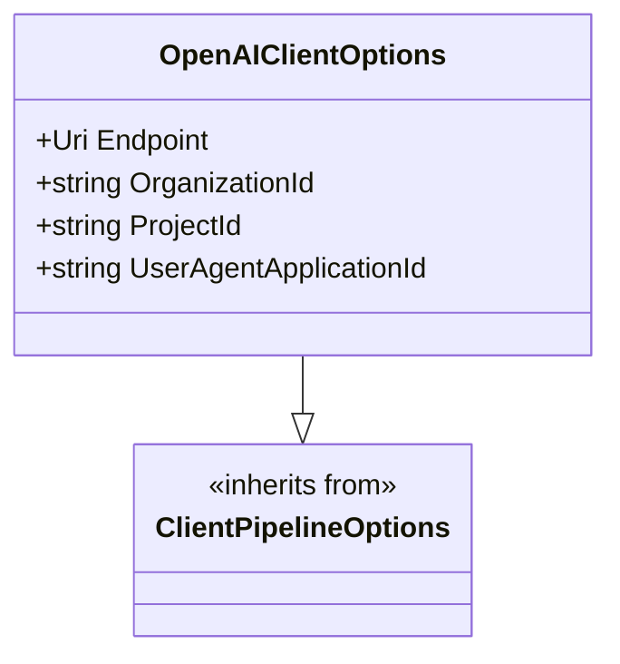
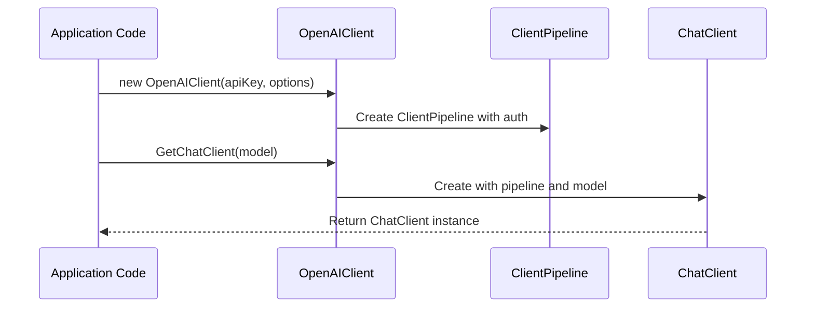
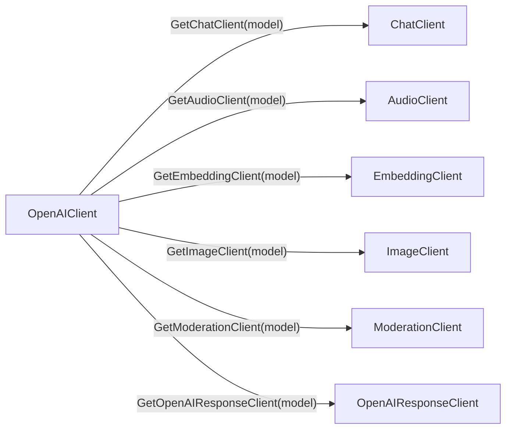
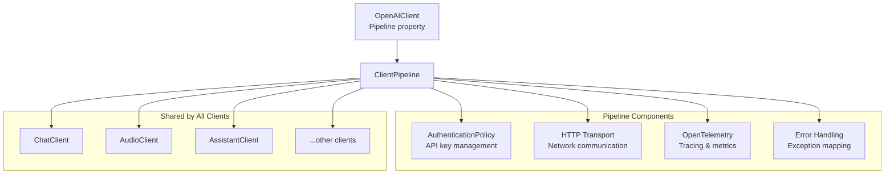
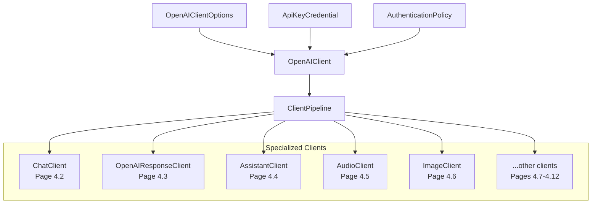

<!-- source: DeepWiki mcp.deepwiki.com · repo openai/openai-dotnet · page 4.1 OpenAIClient · fetched 2026-10-26 -->

# OpenAIClient

<details>
<summary>Relevant source files</summary>

The following files were used as context for generating this wiki page:

- [api/OpenAI.net8.0.cs](api/OpenAI.net8.0.cs)
- [api/OpenAI.netstandard2.0.cs](api/OpenAI.netstandard2.0.cs)
- [specification/base/typespec/common/models.tsp](specification/base/typespec/common/models.tsp)
- [specification/base/typespec/main.tsp](specification/base/typespec/main.tsp)
- [specification/base/typespec/videos/main.tsp](specification/base/typespec/videos/main.tsp)
- [specification/client/videos.client.tsp](specification/client/videos.client.tsp)
- [src/Custom/OpenAIClient.cs](src/Custom/OpenAIClient.cs)
- [src/Custom/OpenAIClientOptions.cs](src/Custom/OpenAIClientOptions.cs)
- [src/Generated/Models/Chat/ChatReasoningEffortLevel.cs](src/Generated/Models/Chat/ChatReasoningEffortLevel.cs)
- [src/Generated/Models/OpenAIContext.cs](src/Generated/Models/OpenAIContext.cs)
- [src/Generated/Models/Responses/ResponseReasoningEffortLevel.cs](src/Generated/Models/Responses/ResponseReasoningEffortLevel.cs)
- [src/Generated/OpenAIModelFactory.cs](src/Generated/OpenAIModelFactory.cs)
- [tests/Responses/ResponsesTests.cs](tests/Responses/ResponsesTests.cs)
- [tspCodeModel.json](tspCodeModel.json)

</details>


## Purpose and Scope

`OpenAIClient` is the central factory class for instantiating specialized service clients in the OpenAI .NET SDK. It provides a unified entry point for creating client instances that interact with different OpenAI API services, while managing shared configuration such as authentication credentials, endpoint URLs, and HTTP communication pipelines. This document covers the construction, configuration, and factory methods of `OpenAIClient`. For information about individual service clients returned by the factory methods, see their respective documentation pages (e.g., [Chat Client](#4.2), [Assistants Client](#4.4), [Responses API Client](#4.3)).

Sources: [api/OpenAI.netstandard2.0.cs:1-39](), [api/OpenAI.net8.0.cs:1-52]()

## Architecture Overview

```mermaid
graph TB
    subgraph "Client Construction"
        APIKey["string apiKey"]
        Credential["ApiKeyCredential"]
        AuthPolicy["AuthenticationPolicy"]
        Options["OpenAIClientOptions"]
        Pipeline["ClientPipeline"]
    end
    
    subgraph "OpenAIClient Factory"
        OAIClient["OpenAIClient<br/>Factory & Configuration"]
        EndpointProp["Endpoint property"]
        PipelineProp["Pipeline property"]
    end
    
    subgraph "Specialized Service Clients"
        ChatClient["ChatClient<br/>GetChatClient(model)"]
        AudioClient["AudioClient<br/>GetAudioClient(model)"]
        AssistantClient["AssistantClient<br/>GetAssistantClient()"]
        ResponseClient["OpenAIResponseClient<br/>GetOpenAIResponseClient(model)"]
        EmbeddingClient["EmbeddingClient<br/>GetEmbeddingClient(model)"]
        ImageClient["ImageClient<br/>GetImageClient(model)"]
        FileClient["OpenAIFileClient<br/>GetOpenAIFileClient()"]
        VectorStoreClient["VectorStoreClient<br/>GetVectorStoreClient()"]
        ModelClient["OpenAIModelClient<br/>GetOpenAIModelClient()"]
        BatchClient["BatchClient<br/>GetBatchClient()"]
        RealtimeClient["RealtimeClient<br/>GetRealtimeClient()"]
        ModerationClient["ModerationClient<br/>GetModerationClient(model)"]
        FineTuningClient["FineTuningClient<br/>GetFineTuningClient()"]
        ContainerClient["ContainerClient<br/>GetContainerClient()"]
        EvaluationClient["EvaluationClient<br/>GetEvaluationClient()"]
        GraderClient["GraderClient<br/>GetGraderClient()"]
    end
    
    APIKey --> OAIClient
    Credential --> OAIClient
    AuthPolicy --> OAIClient
    Options --> OAIClient
    Pipeline --> OAIClient
    
    OAIClient --> EndpointProp
    OAIClient --> PipelineProp
    
    OAIClient --> ChatClient
    OAIClient --> AudioClient
    OAIClient --> AssistantClient
    OAIClient --> ResponseClient
    OAIClient --> EmbeddingClient
    OAIClient --> ImageClient
    OAIClient --> FileClient
    OAIClient --> VectorStoreClient
    OAIClient --> ModelClient
    OAIClient --> BatchClient
    OAIClient --> RealtimeClient
    OAIClient --> ModerationClient
    OAIClient --> FineTuningClient
    OAIClient --> ContainerClient
    OAIClient --> EvaluationClient
    OAIClient --> GraderClient
```



**OpenAIClient Factory Pattern**: The client acts as a centralized factory that creates specialized service clients with shared configuration

Sources: [api/OpenAI.netstandard2.0.cs:1-39](), [tests/Chat/ChatTests.cs:46-53]()

## Key Responsibilities

`OpenAIClient` serves three primary functions:

1. **Configuration Management**: Accepts and stores authentication credentials, endpoint configuration, and client options that are shared across all service clients
2. **Factory Pattern Implementation**: Provides factory methods to instantiate specialized client instances for different OpenAI services
3. **Pipeline Sharing**: Creates and shares a `ClientPipeline` instance that handles HTTP communication, authentication, retry logic, and telemetry across all clients created from the factory

Sources: [api/OpenAI.netstandard2.0.cs:2-28]()

## Construction and Configuration

### Constructor Overloads

`OpenAIClient` provides multiple constructor overloads to support different authentication and configuration scenarios:

| Constructor Signature | Use Case |
|----------------------|----------|
| `OpenAIClient(string apiKey)` | Simple API key authentication with default options |
| `OpenAIClient(ApiKeyCredential credential)` | API key authentication using credential object |
| `OpenAIClient(ApiKeyCredential credential, OpenAIClientOptions options)` | API key authentication with custom options |
| `OpenAIClient(AuthenticationPolicy authenticationPolicy)` | Custom authentication policy |
| `OpenAIClient(AuthenticationPolicy authenticationPolicy, OpenAIClientOptions options)` | Custom authentication with custom options |
| `OpenAIClient(ClientPipeline pipeline, OpenAIClientOptions options)` | Advanced scenario with pre-configured pipeline |

Sources: [api/OpenAI.netstandard2.0.cs:3-11](), [tests/Chat/ChatSmokeTests.cs:75-101]()

### OpenAIClientOptions

The `OpenAIClientOptions` class configures cross-cutting concerns for all clients created from the factory:



**OpenAIClientOptions Configuration**: Options that apply to all service clients

| Property | Description |
|----------|-------------|
| `Endpoint` | Custom endpoint URL (defaults to OpenAI's API) |
| `OrganizationId` | OpenAI organization identifier for billing and access control |
| `ProjectId` | OpenAI project identifier for resource isolation |
| `UserAgentApplicationId` | Custom user agent string for request identification |

Sources: [api/OpenAI.netstandard2.0.cs:29-34](), [src/OpenAI.csproj:1-84]()

### Construction Examples



**Client Creation Sequence**: Flow from OpenAIClient construction to specialized client instantiation

Sources: [tests/Chat/ChatTests.cs:46-53](), [tests/Chat/ChatSmokeTests.cs:75-101]()

## Factory Methods

### Model-Scoped Clients

These factory methods require a model identifier and return clients configured for that specific model:



**Model-Scoped Factory Methods**: Clients that require model selection at creation time

| Method | Returns | Model Parameter Usage |
|--------|---------|----------------------|
| `GetChatClient(string model)` | `ChatClient` | Specifies chat completion model (e.g., "gpt-4o", "gpt-4o-mini") |
| `GetAudioClient(string model)` | `AudioClient` | Specifies TTS or transcription model (e.g., "whisper-1", "tts-1") |
| `GetEmbeddingClient(string model)` | `EmbeddingClient` | Specifies embedding model (e.g., "text-embedding-3-small") |
| `GetImageClient(string model)` | `ImageClient` | Specifies image generation model (e.g., "dall-e-3") |
| `GetModerationClient(string model)` | `ModerationClient` | Specifies moderation model (e.g., "text-moderation-latest") |
| `GetOpenAIResponseClient(string model)` | `OpenAIResponseClient` | Specifies model for response generation with tools |

Sources: [api/OpenAI.netstandard2.0.cs:13-26](), [tests/Chat/ChatTests.cs:48-49]()

### Service-Scoped Clients

These factory methods return clients for specific OpenAI services that are not tied to a particular model at construction time:

| Method | Returns | Service Purpose |
|--------|---------|----------------|
| `GetAssistantClient()` | `AssistantClient` | Assistants API for stateful multi-turn conversations |
| `GetBatchClient()` | `BatchClient` | Batch processing API for asynchronous operations |
| `GetContainerClient()` | `ContainerClient` | Container management for code execution environments |
| `GetEvaluationClient()` | `EvaluationClient` | Model evaluation and testing workflows |
| `GetFineTuningClient()` | `FineTuningClient` | Fine-tuning job management |
| `GetGraderClient()` | `GraderClient` | Model output grading and validation |
| `GetOpenAIFileClient()` | `OpenAIFileClient` | File upload, download, and management |
| `GetOpenAIModelClient()` | `OpenAIModelClient` | Model metadata and capability queries |
| `GetRealtimeClient()` | `RealtimeClient` | Real-time bidirectional audio/text streaming |
| `GetVectorStoreClient()` | `VectorStoreClient` | Vector store creation and RAG document management |

Sources: [api/OpenAI.netstandard2.0.cs:12-27]()

## Shared Infrastructure

### ClientPipeline Management

`OpenAIClient` creates and shares a `ClientPipeline` instance across all specialized clients. This pipeline handles:

- **HTTP Transport**: Network communication with retry policies
- **Authentication**: API key injection via `AuthenticationPolicy`
- **Telemetry**: OpenTelemetry tracing and metrics collection
- **Request/Response Processing**: Header management, serialization, error handling



**Shared Pipeline Architecture**: All clients created from OpenAIClient share the same pipeline instance

Sources: [api/OpenAI.netstandard2.0.cs:11](), [tests/Telemetry/ChatTelemetryTests.cs:1-318]()

### Endpoint Property

The `Endpoint` property exposes the configured API endpoint URL. This is set via `OpenAIClientOptions` during construction and defaults to OpenAI's production API endpoint:

```csharp
// Accessing the configured endpoint
Uri endpoint = client.Endpoint;
```

The endpoint property is marked with the `[Experimental("OPENAI001")]` attribute in the .NET 8.0 target, indicating it may change in future versions.

Sources: [api/OpenAI.netstandard2.0.cs:10](), [api/OpenAI.net8.0.cs:12-13]()

## Usage Patterns

### Basic Pattern: Factory Usage

The most common usage pattern is to create an `OpenAIClient` instance once and use it to obtain specialized clients as needed:

```csharp
// Create the factory client
OpenAIClient client = new OpenAIClient(apiKey);

// Obtain specialized clients
ChatClient chatClient = client.GetChatClient("gpt-4o-mini");
ImageClient imageClient = client.GetImageClient("dall-e-3");
```

Sources: [tests/Chat/ChatTests.cs:46-53]()

### Advanced Pattern: Custom Configuration

For scenarios requiring custom endpoints, organization IDs, or authentication policies:

```csharp
OpenAIClientOptions options = new OpenAIClientOptions
{
    Endpoint = new Uri("https://custom.openai.endpoint"),
    OrganizationId = "org-123456",
    ProjectId = "proj-abcdef"
};

OpenAIClient client = new OpenAIClient(credential, options);
ChatClient chatClient = client.GetChatClient("gpt-4o");
```

Sources: [tests/Chat/ChatSmokeTests.cs:82-89](), [api/OpenAI.netstandard2.0.cs:29-34]()

### Alternative Pattern: Direct Client Construction

Specialized clients can also be constructed directly without using `OpenAIClient` as a factory. This approach is useful when only a single service is needed:

```csharp
// Direct construction bypasses OpenAIClient factory
ChatClient chatClient = new ChatClient("gpt-4o-mini", credential, options);
```

Both patterns share the same underlying implementation, as specialized clients have similar constructor overloads that accept credentials and options directly.

Sources: [tests/Chat/ChatSmokeTests.cs:91-100]()

### Testing Pattern: Mocking and Proxies

The test infrastructure uses `OpenAIClient` with custom transport layers for mocking:

```csharp
MockPipelineTransport mockTransport = new MockPipelineTransport(/* ... *);
OpenAIClientOptions options = new OpenAIClientOptions { Transport = mockTransport };
ChatClient client = new ChatClient("model", credential, options);
```

This pattern enables deterministic testing without making actual API calls.

Sources: [tests/Chat/ChatSmokeTests.cs:28-68]()

## Relationship to Other Components



**Component Relationships**: OpenAIClient coordinates configuration and creates specialized service clients

- **Configuration Input**: Receives `OpenAIClientOptions`, credentials, and authentication policies
- **Pipeline Creation**: Instantiates and configures `ClientPipeline` with authentication and transport
- **Client Provisioning**: Factory methods create specialized clients with shared pipeline
- **Documentation Links**: See individual client pages for service-specific functionality

Sources: [api/OpenAI.netstandard2.0.cs:1-39](), [CHANGELOG.md:42-241]()

## Constructor and Property Reference

### Constructors

| Constructor | Accessibility | Description |
|------------|---------------|-------------|
| `OpenAIClient()` | `protected` | Base constructor for derived classes |
| `OpenAIClient(ApiKeyCredential credential, OpenAIClientOptions options)` | `public` | Full configuration with credential object |
| `OpenAIClient(ApiKeyCredential credential)` | `public` | Credential with default options |
| `OpenAIClient(AuthenticationPolicy authenticationPolicy, OpenAIClientOptions options)` | `public` | Custom authentication with options |
| `OpenAIClient(AuthenticationPolicy authenticationPolicy)` | `public` | Custom authentication with default options |
| `OpenAIClient(ClientPipeline pipeline, OpenAIClientOptions options)` | `protected internal` | Advanced pipeline injection |
| `OpenAIClient(string apiKey)` | `public` | Simple API key string |

Sources: [api/OpenAI.netstandard2.0.cs:3-11]()

### Properties

| Property | Type | Description |
|----------|------|-------------|
| `Endpoint` | `Uri` | Configured API endpoint URL |
| `Pipeline` | `ClientPipeline` | Shared HTTP communication pipeline |

Sources: [api/OpenAI.netstandard2.0.cs:10-11]()

## Version and Compatibility Notes

The `OpenAIClient` class is available in both target frameworks:
- **netstandard2.0**: Supports .NET Framework 4.6.2+, .NET Core 2.0+
- **net8.0**: Optimized for .NET 8+ with additional features

Several members are marked with `[Experimental("OPENAI001")]` in the net8.0 build, indicating potential API changes:
- `Endpoint` property
- Factory methods for experimental services (Assistants, Batch, Containers, Evaluations, Fine-tuning, Graders, Realtime, Responses, Vector Stores)

Sources: [api/OpenAI.net8.0.cs:1-52](), [src/OpenAI.csproj:14-15]()

---

