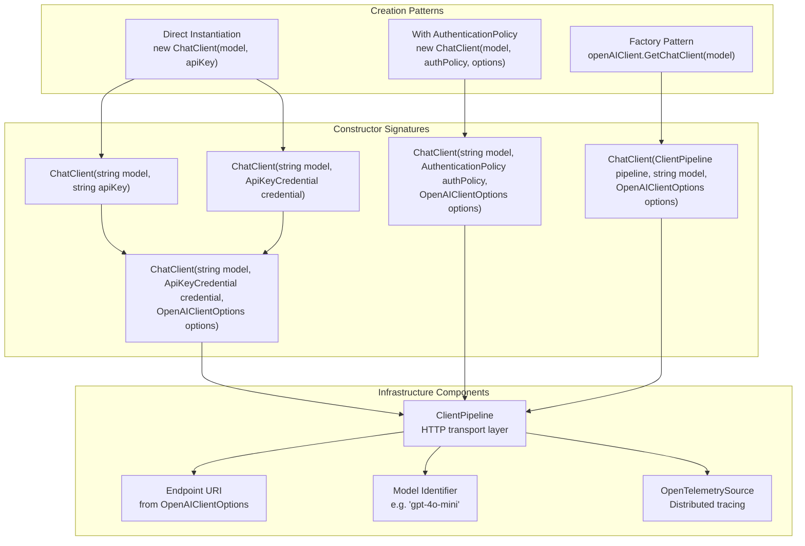
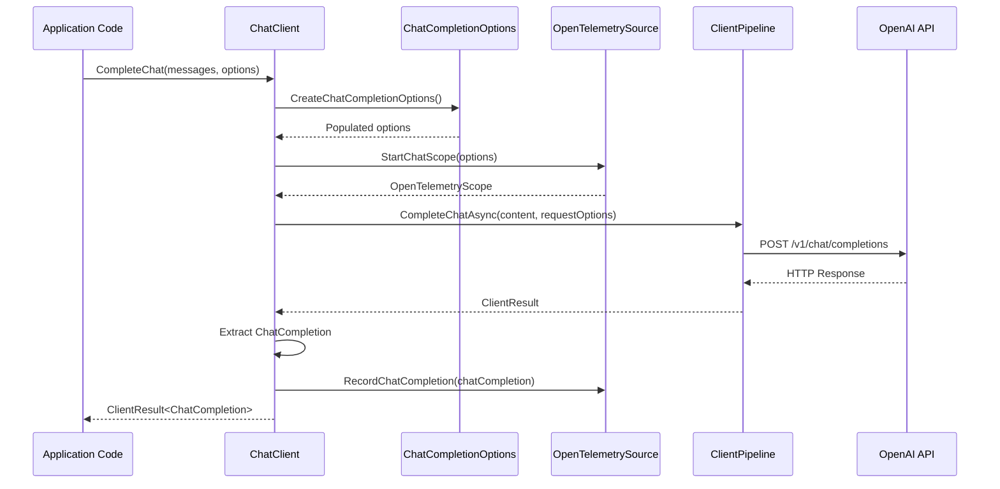
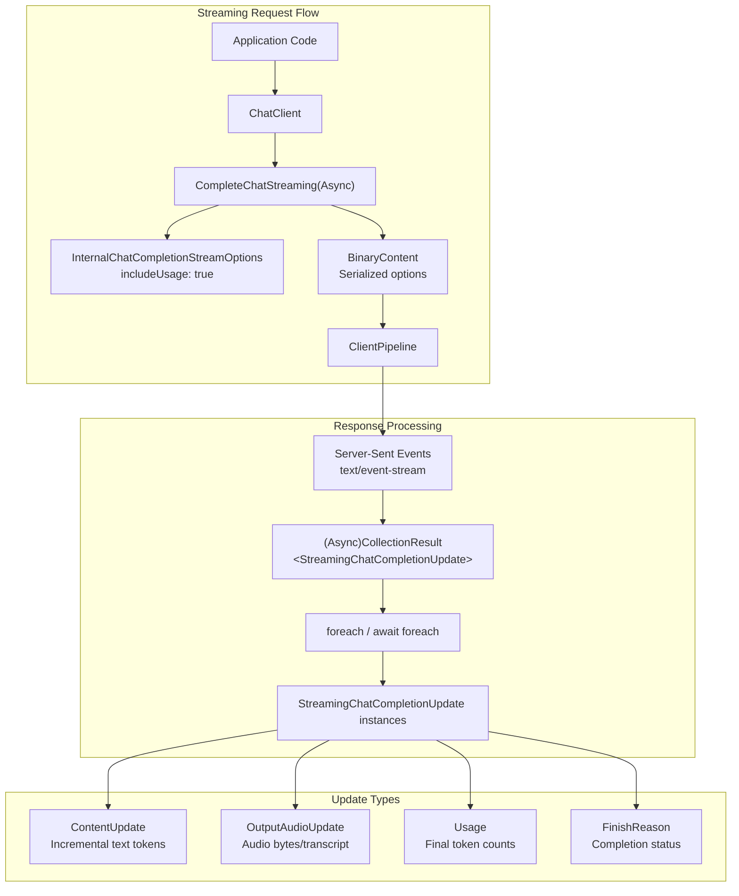
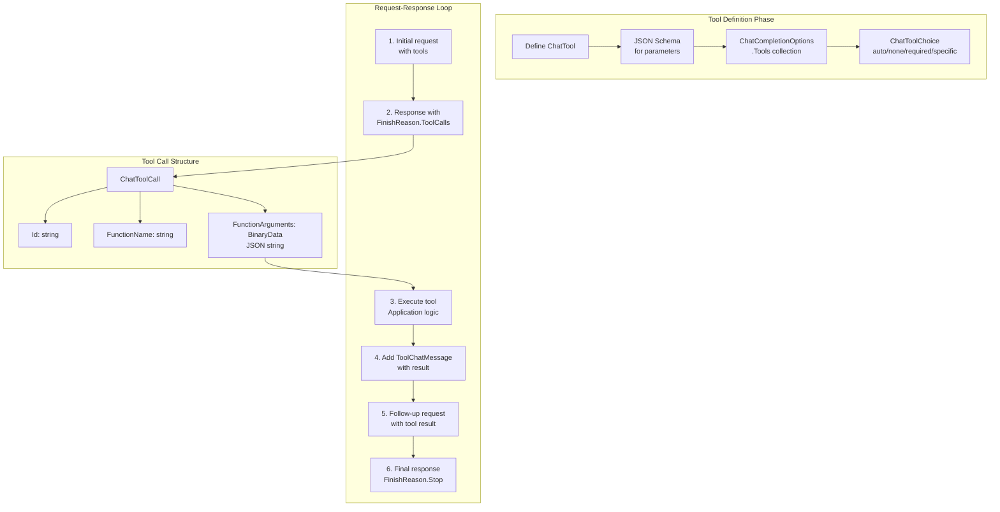
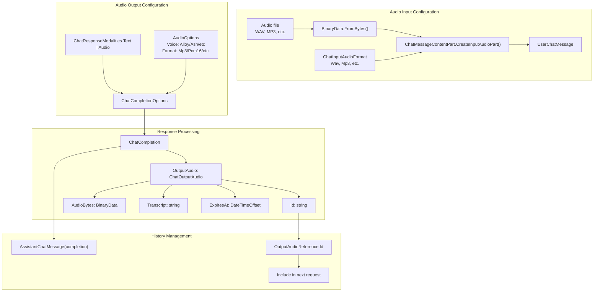
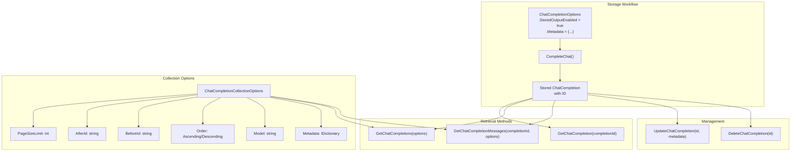
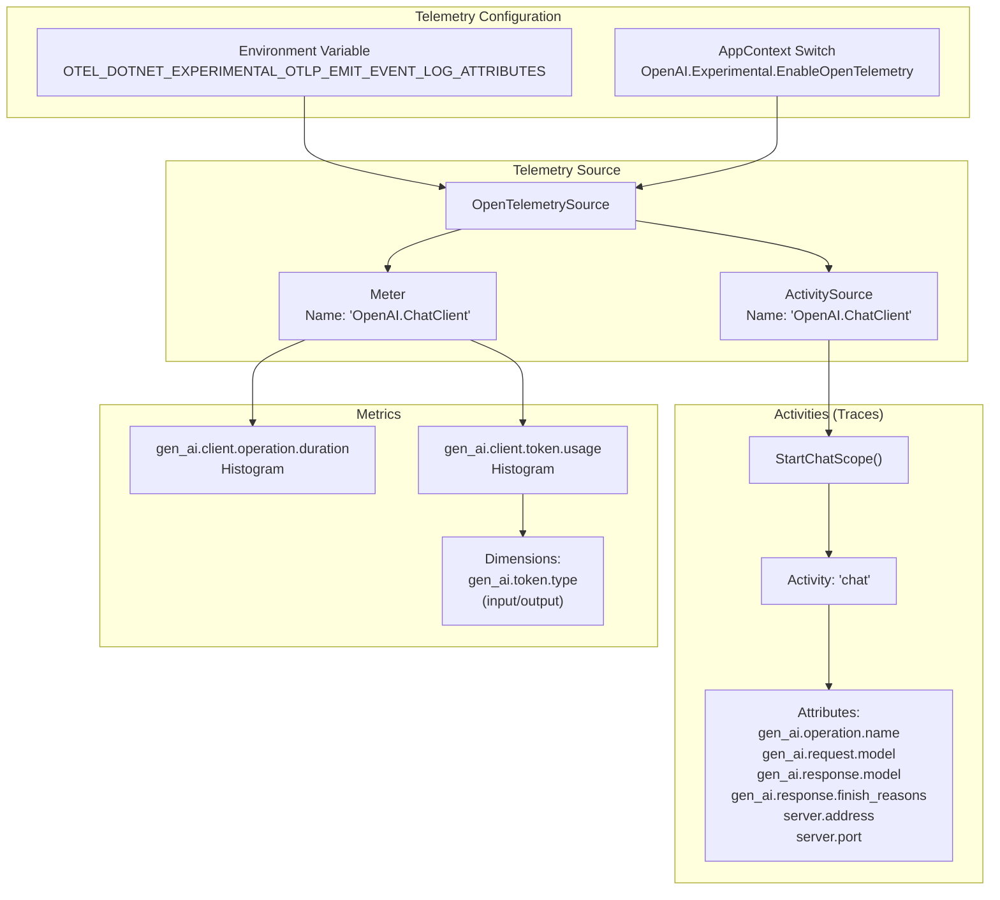

<!-- source: DeepWiki mcp.deepwiki.com · repo openai/openai-dotnet · page 4.2 Chat Client · fetched 2026-10-26 -->

# Chat Client

<details>
<summary>Relevant source files</summary>

The following files were used as context for generating this wiki page:

- [README.md](README.md)
- [examples/Assistants/Example01_RetrievalAugmentedGeneration.cs](examples/Assistants/Example01_RetrievalAugmentedGeneration.cs)
- [examples/Assistants/Example01_RetrievalAugmentedGenerationAsync.cs](examples/Assistants/Example01_RetrievalAugmentedGenerationAsync.cs)
- [examples/Assistants/Example05_AssistantsWithVision.cs](examples/Assistants/Example05_AssistantsWithVision.cs)
- [examples/Assistants/Example05_AssistantsWithVisionAsync.cs](examples/Assistants/Example05_AssistantsWithVisionAsync.cs)
- [examples/Chat/Example02_SimpleChatStreaming.cs](examples/Chat/Example02_SimpleChatStreaming.cs)
- [examples/Chat/Example02_SimpleChatStreamingAsync.cs](examples/Chat/Example02_SimpleChatStreamingAsync.cs)
- [examples/Chat/Example03_FunctionCalling.cs](examples/Chat/Example03_FunctionCalling.cs)
- [examples/Chat/Example06_StructuredOutputs.cs](examples/Chat/Example06_StructuredOutputs.cs)
- [examples/Chat/Example06_StructuredOutputsAsync.cs](examples/Chat/Example06_StructuredOutputsAsync.cs)
- [src/Custom/Chat/ChatClient.cs](src/Custom/Chat/ChatClient.cs)
- [src/Custom/Chat/ChatCompletionOptions.cs](src/Custom/Chat/ChatCompletionOptions.cs)
- [tests/Chat/ChatTests.cs](tests/Chat/ChatTests.cs)
- [tests/SessionRecords/ChatTests/ChatServiceTierWorks.json](tests/SessionRecords/ChatTests/ChatServiceTierWorks.json)
- [tests/SessionRecords/ChatTests/ChatServiceTierWorksAsync.json](tests/SessionRecords/ChatTests/ChatServiceTierWorksAsync.json)
- [tests/SessionRecords/ChatTests/StructuredRefusalWorks.json](tests/SessionRecords/ChatTests/StructuredRefusalWorks.json)
- [tests/SessionRecords/ChatTests/StructuredRefusalWorksAsync.json](tests/SessionRecords/ChatTests/StructuredRefusalWorksAsync.json)
- [tests/SessionRecords/ChatTests/ValidateConcurrency.json](tests/SessionRecords/ChatTests/ValidateConcurrency.json)
- [tests/SessionRecords/ChatTests/ValidateConcurrencyAsync.json](tests/SessionRecords/ChatTests/ValidateConcurrencyAsync.json)
- [tests/SessionRecords/ChatTests/WebSearchWorks.json](tests/SessionRecords/ChatTests/WebSearchWorks.json)
- [tests/SessionRecords/ChatTests/WebSearchWorksAsync.json](tests/SessionRecords/ChatTests/WebSearchWorksAsync.json)
- [tests/Telemetry/ChatTelemetryTests.cs](tests/Telemetry/ChatTelemetryTests.cs)

</details>


## Purpose and Scope

This document covers the `ChatClient` class, which provides access to OpenAI's chat completions API. The `ChatClient` enables conversational AI interactions through both streaming and non-streaming modes, with support for advanced features including function calling, structured outputs, multimodal inputs (vision and audio), and chat completion persistence.

For information about the Responses API (which uses reasoning models like `o3-mini`), see [Responses API Client](#4.3). For information about the Assistants API (which provides stateful conversations with file search and code interpreter), see [Assistants Client](#4.4).

**Sources**: [src/Custom/Chat/ChatClient.cs:1-398](), [README.md:58-68]()

---

## Client Creation and Configuration

### Instantiation Patterns

The `ChatClient` can be instantiated directly or obtained from the factory `OpenAIClient`. The client requires a model identifier and authentication credentials.



**Sources**: [src/Custom/Chat/ChatClient.cs:29-119](), [README.md:60-87]()

### Configuration Options

The client accepts `OpenAIClientOptions` for endpoint customization, organization/project IDs, and custom headers.

| Constructor Parameter | Purpose | Default |
|----------------------|---------|---------|
| `model` | Model identifier (e.g., `gpt-4o-mini`, `gpt-4o`, `gpt-4o-audio-preview`) | Required |
| `apiKey` or `credential` | API key authentication | Required |
| `options` | Configuration for endpoint, headers, retry policy | `new OpenAIClientOptions()` |

**Sources**: [src/Custom/Chat/ChatClient.cs:42-95](), [README.md:72-88]()

---

## Basic Chat Completions

### Non-Streaming Completions

The primary methods for generating chat completions are `CompleteChat` and `CompleteChatAsync`. These methods accept a collection of `ChatMessage` instances and return a `ChatCompletion` containing the model's response.



**Method Signatures**:
- `CompleteChat(IEnumerable<ChatMessage> messages, ChatCompletionOptions options = null, CancellationToken cancellationToken = default)`
- `CompleteChatAsync(IEnumerable<ChatMessage> messages, ChatCompletionOptions options = null, CancellationToken cancellationToken = default)`
- `CompleteChat(params ChatMessage[] messages)` - convenience overload
- `CompleteChatAsync(params ChatMessage[] messages)` - convenience overload

**Sources**: [src/Custom/Chat/ChatClient.cs:133-215](), [tests/Chat/ChatTests.cs:35-43]()

### ChatMessage Types

| Message Type | Purpose | Example |
|--------------|---------|---------|
| `UserChatMessage` | User input | `new UserChatMessage("Hello, world!")` |
| `SystemChatMessage` | System instructions | `new SystemChatMessage("You are a helpful assistant.")` |
| `AssistantChatMessage` | Assistant's prior responses | `new AssistantChatMessage(completion)` |
| `ToolChatMessage` | Tool execution results | `new ToolChatMessage(toolCallId, result)` |
| `FunctionChatMessage` | Legacy function results | `new FunctionChatMessage(functionName, result)` |

**Sources**: [tests/Chat/ChatTests.cs:59-65](), [README.md:224-368]()

### ChatCompletion Response

The `ChatCompletion` object contains the model's response with the following key properties:

| Property | Type | Description |
|----------|------|-------------|
| `Id` | `string` | Unique identifier for the completion |
| `CreatedAt` | `DateTimeOffset` | Timestamp of creation |
| `Model` | `string` | Model used for generation |
| `Role` | `ChatMessageRole` | Role (typically `Assistant`) |
| `Content` | `IReadOnlyList<ChatMessageContentPart>` | Response content parts |
| `FinishReason` | `ChatFinishReason` | Completion termination reason |
| `ToolCalls` | `IReadOnlyList<ChatToolCall>` | Tool calls requested by model |
| `ContentTokenLogProbabilities` | `IReadOnlyList<ChatTokenLogProbabilityDetails>` | Token probabilities |
| `Usage` | `ChatTokenUsage` | Token consumption details |
| `OutputAudio` | `ChatOutputAudio` | Audio output (if enabled) |

**Sources**: [tests/Chat/ChatTests.cs:40-42](), [src/Custom/Chat/ChatClient.cs:159-164]()

---

## Streaming Completions

### Streaming API

Streaming completions allow incremental processing of the model's response as it is generated. This reduces perceived latency and enables real-time UI updates.



**Method Signatures**:
- `CompleteChatStreaming(IEnumerable<ChatMessage> messages, ChatCompletionOptions options = null, CancellationToken cancellationToken = default)` → `CollectionResult<StreamingChatCompletionUpdate>`
- `CompleteChatStreamingAsync(IEnumerable<ChatMessage> messages, ChatCompletionOptions options = null, CancellationToken cancellationToken = default)` → `AsyncCollectionResult<StreamingChatCompletionUpdate>`

**Sources**: [src/Custom/Chat/ChatClient.cs:217-307](), [tests/Chat/ChatTests.cs:69-99]()

### StreamingChatCompletionUpdate

Each streaming update may contain:

| Property | Type | Description |
|----------|------|-------------|
| `ContentUpdate` | `IReadOnlyList<ChatMessageContentPart>` | Incremental content tokens |
| `OutputAudioUpdate` | `StreamingChatOutputAudioUpdate` | Audio data increments |
| `ToolCallUpdates` | `IReadOnlyList<StreamingChatToolCallUpdate>` | Tool call deltas |
| `FinishReason` | `ChatFinishReason?` | Completion reason (final update) |
| `Usage` | `ChatTokenUsage` | Token usage (final update with `includeUsage: true`) |
| `ContentTokenLogProbabilities` | `IReadOnlyList<ChatTokenLogProbabilityDetails>` | Token probabilities |

**Sources**: [tests/Chat/ChatTests.cs:83-98](), [README.md:184-220]()

---

## Function Calling and Tool Usage

### Tool Definition

Tools (functions) are defined using `ChatTool.CreateFunctionTool` with a name, description, and optional JSON schema for parameters.



**Example Tool Definition**:
```csharp
ChatTool tool = ChatTool.CreateFunctionTool(
    functionName: "GetCurrentWeather",
    functionDescription: "Get the current weather in a given location",
    functionParameters: BinaryData.FromBytes("""
        {
            "type": "object",
            "properties": {
                "location": { "type": "string" },
                "unit": { "type": "string", "enum": ["celsius", "fahrenheit"] }
            },
            "required": ["location"]
        }
        """u8.ToArray())
);
```

**Sources**: [README.md:224-268](), [tests/Chat/ChatToolTests.cs:26-77]()

### Tool Execution Loop

The tool calling pattern requires iterative requests:

1. Send user message with tools defined in `ChatCompletionOptions.Tools`
2. Check if `FinishReason == ChatFinishReason.ToolCalls`
3. Extract tool calls from `ChatCompletion.ToolCalls`
4. Execute local functions based on `FunctionName` and parse `FunctionArguments`
5. Add `AssistantChatMessage(completion)` to conversation
6. Add `ToolChatMessage(toolCallId, result)` for each tool call
7. Send follow-up request with updated messages
8. Repeat until `FinishReason == ChatFinishReason.Stop`

**Sources**: [README.md:284-367](), [tests/Chat/ChatToolTests.cs:81-107]()

### Parallel Tool Calls

The model can request multiple tool calls simultaneously. Each must be resolved and added as a separate `ToolChatMessage` before the next request.

**Sources**: [tests/Chat/ChatToolTests.cs:139-176]()

### ChatToolChoice Configuration

| Choice | Behavior |
|--------|----------|
| `ChatToolChoice.CreateAutoChoice()` | Model decides whether to call tools |
| `ChatToolChoice.CreateNoneChoice()` | Model will not call tools |
| `ChatToolChoice.CreateRequiredChoice()` | Model must call a tool |
| `ChatToolChoice.CreateFunctionChoice(functionName)` | Model must call specific function |

**Sources**: [tests/Chat/ChatToolTests.cs:29-50]()

---

## Structured Outputs

### JSON Schema Validation

Structured outputs guarantee that the model's response conforms to a specified JSON schema using `ChatResponseFormat.CreateJsonSchemaFormat`.

```mermaid
graph LR
    subgraph "Configuration"
        Schema["JSON Schema<br/>BinaryData"]
        Format["ChatResponseFormat.CreateJsonSchemaFormat()"]
        Options["ChatCompletionOptions<br/>.ResponseFormat"]
    end
    
    subgraph "Request"
        Messages["User messages"]
        Request["CompleteChat()"]
    end
    
    subgraph "Response"
        Completion["ChatCompletion"]
        Content["Content[0].Text<br/>Guaranteed valid JSON"]
        Parse["JsonDocument.Parse()"]
        Validate["Conforms to schema"]
    end
    
    Schema --> Format
    Format --> Options
    Messages --> Request
    Options --> Request
    Request --> Completion
    Completion --> Content
    Content --> Parse
    Parse --> Validate
```

**Key Parameters**:
- `jsonSchemaFormatName`: Name for the schema
- `jsonSchema`: BinaryData containing JSON schema definition
- `jsonSchemaIsStrict`: When `true`, enforces strict conformance (recommended)

**Example**:
```csharp
ChatCompletionOptions options = new()
{
    ResponseFormat = ChatResponseFormat.CreateJsonSchemaFormat(
        jsonSchemaFormatName: "math_reasoning",
        jsonSchema: BinaryData.FromBytes(/* schema *),
        jsonSchemaIsStrict: true)
};
```

**Sources**: [README.md:370-423](), [tests/Chat/ChatTests.cs:476-536](), [examples/Chat/Example06_StructuredOutputs.cs:1-58]()

---

## Multimodal Capabilities

### Audio Input and Output

Models like `gpt-4o-audio-preview` support audio input and output through `ChatMessageContentPart` and `ChatOutputAudio`.



**Audio Input**: Use `ChatMessageContentPart.CreateInputAudioPart(audioData, format)` in user messages.

**Audio Output**: Configure `ChatCompletionOptions.AudioOptions` and set `ResponseModalities` to include `ChatResponseModalities.Audio`.

**Sources**: [README.md:425-485](), [tests/Chat/ChatTests.cs:192-280]()

### Streaming Audio

Streaming audio provides incremental updates through `StreamingChatOutputAudioUpdate`:

| Property | Description |
|----------|-------------|
| `Id` | Audio identifier (appears across multiple updates) |
| `AudioBytesUpdate` | Incremental audio data |
| `TranscriptUpdate` | Incremental transcript text |
| `ExpiresAt` | Expiration time (appears once, typically in final update) |

**Sources**: [README.md:487-493](), [tests/Chat/ChatTests.cs:144-190]()

### Vision

Vision capabilities allow including images in messages via `ChatMessageContentPart.CreateImagePart`.

**Image Sources**:
- `BinaryData` with media type (e.g., `"image/png"`)
- `Uri` to remote image

**Sources**: [tests/Chat/ChatTests.cs:122-140]()

---

## Token Log Probabilities

Token log probabilities provide insight into the model's confidence for each generated token.

**Configuration**:
```csharp
ChatCompletionOptions options = new()
{
    IncludeLogProbabilities = true,
    TopLogProbabilityCount = 3  // Top 3 alternatives per token
};
```

**Response Structure**:
- `ChatCompletion.ContentTokenLogProbabilities` → `IReadOnlyList<ChatTokenLogProbabilityDetails>`
- Each `ChatTokenLogProbabilityDetails` contains:
  - `Token`: The selected token
  - `LogProbability`: Log probability value
  - `TopLogProbabilities`: Alternative tokens with their probabilities

**Streaming**: In streaming mode, token log probabilities appear alongside content updates in `StreamingChatCompletionUpdate.ContentTokenLogProbabilities`.

**Sources**: [tests/Chat/ChatTests.cs:303-353](), [tests/Chat/ChatTests.cs:355-409]()

---

## Chat Completion Storage and Retrieval

### Storage Configuration

Chat completions can be stored for later retrieval by enabling `StoredOutputEnabled` in `ChatCompletionOptions`.



**Sources**: [tests/Chat/ChatStoreTests.cs:24-46](), [src/Custom/Chat/ChatClient.cs:310-381]()

### Retrieval API

| Method | Purpose | Return Type |
|--------|---------|-------------|
| `GetChatCompletion(completionId)` | Retrieve single completion | `ClientResult<ChatCompletion>` |
| `GetChatCompletions(options)` | List completions with pagination | `IAsyncEnumerable<ChatCompletion>` |
| `GetChatCompletionMessages(completionId, options)` | Retrieve messages from completion | `IAsyncEnumerable<ChatCompletionMessageListDatum>` |
| `UpdateChatCompletion(completionId, metadata)` | Update metadata | `ClientResult<ChatCompletion>` |
| `DeleteChatCompletion(completionId)` | Delete stored completion | `ClientResult<ChatCompletionDeletionResult>` |

**Sources**: [src/Custom/Chat/ChatClient.cs:312-381]()

### Pagination Options

`ChatCompletionCollectionOptions` supports cursor-based pagination:

| Property | Type | Description |
|----------|------|-------------|
| `PageSizeLimit` | `int?` | Maximum results per page |
| `AfterId` | `string` | Cursor for results after this ID |
| `BeforeId` | `string` | Cursor for results before this ID |
| `Order` | `ChatCompletionCollectionOrder` | `Ascending` or `Descending` |
| `Model` | `string` | Filter by model name |
| `Metadata` | `IDictionary<string, string>` | Filter by metadata key-value pairs |

**Sources**: [tests/Chat/ChatStoreTests.cs:50-104](), [tests/Chat/ChatStoreTests.cs:106-164]()

---

## ChatCompletionOptions Configuration

### Core Options

| Property | Type | Description | Default |
|----------|------|-------------|---------|
| `Messages` | `IList<ChatMessage>` | Conversation history | Set by client |
| `Model` | `string` | Model identifier | Set by client constructor |
| `MaxOutputTokenCount` | `int?` | Maximum completion tokens | `null` |
| `Temperature` | `float?` | Sampling temperature (0.0-2.0) | `null` |
| `TopP` | `float?` | Nucleus sampling threshold | `null` |
| `FrequencyPenalty` | `float?` | Penalty for frequent tokens | `null` |
| `PresencePenalty` | `float?` | Penalty for present tokens | `null` |
| `StopSequences` | `IList<string>` | Stop generation sequences | `null` |

**Sources**: [tests/Chat/ChatTests.cs:122-140]()

### Advanced Options

| Property | Type | Description |
|----------|------|-------------|
| `ResponseFormat` | `ChatResponseFormat` | Output format constraint (JSON, text, schema) |
| `Tools` | `IList<ChatTool>` | Available function tools |
| `ToolChoice` | `ChatToolChoice` | Tool selection strategy |
| `ParallelToolCallsEnabled` | `bool?` | Allow parallel tool invocations |
| `AudioOptions` | `ChatAudioOptions` | Audio output configuration |
| `ResponseModalities` | `ChatResponseModalities` | Include text and/or audio |
| `IncludeLogProbabilities` | `bool?` | Include token probabilities |
| `TopLogProbabilityCount` | `int?` | Number of top alternatives |
| `StoredOutputEnabled` | `bool?` | Enable persistence |
| `Metadata` | `IDictionary<string, string>` | Custom metadata |

**Sources**: [tests/Chat/ChatTests.cs:415-428](), [tests/Chat/ChatStoreTests.cs:28-35]()

---

## Observability and Telemetry

### OpenTelemetry Integration

`ChatClient` is the only client with built-in OpenTelemetry support through `OpenTelemetrySource`. Telemetry is enabled via environment variables or app context switches.



**Trace Attributes**:
- `gen_ai.operation.name`: Always `"chat"`
- `gen_ai.request.model`: Model from options
- `gen_ai.response.model`: Model from response
- `gen_ai.response.finish_reasons`: Array of finish reasons
- `gen_ai.usage.input_tokens`: Prompt tokens
- `gen_ai.usage.output_tokens`: Completion tokens
- `server.address`: Endpoint host
- `server.port`: Endpoint port

**Metrics**:
- `gen_ai.client.operation.duration`: Request duration in seconds (histogram)
- `gen_ai.client.token.usage`: Token counts by type (histogram)

**Sources**: [src/Custom/Chat/ChatClient.cs:24-26](), [src/Custom/Chat/ChatClient.cs:92-94](), [tests/Telemetry/ChatTelemetryTests.cs:1-324]()

---

## Error Handling

### ClientResultException

Failed requests throw `ClientResultException` with status codes and sanitized error messages.

**Key Properties**:
- `Status`: HTTP status code (e.g., `401` for authentication failure)
- `Message`: Error description (API keys are automatically sanitized)

**Example**:
```csharp
try
{
    ChatCompletion completion = await client.CompleteChatAsync(messages);
}
catch (ClientResultException ex)
{
    Console.WriteLine($"Status: {ex.Status}");
    Console.WriteLine($"Error: {ex.Message}");
    // API key will not appear in ex.Message
}
```

**Sources**: [tests/Chat/ChatTests.cs:283-301](), [tests/Chat/ChatSmokeTests.cs:104-124]()

---

## Examples and Usage Patterns

### Simple Completion
```csharp
ChatClient client = new("gpt-4o-mini", apiKey);
ChatCompletion completion = client.CompleteChat("Hello, world!");
Console.WriteLine(completion.Content[0].Text);
```

### Streaming Completion
```csharp
await foreach (StreamingChatCompletionUpdate update in client.CompleteChatStreamingAsync("Say 'test'"))
{
    if (update.ContentUpdate.Count > 0)
    {
        Console.Write(update.ContentUpdate[0].Text);
    }
}
```

### Multi-Turn Conversation
```csharp
List<ChatMessage> messages = [
    new SystemChatMessage("You are a helpful assistant."),
    new UserChatMessage("What is the capital of France?")
];
ChatCompletion completion = await client.CompleteChatAsync(messages);
messages.Add(new AssistantChatMessage(completion));
messages.Add(new UserChatMessage("What is its population?"));
completion = await client.CompleteChatAsync(messages);
```

**Sources**: [README.md:58-68](), [README.md:184-220](), [tests/Chat/ChatTests.cs:102-118](), [examples/Chat/Example02_SimpleChatStreaming.cs:1-27]()

---

