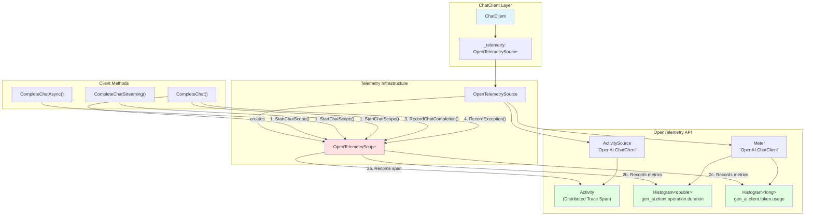
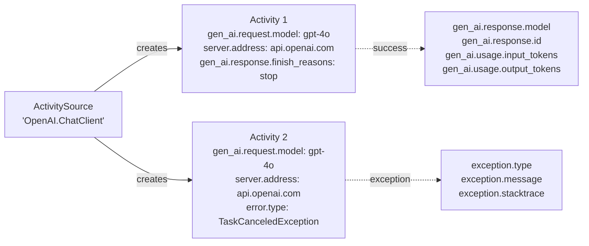
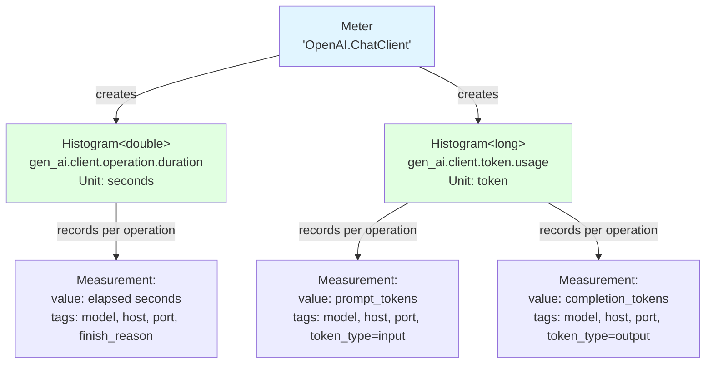
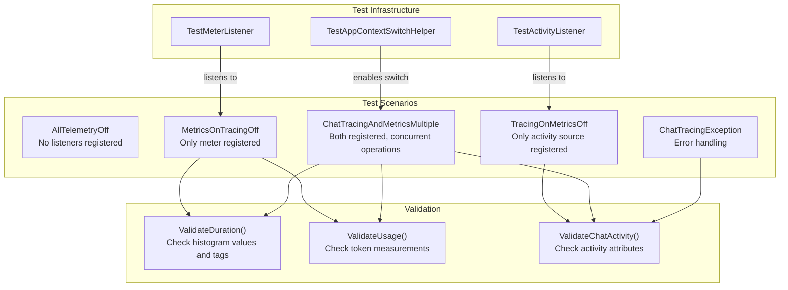

<!-- source: DeepWiki mcp.deepwiki.com · repo openai/openai-dotnet · page 8.5 Observability and Telemetry · fetched 2026-10-26 -->

# Observability and Telemetry

<details>
<summary>Relevant source files</summary>

The following files were used as context for generating this wiki page:

- [README.md](README.md)
- [examples/Assistants/Example01_RetrievalAugmentedGeneration.cs](examples/Assistants/Example01_RetrievalAugmentedGeneration.cs)
- [examples/Assistants/Example01_RetrievalAugmentedGenerationAsync.cs](examples/Assistants/Example01_RetrievalAugmentedGenerationAsync.cs)
- [examples/Assistants/Example05_AssistantsWithVision.cs](examples/Assistants/Example05_AssistantsWithVision.cs)
- [examples/Assistants/Example05_AssistantsWithVisionAsync.cs](examples/Assistants/Example05_AssistantsWithVisionAsync.cs)
- [examples/Chat/Example02_SimpleChatStreaming.cs](examples/Chat/Example02_SimpleChatStreaming.cs)
- [examples/Chat/Example02_SimpleChatStreamingAsync.cs](examples/Chat/Example02_SimpleChatStreamingAsync.cs)
- [examples/Chat/Example03_FunctionCalling.cs](examples/Chat/Example03_FunctionCalling.cs)
- [examples/Chat/Example06_StructuredOutputs.cs](examples/Chat/Example06_StructuredOutputs.cs)
- [examples/Chat/Example06_StructuredOutputsAsync.cs](examples/Chat/Example06_StructuredOutputsAsync.cs)
- [src/Custom/Chat/ChatClient.cs](src/Custom/Chat/ChatClient.cs)
- [src/Custom/Chat/ChatCompletionOptions.cs](src/Custom/Chat/ChatCompletionOptions.cs)
- [tests/Chat/ChatTests.cs](tests/Chat/ChatTests.cs)
- [tests/SessionRecords/ChatTests/ChatServiceTierWorks.json](tests/SessionRecords/ChatTests/ChatServiceTierWorks.json)
- [tests/SessionRecords/ChatTests/ChatServiceTierWorksAsync.json](tests/SessionRecords/ChatTests/ChatServiceTierWorksAsync.json)
- [tests/SessionRecords/ChatTests/StructuredRefusalWorks.json](tests/SessionRecords/ChatTests/StructuredRefusalWorks.json)
- [tests/SessionRecords/ChatTests/StructuredRefusalWorksAsync.json](tests/SessionRecords/ChatTests/StructuredRefusalWorksAsync.json)
- [tests/SessionRecords/ChatTests/ValidateConcurrency.json](tests/SessionRecords/ChatTests/ValidateConcurrency.json)
- [tests/SessionRecords/ChatTests/ValidateConcurrencyAsync.json](tests/SessionRecords/ChatTests/ValidateConcurrencyAsync.json)
- [tests/SessionRecords/ChatTests/WebSearchWorks.json](tests/SessionRecords/ChatTests/WebSearchWorks.json)
- [tests/SessionRecords/ChatTests/WebSearchWorksAsync.json](tests/SessionRecords/ChatTests/WebSearchWorksAsync.json)
- [tests/Telemetry/ChatTelemetryTests.cs](tests/Telemetry/ChatTelemetryTests.cs)

</details>


This document describes the observability and telemetry capabilities provided by the OpenAI .NET SDK, including distributed tracing and metrics collection using OpenTelemetry standards. Currently, telemetry support is implemented exclusively for the `ChatClient`.

For information about testing strategies and recorded tests, see [Testing Strategy](#8.3).

---

## Purpose and Scope

The SDK provides optional OpenTelemetry integration that enables:
- **Distributed Tracing**: Activity-based tracing of chat completion operations with semantic attributes
- **Metrics Collection**: Histogram instrumentation for operation duration and token usage
- **Semantic Conventions**: Compliance with OpenTelemetry semantic conventions for generative AI

The telemetry implementation is **opt-in** and requires explicit enablement through .NET AppContext switches.

**Sources:** [README.md:36](), [tests/Telemetry/ChatTelemetryTests.cs:1-281]()

---

## Telemetry Architecture



**Telemetry Integration Flow**

The `ChatClient` maintains an `OpenTelemetrySource` instance initialized with the model name and endpoint. When a chat completion operation executes:

1. **Scope Creation**: The client creates an `OpenTelemetryScope` by calling `_telemetry.StartChatScope(options)`
2. **Operation Execution**: The HTTP request is sent to the OpenAI API
3. **Result Recording**: On success, `scope.RecordChatCompletion(chatCompletion)` records the completion details
4. **Exception Handling**: On failure, `scope.RecordException(ex)` records the exception
5. **Scope Disposal**: The scope is disposed, which finalizes the activity and records metrics

**Sources:** [src/Custom/Chat/ChatClient.cs:1-398](), [tests/Telemetry/ChatTelemetryTests.cs:36-174]()

---

## Enabling Telemetry

Telemetry is **disabled by default** and must be explicitly enabled through AppContext switches. The SDK checks these switches at runtime to determine whether to create telemetry objects.

### Enabling via AppContext Switch

```csharp
// Enable all OpenTelemetry features (both tracing and metrics)
AppContext.SetSwitch("OpenAI.Experimental.EnableOpenTelemetry", true);
```

### Conditional Telemetry Behavior

| Switch State | ActivitySource Listener | Meter Listener | Behavior |
|-------------|------------------------|----------------|----------|
| Off | N/A | N/A | `StartChatScope()` returns `null`, no telemetry overhead |
| On | Not registered | Not registered | `StartChatScope()` returns `null`, minimal overhead |
| On | Registered | Not registered | Only distributed tracing is recorded |
| On | Not registered | Registered | Only metrics are recorded |
| On | Registered | Registered | Both tracing and metrics are recorded |

The telemetry infrastructure intelligently detects registered listeners and only creates the necessary objects, minimizing performance impact when telemetry is not actively being collected.

**Sources:** [tests/Telemetry/ChatTelemetryTests.cs:38-52](), [tests/Telemetry/ChatTelemetryTests.cs:54-81]()

---

## Distributed Tracing

### Activity Source and Naming

The SDK creates activities using the `ActivitySource` named **`"OpenAI.ChatClient"`**. Each chat completion operation creates a single activity span representing the entire operation lifecycle.



**Activity Lifecycle**

1. **Start**: Activity created when `StartChatScope()` is called
2. **Request Attributes**: Request parameters added to activity tags
3. **Execution**: HTTP request made to OpenAI API
4. **Response Attributes**: Response details added on success
5. **End**: Activity automatically ended when scope disposed

**Sources:** [tests/Telemetry/ChatTelemetryTests.cs:101-127](), [tests/Telemetry/ChatTelemetryTests.cs:158-174]()

### Activity Attributes

#### Request Attributes (Set at Scope Creation)

| Attribute Name | Type | Description | Example |
|----------------|------|-------------|---------|
| `gen_ai.request.model` | string | Model name from request | `"gpt-4o"` |
| `server.address` | string | API host | `"api.openai.com"` |
| `server.port` | int | API port | `443` |
| `gen_ai.request.temperature` | float | Temperature parameter (if set) | `0.42` |
| `gen_ai.request.top_p` | float | Top-P parameter (if set) | `0.9` |
| `gen_ai.request.max_tokens` | int | Max tokens parameter (if set) | `200` |

#### Response Attributes (Set on RecordChatCompletion)

| Attribute Name | Type | Description | Example |
|----------------|------|-------------|---------|
| `gen_ai.response.id` | string | Completion ID | `"chatcmpl-9fG9OILMJnKZARXDwxoCnLcvDsDDX"` |
| `gen_ai.response.model` | string | Actual model used | `"gpt-4o-2024-05-13"` |
| `gen_ai.response.finish_reasons` | string[] | Finish reasons | `["stop"]` |
| `gen_ai.usage.input_tokens` | int | Prompt tokens consumed | `2` |
| `gen_ai.usage.output_tokens` | int | Completion tokens generated | `42` |

#### Exception Attributes (Set on RecordException)

| Attribute Name | Type | Description |
|----------------|------|-------------|
| `error.type` | string | Exception type name |
| `exception.type` | string | Full exception type |
| `exception.message` | string | Exception message |
| `exception.stacktrace` | string | Stack trace |

**Sources:** [tests/Telemetry/ChatTelemetryTests.cs:130-155](), [tests/Telemetry/ChatTelemetryTests.cs:158-174]()

---

## Metrics Collection

### Meter and Instrument Naming

The SDK creates metrics using the `Meter` named **`"OpenAI.ChatClient"`**. Two histogram instruments are defined:

1. **`gen_ai.client.operation.duration`**: Histogram<double> measuring operation duration in seconds
2. **`gen_ai.client.token.usage`**: Histogram<long> measuring token consumption



**Sources:** [tests/Telemetry/ChatTelemetryTests.cs:54-81](), [tests/Telemetry/ChatTelemetryTests.cs:260-280]()

### Duration Metric: `gen_ai.client.operation.duration`

**Type**: `Histogram<double>`  
**Unit**: `seconds`  
**Description**: Measures the total elapsed time of chat completion operations

#### Metric Tags

| Tag Name | Type | Description | Example |
|----------|------|-------------|---------|
| `gen_ai.request.model` | string | Requested model | `"gpt-4o"` |
| `gen_ai.response.model` | string | Actual model used | `"gpt-4o-2024-05-13"` |
| `server.address` | string | API host | `"api.openai.com"` |
| `server.port` | int | API port | `443` |
| `gen_ai.response.finish_reasons` | string[] | Finish reasons (on success) | `["stop"]` |
| `error.type` | string | Exception type (on error) | `"TaskCanceledException"` |

#### Recording Behavior

- **On Success**: Records duration from scope creation to `RecordChatCompletion()` call
- **On Exception**: Records duration from scope creation to `RecordException()` call with `error.type` tag

**Sources:** [tests/Telemetry/ChatTelemetryTests.cs:243-259]()

### Token Usage Metric: `gen_ai.client.token.usage`

**Type**: `Histogram<long>`  
**Unit**: `token`  
**Description**: Measures token consumption for input (prompt) and output (completion)

#### Metric Tags

| Tag Name | Type | Description | Example |
|----------|------|-------------|---------|
| `gen_ai.request.model` | string | Requested model | `"gpt-4o"` |
| `gen_ai.response.model` | string | Actual model used | `"gpt-4o-2024-05-13"` |
| `server.address` | string | API host | `"api.openai.com"` |
| `server.port` | int | API port | `443` |
| `gen_ai.token.type` | string | Token type: `"input"` or `"output"` | `"input"` |

#### Recording Behavior

- **Two measurements per successful operation**: One for input tokens, one for output tokens
- **No measurements on exception**: Token usage is only recorded when a valid response is received
- **Separate histograms**: Input and output tokens are tracked separately using the `gen_ai.token.type` tag

**Sources:** [tests/Telemetry/ChatTelemetryTests.cs:261-280]()

---

## Semantic Conventions

The SDK follows OpenTelemetry semantic conventions for generative AI operations. The attribute names and values conform to the [GenAI Semantic Conventions specification](https://opentelemetry.io/docs/specs/semconv/gen-ai).

### Attribute Naming Pattern

```
gen_ai.<category>.<attribute>
```

Examples:
- `gen_ai.request.model` - Request-scoped model attribute
- `gen_ai.response.finish_reasons` - Response-scoped finish reasons
- `gen_ai.usage.input_tokens` - Usage-scoped input token count

### Server Attributes

Server location attributes follow the standard semantic conventions:
- `server.address` - Host name
- `server.port` - Port number

These are extracted from the endpoint URI configured in `OpenAIClientOptions`.

**Sources:** [tests/Telemetry/ChatTelemetryTests.cs:1-281]()

---

## Client Support Matrix

| Client | Distributed Tracing | Metrics | Status |
|--------|---------------------|---------|--------|
| `ChatClient` | ✓ | ✓ | Supported |
| `EmbeddingClient` | ✗ | ✗ | Not supported |
| `AudioClient` | ✗ | ✗ | Not supported |
| `ImageClient` | ✗ | ✗ | Not supported |
| `OpenAIResponseClient` | ✗ | ✗ | Not supported |
| `AssistantClient` | ✗ | ✗ | Not supported |
| Other clients | ✗ | ✗ | Not supported |

**Current Implementation**: Only `ChatClient` includes telemetry instrumentation. The `OpenTelemetrySource` is initialized in the `ChatClient` constructor and used throughout the chat completion lifecycle.

**Future Expansion**: Telemetry support may be extended to other clients in future releases.

**Sources:** [src/Custom/Chat/ChatClient.cs:1-398](), [README.md:36]()

---

## Implementation Details

### ChatClient Integration

The `ChatClient` class integrates telemetry through constructor initialization and operation-level scoping:

```
Constructor Flow:
ChatClient() 
  → _telemetry = new OpenTelemetrySource(model, _endpoint)

Operation Flow (CompleteChatAsync):
1. using OpenTelemetryScope scope = _telemetry.StartChatScope(options)
2. try { 
     result = await CompleteChatAsync(content, requestOptions)
     scope?.RecordChatCompletion(chatCompletion)
   }
3. catch (Exception ex) {
     scope?.RecordException(ex)
     throw
   }
```

**Key Characteristics**:
- **Null-conditional operators**: `scope?.RecordChatCompletion()` ensures telemetry code doesn't break when disabled
- **Using pattern**: Scope disposal automatically finalizes activities and metrics
- **Exception handling**: Exceptions are recorded before re-throwing to preserve telemetry

**Sources:** [src/Custom/Chat/ChatClient.cs:85-171](), [src/Custom/Chat/ChatClient.cs:179-201]()

### Streaming Operations

Streaming chat completions (`CompleteChatStreaming`, `CompleteChatStreamingAsync`) do **not** currently create telemetry scopes in the visible code. The streaming methods create `SseUpdateCollection` or `AsyncSseUpdateCollection` instances but do not wrap them with telemetry.

**Note**: Telemetry for streaming operations may be handled differently or may be a future enhancement.

**Sources:** [src/Custom/Chat/ChatClient.cs:230-279]()

---

## Testing Telemetry

The SDK includes comprehensive telemetry tests demonstrating proper usage:



### Example Test: Metrics Only

The test demonstrates metrics collection without distributed tracing:

**Test Flow**:
1. Enable OpenTelemetry switch
2. Register only `TestMeterListener` (no activity listener)
3. Create telemetry scope
4. Verify `Activity.Current` is null (no tracing)
5. Record completion
6. Validate duration histogram measurement
7. Validate token usage histogram measurements (2 measurements: input + output)

**Sources:** [tests/Telemetry/ChatTelemetryTests.cs:54-81]()

### Example Test: Concurrent Operations

The test validates telemetry in concurrent scenarios:

**Test Flow**:
1. Enable OpenTelemetry switch
2. Register both activity and meter listeners
3. Launch 5 concurrent tasks, each creating its own telemetry scope
4. 3 tasks succeed and record completions
5. 2 tasks fail and record exceptions
6. Verify 5 activities created (one per task)
7. Verify 5 duration measurements (all operations)
8. Verify 6 token usage measurements (3 successful × 2 token types)

**Sources:** [tests/Telemetry/ChatTelemetryTests.cs:178-235]()

---

## Usage Example

### Basic Telemetry Setup

```csharp
// 1. Enable OpenTelemetry in your application
AppContext.SetSwitch("OpenAI.Experimental.EnableOpenTelemetry", true);

// 2. Configure OpenTelemetry with appropriate exporters
// (using standard OpenTelemetry SDK configuration)

// 3. Create ChatClient - telemetry is automatically initialized
ChatClient client = new("gpt-4o", Environment.GetEnvironmentVariable("OPENAI_API_KEY"));

// 4. Perform operations - telemetry is automatically recorded
ChatCompletion completion = await client.CompleteChatAsync("Hello, world!");

// Activities and metrics are automatically exported to your configured backends
```

### Required Dependencies

To collect and export telemetry data, you must add OpenTelemetry SDK packages:

```xml
<PackageReference Include="OpenTelemetry" Version="..." />
<PackageReference Include="OpenTelemetry.Exporter.Console" Version="..." />
<!-- Add other exporters as needed (OTLP, Jaeger, Prometheus, etc.) -->
```

### Registering Listeners

```csharp
using OpenTelemetry;
using OpenTelemetry.Trace;
using OpenTelemetry.Metrics;

// Configure tracing
using var tracerProvider = Sdk.CreateTracerProviderBuilder()
    .AddSource("OpenAI.ChatClient")
    .AddConsoleExporter()
    .Build();

// Configure metrics
using var meterProvider = Sdk.CreateMeterProviderBuilder()
    .AddMeter("OpenAI.ChatClient")
    .AddConsoleExporter()
    .Build();
```

**Sources:** [tests/Telemetry/ChatTelemetryTests.cs:1-281](), [README.md:36]()

---

## Performance Considerations

### Minimal Overhead When Disabled

When the AppContext switch is **not enabled**, or when no listeners are registered:
- `StartChatScope()` returns `null`
- Null-conditional operators (`?.`) prevent any method calls
- **Zero allocation overhead** from telemetry infrastructure

### Selective Enablement

Telemetry can be selectively enabled:
- **Tracing only**: Register `ActivitySource` listener but not `Meter` listener
- **Metrics only**: Register `Meter` listener but not `ActivitySource` listener
- **Both**: Register both listeners

The SDK detects listener registration and only creates necessary objects.

**Sources:** [tests/Telemetry/ChatTelemetryTests.cs:38-81]()

---

## Diagnostic IDs and Experimental Status

Telemetry features are currently marked as experimental and require suppressing diagnostic warnings where used internally. The telemetry infrastructure itself does not require external consumers to suppress warnings, as the public API surface (constructors and methods) automatically handles telemetry without requiring consumers to interact with experimental APIs.

**Sources:** [src/Custom/Chat/ChatClient.cs:1-10]()

---

