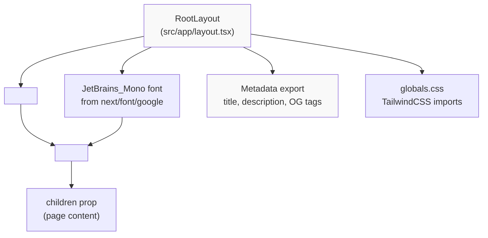
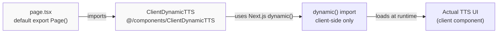
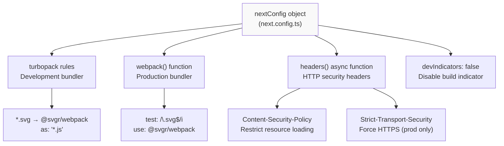
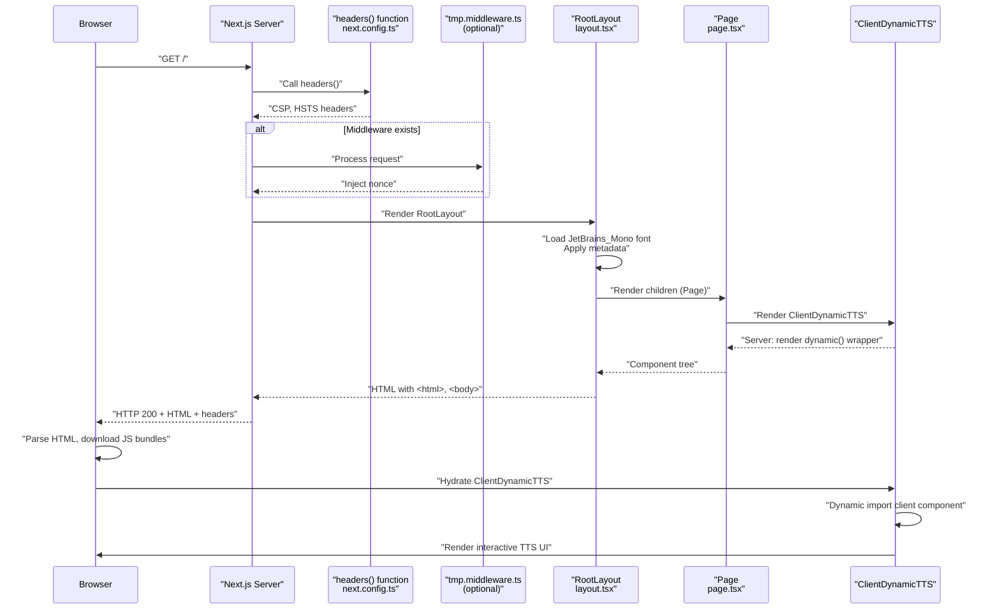

<!-- source: DeepWiki mcp.deepwiki.com · repo openai/openai-fm · page 3.1 Next.js Application Structure · fetched 2026-10-26 -->

# Next.js Application Structure

<details>
<summary>Relevant source files</summary>

The following files were used as context for generating this wiki page:

- [next.config.ts](next.config.ts)
- [src/app/layout.tsx](src/app/layout.tsx)
- [src/app/page.tsx](src/app/page.tsx)

</details>


## Purpose and Scope

This document describes the Next.js application structure of OpenAI.fm, focusing on the App Router file organization, root layout configuration, main page component, and Next.js build configuration. This covers the foundational framework that all other application components build upon.

For information about specific UI components rendered within this structure, see [Frontend Components](#3.2). For details on API routing and server-side logic, see [API Routes](#3.3). For build tooling and development workflows, see [Build Process](#4.2).

## App Router Structure

OpenAI.fm uses the Next.js App Router (introduced in Next.js 13+) rather than the legacy Pages Router. The App Router uses file-system based routing with special files defining route segments.

### Directory Layout

```
src/app/
├── layout.tsx          # Root layout component
├── page.tsx            # Main page route ()
├── globals.css         # Global styles
├── tmp.middleware.ts   # Middleware for CSP nonce injection
└── api/
    ├── generate/
    │   └── route.ts    # /api/generate endpoint
    └── share/
        └── route.ts    # /api/share endpoint
```

The `src/app` directory serves as the root of the application routing structure. Each `page.tsx` file creates a route, while `layout.tsx` defines shared UI wrapping all routes at that level.

**Sources:** [src/app/layout.tsx:1-47](), [src/app/page.tsx:1-6]()

### File Naming Conventions

| File Name | Purpose | Rendered |
|-----------|---------|----------|
| `layout.tsx` | Defines UI shared across routes | Always |
| `page.tsx` | Defines unique UI for a route | When route matches |
| `route.ts` | Defines API endpoint handlers | N/A (API) |
| `globals.css` | Global styles imported in layout | Always |

**Sources:** [src/app/layout.tsx:4](), [src/app/page.tsx:1-6]()

## Root Layout Component

The root layout is defined in [src/app/layout.tsx:1-47]() and establishes the HTML document structure, metadata, and global styling for the entire application.

### Component Structure



**Sources:** [src/app/layout.tsx:1-47]()

### Metadata Configuration

The `metadata` export at [src/app/layout.tsx:12-32]() defines SEO and social media metadata:

| Property | Value | Purpose |
|----------|-------|---------|
| `metadataBase` | `https://www.openai.fm` | Base URL for relative URLs |
| `title` | `"OpenAI.fm"` | Page title |
| `description` | Interactive TTS demo description | SEO description |
| `authors` | `[{ name: "OpenAI" }]` | Author metadata |
| `openGraph.title` | `"OpenAI.fm"` | Open Graph title |
| `openGraph.description` | TTS demo description | Open Graph description |
| `openGraph.images` | `/og-image.png` (1200x630) | Social media preview image |
| `twitter.card` | `"summary_large_image"` | Twitter card type |

The `metadataBase` at [src/app/layout.tsx:13]() ensures that relative paths in metadata (like the Open Graph image) resolve correctly in production.

**Sources:** [src/app/layout.tsx:12-32]()

### Font Configuration

The layout uses the JetBrains Mono font loaded via `next/font/google` at [src/app/layout.tsx:6-10]():

```typescript
const jetBrainsMono = JetBrains_Mono({
  weight: "400",
  subsets: [],
  preload: true,
});
```

This font is applied to the `<body>` element at [src/app/layout.tsx:41]() using the `clsx` utility to combine multiple class names. The `next/font/google` integration automatically optimizes font loading, generating CSS with font-display swap and self-hosting the font files.

**Sources:** [src/app/layout.tsx:6-10](), [src/app/layout.tsx:41]()

### HTML Structure

The root layout returns the following HTML structure [src/app/layout.tsx:39-45]():

```
<html lang="en">
  <body className="antialiased {jetBrainsMono.className}">
    {children}
  </body>
</html>
```

The `antialiased` class applies font smoothing, while `{children}` represents the content from nested routes (in this case, the page component).

**Sources:** [src/app/layout.tsx:39-45]()

## Main Page Component

The main page component is defined in [src/app/page.tsx:1-6]() and represents the root route (`/`) of the application.



**Sources:** [src/app/page.tsx:1-6]()

### Component Implementation

The page component is minimal at [src/app/page.tsx:3-5]():

```typescript
export default function Page() {
  return <ClientDynamicTTS />;
}
```

This simplicity is intentional. The `Page` component itself is a Server Component (the default in App Router), but it immediately renders `ClientDynamicTTS`, which handles the dynamic import of the actual client-side UI. This pattern is necessary because the TTS interface requires browser APIs (Web Audio API, Service Workers) that are not available during server-side rendering.

**Sources:** [src/app/page.tsx:3-5]()

### Import Path Resolution

The import at [src/app/page.tsx:1]() uses the `@/` path alias:

```typescript
import ClientDynamicTTS from "@/components/ClientDynamicTTS";
```

This alias is configured in `tsconfig.json` to map `@/*` to `src/*`, enabling absolute imports and avoiding relative path complexity.

**Sources:** [src/app/page.tsx:1]()

## Next.js Configuration

The [next.config.ts:1-58]() file configures the Next.js build system, bundler behavior, SVG handling, and HTTP headers.

### Configuration Structure



**Sources:** [next.config.ts:1-58]()

### Bundler Configuration

#### Turbopack (Development)

The `turbopack` configuration at [next.config.ts:19-26]() defines rules for the development bundler:

```typescript
turbopack: {
  rules: {
    "*.svg": {
      loaders: ["@svgr/webpack"],
      as: "*.js",
    },
  },
}
```

This rule transforms SVG files into React components using `@svgr/webpack`, allowing SVG imports as JSX elements rather than URL strings.

**Sources:** [next.config.ts:19-26]()

#### Webpack (Production)

The `webpack()` function at [next.config.ts:30-37]() applies the same SVG transformation for production builds:

```typescript
webpack(config) {
  config.module.rules.push({
    test: /\.svg$/i,
    issuer: /\.[jt]sx?$/,
    use: ["@svgr/webpack"],
  });
  return config;
}
```

The `issuer` constraint ensures SVG files are only transformed when imported from JavaScript/TypeScript files (not CSS).

**Sources:** [next.config.ts:30-37]()

### HTTP Security Headers

The `headers()` async function at [next.config.ts:38-54]() configures HTTP security headers returned for all routes.

#### Content Security Policy (CSP)

The CSP is constructed at [next.config.ts:5-16]():

```typescript
const CSP = [
  "default-src 'self';",
  "script-src 'self' 'unsafe-eval' 'unsafe-inline' ;",
  "connect-src 'self';",
  "style-src 'self' 'unsafe-inline';",
  "img-src 'self'",
  "object-src 'none';",
  "frame-ancestors 'none';",
  IS_DEV ? null : "upgrade-insecure-requests;",
]
  .filter(Boolean)
  .join(" ");
```

| Directive | Value | Purpose |
|-----------|-------|---------|
| `default-src` | `'self'` | Default to same-origin only |
| `script-src` | `'self' 'unsafe-eval' 'unsafe-inline'` | Allow scripts from same origin, eval (React dev), inline |
| `connect-src` | `'self'` | Allow fetch/XHR to same origin only |
| `style-src` | `'self' 'unsafe-inline'` | Allow styles from same origin and inline |
| `img-src` | `'self'` | Allow images from same origin only |
| `object-src` | `'none'` | Block all plugins (Flash, Java, etc.) |
| `frame-ancestors` | `'none'` | Prevent embedding in iframes (clickjacking protection) |
| `upgrade-insecure-requests` | (prod only) | Auto-upgrade HTTP to HTTPS |

Note: `'unsafe-eval'` and `'unsafe-inline'` reduce security but are required for React's development mode and some styling approaches. For production deployments with stricter security requirements, consider implementing nonce-based CSP as demonstrated in [src/app/tmp.middleware.ts]().

**Sources:** [next.config.ts:5-16](), [next.config.ts:38-44]()

#### Strict Transport Security (HSTS)

In production (when `NODE_ENV !== "production"`), an HSTS header is added at [next.config.ts:46-51]():

```typescript
if (!IS_DEV) {
  headers.push({
    key: "Strict-Transport-Security",
    value: "max-age=31536000; includeSubDomains; preload",
  });
}
```

This header instructs browsers to only access the site via HTTPS for the next year (31536000 seconds), including all subdomains, and signals eligibility for browser HSTS preload lists.

**Sources:** [next.config.ts:3](), [next.config.ts:46-51]()

### Build Environment Detection

The `IS_DEV` constant at [next.config.ts:3]() determines the build environment:

```typescript
const IS_DEV = process.env.NODE_ENV !== "production";
```

This boolean is used to conditionally apply production-only security features (HSTS, CSP upgrade-insecure-requests) and avoid them in development where they would interfere with local HTTP workflows.

**Sources:** [next.config.ts:3]()

## Request Lifecycle

The following diagram shows how an incoming HTTP request flows through the Next.js application structure:



**Sources:** [next.config.ts:38-54](), [src/app/layout.tsx:1-47](), [src/app/page.tsx:1-6]()

### Server-Side Rendering (SSR)

1. **Request Reception**: Next.js server receives the HTTP request for `/`
2. **Header Application**: The `headers()` function at [next.config.ts:38-54]() adds CSP and HSTS headers to the response
3. **Layout Rendering**: `RootLayout` at [src/app/layout.tsx:34-46]() executes on the server, establishing HTML structure and metadata
4. **Page Rendering**: `Page` at [src/app/page.tsx:3-5]() renders on the server, outputting the `ClientDynamicTTS` wrapper
5. **HTML Response**: Complete HTML is sent to the browser with security headers

**Sources:** [next.config.ts:38-54](), [src/app/layout.tsx:34-46](), [src/app/page.tsx:3-5]()

### Client-Side Hydration

1. **HTML Parsing**: Browser parses the received HTML and begins downloading JavaScript bundles
2. **Font Loading**: Next.js font optimization loads JetBrains Mono with optimal performance
3. **React Hydration**: React hydrates the server-rendered HTML, making it interactive
4. **Dynamic Import**: `ClientDynamicTTS` performs a dynamic import (client-side only) to load the actual TTS UI
5. **Interactive UI**: The TTS interface becomes fully interactive with browser APIs available

This two-phase approach (SSR for shell + CSR for interactive components) optimizes both initial page load and interactivity.

**Sources:** [src/app/page.tsx:1-6]()

## Configuration File Dependencies

The following table summarizes how different configuration files relate to the Next.js application structure:

| File | Purpose | Referenced By |
|------|---------|---------------|
| `next.config.ts` | Build configuration, bundler rules, HTTP headers | Next.js build system |
| `src/app/layout.tsx` | Root HTML structure, metadata, fonts | Next.js App Router |
| `src/app/page.tsx` | Main page route component | Next.js App Router |
| `src/app/globals.css` | Global styles (imported in layout) | [src/app/layout.tsx:4]() |
| `tsconfig.json` | TypeScript configuration, path aliases | Next.js, TypeScript compiler |
| `postcss.config.mjs` | PostCSS plugins (TailwindCSS) | Next.js build system |

For detailed information on styling configuration, see [Styling System](#4.3). For build process details, see [Build Process](#4.2).

**Sources:** [next.config.ts:1-58](), [src/app/layout.tsx:1-47](), [src/app/page.tsx:1-6]()

---

