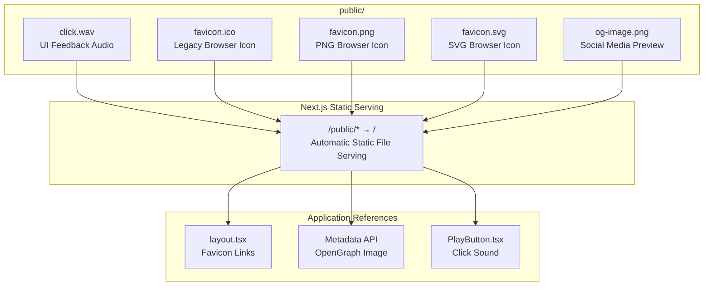
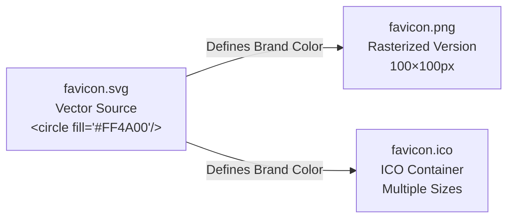
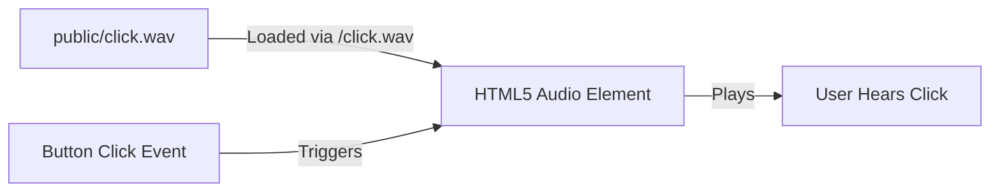
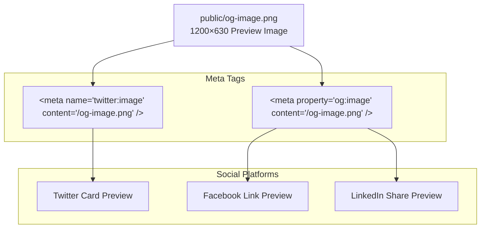
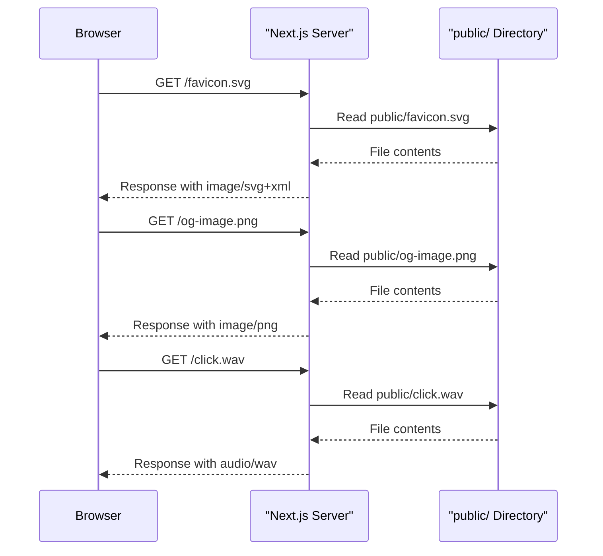
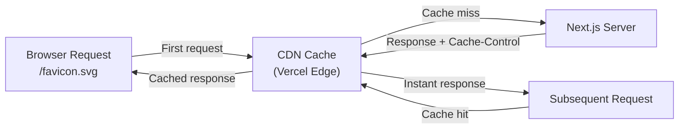

<!-- source: DeepWiki mcp.deepwiki.com · repo openai/openai-fm · page 6 Static Assets · fetched 2026-10-26 -->

# Static Assets

<details>
<summary>Relevant source files</summary>

The following files were used as context for generating this wiki page:

- [public/click.wav](public/click.wav)
- [public/favicon.ico](public/favicon.ico)
- [public/favicon.png](public/favicon.png)
- [public/favicon.svg](public/favicon.svg)
- [public/og-image.png](public/og-image.png)
- [public/pressed.wav](public/pressed.wav)
- [public/screenshot.jpg](public/screenshot.jpg)

</details>


This document catalogs the static assets stored in the `public/` directory and explains their roles within the OpenAI.fm application. Static assets include favicons, audio files, and social sharing images that are served directly by Next.js without processing.

For information about build-time asset processing (SVG-to-React conversion, CSS compilation), see [Build Process](#4.2). For service worker caching of generated audio, see [Audio Processing](#3.5).

---

## Overview

OpenAI.fm maintains a minimal set of static assets in the `public/` directory, which Next.js serves from the root path (`/`). These assets include branding elements (favicons), UI feedback sounds, and social media metadata images.

**Sources:** [public/](public)

---

## Static Asset Directory Structure

The following diagram shows all static assets and their purposes:



**Sources:** [public/click.wav](public/click.wav), [public/favicon.ico](public/favicon.ico), [public/favicon.png](public/favicon.png), [public/favicon.svg](public/favicon.svg), [public/og-image.png](public/og-image.png)

---

## Favicon System

OpenAI.fm provides favicons in three formats to ensure compatibility across browsers and devices:

| File | Format | Dimensions | Purpose |
|------|--------|------------|---------|
| `favicon.svg` | Vector (SVG) | 100×100 viewBox | Modern browsers with SVG support |
| `favicon.png` | Raster (PNG) | 100×100 pixels | Standard browsers |
| `favicon.ico` | Multi-resolution ICO | Multiple sizes | Legacy browser compatibility |

### Favicon Design

All favicon variants display the same design: an orange circle (`#FF4A00`) on a transparent background.



The SVG implementation is minimal:

```svg
<circle cx="49.5" cy="49.5" r="47.5" fill="#FF4A00"/>
```

**Sources:** [public/favicon.svg:1-4](public/favicon.svg:1-4), [public/favicon.png](public/favicon.png), [public/favicon.ico](public/favicon.ico)

### Favicon Integration

Favicons are referenced in the root layout through Next.js's metadata system. The application likely uses Next.js 13+ App Router conventions for favicon discovery, where files in `public/` named `favicon.*` are automatically served.

**Sources:** [src/app/layout.tsx](src/app/layout.tsx) (inferred from Next.js conventions)

---

## Audio Assets

### Click Sound (`click.wav`)

The application includes a WAV audio file for UI feedback, typically played when users interact with buttons or controls.

| Property | Value |
|----------|-------|
| File | `public/click.wav` |
| Format | WAV (RIFF container) |
| Sample Rate | 48 kHz (inferred from WAV header) |
| Channels | Stereo (inferred) |
| Purpose | UI interaction feedback |



The click sound is likely triggered by UI components (such as `PlayButton`) to provide auditory feedback for user actions. The exact integration point would be in the component's event handlers.

**Sources:** [public/click.wav](public/click.wav), [src/components/PlayButton.tsx](src/components/PlayButton.tsx) (inferred usage)

---

## Social Media Assets

### Open Graph Image (`og-image.png`)

The `og-image.png` serves as the preview image when the application is shared on social media platforms (Twitter, Facebook, LinkedIn, etc.).

| Property | Value |
|----------|-------|
| File | `public/og-image.png` |
| Format | PNG |
| Dimensions | 1200×630 pixels (standard OG image size, inferred) |
| Purpose | Social media link previews |



The Open Graph image is referenced through Next.js metadata configuration, which generates appropriate `<meta>` tags in the HTML `<head>`.

**Sources:** [public/og-image.png](public/og-image.png), [src/app/layout.tsx](src/app/layout.tsx) (metadata configuration)

---

## Asset Serving Flow

Next.js automatically serves files from the `public/` directory at the root URL path. The following diagram illustrates how static assets are requested and served:



**Sources:** [next.config.ts](next.config.ts) (Next.js configuration)

---

## Asset Manifest

The complete inventory of static assets:

| Asset | Type | Size Category | Primary Consumer |
|-------|------|---------------|------------------|
| `favicon.svg` | Branding | Small (<1 KB) | Browser chrome |
| `favicon.png` | Branding | Small (~5 KB) | Browser chrome |
| `favicon.ico` | Branding | Small (~5 KB) | Legacy browsers |
| `og-image.png` | Metadata | Large (~50-200 KB) | Social media scrapers |
| `click.wav` | Audio | Medium (~5-20 KB) | UI components |

**Sources:** [public/](public)

---

## Caching and Performance

Static assets in the `public/` directory benefit from Next.js's built-in caching strategies:

- **Browser Caching:** Next.js sets appropriate `Cache-Control` headers for static assets
- **Service Worker:** Generated audio (not static files) is cached by the service worker at [public/worker-444eae9e2e1bdd6edd8969f319655e70.js](public/worker-444eae9e2e1bdd6edd8969f319655e70.js)
- **CDN Compatibility:** When deployed to Vercel or similar platforms, these assets are automatically served from a CDN



**Sources:** [next.config.ts](next.config.ts), [public/worker-444eae9e2e1bdd6edd8969f319655e70.js](public/worker-444eae9e2e1bdd6edd8969f319655e70.js)

---

## Development Considerations

When modifying static assets:

1. **Favicon Changes:** Update all three formats (`svg`, `png`, `ico`) to maintain consistency
2. **Audio Files:** Keep WAV files short (<1 second) and ensure sample rate is appropriate (44.1 kHz or 48 kHz)
3. **OG Images:** Follow Open Graph specifications (1200×630 px, <8 MB)
4. **File Naming:** Use lowercase, hyphen-separated names for consistency with web conventions

**Sources:** [public/](public)

---

