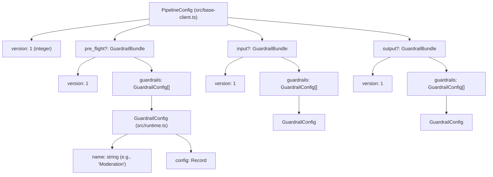
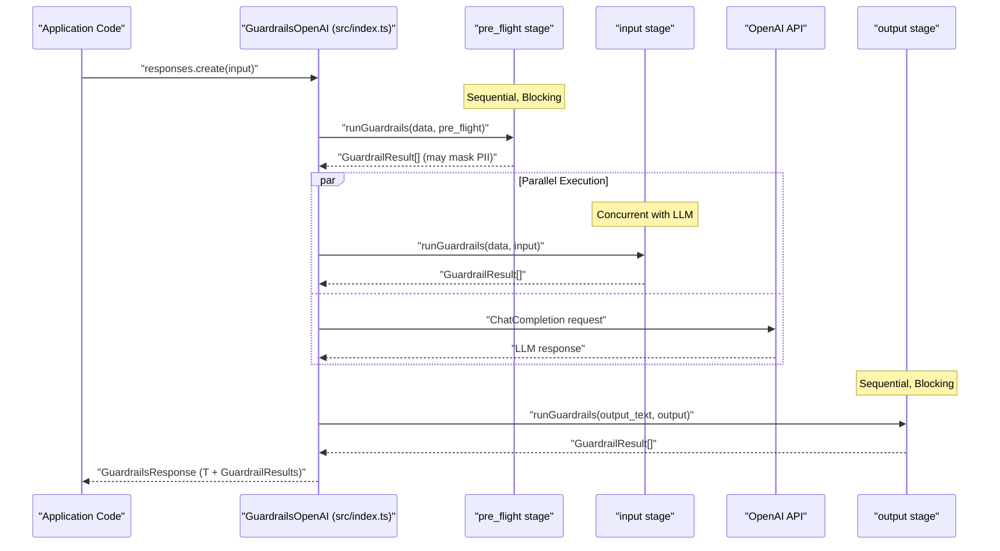

<!-- source: DeepWiki mcp.deepwiki.com · repo openai/openai-guardrails-js · page 2.3 Pipeline Configuration Basics · fetched 2026-10-26 -->

# Pipeline Configuration Basics

<details>
<summary>Relevant source files</summary>

The following files were used as context for generating this wiki page:

- [examples/basic/hello_world.ts](examples/basic/hello_world.ts)
- [examples/basic/local_model.ts](examples/basic/local_model.ts)
- [examples/basic/multiturn_with_prompt_injection_detection.ts](examples/basic/multiturn_with_prompt_injection_detection.ts)
- [examples/basic/streaming.ts](examples/basic/streaming.ts)
- [src/base-client.ts](src/base-client.ts)
- [src/runtime.ts](src/runtime.ts)
- [src/types.ts](src/types.ts)

</details>


## Purpose and Scope

This page explains how to create and structure pipeline configurations for the OpenAI Guardrails framework. Pipeline configurations are declarative JSON or TypeScript objects that define which guardrails run at which stages of LLM request processing.

Configurations are defined by the `PipelineConfig` interface [src/base-client.ts:126-131](), which organizes guardrails into `pre_flight`, `input`, and `output` stages. These stages are populated with `GuardrailBundle` objects [src/runtime.ts:25-32](), which contain the specific guardrail definitions and their associated parameters.

---

## Configuration Formats

Pipeline configurations can be provided in two formats:

### JSON File Format

Configuration stored as a `.json` file and loaded via file path. The `GuardrailsBaseClient.setupGuardrails` method handles loading these configurations [src/base-client.ts:191-199]().

```json
{
  "version": 1,
  "input": {
    "version": 1,
    "guardrails": [
      {"name": "Moderation", "config": {"categories": ["hate", "violence"]}}
    ]
  }
}
```

### TypeScript Object Format

Configuration defined inline as a JavaScript/TypeScript object, as seen in the framework examples [examples/basic/hello_world.ts:14-57]().

```typescript
const PIPELINE_CONFIG = {
  version: 1,
  pre_flight: {
    version: 1,
    guardrails: [
      {
        name: 'Moderation',
        config: { categories: ['hate', 'violence'] },
      }
    ],
  },
  input: {
    version: 1,
    guardrails: [
      {
        name: 'Custom Prompt Check',
        config: {
          model: 'gpt-4.1-mini',
          confidence_threshold: 0.7,
          system_prompt_details: 'Check if the text contains any math problems.',
        },
      },
    ],
  },
};
```

**Sources:** [src/base-client.ts:126-131](), [examples/basic/hello_world.ts:14-57](), [src/runtime.ts:37-42]()

---

## Configuration Structure

### Top-Level Schema

The `PipelineConfig` interface [src/base-client.ts:126-131]() requires a `version` and optional stage bundles.

#### Diagram: Pipeline Configuration Object Hierarchy



**Sources:** [src/base-client.ts:126-131](), [src/runtime.ts:15-32]()

### Version Field

The `version` field (currently `1`) is used at both the pipeline level [src/base-client.ts:127]() and the bundle level [src/runtime.ts:27]().

### GuardrailConfig Structure

Each entry in the `guardrails` array is a `GuardrailConfig` object [src/runtime.ts:15-20]():
- `name`: The registry name used to look up the `GuardrailSpec` in the `defaultSpecRegistry` [src/runtime.ts:195-198]().
- `config`: A record containing parameters that are validated against the guardrail's `configSchema` [src/runtime.ts:202-205]().

---

## Pipeline Stages

The pipeline supports three execution stages, managed by the `StageGuardrails` interface [src/base-client.ts:136-140]().

#### Diagram: Stage Execution Flow and Timing



**Sources:** [src/base-client.ts:136-140](), [src/runtime.ts:139-178](), [examples/basic/hello_world.ts:73-77]()

### Pre-flight Stage

The `pre_flight` stage runs before any other processing. It is unique because it can perform content modifications, such as PII masking, via `applyPreflightModifications` [src/base-client.ts:201-204]().

**Common use cases:**
- PII masking or redaction [src/base-client.ts:209-223]().
- Early moderation of user intent [examples/basic/hello_world.ts:16-31]().

### Input Stage

The `input` stage validates the prompt. In the standard implementation, this typically runs in parallel with the LLM call to minimize latency.

**Common use cases:**
- Jailbreak detection [examples/basic/hello_world.ts:24-29]().
- Prompt injection detection [examples/basic/multiturn_with_prompt_injection_detection.ts:130-138]().

### Output Stage

The `output` stage validates the content generated by the LLM [src/base-client.ts:82]().

**Common use cases:**
- URL filtering [examples/basic/hello_world.ts:46-56]().
- Hallucination detection.
- Detecting PII in the model's response [examples/basic/streaming.ts:51-58]().

---

## Using the Guardrails Wizard

The [Guardrails Wizard](https://guardrails.openai.com) is the recommended tool for generating these configurations. It allows developers to visually select guardrails and export a `PipelineConfig` compatible with the `GuardrailsOpenAI.create` method [examples/basic/hello_world.ts:116]().

---

## Configuration Examples

### Streaming Configuration

Configurations remain active during streaming. In a streaming context, `output` guardrails are typically evaluated after the stream completes or on individual chunks depending on the guardrail type [examples/basic/streaming.ts:42-60]().

```typescript
const STREAMING_CONFIG = {
  version: 1,
  output: {
    version: 1,
    guardrails: [
      {
        name: 'Contains PII',
        config: {
          entities: ['US_SSN', 'PHONE_NUMBER'],
          block: true
        },
      },
    ],
  },
};
```

### Multi-turn Configuration

For multi-turn conversations, guardrails like `Prompt Injection Detection` can be configured in both `pre_flight` and `output` stages to monitor the conversation state [examples/basic/multiturn_with_prompt_injection_detection.ts:128-148]().

---

## Configuration Validation

When `GuardrailsOpenAI.create(config)` is called, the framework performs several validation steps:
1. **Instantiation**: `instantiateAllGuardrails` is called to transform the config into executable `ConfiguredGuardrail` objects [src/base-client.ts:196]().
2. **Registry Lookup**: The `name` in the config is checked against the `defaultSpecRegistry` [src/runtime.ts:195-198]().
3. **Schema Validation**: If the guardrail spec defines a `configSchema` (using Zod), the provided `config` object is parsed and validated [src/runtime.ts:203-205]().

**Sources:** [src/base-client.ts:191-199](), [src/runtime.ts:189-211](), [src/types.ts:82-86]()

---

