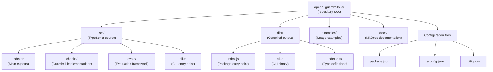
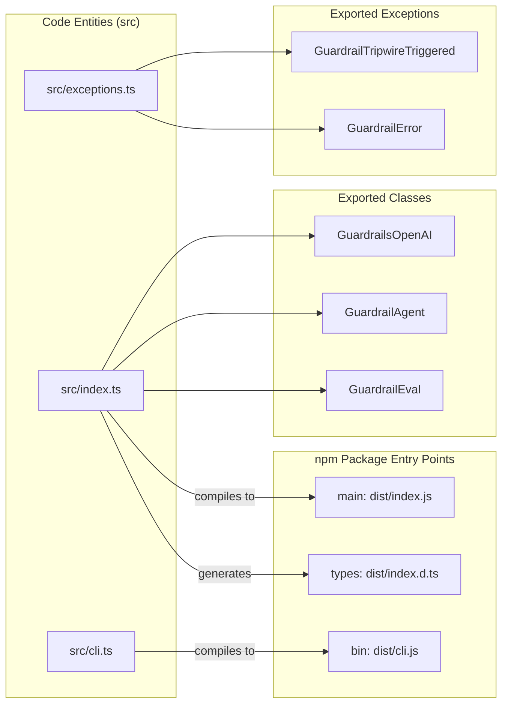

<!-- source: DeepWiki mcp.deepwiki.com · repo openai/openai-guardrails-js · page 8.1 Development Setup · fetched 2026-10-26 -->

# Development Setup

<details>
<summary>Relevant source files</summary>

The following files were used as context for generating this wiki page:

- [.gitignore](.gitignore)
- [docs/ref/exceptions-typescript.md](docs/ref/exceptions-typescript.md)
- [package-lock.json](package-lock.json)
- [package.json](package.json)
- [tsconfig.json](tsconfig.json)

</details>


This page covers setting up a local development environment for contributing to the OpenAI Guardrails TypeScript repository. It explains the repository structure, dependency installation, and running the project in development mode.

For information about the build pipeline and npm scripts, see [Build System](#8.2). For code quality tooling (ESLint, Prettier, Vitest), see [Code Quality Tools](#8.3). For documentation generation, see [Documentation System](#8.4).

## Prerequisites

Development requires the following tools installed on your system:

| Tool | Minimum Version | Purpose |
|------|----------------|---------|
| Node.js | 18.0.0 | Runtime environment |
| npm | (bundled with Node.js) | Package management |
| Git | Any recent version | Source control |

The Node.js version requirement is specified in `package.json`.

**Sources:** [package.json:62-64]()

## Repository Structure Overview

The following diagram maps the logical components of the repository to their physical locations in the source tree.



### Key Directories and Files

| Directory/File | Purpose | Notes |
|-----------|---------|-------|
| `src/` | TypeScript source code | Primary development location. Configured as `rootDir` in `tsconfig.json` [tsconfig.json:10-10](). |
| `dist/` | Compiled JavaScript output | Generated by `tsc`. Configured as `outDir` in `tsconfig.json` [tsconfig.json:9-9](). |
| `src/index.ts` | Framework entry point | Exports core classes like `GuardrailsOpenAI` and `GuardrailAgent`. |
| `src/cli.ts` | CLI entry point | Implementation of the `guardrails` command-line tool [package.json:7-9](). |
| `package.json` | Manifest | Defines metadata, scripts, and dependencies [package.json:1-68](). |
| `.gitignore` | Exclusion list | Prevents committing `node_modules/`, `dist/`, and `.env` files [/.gitignore:1-15](). |

**Sources:** [package.json:1-68](), [tsconfig.json:1-40](), [/.gitignore:1-108]()

## Initial Setup

### Cloning the Repository

Clone the repository from GitHub:

```bash
git clone https://github.com/openai/openai-guardrails-js.git
cd openai-guardrails-js
```

The repository URL is specified in the package manifest.

**Sources:** [package.json:38-41]()

### Installing Dependencies

Install npm dependencies using `npm`:

```bash
npm install
```

#### Core Dependencies

The package has the following runtime dependencies:

| Package | Version | Purpose |
|---------|---------|---------|
| `openai` | ^4.0.0 | OpenAI API client (wrapped by `GuardrailsOpenAI`) [package.json:48-48]() |
| `@openai/agents` | ^0.1.3 | Agents SDK (for `GuardrailAgent` integration) [package.json:47-47]() |
| `zod` | ^3.22.0 | Schema validation for configurations [package.json:49-49]() |

#### Development Dependencies

Development tooling dependencies include:

| Package | Purpose |
|---------|---------|
| `typescript` (^5.0.0) | TypeScript compiler [package.json:59-59]() |
| `eslint` (^8.0.0) | Code linting [package.json:56-56]() |
| `prettier` (^3.0.0) | Code formatting [package.json:57-57]() |
| `vitest` (^1.0.0) | Testing framework [package.json:60-60]() |
| `rimraf` (^5.0.0) | Cross-platform file removal for `clean` script [package.json:58-58]() |

**Sources:** [package.json:46-61]()

## Development Workflow

### Development Mode with Watch

The primary development workflow uses TypeScript's watch mode to automatically recompile on file changes:

```bash
npm run dev
```

This executes `tsc --watch` as defined in `package.json`. The compiler will watch the `src/` directory and update `dist/` incrementally.

**Sources:** [package.json:15-15](), [tsconfig.json:31-31]()

### Building the Project

To perform a one-time build:

```bash
npm run build
```

This runs `tsc`, which uses settings from `tsconfig.json`, including targeting `ES2020` and `commonjs` modules.

**Sources:** [package.json:14-14](), [tsconfig.json:3-4]()

### Running Tests

Execute the test suite using Vitest:

```bash
# Run tests once
npm run test:run

# Run tests in watch mode
npm run test:watch
```

**Sources:** [package.json:18-19]()

## Package Entry Points

The following diagram bridges the npm package structure to the internal code entities.



Entry points are configured in `package.json`:

| Field | Path | Purpose |
|-------|------|---------|
| `main` | `dist/index.js` | Main library entry point [package.json:5-5]() |
| `types` | `dist/index.d.ts` | Type definitions for consumers [package.json:6-6]() |
| `bin` | `dist/cli.js` | Executable command `guardrails` [package.json:7-9]() |

**Sources:** [package.json:5-9](), [docs/ref/exceptions-typescript.md:5-18]()

## Development Environment Variables

The framework interacts with OpenAI services and requires an API key. It is recommended to use an `.env` file for local development (which is ignored by git).

```bash
OPENAI_API_KEY='your-api-key-here'
```

**Sources:** [/.gitignore:13-14]()

## Common Development Tasks

### Cleaning Build Output
```bash
npm run clean
```
Runs `rimraf dist` to clear previous builds.

### Formatting and Linting
```bash
npm run format   # Runs prettier
npm run lint     # Runs eslint
npm run lint:fix # Runs eslint with --fix
```

### Running Evaluations
```bash
npm run eval
```
This executes `node dist/cli.js eval`, allowing developers to test guardrail configurations against datasets.

**Sources:** [package.json:16-25]()

## Files Published to npm

The package is configured to only include the `dist` directory in the final npm artifact.

```json
"files": [
  "dist"
]
```

The `prepublishOnly` script ensures that the project is cleaned and rebuilt from scratch before any publication to ensure consistency.

**Sources:** [package.json:10-12](), [package.json:23-23]()

---

