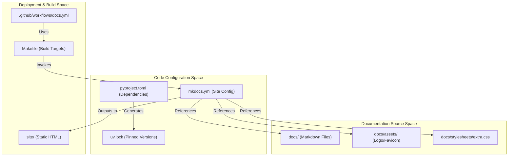
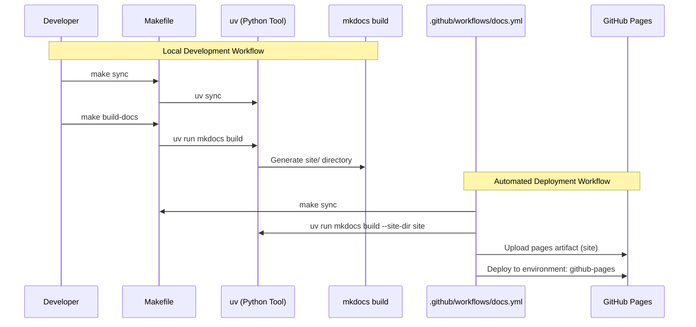

<!-- source: DeepWiki mcp.deepwiki.com · repo openai/openai-guardrails-js · page 8.4 Documentation System · fetched 2026-10-26 -->

# Documentation System

<details>
<summary>Relevant source files</summary>

The following files were used as context for generating this wiki page:

- [.github/workflows/ci.yml](.github/workflows/ci.yml)
- [.github/workflows/docs.yml](.github/workflows/docs.yml)
- [.github/workflows/publish.yml](.github/workflows/publish.yml)
- [Makefile](Makefile)
- [mkdocs.yml](mkdocs.yml)
- [pyproject.toml](pyproject.toml)
- [uv.lock](uv.lock)

</details>


This page describes the MkDocs-based documentation system used to generate and deploy the static documentation site for the OpenAI Guardrails TypeScript library. This includes the configuration files, build process, deployment mechanism, and Python dependencies required to work with the documentation.

For information about contributing to the codebase itself, see [8.1 Development Setup](). For information about the TypeScript build system, see [8.2 Build System]().

---

## Overview

The documentation system is a Python-based static site generator built on MkDocs with the Material theme. It transforms Markdown files in the `docs/` directory into a fully-featured static website deployed to GitHub Pages at `https://openai.github.io/openai-guardrails-js/`.

### Technology Stack

| Component | Technology | Purpose |
|-----------|-----------|---------|
| **Static Site Generator** | MkDocs 1.6.1+ | Core documentation framework |
| **Theme** | Material for MkDocs 9.6.14+ | Modern, responsive UI |
| **Markdown Extensions** | PyMdown Extensions 10.0.0+ | Enhanced Markdown features, code highlighting |
| **Internationalization** | mkdocs-i18n 0.4.3+ | Multi-language support infrastructure |
| **Deployment** | GitHub Actions & `gh-deploy` | Automated GitHub Pages deployment |
| **Package Management** | uv (Python) | Dependency resolution and environment management |

**Sources:** [pyproject.toml:6-10](), [mkdocs.yml:4-8]()

---

## Configuration Architecture

The documentation system is configured through two primary files: `mkdocs.yml` for site structure and `pyproject.toml` for the Python environment.

### Documentation Components Association
The following diagram bridges the natural language documentation concepts to the specific files and entities within the codebase.



**Sources:** [mkdocs.yml:1-3](), [mkdocs.yml:15-16](), [mkdocs.yml:65-66](), [pyproject.toml:1-11](), [.github/workflows/docs.yml:31-33](), [Makefile:25-35]()

---

## MkDocs Configuration (mkdocs.yml)

The [mkdocs.yml:1-69]() file defines the entire site structure, theme settings, and build behavior.

### Site Metadata and Theme
The system uses the `material` theme with a black primary color palette [mkdocs.yml:4-14](). Key features enabled include code block copy/select functionality and collapsible navigation sections [mkdocs.yml:6-11]().

### Markdown Extensions
The system enables advanced Markdown features through `pymdownx.superfences` [mkdocs.yml:18-19](). Specifically, it registers a custom fence for Mermaid diagrams using the `fence_code_format` from `pymdownx` [mkdocs.yml:20-23]().

### Navigation Structure
The documentation is organized into four main sections:
- **Intro**: The `index.md` landing page [mkdocs.yml:34]().
- **Examples**: `examples.md` [mkdocs.yml:35]().
- **Documentation**: Includes Quickstart, Streaming, Tripwires, and a detailed `Checks` reference for individual guardrails like PII, Hallucination, and Jailbreak detection [mkdocs.yml:36-50]().
- **API Reference**: TypeScript types and exception documentation [mkdocs.yml:51-53]().

**Sources:** [mkdocs.yml:33-53]()

---

## Python Dependencies

The documentation system requires Python >=3.11 [pyproject.toml:5](). Dependencies are managed via `uv`.

### Core Dependencies
- `mkdocs>=1.6.1`: The base documentation engine [pyproject.toml:7]().
- `mkdocs-material>=9.6.14`: The UI theme [pyproject.toml:8]().
- `pymdown-extensions>=10.0.0`: Extended Markdown support [pyproject.toml:9]().
- `mkdocs-i18n>=0.4.3`: Internationalization plugin [pyproject.toml:10]().

The `uv.lock` file ensures reproducible builds by pinning transitive dependencies such as `babel` [uv.lock:6-12](), `certifi` [uv.lock:29-35](), and `charset-normalizer` [uv.lock:38-53]().

**Sources:** [pyproject.toml:5-11](), [uv.lock:1-53]()

---

## Build and Deployment Pipeline

The documentation is built and deployed automatically via GitHub Actions when changes are pushed to the `main` branch.

### Deployment Flow
The following diagram shows how the documentation moves from local development to the live GitHub Pages site.



**Sources:** [.github/workflows/docs.yml:1-43](), [Makefile:21-35](), [pyproject.toml:6-11]()

### GitHub Actions Configuration
The `docs.yml` workflow manages the deployment process:
1. **Triggers**: Runs on push to `main` or manual dispatch [.github/workflows/docs.yml:3-6]().
2. **Setup**: Uses `astral-sh/setup-uv` to manage the Python environment with caching enabled [.github/workflows/docs.yml:26-29]().
3. **Build**: Executes `make sync` to install dependencies and `uv run mkdocs build --site-dir site` to generate the static files [.github/workflows/docs.yml:31-33]().
4. **Publish**: Uses `actions/upload-pages-artifact` and `actions/deploy-pages` to push the `site` directory to the `github-pages` environment [.github/workflows/docs.yml:36-43]().

**Sources:** [.github/workflows/docs.yml:1-43]()

### Makefile Targets
The project provides several targets for managing documentation locally:
- `make sync`: Runs `uv sync` to synchronize Python dependencies [Makefile:21-23]().
- `make build-docs`: Builds the static site into the `site/` directory [Makefile:25-27]().
- `make serve-docs`: Starts a local development server with live-reloading [Makefile:29-31]().
- `make deploy-docs`: Manually forces a deployment to GitHub Pages using `mkdocs gh-deploy` [Makefile:33-35]().

**Sources:** [Makefile:21-35]()

---

## Development Workflow

### Local Preview
To work on documentation locally, developers should use the `serve-docs` target:
```bash
make serve-docs
```
This command invokes `uv run mkdocs serve` [Makefile:31](), which provides a local web server (typically at `http://127.0.0.1:8000`). The configuration is set to watch the `src` directory in addition to the `docs` folder, ensuring that any changes to the core library logic that might affect documentation (like docstrings or type definitions) trigger a refresh [mkdocs.yml:68-69]().

### Validation
The build process includes strict validation settings:
- `omitted_files: warn`: Warns if a Markdown file exists but isn't in the `nav` [mkdocs.yml:60]().
- `unrecognized_links: warn`: Warns if an internal link is broken [mkdocs.yml:62]().
- `anchors: warn`: Warns if a link to a specific section header is invalid [mkdocs.yml:63]().

**Sources:** [mkdocs.yml:59-63](), [Makefile:29-31]()

---

