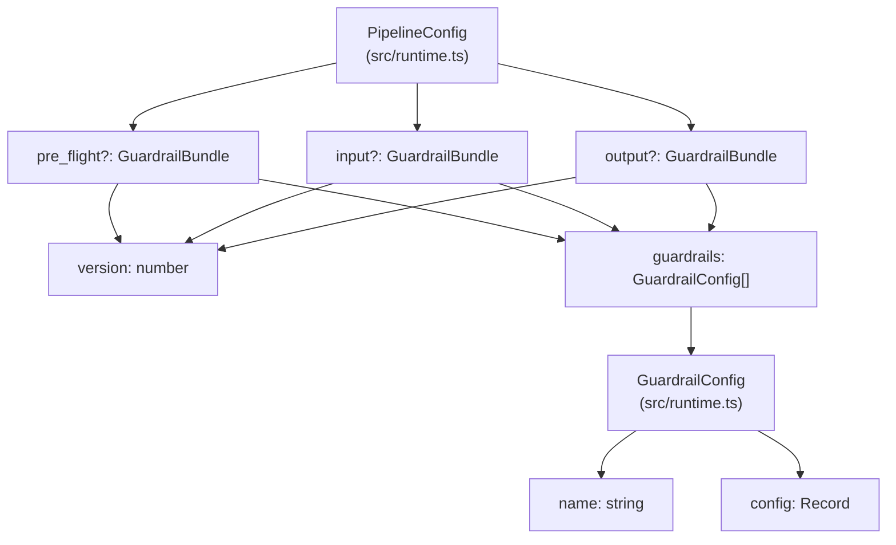
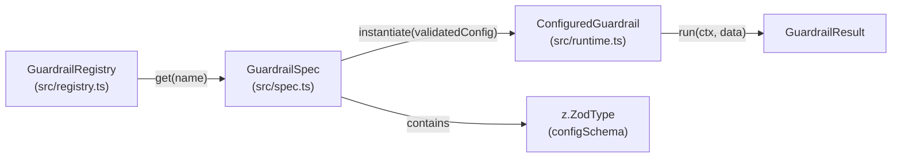
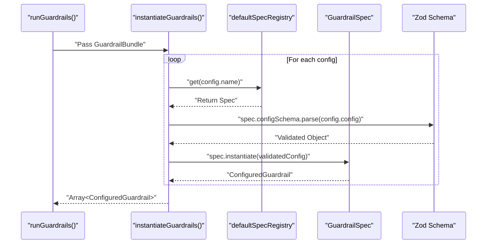

<!-- source: DeepWiki mcp.deepwiki.com · repo openai/openai-guardrails-js · page 9.6 Configuration Schemas · fetched 2026-10-26 -->

# Configuration Schemas

<details>
<summary>Relevant source files</summary>

The following files were used as context for generating this wiki page:

- [src/__tests__/integration/integration.test.ts](src/__tests__/integration/integration.test.ts)
- [src/__tests__/integration/test_suite.ts](src/__tests__/integration/test_suite.ts)
- [src/__tests__/unit/spec.test.ts](src/__tests__/unit/spec.test.ts)
- [src/registry.ts](src/registry.ts)
- [src/runtime.ts](src/runtime.ts)

</details>


This page documents the structure and validation rules for pipeline configurations and guardrail-specific configuration objects. Pipeline configurations define which guardrails execute at which stages (pre-flight, input, output) and how they are configured.

The framework utilizes [zod](https://zod.dev) for schema definition and validation, ensuring that configurations are checked at runtime before execution.

## Pipeline Configuration Schema

The top-level pipeline configuration is a JSON object or TypeScript object that defines the complete guardrail execution plan. It specifies which guardrails run at which stages and with what parameters.

### Structure

The core interfaces for defining these configurations are `PipelineConfig`, `GuardrailBundle`, and `GuardrailConfig`.

```typescript
// From src/runtime.ts:15-42
export interface GuardrailConfig {
  name: string;
  config: Record<string, unknown>;
}

export interface GuardrailBundle {
  version?: number;
  stageName?: string;
  guardrails: GuardrailConfig[];
}

export interface PipelineConfig {
  version?: number;
  pre_flight?: GuardrailBundle;
  input?: GuardrailBundle;
  output?: GuardrailBundle;
}
```

### Pipeline Configuration Fields

| Field | Type | Required | Description |
|-------|------|----------|-------------|
| `version` | `number` | No | Pipeline configuration version. |
| `pre_flight` | `GuardrailBundle` | No | Guardrails that execute before the LLM call. |
| `input` | `GuardrailBundle` | No | Guardrails that execute in parallel with the LLM call. |
| `output` | `GuardrailBundle` | No | Guardrails that execute after the LLM response. |

At least one stage (`pre_flight`, `input`, or `output`) must be specified for a functional pipeline.

**Diagram: Pipeline Configuration Hierarchy**



Sources: [src/runtime.ts:15-42]()

## Stage Configuration Schema

Each pipeline stage follows the `GuardrailBundle` structure [src/runtime.ts:25-32]().

### GuardrailConfig Structure

Each guardrail specification within a bundle defines a single guardrail check to execute.

| Field | Type | Required | Description |
|-------|------|----------|-------------|
| `name` | `string` | Yes | Registered guardrail name used to look up the `GuardrailSpec` in the registry [src/runtime.ts:17-17](). |
| `config` | `object` | Yes | Guardrail-specific configuration object. Validated against the spec's `configSchema` [src/runtime.ts:19-19](). |

**Example Configuration Bundle:**

```json
{
  "version": 1,
  "stageName": "input_validation",
  "guardrails": [
    {
      "name": "Moderation",
      "config": { "categories": ["hate", "violence"] }
    },
    {
      "name": "Keyword Filter",
      "config": { "keywords": ["competitor_a", "competitor_b"] }
    }
  ]
}
```

Sources: [src/runtime.ts:15-32](), [src/__tests__/integration/integration.test.ts:72-81]()

## Guardrail-Specific Configuration Schemas

Each guardrail type has its own configuration schema defined via `zod`. These are passed to the `GuardrailSpec` constructor and used by `ConfiguredGuardrail` to validate inputs [src/spec.ts:41-49]().

### GuardrailSpec Definition

The `GuardrailSpec` class acts as the blueprint for a guardrail, containing its validation logic (`checkFn`) and the schema for its configuration (`configSchema`).

```typescript
// From src/spec.ts:41-49
export class GuardrailSpec<TContext = object, TIn = TextInput, TCfg = object> {
  constructor(
    public readonly name: string,
    public readonly description: string,
    public readonly mediaType: string,
    public readonly configSchema: z.ZodType<TCfg>,
    public readonly checkFn: CheckFn<TContext, TIn, TCfg>,
    public readonly ctxRequirements: z.ZodType<TContext>,
    public readonly metadata?: GuardrailSpecMetadata
  ) {}
}
```

**Diagram: Guardrail Specification and Instantiation**



Sources: [src/spec.ts:41-118](), [src/registry.ts:55-92](), [src/runtime.ts:51-55]()

### Common Guardrail Schemas (Examples)

Based on the integration test suite, the following schemas are commonly used:

| Guardrail Name | Configuration Object Example | Source |
|----------------|------------------------------|--------|
| **Competitors** | `{ keywords: string[] }` | [src/__tests__/integration/test_suite.ts:26-26]() |
| **Contains PII** | `{ entities: string[], block: boolean, detect_encoded_pii: boolean }` | [src/__tests__/integration/test_suite.ts:46-50]() |
| **Secret Keys** | `{ threshold: 'balanced' \| 'strict' \| 'relaxed' }` | [src/__tests__/integration/test_suite.ts:70-70]() |
| **Moderation** | `{ categories: string[] }` | [src/__tests__/integration/test_suite.ts:93-93]() |
| **URL Filter** | `{ url_allow_list: string[] }` | [src/__tests__/integration/test_suite.ts:133-133]() |
| **Jailbreak** | `{ confidence_threshold: number, model: string }` | [src/__tests__/integration/test_suite.ts:153-153]() |

## Configuration Validation Flow

The validation process occurs during the instantiation of guardrails from a bundle.

1. **Lookup**: The `name` in `GuardrailConfig` is used to find the `GuardrailSpec` in the `defaultSpecRegistry` [src/runtime.ts:195-198]().
2. **Schema Validation**: If the `GuardrailSpec` has a `configSchema`, the provided `config` is parsed using `spec.configSchema.parse()` [src/runtime.ts:203-205]().
3. **Instantiation**: A `ConfiguredGuardrail` is created with the validated configuration [src/runtime.ts:207-208]().

**Diagram: Runtime Validation Sequence**



Sources: [src/runtime.ts:139-178](), [src/runtime.ts:189-212]()

## Sentinel Schemas

The registry provides sentinel schemas for guardrails that do not require specific configurations or context:

*   **`NO_CONFIG`**: `z.object({})` - Used when a guardrail has no configuration options [src/registry.ts:19-19]().
*   **`NO_CONTEXT_REQUIREMENTS`**: `z.object({})` - Used when a guardrail does not require external context to run [src/registry.ts:26-26]().

Sources: [src/registry.ts:15-27]()

---

