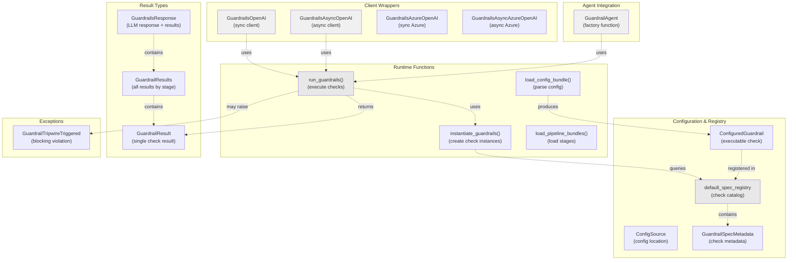
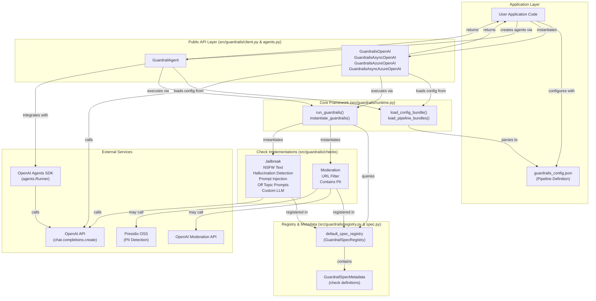
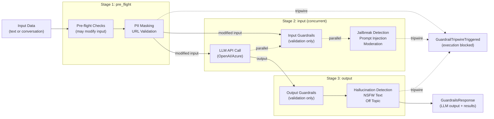
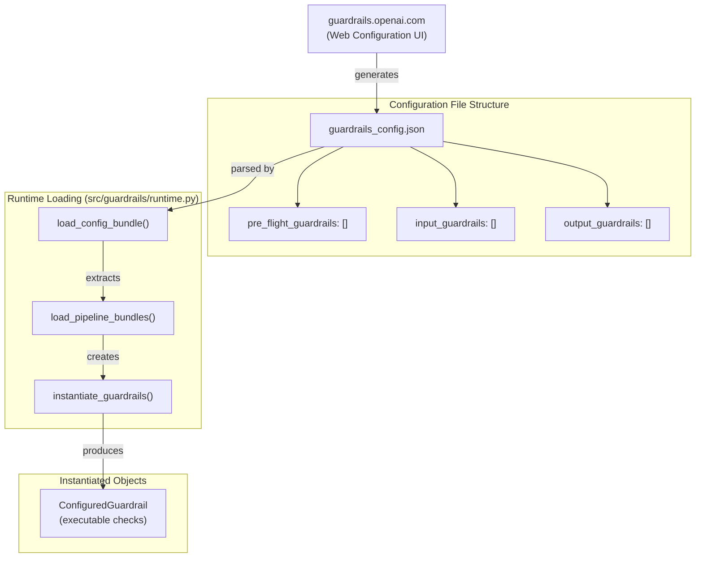
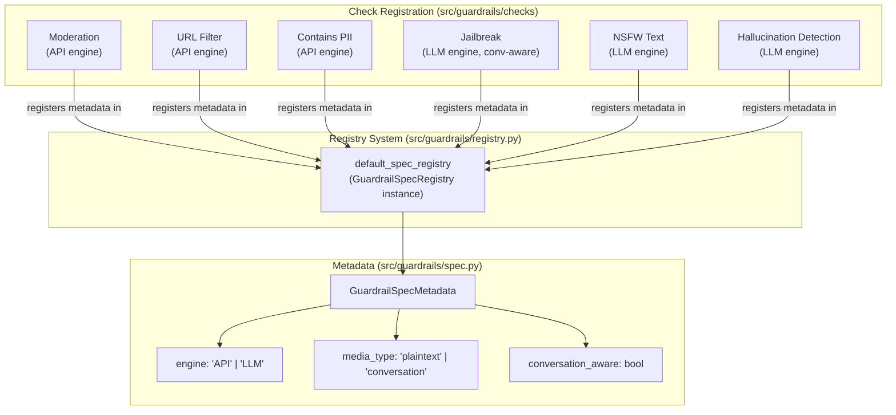
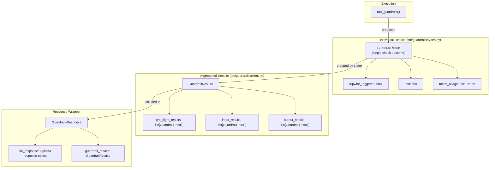
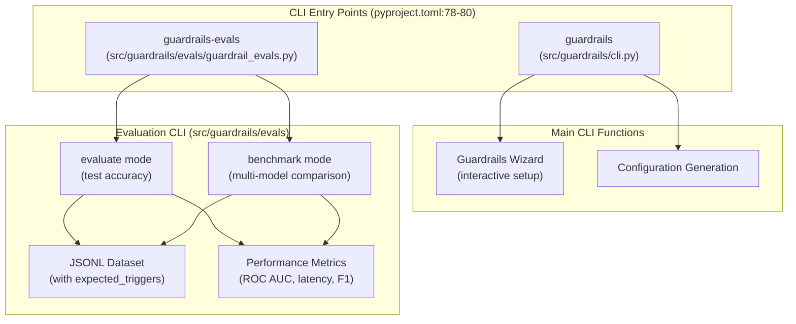
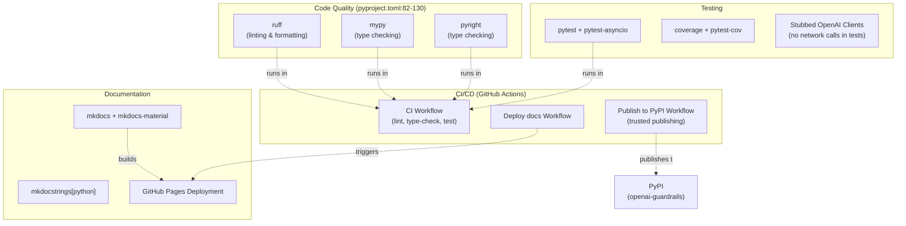

<!-- source: DeepWiki mcp.deepwiki.com · repo openai/openai-guardrails-python · page 1 Overview · fetched 2026-10-26 -->

# Overview

<details>
<summary>Relevant source files</summary>

The following files were used as context for generating this wiki page:

- [README.md](README.md)
- [docs/assets/images/guardrails-python-config-screenshot-100pct-q70.webp](docs/assets/images/guardrails-python-config-screenshot-100pct-q70.webp)
- [pyproject.toml](pyproject.toml)
- [src/guardrails/__init__.py](src/guardrails/__init__.py)

</details>


## Purpose and Scope

This document provides an overview of the OpenAI Guardrails Python package, a framework for adding configurable safety and compliance checks to LLM applications. The package provides drop-in wrappers for OpenAI's Python client, enabling automatic validation and moderation of inputs and outputs using a library of built-in guardrails.

This page covers the high-level architecture, integration patterns, and core components. For specific guardrail implementations, see [Built-in Guardrails](#6). For client integration details, see [Client Integration](#4) and [Agent Integration](#5). For evaluation and testing, see [Evaluation and Benchmarking](#7).

**Sources:** [README.md:1-11](), [pyproject.toml:1-8]()

---

## Package Identity and Distribution

The package is distributed as `openai-guardrails` on PyPI and requires Python 3.11 or higher. It is licensed under MIT and maintained by OpenAI. The current version is 0.2.1.

| Attribute | Value |
|-----------|-------|
| Package Name | `openai-guardrails` |
| PyPI Distribution | `pip install openai-guardrails` |
| Python Requirement | `>=3.11` |
| License | MIT |
| Repository | `github.com/openai/openai-guardrails-python` |
| Documentation | `openai.github.io/openai-guardrails-python/` |

The package provides two command-line entry points:
- `guardrails` - Main CLI for configuration management
- `guardrails-evals` - Evaluation and benchmarking tool

**Sources:** [pyproject.toml:1-33](), [pyproject.toml:78-80]()

---

## Core Value Proposition

OpenAI Guardrails acts as a **safety and compliance layer** that wraps existing OpenAI API interactions. Instead of requiring developers to implement custom validation logic, the package provides:

1. **Drop-in Replacement Pattern**: `GuardrailsOpenAI` and `GuardrailsAsyncOpenAI` classes that extend OpenAI's client classes with transparent guardrail execution
2. **Agent Integration**: `GuardrailAgent` factory for OpenAI Agents SDK that bakes guardrails into agent workflows
3. **Declarative Configuration**: JSON-based configuration files generated from `guardrails.openai.com` that define validation pipelines
4. **Built-in Checks**: Nine pre-built guardrails covering content moderation, jailbreak detection, hallucination detection, PII filtering, and more
5. **Extensibility**: Framework for creating custom LLM-based checks using standardized interfaces

The package does not replace OpenAI's APIs; it enhances them by adding validation stages before and after LLM calls while maintaining API compatibility.

**Sources:** [README.md:1-11](), [README.md:36-64]()

---

## Public API Surface

The following table maps the primary classes and functions exposed by the package to their purposes:



**Primary Entry Points for Applications**

| Class/Function | Purpose | Source Location |
|----------------|---------|-----------------|
| `GuardrailsOpenAI` | Sync client wrapper for OpenAI API | [src/guardrails/__init__.py:19]() |
| `GuardrailsAsyncOpenAI` | Async client wrapper for OpenAI API | [src/guardrails/__init__.py:18]() |
| `GuardrailAgent` | Factory for agent creation with guardrails | [src/guardrails/__init__.py:15]() |
| `run_guardrails` | Core execution function for running checks | [src/guardrails/__init__.py:40]() |
| `GuardrailTripwireTriggered` | Exception raised when checks fail | [src/guardrails/__init__.py:30]() |
| `GuardrailsResponse` | Response wrapper containing results | [src/guardrails/__init__.py:20-21]() |

**Sources:** [src/guardrails/__init__.py:45-68](), [src/guardrails/__init__.py:14-43]()

---

## System Architecture Overview

The following diagram shows how the major components interact and where they fit in the request/response lifecycle:



**Sources:** [src/guardrails/__init__.py:14-43](), [README.md:36-95]()

---

## Integration Patterns

The package supports three primary integration patterns, each targeting different use cases:

### Pattern 1: Direct Client Replacement

Replace `OpenAI()` with `GuardrailsOpenAI()` in existing code. The wrapper intercepts API calls and runs guardrails transparently:

```python
from guardrails import GuardrailsOpenAI
client = GuardrailsOpenAI(config=Path("guardrails_config.json"))
response = client.chat.completions.create(model="gpt-4", messages=[...])
```

This pattern works with:
- `chat.completions.create()` - Standard chat completions
- `responses.create()` - Responses API for structured outputs
- `responses.parse()` - Parsing with Pydantic models
- Streaming and non-streaming modes

**Sources:** [README.md:36-64]()

### Pattern 2: Agent SDK Integration

Use `GuardrailAgent()` factory to create agents with baked-in guardrails:

```python
from guardrails import GuardrailAgent
from agents import Runner

agent = GuardrailAgent(
    config=Path("guardrails_config.json"),
    name="Support Agent",
    instructions="...",
)
result = await Runner.run(agent, "User query")
```

This pattern supports:
- Tool-level guardrails (before/after each tool call)
- Agent-level guardrails (on final agent output)
- Multi-turn conversation tracking
- Automatic context propagation

**Sources:** [README.md:66-95]()

### Pattern 3: Programmatic Execution

Call `run_guardrails()` directly for custom integration scenarios:

```python
from guardrails import run_guardrails, instantiate_guardrails

checks = instantiate_guardrails(config_bundle)
results = await run_guardrails(checks, data, context)
```

This pattern provides maximum flexibility for:
- Custom pipeline orchestration
- Integration with non-OpenAI LLMs
- Testing and benchmarking
- Building custom wrappers

**Sources:** [src/guardrails/__init__.py:32-41]()

---

## Three-Stage Pipeline Architecture

Guardrails execute in a three-stage pipeline with different purposes:



**Stage Characteristics**

| Stage | Timing | Can Modify Data | Purpose | Typical Checks |
|-------|--------|-----------------|---------|----------------|
| `pre_flight` | Before LLM call | Yes | Transform inputs, mask sensitive data | PII Masking, URL Validation |
| `input` | Concurrent with LLM | No | Validate user inputs without blocking LLM | Jailbreak, Prompt Injection, Moderation |
| `output` | After LLM call | No | Validate LLM outputs | Hallucination Detection, NSFW Text, Off Topic |

**Concurrent Execution**: Input guardrails run in parallel with the LLM call to minimize latency impact. This means input validation results arrive after the LLM response, but violations still trigger exceptions.

**Sources:** [README.md:36-95](), High-level Diagram 2

---

## Configuration System

The system is configured via JSON files generated from `guardrails.openai.com`:



**Configuration Schema Elements**

A configuration file defines three guardrail bundles (one per stage), with each guardrail specifying:

| Field | Purpose | Example |
|-------|---------|---------|
| `name` | Guardrail identifier | `"Jailbreak"` |
| `enabled` | Whether to execute | `true` |
| `config` | Check-specific parameters | `{"tripwire_threshold": 0.5}` |
| `on_exception` | Error handling mode | `"raise_exception"` or `"reject_content"` |

The `ConfigSource` type accepts:
- `Path` object pointing to JSON file
- `dict` containing parsed configuration
- String representing JSON or file path

**Sources:** [README.md:1-11](), [src/guardrails/__init__.py:33]()

---

## Guardrail Registry and Check Discovery

The `default_spec_registry` singleton maintains the catalog of available guardrails:



**Check Metadata Properties**

Each guardrail registers with metadata indicating its capabilities:

| Property | Values | Purpose |
|----------|--------|---------|
| `engine` | `"API"`, `"LLM"` | Execution strategy (API call vs LLM prompt) |
| `media_type` | `"plaintext"`, `"conversation"` | Input format expected |
| `conversation_aware` | `true`, `false` | Whether check uses conversation history |

**Engine Types**:
- **API-based**: Call external services (OpenAI Moderation API, Presidio). Fast, deterministic.
- **LLM-based**: Use language models for analysis. Flexible, context-aware, higher latency.

**Sources:** [src/guardrails/__init__.py:31](), [src/guardrails/__init__.py:43](), [src/guardrails/__init__.py:61]()

---

## Result Aggregation and Response Handling

The execution flow produces structured results:



**Result Structure**

- **`GuardrailResult`**: Single check outcome with `tripwire_triggered` boolean, `info` dict with details, and optional `token_usage`
- **`GuardrailResults`**: Three lists of results organized by pipeline stage (`pre_flight_results`, `input_results`, `output_results`)
- **`GuardrailsResponse`**: Wraps the LLM response object with attached `guardrail_results`

**Exception Handling**: If any check sets `tripwire_triggered=True` and `on_exception="raise_exception"`, a `GuardrailTripwireTriggered` exception is raised, blocking the response. The `suppress_tripwire` parameter allows collecting results without raising exceptions.

**Sources:** [src/guardrails/__init__.py:43](), [src/guardrails/__init__.py:46-55](), [src/guardrails/__init__.py:67]()

---

## Dependencies and Third-Party Services

The package has minimal required dependencies and optional integrations:

**Required Dependencies** (from [pyproject.toml:9-16]()):

| Dependency | Version | Purpose |
|------------|---------|---------|
| `openai` | `>=1.75.0` | OpenAI API client |
| `pydantic` | `>=2.11.3` | Data validation and serialization |
| `openai-agents` | `>=0.3.3` | Agents SDK integration |
| `presidio-analyzer` | `>=2.2.360` | PII detection (third-party) |
| `thinc` | `>=8.3.6` | ML utilities for Presidio |

**Optional Dependencies**:
- `[examples]`: `pillow`, `rich` for running example scripts
- `[benchmark]`: `numpy`, `scikit-learn`, `matplotlib`, `seaborn`, `pandas` for evaluation

**Third-Party Service Integrations**:
- **OpenAI Moderation API**: Used by `Moderation` guardrail for content classification
- **Presidio Framework**: Open-source PII detection used by `Contains PII` guardrail
- **Vector Stores**: Optional integration for `Hallucination Detection` guardrail with file search

**Important**: Developers using `Contains PII` must comply with Presidio's terms. Guardrails calls OpenAI APIs and incurs charges. Developers are responsible for implementing appropriate safeguards against logging sensitive content.

**Sources:** [pyproject.toml:9-16](), [pyproject.toml:34-45](), [README.md:202-206]()

---

## CLI Tools and Evaluation

The package exposes two command-line interfaces:



**CLI Usage Patterns**:

- `guardrails`: Interactive wizard for initial setup and configuration management
- `guardrails-evals --config-path CONFIG --dataset-path DATA.jsonl`: Run accuracy evaluation
- `guardrails-evals --mode benchmark --models gpt-4 gpt-4-mini`: Compare models with ROC curves

The evaluation framework supports:
- Multi-turn conversation testing
- Third-party provider integration (Ollama, vLLM, Azure)
- Automated benchmark report generation
- Batch processing with configurable concurrency

**Sources:** [pyproject.toml:78-80](), [README.md:97-147]()

---

## Development and Testing Infrastructure

The codebase uses modern Python tooling:



**Code Quality Configuration**:
- **Ruff**: Line length 150, Python 3.11 target, Google-style docstrings
- **MyPy**: Strict mode with selective disabling for examples and evals
- **PyRight**: Ignores examples and evals directories
- **Coverage**: Excludes `src/guardrails/evals/` from coverage reports

**Testing Strategy**: Tests use stubbed OpenAI clients to avoid network dependencies and API charges. Test files are exempt from docstring requirements.

**Sources:** [pyproject.toml:82-130](), [pyproject.toml:47-63]()

---

## Key Design Principles

The architecture follows these principles:

1. **Drop-in Compatibility**: Client wrappers maintain OpenAI API signatures to minimize migration effort
2. **Declarative Configuration**: Guardrails are configured via JSON rather than code to separate policy from implementation
3. **Lazy Registration**: Guardrails register themselves with the central registry on module import
4. **Stage-Based Execution**: Three-stage pipeline (pre-flight, input, output) with distinct purposes and timing
5. **Concurrent Validation**: Input guardrails run in parallel with LLM calls to minimize latency
6. **Type Safety**: Extensive use of Pydantic for configuration validation and type checking
7. **Extensibility**: Clear interfaces (`CheckFn`, `GuardrailSpecMetadata`) for custom guardrail development
8. **Token Accounting**: All LLM-based checks report token usage for cost tracking

These principles enable the package to act as a transparent safety layer that can be incrementally adopted and easily configured without deep code changes.

**Sources:** [README.md:1-11](), [README.md:36-95](), [src/guardrails/__init__.py:1-9]()

---

