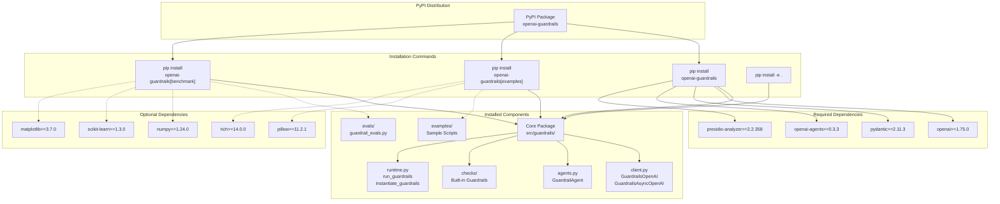
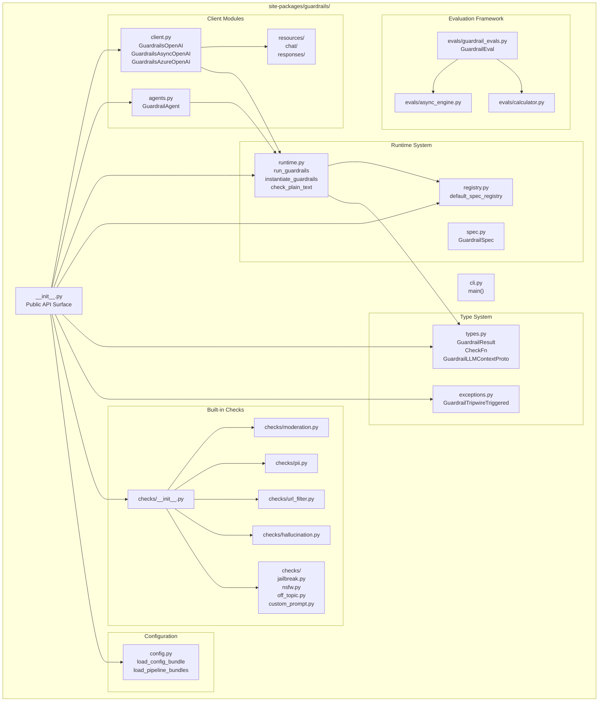

<!-- source: DeepWiki mcp.deepwiki.com · repo openai/openai-guardrails-python · page 1.3 Installation and Setup · fetched 2026-10-26 -->

# Installation and Setup

<details>
<summary>Relevant source files</summary>

The following files were used as context for generating this wiki page:

- [README.md](README.md)
- [docs/assets/images/guardrails-python-config-screenshot-100pct-q70.webp](docs/assets/images/guardrails-python-config-screenshot-100pct-q70.webp)
- [pyproject.toml](pyproject.toml)
- [src/guardrails/__init__.py](src/guardrails/__init__.py)

</details>


This document guides you through installing the `openai-guardrails` package from PyPI and preparing your environment for basic usage. For detailed configuration file structure, see [Configuration Files](#2.2). For usage examples after installation, see [Quickstart Guide](#2.1). For local development workflows, see [Development Workflow](#8.2).

---

## Prerequisites

The `openai-guardrails` package requires Python 3.11 or higher. The package is tested on Python 3.11, 3.12, and 3.13.

| Requirement | Version | Specified In |
|------------|---------|--------------|
| Python | ≥3.11 | [pyproject.toml:6]() |
| `openai` | ≥1.75.0 | [pyproject.toml:10]() |
| `pydantic` | ≥2.11.3 | [pyproject.toml:11]() |
| `openai-agents` | ≥0.3.3 | [pyproject.toml:12]() |
| `pip` | ≥25.0.1 | [pyproject.toml:13]() |
| `presidio-analyzer` | ≥2.2.360 | [pyproject.toml:14]() |
| `thinc` | ≥8.3.6 | [pyproject.toml:15]() |

The `presidio-analyzer` dependency is required for the PII detection guardrail (see [Contains PII](#6.6)). The `thinc` library provides machine learning utilities used by some guardrail checks.

**Sources:** [pyproject.toml:1-16]()

---

## Installing from PyPI

### Base Package Installation

The package is distributed via PyPI under the name `openai-guardrails`:

```bash
pip install openai-guardrails
```

This installs the core package with all required dependencies, including:
- `GuardrailsOpenAI` and `GuardrailsAsyncOpenAI` clients
- `GuardrailsAzureOpenAI` and `GuardrailsAsyncAzureOpenAI` clients (if Azure SDK is available)
- `GuardrailAgent` for Agents SDK integration
- All built-in guardrails in the `guardrails.checks` module
- Runtime utilities (`run_guardrails`, `instantiate_guardrails`, `check_plain_text`)

**Sources:** [README.md:7-13](), [pyproject.toml:1-15]()

---

### Optional Extras

The package provides optional dependency groups that can be installed using bracket notation:

| Extra | Purpose | Key Dependencies | Install Command |
|-------|---------|------------------|-----------------|
| `[examples]` | Example scripts with rich output | `pillow`, `rich` | `pip install openai-guardrails[examples]` |
| `[benchmark]` | Evaluation and benchmarking tools | `numpy`, `scikit-learn`, `matplotlib`, `seaborn`, `pandas` | `pip install openai-guardrails[benchmark]` |

To install multiple extras:

```bash
pip install openai-guardrails[examples,benchmark]
```

**Sources:** [pyproject.toml:33-44](), [README.md:169-172]()

---

## Installation Flow Diagram



**Sources:** [pyproject.toml:1-44](), [README.md:7-31](), [src/guardrails/__init__.py:1-76]()

---

## Local Development Installation

For contributors or users who want to modify the source code, install the package in editable mode from a cloned repository:

```bash
# Clone the repository
git clone https://github.com/openai/openai-guardrails-python.git
cd openai-guardrails-python

# Install in editable mode (base package)
pip install -e .

# Install with examples extra
pip install -e ".[examples]"

# Install with all extras
pip install -e ".[examples,benchmark]"
```

Editable mode creates a symbolic link to the source code, allowing changes to be reflected immediately without reinstalling.

**Note:** The repository uses `uv` as the preferred dependency manager for development. See [Development Workflow](#8.2) for details on using `uv` and the `Makefile` targets.

**Sources:** [README.md:19-31]()

---

## Package Structure After Installation



**Sources:** [src/guardrails/__init__.py:1-76](), [pyproject.toml:73-77]()

---

## Environment Configuration

### OpenAI API Key

The `GuardrailsOpenAI` and `GuardrailsAsyncOpenAI` clients require an OpenAI API key. Set it as an environment variable:

```bash
export OPENAI_API_KEY="sk-..."
```

Alternatively, pass the API key directly to the client constructor:

```python
from guardrails import GuardrailsOpenAI

client = GuardrailsOpenAI(
    api_key="sk-...",
    config="guardrails_config.json"
)
```

### Azure OpenAI Configuration

For `GuardrailsAzureOpenAI`, additional environment variables are required:

```bash
export AZURE_OPENAI_API_KEY="your-azure-key"
export AZURE_OPENAI_ENDPOINT="https://your-resource.openai.azure.com/"
```

### Configuration File Generation

The easiest way to create a guardrails configuration file is through the no-code web interface at [guardrails.openai.com](https://guardrails.openai.com). This portal allows you to:
- Select which guardrails to enable (e.g., Moderation, Jailbreak Detection, NSFW Text)
- Configure parameters for each guardrail (e.g., thresholds, categories)
- Organize guardrails into pipeline stages (pre-flight, input, output)
- Download a ready-to-use `guardrails_config.json` file

**Configuration File Location**

The downloaded `guardrails_config.json` file can be placed anywhere and referenced via:
- Absolute path: `config="/path/to/guardrails_config.json"`
- Relative path: `config="./guardrails_config.json"`
- `Path` object: `config=Path("guardrails_config.json")`

For configuration file structure and options, see [Configuration Files](#2.2).

**Sources:** [README.md:5](), [README.md:19](), [README.md:39-62]()

---

## Verifying Installation

### Import Test

Verify the package is installed correctly by importing core components:

```python
import guardrails

# Check version
print(guardrails.__version__)  # e.g., "0.1.0"

# Verify core exports are available
from guardrails import (
    GuardrailsOpenAI,
    GuardrailsAsyncOpenAI,
    GuardrailAgent,
    GuardrailResult,
    GuardrailTripwireTriggered,
    run_guardrails,
    check_plain_text,
    checks,
)

print("Installation verified successfully!")
```

### CLI Verification

The package installs two command-line tools:

```bash
# Main CLI for guardrails management
guardrails --help

# Evaluation and benchmarking CLI
guardrails-evals --help
```

These commands are registered via the `[project.scripts]` section in `pyproject.toml`:
- `guardrails` → `guardrails.cli:main`
- `guardrails-evals` → `guardrails.evals.guardrail_evals:main`

**Sources:** [src/guardrails/__init__.py:45-67](), [pyproject.toml:78-80]()

---

## Public API Exports

The following table summarizes the public API surface exported by `guardrails.__init__`:

| Export | Type | Description | Module |
|--------|------|-------------|--------|
| `GuardrailsOpenAI` | Class | Sync OpenAI client with guardrails | `client.py` |
| `GuardrailsAsyncOpenAI` | Class | Async OpenAI client with guardrails | `client.py` |
| `GuardrailsAzureOpenAI` | Class | Sync Azure OpenAI client with guardrails | `client.py` |
| `GuardrailsAsyncAzureOpenAI` | Class | Async Azure OpenAI client with guardrails | `client.py` |
| `GuardrailAgent` | Class | Agent with guardrails for Agents SDK | `agents.py` |
| `GuardrailsResponse` | Class | Response wrapper with guardrail results | `client.py` |
| `GuardrailResults` | Class | Organized results by pipeline stage | `client.py` |
| `GuardrailResult` | Class | Single guardrail check result | `types.py` |
| `GuardrailTripwireTriggered` | Exception | Raised when guardrail is violated | `exceptions.py` |
| `run_guardrails` | Function | Core execution function | `runtime.py` |
| `instantiate_guardrails` | Function | Factory for guardrail instances | `runtime.py` |
| `check_plain_text` | Function | Simple text validation utility | `runtime.py` |
| `load_config_bundle` | Function | Load single config bundle | `runtime.py` |
| `load_pipeline_bundles` | Function | Load three-stage pipeline config | `runtime.py` |
| `default_spec_registry` | Object | Registry of built-in guardrails | `registry.py` |
| `checks` | Module | Built-in guardrail implementations | `checks/` |
| `resources` | Module | Resource classes for chat/responses | `resources/` |

For detailed API documentation, see [Public API Surface](#10.1).

**Sources:** [src/guardrails/__init__.py:45-67]()

---

## Next Steps

After installation:
1. Create a configuration file (see [Configuration Files](#2.2))
2. Follow the [Quickstart Guide](#2.1) for basic usage
3. Explore [Examples](#9) for common patterns
4. Review [Built-in Guardrails](#6) for available checks

For configuration generation via the no-code UI, visit [guardrails.openai.com](https://guardrails.openai.com).

**Sources:** [README.md:5-17]()

---

