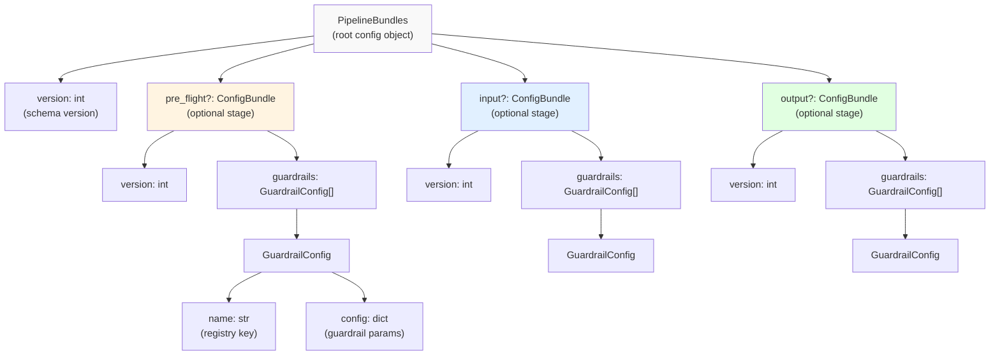
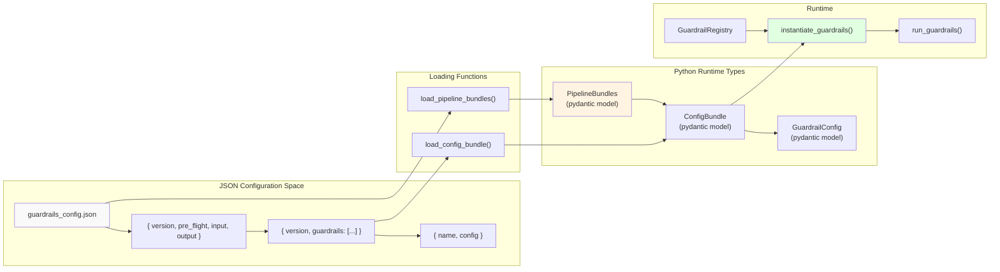
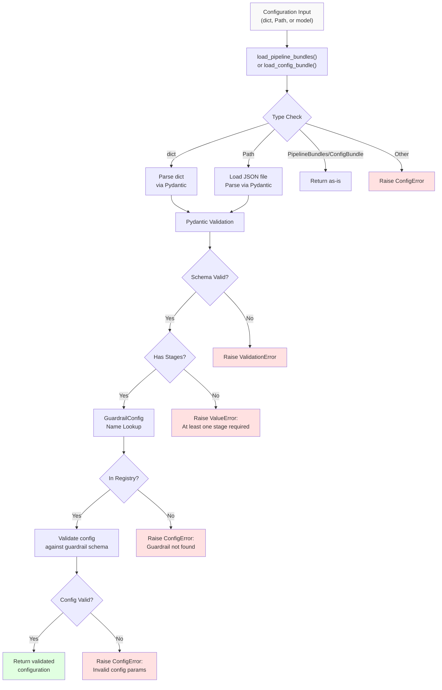
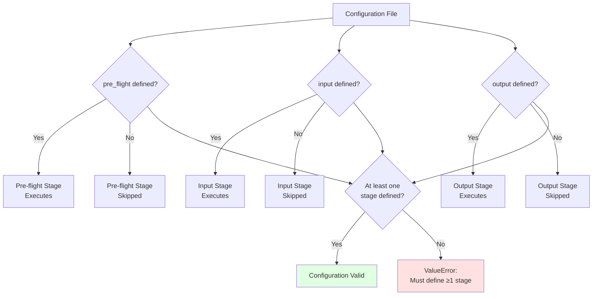
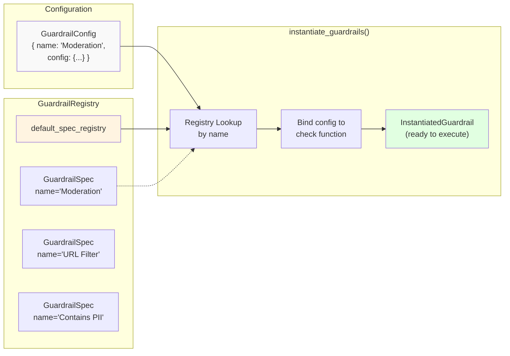
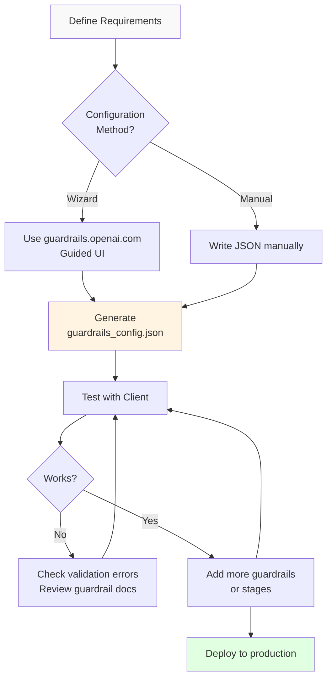

<!-- source: DeepWiki mcp.deepwiki.com · repo openai/openai-guardrails-python · page 2.2 Configuration Files · fetched 2026-10-26 -->

# Configuration Files

<details>
<summary>Relevant source files</summary>

The following files were used as context for generating this wiki page:

- [README.md](README.md)
- [docs/assets/images/guardrails-python-config-screenshot-100pct-q70.webp](docs/assets/images/guardrails-python-config-screenshot-100pct-q70.webp)
- [examples/basic/agents_sdk.py](examples/basic/agents_sdk.py)
- [pyproject.toml](pyproject.toml)
- [src/guardrails/__init__.py](src/guardrails/__init__.py)
- [src/guardrails/_streaming.py](src/guardrails/_streaming.py)
- [src/guardrails/agents.py](src/guardrails/agents.py)
- [tests/unit/test_agents.py](tests/unit/test_agents.py)

</details>


This page documents the structure and usage of `guardrails_config.json` files, which define pipeline configurations for the OpenAI Guardrails framework. Configuration files specify which guardrails execute at each stage of the pipeline and their parameters.

For general usage patterns, see [Quickstart Guide](#2.1). For information about exception handling when guardrails trigger, see [Error Handling Modes](#2.3). For details on the three-stage execution model, see [Three-Stage Pipeline Architecture](#3.1).

---

## Overview

The guardrails framework uses declarative JSON configuration files to define which checks run at each pipeline stage. These configurations are loaded at client initialization and used to instantiate guardrail check functions during runtime.

Configuration files may be:
- Created manually by writing JSON
- Generated using the [Guardrails Wizard](https://guardrails.openai.com) web interface
- Loaded from file paths or Python dictionaries programmatically

**Sources:** [README.md:1-204](), [docs/quickstart.md:1-178]()

---

## Configuration File Structure

### Pipeline Configuration Schema

The root configuration object is a `PipelineBundles` structure containing up to three optional stage bundles:



**Diagram: PipelineBundles Configuration Structure**

This diagram shows how configuration files map to the `PipelineBundles` type defined in [src/guardrails/runtime.py](). The root object contains an integer version and optional stage bundles. Each stage bundle is a `ConfigBundle` containing an array of `GuardrailConfig` objects.

**Sources:** [tests/unit/test_runtime.py:136-165](), [docs/quickstart.md:23-50]()

---

### Type Definitions and Code Mapping



**Diagram: Configuration Loading Pipeline - JSON to Runtime Objects**

This diagram illustrates how JSON configuration files are parsed into Pydantic models (`PipelineBundles`, `ConfigBundle`, `GuardrailConfig`) using loader functions (`load_pipeline_bundles`, `load_config_bundle`) defined in [src/guardrails/runtime.py](). These models are then passed to `instantiate_guardrails()` along with the `GuardrailRegistry` to create executable guardrail instances.

**Sources:** [tests/unit/test_runtime.py:116-184](), [src/guardrails/runtime.py]()

---

## Schema Reference

### PipelineBundles Schema

| Field | Type | Required | Description |
|-------|------|----------|-------------|
| `version` | `int` | Yes | Schema version (currently `1`) |
| `pre_flight` | `ConfigBundle` | No | Pre-flight stage configuration |
| `input` | `ConfigBundle` | No | Input stage configuration |
| `output` | `ConfigBundle` | No | Output stage configuration |

**Validation Rules:**
- At least one stage (`pre_flight`, `input`, or `output`) must be present
- If no stages are provided, validation raises `ValueError`

**Sources:** [tests/unit/test_runtime.py:167-171]()

---

### ConfigBundle Schema

| Field | Type | Required | Description |
|-------|------|----------|-------------|
| `version` | `int` | Yes | Bundle schema version (currently `1`) |
| `guardrails` | `GuardrailConfig[]` | Yes | Array of guardrail configurations (may be empty) |

**Sources:** [tests/unit/test_runtime.py:116-120]()

---

### GuardrailConfig Schema

| Field | Type | Required | Description |
|-------|------|----------|-------------|
| `name` | `str` | Yes | Guardrail name as registered in `GuardrailRegistry` |
| `config` | `dict` | Yes | Configuration dictionary specific to the guardrail |

The `config` dictionary structure varies by guardrail type. For detailed parameters, see [Guardrail Configuration Reference](#6.6).

**Sources:** [tests/unit/test_runtime.py:186-195]()

---

## Example Configurations

### Minimal Configuration (Single Stage)

```json
{
    "version": 1,
    "output": {
        "version": 1,
        "guardrails": [
            {
                "name": "Contains PII",
                "config": {
                    "entities": ["EMAIL_ADDRESS", "PHONE_NUMBER"]
                }
            }
        ]
    }
}
```

This configuration runs only output validation, checking for PII in LLM responses.

**Sources:** [docs/quickstart.md:23-40]()

---

### Multi-Stage Configuration

```json
{
    "version": 1,
    "pre_flight": {
        "version": 1,
        "guardrails": [
            {
                "name": "Contains PII",
                "config": {
                    "entities": ["CREDIT_CARD", "PHONE_NUMBER"],
                    "scrub": true
                }
            }
        ]
    },
    "input": {
        "version": 1,
        "guardrails": [
            {
                "name": "URL Filter",
                "config": {}
            },
            {
                "name": "Moderation",
                "config": {
                    "categories": ["hate", "violence"]
                }
            }
        ]
    },
    "output": {
        "version": 1,
        "guardrails": [
            {
                "name": "Hallucination Detection",
                "config": {
                    "vector_store_id": "vs_abc123",
                    "model": "gpt-5"
                }
            },
            {
                "name": "NSFW Text",
                "config": {
                    "model": "gpt-5-mini"
                }
            }
        ]
    }
}
```

This configuration demonstrates all three stages:
- **Pre-flight:** Scrubs PII from user input before the LLM call
- **Input:** Validates input for URLs and moderation violations (runs concurrently with LLM)
- **Output:** Checks LLM responses for hallucinations and NSFW content

**Sources:** [docs/quickstart.md:23-50](), [README.md:39-62]()

---

### Empty Guardrails Array

```json
{
    "version": 1,
    "input": {
        "version": 1,
        "guardrails": []
    }
}
```

A stage may have an empty `guardrails` array. This is valid but performs no validation at that stage.

**Sources:** [tests/unit/test_runtime.py:152-164]()

---

## Loading Configurations

### From File Path

Configuration files are loaded at client initialization:

```python
from pathlib import Path
from guardrails import GuardrailsOpenAI

# Load from file path
client = GuardrailsOpenAI(config=Path("guardrails_config.json"))
```

The `config` parameter accepts:
- `pathlib.Path` objects
- String paths (automatically converted to `Path`)
- Python dictionaries matching the schema

**Sources:** [README.md:39-62](), [docs/quickstart.md:64-80]()

---

### From Dictionary

Configurations may be provided as Python dictionaries instead of files:

```python
from guardrails import GuardrailsAsyncOpenAI

config_dict = {
    "version": 1,
    "output": {
        "version": 1,
        "guardrails": [
            {"name": "Moderation", "config": {}}
        ]
    }
}

client = GuardrailsAsyncOpenAI(config=config_dict)
```

**Sources:** [tests/unit/test_runtime.py:116-120]()

---

### Programmatic Loading Functions

The `runtime` module provides functions for loading and validating configurations:

```python
from guardrails.runtime import (
    load_pipeline_bundles,
    load_config_bundle,
    PipelineBundles,
    ConfigBundle,
)

# Load full pipeline configuration
pipeline: PipelineBundles = load_pipeline_bundles({
    "version": 1,
    "input": {"version": 1, "guardrails": [...]},
    "output": {"version": 1, "guardrails": [...]},
})

# Load single stage bundle
bundle: ConfigBundle = load_config_bundle({
    "version": 1,
    "guardrails": [...]
})
```

These functions:
- Accept `dict`, `Path`, or already-constructed Pydantic models
- Validate the structure against the schema
- Raise `ConfigError` for invalid configurations
- Raise `pydantic.ValidationError` for schema violations

**Sources:** [tests/unit/test_runtime.py:116-184]()

---

## Configuration Validation

### Schema Validation Flow



**Diagram: Configuration Validation Pipeline**

This diagram shows the complete validation flow from raw configuration input to validated runtime objects. Validation occurs at multiple levels: type checking, JSON schema validation via Pydantic, stage presence verification, registry lookup, and guardrail-specific config validation.

**Sources:** [tests/unit/test_runtime.py:123-133](), [tests/unit/test_runtime.py:167-177](), [tests/unit/test_runtime.py:197-206]()

---

### Common Validation Errors

| Error Type | Cause | Example |
|------------|-------|---------|
| `ConfigError` | Invalid input type (e.g., plain string) | `load_pipeline_bundles("not a dict")` |
| `ValidationError` | Missing required fields | `{"version": 1}` (no stages) |
| `ValueError` | No stages provided | `{"version": 1}` (pipeline must have ≥1 stage) |
| `ConfigError` | Guardrail name not in registry | `{"name": "NonExistentCheck", ...}` |
| `ConfigError` | Invalid guardrail config params | `{"name": "Moderation", "config": {"invalid": true}}` |

**Sources:** [tests/unit/test_runtime.py:123-133](), [tests/unit/test_runtime.py:167-184](), [tests/unit/test_runtime.py:197-206]()

---

## Stage Semantics

### Pipeline Stage Execution Order

The three stages execute in a specific order with different timing characteristics:

| Stage | Timing | Typical Use Cases | Modifies Input? |
|-------|--------|-------------------|-----------------|
| `pre_flight` | **Before** LLM call (serial) | PII scrubbing, content modification | Yes |
| `input` | **Concurrent** with LLM call | Jailbreak detection, URL filtering | No |
| `output` | **After** LLM response (serial) | Hallucination detection, PII in output | No |

**Pre-flight Stage Behavior:**
- Executes synchronously before the LLM API call
- Can modify the input text (e.g., PII masking replaces detected entities)
- Modified input is passed to both the LLM and subsequent input guardrails

**Input Stage Behavior:**
- Executes concurrently with the LLM API call using `ThreadPoolExecutor` (sync) or `asyncio.gather()` (async)
- Reduces total latency by overlapping validation with LLM processing
- Cannot modify input (runs on original or pre-flight-modified text)

**Output Stage Behavior:**
- Executes after LLM response is received
- Validates the generated content
- Cannot modify output

**Sources:** [docs/quickstart.md:42-50](), [README.md:1-204]()

---

### Stage Optionality



**Diagram: Stage Optionality and Requirements**

All three stages are optional, but at least one must be defined. This allows flexible deployment patterns:
- Input-only: Pre-call validation without output checks
- Output-only: Post-generation validation only
- Full pipeline: All three stages

**Sources:** [tests/unit/test_runtime.py:152-171](), [docs/quickstart.md:42-50]()

---

## Integration with Registry

### Name Resolution

The `name` field in `GuardrailConfig` objects references guardrails by their registered name in `GuardrailRegistry`:



**Diagram: Guardrail Name Resolution via Registry**

During instantiation, the `name` field is used to look up the corresponding `GuardrailSpec` in the registry. The `config` dictionary is then validated against the guardrail's expected configuration schema (defined by the guardrail's Pydantic model). This produces an `InstantiatedGuardrail` object that can execute.

**Sources:** [tests/unit/test_runtime.py:186-206]()

---

### Instantiation Process

The function `instantiate_guardrails()` performs the following steps:

1. **Registry Lookup:** For each `GuardrailConfig` in the bundle, look up `name` in the registry
2. **Config Validation:** Parse the `config` dict using the guardrail's Pydantic config model
3. **Binding:** Create an `InstantiatedGuardrail` binding the check function with validated config
4. **Error Handling:** Raise `ConfigError` if name is not found or config is invalid

Example code pattern from tests:

```python
# [tests/unit/test_runtime.py:186-195]()
registry = GuardrailRegistry()
bundle = ConfigBundle(
    guardrails=[GuardrailConfig(name="len", config={"threshold": 2})],
    version=1,
)
guardrails = instantiate_guardrails(bundle, registry)
# Returns list of InstantiatedGuardrail objects ready for execution
```

**Sources:** [tests/unit/test_runtime.py:186-206]()

---

## Configuration Best Practices

### Recommended Patterns

1. **Start with Minimal Configuration**
   - Begin with a single stage and a single guardrail
   - Add complexity incrementally as requirements emerge

2. **Use Pre-flight for Modifications Only**
   - PII scrubbing: `pre_flight` stage with `scrub: true`
   - Content transformations that must affect both LLM and validation

3. **Use Input for Latency-Sensitive Checks**
   - Jailbreak detection
   - URL filtering
   - Checks that run concurrently with LLM API call

4. **Use Output for Content Validation**
   - Hallucination detection
   - NSFW content
   - PII in generated responses

5. **Leverage Empty Config**
   - Many guardrails work with `"config": {}`
   - Use defaults unless specific customization is needed

**Sources:** [docs/quickstart.md:42-50](), [README.md:183-193]()

---

### Development Workflow



**Diagram: Configuration Development Workflow**

This workflow shows the iterative process of creating and refining configurations. The Guardrails Wizard provides a no-code path, while manual JSON editing offers full control. Both paths converge on testing with actual clients and iterating based on results.

**Sources:** [docs/quickstart.md:19-20](), [README.md:5-17]()

---

## Related Topics

- For runtime execution details, see [Runtime Execution](#3.5)
- For registry details, see [Guardrail Registry](#3.4)
- For individual guardrail configuration parameters, see [Guardrail Configuration Reference](#6.6)
- For evaluation dataset configuration, see [Dataset Format](#7.2)

**Sources:** [README.md:1-204](), [docs/quickstart.md:1-178]()

---

