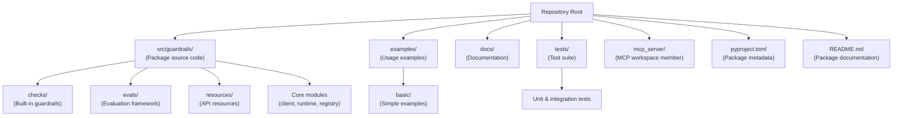
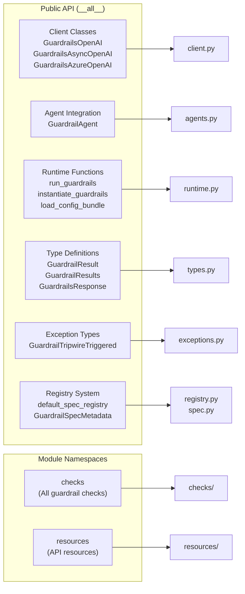
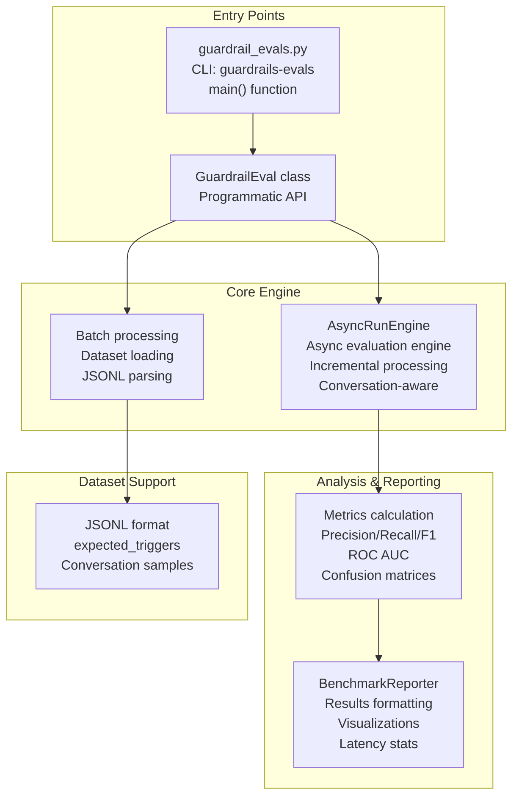
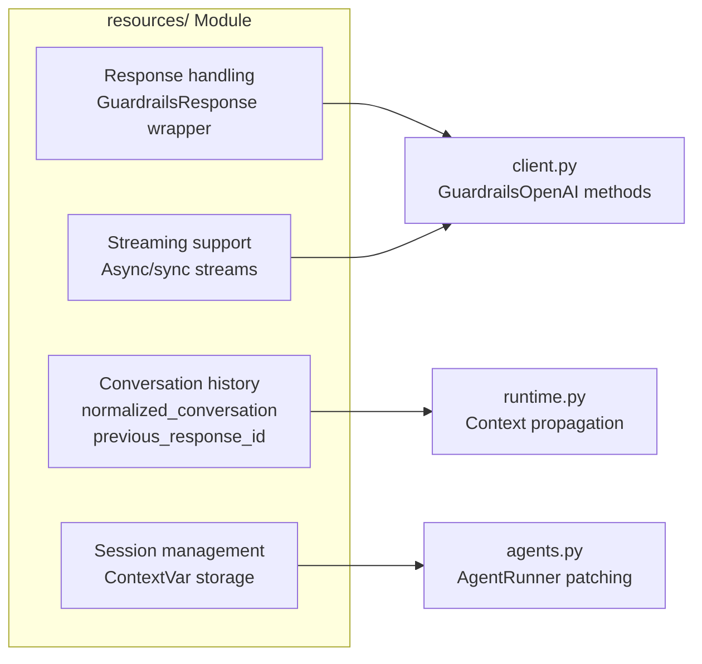
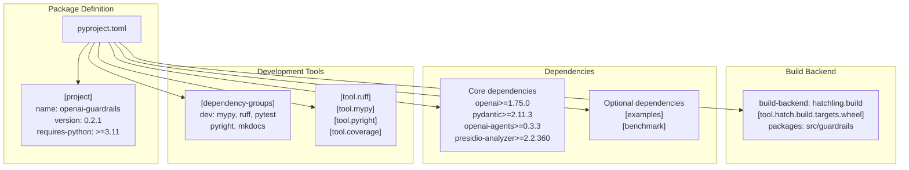
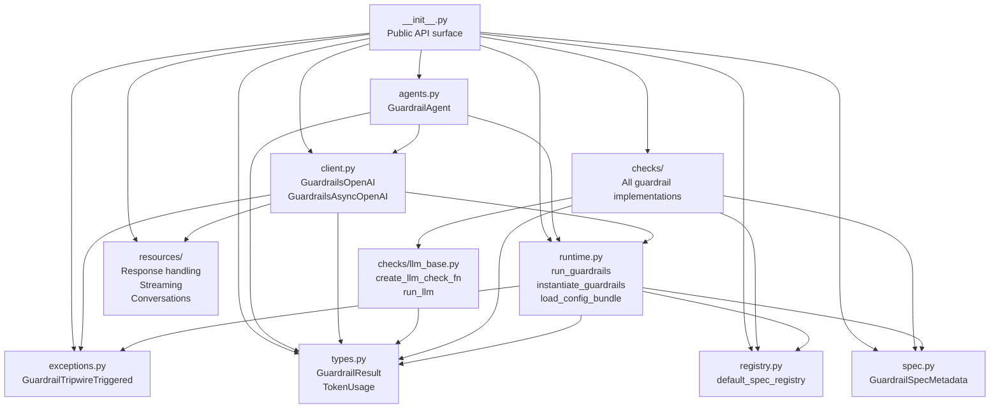
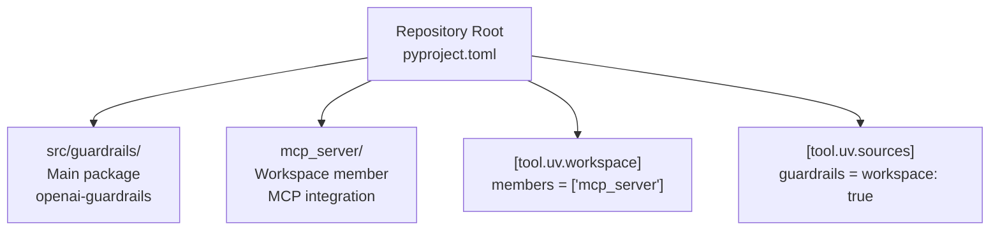

<!-- source: DeepWiki mcp.deepwiki.com · repo openai/openai-guardrails-python · page 8.1 Project Structure · fetched 2026-10-26 -->

# Project Structure

<details>
<summary>Relevant source files</summary>

The following files were used as context for generating this wiki page:

- [README.md](README.md)
- [docs/assets/images/guardrails-python-config-screenshot-100pct-q70.webp](docs/assets/images/guardrails-python-config-screenshot-100pct-q70.webp)
- [pyproject.toml](pyproject.toml)
- [src/guardrails/__init__.py](src/guardrails/__init__.py)

</details>


This page documents the organization of the `openai-guardrails` Python package, including the directory layout, module hierarchy, and the purpose of each major component. For information about setting up a local development environment and working with this structure, see [Development Workflow](#8.2). For details on the CI/CD pipeline and build process, see [CI/CD Pipeline](#8.4).

## Repository Layout

The repository follows a standard Python package structure with source code in `src/guardrails/`, supporting infrastructure in the root, and examples in a dedicated directory.

**Top-Level Directory Structure**



**Sources:** [pyproject.toml:1-130](), [README.md:149-155]()

---

## Package Structure (src/guardrails)

The main package code lives in `src/guardrails/`. This follows the `src/` layout convention, which isolates the package from the repository root and ensures tests run against the installed package rather than the source tree.

### Core Module Organization

The package exposes a carefully curated public API through `__init__.py`, organizing functionality into logical modules:

| Module | Purpose | Key Exports |
|--------|---------|-------------|
| `client` | Drop-in OpenAI client wrappers | `GuardrailsOpenAI`, `GuardrailsAsyncOpenAI`, `GuardrailsAzureOpenAI` |
| `agents` | Agents SDK integration | `GuardrailAgent` |
| `runtime` | Guardrail execution engine | `run_guardrails`, `instantiate_guardrails`, `load_config_bundle` |
| `registry` | Guardrail discovery and registration | `default_spec_registry` |
| `spec` | Guardrail metadata definitions | `GuardrailSpecMetadata` |
| `types` | Core type definitions | `GuardrailResult`, `total_guardrail_token_usage` |
| `exceptions` | Error types | `GuardrailTripwireTriggered` |
| `checks` | Built-in guardrail implementations | Namespace for all checks |
| `resources` | API resource helpers | Response/conversation utilities |

**Sources:** [src/guardrails/__init__.py:1-77]()

### Public API Surface

The package defines an explicit `__all__` list to control the public API surface, ensuring backward compatibility and clear expectations for consumers:



**Sources:** [src/guardrails/__init__.py:45-68]()

---

## Guardrail Checks Directory (src/guardrails/checks)

The `checks/` subdirectory contains all built-in guardrail implementations. Each guardrail is implemented as a separate module that registers itself with the `default_spec_registry`.

### Guardrail Check Categories

**Module-to-Guardrail Mapping**

```mermaid
graph TB
    ChecksInit["checks/__init__.py<br/>(Namespace package)"]
    
    subgraph "API-Based Checks"
        Moderation["moderation.py<br/>OpenAI Moderation API<br/>13 content categories"]
        URLFilter["url_filter.py<br/>Domain allowlist/blocklist"]
        PII["contains_pii.py<br/>Presidio integration<br/>Entity detection"]
    end
    
    subgraph "LLM-Based Checks"
        Jailbreak["jailbreak.py<br/>7 technique taxonomy<br/>Conversation-aware"]
        NSFW["nsfw_text.py<br/>Workplace filter<br/>Output-focused"]
        Hallucination["hallucination_detection.py<br/>Vector store validation<br/>File search integration"]
        PromptInjection["prompt_injection.py<br/>Tool call validation<br/>Intent alignment"]
        OffTopic["off_topic_prompts.py<br/>Business scope<br/>Topical alignment"]
        CustomLLM["user_defined_llm.py<br/>Custom system prompts<br/>Extensible framework"]
    end
    
    subgraph "LLM Infrastructure"
        LLMBase["llm_base.py<br/>create_llm_check_fn<br/>run_llm<br/>LLMConfig/LLMOutput"]
    end
    
    Jailbreak --> LLMBase
    NSFW --> LLMBase
    Hallucination --> LLMBase
    PromptInjection --> LLMBase
    OffTopic --> LLMBase
    CustomLLM --> LLMBase
    
    Moderation --> Registry["default_spec_registry"]
    URLFilter --> Registry
    PII --> Registry
    Jailbreak --> Registry
    NSFW --> Registry
    Hallucination --> Registry
    PromptInjection --> Registry
    OffTopic --> Registry
    CustomLLM --> Registry
```



### Check Implementation Pattern

All guardrail checks follow a consistent registration pattern:
1. Define a `CheckFn` function that accepts `GuardrailLLMContextProto` and returns `GuardrailResult`
2. Create `GuardrailSpecMetadata` describing the check's capabilities (engine type, media type, conversation awareness)
3. Register with `default_spec_registry` using a unique name
4. For LLM-based checks, use `create_llm_check_fn` factory from `llm_base` module

**Sources:** [README.md:183-195](), [src/guardrails/__init__.py:14]()

---

## Evaluation Framework (src/guardrails/evals)

The `evals/` subdirectory contains a complete evaluation and benchmarking system for testing guardrail performance against labeled datasets.

### Evaluation Module Structure



### CLI Entry Points

The package exposes two CLI commands defined in `pyproject.toml`:

| Command | Module | Purpose |
|---------|--------|---------|
| `guardrails` | `guardrails.cli:main` | Main CLI for guardrails management |
| `guardrails-evals` | `guardrails.evals.guardrail_evals:main` | Evaluation and benchmarking CLI |

**Sources:** [pyproject.toml:78-80](), [README.md:99-147]()

---

## Resources Module (src/guardrails/resources)

The `resources/` subdirectory provides helper utilities for working with OpenAI API responses, streaming, and conversation management. This module bridges the OpenAI SDK's response types with guardrail-specific functionality.

### Resource Module Purpose

**Code Entity Mapping**



**Sources:** [src/guardrails/__init__.py:29](), [src/guardrails/__init__.py:66]()

---

## Examples Directory

The `examples/` directory contains working code samples demonstrating various integration patterns and use cases.

### Example Organization

| Example File | Purpose | Key Concepts |
|-------------|---------|--------------|
| `basic/hello_world.py` | Basic chatbot with guardrails | `GuardrailsOpenAI` client usage, configuration loading |
| `basic/agents_sdk.py` | Agents SDK integration | `GuardrailAgent` factory pattern, tool-level guardrails |
| `basic/local_model.py` | Local model support | Custom base URLs, third-party providers |
| `basic/structured_outputs_example.py` | Structured outputs | `responses.parse` with guardrails |
| `basic/pii_mask_example.py` | PII masking | Pre-flight modifications, data transformation |
| `basic/suppress_tripwire.py` | Error handling | `suppress_tripwire=True`, graceful degradation |

### Example Prerequisites

Examples require optional dependencies installed via:
```bash
pip install -e ".[examples]"
```

This installs packages like `pillow` and `rich` needed for enhanced example functionality.

**Sources:** [README.md:156-182](), [pyproject.toml:34-38]()

---

## Package Configuration and Build

The repository uses modern Python packaging standards with `pyproject.toml` as the single source of configuration.

### Build System Configuration

**Build System and Metadata**



### Python Version Support

The package targets Python 3.11+ with explicit testing across:
- Python 3.11
- Python 3.12
- Python 3.13

**Sources:** [pyproject.toml:1-63]()

---

## Code Quality Configuration

The repository uses multiple linters and type checkers, all configured in `pyproject.toml`:

### Tool Configuration Summary

| Tool | Purpose | Configuration Section |
|------|---------|---------------------|
| `ruff` | Linting and formatting | `[tool.ruff]`, `[tool.ruff.lint]` |
| `mypy` | Static type checking | `[tool.mypy]` |
| `pyright` | Alternative type checker | `[tool.pyright]` |
| `pytest` | Test runner | Implicit via `pytest-asyncio` |
| `coverage` | Test coverage | `[tool.coverage.run]` |

### Code Quality Rules

**Ruff Configuration:**
- Line length: 150 characters
- Selected rule sets: pycodestyle (E/W), pyflakes (F), isort (I), flake8-bugbear (B), comprehensions (C4), pyupgrade (UP), pydocstyle (D)
- Docstring convention: Google style
- Per-file ignores for tests and examples

**Type Checking:**
- `mypy`: Strict mode with `disallow_incomplete_defs`, `disallow_untyped_defs`, `disallow_untyped_calls` disabled
- Both tools exclude `examples/` and `src/guardrails/evals/` directories

**Sources:** [pyproject.toml:82-130]()

---

## Module Dependency Graph

This diagram shows how the core modules depend on each other, helping developers understand the import hierarchy and potential circular dependency constraints.

**Core Module Dependencies**



**Key Dependency Principles:**
1. **Types First:** `types.py` has no internal dependencies and provides foundational data structures
2. **Registry as Hub:** `registry.py` and `spec.py` form the central discovery mechanism
3. **Runtime as Engine:** `runtime.py` orchestrates execution using registry lookups
4. **Client as Integration:** `client.py` and `agents.py` wrap external SDKs with runtime calls
5. **Checks as Plugins:** All checks register themselves but don't depend on each other

**Sources:** [src/guardrails/__init__.py:1-77]()

---

## Workspace Configuration

The repository uses `uv` workspace functionality to manage the MCP server as a separate package while sharing dependencies.

### Workspace Layout



**Sources:** [pyproject.toml:65-69]()

---

## Distribution and Packaging

The package is distributed via PyPI as `openai-guardrails` with wheel packaging using `hatchling`.

### Package Distribution Details

| Aspect | Configuration |
|--------|---------------|
| **Package Name** | `openai-guardrails` |
| **Build Backend** | `hatchling.build` |
| **Package Source** | `src/guardrails` (via `tool.hatch.build.targets.wheel`) |
| **Entry Points** | `guardrails` CLI, `guardrails-evals` CLI |
| **License** | MIT |
| **Python Support** | >=3.11 |
| **Repository** | https://github.com/openai/openai-guardrails-python |
| **Documentation** | https://openai.github.io/openai-guardrails-python/ |

### Install Modes

Users can install the package in several configurations:

```bash
# Standard installation
pip install openai-guardrails

# With example dependencies
pip install "openai-guardrails[examples]"

# With benchmark dependencies
pip install "openai-guardrails[benchmark]"

# Editable development installation
pip install -e .
```

**Sources:** [pyproject.toml:1-80](), [README.md:10-33]()

---

