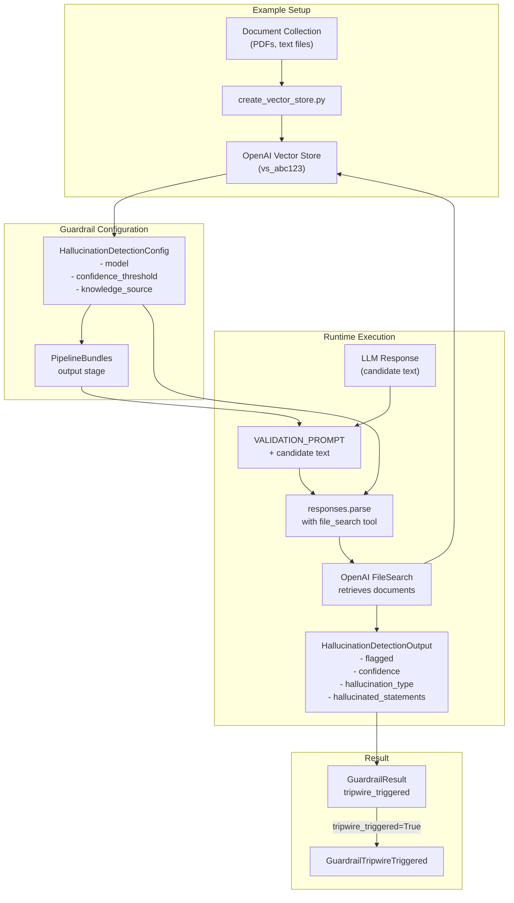
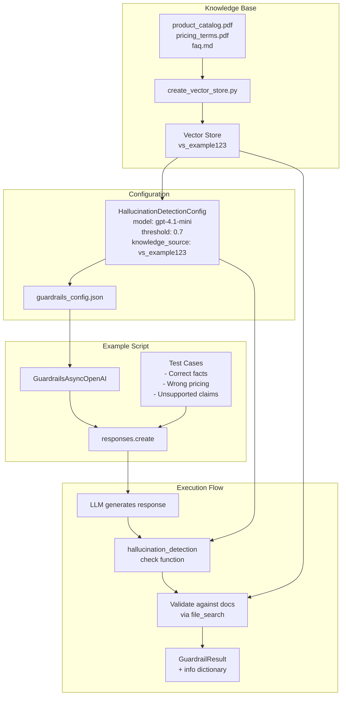
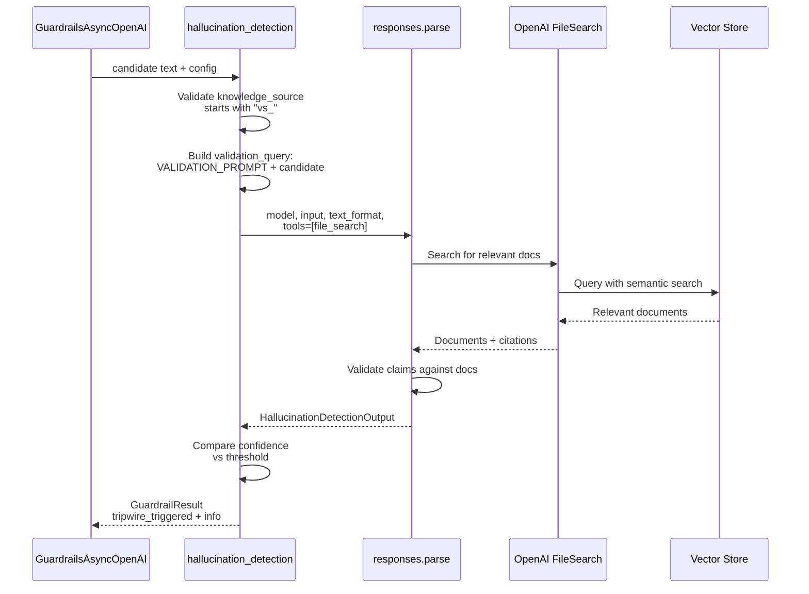

<!-- source: DeepWiki mcp.deepwiki.com · repo openai/openai-guardrails-python · page 9.4 Hallucination Detection Example · fetched 2026-10-26 -->

# Hallucination Detection Example

<details>
<summary>Relevant source files</summary>

The following files were used as context for generating this wiki page:

- [docs/ref/checks/hallucination_detection.md](docs/ref/checks/hallucination_detection.md)
- [src/guardrails/checks/text/hallucination_detection.py](src/guardrails/checks/text/hallucination_detection.py)
- [src/guardrails/checks/text/off_topic_prompts.py](src/guardrails/checks/text/off_topic_prompts.py)
- [src/guardrails/checks/text/user_defined_llm.py](src/guardrails/checks/text/user_defined_llm.py)
- [src/guardrails/evals/core/benchmark_reporter.py](src/guardrails/evals/core/benchmark_reporter.py)

</details>


This page provides a complete walkthrough of implementing hallucination detection with real documents as a knowledge source. It demonstrates how to create a vector store, configure the `hallucination_detection` guardrail, and validate LLM responses against actual documents using the OpenAI Responses API with FileSearch.

For conceptual information about hallucination detection, see [Hallucination Detection](#6.3). For other practical examples, see [Basic Examples](#9.1), [PII Masking Example](#9.2), and [Structured Outputs Example](#9.3).

---

## Overview

The hallucination detection guardrail validates factual claims in LLM-generated text against a knowledge base stored in an OpenAI vector store. It uses the `responses.parse` API with the `file_search` tool to retrieve relevant documents and validate claims.

**Key components:**
- `HallucinationDetectionConfig`: Configuration schema for the guardrail
- `HallucinationDetectionOutput`: Structured output with validation results
- `hallucination_detection`: Async check function registered in `default_spec_registry`
- `VALIDATION_PROMPT`: System prompt for hallucination analysis

**Sources:** [src/guardrails/checks/text/hallucination_detection.py:1-289](), [docs/ref/checks/hallucination_detection.md:1-273]()

---

## Hallucination Detection Flow



**Sources:** [src/guardrails/checks/text/hallucination_detection.py:181-274](), [docs/ref/checks/hallucination_detection.md:83-91]()

---

## Prerequisites: Creating a Vector Store

Before using hallucination detection, you must create an OpenAI vector store containing your reference documents. The guardrail requires a valid vector store ID starting with `vs_`.

### Vector Store Creation Methods

| Method | Description | Use Case |
|--------|-------------|----------|
| **Guardrails Wizard** | Web UI at [guardrails.openai.com](https://guardrails.openai.com) | Interactive configuration with vector store creation |
| **OpenAI Dashboard** | [platform.openai.com/storage/vector_stores](https://platform.openai.com/storage/vector_stores) | Manual vector store management |
| **Utility Script** | `src/guardrails/utils/create_vector_store.py` | Programmatic creation from local files |
| **OpenAI API** | Direct API calls | Custom integration workflows |

**Sources:** [src/guardrails/checks/text/hallucination_detection.py:7-16](), [docs/ref/checks/hallucination_detection.md:35-44]()

### Using the Utility Script

The `create_vector_store.py` utility creates a vector store from local files or directories:

```bash
# Single file
python src/guardrails/utils/create_vector_store.py document.pdf

# Directory of files
python src/guardrails/utils/create_vector_store.py docs/

# Returns vector store ID: vs_abc123def456
```

The script:
1. Uploads files to OpenAI
2. Creates a vector store
3. Adds files to the vector store
4. Returns the vector store ID

**Implementation details:**
- Located at [src/guardrails/utils/create_vector_store.py]()
- Accepts file paths or directory paths as arguments
- Supports PDF, TXT, MD, and other text formats
- Outputs `vs_` prefixed ID for use in configuration

**Sources:** [src/guardrails/checks/text/hallucination_detection.py:14](), [docs/ref/checks/hallucination_detection.md:38-44]()

---

## Example Walkthrough

The complete example is located at `examples/hallucination_detection/` and demonstrates validating product information against actual documentation.

### Example Architecture



**Sources:** [docs/examples.md:14-17](), [docs/ref/checks/hallucination_detection.md:89-91]()

### Step 1: Prepare Reference Documents

Create a directory with reference documents containing factual information to validate against:

```
examples/hallucination_detection/
├── docs/
│   ├── product_catalog.pdf      # Product specifications
│   ├── pricing_terms.pdf        # Pricing information
│   └── company_policies.md      # Policies and terms
├── create_vector_store.sh       # Vector store creation script
├── example.py                   # Main example script
└── guardrails_config.json       # Guardrail configuration
```

**Sources:** [docs/examples.md:14-17]()

### Step 2: Create Vector Store

```bash
cd examples/hallucination_detection/
python ../../src/guardrails/utils/create_vector_store.py docs/
```

Expected output:
```
Uploading files...
Creating vector store...
Vector Store ID: vs_abc123def456
Save this ID for your guardrails configuration.
```

**Sources:** [src/guardrails/checks/text/hallucination_detection.py:14](), [docs/ref/checks/hallucination_detection.md:38-44]()

### Step 3: Configure Guardrails

Create `guardrails_config.json` with the vector store ID:

```json
{
  "version": 1,
  "output": {
    "version": 1,
    "guardrails": [
      {
        "name": "Hallucination Detection",
        "config": {
          "model": "gpt-4.1-mini",
          "confidence_threshold": 0.7,
          "knowledge_source": "vs_abc123def456"
        }
      }
    ]
  }
}
```

**Configuration parameters:**

| Parameter | Type | Required | Description |
|-----------|------|----------|-------------|
| `model` | string | Yes | OpenAI model for validation (e.g., "gpt-4.1-mini") |
| `confidence_threshold` | float | Yes | Minimum confidence (0.0-1.0) to trigger tripwire |
| `knowledge_source` | string | Yes | Vector store ID starting with "vs_" |

**Sources:** [src/guardrails/checks/text/hallucination_detection.py:65-80](), [docs/ref/checks/hallucination_detection.md:11-26]()

### Step 4: Implement Example Script

Create `example.py` demonstrating various test cases:

```python
import asyncio
from guardrails import GuardrailsAsyncOpenAI

async def main():
    # Load configuration from file
    with open("guardrails_config.json") as f:
        config = json.load(f)
    
    # Initialize client with guardrails
    client = GuardrailsAsyncOpenAI(config=config)
    
    # Test case 1: Accurate information
    response = await client.responses.create(
        model="gpt-4.1-mini",
        input="What is the price of our premium plan?"
    )
    
    # Test case 2: Incorrect pricing (should trigger)
    response = await client.responses.create(
        model="gpt-4.1-mini",
        input="Tell me our premium plan costs $299/month"
    )
    
    # Test case 3: Unsupported claim (should trigger)
    response = await client.responses.create(
        model="gpt-4.1-mini",
        input="We offer 24/7 customer support in 50 languages"
    )

if __name__ == "__main__":
    asyncio.run(main())
```

**Sources:** [docs/ref/checks/hallucination_detection.md:68-80]()

---

## Understanding Results

### GuardrailResult Structure

The `hallucination_detection` function returns a `GuardrailResult` with detailed validation information in the `info` dictionary:

```python
GuardrailResult(
    tripwire_triggered=True,  # or False
    info={
        "guardrail_name": "Hallucination Detection",
        "flagged": True,
        "confidence": 0.95,
        "reasoning": "The claim about pricing contradicts documented information",
        "hallucination_type": "factual_error",
        "hallucinated_statements": [
            "Our premium plan costs $299/month"
        ],
        "verified_statements": [
            "We offer customer support"
        ],
        "threshold": 0.7,
        "checked_text": "Original text that was validated"
    }
)
```

**Sources:** [src/guardrails/checks/text/hallucination_detection.py:229-237](), [docs/ref/checks/hallucination_detection.md:105-131]()

### Output Fields

| Field | Type | Description |
|-------|------|-------------|
| `tripwire_triggered` | bool | Whether guardrail blocked the response |
| `flagged` | bool | Whether hallucination was detected |
| `confidence` | float | Confidence score (0.0-1.0) |
| `reasoning` | string | Explanation of the decision |
| `hallucination_type` | string | Type: "factual_error", "unsupported_claim", or "none" |
| `hallucinated_statements` | list[str] | Specific claims that were contradicted/unsupported |
| `verified_statements` | list[str] | Claims supported by documents |
| `threshold` | float | Configured confidence threshold |
| `checked_text` | string | Original text that was validated |

**Sources:** [src/guardrails/checks/text/hallucination_detection.py:82-105](), [docs/ref/checks/hallucination_detection.md:121-130]()

### Hallucination Types

The `hallucination_type` field indicates the nature of detected issues:

- **`"factual_error"`**: Claims that directly contradict information in documents
- **`"unsupported_claim"`**: Claims that cannot be verified from documents
- **`"none"`**: All factual claims are supported or no factual claims present

**Sources:** [src/guardrails/checks/text/hallucination_detection.py:93-96](), [docs/ref/checks/hallucination_detection.md:130]()

---

## Example Output Scenarios

### Scenario 1: Accurate Response (Passes)

**Input:** "What is the price of our premium plan?"

**LLM Response:** "Our premium plan costs $199/month."

**Validation Result:**
```json
{
  "tripwire_triggered": false,
  "flagged": false,
  "confidence": 0.1,
  "reasoning": "The pricing claim is directly supported by the pricing_terms.pdf document",
  "hallucination_type": "none",
  "hallucinated_statements": [],
  "verified_statements": ["Our premium plan costs $199/month"]
}
```

### Scenario 2: Incorrect Pricing (Triggers)

**Input:** "Tell me about our premium plan pricing."

**LLM Response:** "Our premium plan costs $299/month."

**Validation Result:**
```json
{
  "tripwire_triggered": true,
  "flagged": true,
  "confidence": 0.95,
  "reasoning": "The pricing claim contradicts documented pricing of $199/month in pricing_terms.pdf",
  "hallucination_type": "factual_error",
  "hallucinated_statements": ["Our premium plan costs $299/month"],
  "verified_statements": []
}
```

### Scenario 3: Unsupported Claim (Triggers)

**Input:** "What languages do we support?"

**LLM Response:** "We offer 24/7 customer support in 50 languages."

**Validation Result:**
```json
{
  "tripwire_triggered": true,
  "flagged": true,
  "confidence": 0.85,
  "reasoning": "No documentation found supporting the claim about 50 languages",
  "hallucination_type": "unsupported_claim",
  "hallucinated_statements": ["We offer 24/7 customer support in 50 languages"],
  "verified_statements": []
}
```

**Sources:** [docs/ref/checks/hallucination_detection.md:137-151](), [src/guardrails/checks/text/hallucination_detection.py:107-178]()

---

## Validation Logic

### VALIDATION_PROMPT

The guardrail uses a detailed system prompt to guide hallucination detection. The prompt instructs the LLM to:

1. **Identify factual claims** about products, pricing, policies, dates, statistics, etc.
2. **Validate claims** against documents retrieved via FileSearch
3. **Flag contradictions** or completely unsupported claims
4. **Allow conversational content** (greetings, opinions, questions)
5. **Allow supported claims** even if incomplete or with minor phrasing differences

**Key guidelines from the prompt:**

- Flag content with **any** unsupported or contradicted factual claims
- Do not flag minor phrasing differences if core meaning is correct
- Do not flag incomplete but accurate statements
- Focus on claims that could mislead users

**Sources:** [src/guardrails/checks/text/hallucination_detection.py:107-178]()

### Validation Process Flow



**Sources:** [src/guardrails/checks/text/hallucination_detection.py:181-237]()

---

## Error Handling

The `hallucination_detection` function implements robust error handling:

### Validation Errors

If `knowledge_source` is invalid (missing or doesn't start with `vs_`):

```python
if not config.knowledge_source or not config.knowledge_source.startswith("vs_"):
    raise ValueError("knowledge_source must be a valid vector store ID starting with 'vs_'")
```

**Sources:** [src/guardrails/checks/text/hallucination_detection.py:205-206]()

### API Errors

If the LLM response is malformed or API call fails, the guardrail returns a safe default:

```python
GuardrailResult(
    tripwire_triggered=False,
    info={
        "guardrail_name": "Hallucination Detection",
        "flagged": False,
        "confidence": 0.0,
        "reasoning": f"Analysis failed: {str(e)}",
        "error": str(e),
        # ... other fields with null/default values
    }
)
```

This ensures graceful degradation rather than blocking all responses on error.

**Sources:** [src/guardrails/checks/text/hallucination_detection.py:239-274]()

---

## Advanced Configuration

### Tuning Confidence Threshold

The `confidence_threshold` parameter controls detection sensitivity:

| Threshold | Behavior | Use Case |
|-----------|----------|----------|
| **0.6** | More sensitive, catches subtle errors | High-stakes applications (medical, legal) |
| **0.7** | Balanced (default) | General purpose applications |
| **0.8-0.9** | Less sensitive, avoids false positives | Applications with borderline content |

**Tuning guidance:**
- Start at 0.7
- Increase to 0.8-0.9 to reduce false positives on borderline claims
- Decrease to 0.6 to catch more subtle hallucinations
- Monitor false positive/negative rates in evaluation

**Sources:** [docs/ref/checks/hallucination_detection.md:28-31](), [src/guardrails/checks/text/hallucination_detection.py:27-28]()

### Model Selection

Different models provide varying performance characteristics:

| Model | ROC AUC | Latency (P50) | Best For |
|-------|---------|---------------|----------|
| `gpt-4.1-mini` | 0.876 | 7,069ms | Balanced accuracy/cost (default) |
| `gpt-5-mini` | 0.934 | 23,013ms | Highest accuracy |
| `gpt-4.1-nano` | 0.537 | 4,809ms | Lowest latency (poor accuracy) |
| `gpt-4.1` | 0.870 | 7,126ms | Good accuracy with stable latency |

**Sources:** [docs/ref/checks/hallucination_detection.md:174-202]()

### Vector Store Optimization

Vector store size impacts performance and latency:

| Size | Documents | Impact |
|------|-----------|--------|
| Small (1 MB) | 3 documents | Best latency, may lack coverage |
| Medium (3 MB) | 15 documents | Balanced (recommended) |
| Large (11 MB) | 20+ documents | Good coverage, moderate latency increase |
| Extra Large (105 MB) | 100+ documents | Risk of signal-to-noise degradation |

**Key insights:**
- Document quality matters more than quantity
- Performance may decrease with very large vector stores
- GPT-4.1 models show minimal latency impact across sizes
- GPT-5 models show significant latency increases at larger scales

**Sources:** [docs/ref/checks/hallucination_detection.md:204-273]()

---

## Cost Considerations

Hallucination detection incurs additional costs due to FileSearch API usage:

**Cost components:**
1. Base model inference (per token)
2. Vector storage ($0.10/GB/day)
3. FileSearch queries (per query)

**Pricing details:** See [OpenAI API Pricing - Built-in Tools](https://openai.com/api/pricing/#built-in-tools)

**Cost optimization strategies:**
- Use smaller models (gpt-4.1-mini) for cost efficiency
- Keep vector stores focused and relevant (avoid large noisy corpora)
- Set appropriate confidence thresholds to reduce false positives
- Delete unused vector stores to avoid storage costs

**Sources:** [src/guardrails/checks/text/hallucination_detection.py:16](), [docs/ref/checks/hallucination_detection.md:95]()

---

## Related Documentation

- [Hallucination Detection Reference](#6.3) - Conceptual overview and configuration details
- [Responses API](#4.4) - Using responses.create/parse with guardrails
- [Configuration Files](#2.2) - Pipeline configuration structure
- [Built-in Guardrails](#6) - Overview of all available guardrails
- [Evaluation Framework](#7) - Testing and benchmarking guardrails

**Sources:** [docs/examples.md:1-26](), [docs/ref/checks/hallucination_detection.md:1-273]()

---

