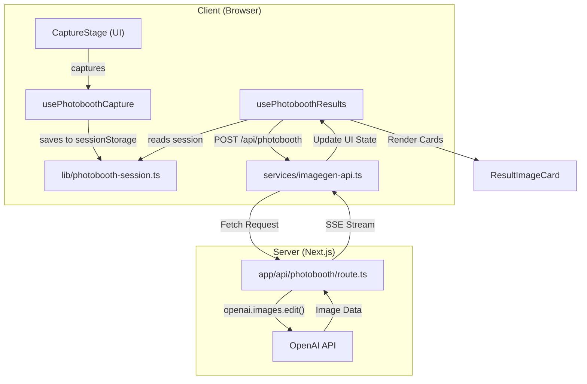
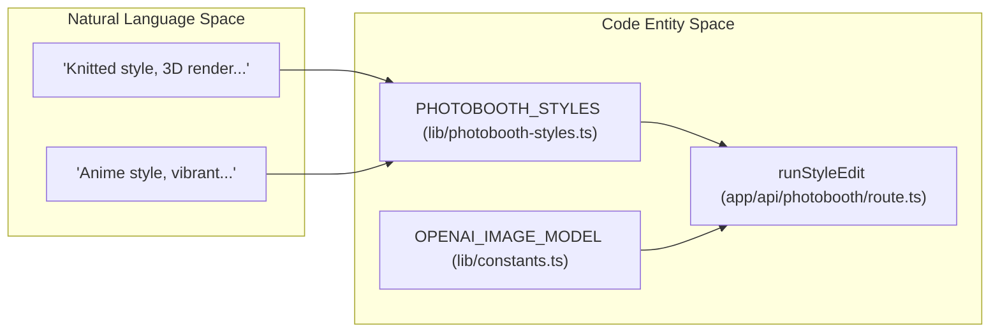

<!-- source: DeepWiki mcp.deepwiki.com · repo openai/openai-imagegen-demo · page 1 Overview · fetched 2026-10-26 -->

# Overview

Relevant source files

The following files were used as context for generating this wiki page:

- [LICENSE](LICENSE)
- [README.md](README.md)
- [SECURITY.md](SECURITY.md)
- [THIRD_PARTY_NOTICES.md](THIRD_PARTY_NOTICES.md)

The **ImageGen Photobooth Demo** is a technical showcase of the [OpenAI Image API](https://developers.openai.com/api/reference/resources/images/methods/edit), specifically utilizing the `gpt-image-2` model's edit capabilities [README.md:8-8](). The application allows users to capture or upload a portrait and transform it into various artistic styles using high-performance, streaming image generation.

### Core Capabilities
- **Portrait Transformation**: Uses the `/images/edits` endpoint to maintain subject consistency while applying stylistic changes [README.md:26-26]().
- **Real-time Streaming**: Implements Server-Sent Events (SSE) to provide partial generation updates and concurrent style processing [README.md:19-19]().
- **Responsive Web Interface**: A mobile-optimized flow built with Next.js 15 and Tailwind CSS 4 [README.md:4-6]().

---

### Technology Stack

The project is built on a modern TypeScript stack designed for rapid deployment and low-latency interactions.

| Layer | Technology | Role |
| :--- | :--- | :--- |
| **Framework** | [Next.js 15 (App Router)](https://nextjs.org) | Application framework and API routing [README.md:23-23]() |
| **Language** | [TypeScript 5](https://www.typescriptlang.org) | Type-safe development [README.md:5-5]() |
| **Styling** | [Tailwind CSS 4](https://tailwindcss.com) | Utility-first CSS and design tokens [README.md:6-6]() |
| **AI Integration** | [OpenAI Node SDK](https://github.com/openai/openai-node) | Interface for image generation and edits [README.md:8-8]() |
| **UI Components** | [shadcn/ui](https://ui.shadcn.com) | Accessible primitive components [README.md:25-25]() |

**Sources:**
- [README.md:1-27]()
- [LICENSE:1-21]()

---

### System Architecture Overview

The application follows a decoupled architecture where the frontend manages complex media capture and session state, while the backend handles secure communication with OpenAI's infrastructure.

#### High-Level Data Flow
The following diagram illustrates how user-captured data moves from the browser to the OpenAI API and back through a streaming channel.

**Logic Flow: From Capture to Generation**

**Sources:**
- [README.md:80-90]()
- [app/api/photobooth/route.ts:1-10]()

---

### Subsystem Integration

The codebase is organized into distinct subsystems that bridge the gap between "Natural Language Space" (AI Prompts) and "Code Entity Space" (API implementation).

#### 1. Generation Pipeline
This subsystem maps human-readable styles (e.g., "Anime", "Watercolor") to specific API parameters and prompts.

**Entity Mapping: Style Configuration to API**

#### 2. Session & State Management
Because image data (Base64) can be large, the app uses a specialized persistence layer to move data between the capture page and the results page without overloading URL parameters.

- **Frontend State**: Managed by `usePhotoboothCapture` and `usePhotoboothResults` hooks [README.md:84-85]().
- **Persistence**: Handled by `lib/photobooth-session.ts` using the browser's `sessionStorage` [README.md:89-89]().

For a deeper dive into how these components are structured, see [Application Architecture](#1.2).

**Sources:**
- [README.md:80-90]()
- [lib/constants.ts:1-15]()
- [lib/photobooth-styles.ts:1-20]()

---

### Next Steps

To begin working with the codebase, please refer to the following guides:

- **[Getting Started](#1.1)**: Instructions for environment setup, `OPENAI_API_KEY` configuration, and running the development server.
- **[Application Architecture](#1.2)**: A detailed breakdown of the Next.js App Router structure, routing logic, and the SSE (Server-Sent Events) implementation.

---

