# Page: Overview

# Overview

<details>
<summary>Relevant source files</summary>

The following files were used as context for generating this wiki page:

- [LICENSE](LICENSE)
- [README.md](README.md)
- [SECURITY.md](SECURITY.md)
- [THIRD_PARTY_NOTICES.md](THIRD_PARTY_NOTICES.md)

</details>


The **ImageGen Photobooth Demo** is a technical showcase of the [OpenAI Image API](https://developers.openai.com/api/reference/resources/images/methods/edit), specifically utilizing the `gpt-image-2` model's edit capabilities [README.md:8-8](). The application allows users to capture or upload a portrait and transform it into various artistic styles using high-performance, streaming image generation.

### Core Capabilities
- **Portrait Transformation**: Uses the `/images/edits` endpoint to maintain subject consistency while applying stylistic changes [README.md:26-26]().
- **Real-time Streaming**: Implements Server-Sent Events (SSE) to provide partial generation updates and concurrent style processing [README.md:19-19]().
- **Responsive Web Interface**: A mobile-optimized flow built with Next.js 15 and Tailwind CSS 4 [README.md:4-6]().

---

### Technology Stack

The project is built on a modern TypeScript stack designed for rapid deployment and low-latency interactions.

| Layer | Technology | Role |
| :--- | :--- | :--- |
| **Framework** | [Next.js 15 (App Router)](https://nextjs.org) | Application framework and API routing [README.md:23-23]() |
| **Language** | [TypeScript 5](https://www.typescriptlang.org) | Type-safe development [README.md:5-5]() |
| **Styling** | [Tailwind CSS 4](https://tailwindcss.com) | Utility-first CSS and design tokens [README.md:6-6]() |
| **AI Integration** | [OpenAI Node SDK](https://github.com/openai/openai-node) | Interface for image generation and edits [README.md:8-8]() |
| **UI Components** | [shadcn/ui](https://ui.shadcn.com) | Accessible primitive components [README.md:25-25]() |

**Sources:**
- [README.md:1-27]()
- [LICENSE:1-21]()

---

### System Architecture Overview

The application follows a decoupled architecture where the frontend manages complex media capture and session state, while the backend handles secure communication with OpenAI's infrastructure.

#### High-Level Data Flow
The following diagram illustrates how user-captured data moves from the browser to the OpenAI API and back through a streaming channel.

**Logic Flow: From Capture to Generation**
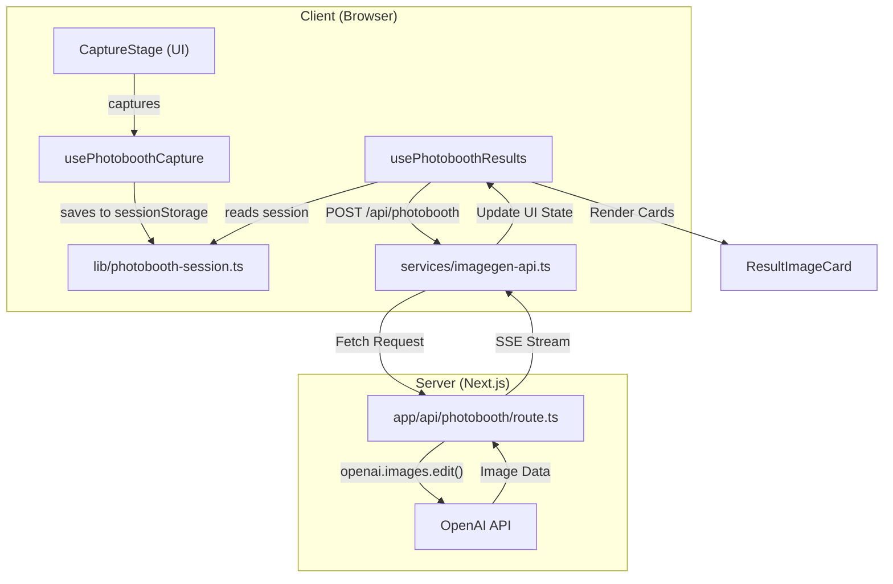

**Sources:**
- [README.md:80-90]()
- [app/api/photobooth/route.ts:1-10]()

---

### Subsystem Integration

The codebase is organized into distinct subsystems that bridge the gap between "Natural Language Space" (AI Prompts) and "Code Entity Space" (API implementation).

#### 1. Generation Pipeline
This subsystem maps human-readable styles (e.g., "Anime", "Watercolor") to specific API parameters and prompts.

**Entity Mapping: Style Configuration to API**
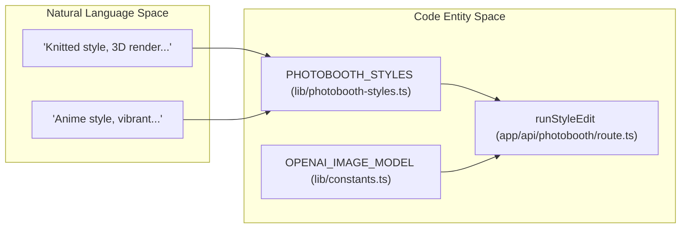

#### 2. Session & State Management
Because image data (Base64) can be large, the app uses a specialized persistence layer to move data between the capture page and the results page without overloading URL parameters.

- **Frontend State**: Managed by `usePhotoboothCapture` and `usePhotoboothResults` hooks [README.md:84-85]().
- **Persistence**: Handled by `lib/photobooth-session.ts` using the browser's `sessionStorage` [README.md:89-89]().

For a deeper dive into how these components are structured, see [Application Architecture](#1.2).

**Sources:**
- [README.md:80-90]()
- [lib/constants.ts:1-15]()
- [lib/photobooth-styles.ts:1-20]()

---

### Next Steps

To begin working with the codebase, please refer to the following guides:

- **[Getting Started](#1.1)**: Instructions for environment setup, `OPENAI_API_KEY` configuration, and running the development server.
- **[Application Architecture](#1.2)**: A detailed breakdown of the Next.js App Router structure, routing logic, and the SSE (Server-Sent Events) implementation.

---

# Page: Getting Started

# Getting Started

<details>
<summary>Relevant source files</summary>

The following files were used as context for generating this wiki page:

- [.env.example](.env.example)
- [.gitignore](.gitignore)
- [eslint.config.mjs](eslint.config.mjs)
- [next.config.ts](next.config.ts)
- [package-lock.json](package-lock.json)
- [package.json](package.json)
- [postcss.config.mjs](postcss.config.mjs)
- [tsconfig.json](tsconfig.json)

</details>


This page provides a technical guide for setting up the OpenAI ImageGen Photobooth demo locally and deploying it to production. The application is built on **Next.js 15** and utilizes the **OpenAI DALL-E 2 API** (specifically the image editing endpoint) to transform user-captured photos into various artistic styles.

## Prerequisites

Before beginning, ensure you have the following installed:
*   **Node.js**: Version 20 or higher (recommended for Next.js 15 compatibility).
*   **npm**: Included with Node.js.
*   **OpenAI API Key**: A valid key with access to DALL-E models.

## Initial Setup

### 1. Clone the Repository
Clone the codebase to your local machine:
```bash
git clone https://github.com/openai/openai-imagegen-demo.git
cd openai-imagegen-demo
```

### 2. Configure Environment Variables
The application requires an OpenAI API key to function. The backend API route expects this variable to be available in the environment.

1.  Locate `.env.example` in the root directory [.env.example:1-1]().
2.  Create a new file named `.env` or `.env.local`.
3.  Add your OpenAI API key:
    ```text
    OPENAI_API_KEY="your_api_key_here"
    ```
Note that `.env*` files are ignored by git to prevent credential leakage [.gitignore:38-39]().

### 3. Install Dependencies
The project uses `npm` for package management. Install the required dependencies defined in `package.json` [package.json:11-33]().

```bash
npm install
```

## Local Development

The project provides several scripts for development and maintenance [package.json:5-10]():

| Script | Command | Purpose |
| :--- | :--- | :--- |
| `dev` | `next dev` | Starts the Next.js development server on `http://localhost:3000`. |
| `build` | `next build` | Compiles the application for production. |
| `start` | `next start` | Starts the production server after a build. |
| `lint` | `eslint` | Runs ESLint to check for code quality and Next.js best practices. |

To start the development server:
```bash
npm run dev
```

### Configuration Files
*   **Next.js Config**: `next.config.ts` disables the development indicator for a cleaner UI [next.config.ts:3-5]().
*   **TypeScript**: Configured in `tsconfig.json` with strict type checking and path aliasing (`@/*` maps to the root) [tsconfig.json:7-22]().
*   **Styling**: Uses Tailwind CSS v4 via `@tailwindcss/postcss` [postcss.config.mjs:2-2]().

## Deployment

### Vercel Deployment
The application is optimized for **Vercel**. When deploying, ensure you configure the `OPENAI_API_KEY` in the Vercel Project Settings under "Environment Variables".

### Data Flow Overview
The following diagram illustrates the relationship between the local environment, the Next.js server, and the OpenAI API.

**System Initialization and Request Flow**
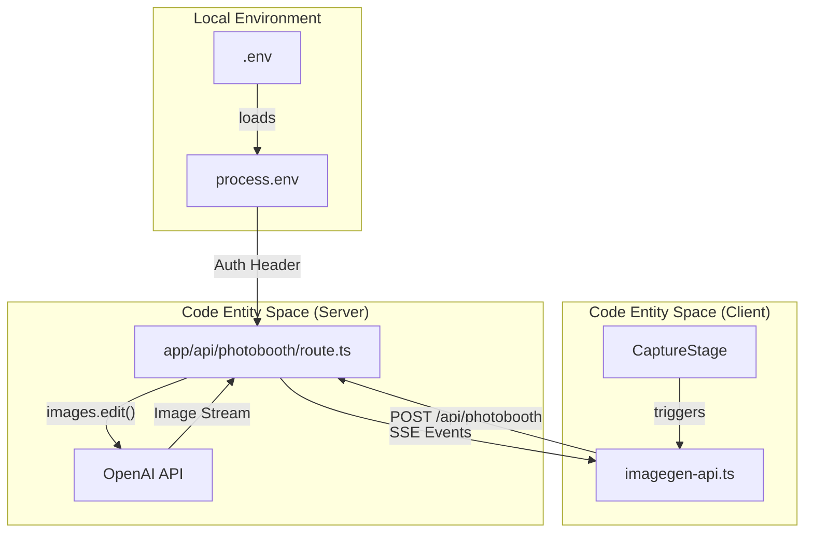
**Sources:** [.env.example:1-1](), [package.json:6-6](), [tsconfig.json:21-23]()

## Project Structure
The repository follows the Next.js App Router convention:

**Core Logic Mapping**
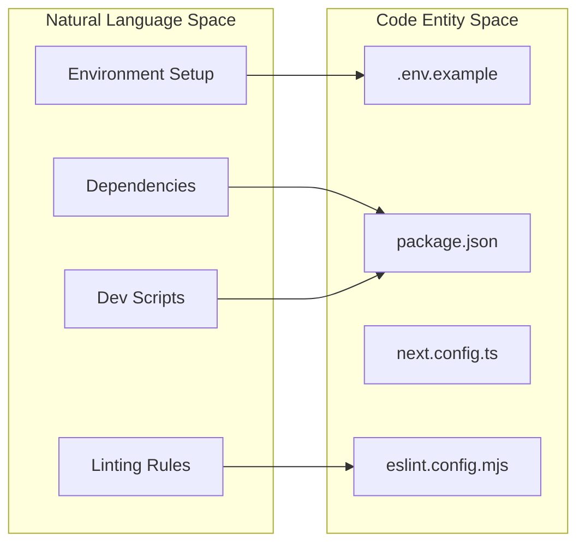
**Sources:** [.env.example:1-1](), [package.json:5-34](), [eslint.config.mjs:12-23](), [next.config.ts:3-5]()

*   **`app/`**: Contains the Next.js routes and layouts.
*   **`components/`**: React components including Radix UI primitives and photobooth-specific UI.
*   **`lib/`**: Utility functions, style definitions, and API services.
*   **`public/`**: Static assets like the mask image required for DALL-E editing.

**Sources:**
*   Environment Variables: [.env.example:1-1]()
*   Git Ignored Files: [.gitignore:1-46]()
*   ESLint Configuration: [eslint.config.mjs:1-26]()
*   Next.js Configuration: [next.config.ts:1-8]()
*   Project Metadata/Scripts: [package.json:1-35]()
*   TypeScript Configuration: [tsconfig.json:1-28]()

---

# Page: Application Architecture

# Application Architecture

<details>
<summary>Relevant source files</summary>

The following files were used as context for generating this wiki page:

- [app/layout.tsx](app/layout.tsx)
- [app/page.tsx](app/page.tsx)
- [app/results/page.tsx](app/results/page.tsx)
- [next-env.d.ts](next-env.d.ts)

</details>


The OpenAI ImageGen Photobooth is a full-stack Next.js application designed to provide a real-time, AI-powered photo transformation experience. It utilizes the Next.js App Router for routing and layout management, and integrates with the OpenAI Images API (DALL-E) via a streaming backend.

## System Overview

The application is structured around a two-page flow: **Capture** and **Results**. Data is passed between these pages using client-side session storage to accommodate large base64 image payloads that exceed URL length limits.

### Component Relationship Diagram
This diagram illustrates how the primary UI components and services interact across the frontend/backend boundary.

"Application Component Relationships"
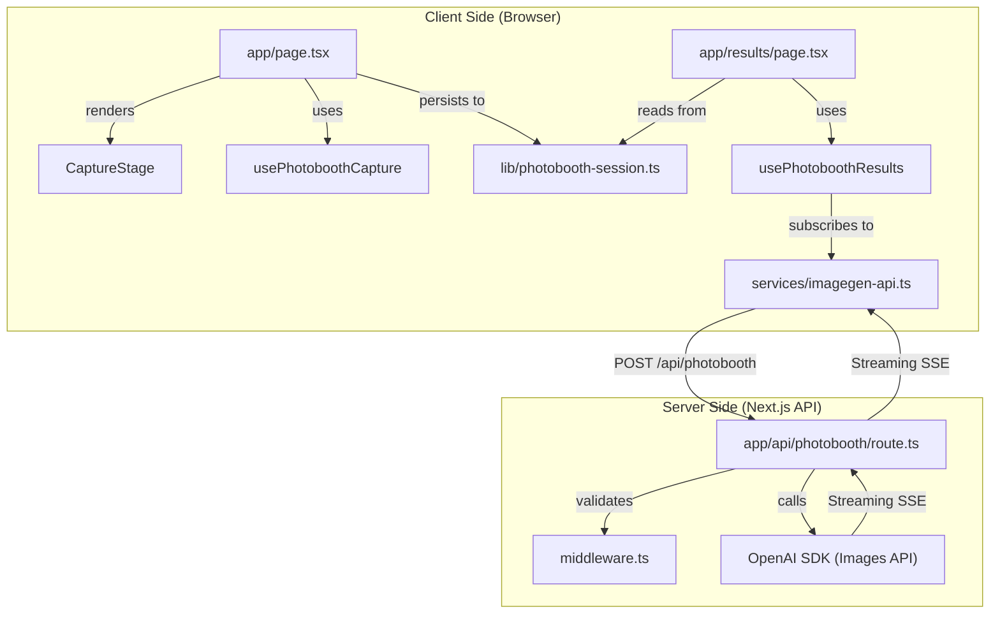
Sources: [app/page.tsx:5-14](), [app/results/page.tsx:8-10](), [app/api/photobooth/route.ts:1-20](), [middleware.ts:1-10]()

---

## The Two-Page Flow

The application logic is split into two distinct phases to separate the resource-heavy camera/upload operations from the asynchronous AI generation process.

### 1. Capture Phase (`/`)
The entry point of the application is the home page [app/page.tsx:16-138](). 
- **Image Acquisition**: Users can capture a photo via the `MediaDevices` API or upload an existing file. This is managed by the `usePhotoboothCapture` hook [app/page.tsx:14-37]().
- **Style Selection**: Users select up to 4 styles from the `PHOTOBOOTH_STYLES` catalog.
- **Session Handover**: When `onGenerate` is triggered, the `savePhotoboothRequest` function [app/page.tsx:65-82]() stores the base64 `imageDataUrl` and selected `styleIds` into `sessionStorage`. The application then navigates to `/results` via the Next.js router [app/page.tsx:81]().

### 2. Results Phase (`/results`)
The results page [app/results/page.tsx:13-124]() handles the lifecycle of the AI generation.
- **Session Recovery**: Upon mount, the `usePhotoboothResults` hook loads the data from `sessionStorage` [app/results/page.tsx:15]().
- **SSE Subscription**: The client establishes a connection to the `/api/photobooth` route.
- **Incremental UI Updates**: As the server streams back partial and final images, the `ResultImageCard` components update their state from "loading" to "streaming" to "done" [app/results/page.tsx:76-90]().

---

## Technical Stack & Data Flow

### Code Entity Mapping
The following diagram maps high-level concepts to the specific code entities that implement them.

"Conceptual to Code Entity Mapping"
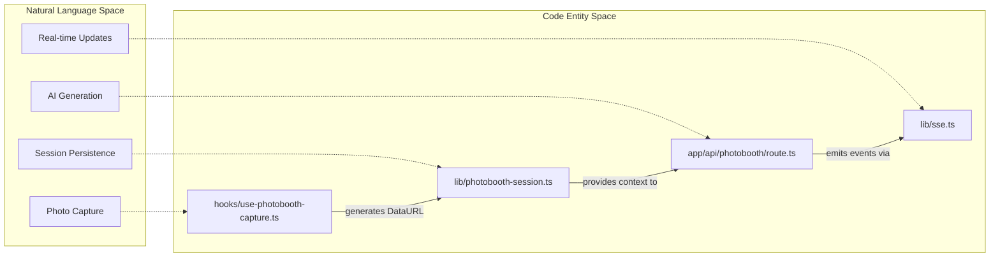
Sources: [hooks/use-photobooth-capture.ts:1-20](), [lib/photobooth-session.ts:1-15](), [app/api/photobooth/route.ts:1-10](), [lib/sse.ts:1-10]()

### Backend Integration
The application uses a Next.js Route Handler [app/api/photobooth/route.ts:1-20]() to act as a proxy between the client and OpenAI. This architecture provides several benefits:
1. **Security**: The `OPENAI_API_KEY` remains on the server and is never exposed to the client.
2. **Middleware Protection**: The `middleware.ts` file ensures that only requests from the same origin are processed [middleware.ts:1-20]().
3. **Concurrency**: The server-side route handles multiple concurrent requests to OpenAI (one per selected style) and multiplexes their responses into a single Server-Sent Events (SSE) stream.

### Key Infrastructure Files
| File | Role |
| :--- | :--- |
| `app/layout.tsx` | Defines the root HTML structure, Geist font variables, and global metadata [app/layout.tsx:1-39](). |
| `app/globals.css` | Contains the Tailwind CSS v4 configuration and design system tokens. |
| `next-env.d.ts` | Provides TypeScript definitions for Next.js routes and image types [next-env.d.ts:1-7](). |

Sources: [app/layout.tsx:1-39](), [app/api/photobooth/route.ts:1-20](), [middleware.ts:1-20](), [next-env.d.ts:1-7]()

---

# Page: User Flow & Pages

# User Flow & Pages

<details>
<summary>Relevant source files</summary>

The following files were used as context for generating this wiki page:

- [app/page.tsx](app/page.tsx)
- [app/results/page.tsx](app/results/page.tsx)

</details>


This section describes the end-to-end user journey within the ImageGen Photobooth application. The application follows a linear two-page progression: capturing or uploading a source image on the home page, followed by viewing AI-generated transformations on the results page.

## Journey Overview

The user flow is designed for rapid iteration, allowing users to select multiple artistic styles and see them generated in parallel.

### User Flow Diagram

The following diagram maps the user's path through the frontend components and the underlying session persistence mechanism.

**Application Navigation Flow**
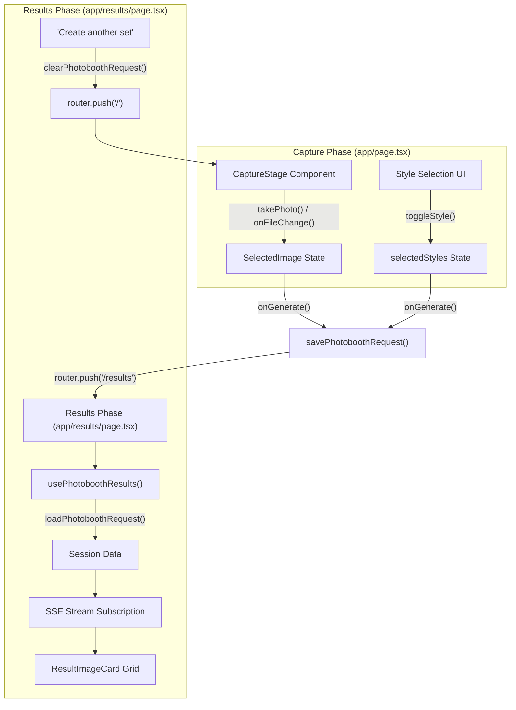
Sources: [app/page.tsx:16-138](), [app/results/page.tsx:13-123](), [lib/photobooth-session.ts:1-40]()

---

## Capture & Style Selection

The entry point of the application is the `HomePage` [app/page.tsx:16](). It serves as the "Photobooth" interface where users provide a source image and select which AI styles they wish to apply.

The page utilizes the `usePhotoboothCapture` hook to manage complex media interactions, including webcam access and drag-and-drop file handling [app/page.tsx:21-37](). Users can select up to a maximum number of styles defined by `MAX_SELECTED_STYLES` [lib/constants.ts:10]().

When the user clicks the generate button, the `onGenerate` function [app/page.tsx:65-82]() performs the following:
1. Validates that an image and at least one style are selected.
2. Persists the image data and style IDs to `sessionStorage` via `savePhotoboothRequest` [app/page.tsx:68-71]().
3. Navigates the user to the `/results` route [app/page.tsx:81]().

For details on image acquisition and the style selection UI, see [Capture & Style Selection Page](#2.1).

**Sources:** [app/page.tsx:65-82](), [lib/constants.ts:9-11]()

---

## Results Page

The `ResultsPage` [app/results/page.tsx:13]() is responsible for orchestrating the generation process and displaying the output. It relies on the `usePhotoboothResults` hook to retrieve the session data and manage the Server-Sent Events (SSE) stream [app/results/page.tsx:15]().

### Result Visualization
The page renders a responsive grid of `ResultImageCard` components [app/results/page.tsx:83-88](). These cards transition through several states:
- **Loading/Queued**: Waiting for the API to begin processing the specific style.
- **Streaming**: Displaying partial image chunks as they arrive from the OpenAI API.
- **Done**: Displaying the final high-resolution image with download options.

### Interaction & Reset
Users can click on any card to open a `ResultPreviewModal` for a larger view [app/results/page.tsx:112-120](). To start over, the "Create another set" button invokes `clearPhotoboothRequest` [app/results/page.tsx:103]() and redirects back to the home page, ensuring a fresh state for the next session.

For details on the streaming implementation and the result UI states, see [Results Page](#2.2).

**Sources:** [app/results/page.tsx:15-109](), [hooks/use-photobooth-results.ts:1-50]()

---

## Session Bridge

Because the source image is a potentially large base64 Data URL, the application does not pass state via URL parameters. Instead, it uses a client-side session utility to bridge the two pages.

| Function | File | Purpose |
| :--- | :--- | :--- |
| `savePhotoboothRequest` | `lib/photobooth-session.ts` | Writes `imageDataUrl` and `styleIds` to `sessionStorage`. |
| `loadPhotoboothRequest` | `lib/photobooth-session.ts` | Reads the session data to initialize the results stream. |
| `clearPhotoboothRequest`| `lib/photobooth-session.ts` | Purges the storage to prevent stale data on re-entry. |

**Sources:** [lib/photobooth-session.ts:1-40]()

---

# Page: Capture & Style Selection Page

# Capture & Style Selection Page

<details>
<summary>Relevant source files</summary>

The following files were used as context for generating this wiki page:

- [app/page.tsx](app/page.tsx)
- [components/photobooth/capture-stage.tsx](components/photobooth/capture-stage.tsx)
- [components/photobooth/desktop-style-panel.tsx](components/photobooth/desktop-style-panel.tsx)
- [components/photobooth/mobile-style-strip.tsx](components/photobooth/mobile-style-strip.tsx)
- [components/photobooth/style-option-card.tsx](components/photobooth/style-option-card.tsx)
- [components/photobooth/style-options-list.tsx](components/photobooth/style-options-list.tsx)
- [hooks/use-photobooth-capture.ts](hooks/use-photobooth-capture.ts)

</details>


The **Capture & Style Selection Page** is the entry point of the application, located at `app/page.tsx`. It provides the user interface for acquiring a source image and selecting the AI styles to be applied. The page integrates camera access, file system uploads, drag-and-drop interactions, and a responsive style selection system.

## Overview of implementation

The page is a client-side component that orchestrates state between the image acquisition logic (encapsulated in a custom hook) and the UI components. It manages the list of selected styles and handles the transition to the results phase by persisting the session data.

### Core Logic & Data Flow

The following diagram illustrates how the `HomePage` component connects user actions to the underlying logic and navigation.

**Diagram: Capture Page Logic Flow**
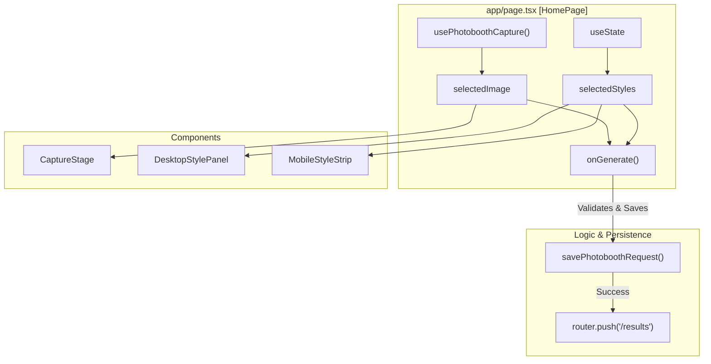
**Sources:** [app/page.tsx:16-138](), [hooks/use-photobooth-capture.ts:6-176]()

---

## Image Acquisition

Image acquisition is managed by the `usePhotoboothCapture` hook, which abstracts three primary methods: webcam capture, file upload, and drag-and-drop.

### 1. Webcam Capture
*   **Media Access:** Uses `navigator.mediaDevices.getUserMedia` to request a video stream [hooks/use-photobooth-capture.ts:58-61]().
*   **Mirroring:** The UI mirrors the video feed for a natural "mirror" feel [components/photobooth/capture-stage.tsx:76]().
*   **Snapshot:** When `takePhoto` is called, the current video frame is drawn to a hidden `<canvas>`. To ensure the resulting image matches the preview, the canvas context is flipped horizontally before drawing [hooks/use-photobooth-capture.ts:91-95]().

### 2. File Upload & Drag-and-Drop
*   **File Selection:** A hidden `<input type="file">` is triggered via a ref [app/page.tsx:120-126]().
*   **Processing:** Files (whether dropped or uploaded) are processed by `handleUploadFile`, which utilizes `resizeImageFileAsDataUrl` to ensure the image meets size requirements before being converted to a base64 Data URL [hooks/use-photobooth-capture.ts:105-122]().
*   **Drag States:** `onDragOver`, `onDragLeave`, and `onDrop` manage the `isDragActive` state to provide visual feedback [hooks/use-photobooth-capture.ts:135-157]().

**Sources:** [hooks/use-photobooth-capture.ts:52-157](), [components/photobooth/capture-stage.tsx:70-118]()

---

## Style Selection UI

The application allows users to select up to a maximum number of styles (defined by `MAX_SELECTED_STYLES`) [lib/constants.ts:10](). The UI adapts based on the viewport size.

### Component Hierarchy
The style selection is split into two responsive views:
1.  **DesktopStylePanel:** A sidebar appearing on large screens (`lg:block`) [components/photobooth/desktop-style-panel.tsx:18]().
2.  **MobileStyleStrip:** A horizontal scrolling strip appearing on smaller screens (`lg:hidden`) [components/photobooth/mobile-style-strip.tsx:18]().

Both components wrap the `StyleOptionsList`, which iterates over `PHOTOBOOTH_STYLES` to render `StyleOptionCard` components [components/photobooth/style-options-list.tsx:31-48]().

### Selection Logic
The `toggleStyle` function in `app/page.tsx` manages the `selectedStyles` array:
*   If the style is already selected, it is removed [app/page.tsx:53]().
*   If the selection is below the limit, the new style is added [app/page.tsx:56]().
*   If the limit is reached, the selection is ignored, and a tooltip (`STYLE_LIMIT_TOOLTIP`) is displayed on the card [components/photobooth/style-option-card.tsx:34]().

**Sources:** [app/page.tsx:50-58](), [components/photobooth/style-options-list.tsx:19-49](), [components/photobooth/style-option-card.tsx:13-53]()

---

## Generation Flow (`onGenerate`)

The `onGenerate` function serves as the bridge between the selection phase and the results phase.

**Diagram: Data Persistence & Navigation**
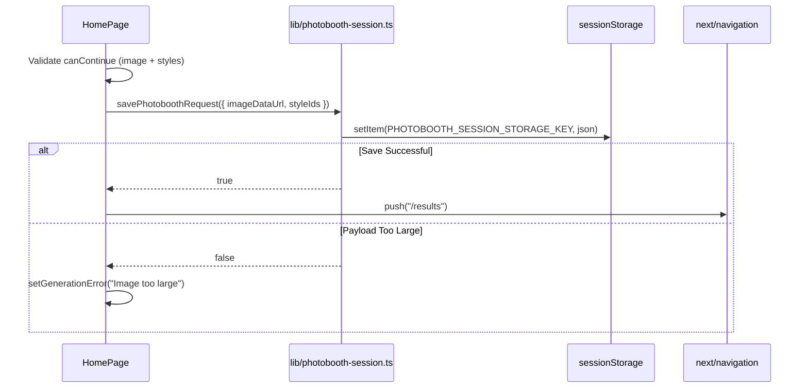

### Implementation Details
*   **Validation:** The `canContinue` memoized boolean ensures the "Generate" button is only active when an image is present and at least one style is selected [app/page.tsx:60-63]().
*   **Persistence:** The image and style data are passed to `savePhotoboothRequest` [app/page.tsx:68-71](). This helper uses `sessionStorage` because the base64 image data is typically too large for URL parameters [lib/photobooth-session.ts]().
*   **Error Handling:** If `savePhotoboothRequest` returns `false` (usually due to `sessionStorage` quota limits), a `generationError` is displayed to the user [app/page.tsx:73-78]().

**Sources:** [app/page.tsx:65-82](), [lib/photobooth-session.ts:12]()

---

## Component Reference Table

| Component | File Path | Responsibility |
| :--- | :--- | :--- |
| `CaptureStage` | `components/photobooth/capture-stage.tsx` | Renders the video feed, selected image, or upload placeholders. |
| `DesktopStylePanel` | `components/photobooth/desktop-style-panel.tsx` | Vertical sidebar for style selection on desktop. |
| `MobileStyleStrip` | `components/photobooth/mobile-style-strip.tsx` | Horizontal scrollable list for style selection on mobile. |
| `StyleOptionsList` | `components/photobooth/style-options-list.tsx` | Maps the style catalog to individual cards. |
| `StyleOptionCard` | `components/photobooth/style-option-card.tsx` | The clickable tile for an individual AI style. |

**Sources:** [components/photobooth/capture-stage.tsx:21](), [components/photobooth/desktop-style-panel.tsx:12](), [components/photobooth/mobile-style-strip.tsx:12](), [components/photobooth/style-options-list.tsx:19](), [components/photobooth/style-option-card.tsx:13]()

---

# Page: Results Page

# Results Page

<details>
<summary>Relevant source files</summary>

The following files were used as context for generating this wiki page:

- [app/results/page.tsx](app/results/page.tsx)
- [components/photobooth/result-image-card.tsx](components/photobooth/result-image-card.tsx)
- [components/photobooth/result-preview-modal.tsx](components/photobooth/result-preview-modal.tsx)
- [hooks/use-photobooth-results.ts](hooks/use-photobooth-results.ts)

</details>


The Results Page (`app/results/page.tsx`) is the final destination in the photobooth user journey. It is responsible for orchestrating the generation of AI-styled portraits by consuming a server-sent events (SSE) stream and rendering the results in a responsive, interactive grid.

## Overview and Purpose

The page serves three primary technical functions:
1.  **Session Restoration**: Retrieving the base64 image and selected style IDs from `sessionStorage` via the `usePhotoboothResults` hook [app/results/page.tsx:15]().
2.  **Streaming Orchestration**: Managing the lifecycle of multiple concurrent image generations, updating individual `ResultCard` states as partial and final images arrive [hooks/use-photobooth-results.ts:42-111]().
3.  **Interaction Management**: Providing a fullscreen preview modal with client-side image optimization and a download mechanism for generated assets [app/results/page.tsx:19-58]().

### Data Flow: Capture to Results
The following diagram illustrates how data captured on the home page is transitioned to and processed by the Results Page.

**Session Transition and Generation Flow**
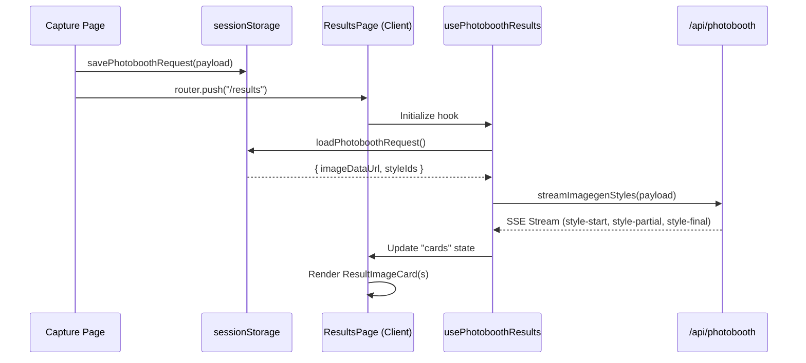
Sources: [app/results/page.tsx:15](), [hooks/use-photobooth-results.ts:23-31](), [hooks/use-photobooth-results.ts:113-118]()

---

## State Management

The page state is primarily driven by the `usePhotoboothResults` hook, which manages an array of `ResultCard` objects.

### The ResultCard State Machine
Each card in the grid follows a specific state transition based on the SSE event type received:

| Event Name | Target Status | Description |
| :--- | :--- | :--- |
| `session-start` | `queued` | Initial state before generation begins. |
| `style-start` | `streaming` | The API has started processing this specific style [hooks/use-photobooth-results.ts:62-68](). |
| `style-partial` | `streaming` | A low-resolution preview image is available [hooks/use-photobooth-results.ts:70-80](). |
| `style-final` | `done` | The high-resolution final image is received [hooks/use-photobooth-results.ts:82-94](). |
| `style-error` | `error` | Generation failed for this specific style [hooks/use-photobooth-results.ts:96-106](). |

### Entity Mapping: Component to State
The following diagram maps UI components to their corresponding data entities and state hooks.

**Component and State Relationship**
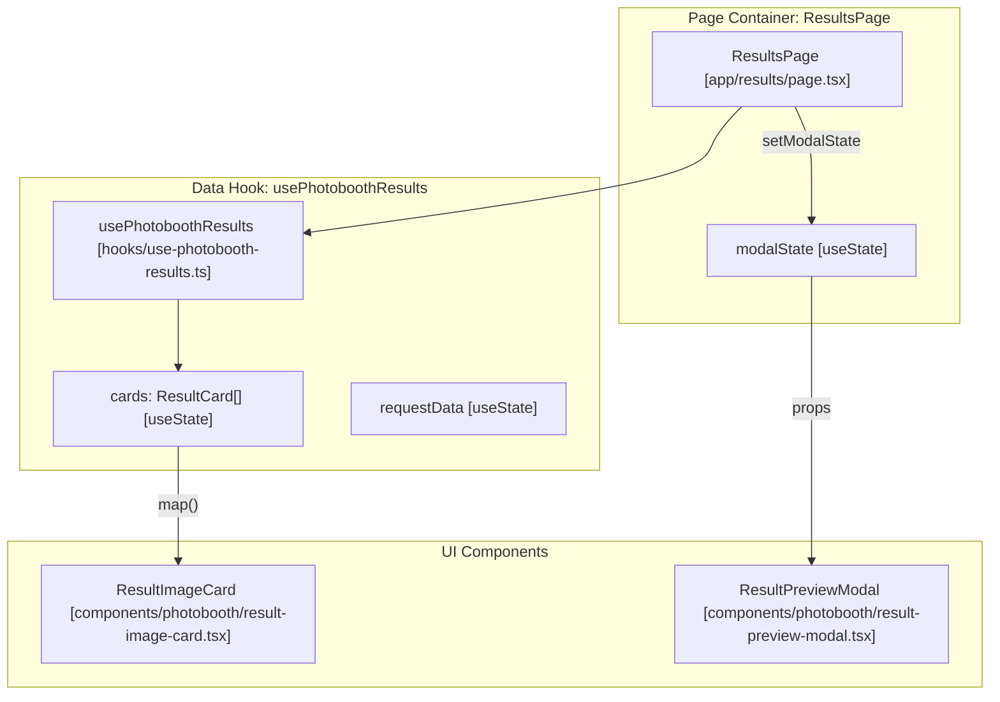
Sources: [app/results/page.tsx:15-16](), [hooks/use-photobooth-results.ts:17-20](), [app/results/page.tsx:83-87]()

---

## Component Implementation

### ResultImageCard
The `ResultImageCard` component handles the visual representation of a style's generation progress. It dynamically toggles between different loading indicators:
*   **Centered Spinner**: Shown when the style is `queued` or `streaming` but no image data (partial or final) is yet available [components/photobooth/result-image-card.tsx:22]().
*   **Top-Right Spinner**: Shown when an image is being displayed but the status is still `streaming`, indicating a higher-quality version is pending [components/photobooth/result-image-card.tsx:23]().
*   **Zoom Cursor**: Applied only when `activeImage` is present, signaling that the card can be clicked to open the preview modal [components/photobooth/result-image-card.tsx:31]().

### Fullscreen Preview and Optimization
When a user clicks a card, `handleOpenPreview` is triggered. Before opening the `ResultPreviewModal`, the application attempts to resize the image using `resizeImageDataUrl` [app/results/page.tsx:27](). This ensures that even if the raw generated image is large, the preview modal remains performant.

The `ResultPreviewModal` itself is a fixed-position overlay that uses `role="dialog"` and `aria-modal="true"` for accessibility [components/photobooth/result-preview-modal.tsx:23-24]().

### Download Functionality
Downloading is handled via a utility function `downloadUrl` [lib/browser/file-utils.ts](). 
1.  **Grid Download**: Users can download directly from the card once `status === "done"` [app/results/page.tsx:39-43]().
2.  **Modal Download**: The modal checks if the current style in view is finished (`canDownloadPreview`) before showing the download button [app/results/page.tsx:45-52]().

Sources: [components/photobooth/result-image-card.tsx:17-24](), [app/results/page.tsx:19-37](), [components/photobooth/result-preview-modal.tsx:36-46]()

---

## Reset Flow: 'Create another set'

The reset flow allows users to return to the capture phase while ensuring a clean state.
1.  **Clear Session**: The `clearPhotoboothRequest()` function is called to remove the `PHOTOBOOTH_SESSION_STORAGE_KEY` from `sessionStorage` [app/results/page.tsx:103]().
2.  **Navigation**: The user is routed back to the root path `/` [app/results/page.tsx:104]().
3.  **Cleanup**: The `usePhotoboothResults` hook includes a cleanup effect that calls `controller.abort()`, immediately terminating any active SSE connections to the API if the user navigates away mid-generation [hooks/use-photobooth-results.ts:133]().

Sources: [app/results/page.tsx:100-108](), [hooks/use-photobooth-results.ts:133-134]()

---

# Page: Backend API & Streaming

# Backend API & Streaming

<details>
<summary>Relevant source files</summary>

The following files were used as context for generating this wiki page:

- [app/api/photobooth/route.ts](app/api/photobooth/route.ts)
- [middleware.ts](middleware.ts)

</details>


The backend layer of the ImageGen Photobooth is a Next.js Route Handler that orchestrates concurrent requests to the OpenAI `images/edits` API. It utilizes Server-Sent Events (SSE) to stream generation progress and final results back to the client in real-time, ensuring a responsive user experience even during long-running AI generations.

## Architecture Overview

The backend is structured to handle high-concurrency image generation while maintaining strict security boundaries. When a user submits a photo, the backend triggers multiple parallel requests—one for each selected style—and aggregates their streams into a single SSE response.

### System Data Flow: Request to Stream

The following diagram illustrates how the natural language request for "styles" is transformed into code entities and processed through the streaming pipeline.

**Backend Request Processing Flow**
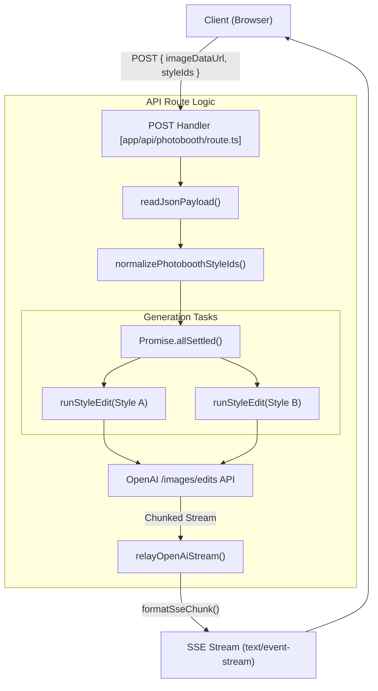
Sources: [app/api/photobooth/route.ts:239-300](), [app/api/photobooth/route.ts:158-164]()

## Core Components

### Photobooth API Route
The primary entry point is the `POST` handler in `app/api/photobooth/route.ts`. It validates the incoming base64 image data and the requested `styleIds` before initiating the generation process. It uses `Promise.allSettled` to manage multiple style generations concurrently, ensuring that a failure in one style (e.g., a safety filter trigger) does not terminate the entire session.

For details, see [Photobooth API Route](#3.1).

### SSE Protocol & Client Service
Communication between the server and client relies on a custom implementation of the Server-Sent Events protocol. The server uses `formatSseChunk` to wrap OpenAI's raw data and internal lifecycle events (like `style-start`) into a format the client can easily parse. On the frontend, a dedicated service consumes this stream and updates the UI state incrementally.

For details, see [SSE Protocol & Client Service](#3.2).

### Middleware & Security
All `/api/*` routes are protected by a middleware layer that enforces origin and referer validation. This prevents unauthorized external usage of the API. The middleware also handles CORS preflight requests and ensures that `POST` requests provide the correct `application/json` content type.

For details, see [Middleware & Security](#3.3).

## Security & Environment Configuration

The backend relies on several environment variables to configure its behavior and security posture.

| Variable | Description | Usage Site |
| :--- | :--- | :--- |
| `OPENAI_API_KEY` | Secret key for OpenAI authentication. | [app/api/photobooth/route.ts:240-241]() |
| `NEXT_PUBLIC_APP_URL` | The primary allowed origin for API requests. | [middleware.ts:6-8]() |
| `VERCEL_URL` | Automatically set by Vercel; used for preview deployments. | [middleware.ts:10-12]() |
| `OPENAI_BASE_URL` | Optional override for the OpenAI API endpoint. | [app/api/photobooth/route.ts:173-174]() |

### Security Validation Logic
The middleware ensures that only requests originating from the application's own domain are processed.

**Middleware Validation Sequence**
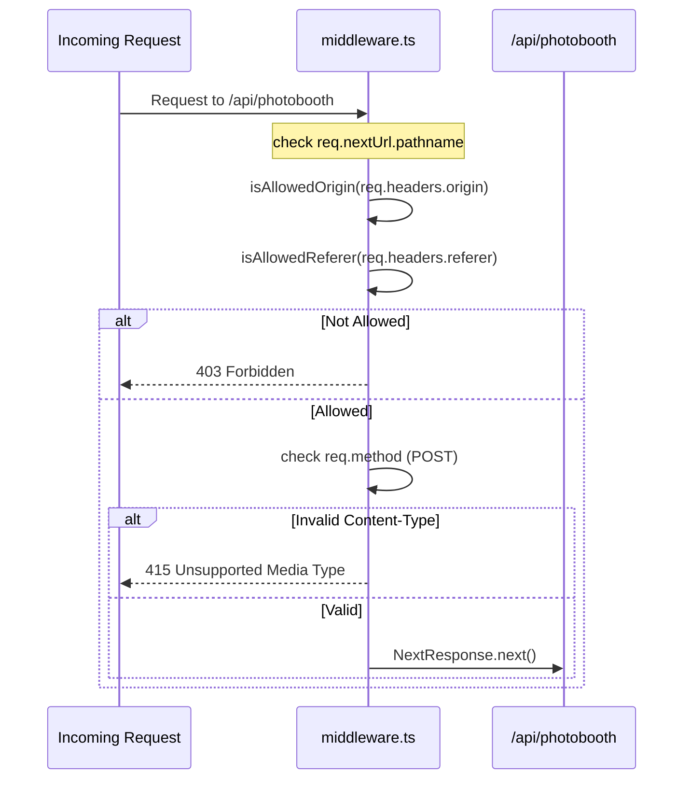
Sources: [middleware.ts:30-68]()

## Technical Specifications

- **Runtime**: Node.js (`export const runtime = "nodejs"`) [app/api/photobooth/route.ts:18]()
- **Max Duration**: 300 seconds to accommodate slow AI generations [app/api/photobooth/route.ts:20]()
- **Streaming**: Uses `ReadableStream` and `TextEncoder` to pipe events to the client [app/api/photobooth/route.ts:275-298]()
- **OpenAI Integration**: Calls the `/images/edits` endpoint with `stream: true` and `partial_images` enabled [app/api/photobooth/route.ts:175-203]()

---

# Page: Photobooth API Route

# Photobooth API Route

<details>
<summary>Relevant source files</summary>

The following files were used as context for generating this wiki page:

- [app/api/photobooth/route.ts](app/api/photobooth/route.ts)
- [lib/constants.ts](lib/constants.ts)
- [lib/photobooth-style-utils.ts](lib/photobooth-style-utils.ts)

</details>


The Photobooth API route is the primary backend handler for processing image generation requests. It acts as an orchestrator that receives a user-provided image and a set of style identifiers, executes concurrent calls to the OpenAI `images/edits` endpoint for each style, and streams the results back to the client using Server-Sent Events (SSE).

## Route Overview

The route is implemented as a Next.js App Router Route Handler. It supports two HTTP methods:
- **GET**: A discovery endpoint that returns the available photobooth styles.
- **POST**: The main processing endpoint that handles image uploads and generation.

The route is configured with a `nodejs` runtime and a `maxDuration` of 300 seconds to accommodate the latency of multiple concurrent AI image generation tasks [app/api/photobooth/route.ts:18-20]().

### Request Data Flow

The following diagram illustrates how the `POST` handler processes an incoming request and interfaces with OpenAI.

**Diagram: Request Processing Flow**
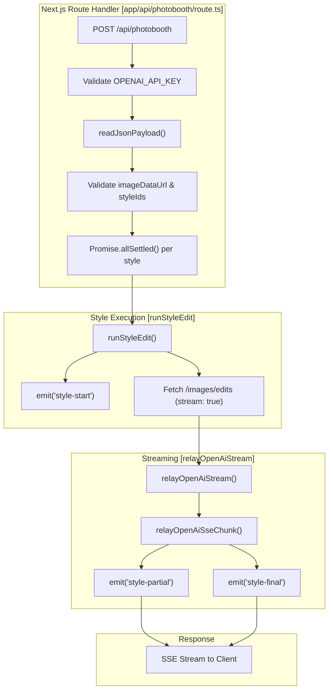
Sources: [app/api/photobooth/route.ts:239-270](), [app/api/photobooth/route.ts:158-171](), [app/api/photobooth/route.ts:117-124]()

## Core Implementation Details

### Request Validation
The `POST` handler first ensures that the `OPENAI_API_KEY` is configured [app/api/photobooth/route.ts:240-248](). It then parses the JSON body using `readJsonPayload` and validates the inputs:
- `imageDataUrl`: Must be a string starting with `data:image/` and containing `;base64,` [app/api/photobooth/route.ts:35-41]().
- `styleIds`: Processed via `normalizePhotoboothStyleIds` to ensure they are valid, unique, and do not exceed `MAX_SELECTED_STYLES` [lib/photobooth-style-utils.ts:7-26]().

### Concurrent Style Execution
The route processes styles in parallel using `Promise.allSettled`. This allows the server to trigger multiple OpenAI requests simultaneously, significantly reducing the total time the user waits for all results [app/api/photobooth/route.ts:289-301](). Each style is handled by the `runStyleEdit` function.

### OpenAI Integration (`runStyleEdit`)
This function constructs the multipart-like request for the OpenAI `/images/edits` endpoint [app/api/photobooth/route.ts:173-175](). Key parameters used include:
- **Model**: `OPENAI_IMAGE_MODEL` (e.g., `gpt-image-2`) [lib/constants.ts:18]().
- **Prompt**: A combination of the style-specific prompt and `OPENAI_IMAGE_OUTPUT_REQUIREMENTS` to ensure subject preservation [app/api/photobooth/route.ts:196]().
- **Stream**: Set to `true` to receive partial generation updates [app/api/photobooth/route.ts:201]().
- **Partial Images**: Configured via `OPENAI_IMAGE_PARTIAL_IMAGES` [lib/constants.ts:22]().

### Streaming Logic
The route uses a `ReadableStream` to send events back to the client. The `emit` helper function formats data using `formatSseChunk` [app/api/photobooth/route.ts:272-277]().

1.  **`relayOpenAiStream`**: Reads the raw `Uint8Array` stream from OpenAI, decodes it into text, and manages a buffer to identify complete SSE chunks separated by `\n\n` [app/api/photobooth/route.ts:117-142]().
2.  **`relayOpenAiSseChunk`**: Parses individual chunks from OpenAI. If the chunk contains a `partial_image`, it emits a `style-partial` event. If it indicates completion, it emits `style-final` [app/api/photobooth/route.ts:69-107]().
3.  **`toDataUrl`**: A utility that normalizes the `b64_json` returned by OpenAI back into a standard Data URL format (e.g., `data:image/png;base64,...`) for client-side consumption [app/api/photobooth/route.ts:60-67]().

**Table: SSE Event Types Emitted**
| Event Name | Trigger | Payload Contents |
| :--- | :--- | :--- |
| `session-start` | Request received | `styleIds` |
| `style-start` | Before OpenAI call | `styleId`, `label` |
| `style-partial` | OpenAI partial chunk | `styleId`, `imageDataUrl`, `partialIndex` |
| `style-final` | OpenAI completion | `styleId`, `imageDataUrl` |
| `style-error` | Per-style failure | `styleId`, `message` |
| `session-complete` | All styles finished | N/A |

Sources: [app/api/photobooth/route.ts:281-325](), [app/api/photobooth/route.ts:88-107]()

## Abort Handling
The route monitors the `AbortSignal` from the `NextRequest`. If the user closes the browser or cancels the request, the `signal` is passed to the OpenAI `fetch` call [app/api/photobooth/route.ts:193](). The `isAbortError` utility identifies these interruptions to prevent logging standard cancellations as server errors [app/api/photobooth/route.ts:151-156]().

## Discovery Endpoint (GET)
The `GET` handler provides a simple way for the client to discover supported styles without hardcoding them in the frontend [app/api/photobooth/route.ts:339-341]().

**Diagram: Entity Mapping**
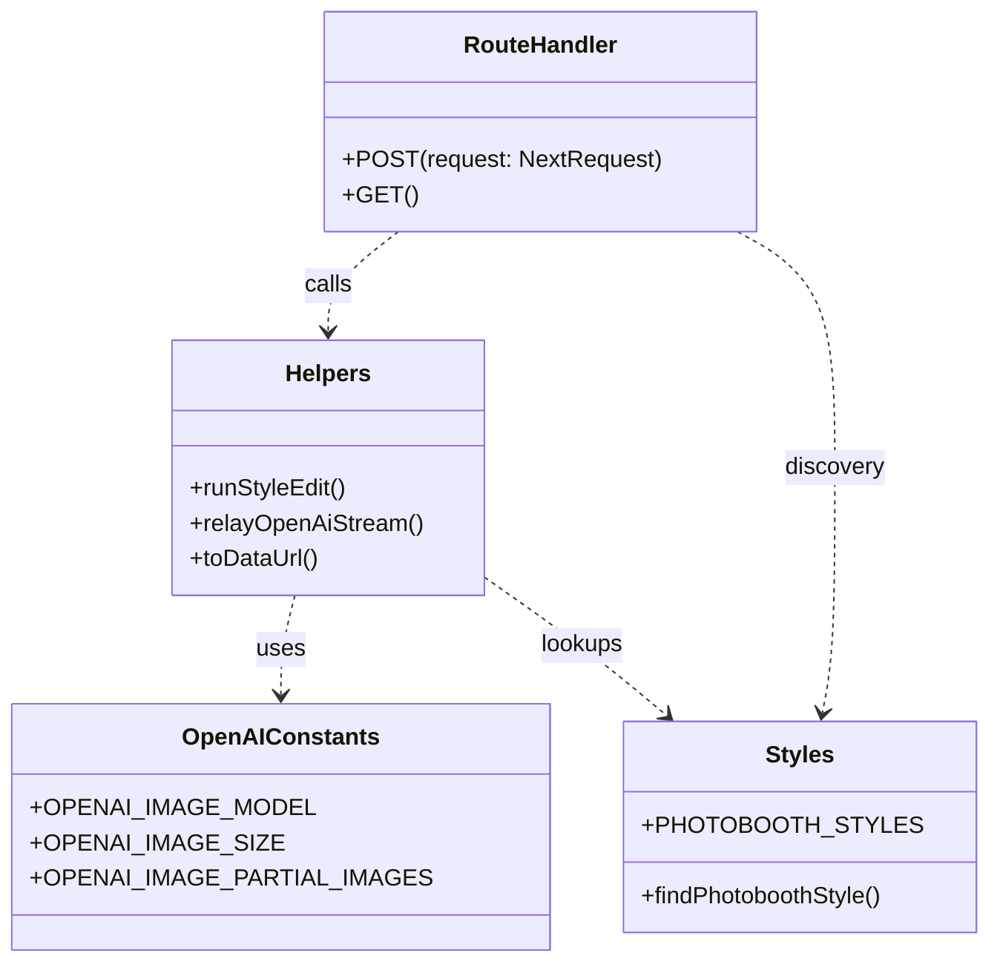
Sources: [app/api/photobooth/route.ts:1-15](), [lib/constants.ts:18-22](), [lib/photobooth-styles.ts:12-15]()

---

# Page: SSE Protocol & Client Service

# SSE Protocol & Client Service

<details>
<summary>Relevant source files</summary>

The following files were used as context for generating this wiki page:

- [lib/sse.ts](lib/sse.ts)
- [services/imagegen-api.ts](services/imagegen-api.ts)

</details>


The ImageGen Photobooth utilizes Server-Sent Events (SSE) to provide a real-time, low-latency streaming experience. This allows the client to display partial results and status updates as multiple AI image generations progress concurrently on the server.

## SSE Protocol Implementation

The communication between the server and client relies on a standardized text-based format defined in `lib/sse.ts`. This utility handles the serialization and deserialization of event-driven messages.

### Message Formatting
The server uses `formatSseChunk` to construct messages. Each chunk consists of an `event` identifier and a `data` payload containing a JSON string, terminated by double newlines `\n\n` [lib/sse.ts:30-33]().

### Message Parsing
The client utilizes `parseSseChunk` to process raw strings received from the stream. It identifies the `eventName` (defaulting to "message") and aggregates lines starting with `data:` into a single payload [lib/sse.ts:6-28]().

### Data Flow: Server to Client
The following diagram illustrates how the SSE protocol bridges the server-side generation logic with the client-side consumption service.

**SSE Communication Flow**
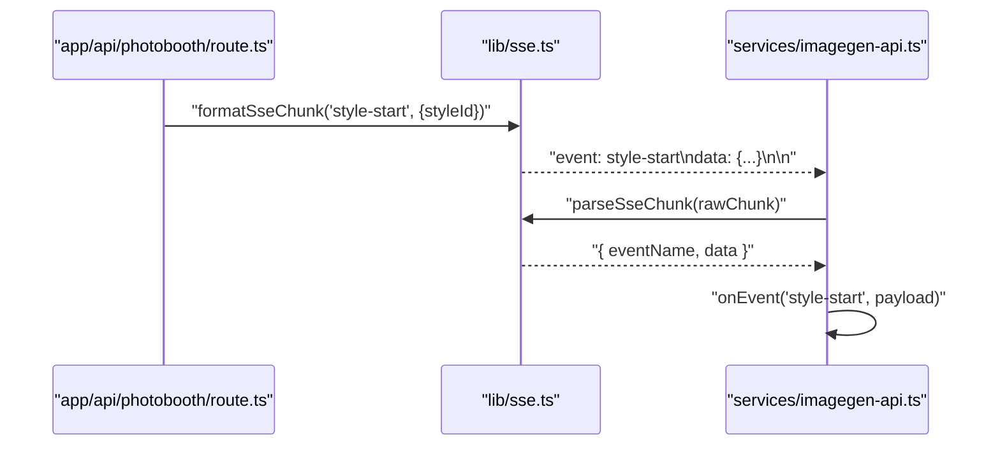
Sources: [lib/sse.ts:1-33](), [services/imagegen-api.ts:102-130]()

## Event Taxonomy

The system defines a specific set of event types represented by the `ImagegenStreamEventName` type [services/imagegen-api.ts:31-38](). These events drive the UI state transitions in the results view.

| Event Name | Description | Payload Key Entities |
| :--- | :--- | :--- |
| `session-start` | Triggered when the server begins processing the batch. | `sessionId` |
| `style-start` | Indicates a specific style generation has been initiated. | `styleId` |
| `style-partial` | Sent when a partial/preview image is available (e.g., during DALL-E generation). | `styleId`, `imageDataUrl` |
| `style-final` | Sent when the high-resolution final image is ready. | `styleId`, `imageDataUrl` |
| `style-error` | Sent if a specific style generation fails (e.g., safety filters). | `styleId`, `message` |
| `session-complete`| Final event indicating all requested styles have been processed. | `{}` |

Sources: [services/imagegen-api.ts:31-38](), [services/imagegen-api.ts:85-98]()

## Client Service: `streamImagegenStyles`

The `streamImagegenStyles` function in `services/imagegen-api.ts` is the primary consumer of the SSE stream. It manages the fetch lifecycle, response validation, and stream reading [services/imagegen-api.ts:50-146]().

### Stream Consumption Logic
1.  **Request Initiation**: Sends a POST request to `IMAGEGEN_API_ROUTE` with the base64 image and selected style IDs [services/imagegen-api.ts:56-61]().
2.  **Fallback Handling**: If the server returns a standard JSON response instead of a stream (detected via `content-type`), the service iterates through the `results` array and manually triggers `style-final` or `style-error` events to maintain compatibility with the UI [services/imagegen-api.ts:72-100]().
3.  **Stream Reading**:
    *   Obtains a `ReadableStreamDefaultReader` from the response body [services/imagegen-api.ts:102]().
    *   Uses a `TextDecoder` to convert binary chunks into strings [services/imagegen-api.ts:103]().
    *   Maintains a `buffer` to handle cases where SSE chunks are split across multiple network packets [services/imagegen-api.ts:104-110]().
4.  **Chunk Processing**: Searches for the `\n\n` boundary, extracts the chunk, parses it via `parseSseChunk`, and executes the `onEvent` callback [services/imagegen-api.ts:113-130]().

**Code Entity Mapping: Client Stream Handler**
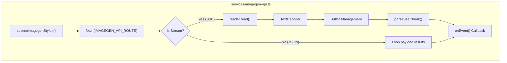
Sources: [services/imagegen-api.ts:50-146](), [lib/sse.ts:6-28]()

### Error Handling
The service includes a `buildHttpError` helper that extracts error messages from the response payload or status text [services/imagegen-api.ts:20-29](). If the `response.ok` check fails, an `HttpError` is thrown, allowing the calling hook to update the UI accordingly [services/imagegen-api.ts:63-66]().

Sources: [services/imagegen-api.ts:5-29](), [services/imagegen-api.ts:63-66]()

---

# Page: Middleware & Security

# Middleware & Security

<details>
<summary>Relevant source files</summary>

The following files were used as context for generating this wiki page:

- [.env.example](.env.example)
- [middleware.ts](middleware.ts)

</details>


The application utilizes a Next.js Middleware layer to enforce security constraints on all API interactions. This layer acts as a gatekeeper for routes under `/api/*`, ensuring that requests originate from authorized domains and adhere to expected content standards. The primary security model relies on Origin and Referer validation to prevent unauthorized cross-site requests and CSRF-like patterns.

## Middleware Execution Flow

The `middleware` function is configured to intercept all requests matching the `/api/:path*` pattern [middleware.ts:70-72](). It performs a series of sequential checks: handling CORS preflight, validating request origins against an allowlist, and enforcing `Content-Type` headers for write operations.

### Security Validation Sequence

1.  **Path Filtering**: The middleware immediately passes through any request that does not start with `/api/` [middleware.ts:31-33]().
2.  **CORS Preflight**: Responds to `OPTIONS` requests with a `204 No Content` status to support browser preflight checks [middleware.ts:35-37]().
3.  **Origin/Referer Validation**: Compares the `origin` and `referer` headers against a dynamically generated allowlist [middleware.ts:42-48]().
4.  **Content-Type Enforcement**: For `POST` requests, ensures the body is `application/json` [middleware.ts:57-65]().

### Request Processing Logic

The following diagram illustrates the decision tree within `middleware.ts`:

**Middleware Logic Flow**
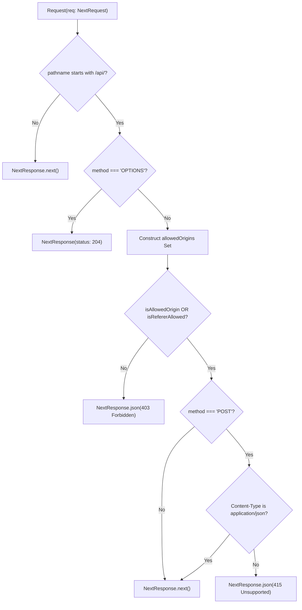
Sources: [middleware.ts:30-68]()

---

## Origin Allowlist Configuration

The security layer determines authorized origins by combining environment variables with runtime request metadata. This ensures the application remains secure across local development, Vercel preview deployments, and production environments.

### Environment Variables
The `getEnvAllowedOrigins` function [middleware.ts:3-15]() populates the `ALLOWED_FROM_ENV` set using:
*   `NEXT_PUBLIC_APP_URL`: The primary production URL of the application [middleware.ts:6-8]().
*   `VERCEL_URL`: The dynamic deployment URL provided by the Vercel platform, automatically prefixed with `https://` [middleware.ts:10-12]().

### Runtime Resolution
At runtime, the middleware also adds `req.nextUrl.origin` to the `allowedOrigins` set [middleware.ts:39-40](). This allows the application to communicate with its own API routes regardless of the specific domain it is currently hosted on, facilitating seamless local development and branch previews.

| Variable | Description | Usage in Code |
| :--- | :--- | :--- |
| `NEXT_PUBLIC_APP_URL` | Hardcoded production domain | `allowed.add(process.env.NEXT_PUBLIC_APP_URL)` [middleware.ts:7]() |
| `VERCEL_URL` | Vercel-generated deployment URL | `allowed.add("https://" + process.env.VERCEL_URL)` [middleware.ts:11]() |
| `req.nextUrl.origin` | The current request's destination origin | `allowedOrigins.add(req.nextUrl.origin)` [middleware.ts:40]() |

Sources: [middleware.ts:3-17](), [middleware.ts:39-40]()

---

## Validation Mechanisms

### Origin and Referer Check
The middleware implements a "dual-check" strategy for domain validation. A request is considered authorized if either the `origin` header matches or the `referer` header is valid [middleware.ts:50]().

The `isAllowedReferer` helper [middleware.ts:19-28]() performs the following:
1.  Extracts the `referer` header [middleware.ts:20]().
2.  Parses it into a `URL` object to isolate the protocol and host [middleware.ts:23]().
3.  Checks if the reconstructed origin (`protocol//host`) exists in the `allowedOrigins` set [middleware.ts:24]().

### Content-Type Enforcement
To prevent unexpected payload processing and ensure compatibility with the `Photobooth API Route`, all `POST` requests must specify `application/json` in their `Content-Type` header [middleware.ts:57-59](). If the header is missing or incorrect, the middleware returns a `415 Unsupported Media Type` error [middleware.ts:60-64]().

**Entity Association: Validation Logic**
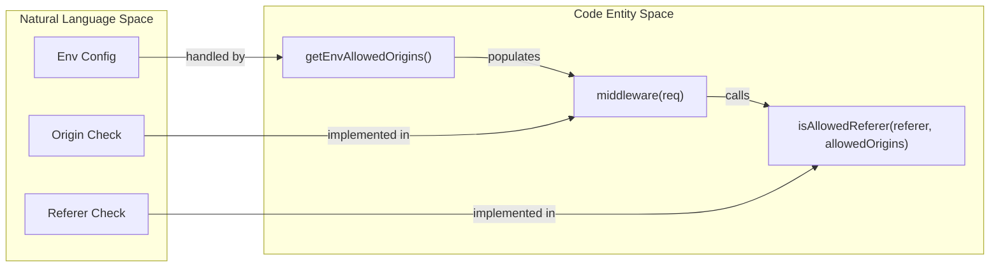
Sources: [middleware.ts:3-28](), [middleware.ts:30-68]()

---

## Error Responses

The middleware returns standardized JSON error responses when security constraints are violated:

| Status Code | Message | Trigger Condition |
| :--- | :--- | :--- |
| `403 Forbidden` | `Forbidden - invalid Origin/Referer` | Neither `origin` nor `referer` headers match the authorized list [middleware.ts:50-55](). |
| `415 Unsupported Media Type` | `Unsupported Media Type` | A `POST` request was made with a `Content-Type` other than `application/json` [middleware.ts:60-64](). |

Sources: [middleware.ts:50-65]()

---

# Page: State Management & Hooks

# State Management & Hooks

<details>
<summary>Relevant source files</summary>

The following files were used as context for generating this wiki page:

- [hooks/use-photobooth-capture.ts](hooks/use-photobooth-capture.ts)
- [hooks/use-photobooth-results.ts](hooks/use-photobooth-results.ts)
- [lib/photobooth-session.ts](lib/photobooth-session.ts)

</details>


The OpenAI ImageGen Photobooth application relies on a decoupled state management strategy that bridges the transition between the **Capture** phase and the **Results** phase. State is encapsulated within two primary custom hooks, while a session persistence layer ensures that large image payloads (Base64) are transferred reliably across page navigations without overloading URL parameters.

### Application State Architecture

The application transitions through two main states: the acquisition of a source image and the streaming of AI-generated variants. These states are bridged by `sessionStorage`.

#### State Flow Diagram
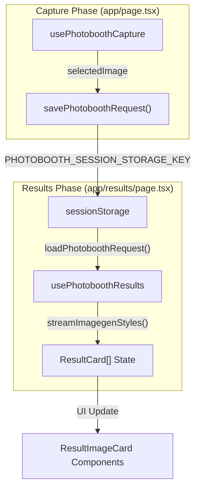
**Sources:** [hooks/use-photobooth-capture.ts:6-176](), [hooks/use-photobooth-results.ts:16-141](), [lib/photobooth-session.ts:7-54]()

---

### usePhotoboothCapture Hook
The `usePhotoboothCapture` hook manages the complexity of the MediaDevices API and file system interactions. It provides a unified interface for acquiring an image, whether through a live camera stream or a local file upload.

*   **Camera Lifecycle**: Handles `getUserMedia` streams, ensuring tracks are stopped via `stopCamera` to release hardware resources when the component unmounts or an image is selected [hooks/use-photobooth-capture.ts:16-21](), [hooks/use-photobooth-capture.ts:39-44]().
*   **Image Processing**: Uses a hidden canvas (`canvasRef`) to capture video frames. It applies a horizontal flip (`context.scale(-1, 1)`) during capture to ensure the output matches the mirrored preview shown to the user [hooks/use-photobooth-capture.ts:91-95]().
*   **File Handling**: Manages drag-and-drop states (`isDragActive`) and file input changes, utilizing `resizeImageFileAsDataUrl` to ensure images are optimized before being stored in state [hooks/use-photobooth-capture.ts:105-122](), [hooks/use-photobooth-capture.ts:148-157]().

For details, see [usePhotoboothCapture Hook](#4.1).

**Sources:** [hooks/use-photobooth-capture.ts:6-176]()

---

### usePhotoboothResults Hook
The `usePhotoboothResults` hook orchestrates the asynchronous streaming of AI images from the backend. It transforms the flat session data into a reactive array of `ResultCard` objects.

*   **Initialization**: On mount, it retrieves the session using `loadPhotoboothRequest` and initializes the UI state using `buildInitialResultCards` [hooks/use-photobooth-results.ts:22-32]().
*   **SSE Subscription**: It invokes `streamImagegenStyles` and maps incoming Server-Sent Events (SSE) to specific card updates [hooks/use-photobooth-results.ts:113-118]().
*   **Incremental Updates**: The hook handles various event types—`style-start`, `style-partial`, and `style-final`—to update individual card statuses from `streaming` to `done`, allowing the UI to show partial DALL-E 3 previews as they arrive [hooks/use-photobooth-results.ts:62-94]().

For details, see [usePhotoboothResults Hook](#4.2).

**Sources:** [hooks/use-photobooth-results.ts:16-141]()

---

### Session Persistence
Because the application generates high-resolution Base64 strings, standard URL query parameters are insufficient for passing state between the `/` and `/results` routes. The `lib/photobooth-session.ts` utility provides a persistence layer using the browser's `sessionStorage`.

| Function | Responsibility |
| :--- | :--- |
| `savePhotoboothRequest` | Serializes the `PhotoboothRequestPayload` to JSON and stores it [lib/photobooth-session.ts:7-16](). |
| `loadPhotoboothRequest` | Retrieves the session, validates the `imageDataUrl` format, and normalizes style IDs [lib/photobooth-session.ts:18-49](). |
| `clearPhotoboothRequest` | Removes the session key to reset the application state [lib/photobooth-session.ts:51-54](). |

#### Data Entity Mapping
```mermaid
classDiagram
    class PhotoboothRequestPayload {
        +string imageDataUrl
        +string[] styleIds
    }
    class ResultCard {
        +PhotoboothStyleId styleId
        +string status
        +string? partialImageUrl
        +string? finalImageUrl
        +string? error
    }
    PhotoboothRequestPayload --|> ResultCard : "Initialized by buildInitialResultCards"
    ResultCard --|> usePhotoboothResults : "Managed as cards state"
```
**Sources:** [lib/photobooth-session.ts:1-55](), [hooks/use-photobooth-results.ts:3-5]()

For details, see [Session Persistence](#4.3).

---

# Page: usePhotoboothCapture Hook

# usePhotoboothCapture Hook

<details>
<summary>Relevant source files</summary>

The following files were used as context for generating this wiki page:

- [hooks/use-photobooth-capture.ts](hooks/use-photobooth-capture.ts)
- [lib/browser/file-utils.ts](lib/browser/file-utils.ts)
- [types/photobooth.ts](types/photobooth.ts)

</details>


The `usePhotoboothCapture` hook is the central logic controller for the image acquisition phase of the application. It encapsulates the complexities of the browser's MediaDevices API, handles the lifecycle of the webcam stream, manages file uploads via drag-and-drop or file pickers, and performs client-side image processing.

## Core State and References

The hook manages several pieces of state and refs to interact with DOM elements required for media handling.

| State/Ref | Type | Purpose |
| :--- | :--- | :--- |
| `videoRef` | `useRef<HTMLVideoElement>` | Reference to the video element for the live camera preview [hooks/use-photobooth-capture.ts:7](). |
| `canvasRef` | `useRef<HTMLCanvasElement>` | Reference to a hidden canvas used for capturing and mirroring the photo [hooks/use-photobooth-capture.ts:8](). |
| `cameraStream` | `MediaStream \| null` | The active media stream from `navigator.mediaDevices.getUserMedia` [hooks/use-photobooth-capture.ts:11](). |
| `selectedImage` | `SelectedImage \| null` | The final processed image (Base64) and its origin [hooks/use-photobooth-capture.ts:12](). |
| `isDragActive` | `boolean` | UI state for drag-and-drop overlays [hooks/use-photobooth-capture.ts:14](). |

### SelectedImage State Shape
The hook produces a `SelectedImage` object, defined as:
- `dataUrl`: A string containing the Base64 encoded image data [types/photobooth.ts:4]().
- `source`: A literal type `"camera" | "upload"` indicating how the image was acquired [types/photobooth.ts:5]().

Sources: [hooks/use-photobooth-capture.ts:6-15](), [types/photobooth.ts:3-6]()

## Camera Lifecycle Management

The hook manages the camera stream lifecycle through `useEffect` and `useCallback` to prevent memory leaks and ensure hardware resources (webcam) are released when not in use.

### Stream Initialization and Cleanup
- **`startCamera`**: Requests user permission via `getUserMedia` with `video: { facingMode: "user" }` and sets the `cameraStream` [hooks/use-photobooth-capture.ts:52-66]().
- **`stopCamera`**: Iterates through all tracks in the current stream and calls `.stop()` before nullifying the state [hooks/use-photobooth-capture.ts:39-44]().
- **Automatic Cleanup**: A `useEffect` hook ensures that if the component unmounts while the camera is active, all tracks are stopped [hooks/use-photobooth-capture.ts:16-21]().

### Preview Synchronization
A second `useEffect` monitors the `cameraStream`. When a stream is active, it attaches the stream to the `videoRef.current.srcObject` and invokes `.play()` [hooks/use-photobooth-capture.ts:23-37]().

### Photo Capture with Mirror Correction
When `takePhoto` is called, the hook performs a canvas-based capture that mirrors the image to match the user's "mirror" preview:
1. Validates that the video stream has current data and valid dimensions [hooks/use-photobooth-capture.ts:73-80]().
2. Sets the `canvasRef` dimensions to match the `videoWidth` and `videoHeight` [hooks/use-photobooth-capture.ts:82-85]().
3. Uses `context.scale(-1, 1)` and `context.translate(width, 0)` to flip the image horizontally before drawing the video frame [hooks/use-photobooth-capture.ts:91-95]().
4. Exports the result via `canvas.toDataURL("image/png")` [hooks/use-photobooth-capture.ts:97]().

Sources: [hooks/use-photobooth-capture.ts:39-99]()

## Image Upload and Processing

The hook supports both manual file selection and drag-and-drop interactions. Both flows converge on the `handleUploadFile` function.

### File Handling Logic
- **`handleUploadFile`**: Validates the MIME type to ensure it starts with `image/` [hooks/use-photobooth-capture.ts:107-110]().
- **Resizing**: It utilizes `resizeImageFileAsDataUrl` from the browser utilities to ensure the image does not exceed the maximum allowed dimension (1536px) before being stored in state [hooks/use-photobooth-capture.ts:113]().
- **`onFileChange`**: Triggered by the hidden `fileInputRef`. It extracts the first file and resets the input value to allow re-uploading the same file [hooks/use-photobooth-capture.ts:124-133]().

### Drag-and-Drop Event Handlers
The hook provides standard event handlers to manage the drag-and-drop UX:
- **`onDragOver`**: Prevents default browser behavior and sets `isDragActive` to true [hooks/use-photobooth-capture.ts:135-139]().
- **`onDragLeave`**: Resets `isDragActive` if the cursor leaves the drop zone [hooks/use-photobooth-capture.ts:141-146]().
- **`onDrop`**: Extracts the file from `event.dataTransfer.files` and passes it to the upload handler [hooks/use-photobooth-capture.ts:148-157]().

Sources: [hooks/use-photobooth-capture.ts:101-157](), [lib/browser/file-utils.ts:61-70]()

## Implementation Diagrams

### Camera Stream and Capture Flow
This diagram illustrates the relationship between the MediaDevices API, the HTML5 Video element, and the Canvas capture mechanism.

```mermaid
sequenceDiagram
    participant U as User
    participant H as usePhotoboothCapture
    participant M as MediaDevices API
    participant V as HTMLVideoElement (videoRef)
    participant C as HTMLCanvasElement (canvasRef)

    U->>H: "startCamera()"
    H->>M: "getUserMedia({ video: true })"
    M-->>H: "MediaStream"
    H->>V: "srcObject = stream"
    V-->>U: "Live Mirror Preview"

    U->>H: "takePhoto()"
    H->>C: "getContext('2d')"
    Note over H, C: "Apply mirror transform (scale -1, 1)"
    H->>C: "drawImage(videoRef, 0, 0)"
    C-->>H: "toDataURL('image/png')"
    H->>H: "setSelectedImage({ dataUrl, source: 'camera' })"
    H->>M: "track.stop()"
```
Sources: [hooks/use-photobooth-capture.ts:52-99]()

### Image Processing Pipeline
This diagram bridges the Natural Language concept of "Image Upload" to the specific utility functions and browser APIs used.

```mermaid
flowchart TD
    subgraph "Natural Language Space"
        Input["User selects/drops file"]
        Resize["Downscale for API limits"]
        Output["Ready for Generation"]
    end

    subgraph "Code Entity Space"
        A["handleUploadFile"]
        B["resizeImageFileAsDataUrl"]
        C["readFileAsDataUrl"]
        D["FileReader API"]
        E["resizeImageDataUrl"]
        F["HTMLCanvasElement"]
    end

    Input --> A
    A --> B
    B --> C
    C --> D
    B --> E
    E --> F
    F --> Output
```
Sources: [hooks/use-photobooth-capture.ts:105-122](), [lib/browser/file-utils.ts:1-70]()

## Utility Integration

The hook relies on `lib/browser/file-utils.ts` for heavy lifting:

1.  **`readFileAsDataUrl`**: Wraps `FileReader.readAsDataURL` in a Promise to convert a `File` object to a Base64 string [lib/browser/file-utils.ts:1-15]().
2.  **`resizeImageDataUrl`**: Creates an off-screen canvas to scale images down if their longest side exceeds 1536px, preserving the aspect ratio and original MIME type [lib/browser/file-utils.ts:36-59]().

Sources: [lib/browser/file-utils.ts:1-70]()

---

# Page: usePhotoboothResults Hook

# usePhotoboothResults Hook

<details>
<summary>Relevant source files</summary>

The following files were used as context for generating this wiki page:

- [hooks/use-photobooth-results.ts](hooks/use-photobooth-results.ts)
- [lib/photobooth-results.ts](lib/photobooth-results.ts)
- [lib/photobooth-session.ts](lib/photobooth-session.ts)
- [types/photobooth.ts](types/photobooth.ts)

</details>


The `usePhotoboothResults` hook is the primary state manager for the Results page. It orchestrates the retrieval of session data from local storage, initializes the UI state for image generation cards, and manages the lifecycle of the Server-Sent Events (SSE) stream that delivers generated images from the OpenAI API.

## Core Responsibilities

The hook manages a complex state machine where multiple images are generated in parallel, each transitioning through various statuses (`queued`, `streaming`, `done`, or `error`) based on real-time updates from the backend.

1.  **Session Retrieval**: Loads the base64 image and selected style IDs from `sessionStorage` [hooks/use-photobooth-results.ts:23-30]().
2.  **State Initialization**: Pre-populates the `cards` array with placeholder objects for each selected style using `buildInitialResultCards` [hooks/use-photobooth-results.ts:31]().
3.  **Stream Management**: Initiates the SSE connection via `streamImagegenStyles` and handles the incremental updates [hooks/use-photobooth-results.ts:113-118]().
4.  **Cleanup**: Utilizes `AbortController` to cancel pending network requests if the user navigates away from the page [hooks/use-photobooth-results.ts:37, 133]().

### Data Flow: From Storage to Stream

The following diagram illustrates how `usePhotoboothResults` bridges the persistent session data with the live streaming service.

**Hook Initialization and Streaming Flow**
```mermaid
sequenceDiagram
    participant B as Browser sessionStorage
    participant H as usePhotoboothResults
    participant L as lib/photobooth-results.ts
    participant S as services/imagegen-api.ts
    participant A as API Route

    H->>B: loadPhotoboothRequest()
    B-->>H: PhotoboothRequestPayload
    H->>L: buildInitialResultCards(styleIds)
    L-->>H: ResultCard[] (status: "queued")
    H->>S: streamImagegenStyles(payload, onEvent)
    S->>A: POST /api/photobooth
    loop SSE Events
        A-->>S: event: style-partial / style-final
        S-->>H: onEvent(eventName, payload)
        H->>H: setCards(update specific card)
    end
```
**Sources:** [hooks/use-photobooth-results.ts:22-40](), [hooks/use-photobooth-results.ts:113-118](), [lib/photobooth-session.ts:18-49](), [lib/photobooth-results.ts:5-19]()

## State Implementation

The hook maintains four primary state variables to drive the UI:

| State Variable | Type | Purpose |
| :--- | :--- | :--- |
| `requestData` | `PhotoboothRequestPayload \| null` | The validated image data and style IDs from the session [hooks/use-photobooth-results.ts:17](). |
| `cards` | `ResultCard[]` | Array of objects tracking the generation progress for every style [hooks/use-photobooth-results.ts:18](). |
| `error` | `string` | Global error message (e.g., session load failure or stream interruption) [hooks/use-photobooth-results.ts:19](). |
| `loading` | `boolean` | Indicates if the overall session is still active [hooks/use-photobooth-results.ts:20](). |

### Incremental Card Updates

When `streamImagegenStyles` receives an event, the `applyEvent` function [hooks/use-photobooth-results.ts:42-111]() performs a functional update on the `cards` state. It identifies the target card by its `styleId` and modifies its properties based on the `ImagegenStreamEventName`.

**Event Mapping to ResultCard State**
```mermaid
graph TD
    subgraph "Natural Language Events"
        E1["Style starts processing"]
        E2["Partial image received"]
        E3["Final image received"]
        E4["Generation failed"]
    end

    subgraph "Code Entities (hooks/use-photobooth-results.ts)"
        EV1["style-start"]
        EV2["style-partial"]
        EV3["style-final"]
        EV4["style-error"]
        
        S1["status: 'streaming'"]
        S2["partialImageUrl: dataUrl"]
        S3["status: 'done'"]
        S4["status: 'error'"]
    end

    E1 --> EV1
    E2 --> EV2
    E3 --> EV3
    E4 --> EV4

    EV1 --> S1
    EV2 --> S2
    EV3 --> S3
    EV4 --> S4
```
**Sources:** [hooks/use-photobooth-results.ts:62-106](), [types/photobooth.ts:13-22]()

## Key Functions

### `loadPhotoboothRequest`
Defined in `lib/photobooth-session.ts` [lib/photobooth-session.ts:18](), this function retrieves the session JSON from `sessionStorage`. It performs critical validation:
*   Ensures `imageDataUrl` is a valid base64 image string [lib/photobooth-session.ts:32-35]().
*   Normalizes style IDs to ensure they exist in the application's style catalog [lib/photobooth-session.ts:39]().

### `buildInitialResultCards`
Defined in `lib/photobooth-results.ts` [lib/photobooth-results.ts:5](), this utility maps the array of `styleIds` to the initial `ResultCard` objects. Every card starts with a `status` of `"queued"` and `null` image URLs [lib/photobooth-results.ts:14-17]().

### `applyEvent`
An internal helper within the hook [hooks/use-photobooth-results.ts:42]() that acts as a reducer for incoming SSE events.
*   **session-error**: Sets the global `error` state [hooks/use-photobooth-results.ts:46-53]().
*   **style-partial**: Updates `partialImageUrl` to show the low-resolution preview as it arrives [hooks/use-photobooth-results.ts:70-80]().
*   **style-final**: Updates `finalImageUrl` and sets `status` to `"done"` [hooks/use-photobooth-results.ts:82-94]().

## Lifecycle & Cleanup

The hook utilizes two `useEffect` blocks:
1.  **Mount**: Loads the session data once when the component mounts [hooks/use-photobooth-results.ts:22-32]().
2.  **Request Change**: Triggered once `requestData` is populated. It initializes an `AbortController` and starts the SSE stream [hooks/use-photobooth-results.ts:34-134]().

If the user leaves the results page before generation finishes, the cleanup function calls `controller.abort()` [hooks/use-photobooth-results.ts:133](). This signal is passed to `streamImagegenStyles`, which ensures the underlying `fetch` request is terminated immediately [hooks/use-photobooth-results.ts:116]().

**Sources:** [hooks/use-photobooth-results.ts:16-141](), [lib/photobooth-session.ts:18-49](), [lib/photobooth-results.ts:5-19](), [types/photobooth.ts:1-29]()

---

# Page: Session Persistence

# Session Persistence

<details>
<summary>Relevant source files</summary>

The following files were used as context for generating this wiki page:

- [lib/constants.ts](lib/constants.ts)
- [lib/photobooth-session.ts](lib/photobooth-session.ts)

</details>


The Photobooth application utilizes a client-side session persistence layer to transition data between the capture phase and the results generation phase. This mechanism ensures that the source image and selected styles are preserved across page navigations without requiring a backend database or passing large payloads through URL parameters.

## Overview

Session persistence is handled by `lib/photobooth-session.ts` [lib/photobooth-session.ts:1-55](). It provides a wrapper around the browser's `sessionStorage` API to store, retrieve, and validate `PhotoboothRequestPayload` objects.

### Why sessionStorage?
The application avoids using URL parameters for session state because the `imageDataUrl` contains a base64-encoded representation of the user's photo. These strings frequently exceed the character limits of browser URLs. `sessionStorage` provides a per-tab storage area that persists through page reloads and navigations, making it ideal for large temporary payloads that should not persist once the tab is closed.

## Key Functions

The persistence layer exposes three primary functions to manage the lifecycle of a photobooth request.

### `savePhotoboothRequest`
This function serializes the request payload into a JSON string and persists it to the browser's storage [lib/photobooth-session.ts:7-16]().

*   **Logic**: It checks for environment compatibility using `hasSessionStorage()` [lib/photobooth-session.ts:5-5]().
*   **Storage Key**: Uses the constant `PHOTOBOOTH_SESSION_STORAGE_KEY` [lib/constants.ts:5-5]().
*   **Error Handling**: Wraps the `setItem` call in a try-catch block to handle potential `QuotaExceededError` exceptions if the base64 image is too large for the browser's storage limits [lib/photobooth-session.ts:10-15]().

### `loadPhotoboothRequest`
This function retrieves and validates the stored session data [lib/photobooth-session.ts:18-49]().

*   **Validation**: It performs strict checks on the `imageDataUrl` to ensure it is a valid base64 image string starting with `data:image/` and containing `;base64,` [lib/photobooth-session.ts:30-37]().
*   **Normalization**: It uses `normalizePhotoboothStyleIds` to ensure the retrieved style IDs are valid and formatted correctly before returning the payload [lib/photobooth-session.ts:39-40]().

### `clearPhotoboothRequest`
This function removes the session data from storage [lib/photobooth-session.ts:51-54](). It is typically called when a user chooses to "Start Over" or after a session has been successfully processed and the user returns to the home page.

## Data Flow

The following diagram illustrates how session data moves from the Capture page to the Results page through the persistence layer.

### Session Lifecycle Diagram
```mermaid
sequenceDiagram
    participant C as Capture Page (app/page.tsx)
    participant S as sessionStorage
    participant R as Results Page (app/results/page.tsx)
    
    Note over C: User takes photo & selects styles
    C->>C: Calls savePhotoboothRequest()
    C->>S: setItem(PHOTOBOOTH_SESSION_STORAGE_KEY, JSON.stringify(payload))
    C->>R: Navigate to /results
    
    Note over R: Page Load
    R->>R: Calls loadPhotoboothRequest()
    S->>R: getItem(PHOTOBOOTH_SESSION_STORAGE_KEY)
    R->>R: Validate imageDataUrl & styleIds
    
    Note over R: Generation Starts
    
    R->>C: User clicks "Create another set"
    C->>C: Calls clearPhotoboothRequest()
    C->>S: removeItem(PHOTOBOOTH_SESSION_STORAGE_KEY)
```
**Sources:** [lib/photobooth-session.ts:7-54](), [lib/constants.ts:5-5]()

## Implementation Details

### Constants and Storage Key
The persistence layer relies on a centralized constant to ensure consistency across the codebase.

| Constant | Value | Description |
| :--- | :--- | :--- |
| `PHOTOBOOTH_SESSION_STORAGE_KEY` | `"photobooth.request"` | The key used for `sessionStorage` operations. |

**Sources:** [lib/constants.ts:5-5]()

### Code Entity Mapping
The following diagram maps the natural language concepts of the session lifecycle to the specific functions and constants in the code.

### Entity Relationship Diagram
```mermaid
classDiagram
    class SessionPersistence {
        +savePhotoboothRequest(request)
        +loadPhotoboothRequest()
        +clearPhotoboothRequest()
    }

    class Constants {
        +PHOTOBOOTH_SESSION_STORAGE_KEY
    }

    class Types {
        +PhotoboothRequestPayload
    }

    SessionPersistence ..> Constants : uses
    SessionPersistence ..> Types : manages
    
    note for SessionPersistence "lib/photobooth-session.ts"
    note for Constants "lib/constants.ts"
    note for Types "types/photobooth.ts"
```
**Sources:** [lib/photobooth-session.ts:1-55](), [lib/constants.ts:5-5]()

## Data Validation Logic

When `loadPhotoboothRequest` is invoked, it does not blindly trust the contents of `sessionStorage`. It performs the following checks:

1.  **Type Check**: Verifies the parsed object exists and `imageDataUrl` is a string [lib/photobooth-session.ts:30-32]().
2.  **Format Check**: Ensures the string is a valid Data URL for an image [lib/photobooth-session.ts:33-33]().
3.  **Encoding Check**: Verifies the presence of the base64 marker [lib/photobooth-session.ts:34-34]().
4.  **Style Validation**: Normalizes the style IDs and ensures the resulting array is not empty [lib/photobooth-session.ts:39-40]().

If any of these checks fail, the function returns `null`, signaling to the calling component (typically the `usePhotoboothResults` hook) that the session is invalid and the user should be redirected [lib/photobooth-session.ts:36-47]().

**Sources:** [lib/photobooth-session.ts:30-49]()

---

# Page: Styles & Configuration

# Styles & Configuration

<details>
<summary>Relevant source files</summary>

The following files were used as context for generating this wiki page:

- [lib/constants.ts](lib/constants.ts)
- [lib/photobooth-styles.ts](lib/photobooth-styles.ts)

</details>


The **Styles & Configuration** layer defines the visual identity and operational parameters of the ImageGen Photobooth. It centralizes the aesthetic definitions (the style catalog) and the technical constraints (OpenAI API parameters) used to transform user photos into stylized artwork.

This configuration is consumed by both the frontend UI for rendering selection cards and the backend API for constructing generation prompts and governing model behavior.

### System Configuration Overview

The application relies on two primary configuration files to manage the generation pipeline:

1.  **`lib/photobooth-styles.ts`**: Contains the visual definitions for the photobooth, including the natural language prompts that guide the AI.
2.  **`lib/constants.ts`**: Defines application-wide limits, default states, and the specific parameters sent to the OpenAI Image Generation API.

#### Natural Language to Code Mapping

The following diagram illustrates how the abstract concept of a "Style" is represented in the codebase and how it interacts with the system constants.

**Style Entity Association**
```mermaid
graph TD
    subgraph "Natural Language Space"
        A["Visual Style (e.g., 'Knitted')"]
        B["Generation Rules"]
    end

    subgraph "Code Entity Space"
        C["PhotoboothStyle (Type)"]
        D["PHOTOBOOTH_STYLES (Array)"]
        E["OPENAI_IMAGE_OUTPUT_REQUIREMENTS (Constant)"]
        F["PhotoboothStyleId (Union Type)"]
    end

    A -->|"Defined by"| C
    C -->|"Instantiated in"| D
    D -->|"Identified by"| F
    B -->|"Appended to prompts"| E
```
**Sources:** [lib/photobooth-styles.ts:1-14](), [lib/constants.ts:24-26]()

### Photobooth Style Catalog

The photobooth offers six distinct visual styles. Each style is defined as a `PhotoboothStyle` object containing a unique `id`, a user-facing `label`, a short `description` for the UI, and a detailed `prompt` for the AI.

The catalog is designed to ensure that while the aesthetic changes (e.g., from "Watercolor" to "Futuristic"), the subject's identity, pose, and expression remain faithful to the original image. This is achieved by embedding specific preservation instructions within each style's prompt string.

For details on the specific prompts and the style helper functions, see **[Photobooth Style Catalog](#5.1)**.

**Sources:** [lib/photobooth-styles.ts:9-60]()

### Constants & OpenAI Parameters

The operational behavior of the photobooth is governed by a set of constants. These constants define everything from the UI limits (e.g., maximum number of styles a user can select) to the specific model and dimensions used during image generation.

**Configuration Data Flow**
```mermaid
graph LR
    subgraph "Frontend Configuration"
        MAX["MAX_SELECTED_STYLES"]
        DEF["DEFAULT_SELECTED_STYLE_IDS"]
    end

    subgraph "API Configuration"
        MOD["OPENAI_IMAGE_MODEL"]
        SIZ["OPENAI_IMAGE_SIZE"]
        QUAL["OPENAI_IMAGE_QUALITY"]
    end

    MAX -->|"Governs UI selection"| UI["Capture Page"]
    DEF -->|"Initializes state"| UI
    MOD -->|"Configures Payload"| API["/api/photobooth"]
    SIZ -->|"Sets Dimensions"| API
    QUAL -->|"Sets Detail Level"| API
```
**Sources:** [lib/constants.ts:7-22]()

Key parameters such as `OPENAI_IMAGE_MODEL` (set to `gpt-image-2`) and `OPENAI_IMAGE_SIZE` (set to `1024x1536`) ensure that the generated output meets the portrait orientation requirements of the application.

For details on the full list of constants and how they flow into the API route, see **[Constants & OpenAI Parameters](#5.2)**.

**Sources:** [lib/constants.ts:18-22]()

***

## Child Pages

*   **[Photobooth Style Catalog](#5.1)**
    Documents the six built-in styles, the `PhotoboothStyle` type, the `PHOTOBOOTH_STYLES` array, and the `findPhotoboothStyle` helper.
*   **[Constants & OpenAI Parameters](#5.2)**
    Documents application constants, including `MAX_SELECTED_STYLES`, `IMAGEGEN_API_ROUTE`, and all `OPENAI_IMAGE_*` parameters used for the generation pipeline.

---

# Page: Photobooth Style Catalog

# Photobooth Style Catalog

<details>
<summary>Relevant source files</summary>

The following files were used as context for generating this wiki page:

- [lib/photobooth-style-utils.ts](lib/photobooth-style-utils.ts)
- [lib/photobooth-styles.ts](lib/photobooth-styles.ts)
- [types/photobooth.ts](types/photobooth.ts)

</details>


The Photobooth Style Catalog defines the creative visual transformations available to users. It acts as the source of truth for the application's aesthetic options, providing the necessary metadata and prompt engineering instructions required to interface with the OpenAI DALL-E 2 Image Edits API.

## Core Data Structures

The catalog is built around a strongly typed definition that ensures consistency between the frontend selection UI and the backend generation pipeline.

### Type Definitions
The system utilizes two primary types to manage styles:
*   `PhotoboothStyleId`: A union of literal strings representing the unique identifiers for each style [lib/photobooth-styles.ts:1-7]().
*   `PhotoboothStyle`: An object containing the display label, user-facing description, and the internal AI prompt [lib/photobooth-styles.ts:9-14]().

```mermaid
classDiagram
    class PhotoboothStyle {
        +PhotoboothStyleId id
        +string label
        +string description
        +string prompt
    }
    class PhotoboothStyleId {
        <<enumeration>>
        knitted
        anime
        digital-art
        watercolor
        futuristic
        lofi-comic
    }
    PhotoboothStyle --> PhotoboothStyleId
```
**Sources:** [lib/photobooth-styles.ts:1-14](), [types/photobooth.ts:1-29]()

## Built-in Styles

The `PHOTOBOOTH_STYLES` array contains six predefined configurations. Each style is engineered to leverage DALL-E's image editing capabilities while maintaining the user's original identity.

| ID | Label | Description | Prompt Strategy |
|:---|:---|:---|:---|
| `knitted` | Knitted | Cozy yarn textures and stitched details. | Focuses on "soft, cute knitted dolls" and "wool textures" [lib/photobooth-styles.ts:18-23](). |
| `digital-art` | Digital Art | Bold modern illustration with crisp shapes. | Emphasizes "clean modern digital art" and "smooth vector-like forms" [lib/photobooth-styles.ts:25-30](). |
| `watercolor` | Watercolor | Airy brushwork and delicate pastel atmosphere. | Requests "fluid brush strokes" and "soft pigment bleeding" [lib/photobooth-styles.ts:32-37](). |
| `anime` | Anime | Soft cinematic anime look with painterly light. | Specifies "delicate linework" and "atmospheric lighting" [lib/photobooth-styles.ts:39-44](). |
| `futuristic` | Futuristic | Ethereal sci-fi glow with blue tones. | Combines "holographic lighting" with a "glowing cityscape" background [lib/photobooth-styles.ts:47-52](). |
| `lofi-comic` | Lo-Fi Comic | Graphic style with bold lines and retro colors. | Uses "halftone textures" and "clean bold outlines" [lib/photobooth-styles.ts:54-59](). |

**Sources:** [lib/photobooth-styles.ts:16-60]()

## Identity Preservation in Prompts

A critical aspect of the `PhotoboothStyle.prompt` field is the inclusion of instructions to preserve the subject's identity. Because the application uses the OpenAI Edits endpoint, the prompt must explicitly guide the model to maintain consistency with the source image.

Every prompt in the catalog includes variations of the following constraints:
*   **Identity:** "preserving the same identity" or "Keep the same people" [lib/photobooth-styles.ts:22,43]().
*   **Composition:** "preserving the same... pose, expression, framing, and scene layout" [lib/photobooth-styles.ts:22,29,36]().
*   **Proportions:** "preserving the same subjects, proportions, composition" [lib/photobooth-styles.ts:36]().

**Sources:** [lib/photobooth-styles.ts:21-59]()

## Helper Functions

### findPhotoboothStyle
A utility used to retrieve a full style object by its string ID. It returns `undefined` if the ID does not match any entry in `PHOTOBOOTH_STYLES` [lib/photobooth-styles.ts:62-63]().

### normalizePhotoboothStyleIds
Located in `lib/photobooth-style-utils.ts`, this function sanitizes input from API requests or session storage. It performs the following steps:
1.  **Validation:** Ensures the input is an array [lib/photobooth-style-utils.ts:11]().
2.  **Sanitization:** Filters for strings, trims whitespace, and removes empty values [lib/photobooth-style-utils.ts:16-18]().
3.  **Deduplication:** Uses a `Set` to ensure unique IDs and applies the `MAX_SELECTED_STYLES` limit [lib/photobooth-style-utils.ts:20]().
4.  **Verification:** Cross-references the IDs against `findPhotoboothStyle` to ensure only supported styles are processed [lib/photobooth-style-utils.ts:22-25]().

**Sources:** [lib/photobooth-styles.ts:62-63](), [lib/photobooth-style-utils.ts:7-26]()

## Data Flow: Style Resolution

The following diagram illustrates how a raw style ID from a request is resolved into a functional prompt for the OpenAI API.

```mermaid
flowchart TD
    subgraph "Natural Language Space"
        A["User Selection (UI)"]
        B["System Prompt Construction"]
    end

    subgraph "Code Entity Space"
        C["normalizePhotoboothStyleIds()"]
        D["findPhotoboothStyle()"]
        E["PHOTOBOOTH_STYLES Array"]
        F["PhotoboothRequestPayload"]
    end

    A -->|styleId strings| F
    F -->|rawStyleIds| C
    C -->|iterates| D
    D -->|lookup| E
    E -->|PhotoboothStyle.prompt| B
```

**Sources:** [lib/photobooth-styles.ts:16-63](), [lib/photobooth-style-utils.ts:7-26](), [types/photobooth.ts:8-11]()

---

# Page: Constants & OpenAI Parameters

# Constants & OpenAI Parameters

<details>
<summary>Relevant source files</summary>

The following files were used as context for generating this wiki page:

- [app/api/photobooth/route.ts](app/api/photobooth/route.ts)
- [lib/constants.ts](lib/constants.ts)

</details>


This page documents the static configuration and AI generation parameters that drive the Photobooth ImageGen Demo. These constants, primarily defined in `lib/constants.ts`, govern UI limits, API routing, and the specific configurations sent to the OpenAI `images/edits` endpoint.

## Application Constants

The core application behavior, such as naming and style selection limits, is defined at the top level of the constants file.

| Constant | Value | Description |
| :--- | :--- | :--- |
| `APP_NAME` | `"Photobooth ImageGen Demo"` | The global application title used in the UI. |
| `MAX_SELECTED_STYLES` | `4` | The maximum number of styles a user can select for a single generation run. |
| `DEFAULT_SELECTED_STYLE_IDS` | `["knitted", "digital-art"]` | The initial styles selected when the application first loads. |
| `IMAGEGEN_API_ROUTE` | `"/api/photobooth"` | The relative URL path for the Next.js Route Handler. |

**Sources:**
- [lib/constants.ts:3-16]()

## OpenAI Generation Parameters

The application uses specific constants to ensure consistent output from the OpenAI API. These values are mapped directly into the request body within the backend route handler.

| Constant | Value | Purpose |
| :--- | :--- | :--- |
| `OPENAI_IMAGE_MODEL` | `"gpt-image-2"` | Specifies the model version for image editing. |
| `OPENAI_IMAGE_SIZE` | `"1024x1536"` | Sets the output resolution (Portrait 2:3 aspect ratio). |
| `OPENAI_IMAGE_QUALITY` | `"high"` | Controls the generation quality setting. |
| `OPENAI_IMAGE_OUTPUT_FORMAT`| `"png"` | The file format returned by the API. |
| `OPENAI_IMAGE_PARTIAL_IMAGES`| `2` | Number of intermediate steps to stream before the final image. |
| `OPENAI_IMAGE_OUTPUT_REQUIREMENTS` | (See below) | System instructions appended to every style prompt. |

### Prompt Engineering
The `OPENAI_IMAGE_OUTPUT_REQUIREMENTS` constant is a critical instruction string: *"Output requirements: portrait orientation (2:3 aspect ratio), preserve the exact people, poses, facial expressions, and scene composition as faithfully as possible."* [lib/constants.ts:24-25](). This is appended to the user-selected style prompt in the API route to ensure the AI maintains subject identity during the transformation.

**Sources:**
- [lib/constants.ts:18-26]()

## Data Flow: Constants to API

The following diagram illustrates how natural language configuration (constants) flows into the technical code entities that perform the API request.

### Natural Language to Code Entity Mapping: API Configuration
"This diagram shows how static constants are consumed by the backend logic to form the OpenAI request."

```mermaid
graph TD
    subgraph "Natural Language Space (Constants)"
        C1["'gpt-image-2' (Model)"]
        C2["'1024x1536' (Size)"]
        C3["'high' (Quality)"]
        C4["'png' (Format)"]
        C5["Output Requirements (Prompt)"]
    end

    subgraph "Code Entity Space (lib/constants.ts)"
        V1["OPENAI_IMAGE_MODEL"]
        V2["OPENAI_IMAGE_SIZE"]
        V3["OPENAI_IMAGE_QUALITY"]
        V4["OPENAI_IMAGE_OUTPUT_FORMAT"]
        V5["OPENAI_IMAGE_OUTPUT_REQUIREMENTS"]
    end

    subgraph "Execution Space (app/api/photobooth/route.ts)"
        F1["runStyleEdit()"]
        F2["fetch(endpoint)"]
    end

    C1 --> V1
    C2 --> V2
    C3 --> V3
    C4 --> V4
    C5 --> V5

    V1 & V2 & V3 & V4 & V5 --> F1
    F1 --> F2
```

**Sources:**
- [lib/constants.ts:18-26]()
- [app/api/photobooth/route.ts:158-204]()

## Implementation Details

### API Request Construction
In `app/api/photobooth/route.ts`, the `runStyleEdit` function imports these constants to build the `body` of the `fetch` request to the OpenAI endpoint. The `prompt` is constructed by concatenating the style-specific prompt with the global requirements constant.

```typescript
// Example of how constants are used in the request body
// [app/api/photobooth/route.ts:194-203]
body: JSON.stringify({
  model: OPENAI_IMAGE_MODEL,
  prompt: `${style.prompt}\n\n${OPENAI_IMAGE_OUTPUT_REQUIREMENTS}`,
  images: [{ image_url: imageDataUrl }],
  size: OPENAI_IMAGE_SIZE,
  quality: OPENAI_IMAGE_QUALITY,
  output_format: OPENAI_IMAGE_OUTPUT_FORMAT,
  stream: true,
  partial_images: OPENAI_IMAGE_PARTIAL_IMAGES,
})
```

### Response Normalization
The `OPENAI_IMAGE_OUTPUT_FORMAT` constant also informs the `toDataUrl` helper function [app/api/photobooth/route.ts:60-67](), which ensures that the base64 strings returned by OpenAI are correctly prefixed with the appropriate MIME type (e.g., `data:image/png;base64,...`) before being streamed to the client.

### Client-Side Integration
The `IMAGEGEN_API_ROUTE` constant is used by the frontend services to identify the correct endpoint for POSTing the image data and style selections, ensuring that if the API path changes, it only needs to be updated in one location.

### Configuration Lifecycle
"This diagram bridges the System Constants to the Runtime Request lifecycle."

```mermaid
graph LR
    subgraph "Configuration (lib/constants.ts)"
        CONST["Constants Definitions"]
    end

    subgraph "Request Lifecycle (app/api/photobooth/route.ts)"
        POST["POST() Handler"]
        VALIDATE["readJsonPayload()"]
        RUN["runStyleEdit()"]
        STREAM["relayOpenAiStream()"]
    end

    CONST -- "API Route Path" --> POST
    CONST -- "Model/Size/Quality" --> RUN
    CONST -- "Partial Count" --> RUN
    RUN -- "fetch /images/edits" --> STREAM
```

**Sources:**
- [lib/constants.ts:1-26]()
- [app/api/photobooth/route.ts:1-237]()

---

# Page: UI Components & Styling

# UI Components & Styling

<details>
<summary>Relevant source files</summary>

The following files were used as context for generating this wiki page:

- [app/globals.css](app/globals.css)
- [app/layout.tsx](app/layout.tsx)
- [components/ui/button.tsx](components/ui/button.tsx)

</details>


This section provides an overview of the application's visual layer, including the React component architecture, the design system tokens, and global CSS configurations. The UI is built using **Tailwind CSS v4**, **Radix UI** primitives, and **Shadcn UI** patterns, ensuring a responsive and accessible experience across mobile and desktop devices.

## High-Level Architecture

The UI is divided into two distinct layers: a base design system providing primitive components and tokens, and a feature-specific layer containing complex components for image capture and result streaming.

### Component Hierarchy & Styling Flow

The following diagram illustrates how global styles and design tokens flow into the functional components used in the application.

**UI Layer Association**
```mermaid
graph TD
    subgraph "Natural Language Space"
        "Visual Theme"
        "Layout Structure"
        "Interactive Elements"
    end

    subgraph "Code Entity Space"
        direction TB
        G[app/globals.css]
        L[app/layout.tsx]
        B[components/ui/button.tsx]
        PC[components/photobooth/*]
        
        G -->|Provides Tokens| B
        G -->|Provides Tokens| PC
        L -->|Wraps| PC
        B -->|Used by| PC
    end

    "Visual Theme" -.-> G
    "Layout Structure" -.-> L
    "Interactive Elements" -.-> B
```
**Sources:** [app/globals.css:1-124](), [app/layout.tsx:25-39](), [components/ui/button.tsx:7-35]()

## Photobooth Components

The `components/photobooth/` directory contains the core domain-specific logic for the application. These components manage the complex states of the camera interface, style selection, and the asynchronous streaming of AI-generated images.

Key components include:
*   **CaptureStage**: Handles the webcam stream, file uploads, and drag-and-drop interactions.
*   **Style Selection**: Responsive components (`DesktopStylePanel` and `MobileStyleStrip`) that allow users to choose generation styles.
*   **Result Displays**: `ResultImageCard` manages the lifecycle of a single generation (from spinner to final image), while `ResultPreviewModal` provides a fullscreen view with download capabilities.

For a detailed breakdown of these components, see **[Photobooth Components](#6.1)**.

**Sources:** [app/layout.tsx:16-23](), [components/ui/button.tsx:1-58]()

## Design System & Global Styles

The application utilizes a modern styling stack centered around **Tailwind CSS v4** and **OKLCH** color spaces. This allows for high-precision color definitions that remain consistent across light and dark modes.

### Styling Logic Overview
The following diagram maps the styling configuration to the resulting UI behavior.

**Styling System Mapping**
```mermaid
graph LR
    subgraph "Code Entity Space"
        V4["Tailwind v4 @theme"]
        OKLCH["OKLCH Tokens"]
        CN["cn() Utility"]
        CVA["buttonVariants (CVA)"]
    end

    subgraph "Natural Language Space"
        "Design Tokens"
        "Color Consistency"
        "Dynamic Classes"
        "Component Variants"
    end

    V4 --- "Design Tokens"
    OKLCH --- "Color Consistency"
    CN --- "Dynamic Classes"
    CVA --- "Component Variants"
```
**Sources:** [app/globals.css:8-44](), [components/ui/button.tsx:7-35]()

### Core Styling Features
*   **OKLCH Color Tokens**: Defined in `app/globals.css`, these tokens (e.g., `--primary`, `--destructive`) provide perceptually uniform colors for both light and dark themes [app/globals.css:46-115]().
*   **Tailwind v4 Integration**: The `@theme inline` block maps CSS variables to Tailwind utility classes, such as `bg-background` and `text-foreground` [app/globals.css:8-44]().
*   **Primitive Components**: Base UI elements like the `Button` component use `class-variance-authority` (CVA) to manage visual states (e.g., `outline`, `ghost`, `destructive`) while maintaining accessibility through Radix UI's `Slot` [components/ui/button.tsx:7-55]().

For details on the CSS variable map and utility functions, see **[Design System & Global Styles](#6.2)**.

**Sources:** [app/globals.css:1-124](), [components/ui/button.tsx:7-58]()

---

# Page: Photobooth Components

# Photobooth Components

<details>
<summary>Relevant source files</summary>

The following files were used as context for generating this wiki page:

- [components/photobooth/capture-stage.tsx](components/photobooth/capture-stage.tsx)
- [components/photobooth/desktop-style-panel.tsx](components/photobooth/desktop-style-panel.tsx)
- [components/photobooth/mobile-style-strip.tsx](components/photobooth/mobile-style-strip.tsx)
- [components/photobooth/result-image-card.tsx](components/photobooth/result-image-card.tsx)
- [components/photobooth/result-preview-modal.tsx](components/photobooth/result-preview-modal.tsx)
- [components/photobooth/style-option-card.tsx](components/photobooth/style-option-card.tsx)
- [components/photobooth/style-options-list.tsx](components/photobooth/style-options-list.tsx)

</details>


This section documents the React components located in `components/photobooth/`. These components form the specialized UI layer of the application, handling image acquisition, style selection, and the visualization of AI-generated results.

## Capture and Acquisition

The acquisition phase is managed by the `CaptureStage` component, which provides a unified interface for three distinct input methods: live camera feed, manual file upload, and drag-and-drop.

### CaptureStage Implementation
The `CaptureStage` [components/photobooth/capture-stage.tsx:21-34]() uses a conditional rendering strategy based on the state of `cameraStream` and `selectedImageDataUrl`.

*   **Camera View**: When `cameraStream` is active, it renders a `<video>` element [components/photobooth/capture-stage.tsx:71-77](). Note the `-scale-x-100` class used to mirror the preview for a natural user experience.
*   **Static Preview**: When an image is captured or uploaded, it renders an `` element [components/photobooth/capture-stage.tsx:62-69](). The `object-fit` property varies based on the source: `object-contain` for uploads and `object-cover` for camera captures to match the video aspect ratio.
*   **Empty State**: Displays the primary action buttons for "Start Camera" and "Upload Photo" [components/photobooth/capture-stage.tsx:86-95]().
*   **Drag and Drop**: Overlays a visual indicator [components/photobooth/capture-stage.tsx:113-117]() when `isDragActive` is true.

**Capture Flow Logic**
| State | Visible UI | Action Button |
| :--- | :--- | :--- |
| `cameraStream === null && !selectedImageDataUrl` | Empty state (Camera/Upload buttons) | N/A |
| `cameraStream !== null` | Live mirrored video | `onTakePhoto` (Camera icon) |
| `selectedImageDataUrl && source === "camera"` | Captured photo preview | `onStartCamera` (Retry icon) |

**Sources:** [components/photobooth/capture-stage.tsx:1-120]()

## Style Selection UI

The application supports a responsive style selection interface that adapts between a sidebar for desktop and a horizontal strip for mobile devices.

### Component Hierarchy
The selection logic is centralized in `StyleOptionsList`, which is then wrapped by responsive containers.

**Selection Component Relationships**
```mermaid
graph TD
    subgraph "Layout Containers"
        A["DesktopStylePanel"]
        B["MobileStyleStrip"]
    end

    subgraph "Core Logic"
        C["StyleOptionsList"]
        D["StyleOptionCard"]
    end

    A --> C
    B --> C
    C --> D
    
    D -- "onToggle" --> C
    C -- "onToggleStyle" --> A
    C -- "onToggleStyle" --> B
```
**Sources:** [components/photobooth/desktop-style-panel.tsx:1-38](), [components/photobooth/mobile-style-strip.tsx:1-36](), [components/photobooth/style-options-list.tsx:1-49]()

### Selection Constraints
The `StyleOptionsList` enforces a maximum selection limit defined by `MAX_SELECTED_STYLES` [components/photobooth/style-options-list.tsx:3-5]().
*   **Disabled State**: When the limit is reached, any style not currently selected is set to `isDisabled` [components/photobooth/style-options-list.tsx:33-34]().
*   **Tooltip**: `StyleOptionCard` displays the `STYLE_LIMIT_TOOLTIP` [components/photobooth/style-option-card.tsx:47-51]() when a user hovers over a disabled card.

**Sources:** [components/photobooth/style-options-list.tsx:31-47](), [components/photobooth/style-option-card.tsx:13-53]()

## Results and Visualization

The results phase uses specialized cards to handle the asynchronous, streaming nature of the OpenAI image generation.

### ResultImageCard States
`ResultImageCard` [components/photobooth/result-image-card.tsx:12-16]() manages complex visual states to provide feedback during the SSE (Server-Sent Events) stream.

| State Variable | Definition | UI Representation |
| :--- | :--- | :--- |
| `showPendingIndicator` | `queued` or `streaming` [components/photobooth/result-image-card.tsx:17-18]() | Activates spinners. |
| `activeImage` | `finalImageUrl` ?? `partialImageUrl` [components/photobooth/result-image-card.tsx:19-20]() | Displays the best available image. |
| `showCenteredSpinner` | Pending and no image yet [components/photobooth/result-image-card.tsx:22]() | Large spinner in center of card. |
| `showTopRightSpinner` | Pending but image is visible [components/photobooth/result-image-card.tsx:23]() | Small spinner in corner (indicates refinement). |
| `canDownload` | Status is `done` [components/photobooth/result-image-card.tsx:21]() | Shows Download button. |

**Sources:** [components/photobooth/result-image-card.tsx:1-99]()

### ResultPreviewModal
The `ResultPreviewModal` [components/photobooth/result-preview-modal.tsx:12-17]() provides a fullscreen view of the generated image. It uses `fixed inset-0` and a high z-index to overlay the entire application [components/photobooth/result-preview-modal.tsx:21-22]().

*   **Interaction**: Closes on background click via `onClose` [components/photobooth/result-preview-modal.tsx:27](), while stopping propagation on the content container to prevent accidental closures [components/photobooth/result-preview-modal.tsx:30]().
*   **Responsive Image**: Uses `max-h-[calc(100svh-8rem)]` to ensure the image fits within the viewport regardless of device height [components/photobooth/result-preview-modal.tsx:68]().

**Sources:** [components/photobooth/result-preview-modal.tsx:1-74]()

## Data Flow Diagram

The following diagram illustrates how user interactions in the components trigger state changes and navigation.

**Photobooth Component Interaction Flow**
```mermaid
sequenceDiagram
    participant CS as "CaptureStage"
    participant DSP as "DesktopStylePanel"
    participant SOL as "StyleOptionsList"
    participant RIC as "ResultImageCard"
    participant RPM as "ResultPreviewModal"

    Note over CS: User uploads or takes photo
    CS->>CS: onTakePhoto / onUploadPhoto
    
    Note over DSP, SOL: User selects styles
    SOL->>SOL: onToggleStyle (Check MAX_SELECTED_STYLES)
    DSP->>DSP: onGenerate (Navigate to /results)
    
    Note over RIC: SSE Stream Updates Cards
    RIC->>RIC: Status: queued -> streaming -> done
    RIC->>RIC: Update partialImageUrl -> finalImageUrl
    
    Note over RIC, RPM: Fullscreen Preview
    RIC->>RPM: onOpenPreview(card)
    RPM->>RPM: onDownload (Trigger File Download)
```

**Sources:** [components/photobooth/capture-stage.tsx:105-109](), [components/photobooth/style-options-list.tsx:33-34](), [components/photobooth/result-image-card.tsx:17-24](), [components/photobooth/result-preview-modal.tsx:36-46]()

---

# Page: Design System & Global Styles

# Design System & Global Styles

<details>
<summary>Relevant source files</summary>

The following files were used as context for generating this wiki page:

- [THIRD_PARTY_NOTICES.md](THIRD_PARTY_NOTICES.md)
- [app/globals.css](app/globals.css)
- [components/ui/button.tsx](components/ui/button.tsx)
- [lib/utils.ts](lib/utils.ts)

</details>


This section documents the foundational styling architecture of the ImageGen Photobooth demo. The application utilizes **Tailwind CSS v4** with a CSS-variable-first approach, employing **OKLCH** color spaces for high-fidelity color reproduction and consistent perceived lightness across themes.

## CSS Architecture & Tailwind v4 Integration

The application's global styles are defined in `app/globals.css`. It uses the `@theme` block to map CSS variables to Tailwind utility classes, enabling a strict design system where colors and spacing are controlled via a central set of tokens.

### Global Configuration
The system imports Tailwind and the `tailwindcss-animate` plugin to handle UI transitions [app/globals.css:1-4](). It also defines a custom variant for dark mode detection via the `.dark` class selector [app/globals.css:6]().

### Theme Token Mapping
The `@theme inline` block maps standard Tailwind utility names (e.g., `primary`, `muted`, `radius-md`) to internal CSS variables [app/globals.css:8-44]().

| Tailwind Token | CSS Variable | Purpose |
| :--- | :--- | :--- |
| `--color-background` | `var(--background)` | Main application background |
| `--color-primary` | `var(--primary)` | Primary actions and branding |
| `--color-destructive` | `var(--destructive)` | Error states and destructive actions |
| `--radius-lg` | `var(--radius)` | Base border radius (0.625rem) |
| `--color-sidebar-*` | `var(--sidebar-*)` | Specific tokens for navigation/sidebar elements |

**Sources:** [app/globals.css:1-44]()

## Color System (OKLCH)

The application uses the **OKLCH** color model for its palette. Unlike HSL or RGB, OKLCH is perceptually uniform, ensuring that colors with the same lightness value appear equally bright to the human eye.

### Theme Definitions
Tokens are defined for both `:root` (Light Mode) and `.dark` (Dark Mode) [app/globals.css:46-115]().

*   **Light Mode:** Uses high lightness values (e.g., `oklch(1 0 0)` for background) and low lightness for foregrounds [app/globals.css:49-50]().
*   **Dark Mode:** Inverts the lightness scale (e.g., `oklch(0.145 0 0)` for background) while maintaining the same chroma and hue logic [app/globals.css:84-85]().
*   **Border & Input:** Utilize alpha transparency in dark mode for softer UI separation (e.g., `oklch(1 0 0 / 10%)`) [app/globals.css:99-100]().

### Data Flow: Color Tokens to UI
The following diagram illustrates how raw OKLCH values flow through the theme system into React components.

**Color Token Pipeline**
```mermaid
graph TD
    subgraph "CSS Variable Layer (app/globals.css)"
        V_BG["--background: oklch(...)"]
        V_PRI["--primary: oklch(...)"]
    end

    subgraph "Tailwind Theme Layer (app/globals.css)"
        T_BG["--color-background"]
        T_PRI["--color-primary"]
    end

    subgraph "Component Layer (components/ui/button.tsx)"
        C_BTN["Button Component"]
        C_BASE["Base Styles (bg-background)"]
    end

    V_BG --> T_BG
    V_PRI --> T_PRI
    T_BG --> C_BASE
    T_PRI --> C_BTN
```
**Sources:** [app/globals.css:46-115](), [components/ui/button.tsx:12-13]()

## Typography & Fonts

The project utilizes **Geist** and **Geist Mono** fonts, provided via `next/font/google` [THIRD_PARTY_NOTICES.md:3-5](). These are standard Vercel-designed fonts optimized for legibility in technical interfaces.

**Sources:** [THIRD_PARTY_NOTICES.md:3-10]()

## Utility: The `cn()` Helper

To manage complex conditional class names and ensure Tailwind class merging (resolving conflicts like `px-2 px-4`), the project uses a utility function in `lib/utils.ts`.

*   **Implementation:** It wraps `clsx` for conditional logic and `twMerge` for conflict resolution [lib/utils.ts:4-6]().
*   **Usage:** Extensively used in components to merge default variant styles with user-provided `className` props [components/ui/button.tsx:48]().

**Sources:** [lib/utils.ts:1-7](), [components/ui/button.tsx:5]()

## Base Component: Button

The `Button` component is the primary interactive primitive, built using `class-variance-authority` (CVA) for variant management and `@radix-ui/react-slot` for polymorphic rendering.

### Implementation Details
*   **Polymorphism:** Uses the `asChild` prop and Radix `Slot` to allow the Button to behave like another element (e.g., an `<a>` tag) while keeping its styles [components/ui/button.tsx:45]().
*   **Variants:** Defined via `buttonVariants` [components/ui/button.tsx:7-35]().
    *   **Variants:** `default`, `destructive`, `outline`, `secondary`, `ghost`, `link`.
    *   **Sizes:** `default` (h-9), `sm` (h-8), `lg` (h-10), `icon` (square).
*   **Default Styles:** Includes `inline-flex`, `transition-colors`, and focus-ring logic [components/ui/button.tsx:8]().

### Component Structure
**Button Logic Entity Map**
```mermaid
graph LR
    subgraph "Code Entity Space"
        B_COMP["Button (React.forwardRef)"]
        B_VAR["buttonVariants (CVA)"]
        B_PROPS["ButtonProps (Interface)"]
        B_SLOT["Slot (Radix UI)"]
        B_CN["cn() (Utility)"]
    end

    subgraph "System Role"
        R_DOM["DOM Element Rendering"]
        R_STYLE["CSS Class Generation"]
        R_POLY["Polymorphic Behavior"]
        R_MERGE["Tailwind Conflict Resolution"]
    end

    B_COMP -- "Uses" --> B_VAR
    B_COMP -- "Implements" --> B_PROPS
    B_COMP -- "Optionally renders" --> B_SLOT
    B_VAR -- "Processed by" --> B_CN
    
    B_COMP ==> R_DOM
    B_VAR ==> R_STYLE
    B_SLOT ==> R_POLY
    B_CN ==> R_MERGE
```

**Sources:** [components/ui/button.tsx:1-58](), [lib/utils.ts:4-6]()

---

# Page: Browser Utilities

# Browser Utilities

<details>
<summary>Relevant source files</summary>

The following files were used as context for generating this wiki page:

- [hooks/use-photobooth-capture.ts](hooks/use-photobooth-capture.ts)
- [lib/browser/file-utils.ts](lib/browser/file-utils.ts)

</details>


The `lib/browser/file-utils.ts` module provides a set of utility functions for handling client-side image processing. These utilities manage the conversion of local files to Data URLs, enforce resolution constraints before API transmission, and facilitate programmatic file downloads.

Client-side resizing is a critical step in the photobooth pipeline. By downscaling images to a maximum dimension of 1536px before they are sent to the backend, the application reduces payload size for the `POST` request to the `/api/photobooth` route and ensures compatibility with OpenAI API limits.

### Image Processing Flow

The following diagram illustrates how raw user input (via file upload or drag-and-drop) is transformed into a sanitized Data URL suitable for the application state.

**User Image Acquisition Flow**
```mermaid
graph TD
    subgraph "Input Layer"
        A["User File/Drop"] --> B["usePhotoboothCapture"]
    end

    subgraph "lib/browser/file-utils.ts"
        B -- "calls" --> C["resizeImageFileAsDataUrl"]
        C -- "1. Read" --> D["readFileAsDataUrl"]
        D -- "FileReader" --> E["Raw Data URL"]
        E --> F["resizeImageDataUrl"]
        F -- "2. Load" --> G["loadImage"]
        G -- "3. Scale" --> H["Canvas Context 2D"]
        H -- "4. Export" --> I["Sanitized Data URL"]
    end

    subgraph "State Management"
        I -- "setSelectedImage" --> J["SelectedImage State"]
    end
```
Sources: [lib/browser/file-utils.ts:1-70](), [hooks/use-photobooth-capture.ts:105-122]()

---

### Core Functions

#### readFileAsDataUrl
This function wraps the asynchronous `FileReader` API in a Promise. It converts a `File` object into a base64 encoded string (Data URL).
*   **Implementation**: Uses `reader.readAsDataURL(file)` [lib/browser/file-utils.ts:14]().
*   **Error Handling**: Rejects if the result is not a string or if the `FileReader` encounters an error [lib/browser/file-utils.ts:10-13]().

#### resizeImageDataUrl
The primary engine for client-side downscaling. It uses an off-screen `HTMLCanvasElement` to resize images while maintaining aspect ratio.
*   **Logic**: 
    1.  Loads the Data URL into an `HTMLImageElement` via the internal `loadImage` helper [lib/browser/file-utils.ts:40]().
    2.  Calculates the `longestSide` of the image [lib/browser/file-utils.ts:41]().
    3.  If the side exceeds `maxDimension` (default 1536px), it calculates a scale factor [lib/browser/file-utils.ts:47]().
    4.  Draws the image onto a canvas with the new dimensions [lib/browser/file-utils.ts:57]().
    5.  Exports the canvas content back to a Data URL using the original MIME type [lib/browser/file-utils.ts:58]().

#### resizeImageFileAsDataUrl
A convenience wrapper that orchestrates the full transformation from a raw `File` to a resized Data URL.
*   **Flow**: It first calls `readFileAsDataUrl` and then passes the result to `resizeImageDataUrl` [lib/browser/file-utils.ts:65-69]().
*   **Usage**: This is the primary entry point used by `usePhotoboothCapture` when a user selects a file [hooks/use-photobooth-capture.ts:113]().

#### downloadUrl
Facilitates programmatic file downloads by simulating a user click on a hidden anchor element.
*   **Implementation**: Creates an `<a>` element, sets the `href` to the provided URL (typically a Data URL or Blob URL), sets the `download` attribute for the filename, appends it to the DOM, triggers `click()`, and immediately removes it [lib/browser/file-utils.ts:73-79]().

Sources: [lib/browser/file-utils.ts:1-80](), [hooks/use-photobooth-capture.ts:3]()

---

### Implementation Details

| Function | Input | Output | Key Dependency |
| :--- | :--- | :--- | :--- |
| `readFileAsDataUrl` | `File` | `Promise<string>` | `FileReader` |
| `loadImage` | `string` (src) | `Promise<HTMLImageElement>` | `new Image()` |
| `resizeImageDataUrl` | `string`, `ResizeImageOptions` | `Promise<string>` | `HTMLCanvasElement` |
| `downloadUrl` | `string` (url), `string` (name) | `void` | `HTMLAnchorElement` |

#### MIME Type Detection
The utility includes a helper `getDataUrlMimeType` to ensure that resized images retain their original format (e.g., `image/jpeg` vs `image/png`). It parses the prefix of the Data URL string to extract the type [lib/browser/file-utils.ts:25-29]().

**Entity Relationship: Browser API Integration**
```mermaid
classDiagram
    class FileReader {
        +readAsDataURL(file)
        +onload
        +onerror
    }
    class HTMLCanvasElement {
        +width
        +height
        +getContext("2d")
        +toDataURL(type)
    }
    class HTMLImageElement {
        +src
        +naturalWidth
        +naturalHeight
    }
    
    readFileAsDataUrl ..> FileReader : uses
    resizeImageDataUrl ..> HTMLImageElement : loads into
    resizeImageDataUrl ..> HTMLCanvasElement : draws to
```
Sources: [lib/browser/file-utils.ts:3-14](), [lib/browser/file-utils.ts:19-22](), [lib/browser/file-utils.ts:48-58]()

---

# Page: Glossary

# Glossary

<details>
<summary>Relevant source files</summary>

The following files were used as context for generating this wiki page:

- [README.md](README.md)
- [app/api/photobooth/route.ts](app/api/photobooth/route.ts)
- [app/globals.css](app/globals.css)
- [lib/constants.ts](lib/constants.ts)
- [lib/photobooth-session.ts](lib/photobooth-session.ts)
- [lib/photobooth-styles.ts](lib/photobooth-styles.ts)
- [lib/sse.ts](lib/sse.ts)
- [middleware.ts](middleware.ts)
- [services/imagegen-api.ts](services/imagegen-api.ts)
- [types/photobooth.ts](types/photobooth.ts)

</details>


This glossary defines the technical terms, abbreviations, and domain concepts specific to the ImageGen Photobooth codebase. It provides a mapping between the high-level application logic and the underlying implementation details.

## Domain Concepts & Terms

### Image Edit Mode
The application utilizes the OpenAI Image API in "edit" mode. Unlike standard text-to-image generation, this mode requires an input image and a prompt to guide the transformation. The system specifically uses the `gpt-image-2` model to perform these edits.
- **Implementation**: Controlled via `OPENAI_IMAGE_MODEL` in [lib/constants.ts:18-18]().
- **Data Flow**: The user's base64 image is wrapped in a JSON payload and sent to the `/images/edits` endpoint [app/api/photobooth/route.ts:175-203]().

### Partial Images (Streaming)
A feature of the `gpt-image-2` model that allows the client to receive intermediate "draft" versions of the image before the final high-quality version is ready.
- **Implementation**: Enabled by setting `partial_images` in the API request [app/api/photobooth/route.ts:202-202]().
- **Configuration**: The number of partials is defined by `OPENAI_IMAGE_PARTIAL_IMAGES` [lib/constants.ts:22-22]().
- **Code Entity**: Handled by the `style-partial` event in the SSE stream [app/api/photobooth/route.ts:91-98]().

### Photobooth Style
A predefined configuration object that maps a user-friendly label to a specific AI prompt designed to transform the subject's appearance while maintaining identity.
- **Implementation**: Defined as the `PhotoboothStyle` type in [lib/photobooth-styles.ts:9-14]().
- **Catalog**: The full list of available styles (e.g., `knitted`, `anime`) is stored in the `PHOTOBOOTH_STYLES` array [lib/photobooth-styles.ts:16-60]().

### SSE (Server-Sent Events)
The communication protocol used to stream generation progress from the Next.js Route Handler to the browser. It allows the UI to update cards as soon as partial images or status changes occur without polling.
- **Utility**: `parseSseChunk` and `formatSseChunk` in [lib/sse.ts:6-33]().
- **Consumption**: The client-side `streamImagegenStyles` function reads the `ReadableStream` and dispatches events [services/imagegen-api.ts:50-146]().

---

## Technical Mapping: Natural Language to Code

The following diagrams bridge high-level user actions and domain concepts to specific code entities and data structures.

### Image Generation Lifecycle
This diagram maps the conceptual "Generation Phase" to the specific functions and event types used in the code.

```mermaid
graph TD
    subgraph "Client Space (usePhotoboothResults)"
        A["streamImagegenStyles()"] -- "POST /api/photobooth" --> B["SSE Stream Reader"]
        B -- "onEvent('style-partial')" --> C["Update ResultCard (streaming)"]
        B -- "onEvent('style-final')" --> D["Update ResultCard (done)"]
    end

    subgraph "Server Space (Photobooth API Route)"
        E["POST handler"] --> F["runStyleEdit()"]
        F -- "fetch OpenAI" --> G["relayOpenAiStream()"]
        G -- "formatSseChunk()" --> H["HTTP Response Body"]
    end

    B -. "Consumes" .-> H
```
**Sources**: [app/api/photobooth/route.ts:158-237](), [services/imagegen-api.ts:50-146](), [lib/sse.ts:30-33]()

### State & Persistence Mapping
This diagram shows how user selections are transitioned from the "Capture" state to the "Results" state via browser storage.

```mermaid
graph LR
    subgraph "Capture Page (app/page.tsx)"
        A["usePhotoboothCapture"] -- "SelectedImage" --> B["savePhotoboothRequest()"]
    end

    subgraph "Storage"
        B -- "JSON String" --> C[("sessionStorage: photobooth.request")]
    end

    subgraph "Results Page (app/results/page.tsx)"
        C -- "JSON Parse" --> D["loadPhotoboothRequest()"]
        D -- "PhotoboothRequestPayload" --> E["usePhotoboothResults"]
    end
```
**Sources**: [lib/photobooth-session.ts:7-49](), [types/photobooth.ts:8-11](), [lib/constants.ts:5-5]()

---

## Abbreviations & Symbols Reference

| Symbol | Definition | Context / File |
| :--- | :--- | :--- |
| `imageDataUrl` | A Base64 encoded string representing the user's captured or uploaded image. | [types/photobooth.ts:9-9]() |
| `styleId` | A unique identifier (e.g., `"lofi-comic"`) for a style preset. | [lib/photobooth-styles.ts:1-7]() |
| `ResultCard` | The UI state object representing one style's generation status and image URLs. | [types/photobooth.ts:15-22]() |
| `SSE` | Server-Sent Events; the protocol for the streaming API. | [lib/sse.ts:1-35]() |
| `cn()` | Utility for merging Tailwind CSS classes. | [lib/utils.ts]() |
| `OPENAI_IMAGE_SIZE` | The fixed resolution (`1024x1536`) used for all generations. | [lib/constants.ts:19-19]() |
| `ResultStatus` | Union type: `"queued" \| "streaming" \| "done" \| "error"`. | [types/photobooth.ts:13-13]() |

---

## Data Structures

### PhotoboothRequestPayload
The core object used to initiate a generation session. It is saved to `sessionStorage` to persist state across the navigation from `/` to `/results`.
- **Fields**:
  - `imageDataUrl`: The source image (base64).
  - `styleIds`: An array of `PhotoboothStyleId` values selected by the user.
- **Definition**: [types/photobooth.ts:8-11]()

### ResultCard
Represents the state of a single style being processed. The `usePhotoboothResults` hook manages an array of these.
- **Fields**:
  - `status`: Current lifecycle state (`streaming`, `done`, etc.).
  - `partialImageUrl`: The latest draft image received via SSE.
  - `finalImageUrl`: The final high-resolution image.
- **Definition**: [types/photobooth.ts:15-22]()

**Sources**: [types/photobooth.ts:1-29](), [lib/photobooth-styles.ts:1-14](), [lib/constants.ts:1-26]()